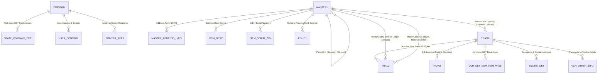

# ARTHA - Project Source Code Bundle

> Generated on: **2026-10-30 17:46:48**
> Total Files: **160** | Total Lines: **93,664** | Total Size: **3.98 MB**

## Table of Contents

1. [.gitattributes](#gitattributes) (16 lines)
2. [.gitignore](#gitignore) (55 lines)
3. [.stackblitzrc.json](#stackblitzrc-json) (8 lines)
4. [backend.log](#backend-log) (5 lines)
5. [eslint.config.js](#eslint-config-js) (35 lines)
6. [frontend.log](#frontend-log) (7 lines)
7. [import-busywin.bat](#import-busywin-bat) (26 lines)
8. [index.html](#index-html) (477 lines)
9. [install.bat](#install-bat) (5 lines)
10. [install.ps1](#install-ps1) (120 lines)
11. [LICENSE](#license) (22 lines)
12. [package.json](#package-json) (134 lines)
13. [README.md](#readme-md) (866 lines)
14. [SECURITY.md](#security-md) (107 lines)
15. [server.js](#server-js) (2157 lines)
16. [setup.bat](#setup-bat) (70 lines)
17. [supporters.json](#supporters-json) (13 lines)
18. [Uninstall.bat](#uninstall-bat) (41 lines)
19. [vite.config.js](#vite-config-js) (293 lines)
20. [docs-site/assets/docs.js](#docs-site-assets-docs-js) (170 lines)
21. [docs-site/assets/img/icon.svg](#docs-site-assets-img-icon-svg) (8 lines)
22. [docs-site/assets/style.css](#docs-site-assets-style-css) (314 lines)
23. [docs-site/build.mjs](#docs-site-build-mjs) (386 lines)
24. [docs-site/pages/about.mjs](#docs-site-pages-about-mjs) (90 lines)
25. [docs-site/pages/daily.mjs](#docs-site-pages-daily-mjs) (506 lines)
26. [docs-site/pages/help.mjs](#docs-site-pages-help-mjs) (288 lines)
27. [docs-site/pages/invoice.mjs](#docs-site-pages-invoice-mjs) (577 lines)
28. [docs-site/pages/money.mjs](#docs-site-pages-money-mjs) (328 lines)
29. [docs-site/pages/print.mjs](#docs-site-pages-print-mjs) (238 lines)
30. [docs-site/pages/setup.mjs](#docs-site-pages-setup-mjs) (299 lines)
31. [docs-site/pages/start.mjs](#docs-site-pages-start-mjs) (276 lines)
32. [docs-site/site.mjs](#docs-site-site-mjs) (57 lines)
33. [docs/AUDIT_2026-04-30.md](#docs-audit-2026-04-30-md) (272 lines)
34. [docs/AUDIT_2026-10-22.md](#docs-audit-2026-10-22-md) (178 lines)
35. [docs/BUSYWIN_DATABASE_SCHEMA.md](#docs-busywin-database-schema-md) (478 lines)
36. [docs/busywin_schemas/01_COMPANY_DATABASE_db_bds.md](#docs-busywin-schemas-01-company-database-db-bds-md) (1647 lines)
37. [docs/busywin_schemas/02_FY_MASTERS_AND_ACCOUNTS.md](#docs-busywin-schemas-02-fy-masters-and-accounts-md) (830 lines)
38. [docs/busywin_schemas/03_FY_TRANSACTIONS_AND_VOUCHERS.md](#docs-busywin-schemas-03-fy-transactions-and-vouchers-md) (1021 lines)
39. [docs/busywin_schemas/04_FY_GST_AND_STATUTORY.md](#docs-busywin-schemas-04-fy-gst-and-statutory-md) (1102 lines)
40. [docs/busywin_schemas/05_FY_SYSTEM_AND_CONFIGURATION.md](#docs-busywin-schemas-05-fy-system-and-configuration-md) (835 lines)
41. [docs/COMPETITOR_GAPS.md](#docs-competitor-gaps-md) (131 lines)
42. [docs/DEPLOY_ONLINE.md](#docs-deploy-online-md) (349 lines)
43. [docs/KNOWN_ERRORS.md](#docs-known-errors-md) (1717 lines)
44. [docs/README.md](#docs-readme-md) (19 lines)
45. [docs/RELEASE_CHECKLIST.md](#docs-release-checklist-md) (137 lines)
46. [docs/superpowers/specs/2026-04-30-multi-account-payments-design.md](#docs-superpowers-specs-2026-04-30-multi-account-payments-design-md) (214 lines)
47. [docs/TAX_HELPER_PLAN.md](#docs-tax-helper-plan-md) (147 lines)
48. [docs/USER_GUIDE.md](#docs-user-guide-md) (456 lines)
49. [installer/App.xaml](#installer-app-xaml) (18 lines)
50. [installer/App.xaml.cs](#installer-app-xaml-cs) (9 lines)
51. [installer/ARTHA.Installer.csproj](#installer-artha-installer-csproj) (29 lines)
52. [installer/InstallerEngine.cs](#installer-installerengine-cs) (234 lines)
53. [installer/MainWindow.xaml](#installer-mainwindow-xaml) (120 lines)
54. [installer/MainWindow.xaml.cs](#installer-mainwindow-xaml-cs) (120 lines)
55. [launcher/App.xaml](#launcher-app-xaml) (22 lines)
56. [launcher/App.xaml.cs](#launcher-app-xaml-cs) (53 lines)
57. [launcher/ARTHA.Launcher.csproj](#launcher-artha-launcher-csproj) (30 lines)
58. [launcher/Converters.cs](#launcher-converters-cs) (27 lines)
59. [launcher/JobManager.cs](#launcher-jobmanager-cs) (119 lines)
60. [launcher/LogItem.cs](#launcher-logitem-cs) (68 lines)
61. [launcher/MainWindow.xaml](#launcher-mainwindow-xaml) (258 lines)
62. [launcher/MainWindow.xaml.cs](#launcher-mainwindow-xaml-cs) (376 lines)
63. [launcher/ServerManager.cs](#launcher-servermanager-cs) (448 lines)
64. [public/favicon.svg](#public-favicon-svg) (8 lines)
65. [public/manifest.webmanifest](#public-manifest-webmanifest) (1 lines)
66. [release-templates/_system-scripts/backup-unix.sh](#release-templates-system-scripts-backup-unix-sh) (30 lines)
67. [release-templates/_system-scripts/backup-windows.ps1](#release-templates-system-scripts-backup-windows-ps1) (39 lines)
68. [release-templates/_system-scripts/install-unix.sh](#release-templates-system-scripts-install-unix-sh) (19 lines)
69. [release-templates/_system-scripts/install-windows.ps1](#release-templates-system-scripts-install-windows-ps1) (231 lines)
70. [release-templates/_system-scripts/move-windows.ps1](#release-templates-system-scripts-move-windows-ps1) (43 lines)
71. [release-templates/_system-scripts/restore-windows.ps1](#release-templates-system-scripts-restore-windows-ps1) (46 lines)
72. [release-templates/_system-scripts/start-unix.sh](#release-templates-system-scripts-start-unix-sh) (50 lines)
73. [release-templates/_system-scripts/start-windows.ps1](#release-templates-system-scripts-start-windows-ps1) (196 lines)
74. [release-templates/_system-scripts/stop-windows.ps1](#release-templates-system-scripts-stop-windows-ps1) (31 lines)
75. [release-templates/_system-scripts/update-unix.sh](#release-templates-system-scripts-update-unix-sh) (273 lines)
76. [release-templates/_system-scripts/update-windows.ps1](#release-templates-system-scripts-update-windows-ps1) (140 lines)
77. [release-templates/Free GST Billing - LINUX.sh](#release-templates-free-gst-billing-linux-sh) (59 lines)
78. [release-templates/Free GST Billing - MAC.command](#release-templates-free-gst-billing-mac-command) (67 lines)
79. [release-templates/Free GST Billing - WINDOWS.hta](#release-templates-free-gst-billing-windows-hta) (600 lines)
80. [release-templates/READ ME FIRST.txt](#release-templates-read-me-first-txt) (146 lines)
81. [scripts/build-release-zip.mjs](#scripts-build-release-zip-mjs) (353 lines)
82. [scripts/bundle-tesseract-assets.mjs](#scripts-bundle-tesseract-assets-mjs) (150 lines)
83. [scripts/busywin_db_schema.json](#scripts-busywin-db-schema-json) (29720 lines)
84. [scripts/csv-test.mjs](#scripts-csv-test-mjs) (115 lines)
85. [scripts/discount-modes-test.mjs](#scripts-discount-modes-test-mjs) (69 lines)
86. [scripts/extract_busywin_schema.py](#scripts-extract-busywin-schema-py) (161 lines)
87. [scripts/generate_busywin_docs.py](#scripts-generate-busywin-docs-py) (351 lines)
88. [scripts/generate_master_doc.py](#scripts-generate-master-doc-py) (503 lines)
89. [scripts/generate-artha-md.mjs](#scripts-generate-artha-md-mjs) (177 lines)
90. [scripts/generate-icons.mjs](#scripts-generate-icons-mjs) (176 lines)
91. [scripts/import-busywin.py](#scripts-import-busywin-py) (505 lines)
92. [scripts/inspect_fy_tables.py](#scripts-inspect-fy-tables-py) (12 lines)
93. [scripts/inspect_key_tables.py](#scripts-inspect-key-tables-py) (24 lines)
94. [scripts/inspect_tables.py](#scripts-inspect-tables-py) (55 lines)
95. [scripts/inspect_vchtypes.py](#scripts-inspect-vchtypes-py) (16 lines)
96. [scripts/tax-test.mjs](#scripts-tax-test-mjs) (1038 lines)
97. [scripts/test-update-unix.mjs](#scripts-test-update-unix-mjs) (239 lines)
98. [scripts/verify-release.mjs](#scripts-verify-release-mjs) (190 lines)
99. [src/App.jsx](#src-app-jsx) (1290 lines)
100. [src/components/ActionsMenu.jsx](#src-components-actionsmenu-jsx) (88 lines)
101. [src/components/AppFooter.jsx](#src-components-appfooter-jsx) (40 lines)
102. [src/components/AppLock.jsx](#src-components-applock-jsx) (104 lines)
103. [src/components/AppLockSettings.jsx](#src-components-applocksettings-jsx) (96 lines)
104. [src/components/BillOCR.jsx](#src-components-billocr-jsx) (655 lines)
105. [src/components/BulkCsvImport.jsx](#src-components-bulkcsvimport-jsx) (199 lines)
106. [src/components/ClientModal.jsx](#src-components-clientmodal-jsx) (203 lines)
107. [src/components/ClientsView.jsx](#src-components-clientsview-jsx) (1014 lines)
108. [src/components/ConfirmModal.jsx](#src-components-confirmmodal-jsx) (210 lines)
109. [src/components/ControlPanel.jsx](#src-components-controlpanel-jsx) (259 lines)
110. [src/components/Dashboard.jsx](#src-components-dashboard-jsx) (1898 lines)
111. [src/components/ExpenseTracker.jsx](#src-components-expensetracker-jsx) (466 lines)
112. [src/components/GSTReturns.jsx](#src-components-gstreturns-jsx) (2466 lines)
113. [src/components/HelpButton.jsx](#src-components-helpbutton-jsx) (62 lines)
114. [src/components/IncomeTax.jsx](#src-components-incometax-jsx) (1177 lines)
115. [src/components/InventoryView.jsx](#src-components-inventoryview-jsx) (398 lines)
116. [src/components/InvoiceGenerator.jsx](#src-components-invoicegenerator-jsx) (4712 lines)
117. [src/components/InvoiceGridLayout.jsx](#src-components-invoicegridlayout-jsx) (543 lines)
118. [src/components/InvoiceNumberSettings.jsx](#src-components-invoicenumbersettings-jsx) (325 lines)
119. [src/components/InvoicePreview.jsx](#src-components-invoicepreview-jsx) (1562 lines)
120. [src/components/LockButton.jsx](#src-components-lockbutton-jsx) (25 lines)
121. [src/components/PageHeader.jsx](#src-components-pageheader-jsx) (73 lines)
122. [src/components/PartyOutstandingReport.jsx](#src-components-partyoutstandingreport-jsx) (97 lines)
123. [src/components/PrintPreviewModal.jsx](#src-components-printpreviewmodal-jsx) (215 lines)
124. [src/components/PrintSettings.jsx](#src-components-printsettings-jsx) (1615 lines)
125. [src/components/ProductBulkEdit.jsx](#src-components-productbulkedit-jsx) (102 lines)
126. [src/components/PurchaseBills.jsx](#src-components-purchasebills-jsx) (1280 lines)
127. [src/components/ReceiptVoucher.jsx](#src-components-receiptvoucher-jsx) (500 lines)
128. [src/components/RecurringInvoices.jsx](#src-components-recurringinvoices-jsx) (443 lines)
129. [src/components/ReportsView.jsx](#src-components-reportsview-jsx) (726 lines)
130. [src/components/SettingsView.jsx](#src-components-settingsview-jsx) (2142 lines)
131. [src/components/SetupWizard.jsx](#src-components-setupwizard-jsx) (256 lines)
132. [src/components/StarBanner.jsx](#src-components-starbanner-jsx) (63 lines)
133. [src/components/StockReport.jsx](#src-components-stockreport-jsx) (106 lines)
134. [src/components/SupportNudge.jsx](#src-components-supportnudge-jsx) (69 lines)
135. [src/components/SupportView.jsx](#src-components-supportview-jsx) (207 lines)
136. [src/components/TableExport.jsx](#src-components-tableexport-jsx) (63 lines)
137. [src/components/Toast.jsx](#src-components-toast-jsx) (77 lines)
138. [src/components/UnassignedBanner.jsx](#src-components-unassignedbanner-jsx) (76 lines)
139. [src/components/useSupporters.js](#src-components-usesupporters-js) (29 lines)
140. [src/components/WelcomeGuide.jsx](#src-components-welcomeguide-jsx) (509 lines)
141. [src/config/brand.js](#src-config-brand-js) (17 lines)
142. [src/index.css](#src-index-css) (3506 lines)
143. [src/index.html](#src-index-html) (154 lines)
144. [src/main.jsx](#src-main-jsx) (146 lines)
145. [src/services/googleDrive.js](#src-services-googledrive-js) (219 lines)
146. [src/store.js](#src-store-js) (550 lines)
147. [src/utils.js](#src-utils-js) (2483 lines)
148. [src/utils/appLock.js](#src-utils-applock-js) (15 lines)
149. [src/utils/bulkCsv.js](#src-utils-bulkcsv-js) (409 lines)
150. [src/utils/clientCredit.js](#src-utils-clientcredit-js) (135 lines)
151. [src/utils/hsnRates.js](#src-utils-hsnrates-js) (168 lines)
152. [src/utils/itr.js](#src-utils-itr-js) (1342 lines)
153. [src/utils/partyOutstanding.js](#src-utils-partyoutstanding-js) (54 lines)
154. [src/utils/prefsMirror.js](#src-utils-prefsmirror-js) (78 lines)
155. [src/utils/printSettings.js](#src-utils-printsettings-js) (571 lines)
156. [src/utils/products.js](#src-utils-products-js) (67 lines)
157. [src/utils/share.js](#src-utils-share-js) (43 lines)
158. [src/utils/supporters.js](#src-utils-supporters-js) (56 lines)
159. [src/utils/xlsx.js](#src-utils-xlsx-js) (76 lines)
160. [tests/smoke.mjs](#tests-smoke-mjs) (1844 lines)

---

<a id="gitattributes"></a>
## `.gitattributes`

- Path: `.gitattributes`
- Lines: 16 | Size: 0.5 KB

```
# Shell / macOS launchers MUST have LF endings, otherwise they fail
# with "bad interpreter: /usr/bin/env^M" on macOS and Linux when
# extracted from a Windows-created ZIP.
*.sh          text eol=lf
*.command     text eol=lf
*.bash        text eol=lf

# PowerShell scripts and .bat files can be either but Windows tools
# prefer CRLF — keep them Windows-native.
*.ps1         text eol=crlf
*.bat         text eol=crlf
*.cmd         text eol=crlf

# HTA runs via mshta.exe on Windows — CRLF is fine.
*.hta         text eol=crlf

```

---

<a id="gitignore"></a>
## `.gitignore`

- Path: `.gitignore`
- Lines: 55 | Size: 1.0 KB

```
# Logs
logs
*.log
npm-debug.log*
yarn-debug.log*
yarn-error.log*
pnpm-debug.log*
lerna-debug.log*

node_modules
dist
dist-ssr
release-build
*.local

# Invoice data (personal/financial - keep local only)
data/
Saved Invoices/
Trash/

# AI assistant context
.claude/

# v1.10.33 — Tesseract assets are regenerated by
# scripts/bundle-tesseract-assets.mjs on every install/build. Keeping
# them out of the repo avoids a ~22MB blob and lets tesseract version
# bumps in package.json flow through cleanly.
public/tesseract/

# Editor directories and files
.vscode/*
!.vscode/extensions.json
.idea
.DS_Store
*.suo
*.ntvs*
*.njsproj
*.sln
*.sw?

# Session scratch from other agent tooling — not part of the project
.zcode

# Built documentation site (regenerate with: node docs-site/build.mjs)
docs-site/out/

# Launcher and Installer build artifacts
publish-launcher/
publish-installer/
launcher/bin/
launcher/obj/
installer/bin/
installer/obj/
*.exe

```

---

<a id="stackblitzrc-json"></a>
## `.stackblitzrc.json`

- Path: `.stackblitzrc.json`
- Lines: 8 | Size: 0.1 KB

```json
{
  "installDependencies": true,
  "startCommand": "npm start",
  "env": {
    "ENABLE_CJS_IMPORTS": true
  }
}

```

---

<a id="backend-log"></a>
## `backend.log`

- Path: `backend.log`
- Lines: 5 | Size: 0.1 KB

```

  Free GST Billing Software running at http://localhost:11001
  Data stored in: D:\VEGA\ARTHA\data


```

---

<a id="eslint-config-js"></a>
## `eslint.config.js`

- Path: `eslint.config.js`
- Lines: 35 | Size: 1.0 KB

```javascript
import js from '@eslint/js'
import globals from 'globals'
import reactHooks from 'eslint-plugin-react-hooks'
import reactRefresh from 'eslint-plugin-react-refresh'
import { defineConfig, globalIgnores } from 'eslint/config'

export default defineConfig([
  globalIgnores(['dist']),
  {
    files: ['**/*.{js,jsx}'],
    extends: [
      js.configs.recommended,
      reactHooks.configs.flat.recommended,
      reactRefresh.configs.vite,
    ],
    languageOptions: {
      ecmaVersion: 2020,
      globals: globals.browser,
      parserOptions: {
        ecmaVersion: 'latest',
        ecmaFeatures: { jsx: true },
        sourceType: 'module',
      },
    },
    rules: {
      'no-unused-vars': ['error', { varsIgnorePattern: '^[A-Z_]' }],
    },
  },
  // The server and the build / test scripts run in Node, not the browser.
  {
    files: ['server.js', 'scripts/**/*.{js,mjs}', 'tests/**/*.{js,mjs}', 'docs-site/*.mjs', 'docs-site/pages/*.mjs'],
    languageOptions: { globals: { ...globals.node } },
  },
])

```

---

<a id="frontend-log"></a>
## `frontend.log`

- Path: `frontend.log`
- Lines: 7 | Size: 0.3 KB

```

  VITE v7.3.7  ready in 560 ms

  ➜  Local:   http://localhost:11002/
  ➜  Network: use --host to expose
  ➜  press h + enter to show help

```

---

<a id="import-busywin-bat"></a>
## `import-busywin.bat`

- Path: `import-busywin.bat`
- Lines: 26 | Size: 0.5 KB

```batch
@echo off
setlocal
cd /d "%~dp0"
title ARTHA - BusyWin Data Importer

echo ========================================================
echo   ARTHA Accounting Software - BusyWin Data Importer
echo ========================================================
echo.
echo Source: C:\BusyWin\DATA\COMP0001
echo Target: %~dp0data
echo.

where python >nul 2>&1
if %ERRORLEVEL% NEQ 0 (
    echo [ERROR] Python is required to run the BusyWin importer.
    pause
    exit /b 1
)

python "%~dp0scripts\import-busywin.py" %*

echo.
pause


```

---

<a id="index-html"></a>
## `index.html`

- Path: `index.html`
- Lines: 477 | Size: 17.8 KB

```html
<!DOCTYPE html>
<html lang="en">
<head>
  <meta charset="UTF-8">
  <meta name="viewport" content="width=device-width, initial-scale=1.0">
  <title>Free GST Billing Software - Control Panel</title>
  <link rel="icon" type="image/svg+xml" href="public/favicon.svg">
  <style>
    * { box-sizing: border-box; }
    body {
      margin: 0;
      min-height: 100vh;
      font-family: -apple-system, BlinkMacSystemFont, "Segoe UI", Roboto, Arial, sans-serif;
      background: #eef2f7;
      color: #0f172a;
      padding: 2.5rem 1rem;
      display: flex;
      align-items: flex-start;
      justify-content: center;
    }
    .wrap { width: 100%; max-width: 640px; }
    header { text-align: center; margin-bottom: 1.5rem; }
    header h1 {
      font-size: 1.6rem;
      font-weight: 700;
      margin: 0 0 0.25rem;
      color: #1e40af;
    }
    header p { margin: 0; font-size: 0.88rem; color: #64748b; }

    .card {
      background: #ffffff;
      border: 1px solid #e2e8f0;
      border-radius: 12px;
      padding: 1.5rem;
      box-shadow: 0 2px 12px rgba(15, 23, 42, 0.06);
      margin-bottom: 1rem;
    }

    .status {
      display: flex;
      align-items: center;
      gap: 0.75rem;
      padding: 0.95rem 1.1rem;
      border-radius: 10px;
      margin-bottom: 1rem;
      border: 1px solid #e2e8f0;
      background: #f8fafc;
    }
    .status strong { font-size: 1rem; display: block; }
    .status small { font-size: 0.78rem; opacity: 0.85; display: block; margin-top: 2px; }
    .status.running { background: #ecfdf5; color: #047857; border-color: #6ee7b7; }
    .status.stopped { background: #fef2f2; color: #b91c1c; border-color: #fca5a5; }
    .status.checking { background: #fffbeb; color: #b45309; border-color: #fde68a; }

    .status-dot {
      width: 12px;
      height: 12px;
      border-radius: 50%;
      background: currentColor;
      flex-shrink: 0;
    }

    .actions { display: grid; gap: 0.6rem; grid-template-columns: 1fr; }
    @media (min-width: 480px) {
      .actions { grid-template-columns: 1fr 1fr; }
      .btn-primary-full { grid-column: 1 / -1; }
    }

    .btn {
      display: flex;
      align-items: center;
      justify-content: center;
      gap: 0.5rem;
      padding: 0.85rem 1rem;
      border: 1px solid #e2e8f0;
      border-radius: 10px;
      font-size: 0.92rem;
      font-weight: 600;
      cursor: pointer;
      text-decoration: none;
      color: #0f172a;
      background: #ffffff;
    }
    .btn:hover { background: #f1f5f9; }
    .btn[aria-disabled="true"] {
      opacity: 0.45;
      cursor: not-allowed;
      pointer-events: none;
    }
    .btn-primary {
      background: #1e40af;
      color: #ffffff;
      border-color: #1e40af;
    }
    .btn-primary:hover { background: #1e3a8a; }
    .btn-danger { color: #b91c1c; border-color: #fecaca; }
    .btn-danger:hover { background: #fef2f2; }

    .info-grid {
      display: grid;
      grid-template-columns: 130px 1fr;
      gap: 0.5rem 1rem;
      font-size: 0.85rem;
      margin: 0;
    }
    .info-grid dt { color: #64748b; font-weight: 500; }
    .info-grid dd {
      margin: 0;
      color: #0f172a;
      font-family: "Consolas", "Menlo", monospace;
      font-size: 0.82rem;
      word-break: break-all;
    }

    details { margin-top: 0.85rem; border-top: 1px solid #e2e8f0; padding-top: 0.5rem; }
    details summary {
      cursor: pointer;
      padding: 0.4rem 0;
      font-size: 0.85rem;
      font-weight: 600;
      color: #475569;
    }
    details summary:hover { color: #0f172a; }
    details .help {
      font-size: 0.82rem;
      color: #475569;
      line-height: 1.55;
      padding: 0.4rem 0;
    }
    details ol { margin: 0.5rem 0 0.5rem 1.2rem; padding: 0; }
    details code {
      background: #f1f5f9;
      padding: 1px 6px;
      border-radius: 4px;
      font-size: 0.85em;
    }

    footer {
      text-align: center;
      font-size: 0.75rem;
      color: #64748b;
      margin-top: 1.25rem;
    }
    footer a { color: #1e40af; text-decoration: none; }

    .nojs-warning {
      background: #fef2f2;
      border: 1px solid #fca5a5;
      color: #991b1b;
      padding: 0.75rem 1rem;
      border-radius: 8px;
      margin-bottom: 1rem;
      font-size: 0.85rem;
    }
  </style>
</head>
<body>
  <div class="wrap">
    <header>
      <h1>Free GST Billing Software</h1>
      <p>Control Panel - start, stop, and open your local billing app</p>
    </header>

    <noscript>
      <div class="card">
        <div class="nojs-warning">
          <strong>JavaScript is disabled in your browser.</strong>
          This control panel needs JavaScript to check server status. Either enable it,
          or open the file <code>Start FreeGSTBill.bat</code> in the install folder
          and then go to <a href="http://localhost:11001/">http://localhost:11001/</a>
          in your browser.
        </div>
      </div>
    </noscript>

    <div class="card">
      <div id="status" class="status checking">
        <div class="status-dot"></div>
        <div>
          <strong id="status-text">Checking server&hellip;</strong>
          <small id="status-detail">Probing localhost on the configured port range.</small>
        </div>
      </div>

      <div class="actions">
        <a id="open-app" class="btn btn-primary btn-primary-full" href="#" target="_blank" rel="noopener" aria-disabled="true">
          Open Billing App
        </a>
        <a id="start-btn" class="btn" href="freegstbill://run">
          Start Server
        </a>
        <a id="stop-btn" class="btn btn-danger" href="freegstbill-stop://run" aria-disabled="true">
          Stop Server
        </a>
      </div>
    </div>

    <div class="card">
      <dl class="info-grid">
        <dt>Status</dt>       <dd id="info-status">-</dd>
        <dt>Port</dt>         <dd id="info-port">-</dd>
        <dt>Version</dt>      <dd id="info-version">-</dd>
        <dt>App URL</dt>      <dd id="info-url">-</dd>
        <dt>Last checked</dt> <dd id="info-checked">-</dd>
      </dl>

      <details>
        <summary>Server won't start? Click here for help</summary>
        <div class="help">
          <p>Try these in order:</p>
          <ol>
            <li>Click <strong>Start Server</strong> above. Your browser may ask to allow <code>freegstbill://</code> - click Allow.</li>
            <li>If nothing happens after 30 seconds, open the install folder and double-click <code>Start FreeGSTBill.bat</code> directly. A small black window should appear briefly.</li>
            <li>If you see "Node.js is not installed", run <code>Install FreeGSTBill.bat</code> first.</li>
            <li>If the port is busy, open <code>data\port.txt</code> in Notepad to see which port the app picked, or delete that file and restart to let the server pick a fresh one.</li>
            <li>Still stuck? Email <a href="mailto:Contact@dicecodes.com">Contact@dicecodes.com</a> or open a <a href="https://github.com/Kvijay199428/Artha/issues" target="_blank" rel="noopener">GitHub issue</a>.</li>
          </ol>
          <p><strong>Tip:</strong> Press <kbd>F12</kbd> to open browser developer tools and check the Console tab for any errors. Share what you see if you ask for support.</p>
        </div>
      </details>
    </div>

    <footer>
      Free GST Billing Software &middot; MIT Licensed &middot;
      <a href="https://github.com/Kvijay199428/Artha" target="_blank" rel="noopener">GitHub</a> &middot;
      made by <a href="https://dicecodes.com" target="_blank" rel="noopener">DiceCodes</a>
    </footer>
  </div>

  <script>
    // Wrap everything in try/catch so a single browser quirk doesn't blank
    // the panel. Errors get logged to console and shown on-page.
    (function () {
      'use strict';

      // v1.9.6 — Polling redesigned to eliminate console spam.
      //
      // BEFORE: every 2 seconds we scanned 50 ports (47371-47420) in
      // parallel looking for the server. When the server was down, that
      // meant ~25 failed fetches per second flooding DevTools console
      // with net::ERR_CONNECTION_REFUSED for every port + hitting the
      // OS's TCP stack constantly. User's screenshot showed dozens of
      // errors per few seconds.
      //
      // AFTER:
      //   - On startup: try cached port. If it fails, do ONE full scan.
      //     After that, we remember whichever port worked (or `null` if
      //     none did).
      //   - Regular polls (every 2s): only ping the KNOWN port. No scans.
      //   - If server transitions to stopped: exponential backoff
      //     (2s → 5s → 15s → stopped). No more auto-polling.
      //   - "Retry now" button appears in stopped state → resets backoff,
      //     does a fresh scan.
      //
      // Net result when server is down: ~1 request every 15s max, not
      // 25 per second.
      var DEFAULT_PORT = 11001;
      var SCAN_RANGE = 50;
      var activePort = DEFAULT_PORT;
      var pollTimer = null;
      var didInitialScan = false;
      var consecutiveFailures = 0;
      var currentInterval = 2000; // ms; grows on failure, resets on success

      try {
        var cached = window.sessionStorage && sessionStorage.getItem('fgsb_port');
        if (cached) {
          var n = parseInt(cached, 10);
          if (n >= 1024 && n <= 65535) activePort = n;
        }
      } catch (e) { /* sessionStorage blocked - ignore */ }

      function $(id) { return document.getElementById(id); }

      function pingPort(port) {
        return new Promise(function (resolve) {
          try {
            var c = new AbortController();
            var t = setTimeout(function () { c.abort(); }, 800);
            fetch('http://localhost:' + port + '/api/version', { signal: c.signal })
              .then(function (r) {
                clearTimeout(t);
                if (!r.ok) { resolve(null); return; }
                return r.json();
              })
              .then(function (data) {
                if (!data) return;
                resolve({ port: port, version: data.current });
              })
              .catch(function () { resolve(null); });
          } catch (e) { resolve(null); }
        });
      }

      // Full scan of the port range — used ONLY on first mount + when
      // user explicitly clicks "Retry now". Never on regular polls.
      function fullScan() {
        var probes = [];
        for (var p = DEFAULT_PORT; p < DEFAULT_PORT + SCAN_RANGE; p++) {
          probes.push(pingPort(p));
        }
        return Promise.all(probes).then(function (results) {
          for (var i = 0; i < results.length; i++) { if (results[i]) return results[i]; }
          return null;
        });
      }

      // Regular poll: only pings the KNOWN cached port. No scan.
      // Returns the hit object (with port + version) or null.
      function findRunningPort() {
        // On first check, run the initial scan so we find the server even
        // if the cached port is stale. After that, only ping the known
        // port. User can force a re-scan via the "Retry now" button.
        if (!didInitialScan) {
          didInitialScan = true;
          return pingPort(activePort).then(function (hit) {
            if (hit) return hit;
            return fullScan();
          });
        }
        // Regular tick — only ping the cached port. If it fails, we back
        // off in checkServer(). No console spam.
        return pingPort(activePort);
      }

      function setStatus(state, message, detail) {
        var el = $('status');
        if (el) el.className = 'status ' + state;
        var t = $('status-text'); if (t) t.textContent = message;
        var d = $('status-detail'); if (d) d.textContent = detail;
      }

      function setButtons(running, port) {
        var open = $('open-app');
        var stop = $('stop-btn');
        if (running) {
          if (open) { open.href = 'http://localhost:' + port + '/'; open.removeAttribute('aria-disabled'); }
          if (stop) { stop.removeAttribute('aria-disabled'); }
        } else {
          if (open) { open.href = '#'; open.setAttribute('aria-disabled', 'true'); }
          if (stop) { stop.setAttribute('aria-disabled', 'true'); }
        }
      }

      function setInfo(running, port, version) {
        var s = $('info-status'); if (s) s.textContent = running ? 'Running' : 'Stopped';
        var p = $('info-port'); if (p) p.textContent = running ? port : '-';
        var v = $('info-version'); if (v) v.textContent = version || '-';
        var u = $('info-url'); if (u) u.textContent = running ? ('http://localhost:' + port + '/') : '-';
        var c = $('info-checked'); if (c) c.textContent = new Date().toLocaleTimeString();
      }

      function schedulePoll() {
        if (pollTimer) clearTimeout(pollTimer);
        pollTimer = setTimeout(checkServer, currentInterval);
      }

      function checkServer() {
        return findRunningPort().then(function (hit) {
          if (hit) {
            activePort = hit.port;
            try { sessionStorage.setItem('fgsb_port', String(hit.port)); } catch (e) {}
            // Success — reset backoff, poll every 2s
            consecutiveFailures = 0;
            currentInterval = 2000;
            setStatus('running', 'Server is running on port ' + hit.port, 'Click "Open Billing App" to launch in a new tab.');
            setButtons(true, hit.port);
            setInfo(true, hit.port, hit.version);
            schedulePoll();
          } else {
            // Failure — increment counter, back off exponentially, and
            // eventually stop auto-polling. User then uses "Retry now".
            consecutiveFailures += 1;
            var detailMsg = 'Click "Start Server" — your browser may ask to allow freegstbill://. Click Allow.';
            if (consecutiveFailures === 1) currentInterval = 5000;
            else if (consecutiveFailures === 2) currentInterval = 15000;
            else if (consecutiveFailures >= 3) {
              currentInterval = 0; // stop
              detailMsg = 'Auto-check paused after 3 failures. Click "Retry now" to check again.';
            }
            setStatus('stopped', 'Server is not running', detailMsg);
            setButtons(false);
            setInfo(false);
            showRetryButton(currentInterval === 0);
            if (currentInterval > 0) schedulePoll();
          }
        }).catch(function (e) {
          setStatus('stopped', 'Error checking server', 'Open browser DevTools (F12) Console for details.');
          if (window.console && console.error) console.error('Launcher status check failed:', e);
          currentInterval = 0;
          showRetryButton(true);
        });
      }

      // Retry button injected below the status pill when polling has
      // stopped due to repeated failures. Clicking it does a full scan
      // and resets the backoff so regular polling resumes on success.
      function showRetryButton(visible) {
        var existing = $('retry-btn');
        if (!visible) {
          if (existing) existing.style.display = 'none';
          return;
        }
        if (existing) { existing.style.display = ''; return; }
        var btn = document.createElement('button');
        btn.id = 'retry-btn';
        btn.className = 'btn';
        btn.style.cssText = 'margin-top:10px;font-size:0.85rem;padding:6px 12px;';
        btn.textContent = '↻ Retry now';
        btn.addEventListener('click', function () {
          didInitialScan = false; // force a full scan
          consecutiveFailures = 0;
          currentInterval = 2000;
          btn.style.display = 'none';
          checkServer();
        });
        var status = $('status');
        if (status && status.parentNode) status.parentNode.insertBefore(btn, status.nextSibling);
      }

      function startPolling() {
        consecutiveFailures = 0;
        currentInterval = 2000;
        checkServer();
      }
      function stopPolling() {
        if (pollTimer) { clearTimeout(pollTimer); pollTimer = null; }
      }

      // Pause polls when tab is backgrounded (saves CPU).
      try {
        document.addEventListener('visibilitychange', function () {
          if (document.hidden) stopPolling(); else startPolling();
        });
      } catch (e) {}

      // Burst-poll after Start/Stop clicks so status updates within a
      // second. Uses ONLY the known port (not scan) — the user's action
      // triggered this, so we know we're looking for the same server.
      // After the burst, regular polling resumes at 2s.
      function burst(durationMs) {
        var start = Date.now();
        // Reset the backoff so the burst polls at fast interval + the
        // subsequent regular polling doesn't inherit any prior failure count.
        consecutiveFailures = 0;
        currentInterval = 2000;
        // Force a fresh scan on Start click since the server may come up
        // on a different port than the cached one.
        didInitialScan = false;
        var burstTimer = setInterval(function () {
          checkServer();
          if (Date.now() - start > durationMs) clearInterval(burstTimer);
        }, 1000);
      }

      var startBtn = $('start-btn');
      if (startBtn) {
        startBtn.addEventListener('click', function () {
          setStatus('checking', 'Starting server...', 'This usually takes 5-15 seconds.');
          burst(30000);
        });
      }
      var stopBtn = $('stop-btn');
      if (stopBtn) {
        stopBtn.addEventListener('click', function () {
          setStatus('checking', 'Stopping server...', 'Releasing the port.');
          burst(15000);
        });
      }

      startPolling();
    })();
  </script>
</body>
</html>

```

---

<a id="install-bat"></a>
## `install.bat`

- Path: `install.bat`
- Lines: 5 | Size: 0.0 KB

```batch
@echo off
cd /d "%~dp0"
call "%~dp0setup.bat" %*


```

---

<a id="install-ps1"></a>
## `install.ps1`

- Path: `install.ps1`
- Lines: 120 | Size: 6.0 KB

```powershell
# ARTHA - one-command Windows installer.
#
#   irm https://raw.githubusercontent.com/Kvijay199428/Artha/main/install.ps1 | iex
#
# Does what a user doing it by hand would do: download the latest release
# ZIP, extract it, run the installer inside it. Nothing else. There is no
# elevation, no registry writing and no service - the app installs under
# the user's own profile.
#
# It runs through `iex`, so it cannot take -Parameters. Point it somewhere
# else with an environment variable instead:
#
#   $env:ARTHA_DIR = 'D:\Apps\ARTHA'
#
# Keep this file pure ASCII: it is fetched and parsed by Windows
# PowerShell 5.1, which mangles UTF-8 without a BOM (see ERR-001).

$ErrorActionPreference = 'Stop'

$Repo = 'Kvijay199428/Artha'
$Dest = if ($env:ARTHA_DIR) { $env:ARTHA_DIR } else { $env:FREEGSTBILL_DIR }
if (-not $Dest) { $Dest = Join-Path $env:LOCALAPPDATA 'Programs\ARTHA' }

Write-Host ''
Write-Host '  ============================================================'
Write-Host '   ARTHA Accounting Software - one-command install'
Write-Host '  ============================================================'
Write-Host ''

# PowerShell 5.1 still defaults to TLS 1.0, which github.com refuses.
[Net.ServicePointManager]::SecurityProtocol = [Net.SecurityProtocolType]::Tls12

# --- Refuse to write over books that are already there ----------------------
# Re-running this would put a fresh copy on top of a live install. The data
# folder survives that, but "the installer touched my data" is not a sentence
# anyone wants to read, so hand the job to the updater that is built for it.
$existingData = Join-Path $Dest '_system\data'
if (Test-Path $existingData) {
  $hasBooks = @(Get-ChildItem -Path $existingData -Recurse -File -ErrorAction SilentlyContinue).Count -gt 0
  if ($hasBooks) {
    Write-Host "  Free GST Billing is already installed at:" -ForegroundColor Yellow
    Write-Host "    $Dest"
    Write-Host ''
    Write-Host '  To update it, open the app and use Control Panel -> Update Now.'
    Write-Host '  That keeps your invoices, clients and settings, and backs them up first.'
    Write-Host ''
    Write-Host '  To install a second, separate copy, set a different folder and re-run:'
    Write-Host '    $env:ARTHA_DIR = ''D:\Apps\ARTHA'''
    Write-Host ''
    return
  }
}

# Installed somewhere else already (a ZIP extracted by hand, say)? The
# shortcuts point at it. Same rule as install-windows.ps1: update that copy,
# do not start a second, empty one. An explicit FREEGSTBILL_DIR skips this.
if (-not $env:ARTHA_DIR -and -not $env:FREEGSTBILL_DIR) {
  $installedAt = $null
  foreach ($dir in @([Environment]::GetFolderPath('Desktop'), [Environment]::GetFolderPath('Programs'))) {
    # One unreadable or empty shortcut must not stop the others being checked.
    try {
      $lnk = Join-Path $dir 'Free GST Billing.lnk'
      if (-not (Test-Path -LiteralPath $lnk)) { continue }
      $root = Split-Path -Parent ([string](New-Object -ComObject WScript.Shell).CreateShortcut($lnk).Arguments).Trim().Trim('"')
      if ($root -and $root.TrimEnd('\') -ne $Dest.TrimEnd('\') -and (Test-Path -LiteralPath (Join-Path $root '_system\node_modules'))) { $installedAt = $root; break }
    } catch { }
  }
  if ($installedAt) {
    Write-Host "  Free GST Billing is already installed at:" -ForegroundColor Yellow
    Write-Host "    $installedAt"
    Write-Host ''
    Write-Host '  To update it, open the app and use Control Panel -> Update Now.'
    Write-Host '  To install a second, separate copy anyway, set a folder and re-run:'
    Write-Host '    $env:ARTHA_DIR = ''D:\Apps\ARTHA'''
    Write-Host ''
    return
  }
}

# --- Step 1: find the latest release ZIP ------------------------------------
Write-Host '  Looking up the latest release...'
$release = Invoke-RestMethod -Uri "https://api.github.com/repos/$Repo/releases/latest" -Headers @{ 'User-Agent' = 'FreeGSTBill-Installer' }
$asset = $release.assets | Where-Object { $_.name -like '*.zip' } | Select-Object -First 1
if (-not $asset) { throw "The latest release ($($release.tag_name)) has no ZIP attached. Download it by hand from https://github.com/$Repo/releases/latest" }
Write-Host "  Found $($release.tag_name) - $($asset.name)"

# --- Step 2: download -------------------------------------------------------
$tmp = Join-Path $env:TEMP ("freegstbill-" + [Guid]::NewGuid().ToString('N'))
New-Item -ItemType Directory -Path $tmp -Force | Out-Null
$zip = Join-Path $tmp $asset.name
Write-Host "  Downloading $([math]::Round($asset.size / 1MB, 1)) MB..."
Invoke-WebRequest -Uri $asset.browser_download_url -OutFile $zip -UseBasicParsing

# --- Step 3: extract --------------------------------------------------------
Write-Host '  Extracting...'
$unpacked = Join-Path $tmp 'unpacked'
Expand-Archive -Path $zip -DestinationPath $unpacked -Force

# The ZIP holds a single folder (Free-GST-Billing) with the launchers and
# _system inside it. Install its CONTENTS, so the target folder is the app
# folder rather than a folder holding a folder.
$inner = Get-ChildItem -Path $unpacked -Directory | Select-Object -First 1
if (-not $inner) { throw "The release ZIP did not contain the expected folder. Extract it by hand from $zip" }

if (-not (Test-Path $Dest)) { New-Item -ItemType Directory -Path $Dest -Force | Out-Null }
Copy-Item -Path (Join-Path $inner.FullName '*') -Destination $Dest -Recurse -Force
Remove-Item $tmp -Recurse -Force -ErrorAction SilentlyContinue
Write-Host "  Installed to $Dest"

# --- Step 4: hand over to the installer that ships in the ZIP ---------------
# It installs Node.js if missing, runs npm install, and makes the Desktop and
# Start-Menu shortcuts. One copy of that logic, not two.
$installer = Join-Path $Dest '_system\install-windows.ps1'
if (-not (Test-Path $installer)) { throw "Extracted, but $installer is missing. Open $Dest and run the launcher by hand." }

Write-Host ''
Write-Host '  Running the installer (Node.js + dependencies + shortcuts)...'
Write-Host ''
& $installer

```

---

<a id="license"></a>
## `LICENSE`

- Path: `LICENSE`
- Lines: 22 | Size: 1.1 KB

```
MIT License

Copyright (c) 2026 DiceCodes (Contact@dicecodes.com)

Permission is hereby granted, free of charge, to any person obtaining a copy
of this software and associated documentation files (the "Software"), to deal
in the Software without restriction, including without limitation the rights
to use, copy, modify, merge, publish, distribute, sublicense, and/or sell
copies of the Software, and to permit persons to whom the Software is
furnished to do so, subject to the following conditions:

The above copyright notice and this permission notice shall be included in all
copies or substantial portions of the Software.

THE SOFTWARE IS PROVIDED "AS IS", WITHOUT WARRANTY OF ANY KIND, EXPRESS OR
IMPLIED, INCLUDING BUT NOT LIMITED TO THE WARRANTIES OF MERCHANTABILITY,
FITNESS FOR A PARTICULAR PURPOSE AND NONINFRINGEMENT. IN NO EVENT SHALL THE
AUTHORS OR COPYRIGHT HOLDERS BE LIABLE FOR ANY CLAIM, DAMAGES OR OTHER
LIABILITY, WHETHER IN AN ACTION OF CONTRACT, TORT OR OTHERWISE, ARISING FROM,
OUT OF OR IN CONNECTION WITH THE SOFTWARE OR THE USE OR OTHER DEALINGS IN THE
SOFTWARE.

```

---

<a id="package-json"></a>
## `package.json`

- Path: `package.json`
- Lines: 134 | Size: 4.6 KB

```json
{
  "name": "artha-accounting-software",
  "version": "1.10.80",
  "description": "ARTHA Accounting Software & billing software for India. Tax Invoice, Proforma, Credit Note, Bill of Supply, Delivery Challan, GSTR-1 / GSTR-3B JSON exports, GSTR-2B reconciliation, e-Way Bill, TDS / TCS reports (Form 26Q / 27EQ), multi-currency for 22 countries, per-line custom units, rich-text Terms with 13 India presets, granular backup with optional Google Drive sync. Offline-first PWA. By DiceCodes.",
  "author": "DiceCodes <Contact@dicecodes.com>",
  "license": "MIT",
  "repository": {
    "type": "git",
    "url": "https://github.com/Kvijay199428/Artha.git"
  },
  "keywords": [
    "gst",
    "gst-invoice",
    "gst-billing-software",
    "free-billing-software",
    "invoice-generator",
    "tax-invoice",
    "billing-software-india",
    "gst-return",
    "gstr-1",
    "gstr-3b",
    "gstr-2b",
    "gstr-2b-reconciliation",
    "gstr-1-json-export",
    "gstr-3b-json-export",
    "tds",
    "tcs",
    "form-26q",
    "form-27eq",
    "section-194q",
    "section-206c",
    "e-way-bill",
    "delivery-challan",
    "credit-note",
    "proforma-invoice",
    "bill-of-supply",
    "pdf-generator",
    "offline-billing",
    "open-source",
    "vyapar-alternative",
    "tally-alternative",
    "zoho-alternative",
    "cleartax-alternative",
    "marg-erp-alternative",
    "mybillbook-alternative",
    "hsn-code",
    "sac-code",
    "uqc",
    "cgst-sgst-igst",
    "place-of-supply",
    "sez-invoice",
    "lut-export-invoice",
    "multi-currency-invoice",
    "international-invoice-india",
    "vat-invoice",
    "upi-qr-invoice",
    "pwa",
    "offline-pwa",
    "freelancer-invoice",
    "small-business-billing",
    "multi-business-profile",
    "multi-gstin",
    "rich-text-terms",
    "india-business-templates",
    "custom-units-invoice",
    "granular-backup",
    "google-drive-backup",
    "searchable-user-guide-pdf",
    "dark-mode-billing",
    "react",
    "vite",
    "expressjs",
    "india",
    "diceCodes"
  ],
  "type": "module",
  "engines": {
    "node": ">=18.0.0"
  },
  "scripts": {
    "server": "node server.js",
    "postinstall": "node scripts/bundle-tesseract-assets.mjs",
    "prebuild": "node scripts/bundle-tesseract-assets.mjs",
    "dev": "node scripts/bundle-tesseract-assets.mjs && node server.js & vite",
    "dev:win": "node scripts/bundle-tesseract-assets.mjs && (start /b node server.js) && vite",
    "build": "vite build",
    "start": "vite build && node server.js",
    "lint": "eslint .",
    "preview": "vite preview",
    "icons": "node scripts/generate-icons.mjs",
    "bundle:tesseract": "node scripts/bundle-tesseract-assets.mjs",
    "bundle:source": "node scripts/generate-artha-md.mjs",
    "release:zip": "npm run build && node scripts/build-release-zip.mjs && node scripts/verify-release.mjs",
    "test": "npm run test:unit && node tests/smoke.mjs",
    "test:unit": "node scripts/tax-test.mjs && node scripts/discount-modes-test.mjs && node scripts/csv-test.mjs",
    "test:install": "playwright install firefox",
    "test:update-unix": "node scripts/test-update-unix.mjs",
    "verify:release": "node scripts/verify-release.mjs",
    "launcher:build": "dotnet build launcher/ARTHA.Launcher.csproj -c Release",
    "launcher:publish": "dotnet publish launcher/ARTHA.Launcher.csproj -c Release -r win-x64 --self-contained true /p:PublishSingleFile=true /p:EnableCompressionInSingleFile=true /p:IncludeNativeLibrariesForSelfExtract=true -o publish-launcher",
    "installer:publish": "dotnet publish installer/ARTHA.Installer.csproj -c Release -r win-x64 --self-contained true /p:PublishSingleFile=true /p:EnableCompressionInSingleFile=true /p:IncludeNativeLibrariesForSelfExtract=true -o publish-installer"
  },
  "dependencies": {
    "cors": "^2.8.6",
    "dompurify": "^3.4.17",
    "express": "^5.2.1",
    "fflate": "^0.8.3",
    "html2canvas": "^1.4.1",
    "jspdf": "^4.2.1",
    "libphonenumber-js": "^1.11.15",
    "lucide-react": "^0.577.0",
    "pdf-lib": "^1.17.1",
    "qrcode": "^1.5.4",
    "react": "^19.3.0",
    "react-dom": "^19.3.0",
    "react-phone-number-input": "^3.4.10",
    "tesseract.js": "^7.0.0"
  },
  "devDependencies": {
    "@eslint/js": "^9.39.5",
    "@types/react": "^19.3.0",
    "@types/react-dom": "^19.3.0",
    "@vitejs/plugin-react": "^5.2.0",
    "eslint": "^9.39.5",
    "eslint-plugin-react-hooks": "^7.1.1",
    "eslint-plugin-react-refresh": "^0.4.24",
    "globals": "^16.5.0",
    "playwright": "^1.63.0",
    "sharp": "^0.35.5",
    "vite": "^7.3.7",
    "vite-plugin-pwa": "^2.0.0"
  }
}

```

---

<a id="readme-md"></a>
## `README.md`

- Path: `README.md`
- Lines: 866 | Size: 64.8 KB

````markdown
<div align="center">

# Free GST Billing Software — 100% Free, No Subscription, No Limits

### The only GST invoicing software you'll never have to pay for.

[](LICENSE)
[](#quick-start--installation)
[](https://github.com/Kvijay199428/Artha/releases/latest)
[](#install-as-a-desktop-app-pwa)
[](https://github.com/Kvijay199428/Artha)
[](#key-features)
[](#clipboard-gst-compliance--filing)

**Create GST-compliant invoices, file GSTR-1 / GSTR-3B / GSTR-2B reconciliation, track TDS / TCS, bill international clients in 22 currencies, manage inventory — all without paying a single rupee. Ever.**

Your data never leaves your computer. No cloud. No signup. No tracking. No limits. Open-source and offline-first.

<a href="https://github.com/Kvijay199428/Artha/releases/latest/download/Free-GST-Billing.zip"></a>&nbsp;&nbsp;<a href="https://dicecodes.com/free-gst-software-documentation/"></a>

<sub>Always the newest version · about 16 MB · Windows, macOS and Linux in one ZIP · <a href="https://github.com/Kvijay199428/Artha/releases/latest">release notes</a></sub>

[⬇ Download ZIP](https://github.com/Kvijay199428/Artha/releases/latest/download/Free-GST-Billing.zip) &nbsp;|&nbsp; [📦 Releases](https://github.com/Kvijay199428/Artha/releases) &nbsp;|&nbsp; [📖 Documentation](https://dicecodes.com/free-gst-software-documentation/) &nbsp;|&nbsp; [⚡ 3-Step Install](#quick-start--installation) &nbsp;|&nbsp; [☁ Run Online (Vercel / Supabase / Railway)](./docs/DEPLOY_ONLINE.md) &nbsp;|&nbsp; [🧾 First Invoice in 5 Minutes](#your-first-invoice-in-5-minutes) &nbsp;|&nbsp; [📸 Screenshots](#screenshots) &nbsp;|&nbsp; [🐛 Report Bug](https://github.com/Kvijay199428/Artha/issues)

</div>

---

## ⚡ Install in 60 Seconds — one launcher per platform

The download ZIP holds a **launcher for each system**, a plain-English **`READ ME FIRST.txt`**, and a `_system/` folder with everything else. Extract the ZIP, double-click the launcher for your computer, click **Install** — it sets itself up, needs no administrator rights, and opens the app in your browser when it is done.

```
Free-GST-Billing/
├── Free GST Billing - WINDOWS.hta    ← Windows: double-click this
├── Free GST Billing - MAC.command    ← macOS
├── Free GST Billing - LINUX.sh       ← Linux / NAS
├── READ ME FIRST.txt                 ← step-by-step, in plain English
└── _system/                          ← the app (hidden after install)
```

<p align="center">
  
  &nbsp;
  
  <br><sub>The Windows launcher — one button to install, then one button to open. Everything else is under <i>More options</i>.</sub>
</p>

```
1. Download the ZIP → https://github.com/Kvijay199428/Artha/releases/latest/download/Free-GST-Billing.zip
2. Right-click the ZIP → Extract All → pick a folder you'll remember
3. Open the EXTRACTED folder. Each launcher is named after the system it is for
   — double-click yours:
       Free GST Billing - WINDOWS.hta     (opens a window with buttons)
       Free GST Billing - MAC.command     (opens Terminal)
       Free GST Billing - LINUX.sh        (opens Terminal — chmod +x first if needed)
```

> ⚠ **Extract the ZIP first.** Windows lets you double-click the launcher
> while you are still looking *inside* the ZIP — but then it unpacks that one
> file on its own to a temp folder, and the launcher correctly reports
> **`_system` folder is missing** even though Explorer is showing it to you.

**Prefer one command?** Paste this into PowerShell — no admin rights needed:

```powershell
irm https://raw.githubusercontent.com/Kvijay199428/Artha/main/install.ps1 | iex
```

It fetches the latest release, installs it to
`%LOCALAPPDATA%\Programs\Free GST Billing`, installs Node.js if you do not have
it, and creates the Desktop shortcut. See [Option 1b](#option-1b-windows--one-powershell-command)
for how to choose a different folder.

The launcher:
- Detects if Node.js is installed; installs it on Windows automatically if missing
- Runs `npm install` inside `_system/` (one-time, ~2 min)
- Creates a **Desktop shortcut** + **Start-Menu entry** so you never open the folder again
- Starts the server and opens your browser at **http://localhost:47371**

From then on, click the Desktop shortcut. To update / backup / restore / move to another PC / stop the server — use the buttons in that same launcher, or the in-app **⚙ Control Panel** in the sidebar. No batch files, no CMD windows.

> **☁ Want to run it online instead (access from multiple devices)?** See the full **[Online Deployment Guide → docs/DEPLOY_ONLINE.md](./docs/DEPLOY_ONLINE.md)** — four paths compared (Railway lift-and-shift, Vercel + Supabase serverless, own VPS, free Cloudflare Tunnel) with costs, trade-offs, SQL schema, and code snippets. Read the trade-offs first — the local install is still the right answer for ~95% of users.

---

## Screenshots

<div align="center">


*Dashboard view — recent invoices, currency-aware revenue cards, overdue alerts, low-stock indicators, and one-click actions.*

</div>

> 📸 **Want more screenshots?** Open an issue and we'll add captures of the New Invoice form, GSTR-2B Reconciliation tab, Multi-Account Payments manager, PRs welcome too.

---

## 📑 Table of Contents

- [Install in 60 Seconds](#-install-in-60-seconds-windows-one-click) — *Windows one-click*
- [☁ Run Online (Vercel + Supabase, Railway, VPS, Cloudflare Tunnel)](./docs/DEPLOY_ONLINE.md) — *for multi-device / team access*
- [Why Choose Free GST Billing Software?](#why-choose-free-gst-billing-software)
- [Your First Invoice in 5 Minutes](#your-first-invoice-in-5-minutes) — *start here if you're new*
- [Key Features](#key-features)
  - [Invoicing & Billing](#receipt-invoicing--billing)
  - [GST Compliance & Filing](#clipboard-gst-compliance--filing)
  - [Business Management](#briefcase-business-management)
  - [Reports & Analytics](#bar_chart-reports--analytics)
  - [Sharing & Export](#outbox_tray-sharing--export)
  - [Customization](#gear-customization)
- [Quick Start / Installation](#quick-start--installation)
- [Install as a Desktop App (PWA)](#install-as-a-desktop-app-pwa)
- [How to Self-File GST Returns](#how-to-self-file-gst-returns)
- [Free GST Billing Software vs Paid Alternatives](#-comparison-free-gst-billing-software-vs-paid-alternatives)
- [Tech Stack](#tech-stack)
- [Roadmap](#roadmap)
- [Documentation](#books-documentation)
- [Who Is This For?](#who-is-this-for)
- [Why Is This Free?](#why-is-this-free)
- [Data Privacy & Security](#data-privacy--security)
- [Contributing](#contributing)
- [Contact & Support](#contact--support)

---

## Your First Invoice in 5 Minutes

A step-by-step guide for the *very first* invoice you create after installing. Targeted at users who've never used billing software before.

### Before you start
You need: Windows 10/11 PC, ~50 MB free disk, your business name + bank details (optional, can be added later). **No coding knowledge required.** No internet needed after install.

### Step 1 — Install (1 minute)

1. **[Download the ZIP](https://github.com/Kvijay199428/Artha/releases/latest/download/Free-GST-Billing.zip)** — always the latest version.
   (Do **not** use the green *Code -> Download ZIP* button — that gives the source code without the built app.)
2. Right-click the downloaded ZIP → **Extract All** → pick a folder you'll remember (e.g. `Documents\FreeGSTBill`)
3. Open the **extracted** folder → double-click **`Free GST Billing - WINDOWS`** (each launcher is named after the system it is for)
4. Click **Install Node & App**. It installs Node.js for you if you do not have it, then sets everything up. Takes 1–2 minutes the first time
5. Click **Open App** — the app opens in your browser at `http://localhost:47371`, and a Desktop shortcut is waiting for you next time

> **In a hurry?** One PowerShell command does steps 1–4 for you:
> `irm https://raw.githubusercontent.com/Kvijay199428/Artha/main/install.ps1 | iex`

> 💡 **Tip:** Click the small **Install App** icon in your browser's address bar to make the app open in its own window like Tally or Word — no browser chrome, looks and feels native.

### Step 2 — Set up your business profile (1 minute)

The Welcome Wizard appears automatically on first launch.

1. **Welcome screen** → pick your region:
   - 🇮🇳 **India only** — enables GST, GSTR-1/3B, UPI QR, E-Way Bill
   - 🌍 **Outside India** — enables VAT / SST / MwSt / TVA labels for 21 other countries
   - 🌐 **Both** — keeps everything visible (default)
2. **Business Details** → fill in your business name and address. Add GSTIN if you have one (leave blank if not GST-registered). PAN is optional.
3. **Bank & UPI** → add one bank account + your UPI ID so clients can pay you. You can add more accounts later from Settings → Payment Accounts.
4. Click **Done** → you land on the empty Dashboard

### Step 3 — Create your first invoice (2 minutes)

1. Click **+ New Invoice** in the sidebar
2. Pick the invoice type: **Tax Invoice** for GST-registered sales, **Bill of Supply** for exempt goods, **Proforma** for quotes, **Delivery Challan** for goods movement
3. Pick **📦 Goods** or **⏱ Services** at the top — this drives the default unit (Nos for goods, Hrs for services)
4. Type the client's name in the **Bill To** field. If you've billed them before they auto-suggest. Otherwise click **+ Save as new client** and fill the modal.
5. Add line items in the table:
   - **Description** — what you sold/did
   - **Qty** — how much
   - **Unit** — pick from the dropdown (Nos/Kg/Ltr for goods; Hrs/Day/Session for services). Click **＋ Add custom…** for things like *Carat* / *Bundle*
   - **Rate** — price per unit
   - **Tax %** — picks from your country's standard rates (5/12/18/28% for India; 5% for UAE; etc.)
6. Click **Download PDF** in the top-right

That's it. The PDF saves to `Saved Invoices/<Client Name>/<Month>/` and the invoice is logged in your bills list with a unique number.

### Step 4 — Send to your client (1 minute)

After clicking Download PDF you get three sharing options inline:

- 📱 **WhatsApp** — opens WhatsApp Web/Desktop with the PDF link prefilled to the client's number
- 📧 **Email** — opens your default mail app with the invoice summary
- ☁ **Google Drive** — auto-uploads (optional, requires you to configure your Google Client ID once in Settings)

### Step 5 — Track payment (whenever)

Open the Dashboard. The invoice shows in the list with a status badge.

- Click the **💰** icon to record a payment (full or partial) — date, mode, note
- The status updates automatically (`unpaid` → `partial` → `paid`)
- Overdue invoices get a red row + days-overdue counter automatically once the due date passes
- Use the **🔔 Notifications** bell in the sidebar to see overdue invoices and upcoming GST filing deadlines

### What to do next

Once you're comfortable with the basics, explore:

- **Recurring invoices** — tick "🔁 Make this recurring" in the Customize panel of any invoice. The app auto-generates it monthly/weekly/yearly on your chosen date.
- **Multi-currency** — billing an overseas client? Open Customize → Currency → USD/EUR/GBP/AED/etc. The PDF renders the right symbol, locale formatting, and amount-in-words.
- **GST Returns** — sidebar → GST Returns. Filter by month/quarter/FY, click **JSON Export** to download GSTR-1 / GSTR-3B ready for the GST portal offline tool.
- **GSTR-2B Reconciliation** — download your 2B JSON from gst.gov.in, click Import in our 2B tab — we auto-match against your purchase records and flag mismatches.
- **TDS / TCS** — Customize → tick TDS or TCS, pick a section (194Q / 206C(1H) / etc.). The Reports view aggregates these for Form 26Q / 27EQ filing.

📖 **Full walkthrough** — see [docs/USER_GUIDE.md](docs/USER_GUIDE.md) or the [online documentation](https://dicecodes.com/free-gst-software-documentation/), which the app's **User Guide** button opens.

---

## Why Choose Free GST Billing Software?

Most billing software in India — Zoho Invoice, Vyapar, Tally, myBillBook — charges you monthly, stores your financial data on their servers, and locks you in. **Free GST Billing Software is the open-source alternative that changes everything.**

- **Completely free** — no subscription, no premium tier, no hidden charges, no "free trial" that expires
- **100% offline** — runs on localhost, works without internet after installation
- **Your data stays on YOUR computer** — invoices, GSTIN, bank details, client records stored as local JSON files. No cloud, no third-party servers
- **GST compliant** — auto-calculates CGST/SGST/IGST, generates GSTR-1 & GSTR-3B data, exports JSON for GST portal upload
- **Self-file your GST returns** — built-in step-by-step filing guide so you don't need a CA for basic filing
- **Install once, use forever** — MIT licensed, open-source, community-driven

> **If you're paying for billing software, you can stop now.**

### 📊 Comparison: Free GST Billing Software vs Paid Alternatives

Every 🆕 row below is a feature we shipped in v1.10 that competitors either paywall, cripple in the free tier, or don't offer at all.

| Feature | **Free GST Billing Software** | Tally Prime | Vyapar | Zoho Books | ClearTax GST |
|---|---|---|---|---|---|
| **Price** | ✅ **Free forever** | ₹22,500–₹67,500 one-time | ₹2,599+/year | ₹899–₹2,999/month | ~₹3,599/year+ |
| **GST invoices (CGST/SGST/IGST)** | ✅ | ✅ | ✅ | ✅ | ✅ |
| 🆕 **UTGST for intra-UT supplies** | ✅ Auto-detected | ⚠ Manual | ❌ | ⚠ Manual | ⚠ Manual |
| **GSTR-1 / GSTR-3B JSON export** | ✅ | ✅ (paid tier) | ⚠ CSV only | ✅ (Standard+) | ✅ |
| **GSTR-2B reconciliation** | ✅ | ✅ (paid tier) | ❌ | ✅ (Premium) | ✅ |
| **E-Way Bill JSON** | ✅ | ✅ | ❌ | ✅ | ✅ |
| **TDS / TCS on invoices** | ✅ Form 26Q / 27EQ-ready | ✅ | ❌ | ✅ | ✅ |
| 🆕 **TCS on right base + ₹50L threshold** | ✅ Auto (Circular 17/2020) | ⚠ Manual | ❌ | ⚠ Manual | ⚠ Manual |
| 🆕 **Income Tax (ITR) with 234B/C interest** | ✅ Free | ❌ | ❌ | ⚠ CA add-on | ✅ (separate product) |
| **Multi-business / multi-GSTIN** | ✅ Unlimited | ✅ (Gold tier) | ⚠ Silver tier | ✅ (Premium) | ✅ |
| **Multi-account payments per business** | ✅ Unlimited | ✅ | ⚠ Paid | ✅ | ✅ |
| **Custom per-line units (kg, ltr, Hrs + custom)** | ✅ | ⚠ Limited | ⚠ Paid | ✅ | ⚠ Limited |
| **22-country multi-currency** | ✅ | ⚠ Paid | ❌ | ✅ (Premium) | ❌ |
| **PWA installable (own window, no browser)** | ✅ | ❌ Desktop only | ❌ Android-first | ❌ Web only | ❌ Web only |
| **Offline-first (works without internet)** | ✅ | ✅ | ⚠ Limited | ❌ Cloud | ❌ Cloud |
| **Your data on YOUR computer (no cloud)** | ✅ | ✅ | ⚠ Cloud sync | ❌ Cloud | ❌ Cloud |
| **Open-source (MIT licensed)** | ✅ | ❌ Proprietary | ❌ Proprietary | ❌ Proprietary | ❌ Proprietary |
| **No signup / no email collected** | ✅ | ✅ | ❌ Phone+OTP | ❌ Email login | ❌ Email login |
| **Recurring invoices auto-generation** | ✅ | ✅ | ⚠ Paid | ✅ | ⚠ |
| 🆕 **9 one-click design presets (Modern / Corporate / Retail Brand / …)** | ✅ | ❌ | ⚠ 2-3 templates (paid tier) | ⚠ Paid | ❌ |
| 🆕 **Split-view live preview (settings + preview side-by-side)** | ✅ | ❌ | ❌ | ⚠ Small preview | ❌ |
| 🆕 **User-configurable PDF colours (accent, header, text, divider)** | ✅ Every colour | ❌ | ❌ | ⚠ Accent only (paid) | ❌ |
| 🆕 **Print margins (mm) — top/bottom/left/right** | ✅ | ⚠ Paid tier | ❌ | ⚠ Paid | ❌ |
| 🆕 **Multi-language section labels (English/Hindi/Tamil/Marathi/Bengali)** | ✅ Free | ⚠ Paid | ❌ | ❌ | ❌ |
| 🆕 **Multi-page Rule 48 (Original/Duplicate/Triplicate) — rows never cut** | ✅ | ✅ | ⚠ Paid Gold | ⚠ Paid | ⚠ Paid |
| 🆕 **Watermark (DUPLICATE / DRAFT / custom) on PDF** | ✅ | ⚠ Paid | ⚠ Paid Silver | ✅ | ⚠ Paid |
| 🆕 **Auto-print payment receipt (with view/edit/delete history)** | ✅ | ⚠ Paid | ⚠ Paid | ⚠ Paid | ⚠ Paid |
| 🆕 **Bulk PDF export with progress + cancel** | ✅ Free | ⚠ Paid | ❌ | ⚠ Paid | ⚠ Paid |
| 🆕 **Ctrl+K command palette (search invoices/clients/products)** | ✅ | ❌ | ❌ | ❌ | ❌ |
| 🆕 **Notification bell (overdue + low stock + filings + updates)** | ✅ | ⚠ Basic | ⚠ Paid | ✅ | ⚠ |
| 🆕 **Automatic daily backup + Trash bin (30-day retention)** | ✅ Free | ⚠ Manual export | ⚠ Paid cloud-sync | ✅ Cloud-only | ✅ Cloud-only |
| 🆕 **Transactional restore (rollback on error)** | ✅ | ❌ | ❌ | ❌ | ❌ |
| 🆕 **Setup wizard with 6 business-type presets** | ✅ | ❌ | ⚠ Basic | ⚠ Basic | ⚠ Basic |
| 🆕 **In-app searchable user guide** | ✅ | ❌ External PDF | ❌ External | ❌ External | ❌ External |
| 🆕 **Barcode + QR of invoice number on PDF** | ✅ Every invoice | ⚠ Paid | ⚠ Paid | ❌ | ❌ |
| 🆕 **Feedback QR (Google Reviews link) on PDF** | ✅ | ❌ | ❌ | ❌ | ❌ |
| 🆕 **Google Drive backup + PDF upload (opt-in)** | ✅ Free (your OAuth) | ❌ | ⚠ Paid | ✅ (Premium) | ❌ |

*Last verified 2026. Competitors' features change; verify on their pricing pages.*

### 💰 What you'd pay elsewhere for what's free here

If we priced every 🆕 feature at the going rate on the paid alternatives:

- **Custom PDF branding + design presets**: paid tier on Vyapar, Zoho, ClearTax
- **Multi-copy Rule 48**: Vyapar Gold (₹3,999/yr), Tally paid module
- **Watermarks**: Vyapar Silver (₹2,599/yr)
- **Auto-print payment receipts**: standard on ClearTax + Zoho Standard
- **Bulk export**: paid tier on all four
- **Daily backup with Trash bin**: cloud-only (paid) on Zoho + ClearTax
- **ITR module** (with 234B/C, surcharge cap, 80D senior tiers): ClearTax sells this as a separate ~₹1,500/yr product
- **Multi-language invoices**: Tally paid module

**Total that would cost you ~₹8,000–₹15,000/year on the competing stack.** Here: **₹0, forever, MIT-licensed.**

---

## Key Features

> 🆕 **What's new (v1.10.30 → v1.10.42, shipped 2026)**
>
> - **Direct-HTML vector thermal print** (v1.10.42) — 58/80mm receipts skip the raster PDF path and go straight to the printer as vector text. Sharp glyphs on 203-dpi thermal heads, smaller print jobs. User-toggle to switch back to Via-PDF for finicky printers.
> - **Payment / receipt reconciliation** (v1.10.41) — Dashboard auto-heals any orphaned receipts against their invoice; stale-editor saves can no longer wipe a payment recorded in another tab.
> - **REPRINT badge polish** (v1.10.41) — moved to top-right so it never overlaps the logo; default OFF for freelancers/services (retail/POS can opt in).
> - **Bill of Supply / Delivery Challan** (v1.10.39) — the "no GST" invoice types now correctly remove GST from the invoice total.
> - **PDF colour crash fix** (v1.10.40) — swapped `color-mix(in oklab, …)` for `rgba()`; PDF Save & Download works on every browser again.
> - **Invoice PDF polish** (v1.10.38) — accent-tinted TOTAL DUE anchor, footer-block containers matching Bill To, smart Terms format default (services → formatted, goods → compact).
> - **Payment Accounts — Account Holder Name + Account Type** (v1.10.37) — invoices now show whose name is on the bank and whether it's Savings/Current.
> - **Portal print preview + settings redesign + business-type gating** (v1.10.36) — split-view collapses to one column on mobile, sections gated by business preset (freelancer no longer sees thermal-only options), reusable page-header card across every screen.
> - **Vector-HTML thermal preview + OCR line items** (v1.10.35) — OCR now extracts HSN / qty / rate / tax% per line and fuzzy-matches your saved product catalogue.
> - **In-app ConfirmModal + PromptModal** (v1.10.34) — every native browser confirm/prompt replaced with a theme-aware in-app modal.
> - **Complete 4-mode discount system** (v1.10.25) — Net / Unit / Price-with-Tax + invoice-level Total discount.
> - **Client credit balance** (v1.10.24) — overpayments carry forward and apply to the next bill automatically.
> - **Focus mode + Ctrl+K command palette + Notification bell** (through v1.10.36) — keyboard-first workflow for POS speed.
>
> Full history: [CHANGELOG.md](./CHANGELOG.md). Earlier v1.10 milestones (UTGST bucket, GST Rule 48 multi-copy, 9 design presets, print margins, multi-language labels, daily backup + Trash bin, transactional restore) remain — see the feature tables below.

### :receipt: Invoicing & Billing

| Feature | Details |
|---------|---------|
| **5 Invoice Types** | Tax Invoice, Proforma/Estimate, Bill of Supply, Credit Note, Delivery Challan |
| 🆕 **Cancel Invoice (not delete)** | A saved invoice keeps its number for GST. Cancelling stamps **CANCELLED** on the PDF and removes it from totals, reports and GST returns; stock goes back. Any other status un-cancels it |
| 🆕 **Logo, signature and stamp** | Upload each separately with its own size slider; signature and stamp print centred, side by side, above the signatory name |
| 🆕 **GSTIN fills in the state** | Type a client's GSTIN and the State is filled from it, offline. A mistyped GSTIN is caught by the checksum the number carries, before it reaches a return |
| **Auto GST Calculation** | CGST + SGST for intra-state, IGST for inter-state — uses *Place of Supply* override and SEZ flag (Section 16, IGST Act) |
| 🆕 **UTGST Bucket** | Intra-UT supplies for Chandigarh, Ladakh, Andaman & Nicobar, Lakshadweep, Dadra & Nagar Haveli / Daman & Diu correctly file as CGST + **UTGST** instead of CGST + SGST — required by GSTN portal (Chapter II of GST Act) |
| 🆕 **Interstate Detection Guard** | Blank business-state produces a warning + block instead of silently defaulting to intra-state (fresh installs can no longer ship interstate invoices with wrong tax split) |
| **HSN/SAC Codes** | Add HSN or SAC codes per line item with correct tax rates |
| **Per-Line Units of Measurement** | kg, ltr, mtr, ft, hrs, pcs, sqft + 15 more — plus user-defined custom units (Carat, Bundle, anything). UQC propagated to GSTR-1 and E-Way Bill |
| **TDS / TCS on Invoices** | Section 194Q / 194C / 194J / 194I / 194H / 194O / 195 (TDS) and 206C(1H) / 52 (TCS) with per-quarter Form 26Q / 27EQ-ready CSV reports |
| 🆕 **TCS on Right Base + ₹50L Threshold** | Section 206C(1H) computed on receipt **including GST** per CBDT Circular 17/2020 (not pre-GST subtotal). ₹50 lakh annual per-counterparty threshold properly enforced — no over-collection on the first invoice |
| **UPI QR Code** | Auto-generated QR code on every Indian-rupee invoice from your UPI ID |
| **Multi-Currency** | Bill in INR + 21 other currencies (USD, EUR, GBP, AED, AUD, SGD, CAD, MYR, ZAR, NGN, KES, SAR, NPR, BDT, LKR, PKR, PHP, IDR, NZD, etc.) with locale-correct formatting and amount-in-words for each |
| **Country-Aware Tax Labels** | "GST" for India, "VAT" for UAE/UK/EU, "SST" for Malaysia, "MwSt" for Germany, "TVA" for France, "PPN" for Indonesia — auto-applied based on seller country |
| **3 PDF Styles** | Classic / Modern / Minimal layouts with customisable accent colour and high-quality multi-page export |
| 🆕 **9 One-Click Design Presets** | Modern (indigo, filled headers) · Classic (mono ALL CAPS, SMART BAZAAR style) · Corporate (navy + gold, premium) · Minimalist (hairlines, airy) · Colorful (warm orange, retail/cafe) · Compact (max lines per page) · Enterprise (blue accent, e-commerce feel) · IT Services (deep navy heading) · Retail Brand (logo-first, HSN column). Each preset shapes **both PDF colours + thermal typography** in one click |
| 🆕 **Multi-Page Rule 48 Compliant PDF** | DOM-level pagination snaps page breaks to safe row boundaries — table rows never cut mid-content across pages. Multi-copy (ORIGINAL / DUPLICATE / TRIPLICATE) correctly duplicates every page for goods invoices |
| 🆕 **Print Margins (mm)** | Top / Bottom / Left / Right margins in mm — shifts content inside every PDF page. Essential for pre-printed letterhead and printers with built-in edge margins |
| 🆕 **PDF Font Family** | Helvetica (default, cleanest) · Times New Roman (traditional / formal) · Courier (monospace / receipt style). Independent of thermal typography setting |
| 🆕 **PDF Font Scale (80% – 140%)** | Slider that multiplies with the base size preset. Fit more per page (80%) or bump up for older customers (140%) — proportional across the whole invoice |
| 🆕 **Multi-Language Section Labels** | English, Hindi, Tamil, Marathi, Bengali — or override any individual label to match your brand. `BILL TO` → `बिल किसे`, `TAX INVOICE` → `கர சாலான்`, etc. |
| 🆕 **PDF User Colours** | Fully user-configurable palette — primary text, muted text, accent, accent text, header background, divider colour. Live preview updates as you type |
| 🆕 **Print & PDF Split-View Live Preview** | 70+ settings on the left, sticky preview on the right. Tabs for PDF (A4) · Thermal (80mm) · Split view — every change reflects instantly without scrolling |
| **Granular PDF Field Control** | 30+ togglable fields grouped by section (Header, Client, Items table, Totals, Footer). Hide-all / Reset-default in one click |
| **Round-off + Currency Exchange Rate Snapshot** | Optional round-to-nearest-rupee line and FX rate stored on the invoice for accurate historical reports |
| **Rich-Text Terms & Notes** | Bold, italic, underline, lists, headings, links — all DOMPurify-sanitised. **13 India-specific Terms presets** by business type (SME, Freelancer, Manufacturer, Retail, Restaurant, IT/SaaS, Construction, Medical, Education, Transport, Real Estate, E-commerce, Export-LUT) |
| **Amount in Words** | Indian format (Crore, Lakh) for INR, international format (Million, Thousand) for foreign currencies — correctly named per currency (Dollars, Dirhams, Pounds, Pence, Riyals, Halalas, Naira, Kobo, etc.) |
| **Quotation to Invoice** | Convert any Proforma/Estimate to Tax Invoice in one click |
| **Auto-Save + Save-Before-Leave** | Auto-saves to sessionStorage as you type; only persists to bills list once meaningful (client + priced item). Browser-close / Back prompts to save |
| **Custom Invoice Numbers** | Branded prefix, separator style, financial year, zero-padded digits — atomic counter (no duplicate numbers under concurrent saves) |
| **Private Internal Notes** | Add notes only you can see (not printed on the PDF) |
| **Rich-Text Extra Pages** | Attach formatted content (tables, lists, scope of work) as additional PDF pages |

### :clipboard: GST Compliance & Filing

| Feature | Details |
|---------|---------|
| **GSTR-1 Data** | B2B invoices (with GSTIN), B2C aggregated by tax rate, B2C Large (inter-state > Rs.2.5 L), HSN summary with UQC, Credit Notes (CDNR / CDNUR), Document Summary (Table 13) |
| **GSTR-3B Computation** | Output tax liability, Input Tax Credit from expenses + purchases (auto-routed to IGST or CGST+SGST per inter-state flag), net tax payable — ready to copy into GST portal |
| **GSTR-1 + GSTR-3B JSON Export** | Download GSTN offline-tool format JSON files (schema v1.7) and upload directly to gst.gov.in — no manual data entry |
| **GSTR-2B Reconciliation** | Import GSTR-2B JSON downloaded from the GST portal; auto-matches each entry against your purchase records by supplier GSTIN + invoice number. Flags Matched / Amount-mismatch / Books-only / 2B-only entries with filterable summary and CSV export |
| **TDS / TCS Reports** | Per-quarter, per-section aggregation of TDS receivable (deducted by clients) and TCS collected. CSV exports formatted as direct input for **Form 26Q** and **Form 27EQ** quarterly returns |
| **CSV Exports** | Download B2B, B2C, B2C Large, HSN, CDNR, Doc Summary reports as CSV for your CA or portal upload |
| **Step-by-Step Filing Guide** | Interactive walkthrough for filing GSTR-1 and GSTR-3B on the GST portal — late-fee math up-to-date with CGST Amendment Act 2023 |
| **NIL Return Guide** | Auto-detects zero-activity periods with instructions for filing NIL returns |
| **E-Way Bill JSON** | Download NIC-format JSON (schema v1.0.1221) for e-way bill portal upload (goods > Rs.50,000). PIN codes auto-extracted from address; correct supplyType for outward bills |
| **SEZ Client Flag** | Tick on a client and supplies are auto-charged IGST regardless of state (Section 16, IGST Act) |
| **Soft Tax-ID Validation** | GSTIN / VAT / TRN / EIN format check per country with friendly warning — never blocks save |
| **Filing Checklist** | Interactive checklist with progress tracking, deadlines, and penalty info |

### :briefcase: Business Management

| Feature | Details |
|---------|---------|
| **Client Ledger** | Save clients with GSTIN, track outstanding amounts, view payment history |
| **Product Catalog** | Save products with HSN/SAC, rate, GST %, unit, stock quantity — auto-fills during invoicing |
| **Stock Management** | Auto-deducts stock on invoice creation, restores on deletion, low stock tracking |
| **Expense Tracker** | Record expenses with category, vendor, GST % for automatic ITC calculation |
| **Recurring Invoices** | Templates for retainer clients — weekly, monthly, quarterly, yearly with auto-advance |
| **Payment Receipts & Vouchers** | Generate payment receipts linked to invoices with amount in words |
| 🆕 **Auto-Print Payment Receipt** | Recording a payment auto-opens a printable receipt (business header, receipt number, invoice number, mode, amount in Indian words, running balance). Print via browser Print → Save as PDF |
| 🆕 **Payment History CRUD** | Every payment has a stable id + Receipt (reprint) / Edit note / Delete actions. Deleting a payment recomputes totals + status automatically |
| 🆕 **Notification Bell** | Overdue invoices, low stock, upcoming GST filings, and update banners all surface in a single click-out popover with badge count. **Mark all as read** clears it — and each section remembers exactly what was cleared, so a genuinely new overdue invoice brings the alert back on its own |
| 🆕 **Ctrl+K Command Palette** | Spotlight-style search across invoices, clients, products, and every settings section. Select an invoice → opens for edit in one keystroke |
| 🆕 **Setup Wizard** | 3-step first-run wizard with 6 business-type presets (Retail / Freelancer / Restaurant / Wholesale / Manufacturing / Service). Configures paper size, language, and defaults in 90 seconds |
| **Purchase Bills** | Record purchase invoices for ITC tracking and expense management |
| **Multi-Business Profiles** | Run several businesses side by side, each with its own GSTIN, bank details, logo and signature — **and its own separate books**. Invoices, dashboard totals, expenses, purchases, payment receipts, recurring templates, reports, GST returns and Income Tax all follow whichever business is selected, so one company's figures never appear under another. Your client list stays shared |

### :bar_chart: Reports & Analytics

| Feature | Details |
|---------|---------|
| **Profit & Loss Statement** | Revenue vs. expenses breakdown (excluding GST) with net profit/loss and margin % |
| **Monthly P&L Breakdown** | Month-by-month financial performance |
| **Outstanding & Aging** | Track unpaid invoices with auto-overdue detection and days overdue counter |
| **Low Stock Alerts** | Monitor inventory levels across your product catalog |
| **GST Return Summaries** | GSTR-1, GSTR-3B, HSN summaries auto-generated from your invoices and expenses |
| **Dashboard Stats** | Total revenue, tax collected, invoice count, outstanding amount at a glance |
| 🆕 **Client Analytics** | Top clients by revenue, worst payers (average days-to-payment), client mix — data straight from your invoice ledger |
| 🆕 **Product Performance** | Best-sellers, most units sold, revenue by product — surfaces which items to restock or push |
| 🆕 **Income Tax (ITR) Computation** | Full-featured ITR module: old vs. new regime compare, salary/business/capital-gains slabs, deductions with senior-citizen-aware 80D caps, Section 234B/234C interest with calendar-month accuracy, surcharge with 15% cap on 111A/112A gains (Finance Act 2022), presumptive-mode advance-tax schedule, ITR-4 Sugam field map |

### :outbox_tray: Sharing & Export

| Feature | Details |
|---------|---------|
| **PDF Download** | High-quality, multi-page PDF — render scale `max(3, devicePixelRatio × 2)`, JPEG 0.95, deflate-compressed. Sharper text, modest file size |
| **WhatsApp Sharing** | Share invoices directly via WhatsApp (desktop app or web, auto-detected) |
| **Email** | One-click email with invoice summary |
| **Google Drive Auto-Upload (PDFs)** | Invoices auto-upload to your own Google Drive after download (optional, OAuth via your Client ID) |
| **Google Drive JSON Backup** | Optional checkbox in Export to upload the JSON backup to your Drive's `<Folder> - Backups` subfolder alongside the local download |
| **Granular Backup / Restore** | Pick exactly what to back up via checkboxes — profile, profiles, invoices, clients, products, expenses, purchases, recurring, receipts, terms templates, settings, local prefs (custom units, theme, region, modules). Import previews counts before restoring |
| 🆕 **Automatic Daily Backup + Trash Bin** | Every day the server snapshots your entire `data/` folder into `data/backups/YYYY-MM-DD/`. 30-day retention with auto-purge. Deleted invoices move to a Trash bin (30-day retention) with one-click Restore |
| 🆕 **Transactional Restore** | Restoring a backup snapshots your live data FIRST — if the restore errors partway through, it rolls back automatically. No more losing everything on a bad restore |
| 🆕 **Bulk PDF Export with Progress + Cancel** | Combine any selection of invoices into one multi-page PDF. Progress toast every 5 invoices, event-loop yield between renders, Cancel button. Works on 50+ invoices without freezing the tab |
| **CSV Import** | Bulk import clients and products from CSV files |
| **Mobile Web Share** | Web Share API attaches PDF to WhatsApp or any app on mobile |

### :gear: Customization

| Feature | Details |
|---------|---------|
| **30+ Invoice Display Toggles** | Show/hide every field: logo, business name, address, phone, email, state, GSTIN, client address/phone/email, place of supply, invoice number/date, due date, HSN, qty, unit, rate, discount, tax, subtotal, amount in words, round-off, bank details, UPI QR, signature, signatory caption, Terms, Notes — grouped by section with Hide-all / Reset |
| **Region Preference** | Pick **India only** / **International** / **Both**. Adapts every menu, picker, and tax label without losing data |
| **Modules Page** | Turn off entire feature groups you don't need (recurring invoices, expenses, purchases, GST returns, integrations) — sidebar shrinks to match |
| **Custom Invoice Numbering** | Branded prefix, separator (/ - #), financial year toggle, starting number, digit padding |
| **Terms & Conditions** | Rich-text editor (B/I/U, lists, headings, links) + 13 India business-type starter templates + reusable saved-template library |
| **Multi-Business Profiles** | Separate profiles with different GSTIN, bank details, logo, signature, country, currency. Switcher in the header for one-click context change — the dashboard and every report re-filter immediately, with no reload. Records saved before you began separating businesses stay visible under all of them and are never hidden; a one-click **Assign to ‹business›** prompt lets you attach them when you are ready |
| **Dark Mode** | Full dark theme with automatic persistence and theme-aware utility classes everywhere |
| **PWA Installable** | Install as a standalone desktop app via Chrome or Edge — opens instantly, no browser needed |
| **Online documentation** | Every screen explained, with search; the **User Guide** button and each screen's **?** help open it |

---

## Quick Start / Installation

### Prerequisites

- **Windows 10/11** for the one-click installer, **OR** **Node.js 18+** for macOS / Linux
- ~50 MB free disk space
- No internet after install (except for optional Google Drive backup / update check)

### Option 1: Windows — extract, then double-click the launcher (recommended — no terminal)

1. **Download the ZIP** → [click here](https://github.com/Kvijay199428/Artha/releases/latest/download/Free-GST-Billing.zip) or grab the latest from [Releases](https://github.com/Kvijay199428/Artha/releases)
2. **Extract** it anywhere (e.g. `Documents\FreeGSTBill`) — right-click the ZIP → *Extract All*
3. Open the extracted folder and **double-click** `Free GST Billing - WINDOWS.hta`
4. Click **Install Node & App** once. When it finishes, click **Open App** — the app opens at **http://localhost:47371**, and a **Desktop shortcut** and **Start-Menu entry** are created for you

That's it. The launcher installs Node.js if you don't have it. From then on, click the Desktop shortcut. Update, Backup, Restore, Move to another PC and Stop Server are buttons in that same launcher — and in the app's in-built **⚙ Control Panel**.

> **Do not run the launcher from inside the ZIP.** Windows will let you
> double-click it while you are still browsing the compressed folder, but it
> unpacks only that one file to a temp folder — so the launcher reports
> **`_system` folder is missing**, which is true of the temp folder it was
> copied into. Extract the ZIP, then open the launcher from the extracted
> folder.

### Option 1b: Windows — one PowerShell command

For anyone comfortable with a terminal. No admin rights, nothing written outside your own user profile:

```powershell
irm https://raw.githubusercontent.com/Kvijay199428/Artha/main/install.ps1 | iex
```

It finds the latest release, downloads and extracts it to `%LOCALAPPDATA%\Programs\Free GST Billing`, installs Node.js if missing, runs `npm install`, and creates the Desktop and Start-Menu shortcuts.

To install somewhere else, set the folder first:

```powershell
$env:ARTHA_DIR = 'D:\Apps\ARTHA'
irm https://raw.githubusercontent.com/Kvijay199428/Artha/main/install.ps1 | iex
```

If the app is already installed in that folder with data in it, the command stops and points you at **Control Panel → Update Now** rather than writing over your books.

> **Why port 47371?** IANA-unassigned range, well above the 3000-range that every dev server fights over. If it's ever busy, the server auto-scans upward and writes the chosen port to `data/port.txt` — the Start launcher always opens the right URL. Always use the Desktop shortcut.

### Option 2: macOS / Linux (Developer Setup)

```bash
git clone https://github.com/Kvijay199428/Artha.git
cd Artha
npm install
npm start                # production build + serve on http://localhost:47371
```

For live-reload development:

```bash
npm run dev              # dev server on http://localhost:5173 · API on http://localhost:47371
```

### Option 3: Install as a Desktop App (any OS)

Once the server is running, open the URL in Chrome / Edge / Brave and click **Install** in the address bar. The app gets its own window, icon, and jump-list — see [Install as a Desktop App (PWA)](#install-as-a-desktop-app-pwa) below.

### Option 4: Deploy online (advanced — Vercel + Supabase, Railway, VPS, Cloudflare Tunnel)

For solo users who want access from multiple devices, or small teams sharing invoices across a shop and an accountant's laptop — **[docs/DEPLOY_ONLINE.md](./docs/DEPLOY_ONLINE.md)** walks through four honest paths (Railway lift-and-shift, Vercel + Supabase serverless, own VPS, free Cloudflare Tunnel) with costs, trade-offs, and code snippets.

> **Read the trade-offs first.** Going online means your business data lives on someone else's server — the local install exists precisely to avoid that. For most users the local install is still the right answer.

## Install as a Desktop App (PWA)

Free GST Billing Software is a **Progressive Web App** — once installed, it gets its own icon, its own window, and behaves exactly like a regular Windows / macOS / Linux app. No browser chrome, no localhost URL visible to the user.

### How to install as a PWA

1. Open **http://localhost:47371** in Chrome / Edge / Brave (any Chromium browser)
2. Click the orange **Install as Desktop App** banner at the top — or the **➕ install icon** in the address bar
3. The app opens in its own window with the GST Billing Software icon in your Start Menu / taskbar

### After installation — manifest shortcuts

Right-click the pinned PWA icon (Windows taskbar / Start Menu / Edge's app launcher) and you get a jump-list:

- 🆕 **New Invoice** → straight to the invoice form
- 📊 **Dashboard** → recent invoices and stats
- 📋 **GST Returns** → GSTR-1 / 3B / 2B reconciliation
- ⚙ **Settings** → business profile, accounts, modules

No need to land on the Dashboard first — jump directly to the most-used flow.

### Offline-first

The PWA caches its full app shell + fonts + icons on first install. Even if your localhost server isn't running for some reason, the app still loads (and tells you the server is offline rather than just showing a blank page). Service worker auto-updates the cache when you upgrade.

> 🪟 **Coming in v2.0:** Native `.exe` installer (Tauri repackage) with code-signed binary, Add/Remove Programs entry, system tray icon, and native auto-update. The PWA flow stays as the developer / power-user fallback.

---

## How to Self-File GST Returns

Free GST Billing Software auto-generates all the data you need for GSTR-1 and GSTR-3B filing. Here's the workflow:

```
Step 1 ──► Enter invoices throughout the month as you normally would
              │
Step 2 ──► Go to GST Returns page → Review GSTR-1 data (B2B, B2C, HSN, Credit Notes)
              │
Step 3 ──► Export GSTR-1 JSON → Upload directly to gst.gov.in
              │
Step 4 ──► Review GSTR-3B summary → Copy figures into the GST portal and file
              │
Step 5 ──► Mark the return as filed to track your compliance status
```

The app includes a **step-by-step interactive filing guide** with screenshots and tips for both GSTR-1 and GSTR-3B. It even covers NIL return filing for months with no activity.

> **No CA needed for basic GST filing.** The app does all the calculations — you just upload and confirm.

---

## Tech Stack

| Layer | Technology |
|-------|-----------|
| **Frontend** | React 19, Vite 7 |
| **Backend** | Express 5 (Node.js) |
| **PDF Generation** | jsPDF + html2canvas |
| **Icons** | Lucide React |
| **QR Codes** | qrcode |
| **Security** | DOMPurify (XSS protection) |
| **Storage** | File-based JSON — no database needed |
| **Offline** | PWA with service worker caching |

> **No database. No Docker. No cloud setup.** Clone, install, run. Your data lives in a simple `data/` folder as plain JSON files.

---

## Roadmap

### :white_check_mark: Recently Delivered (v1.10 series — 2026)

- [x] **A page break never cuts through the signature or stamp** — the whole footer moves to the next page instead (v1.10.70)
- [x] **Optional "system-generated invoice, no signature required" note** below Terms & Conditions (v1.10.70, #72)
- [x] **One launcher for everything on Windows** — install, open and update from a single file, with its own icon and an auto-refreshing status (v1.10.69), plus a one-command PowerShell install
- [x] **Install needs no administrator rights** — Node.js is set up inside the app folder if the PC does not have it, and the app opens in the browser by itself (v1.10.69)
- [x] **Getting started checklist** on the Dashboard that ticks itself off from what you have actually set up (v1.10.69)
- [x] **Purchase status dropdown**, Customize in the toolbar, and click-to-replace number fields in purchases (v1.10.69, #71)
- [x] **A GSTIN fills in the client's state** and catches its own typos, offline (v1.10.68)
- [x] **Cancel Invoice instead of deleting one** — the number stays in the books, the PDF is stamped CANCELLED, and it drops out of every total and return (v1.10.67)
- [x] **Totals count only real sales** — proforma and delivery challans no longer inflate turnover; credit notes subtract (v1.10.67)
- [x] **Company stamp beside the signature**, each with its own size slider (v1.10.67)
- [x] **Separate books per business** — invoices, expenses, purchases, receipts, recurring templates, reports, GST returns and Income Tax all follow the selected company (v1.10.64–1.10.66)
- [x] **Linux / NAS in-app updater** — Control Panel → Update Now works outside Windows (v1.10.66)
- [x] **Mobile sidebar** — the menu hides behind ☰ on a phone so pages get the full width (v1.10.66)
- [x] **Notifications can be cleared** and return when something new happens (v1.10.62)
- [x] **Blank invoices and empty purchase bills can no longer be saved** (v1.10.58)
- [x] **Purchase bills remember your suppliers and items** (v1.10.50)
- [x] **One-file launcher per OS + in-app ⚙ Control Panel** — update, backup, restore, move PC, stop server (v1.10.44)
- [x] **Direct-HTML vector thermal print with PDF fallback toggle** (v1.10.42)
- [x] **Payment/receipt reconciliation** — orphaned receipts auto-heal on Dashboard load (v1.10.41)
- [x] **REPRINT badge** repositioned + default OFF for non-retail (v1.10.41)
- [x] **PDF Save & Download crash fix** — swapped `color-mix(oklab)` for `rgba()` (v1.10.40)
- [x] **Bill of Supply / Delivery Challan** correctly remove GST from invoice total (v1.10.39)
- [x] **Invoice PDF polish** — accent TOTAL DUE anchor, footer containers, smart Terms default (v1.10.38)
- [x] **Payment Accounts — Account Holder Name + Account Type** on bank block (v1.10.37)
- [x] **Portal print preview + settings redesign + business-type gating** (v1.10.36)
- [x] **Vector-HTML thermal preview + OCR line items with catalog fuzzy-match** (v1.10.35)
- [x] **In-app ConfirmModal + PromptModal** — every native browser confirm/prompt replaced (v1.10.34)
- [x] **Thermal print rewrite + CSP fix + OCR offline bundling** (v1.10.33)
- [x] **Complete 4-mode discount system** — Net / Unit / Price-with-Tax + invoice-level Total (v1.10.25)
- [x] **Client credit balance** — overpayment carries forward and applies to next bill (v1.10.24)
- [x] **Focus mode + Ctrl+K command palette + Notification bell** — POS-speed keyboard flow
- [x] **DOM-level pagination + GST Rule 48 multi-copy** — page breaks respect row boundaries
- [x] **UTGST bucket** for Chandigarh / Ladakh / A&N / Lakshadweep / DN&DD (Chapter II compliance)
- [x] **TCS 206C(1H) on receipt-including-GST** per CBDT Circular 17/2020 + ₹50L threshold
- [x] **9 one-click design presets** + full user-configurable PDF colours + font scale
- [x] **Multi-language section labels** — English / Hindi / Tamil / Marathi / Bengali
- [x] **Automatic daily backup + Trash bin** + transactional restore (rollback on error)
- [x] **Bulk PDF export** with progress + cancel
- [x] **Income Tax (ITR)** computation — old/new regime, 234B/C interest, surcharge cap
- [x] **Setup wizard** with 6 business-type presets

### :rocket: Coming Soon

- [ ] **Bank Statement Import** + ITR Filing Summary PDF *(see [docs/TAX_HELPER_PLAN.md](./docs/TAX_HELPER_PLAN.md))*
- [ ] **Tally XML export + Tally-format ledger import**
- [ ] **Recurring invoices: scheduled auto-generate + email/WhatsApp dispatch**
- [ ] **WhatsApp Business API integration** — one-click invoice send (currently opens WA Web with pre-filled text)
- [ ] **Barcode scanning for products** (PWA camera)
- [ ] **E-Invoicing (IRN)** — Invoice Reference Number via IRP portal *(mandatory for AATO > ₹5 cr)*

### :calendar: Planned Features

- [ ] **E-Invoicing (IRN)** — generate Invoice Reference Number via IRP portal *(mandatory for AATO > ₹5 cr — see [docs/COMPETITOR_GAPS.md](./docs/COMPETITOR_GAPS.md))*
- [ ] **Bulk E-Invoicing** — generate IRN for multiple invoices at once
- [ ] **Direct GSTR-1/3B portal upload** *(currently we generate the JSON, user uploads via offline tool — direct submission requires GSP partnership)*
- [ ] **RCM self-invoice** for purchases from unregistered suppliers *(the reverse-charge switch, the "Reverse Charge: Yes / No" line on tax invoices and the GSTR-1 / GSTR-3B reporting already ship)*
- [ ] **GST Cess** (compensation cess on tobacco/auto/coal)
- [ ] **Composition scheme** invoice variant with Rule 46A declaration
- [ ] **Automatic Payment Reminders** — email + WhatsApp for overdue invoices
- [ ] **Android & iOS Mobile App** — native apps for billing on the go
- [ ] **Multi-Language Support** — Hindi, Tamil, Telugu, Gujarati, Marathi
- [ ] **AI-Powered Expense Categorization** — auto-classify expenses
- [ ] **Shopify / WooCommerce Integration** — sync orders and generate invoices
- [ ] **Customer Self-Service Portal** — shareable link for clients to view and pay invoices
- [ ] **Payment-gateway pay-links** on invoices (Razorpay / Stripe / Cashfree)
- [ ] **Multi-user access with roles** (admin, billing, view-only)
- [ ] **Advanced Inventory** — batch tracking, expiry dates, warehouse management
- [ ] **Payroll & Salary Management** — employee salary processing with TDS
- [ ] **Balance Sheet & Cash Flow Reports** — complete financial reporting

### :bulb: Community Requested (still open)

- [ ] Party-wise discount settings
- [ ] Multiple price lists (wholesale / retail)
- [ ] Sales order & purchase order workflows
- [ ] Item size / colour variants
- [ ] Digital signature on invoices (DSC integration)
- [ ] More industry-specific *invoice templates* (separate from the 13 Terms presets we already ship)
- [ ] Branch-wise reporting

> **Want a feature?** [Open an issue](https://github.com/Kvijay199428/Artha/issues) and let us know.

### :scroll: Changelog

See **[CHANGELOG.md](./CHANGELOG.md)** for a detailed history of every release.

---

## :books: Documentation

The deep-dive material lives in **[docs/](./docs/)**:

- **[docs/USER_GUIDE.md](./docs/USER_GUIDE.md)** — plain-language handbook for end users (Quick Start → Daily Use → Backup → Migration → FAQ → Troubleshooting). Also available **inside the app** as a searchable view with one-click PDF export.
- **[docs/DEPLOY_ONLINE.md](./docs/DEPLOY_ONLINE.md)** — deploy the app online (Vercel + Supabase, Railway lift-and-shift, own VPS, free Cloudflare Tunnel). Four paths with honest trade-offs, costs, and code snippets. Read this only if you have a specific reason to move off the local install.
- **[docs/COMPETITOR_GAPS.md](./docs/COMPETITOR_GAPS.md)** — gap analysis vs ERPNext / Akaunting / Invoice Ninja / Crater + Tally / Vyapar / Zoho Books / ClearTax / Marg, with the prioritised post-1.4 roadmap.
- **[docs/TAX_HELPER_PLAN.md](./docs/TAX_HELPER_PLAN.md)** — three-tier proposal for the v1.5.x Income Tax Helper (bank-statement CSV import + ITR Filing Summary PDF + optional ITR-4 JSON).

---

## Who Is This For?

| Who | How They Use It |
|-----|----------------|
| **Freelancers & Consultants** | Invoice clients for projects, retainers, hourly work. Bill international clients in USD/EUR/GBP. |
| **Small Shops & Retail Stores** | Quick bill generation with UPI QR code for instant payment. Stock tracking and low-stock alerts. |
| **Service Businesses** (IT, consulting, design) | Professional tax invoices with HSN/SAC codes. Recurring invoices for retainer clients. |
| **Manufacturers & Traders** | GST tax invoices with HSN codes, delivery challans, e-way bill JSON, stock management. |
| **Startups & New Businesses** | Zero-cost billing from day one. No commitment, no vendor lock-in. |
| **CAs & Tax Consultants** | Generate invoices for advisory fees. Use GST filing tools and CSV exports for clients. |
| **Exporters** | Multi-currency invoices with GST toggles for export billing. |
| **Anyone Who Wants to Self-File GST** | Built-in filing guide replaces the need for a CA for basic GSTR-1 and GSTR-3B filing. |

---

## Why Is This Free?

Free GST Billing Software is built and maintained by [DiceCodes](mailto:Contact@dicecodes.com). It is:

- **Open-source** under the MIT license — fork it, modify it, use it commercially
- **Community-driven** — features are built based on what users actually need
- **No hidden charges** — no premium tier, no ads, no data collection, no signup wall
- **No vendor lock-in** — your data is plain JSON files. Take them anywhere, anytime

We believe every business in India deserves professional billing software without paying monthly fees.

### Support the project

If the app saves you time, you can help keep it going:

- ⭐ **Star this repo**, so other businesses find it
- 💬 **Tell another business** about it
- 🐛 **[Report a bug or ask for a feature](https://github.com/Kvijay199428/Artha/issues)**
- 💛 **UPI, any amount:** `princeramgarhiaa-1@okaxis` (also as a QR code in the app, under **Support & About**)

**Work with DiceCodes:** custom software and web apps, customising this app for your business, setup and data migration, support plans, AI integration and automation, and mobile apps. [contact@dicecodes.com](mailto:contact@dicecodes.com)

---

## Data Privacy & Security

| Question | Answer |
|----------|--------|
| **Where is my data stored?** | In a `data/` folder on your computer as plain JSON files. No server, no cloud, no database. |
| **Can anyone access my invoices?** | No. The app runs on `localhost` — not accessible from the internet or other computers. |
| **What if I uninstall?** | Your `data/` folder stays untouched. Reinstall anytime and everything is still there. |
| **Do I need internet?** | Only for the first install (`npm install`). After that, everything works offline. |
| **How do I backup?** | Settings → Export Data → save JSON file. Import on any machine. |

### Running on a shop LAN (POS tablets)

Since v1.10.0, the Express server accepts requests only from
`localhost` (`127.0.0.1`, `[::1]`). If you run the server on one
machine and access it from a POS tablet on the same Wi-Fi:

1. Find the server machine's LAN IP (e.g. `192.168.1.42`).
2. Open [server.js](server.js), find the CORS middleware near the top
   (search for `v1.10.0 — CORS lockdown`), and add your LAN origin
   to the allowlist regex:

   ```js
   /^https?:\/\/192\.168\.1\.42(:\d+)?$/i.test(origin) ||
   ```

3. Restart the server.
4. From the tablet's browser, hit `http://192.168.1.42:47371/`.

If you don't lock the middleware to specific IPs, any device on the
same Wi-Fi (including guests) can hit your server. That's the trade —
the default is safest, LAN access is opt-in.

---

## Contributing

We welcome contributions from the community. Here's how you can help:

1. **Fork** the repository
2. **Create** a feature branch (`git checkout -b feature/amazing-feature`)
3. **Commit** your changes (`git commit -m 'Add amazing feature'`)
4. **Push** to the branch (`git push origin feature/amazing-feature`)
5. **Open** a Pull Request

You can also contribute by:
- Reporting bugs via [GitHub Issues](https://github.com/Kvijay199428/Artha/issues)
- Suggesting features
- Improving documentation
- Sharing the project with other businesses

---

## Google Drive Setup (Optional)

1. Go to [Google Cloud Console](https://console.cloud.google.com/) and create a project
2. Enable the **Google Drive API**
3. Create an **OAuth 2.0 Client ID** (Web application) under Credentials
4. Add authorized JavaScript origins:
   - `http://localhost:47371` (production install)
   - `http://localhost:5173` (developer mode, optional)
5. Copy the Client ID into **Settings → Cloud Backup** in the app
6. Click **Connect Google Drive** and authorize

PDFs and JSON backups will auto-upload to your own Google Drive after every download.

---

## Project Structure

```
Free-GST-Billing-Software/
├── server.js                     # Express API server (default port 47371, auto-scans if busy)
├── src/
│   ├── App.jsx                   # Root layout, sidebar navigation, dark mode
│   ├── store.js                  # API client for all data operations
│   ├── utils.js                  # Currency formatting, number-to-words, GST helpers
│   ├── components/
│   │   ├── Dashboard.jsx         # Invoice list, filters, stats, payment tracking
│   │   ├── InvoiceGenerator.jsx  # Create/edit invoices with live preview
│   │   ├── InvoicePreview.jsx    # Invoice PDF template
│   │   ├── ClientsView.jsx      # Client ledger & management
│   │   ├── InventoryView.jsx    # Product catalog & stock management
│   │   ├── ExpenseTracker.jsx   # Business expense tracking with ITC
│   │   ├── RecurringInvoices.jsx # Recurring invoice templates
│   │   ├── ReceiptVoucher.jsx   # Payment receipt generation
│   │   ├── ReportsView.jsx      # P&L reports & analytics
│   │   ├── GSTReturns.jsx       # GSTR-1, GSTR-3B, HSN reports, filing guide
│   │   ├── SettingsView.jsx     # Profile, templates, multi-business, backup
│   │   └── Toast.jsx            # Notification system
│   └── services/
│       └── googleDrive.js       # Google Drive OAuth & upload
└── data/                        # Local JSON storage (gitignored)
```

---

## Frequently Asked Questions

### Is Free GST Billing Software really free?
Yes — MIT licensed open-source software. No subscription, no premium tier, no "free trial" that expires, no usage limits. The full feature set is available to every user forever. We make zero rupees from this directly.

### Will my data be sent to the cloud?
No. All your invoices, clients, products, and settings are stored as plain JSON files in a `data/` folder next to the app on your computer. Nothing leaves your machine unless you explicitly turn on the optional Google Drive backup feature (in which case it goes to *your own* Google Drive, not ours).

### Can I file GST returns directly from this software?
The software generates **GSTR-1**, **GSTR-3B**, and **GSTR-2B reconciliation** data in CSV and the GSTN offline-tool JSON format. You upload these files directly to gst.gov.in — no third-party intermediary. The built-in step-by-step filing guide walks you through the GSTN portal once you've downloaded the files.

### Does it work without internet?
Yes, completely. After installation everything runs on `localhost:47371` on your computer. The only optional internet-using features are Google Drive backup, the in-app update notifier (checks GitHub for new versions), and WhatsApp sharing.

### Can I bill international clients?
Yes. Free GST Billing Software supports **22 countries** with locale-correct currency formatting, country-aware tax labels (GST / VAT / SST / MwSt / TVA / PPN / Sales Tax), and amount-in-words in the right currency name (Dollars, Dirhams, Pounds, Rand, Naira, Pesos, etc.). Set your Region Preference in Settings to *International* or *Both*.

### What invoice formats are supported?
**Tax Invoice**, **Proforma / Estimate**, **Bill of Supply** (for exempt goods or non-GST sellers), **Composition scheme invoice** (with Rule 46A declaration), **Credit Note**, **Delivery Challan**.

### Does it support multiple businesses?
Yes. You can add unlimited business profiles (each with its own GSTIN, bank accounts, logo, signature, and country setting). Switch between them with one click in the header.

### Does it run on Mac or Linux?
The `.hta` launcher is Windows-only, but the app itself works on macOS and Linux — a NAS included — from the release ZIP (`Free GST Billing - LINUX.sh`) or via `npm install` + `npm start`. See the [Quick Start](#quick-start--installation) section. From v1.10.66, **Control Panel → Update Now** also works on Linux / NAS installs made from the release ZIP (it needs `unzip` or python3); restart the app, or its container, afterwards.

### What happens to my data when the app updates?
Updates only refresh the app code and dependencies. Your `data/` folder (invoices, clients, products, settings) and `Saved Invoices/` PDF archive are **never touched**. The updater also backs them up to `%TEMP%` as a third safety net before pulling new code.

### Is there a mobile app?
Not yet — the PWA installs as a desktop app today. A native Android app is on the v2.x roadmap.

### Can I import data from Tally / Vyapar / Excel?
CSV import is supported today for clients and products. Direct Tally XML import is on the Coming Soon roadmap. Free-form Excel import requires manual mapping today.

---

## Contact & Support

- **Email:** [Contact@dicecodes.com](mailto:Contact@dicecodes.com)
- **Issues / bugs / feature requests:** [GitHub Issues](https://github.com/Kvijay199428/Artha/issues)
- **Releases:** [GitHub Releases](https://github.com/Kvijay199428/Artha/releases)
- **Discussions:** *(coming soon)*

---

## License

This project is licensed under the [MIT License](LICENSE) — free to use, modify, and distribute.

---

<div align="center">

### Ready to stop paying for billing software?

[**⬇ Download Now**](https://github.com/Kvijay199428/Artha/releases/latest/download/Free-GST-Billing.zip) &nbsp;·&nbsp; [⭐ **Star on GitHub**](https://github.com/Kvijay199428/Artha) &nbsp;·&nbsp; [📖 **Read the User Guide**](docs/USER_GUIDE.md) &nbsp;·&nbsp; [🐛 **Report an Issue**](https://github.com/Kvijay199428/Artha/issues) &nbsp;·&nbsp; [📧 **Email DiceCodes**](mailto:Contact@dicecodes.com)

---

**Free GST Billing Software** by [DiceCodes](mailto:Contact@dicecodes.com) · MIT Licensed · v1.10.42

<sub>Free GST billing software India · Free GST invoice software for small business · Open source GST billing software · Free alternative to Tally Prime Vyapar Zoho Books ClearTax myBillBook Marg ERP · No subscription invoice software · Offline billing software India · GSTR-1 GSTR-3B filing software free · GSTR-2B reconciliation tool free · TDS Form 26Q TCS Form 27EQ software · Section 194Q 206C(1H) TCS calculator with ₹50 lakh threshold · UTGST invoice software · CGST SGST IGST auto calculator · E-way bill JSON generator free · HSN SAC code invoice generator · Bill of Supply generator · Delivery Challan software · Credit Note Debit Note software · Proforma invoice estimate software · Composition scheme invoice · UPI QR invoice maker · Thermal receipt printer software 58mm 80mm · Direct vector thermal print software · POS billing software free India · Retail shop kirana billing software · Restaurant cafe billing software · Freelancer consultant invoice software India · Multi-currency invoice generator (USD EUR GBP AED SGD AUD JPY) 22 countries · Country-aware VAT SST MwSt TVA PPN tax labels · Recurring invoice software · Payment receipt voucher software · Bulk PDF invoice export · Google Drive backup billing software · Automatic daily backup + Trash bin · Multi-business multi-GSTIN switcher · Multi-language invoice Hindi Tamil Marathi Bengali · Dark mode PWA billing app · Rich-text Terms & Conditions with 13 India presets · OCR bill scan tesseract · Ctrl+K command palette · Split-view live PDF preview · Income Tax (ITR) computation old vs new regime 234B 234C · Client credit balance carry-forward · Watermark DUPLICATE DRAFT PDF · Rule 48 multi-copy (Original Duplicate Triplicate) · WhatsApp share invoice PDF · Self-file GST return software · GST invoice software without subscription · No signup no login billing software · Vyapar alternative open source · Tally alternative free · Zoho Books alternative · ClearTax alternative · myBillBook alternative · Marg ERP alternative · Made in India</sub>

Made in India 🇮🇳 · [DiceCodes](https://dicecodes.com)

</div>

````

---

<a id="security-md"></a>
## `SECURITY.md`

- Path: `SECURITY.md`
- Lines: 107 | Size: 4.2 KB

```markdown
# Security Policy

Free GST Billing Software handles invoices, GSTINs and client records for
real businesses. Reports are taken seriously.

## Supported versions

This is a single-maintainer project that ships as a downloadable ZIP.
Only the **latest release** receives security fixes — there are no
maintained back-branches, and fixes are not backported.

| Version | Supported |
| ------- | --------- |
| Latest release ([see Releases](https://github.com/Kvijay199428/Artha/releases/latest)) | ✅ |
| Anything older | ❌ — please update first |

If you are reporting against an older build, please confirm it still
happens on the latest release. Updating is the launcher's **Update**
button, or a manual ZIP download.

## Reporting a vulnerability

**Do not open a public issue for a security problem.**

Two private options:

1. **GitHub private reporting** (preferred) — the
   [Report a vulnerability](https://github.com/Kvijay199428/Artha/security/advisories/new)
   button on the Security tab. Keeps everything in one thread and lets us
   credit you on the published advisory.
2. **Email** — Contact@dicecodes.com, with `SECURITY` in the subject.

Please include:

- Version (shown in the app's Control Panel / launcher)
- Operating system and browser — **the browser matters**; several real
  bugs here have reproduced only in Firefox and not Chrome
- Steps to reproduce, and what an attacker gains
- A screenshot or the browser console output if relevant

**Never include real invoice data, client details or GSTINs in a report.**
Reproduce with dummy data.

### What to expect

| Stage | Target |
| ----- | ------ |
| Acknowledgement | within 7 days |
| Initial assessment (valid / not / severity) | within 14 days |
| Fix released for a confirmed high or critical issue | as soon as practical, typically the next release |

This is maintained by one person alongside other work — these are honest
targets, not a commercial SLA. If you have not heard back in 14 days,
please chase; it means the message was missed, not ignored.

If a report is declined you will get a reason, not silence.

## Scope

This app is **offline-first and runs entirely on the user's own machine**.
The bundled server binds to `127.0.0.1` and data lives in a local
`_system/data/` folder. There is no hosted backend and no multi-tenant
service, so the threat model is not a typical web app's.

**In scope**

- Code execution or file access beyond the app's own folder
- Anything reachable from another machine on the network (the server is
  meant to be loopback-only)
- XSS or HTML injection via invoice fields, client names, rich-text Terms,
  imported JSON/CSV, or OCR'd content
- Content Security Policy weaknesses or bypasses
- Tampering with or exfiltrating local invoice data
- Supply-chain issues in shipped dependencies
- Flaws in backup, restore or the in-app updater — including anything
  letting an update pull code from an unintended source

**Out of scope**

- Anything requiring the attacker to already have the user's Windows
  account or physical machine access
- Missing hardening headers with no demonstrated impact
- Vulnerabilities only in `devDependencies`, which are not shipped to
  users (`npm run release:zip` ships runtime dependencies only)
- Automated scanner output with no working proof of concept
- Social engineering, or reports about a fork or modified build

## Disclosure

Coordinated disclosure. Please give a reasonable window to ship a fix
before publishing — users have to download and install an update by hand,
so a fix in `main` is not yet a fix on anyone's computer.

Reporters are credited by name or handle in the release notes and the
advisory, unless you would rather stay anonymous.

## For users

- Download **only** from
  [this repository's Releases page](https://github.com/Kvijay199428/Artha/releases).
  Copies hosted anywhere else are not published by us and have not been
  checked.
- Keep automatic backups on — the updater writes one to
  `Documents\FreeGSTBill Backups\` before applying any update.
- Your data never leaves your machine unless you explicitly export it or
  turn on Google Drive backup.

```

---

<a id="server-js"></a>
## `server.js`

- Path: `server.js`
- Lines: 2157 | Size: 97.4 KB

```javascript
import express from 'express';
// v1.10.0 — `cors` package no longer imported. The CORS-lockdown
// middleware below is intentionally custom + strict (localhost only)
// where `cors()` echoed `*` for every origin.
import fs from 'fs';
import crypto from 'crypto';
import path from 'path';
import { fileURLToPath } from 'url';
// v1.10.31 — Data-F3.1: share computeInvoiceTotals with the client so
// server-generated recurring invoices honour UTGST, cess, RCM, TDS/TCS,
// discount modes (percent / unit / with-tax), tax-inclusive back-calc,
// invoice-level discount, and round-off. Previously the recurring auto-fire
// re-implemented totals inline and silently reintroduced every bug the
// v1.10.1 extraction fixed. Same source of truth now.
import { templateTotals, clientYearToDate, nextCounterValue, startFor, numberSeriesFor, counterKeyFor, formatDocNumber, businessKeyOf, getFinancialYearLabel, INVOICE_TYPES, decodeGstin, getStatesForCountry } from './src/utils.js';

const __dirname = path.dirname(fileURLToPath(import.meta.url));
const DATA_DIR = path.join(__dirname, 'data');

// Port choice — we deliberately default to a high, unusual number rather than
// the conventional 3001. The 3000-range is heavily used by every other Node /
// Vite / React / Express app, dev servers, Grafana, etc., which means every
// other install would land on 3002 / 3003 / etc. and the user would be left
// guessing which URL is "theirs". 47371 is in IANA's unassigned range
// (between registered 1024-49151 and dynamic 49152-65535) and isn't claimed
// by any common software we could find. The persisted `data/port.txt` always
// wins over this default — so a single user who genuinely needs 47371 for
// something else can edit that file and we'll respect it forever.
const DEFAULT_PORT = parseInt(process.env.PORT, 10) || 11001;
const PORT_FILE = path.join(__dirname, 'data', 'port.txt');

// Read the persisted port (if any) — written once on first successful start
// and every time we get bumped off our preferred port by EADDRINUSE.
const persistedPort = (() => {
  try {
    if (!fs.existsSync(PORT_FILE)) return null;
    const n = parseInt(fs.readFileSync(PORT_FILE, 'utf-8').trim(), 10);
    return (isFinite(n) && n >= 1024 && n <= 65535) ? n : null;
  } catch { return null; }
})();
const STARTING_PORT = persistedPort || DEFAULT_PORT;
const MAX_PORT_SCAN = 50; // 47371 → 47420 is enough headroom for any conceivable collision

const app = express();

// v1.10.0 — CORS lockdown. Previously `app.use(cors())` echoed
// Access-Control-Allow-Origin: *, which meant any site the user visited
// could `fetch('http://localhost:47371/api/bills')` and read/wipe all
// data. This is a local desktop-style app: legitimate callers either
// have no Origin header (same-page fetch from our own served HTML,
// browsers' XHR to localhost from about:blank tools, curl) or an
// Origin pointing at http://localhost:<port>. Everything else is
// rejected. The Vite dev server proxies /api → us so its origin is
// also localhost.
app.use((req, res, next) => {
  const origin = req.headers.origin;
  const allow =
    !origin ||
    /^https?:\/\/localhost(:\d+)?$/i.test(origin) ||
    /^https?:\/\/127\.0\.0\.1(:\d+)?$/i.test(origin) ||
    /^https?:\/\/\[::1\](:\d+)?$/i.test(origin);
  if (!allow) {
    return res.status(403).json({ error: 'Cross-origin request refused' });
  }
  if (origin) {
    res.setHeader('Access-Control-Allow-Origin', origin);
    res.setHeader('Vary', 'Origin');
    res.setHeader('Access-Control-Allow-Methods', 'GET,POST,PUT,DELETE,OPTIONS');
    res.setHeader('Access-Control-Allow-Headers', 'Content-Type');
  }
  if (req.method === 'OPTIONS') return res.status(204).end();
  next();
});

// v1.10.0 — Body size lowered from 50mb → 5mb. Legit invoice payloads
// are single-digit kilobytes; a full import archive with 5000 bills fits
// comfortably in 2-3mb. 50mb + wildcard CORS previously meant any site
// could OOM the Node process with a nested-JSON payload.
// v1.10.77 - except /api/local-prefs, which parses its own body (below).
const LOCAL_PREFS_ROUTE = '/api/local-prefs';
// A full backup is bigger: every invoice keeps a copy of the business
// profile, logo and signature images included, so a few hundred invoices
// with a logo passed 5mb and Restore failed with "Request body too large".
const IMPORT_ROUTE = '/api/import';
const jsonBody = express.json({ limit: '5mb' });
const importBody = express.json({ limit: '500mb' });
app.use((req, res, next) => {
  if (req.path === LOCAL_PREFS_ROUTE) return next();
  return (req.path === IMPORT_ROUTE ? importBody : jsonBody)(req, res, next);
});

// Ensure data directory and sub-directories exist
const DIRS = ['bills', 'clients', 'templates', 'products', 'expenses', 'recurring', 'receipts', 'profiles', 'purchases'];
for (const dir of DIRS) {
  const dirPath = path.join(DATA_DIR, dir);
  if (!fs.existsSync(dirPath)) fs.mkdirSync(dirPath, { recursive: true });
}

// Helper: safe filename from ID (replace slashes, etc.)
function safeFileName(id) {
  return String(id).replace(/[/\\:*?"<>|]/g, '_');
}

// v1.10.0 — Path-traversal-safe user-string → single path segment.
// Strips path separators, drive letters, and every `..` occurrence
// (including URL-encoded variants after decode). Used for the
// save-pdf / trash-pdf endpoints that construct paths from query
// params. Never returns an empty string; falls back to a sentinel so
// callers can trust the return value for `path.join`.
function safePathSegment(input, fallback = 'Untitled') {
  if (input === undefined || input === null) return fallback;
  let s;
  try { s = decodeURIComponent(String(input)); } catch { s = String(input); }
  // eslint-disable-next-line no-control-regex -- stripping control characters is the point
  s = s.replace(/[<>:"/\\|?*\x00-\x1f]/g, '-');    // reserved/control chars
  s = s.replace(/\.{2,}/g, '-');                    // squash .. and ...
  s = s.replace(/^[.\s]+|[.\s]+$/g, '');            // trim leading/trailing . and space (Windows reserves)
  s = s.slice(0, 120);                              // cap length
  return s || fallback;
}

// v1.10.0 — Enforce that `resolved` lives strictly inside `root`.
// Returns true if inside, false otherwise. Callers should reject on
// false and log server-side.
function isPathInside(resolved, root) {
  // Windows paths are case-insensitive: C:\...\DATA is the data folder too.
  const fold = (s) => (process.platform === 'win32' ? s.toLowerCase() : s);
  const r = fold(path.resolve(root));
  const p = fold(path.resolve(resolved));
  return p === r || p.startsWith(r + path.sep);
}

// v1.10.0 — Generic error response helper. Never returns raw Node
// error messages to the client (they leak absolute filesystem paths,
// EACCES/EPERM strings that hint at server structure). Server-side
// logs the full detail; client sees a stable code + generic phrase.
function errRes(res, status, code, err) {
  if (err) {
    try {
      const ts = new Date().toISOString();
      const msg = err && err.stack ? err.stack : String(err);
      fs.appendFileSync(ERRORS_LOG, `[${ts}] [api:${code}] ${msg}\n`, 'utf-8');
    } catch { /* ignore log failures */ }
  }
  const MESSAGES = {
    'bad-request': 'Invalid request',
    'not-found': 'Not found',
    'conflict': 'Conflict with existing resource',
    'server-error': 'Internal server error',
    'forbidden': 'Refused',
    'invalid-path': 'Invalid path',
    'payload-too-large': 'Request body too large',
  };
  return res.status(status).json({ error: MESSAGES[code] || code, code });
}

// v1.10.0 — Atomic file write. Writes to `<file>.tmp` then renames
// over the target so a mid-write crash / power loss cannot leave a
// truncated file on disk. Critical for META_PATH which stores the
// invoice counter — a truncated meta.json read back as `{}` reissues
// invoice numbers from zero.
function writeFileAtomic(filePath, contents) {
  const tmp = filePath + '.tmp';
  fs.writeFileSync(tmp, contents, 'utf-8');
  fs.renameSync(tmp, filePath);
}

// Errors log path — declared here so errRes() can find it. The actual
// file is created lazily; ERRORS_LOG constant below still points here.
const ERRORS_LOG = path.join(DATA_DIR, 'errors.log');

// In-memory cache for directory reads — invalidated on write/delete.
// v1.10.6 — audit L12: added a 5s TTL. Users are documented as being
// able to hand-edit JSON files in data/*; prior code never noticed
// external edits until a POST/DELETE happened to invalidate. Now: any
// cached entry older than 5 seconds is treated as stale and re-read.
const dirCache = {};
const DIR_CACHE_TTL_MS = 5000;
function invalidateCache(dir) { delete dirCache[dir]; }

// Helper: read all JSON files from a directory (cached, 5s TTL)
function readAllFromDir(dir) {
  const entry = dirCache[dir];
  if (entry && (Date.now() - entry.at) < DIR_CACHE_TTL_MS) return entry.value;
  const dirPath = path.join(DATA_DIR, dir);
  if (!fs.existsSync(dirPath)) return [];
  const results = fs.readdirSync(dirPath)
    .filter(f => f.endsWith('.json'))
    .map(f => {
      try { return JSON.parse(fs.readFileSync(path.join(dirPath, f), 'utf-8')); }
      catch { return null; }
    })
    .filter(Boolean);
  dirCache[dir] = { at: Date.now(), value: results };
  return results;
}

// Helper: read a single JSON file
function readJSON(filePath, fallback = null) {
  try {
    if (fs.existsSync(filePath)) return JSON.parse(fs.readFileSync(filePath, 'utf-8'));
  } catch { /* ignore */ }
  return fallback;
}

// Helper: write JSON file (with cache invalidation). v1.10.0 — writes
// atomically via temp+rename so a crash mid-write can't leave a
// truncated meta.json that resets the invoice counter.
function writeJSON(filePath, data) {
  writeFileAtomic(filePath, JSON.stringify(data, null, 2));
  // Invalidate cache for the parent directory
  const parentDir = path.basename(path.dirname(filePath));
  if (DIRS.includes(parentDir)) invalidateCache(parentDir);
}

// Helper: delete file (with cache invalidation)
function deleteFile(filePath) {
  if (fs.existsSync(filePath)) fs.unlinkSync(filePath);
  const parentDir = path.basename(path.dirname(filePath));
  if (DIRS.includes(parentDir)) invalidateCache(parentDir);
}

// ========================
// BILLS
// ========================
app.get('/api/bills', (req, res) => {
  const bills = readAllFromDir('bills');
  bills.sort((a, b) => new Date(b.invoiceDate) - new Date(a.invoiceDate));
  res.json(bills);
});

app.post('/api/bills', (req, res) => {
  const bill = req.body;
  if (!bill || !bill.id) return res.status(400).json({ error: 'Bill must have an id' });
  const filePath = path.join(DATA_DIR, 'bills', safeFileName(bill.id) + '.json');

  // Dupe-check: the invoice-number field is free-text on the client, so a
  // typo (INV/2026/0007 typed again for a fresh bill) would silently
  // overwrite the previous saved bill. That's data loss. Require the
  // client to pass ?overwrite=1 to allow it — used for edits + auto-fire
  // re-processing. Otherwise refuse with 409 so the UI can prompt the user.
  const overwrite = req.query.overwrite === '1' || req.query.overwrite === 'true';
  if (!overwrite && fs.existsSync(filePath)) {
    return res.status(409).json({
      error: 'A bill with this invoice number already exists',
      invoiceNumber: bill.id,
    });
  }
  writeJSON(filePath, bill);
  res.json({ success: true });
});

// v1.10.31 — Data-F9.1: block deletion of a bill that's a client-credit
// SOURCE for another live bill. Deleting it would leave the target bill
// showing "paid" via credit-applied without a real source, breaking the
// dual-entry integrity guaranteed by v1.10.24. Client can force-delete
// by passing `?force=1` (they accept the ledger inconsistency).
function findCreditDependents(billId) {
  try {
    const billsDir = path.join(DATA_DIR, 'bills');
    const dependents = [];
    for (const f of fs.readdirSync(billsDir).filter(n => n.endsWith('.json'))) {
      let other;
      try { other = readJSON(path.join(billsDir, f), null); } catch { continue; }
      if (!other || other.id === billId) continue;
      const payments = other.payments || other.data?.payments || [];
      for (const p of payments) {
        if (p?.mode !== 'credit-applied') continue;
        const sources = p?.creditSourceBillIds || [];
        if (sources.includes(billId)) {
          dependents.push({ id: other.id, invoiceNumber: other.invoiceNumber, amount: p.amount });
          break;
        }
      }
    }
    return dependents;
  } catch {
    return [];
  }
}

app.delete('/api/bills/:id', (req, res) => {
  // v1.9.5 — soft delete: move to data/trash/ instead of unlinking so
  // users can restore within 30 days. Query ?permanent=1 skips trash and
  // deletes forever (used by the Trash bin UI's "Delete forever" action).
  const fname = safeFileName(req.params.id) + '.json';
  const filePath = path.join(DATA_DIR, 'bills', fname);
  if (!fs.existsSync(filePath)) return res.json({ success: true });

  // v1.10.31 — Data-F9.1: client-credit dependency check. Blocks silent
  // deletion of a credit source that would leave a paid-via-credit target
  // bill dangling. Force override via ?force=1.
  const force = req.query.force === '1' || req.query.force === 'true';
  if (!force) {
    const dependents = findCreditDependents(req.params.id);
    if (dependents.length > 0) {
      return res.status(409).json({
        error: 'client-credit-dependency',
        message: 'This bill was used as a client-credit source on another invoice. Deleting it would leave that invoice paid via credit that no longer has a real source.',
        dependents,
      });
    }
  }
  if (req.query.permanent === '1') {
    try { fs.unlinkSync(filePath); } catch { /* ignore */ }
    invalidateCache('bills');
    return res.json({ success: true, permanent: true });
  }
  try {
    const trashDir = path.join(DATA_DIR, 'trash');
    if (!fs.existsSync(trashDir)) fs.mkdirSync(trashDir, { recursive: true });
    fs.renameSync(filePath, path.join(trashDir, fname));
    // The list must not serve the moved bill from cache for 5 more seconds.
    invalidateCache('bills');
    res.json({ success: true, trashed: true });
  } catch (err) {
    errRes(res, 500, 'server-error', err);
  }
});

// ========================
// PROFILE
// ========================
const PROFILE_PATH = path.join(DATA_DIR, 'profile.json');
const DEFAULT_PROFILE = {
  businessName: '', address: '', state: '', gstin: '', pan: '',
  email: '', phone: '', bankName: '', accountNumber: '', ifsc: '',
  logo: '', signature: '', upiId: '', googleClientId: '', googleDriveFolder: 'GST Billing Invoices',
};

app.get('/api/profile', (req, res) => {
  res.json(readJSON(PROFILE_PATH, DEFAULT_PROFILE));
});

function validateProfileOnServer(profile) {
  const errors = [];
  if (!profile || typeof profile !== 'object') {
    return { ok: false, errors: [{ field: 'profile', message: 'Invalid profile payload' }] };
  }

  if (profile.email !== undefined && profile.email !== null && profile.email !== '') {
    const email = String(profile.email).trim();
    if (email.length > 254 || !/^[^\s@]+@[^\s@]+\.[^\s@]+$/.test(email)) {
      errors.push({ field: 'email', message: 'Invalid email address' });
    }
  }

  if (profile.pan) {
    const pan = String(profile.pan).trim().toUpperCase();
    if (pan.length !== 10 || !/^[A-Z]{5}[0-9]{4}[A-Z]$/.test(pan)) {
      errors.push({ field: 'pan', message: 'Invalid PAN format' });
    }
  }

  if (profile.gstin) {
    const gstin = String(profile.gstin).trim().toUpperCase();
    if (gstin.length !== 15) {
      errors.push({ field: 'gstin', message: 'GSTIN must be 15 characters' });
    } else {
      if (!/^[0-9]{2}[A-Z]{5}[0-9]{4}[A-Z][0-9A-Z][A-Z][0-9A-Z]$/.test(gstin)) {
        errors.push({ field: 'gstin', message: 'Invalid GSTIN format' });
      } else if (gstin[13] !== 'Z') {
        errors.push({ field: 'gstin', message: "GSTIN character 14 must be 'Z'" });
      } else {
        const decoded = decodeGstin(gstin);
        if (!decoded || !decoded.checksumOk) {
          errors.push({ field: 'gstin', message: 'Invalid GSTIN checksum' });
        }
        if (!decoded || !decoded.state) {
          errors.push({ field: 'gstin', message: 'Invalid GST state code in GSTIN' });
        }
        const panSeg = gstin.slice(2, 12);
        if (!/^[A-Z]{5}[0-9]{4}[A-Z]$/.test(panSeg)) {
          errors.push({ field: 'gstin', message: 'Invalid PAN segment in GSTIN' });
        }
      }
    }
  }

  if (profile.gstin && profile.pan) {
    const g = String(profile.gstin).trim().toUpperCase();
    const p = String(profile.pan).trim().toUpperCase();
    if (g.length === 15 && p.length === 10) {
      if (g.slice(2, 12) !== p) {
        errors.push({ field: 'pan', message: 'PAN does not match GSTIN embedded PAN' });
      }
    }
  }

  if (profile.country === 'India' && profile.state) {
    const states = getStatesForCountry('India');
    if (states.length > 0 && !states.includes(profile.state)) {
      errors.push({ field: 'state', message: 'Invalid state for India' });
    }
  }

  if (errors.length > 0) return { ok: false, errors };

  const normalized = { ...profile };
  if (normalized.email) normalized.email = String(normalized.email).trim();
  if (normalized.gstin) normalized.gstin = String(normalized.gstin).trim().toUpperCase();
  if (normalized.pan) normalized.pan = String(normalized.pan).trim().toUpperCase();
  if (normalized.phone) normalized.phone = String(normalized.phone).trim();
  if (normalized.businessName) normalized.businessName = String(normalized.businessName).trim();

  return { ok: true, profile: normalized };
}

app.post('/api/profile', (req, res) => {
  try {
    if (!req.body || typeof req.body !== 'object') {
      return res.status(400).json({ error: 'Invalid profile payload', code: 'bad-request' });
    }
    const result = validateProfileOnServer(req.body);
    if (!result.ok) {
      return res.status(400).json({ error: 'Validation failed', errors: result.errors });
    }
    writeJSON(PROFILE_PATH, result.profile);
    res.json({ success: true });
  } catch (err) {
    errRes(res, 500, 'server-error', err);
  }
});

// ========================
// CLIENTS
// ========================
app.get('/api/clients', (req, res) => {
  const clients = readAllFromDir('clients');
  clients.sort((a, b) => (a.name || '').localeCompare(b.name || ''));
  res.json(clients);
});

app.post('/api/clients', (req, res) => {
  const client = req.body;
  if (!client.id) client.id = 'cli_' + Date.now();
  const filePath = path.join(DATA_DIR, 'clients', safeFileName(client.id) + '.json');
  writeJSON(filePath, client);
  res.json({ success: true, id: client.id });
});

app.delete('/api/clients/:id', (req, res) => {
  const filePath = path.join(DATA_DIR, 'clients', safeFileName(req.params.id) + '.json');
  deleteFile(filePath);
  res.json({ success: true });
});

// ========================
// TERMS TEMPLATES
// ========================
app.get('/api/templates', (req, res) => {
  let templates = readAllFromDir('templates');
  if (templates.length === 0) {
    // Seed default template
    const defaultTpl = {
      id: 'default',
      name: 'Standard Terms',
      content: '1. Payment is due within 15 days of invoice date unless otherwise agreed in writing.\n2. Interest @ 18% p.a. will be charged on overdue payments beyond the due date.\n3. The scope of work is limited to what is explicitly mentioned in the project proposal/agreement. Any additional requirements will be quoted and billed separately.\n4. All intellectual property and source code will be transferred to the client only upon receipt of full payment.\n5. We shall not be liable for any delays caused by incomplete or late submission of content, credentials, or approvals from the client\'s end.\n6. Any change requests after project approval may attract additional charges and revised timelines.\n7. This invoice is subject to the jurisdiction of courts at the service provider\'s registered location.\n8. E. & O.E.'
    };
    writeJSON(path.join(DATA_DIR, 'templates', 'default.json'), defaultTpl);
    templates = [defaultTpl];
  }
  templates.sort((a, b) => (a.name || '').localeCompare(b.name || ''));
  res.json(templates);
});

app.post('/api/templates', (req, res) => {
  const tpl = req.body;
  if (!tpl.id) tpl.id = 'tpl_' + Date.now();
  const filePath = path.join(DATA_DIR, 'templates', safeFileName(tpl.id) + '.json');
  writeJSON(filePath, tpl);
  res.json({ success: true, id: tpl.id });
});

app.delete('/api/templates/:id', (req, res) => {
  const filePath = path.join(DATA_DIR, 'templates', safeFileName(req.params.id) + '.json');
  deleteFile(filePath);
  res.json({ success: true });
});

// ========================
// PRODUCTS / INVENTORY
// ========================
app.get('/api/products', (req, res) => {
  const products = readAllFromDir('products');
  products.sort((a, b) => (a.name || '').localeCompare(b.name || ''));
  res.json(products);
});

app.post('/api/products', (req, res) => {
  const product = req.body;
  if (!product.id) product.id = 'prod_' + Date.now();
  const filePath = path.join(DATA_DIR, 'products', safeFileName(product.id) + '.json');
  writeJSON(filePath, product);
  res.json({ success: true, id: product.id });
});

app.delete('/api/products/:id', (req, res) => {
  const filePath = path.join(DATA_DIR, 'products', safeFileName(req.params.id) + '.json');
  deleteFile(filePath);
  res.json({ success: true });
});

// ========================
// EXPENSES
// ========================
app.get('/api/expenses', (req, res) => {
  const expenses = readAllFromDir('expenses');
  expenses.sort((a, b) => new Date(b.date) - new Date(a.date));
  res.json(expenses);
});

app.post('/api/expenses', (req, res) => {
  const expense = req.body;
  if (!expense.id) expense.id = 'exp_' + Date.now();
  const filePath = path.join(DATA_DIR, 'expenses', safeFileName(expense.id) + '.json');
  writeJSON(filePath, expense);
  res.json({ success: true, id: expense.id });
});

app.delete('/api/expenses/:id', (req, res) => {
  const filePath = path.join(DATA_DIR, 'expenses', safeFileName(req.params.id) + '.json');
  deleteFile(filePath);
  res.json({ success: true });
});

// ========================
// RECURRING INVOICES
// ========================
app.get('/api/recurring', (req, res) => {
  const items = readAllFromDir('recurring');
  items.sort((a, b) => (a.clientName || '').localeCompare(b.clientName || ''));
  res.json(items);
});

app.post('/api/recurring', (req, res) => {
  const item = req.body;
  if (!item.id) item.id = 'rec_' + Date.now();
  const filePath = path.join(DATA_DIR, 'recurring', safeFileName(item.id) + '.json');
  writeJSON(filePath, item);
  res.json({ success: true, id: item.id });
});

app.delete('/api/recurring/:id', (req, res) => {
  const filePath = path.join(DATA_DIR, 'recurring', safeFileName(req.params.id) + '.json');
  deleteFile(filePath);
  res.json({ success: true });
});

// ========================
// RECEIPTS / PAYMENT VOUCHERS
// ========================
app.get('/api/receipts', (req, res) => {
  const receipts = readAllFromDir('receipts');
  receipts.sort((a, b) => new Date(b.date) - new Date(a.date));
  res.json(receipts);
});

app.post('/api/receipts', (req, res) => {
  const receipt = req.body;
  if (!receipt.id) receipt.id = 'rcp_' + Date.now();
  const filePath = path.join(DATA_DIR, 'receipts', safeFileName(receipt.id) + '.json');
  writeJSON(filePath, receipt);
  res.json({ success: true, id: receipt.id });
});

app.delete('/api/receipts/:id', (req, res) => {
  const filePath = path.join(DATA_DIR, 'receipts', safeFileName(req.params.id) + '.json');
  deleteFile(filePath);
  res.json({ success: true });
});

// ========================
// PURCHASES (Purchase Bills for ITC)
// ========================
app.get('/api/purchases', (req, res) => {
  const purchases = readAllFromDir('purchases');
  purchases.sort((a, b) => new Date(b.date) - new Date(a.date));
  res.json(purchases);
});

app.post('/api/purchases', (req, res) => {
  const purchase = req.body;
  if (!purchase.id) purchase.id = 'pur_' + Date.now();
  const filePath = path.join(DATA_DIR, 'purchases', safeFileName(purchase.id) + '.json');
  writeJSON(filePath, purchase);
  res.json({ success: true, id: purchase.id });
});

app.delete('/api/purchases/:id', (req, res) => {
  const filePath = path.join(DATA_DIR, 'purchases', safeFileName(req.params.id) + '.json');
  deleteFile(filePath);
  res.json({ success: true });
});

// ========================
// BUSINESS PROFILES (multi-business)
// ========================
app.get('/api/profiles', (req, res) => {
  const profiles = readAllFromDir('profiles');
  profiles.sort((a, b) => (a.businessName || '').localeCompare(b.businessName || ''));
  res.json(profiles);
});

app.post('/api/profiles', (req, res) => {
  const prof = req.body;
  if (!prof.id) prof.id = 'biz_' + Date.now();
  const filePath = path.join(DATA_DIR, 'profiles', safeFileName(prof.id) + '.json');
  writeJSON(filePath, prof);
  res.json({ success: true, id: prof.id });
});

app.delete('/api/profiles/:id', (req, res) => {
  const filePath = path.join(DATA_DIR, 'profiles', safeFileName(req.params.id) + '.json');
  deleteFile(filePath);
  res.json({ success: true });
});

// ========================
// META (counters, etc.)
// ========================
const META_PATH = path.join(DATA_DIR, 'meta.json');

// v1.10.77 (#84) - the PIN lock lives in meta.json too, but only the
// /api/lock routes below may read or change it.
const LOCK_KEY = 'appLock';
const withoutLock = (meta) => { const { [LOCK_KEY]: _lock, ...rest } = meta || {}; return rest; };
const withLock = (meta, lock) => (lock ? { ...withoutLock(meta), [LOCK_KEY]: lock } : withoutLock(meta));

app.get('/api/meta/:key', (req, res) => {
  if (req.params.key === LOCK_KEY) return errRes(res, 403, 'forbidden');
  const meta = readJSON(META_PATH, {});
  res.json({ value: meta[req.params.key] ?? null });
});

app.post('/api/meta/:key', (req, res) => {
  if (req.params.key === LOCK_KEY) return errRes(res, 403, 'forbidden');
  if (!req.body || !('value' in req.body)) return errRes(res, 400, 'bad-request');
  const meta = readJSON(META_PATH, {});
  meta[req.params.key] = req.body.value;
  writeJSON(META_PATH, meta);
  res.json({ success: true });
});

// Atomic increment for invoice-number counters. Node's I/O is single-threaded
// and readJSON / writeJSON are both synchronous (fs.readFileSync /
// writeFileSync), so wrapping read+write in one handler with no awaits is
// race-free across concurrent HTTP requests. Closes the
// "two saves both reading 5, both writing 6" duplicate-invoice-number bug.
app.post('/api/meta/:key/increment', (req, res) => {
  if (req.params.key === LOCK_KEY) return errRes(res, 403, 'forbidden');
  const meta = readJSON(META_PATH, {});
  // v1.10.78 (#93) - a tax invoice sends its start ("Start numbering from");
  // see nextCounterValue. Nothing else jumps.
  const next = nextCounterValue(meta[req.params.key], req.body?.start);
  meta[req.params.key] = next;
  writeJSON(META_PATH, meta);
  res.json({ value: next });
});

// ========================
// BROWSER SETTINGS COPY (v1.10.77, #84)
// ========================
// Settings the browser keeps (Print & PDF, Region, Features...) are mirrored
// here so a browser that loses its storage gets them back (src/utils/
// prefsMirror.js). Own file, not meta.json: Print settings can carry a
// letterhead and signature image, and meta.json is rewritten on every new
// invoice number. 25mb for those images; the server answers this PC only.
const LOCAL_PREFS_PATH = path.join(DATA_DIR, 'local-prefs.json');
app.get(LOCAL_PREFS_ROUTE, (req, res) => {
  res.json({ value: readJSON(LOCAL_PREFS_PATH, {}) });
});
// { set: { key: string }, remove: [key] } - merged, never replaced wholesale.
app.post(LOCAL_PREFS_ROUTE, express.json({ limit: '25mb' }), (req, res) => {
  const { set = {}, remove = [] } = req.body || {};
  if (!set || typeof set !== 'object' || Array.isArray(set) || !Array.isArray(remove)) return errRes(res, 400, 'bad-request');
  const prefs = readJSON(LOCAL_PREFS_PATH, {});
  for (const [k, v] of Object.entries(set)) if (typeof v === 'string') prefs[k] = v;
  for (const k of remove) delete prefs[String(k)];
  writeJSON(LOCAL_PREFS_PATH, prefs);
  return res.json({ success: true });
});

// ========================
// PIN LOCK (v1.10.77, #84)
// ========================
// Optional 6 or 8 digit PIN asked when the app opens. It is a screen lock for
// a shared PC, not encryption: the data files stay as they are, and the
// server still answers this PC only (127.0.0.1). Only a salted scrypt hash is
// stored. Forgotten PIN: put a file named RESET-PIN (or RESET-PIN.txt) in the
// app folder; the next check removes the PIN and the file.
const PIN_RE = /^(\d{6}|\d{8})$/;
const RESET_PIN_FILES = [path.join(__dirname, '..'), __dirname]
  .flatMap((dir) => ['RESET-PIN', 'RESET-PIN.txt'].map((n) => path.join(dir, n)));
const pinHash = (pin, salt) => crypto.scryptSync(String(pin), salt, 32).toString('hex');
const pinMatches = (lock, pin) => {
  if (!lock?.salt || !lock?.hash || !PIN_RE.test(String(pin ?? ''))) return false;
  const a = Buffer.from(pinHash(pin, lock.salt), 'hex');
  const b = Buffer.from(lock.hash, 'hex');
  return a.length === b.length && crypto.timingSafeEqual(a, b);
};
// Five wrong PINs in a row -> wait 30 seconds before the next try.
const pinTries = { wrong: 0, until: 0 };
const currentLock = () => {
  const meta = readJSON(META_PATH, {});
  const reset = RESET_PIN_FILES.filter((f) => fs.existsSync(f));
  if (reset.length) {
    if (meta[LOCK_KEY]) { delete meta[LOCK_KEY]; writeJSON(META_PATH, meta); }
    for (const f of reset) { try { fs.unlinkSync(f); } catch { /* removed already */ } }
    console.log('[lock] RESET-PIN file found: PIN lock removed');
    return null;
  }
  return meta[LOCK_KEY] || null;
};
// Checks a PIN; answers the response itself (and returns false) when it is
// wrong or the user must wait.
const checkPin = (res, lock, pin) => {
  const wait = Math.ceil((pinTries.until - Date.now()) / 1000);
  if (wait > 0) { res.status(429).json({ ok: false, wait }); return false; }
  if (pinMatches(lock, pin)) { pinTries.wrong = 0; return true; }
  pinTries.wrong += 1;
  if (pinTries.wrong >= 5) { pinTries.wrong = 0; pinTries.until = Date.now() + 30000; }
  res.status(401).json({ ok: false, error: 'wrong-pin' });
  return false;
};

app.get('/api/lock', (req, res) => {
  const lock = currentLock();
  res.json({ enabled: !!lock, length: lock?.length || 0 });
});

app.post('/api/lock/verify', (req, res) => {
  const lock = currentLock();
  if (!lock) return res.json({ ok: true });
  if (checkPin(res, lock, req.body?.pin)) res.json({ ok: true });
});

// Turn on, change ({ pin }) or turn off ({ pin: null }). When a PIN is
// already set, the current one must come with it.
app.post('/api/lock/set', (req, res) => {
  const { pin, currentPin } = req.body || {};
  if (pin !== null && !PIN_RE.test(String(pin ?? ''))) return errRes(res, 400, 'bad-request');
  const lock = currentLock();
  if (lock && !checkPin(res, lock, currentPin)) return undefined;
  const meta = readJSON(META_PATH, {});
  if (pin === null) delete meta[LOCK_KEY];
  else {
    const salt = crypto.randomBytes(16).toString('hex');
    meta[LOCK_KEY] = { salt, hash: pinHash(pin, salt), length: String(pin).length };
  }
  writeJSON(META_PATH, meta);
  return res.json({ ok: true, enabled: pin !== null });
});

// ========================
// EXPORT / IMPORT
// ========================
app.get('/api/export', (req, res) => {
  const data = {
    bills: readAllFromDir('bills'),
    profile: readJSON(PROFILE_PATH, DEFAULT_PROFILE),
    clients: readAllFromDir('clients'),
    termsTemplates: readAllFromDir('templates'),
    products: readAllFromDir('products'),
    expenses: readAllFromDir('expenses'),
    recurring: readAllFromDir('recurring'),
    receipts: readAllFromDir('receipts'),
    profiles: readAllFromDir('profiles'),
    purchases: readAllFromDir('purchases'),
    // v1.10.77 - never the PIN hash: a backup file can travel (email, Drive).
    meta: withoutLock(readJSON(META_PATH, {})),
    exportedAt: new Date().toISOString(),
  };
  res.json(data);
});

app.post('/api/import', (req, res) => {
  // v1.10.0 — Match POST /api/bills' overwrite semantics for bills.
  // v1.10.31 — Data-F5.1 fix: overwrite gating now applies to EVERY
  // collection, not just bills. Previously clients / templates / products
  // / expenses / recurring / receipts / profiles / purchases / meta were
  // ALWAYS overwritten regardless of the `?overwrite` flag. A user
  // restoring an old backup expecting a bill-only merge lost every new
  // client / product / template they'd added since the backup — plus the
  // meta counter reset caused invoice-number 409 loops on next save.
  // Also v1.10.31 — Data-F12.2: after any import, scan the imported bills
  // and reconcile the meta counter with each prefix's max existing suffix
  // so the next reservation doesn't collide.
  const data = req.body;
  const overwrite = req.query.overwrite === '1' || req.query.overwrite === 'true';
  const counts = {
    billCount: 0, billSkipped: 0,
    clientCount: 0, clientSkipped: 0,
    templateCount: 0, templateSkipped: 0,
    productCount: 0, productSkipped: 0,
    expenseCount: 0, expenseSkipped: 0,
    recurringCount: 0, recurringSkipped: 0,
    receiptCount: 0, receiptSkipped: 0,
    profileCount: 0, profileSkipped: 0,
    purchaseCount: 0, purchaseSkipped: 0,
  };

  // Helper: upsert one entity to a directory, honouring the overwrite flag.
  const upsertOne = (dirName, entity, countKey, skipKey) => {
    if (!entity?.id) return;
    const p = path.join(DATA_DIR, dirName, safeFileName(entity.id) + '.json');
    if (!overwrite && fs.existsSync(p)) { counts[skipKey]++; return; }
    writeJSON(p, entity);
    counts[countKey]++;
  };

  // Profile is a singleton (single file); overwrite-gated same way.
  if (data.profile) {
    if (overwrite || !fs.existsSync(PROFILE_PATH)) {
      writeJSON(PROFILE_PATH, data.profile);
    }
  }
  (data.bills || []).forEach(b => upsertOne('bills', b, 'billCount', 'billSkipped'));
  (data.clients || []).forEach(c => upsertOne('clients', c, 'clientCount', 'clientSkipped'));
  (data.termsTemplates || []).forEach(t => upsertOne('templates', t, 'templateCount', 'templateSkipped'));
  (data.products || []).forEach(p => upsertOne('products', p, 'productCount', 'productSkipped'));
  (data.expenses || []).forEach(e => upsertOne('expenses', e, 'expenseCount', 'expenseSkipped'));
  (data.recurring || []).forEach(r => upsertOne('recurring', r, 'recurringCount', 'recurringSkipped'));
  (data.receipts || []).forEach(r => upsertOne('receipts', r, 'receiptCount', 'receiptSkipped'));
  (data.profiles || []).forEach(p => upsertOne('profiles', p, 'profileCount', 'profileSkipped'));
  (data.purchases || []).forEach(p => upsertOne('purchases', p, 'purchaseCount', 'purchaseSkipped'));

  // meta.json — same gating. Previously always overwrote → counters could
  // regress below existing bill numbers → collision loop on next save.
  if (data.meta) {
    if (overwrite || !fs.existsSync(META_PATH)) {
      // The PIN on this PC stays as it is: a backup never sets, removes or
      // brings back an old PIN.
      writeJSON(META_PATH, withLock(withoutLock(data.meta), readJSON(META_PATH, {})[LOCK_KEY]));
    } else {
      // v1.10.79 (#95) - a merge keeps what is here and adds the backup's own
      // number series and the higher of each counter, so no number is reused.
      const meta = readJSON(META_PATH, {});
      const series = { ...(data.meta.invoiceNumberSeries || {}), ...(meta.invoiceNumberSeries || {}) };
      if (Object.keys(series).length) meta.invoiceNumberSeries = series;
      for (const [k, v] of Object.entries(data.meta)) {
        if (k.startsWith('counter_') && Number(v) > (Number(meta[k]) || 0)) meta[k] = Number(v);
      }
      writeJSON(META_PATH, meta);
    }
  }

  // v1.10.31 — Data-F12.2: reconcile meta counter with imported bill nums.
  // For every bill just imported (or already on disk), extract the numeric
  // suffix from its invoice number. Bump each `counter_<PREFIX>` in meta
  // to at least max(existing) so the next reservation doesn't collide.
  try {
    const meta = readJSON(META_PATH, {});
    const billFiles = fs.readdirSync(path.join(DATA_DIR, 'bills')).filter(f => f.endsWith('.json'));
    const maxByPrefix = {};
    const maxByKey = {};
    for (const f of billFiles) {
      let bill;
      try { bill = readJSON(path.join(DATA_DIR, 'bills', f), null); } catch { continue; }
      const num = String(bill?.invoiceNumber || bill?.id || '');
      // Extract prefix + last numeric suffix (e.g. INV/2026-27/0007 → prefix INV, suffix 7)
      const m = num.match(/^([A-Z]+)[\W_].*?(\d+)\s*$/i);
      if (!m) continue;
      const prefix = m[1].toUpperCase();
      const suffix = parseInt(m[2], 10);
      if (!Number.isFinite(suffix)) continue;
      if (!maxByPrefix[prefix] || suffix > maxByPrefix[prefix]) maxByPrefix[prefix] = suffix;
      // v1.10.79 (#95) - the counter this bill's series really uses: its own
      // business series (counter_INV@<GSTIN>) or the shared one, by type.
      // The leading-token bump above stays for per-type prefixes from Print
      // Settings, whose counter is named after the prefix itself.
      const typePrefix = INVOICE_TYPES[bill.invoiceType || bill.data?.invoiceType || 'tax-invoice']?.prefix;
      if (typePrefix) {
        const biz = businessKeyOf(bill.data?.profile || { gstin: bill.ownerGstin, businessName: bill.ownerName });
        const series = numberSeriesFor(meta.invoiceNumberSettings, meta.invoiceNumberSeries, biz);
        const head = formatDocNumber({ settings: { ...series, format: 'sequential', showFinYear: false }, typePrefix, next: 0 })
          .replace(/0+$/, '');
        if (num.toUpperCase().startsWith(head.toUpperCase())) {
          const key = counterKeyFor(typePrefix, series, biz);
          if (!maxByKey[key] || suffix > maxByKey[key]) maxByKey[key] = suffix;
        }
      }
    }
    let metaChanged = false;
    const wanted = { ...Object.fromEntries(Object.entries(maxByPrefix).map(([pfx, n]) => [`counter_${pfx}`, n])), ...maxByKey };
    for (const [key, maxNum] of Object.entries(wanted)) {
      const existing = Number(meta[key]) || 0;
      if (maxNum > existing) {
        meta[key] = maxNum;
        metaChanged = true;
      }
    }
    if (metaChanged) writeJSON(META_PATH, meta);
  } catch (err) {
    console.error('Post-import counter reconciliation failed:', err);
  }

  res.json({ ...counts, hasProfile: !!data.profile });
});

// ========================
// Save PDF to local folder
// ========================
const INVOICES_DIR = path.join(__dirname, 'Saved Invoices');
if (!fs.existsSync(INVOICES_DIR)) fs.mkdirSync(INVOICES_DIR, { recursive: true });

app.post('/api/save-pdf', express.raw({ type: 'application/pdf', limit: '20mb' }), (req, res) => {
  try {
    // v1.10.0 — Path traversal fix. Previous filter stripped
    // `<>:"/\|?*` but NOT `..`, so `?client=..&month=..&name=x.bat`
    // resolved to `INVOICES_DIR/../../x.bat` and wrote attacker bytes
    // above the app root. safePathSegment collapses `..` and control
    // chars; the resolved-path guard below rejects anything that still
    // escapes INVOICES_DIR.
    const rawName = req.query.name || `invoice-${Date.now()}.pdf`;
    const safeClient = safePathSegment(req.query.client, 'General');
    const safeMonth = safePathSegment(req.query.month, new Date().toLocaleString('en-IN', { month: 'long', year: 'numeric' }));
    let safeName = safePathSegment(rawName, `invoice-${Date.now()}.pdf`);
    if (!safeName.toLowerCase().endsWith('.pdf')) safeName += '.pdf';

    const folderPath = path.join(INVOICES_DIR, safeClient, safeMonth);
    const filePath = path.join(folderPath, safeName);
    if (!isPathInside(filePath, INVOICES_DIR)) return errRes(res, 400, 'invalid-path');

    if (!fs.existsSync(folderPath)) fs.mkdirSync(folderPath, { recursive: true });
    fs.writeFileSync(filePath, req.body);
    // v1.10.79 (#94) - a PDF saved now replaces any original kept for Undo of
    // a CANCELLED stamp, so an old copy can never come back over a new one.
    const keptOriginal = path.join(DATA_DIR, 'cancelled-pdf-originals', path.relative(INVOICES_DIR, filePath));
    if (isPathInside(keptOriginal, path.join(DATA_DIR, 'cancelled-pdf-originals')) && fs.existsSync(keptOriginal)) {
      try { fs.unlinkSync(keptOriginal); } catch { /* leave it */ }
    }
    // Don't leak absolute FS path — client only needs to know it saved
    // and where (relative). Absolute path revealed OS username +
    // install dir to any origin.
    res.json({ saved: true, relPath: path.relative(__dirname, filePath).split(path.sep).join('/') });
  } catch (err) {
    errRes(res, 500, 'server-error', err);
  }
});

// ========================
// Number series follow a renamed business (v1.10.79, #95)
// ========================
// An own series is filed under the business's GSTIN, or its name when it has
// none. When Settings saves the business under a new GSTIN or name, its series
// and counters move with it, so it keeps numbering where it was.
app.post('/api/number-series/rename', (req, res) => {
  const { from, to } = req.body || {};
  if (!from || !to || typeof from !== 'string' || typeof to !== 'string' || from === to) return errRes(res, 400, 'bad-request');
  const meta = readJSON(META_PATH, {});
  const series = meta.invoiceNumberSeries || {};
  if (!series[from] || series[to]) return res.json({ moved: false });
  series[to] = series[from];
  delete series[from];
  meta.invoiceNumberSeries = series;
  for (const key of Object.keys(meta)) {
    if (key.startsWith('counter_') && key.endsWith(`@${from}`)) {
      const target = key.slice(0, -from.length) + to;
      meta[target] = Math.max(Number(meta[target]) || 0, Number(meta[key]) || 0);
      delete meta[key];
    }
  }
  writeJSON(META_PATH, meta);
  return res.json({ moved: true });
});

// ========================
// CANCELLED on saved PDFs (v1.10.79, #94)
// ========================
// Cancelling an invoice stamps "CANCELLED" across every page of its PDF in
// Saved Invoices; Undo puts the original back, byte for byte. The original is
// kept under data/ (so backups carry it), never in the folder people browse.
const PDF_ORIGINALS_DIR = path.join(DATA_DIR, 'cancelled-pdf-originals');

// The copies of one invoice's PDF in Saved Invoices: <client>/<month>/<name>,
// or loose in the folder. Same lookup as Move saved PDF to Trash below.
function findSavedPdfs(fileName, clientName) {
  const safeClient = safePathSegment(clientName, 'General');
  const safeName = safePathSegment(fileName, 'Untitled.pdf');
  const out = [];
  const clientDir = path.join(INVOICES_DIR, safeClient);
  if (isPathInside(clientDir, INVOICES_DIR) && fs.existsSync(clientDir)) {
    for (const month of fs.readdirSync(clientDir)) {
      const file = path.join(clientDir, month, safeName);
      if (isPathInside(file, INVOICES_DIR) && fs.existsSync(file)) out.push(file);
    }
  }
  const flat = path.join(INVOICES_DIR, safeName);
  if (isPathInside(flat, INVOICES_DIR) && fs.existsSync(flat)) out.push(flat);
  return out;
}

async function stampCancelled(bytes) {
  // Loaded here, not at start-up: if pdf-lib were ever missing (a failed
  // update), only this stamp would fail, never the whole app.
  const { PDFDocument, StandardFonts, rgb, degrees } = await import('pdf-lib');
  const doc = await PDFDocument.load(bytes, { ignoreEncryption: true });
  const font = await doc.embedFont(StandardFonts.HelveticaBold);
  const text = 'CANCELLED';
  const angle = 30;
  const rad = (angle * Math.PI) / 180;
  for (const page of doc.getPages()) {
    const { width, height } = page.getSize();
    const size = Math.min(width, height) / 6.5;
    const w = font.widthOfTextAtSize(text, size);
    // Start point that puts the middle of the rotated word at the page centre.
    const x = width / 2 - (w / 2) * Math.cos(rad) + (size / 3) * Math.sin(rad);
    const y = height / 2 - (w / 2) * Math.sin(rad) - (size / 3) * Math.cos(rad);
    page.drawText(text, { x, y, size, font, color: rgb(0.86, 0.15, 0.15), opacity: 0.28, rotate: degrees(angle) });
  }
  return doc.save();
}

// { fileName, clientName, cancelled } -> { updated: n }
app.post('/api/saved-pdf/cancel-mark', express.json(), async (req, res) => {
  try {
    const { fileName, clientName, cancelled } = req.body || {};
    if (!fileName || typeof cancelled !== 'boolean') return errRes(res, 400, 'bad-request');
    let updated = 0;
    let failed = 0;
    for (const file of findSavedPdfs(fileName, clientName)) {
      const original = path.join(PDF_ORIGINALS_DIR, path.relative(INVOICES_DIR, file));
      if (!isPathInside(original, PDF_ORIGINALS_DIR)) continue;
      // One copy that cannot be written (open in a PDF reader) never stops the rest.
      try {
        if (cancelled) {
          // Always stamp from the original, so cancelling twice never stamps twice.
          if (!fs.existsSync(original)) { ensureDir(path.dirname(original)); fs.copyFileSync(file, original); }
          fs.writeFileSync(file, await stampCancelled(fs.readFileSync(original)));
          updated++;
        } else if (fs.existsSync(original)) {
          fs.copyFileSync(original, file);
          fs.unlinkSync(original);
          updated++;
        }
      } catch (err) {
        failed++;
        console.warn('[pdf] CANCELLED stamp/undo failed:', err.message);
      }
    }
    return res.json({ updated, failed });
  } catch (err) {
    return errRes(res, 500, 'server-error', err);
  }
});

// ========================
// Move saved PDF to Trash
// ========================
const TRASH_DIR = path.join(__dirname, 'Trash');

if (!fs.existsSync(TRASH_DIR)) fs.mkdirSync(TRASH_DIR, { recursive: true });

app.post('/api/trash-pdf', express.json(), (req, res) => {
  try {
    const { fileName, clientName } = req.body;
    if (!fileName) return errRes(res, 400, 'bad-request');

    // v1.10.0 — Path traversal fix (see save-pdf comment). Prior code
    // didn't strip `..` so `fileName: '../../../etc/passwd'` moved
    // arbitrary local files into the Trash.
    const safeClient = safePathSegment(clientName, 'General');
    const safeName = safePathSegment(fileName, 'Untitled.pdf');

    const clientDir = path.join(INVOICES_DIR, safeClient);
    // Extra guard — reject if the constructed client dir somehow escaped.
    if (!isPathInside(clientDir, INVOICES_DIR)) return errRes(res, 400, 'invalid-path');
    let found = false;

    if (fs.existsSync(clientDir)) {
      const months = fs.readdirSync(clientDir).filter(f => {
        try { return fs.statSync(path.join(clientDir, f)).isDirectory(); } catch { return false; }
      });
      for (const month of months) {
        const filePath = path.join(clientDir, month, safeName);
        if (!isPathInside(filePath, INVOICES_DIR)) continue;
        if (fs.existsSync(filePath)) {
          const trashPath = path.join(TRASH_DIR, safeClient, month);
          const trashFile = path.join(trashPath, safeName);
          if (!isPathInside(trashFile, TRASH_DIR)) return errRes(res, 400, 'invalid-path');
          if (!fs.existsSync(trashPath)) fs.mkdirSync(trashPath, { recursive: true });
          try {
            fs.renameSync(filePath, trashFile);
          } catch {
            fs.copyFileSync(filePath, trashFile);
            fs.unlinkSync(filePath);
          }
          found = true;
          break;
        }
      }
    }

    if (!found) {
      const flatPath = path.join(INVOICES_DIR, safeName);
      if (isPathInside(flatPath, INVOICES_DIR) && fs.existsSync(flatPath)) {
        const trashPath = path.join(TRASH_DIR, safeClient);
        const trashFile = path.join(trashPath, safeName);
        if (isPathInside(trashFile, TRASH_DIR)) {
          if (!fs.existsSync(trashPath)) fs.mkdirSync(trashPath, { recursive: true });
          try {
            fs.renameSync(flatPath, trashFile);
          } catch {
            fs.copyFileSync(flatPath, trashFile);
            fs.unlinkSync(flatPath);
          }
          found = true;
        }
      }
    }

    res.json({ trashed: found });
  } catch (err) {
    errRes(res, 500, 'server-error', err);
  }
});

// ========================
// Version check
// ========================
const pkg = JSON.parse(fs.readFileSync(path.join(__dirname, 'package.json'), 'utf-8'));

app.get('/api/version', (req, res) => {
  res.json({ current: pkg.version });
});

// Naive semver compare — returns +1 if a > b, -1 if a < b, 0 if equal.
// "1.4.10" > "1.4.2" correctly (numeric parts), unlike a string compare.
function compareSemver(a, b) {
  const pa = String(a || '0').split('.').map(n => parseInt(n, 10) || 0);
  const pb = String(b || '0').split('.').map(n => parseInt(n, 10) || 0);
  for (let i = 0; i < 3; i++) {
    if ((pa[i] || 0) > (pb[i] || 0)) return 1;
    if ((pa[i] || 0) < (pb[i] || 0)) return -1;
  }
  return 0;
}

app.get('/api/check-update', async (req, res) => {
  try {
    // Two parallel fetches: package.json (definitive version source) and the
    // GitHub Releases API (for release notes). Both have a 4s timeout so a
    // flaky network can't lock the UI.
    const ctrl = new AbortController();
    const t = setTimeout(() => ctrl.abort(), 4000);
    const [pkgRes, relRes] = await Promise.all([
      fetch('https://raw.githubusercontent.com/Kvijay199428/Artha/main/package.json', { signal: ctrl.signal }).catch(() => null),
      fetch('https://api.github.com/repos/Kvijay199428/Artha/releases/latest', {
        signal: ctrl.signal,
        headers: { 'Accept': 'application/vnd.github+json', 'User-Agent': 'FreeGSTBill-update-check' },
      }).catch(() => null),
    ]);
    clearTimeout(t);

    let releaseNotes = null;
    let releaseUrl = null;
    let releasePublishedAt = null;
    let releaseTag = null;
    if (relRes && relRes.ok) {
      const rel = await relRes.json();
      releaseNotes = rel.body || null;
      releaseUrl = rel.html_url || null;
      releasePublishedAt = rel.published_at || null;
      releaseTag = rel.tag_name || null;
    }

    // #105: the updater installs the latest RELEASE, so its tag is the version
    // on offer. main's package.json can be ahead of it (merged, not released
    // yet) and then offered an update that re-installed the same version.
    // package.json is only the fallback when the Releases API can't be read.
    let latest = /^v?\d+\.\d+\.\d+$/.test(releaseTag || '') ? releaseTag.replace(/^v/, '') : null;
    if (!latest) {
      if (!pkgRes?.ok) throw new Error('GitHub fetch failed');
      latest = (await pkgRes.json()).version;
    }
    const updateAvailable = compareSemver(latest, pkg.version) > 0;

    res.json({
      current: pkg.version,
      latest,
      updateAvailable,
      releaseNotes,
      releaseUrl,
      releasePublishedAt,
      releaseTag,
    });
  } catch {
    res.json({ current: pkg.version, latest: null, updateAvailable: false, error: 'Could not check for updates' });
  }
});

// ============================================================
// v1.10.44 — In-app Control Panel API
// Powers /control-panel in the app. Each endpoint shells out to
// a platform-appropriate script under `_system-scripts/` — the copy inside
// `_system/` in a release install, or `release-templates/_system-scripts/`
// when running from the source repo.
// ============================================================
import { spawn } from 'child_process';

const isWindows = process.platform === 'win32';
const isMac = process.platform === 'darwin';

// Where the launcher scripts live. In a release-ZIP install the app
// is under `_system/` so `..` gets us to the launcher's script dir;
// in dev the same relative path lands us at `release-templates/_system-scripts/`
// which also holds them. If neither exists we degrade gracefully —
// the Control Panel just shows the buttons as disabled.
// v1.10.72 (#73) — the release ZIP has always FLATTENED the scripts into
// _system/, right next to this file (build-release-zip.mjs copies
// _system-scripts/* into _system/). None of the old candidates existed in a
// ZIP install, so every user since v1.10.44 got "Launcher scripts not
// detected", and Update / Backup / Restore / Move / Stop failed with
// "Script not found". A folder now only counts if it really holds the update
// script, so an unrelated folder with the right name can't be picked either.
const SCRIPT_SUFFIX = isWindows ? '-windows.ps1' : '-unix.sh';
const CONTROL_SCRIPT_CANDIDATES = [
  __dirname,                                                     // release ZIP: _system/
  path.join(__dirname, 'release-templates', '_system-scripts'), // source repo
  path.join(__dirname, '_system-scripts'),                       // older layouts
  path.join(__dirname, '..', '_system-scripts'),
];
const controlScriptDir = CONTROL_SCRIPT_CANDIDATES.find(
  p => fs.existsSync(path.join(p, `update${SCRIPT_SUFFIX}`)),
) || null;

function pickScript(name) {
  if (!controlScriptDir) return null;
  const p = path.join(controlScriptDir, name + SCRIPT_SUFFIX);
  return fs.existsSync(p) ? p : null;
}

// Which Control Panel actions have a script on this platform. Linux / macOS
// ship update + backup only, so Restore / Move / Stop are shown as not
// available there instead of failing when clicked.
const CONTROL_ACTIONS = ['update', 'backup', 'restore', 'move', 'stop'];
const controlActions = () => Object.fromEntries(CONTROL_ACTIONS.map(a => [a, !!pickScript(a)]));

function runControlScript(scriptPath) {
  return new Promise((resolve) => {
    if (!scriptPath) { resolve({ ok: false, error: 'Not available here: the script for this action is not in the app folder. Download the latest ZIP to get it.' }); return; }
    // v1.10.66 (#59) — update-unix.sh is plain POSIX sh, so it runs under `sh`
    // and therefore also where bash does not exist (Alpine / BusyBox NAS
    // images). The other Unix scripts use bash features and keep running under
    // bash, found on PATH as before — /usr/local/bin/bash on TrueNAS CORE,
    // /run/current-system/sw/bin/bash on NixOS.
    const unixShell = path.basename(scriptPath) === 'update-unix.sh' ? 'sh' : 'bash';
    const [cmd, args] = isWindows
      ? ['powershell.exe', ['-NoProfile', '-ExecutionPolicy', 'Bypass', '-File', scriptPath]]
      : [unixShell, [scriptPath]];
    let out = '', err = '';
    try {
      const child = spawn(cmd, args, { detached: false, windowsHide: false });
      child.stdout?.on('data', d => { out += d.toString(); });
      child.stderr?.on('data', d => { err += d.toString(); });
      child.on('error', e => resolve({ ok: false, error: e.message }));
      child.on('exit', code => resolve({ ok: code === 0, exitCode: code, stdout: out.slice(-4000), stderr: err.slice(-2000) }));
    } catch (e) {
      resolve({ ok: false, error: e.message });
    }
  });
}

app.get('/api/control-panel/status', (req, res) => {
  const dataSize = (() => {
    try {
      let total = 0;
      const walk = (dir) => {
        for (const entry of fs.readdirSync(dir, { withFileTypes: true })) {
          const p = path.join(dir, entry.name);
          if (entry.isDirectory()) walk(p);
          else { try { total += fs.statSync(p).size; } catch { /* ignore */ } }
        }
      };
      if (fs.existsSync(DATA_DIR)) walk(DATA_DIR);
      return total;
    } catch { return 0; }
  })();
  // Port is bound in startServer() below; read it back from the socket
  // address at request time rather than relying on a module-level const
  // that doesn't exist. Falls back to the persisted preference for the
  // edge case where the request arrives before activeServer is set.
  let activePort = STARTING_PORT;
  try {
    const addr = activeServer && activeServer.address();
    if (addr && typeof addr === 'object' && addr.port) activePort = addr.port;
  } catch { /* keep fallback */ }
  res.json({
    platform: process.platform,
    node: process.version,
    controlScriptsAvailable: !!controlScriptDir,
    actions: controlActions(),
    dataFolder: DATA_DIR,
    dataSizeBytes: dataSize,
    port: activePort,
    launcherType: controlScriptDir ? (isWindows ? 'hta' : (isMac ? 'command' : 'sh')) : 'none',
  });
});

app.post('/api/control-panel/backup', async (req, res) => {
  const script = pickScript('backup');
  const result = await runControlScript(script);
  res.json(result);
});

app.post('/api/control-panel/open-data-folder', (req, res) => {
  try {
    if (isWindows) spawn('explorer.exe', [DATA_DIR], { detached: true }).unref();
    else if (isMac) spawn('open', [DATA_DIR], { detached: true }).unref();
    else spawn('xdg-open', [DATA_DIR], { detached: true }).unref();
    res.json({ ok: true });
  } catch (e) { res.json({ ok: false, error: e.message }); }
});

app.post('/api/control-panel/open-backups-folder', (req, res) => {
  const backupsHome = path.join(process.env.USERPROFILE || process.env.HOME || '', 'Documents', 'FreeGSTBill Backups');
  try {
    if (!fs.existsSync(backupsHome)) fs.mkdirSync(backupsHome, { recursive: true });
    if (isWindows) spawn('explorer.exe', [backupsHome], { detached: true }).unref();
    else if (isMac) spawn('open', [backupsHome], { detached: true }).unref();
    else spawn('xdg-open', [backupsHome], { detached: true }).unref();
    res.json({ ok: true, path: backupsHome });
  } catch (e) { res.json({ ok: false, error: e.message }); }
});

app.post('/api/control-panel/launch-script', async (req, res) => {
  // Whitelisted script actions the Control Panel exposes.
  const allowed = new Set(['update', 'restore', 'move', 'stop']);
  const action = String(req.body?.action || '');
  if (!allowed.has(action)) { res.status(400).json({ ok: false, error: 'Unknown action' }); return; }
  const script = pickScript(action);
  const result = await runControlScript(script);
  res.json(result);
});

// ========================
// Serve production build
// ========================
// We register BOTH the static middleware and the SPA catch-all unconditionally.
// The static middleware silently no-ops when dist/ doesn't exist; the catch-all
// then checks per-request and serves either index.html (build ready) or the
// friendly "still building" page (build not ready). This means the server can
// start before `vite build` finishes — common in StackBlitz, Codespaces, or
// when a user accidentally runs `node server.js` directly — and seamlessly
// flips to serving the app the moment dist/ appears.
const distPath = path.join(__dirname, 'dist');
const indexPath = path.join(distPath, 'index.html');
app.get('/manifest.webmanifest', (req, res, next) => {
  const manifestPath = path.join(distPath, 'manifest.webmanifest');
  if (fs.existsSync(manifestPath)) {
    res.setHeader('Content-Type', 'application/manifest+json');
    return res.sendFile(manifestPath);
  }
  next();
});
app.use(express.static(distPath, { fallthrough: true })); // fallthrough = ok if dist doesn't exist

// ============================================================
// v1.9.5 — Automatic daily backup + retention (keep last 30 days).
// MUST be registered BEFORE the SPA catch-all below, otherwise
// GET /api/backups and GET /api/trash get swallowed by the catch-all
// and return 404. Bug discovered by smoke test after v1.9.5 shipped.
// ============================================================
const BACKUPS_DIR = path.join(DATA_DIR, 'backups');
const BILL_TRASH_DIR = path.join(DATA_DIR, 'trash');
function ensureDir(p) { if (!fs.existsSync(p)) fs.mkdirSync(p, { recursive: true }); }

function copyDirRecursive(src, dst) {
  if (!fs.existsSync(dst)) fs.mkdirSync(dst, { recursive: true });
  for (const entry of fs.readdirSync(src, { withFileTypes: true })) {
    const s = path.join(src, entry.name);
    const d = path.join(dst, entry.name);
    if (entry.isDirectory()) copyDirRecursive(s, d);
    else fs.copyFileSync(s, d);
  }
}

// v1.10.0 — Local-timezone date, not UTC. Previous code used
// `new Date().toISOString().split('T')[0]` which flips at midnight UTC
// (05:30 IST) — an IST reboot at 05:29 vs 05:31 IST computed different
// "today" values → duplicate backup dirs or a skipped calendar day.
// Uses the sv-SE locale hack for guaranteed YYYY-MM-DD output.
function todayLocalIso() {
  return new Date().toLocaleDateString('sv-SE');
}

// v1.10.80 (#99) - a second copy of every daily backup in a folder the user
// picks (another drive, a USB disk, a synced folder), so a failed C: drive does
// not take the backups with it. Stored in meta.json as `backupFolder`; the
// copies go in "<folder>/FreeGSTBill Backups/<date>", 30 days kept, and are
// listed and restorable like the ones in data/backups.
const BACKUP_FOLDER_KEY = 'backupFolder';
const EXTRA_BACKUP_SUBDIR = 'FreeGSTBill Backups';
const DATE_DIR = /^\d{4}-\d{2}-\d{2}$/;
const extraBackupsDir = () => {
  const folder = readJSON(META_PATH, {})[BACKUP_FOLDER_KEY];
  return typeof folder === 'string' && folder.trim() && path.isAbsolute(folder.trim())
    ? path.join(folder.trim(), EXTRA_BACKUP_SUBDIR) : null;
};
let lastExtraBackupError = '';
function copyBackupToExtraFolder(date) {
  const dir = extraBackupsDir();
  if (!dir) return;
  try {
    const src = path.join(BACKUPS_DIR, date);
    const dst = path.join(dir, date);
    if (!fs.existsSync(src) || fs.existsSync(dst)) { lastExtraBackupError = ''; return; }
    ensureDir(dir);
    // Copied under a temporary name and renamed, so a half-copied folder (disk
    // removed mid-copy) never looks like a complete backup.
    const tmp = `${dst}.partial`;
    fs.rmSync(tmp, { recursive: true, force: true });
    copyDirRecursive(src, tmp);
    fs.renameSync(tmp, dst);
    const all = fs.readdirSync(dir).filter(n => DATE_DIR.test(n)).sort();
    while (all.length > 30) fs.rmSync(path.join(dir, all.shift()), { recursive: true, force: true });
    lastExtraBackupError = '';
    console.log(`[backup] Copy saved: ${dst}`);
  } catch (err) {
    lastExtraBackupError = err.message || String(err);
    console.warn('[backup] Copy to the backup folder failed:', lastExtraBackupError);
  }
}
// Where a dated backup is: data/backups, else the extra folder (e.g. after a
// reinstall, when only the copy on D: is left).
function backupSourceDir(date) {
  const local = path.join(BACKUPS_DIR, date);
  if (fs.existsSync(local)) return local;
  const dir = extraBackupsDir();
  const extra = dir ? path.join(dir, date) : null;
  return extra && fs.existsSync(extra) ? extra : local;
}

function runDailyBackup() {
  try {
    ensureDir(BACKUPS_DIR);
    const today = todayLocalIso();
    const target = path.join(BACKUPS_DIR, today);
    if (fs.existsSync(target)) { copyBackupToExtraFolder(today); return; }
    ensureDir(target);
    const entries = fs.readdirSync(DATA_DIR, { withFileTypes: true });
    for (const entry of entries) {
      // v1.10.31 — Data-F7.1: `trash` is now INCLUDED in daily backups.
      // Previously excluded → users restoring last week's backup lost every
      // bill they'd trashed since, breaking the 30-day soft-delete promise.
      // We still skip `backups` (no recursion) and log files.
      if (entry.name === 'backups' || entry.name === 'errors.log' || entry.name === 'port.txt') continue;
      const src = path.join(DATA_DIR, entry.name);
      const dst = path.join(target, entry.name);
      if (entry.isDirectory()) copyDirRecursive(src, dst);
      else fs.copyFileSync(src, dst);
    }
    console.log(`[backup] Daily snapshot saved: ${target}`);
    copyBackupToExtraFolder(today);
    const all = fs.readdirSync(BACKUPS_DIR).filter(n => /^\d{4}-\d{2}-\d{2}$/.test(n)).sort();
    while (all.length > 30) {
      const oldest = all.shift();
      const oldestPath = path.join(BACKUPS_DIR, oldest);
      try { fs.rmSync(oldestPath, { recursive: true, force: true }); } catch { /* ignore */ }
    }
  } catch (err) {
    console.warn('[backup] Daily backup failed:', err.message);
  }
}

setTimeout(runDailyBackup, 5000);
// Checked every hour (it does nothing once today's backup exists), so a PC
// left on overnight gets the new day's backup soon after midnight rather
// than up to 24 hours later.
setInterval(runDailyBackup, 60 * 60 * 1000);

// Backup management endpoints
app.get('/api/backups', (req, res) => {
  try {
    ensureDir(BACKUPS_DIR);
    const dates = new Set(fs.readdirSync(BACKUPS_DIR).filter(n => DATE_DIR.test(n)));
    // Backups that exist only in the extra folder are listed too (marked).
    const extra = extraBackupsDir();
    const extraDates = new Set();
    try { if (extra && fs.existsSync(extra)) for (const n of fs.readdirSync(extra)) if (DATE_DIR.test(n)) extraDates.add(n); } catch { /* folder offline */ }
    const list = [...new Set([...dates, ...extraDates])]
      .sort().reverse()
      .map(name => {
        const stat = fs.statSync(backupSourceDir(name));
        return { date: name, createdAt: stat.mtime.toISOString(), inBackupFolder: extraDates.has(name), onlyInBackupFolder: !dates.has(name) };
      });
    res.json(list);
  } catch (err) { errRes(res, 500, 'server-error', err); }
});

// v1.10.22 — Manual delete of a specific dated backup. Reported: "add
// here delete option i know u added 30 days auto delete but manual delete
// also u add". Guarded by the same path-inside + calendar-date checks the
// restore endpoint uses so a crafted `:date` cannot escape BACKUPS_DIR.
app.delete('/api/backups/:date', (req, res) => {
  try {
    const date = req.params.date;
    if (!/^\d{4}-\d{2}-\d{2}$/.test(date)) return errRes(res, 400, 'bad-request');
    const [y, m, d] = date.split('-').map(Number);
    if (m < 1 || m > 12 || d < 1 || d > 31 || y < 2000 || y > 2100) {
      return errRes(res, 400, 'bad-request');
    }
    const backupDir = path.join(BACKUPS_DIR, date);
    if (!isPathInside(backupDir, BACKUPS_DIR)) return errRes(res, 400, 'invalid-path');
    if (!fs.existsSync(backupDir)) return errRes(res, 404, 'not-found');
    fs.rmSync(backupDir, { recursive: true, force: true });
    res.json({ success: true, date });
  } catch (err) { errRes(res, 500, 'server-error', err); }
});

app.post('/api/backups/:date/restore', (req, res) => {
  // v1.10.0 — Transactional restore. Prior implementation
  // `fs.rmSync(dst)` -> `copyDirRecursive(src, dst)`. If copy threw
  // partway (ENOSPC, EACCES, half-corrupted backup), the user's live
  // data was already gone and only a partial restore existed. Now: we
  // rename the current directories to a "pre-restore-<timestamp>"
  // snapshot inside BACKUPS_DIR, do the copy, and only rmSync the
  // snapshot on success. If anything throws, we rename the snapshot
  // back — user is back where they started.
  let snapshotDir = null;
  const restoredDirs = [];
  try {
    const date = req.params.date;
    if (!/^\d{4}-\d{2}-\d{2}$/.test(date)) return errRes(res, 400, 'bad-request');
    const backupDir = backupSourceDir(date);
    if (!isPathInside(path.join(BACKUPS_DIR, date), BACKUPS_DIR)) return errRes(res, 400, 'invalid-path');
    if (!fs.existsSync(backupDir)) return errRes(res, 404, 'not-found');

    // Additional date sanity — a directory can exist with an unrealistic
    // date planted before hardening. Reject impossible calendar dates.
    const [y, m, d] = date.split('-').map(Number);
    if (m < 1 || m > 12 || d < 1 || d > 31 || y < 2000 || y > 2100) {
      return errRes(res, 400, 'bad-request');
    }

    // The PIN on this PC survives the restore (see withLock), and so does the
    // backup folder setting (the backup may be older than it).
    const lockBefore = readJSON(META_PATH, {})[LOCK_KEY];
    const backupFolderBefore = readJSON(META_PATH, {})[BACKUP_FOLDER_KEY];

    // Make a snapshot of live data before touching anything.
    snapshotDir = path.join(BACKUPS_DIR, `pre-restore-${Date.now()}`);
    ensureDir(snapshotDir);
    const liveEntries = fs.readdirSync(DATA_DIR, { withFileTypes: true });
    for (const entry of liveEntries) {
      if (entry.name === 'backups' || entry.name === 'errors.log' || entry.name === 'port.txt') continue;
      const src = path.join(DATA_DIR, entry.name);
      const dst = path.join(snapshotDir, entry.name);
      if (entry.isDirectory()) copyDirRecursive(src, dst);
      else fs.copyFileSync(src, dst);
    }

    // Now do the restore. Track what we replaced so rollback knows
    // which dirs to nuke first.
    const backupEntries = fs.readdirSync(backupDir, { withFileTypes: true });
    for (const entry of backupEntries) {
      const src = path.join(backupDir, entry.name);
      const dst = path.join(DATA_DIR, entry.name);
      if (!isPathInside(dst, DATA_DIR)) continue;
      if (entry.isDirectory()) {
        if (fs.existsSync(dst)) fs.rmSync(dst, { recursive: true, force: true });
        copyDirRecursive(src, dst);
      } else {
        fs.copyFileSync(src, dst);
      }
      restoredDirs.push(entry.name);
    }
    {
      const restoredMeta = withLock(readJSON(META_PATH, {}), lockBefore);
      if (backupFolderBefore) restoredMeta[BACKUP_FOLDER_KEY] = backupFolderBefore;
      else delete restoredMeta[BACKUP_FOLDER_KEY];
      writeJSON(META_PATH, restoredMeta);
    }
    for (const dir of DIRS) invalidateCache(dir);

    // Success. The pre-restore snapshot is KEPT: it is the only copy of the
    // data as it was a moment ago (today's daily backup was taken at
    // start-up, before today's work), and the app promises it can be rolled
    // back. Only the 5 newest snapshots are kept.
    try {
      const snaps = fs.readdirSync(BACKUPS_DIR).filter(n => /^pre-restore-\d+$/.test(n)).sort((x, y) => Number(x.slice(12)) - Number(y.slice(12)));
      while (snaps.length > 5) fs.rmSync(path.join(BACKUPS_DIR, snaps.shift()), { recursive: true, force: true });
    } catch { /* pruning is best-effort */ }
    res.json({ success: true, restored: date, snapshot: path.basename(snapshotDir) });
  } catch (err) {
    // Rollback: put the snapshot back over whatever the restore
    // half-did. This preserves user data at the cost of losing the
    // partial restore (which was probably corrupt anyway).
    if (snapshotDir && fs.existsSync(snapshotDir)) {
      try {
        for (const name of restoredDirs) {
          const dst = path.join(DATA_DIR, name);
          if (!isPathInside(dst, DATA_DIR)) continue;
          if (fs.existsSync(dst)) fs.rmSync(dst, { recursive: true, force: true });
          const snap = path.join(snapshotDir, name);
          if (fs.existsSync(snap)) {
            if (fs.statSync(snap).isDirectory()) copyDirRecursive(snap, dst);
            else fs.copyFileSync(snap, dst);
          }
        }
      } catch { /* if rollback fails, snapshot stays on disk for manual recovery */ }
    }
    for (const dir of DIRS) invalidateCache(dir);
    errRes(res, 500, 'server-error', err);
  }
});

// v1.10.6 — audit L11: throttle. Prior code let any caller spam this
// endpoint and each hit walked the whole data tree + 30-day pruning.
// The `if (fs.existsSync(target)) return` inside runDailyBackup makes
// this idempotent per day, but the fs walks still happen. Now: at most
// one call per 5 seconds; excess return 429 with a hint.
// v1.10.80 (#99) - the extra backup folder. GET says where it is and whether
// the last copy worked; POST { path } sets it ('' turns it off). The folder
// is created and test-written before it is accepted.
app.get('/api/backup-folder', (req, res) => {
  const folder = readJSON(META_PATH, {})[BACKUP_FOLDER_KEY] || '';
  res.json({ path: folder, copiesIn: extraBackupsDir(), error: lastExtraBackupError });
});
app.post('/api/backup-folder', (req, res) => {
  const raw = String(req.body?.path ?? '').trim();
  const meta = readJSON(META_PATH, {});
  if (!raw) {
    delete meta[BACKUP_FOLDER_KEY];
    writeJSON(META_PATH, meta);
    lastExtraBackupError = '';
    return res.json({ ok: true, path: '' });
  }
  if (!path.isAbsolute(raw)) return res.status(400).json({ ok: false, error: 'Give the full folder path, for example D:\\Backups' });
  const dir = path.join(raw, EXTRA_BACKUP_SUBDIR);
  if (isPathInside(dir, DATA_DIR)) return res.status(400).json({ ok: false, error: 'Choose a folder outside the app\'s data folder.' });
  try {
    ensureDir(dir);
    const probe = path.join(dir, `.write-test-${Date.now()}`);
    fs.writeFileSync(probe, 'ok');
    fs.unlinkSync(probe);
  } catch (err) {
    return res.status(400).json({ ok: false, error: `Cannot write to that folder: ${err.code || err.message}` });
  }
  meta[BACKUP_FOLDER_KEY] = raw;
  writeJSON(META_PATH, meta);
  runDailyBackup(); // copies today's backup there now
  return res.json({ ok: !lastExtraBackupError, path: raw, copiesIn: dir, error: lastExtraBackupError });
});

let __lastBackupNowMs = 0;
app.post('/api/backups/now', (req, res) => {
  const now = Date.now();
  if (now - __lastBackupNowMs < 5000) {
    return errRes(res, 429, 'server-error');
  }
  __lastBackupNowMs = now;
  runDailyBackup();
  res.json({ success: true });
});

// ---- Trash bin (soft delete for invoices) ---------------------------------
ensureDir(BILL_TRASH_DIR);

app.get('/api/trash', (req, res) => {
  try {
    ensureDir(BILL_TRASH_DIR);
    const files = fs.readdirSync(BILL_TRASH_DIR)
      .filter(n => n.endsWith('.json'))
      .map(name => {
        try {
          const p = path.join(BILL_TRASH_DIR, name);
          const bill = readJSON(p, null);
          const stat = fs.statSync(p);
          return bill ? { ...bill, _trashedAt: stat.mtime.toISOString() } : null;
        } catch { return null; }
      })
      .filter(Boolean);
    res.json(files);
  } catch (err) { errRes(res, 500, 'server-error', err); }
});

app.post('/api/trash/:id/restore', (req, res) => {
  try {
    const fname = safeFileName(req.params.id) + '.json';
    const trashPath = path.join(BILL_TRASH_DIR, fname);
    const billsPath = path.join(DATA_DIR, 'bills', fname);
    if (!fs.existsSync(trashPath)) return res.status(404).json({ error: 'Not in trash' });
    // A new bill may have taken this number since: never replace it.
    if (fs.existsSync(billsPath)) return res.status(409).json({ error: 'An invoice with this number exists again. Rename or delete it first.' });
    fs.renameSync(trashPath, billsPath);
    invalidateCache('bills');
    res.json({ success: true });
  } catch (err) { errRes(res, 500, 'server-error', err); }
});

app.delete('/api/trash/:id', (req, res) => {
  try {
    const fname = safeFileName(req.params.id) + '.json';
    const trashPath = path.join(BILL_TRASH_DIR, fname);
    if (fs.existsSync(trashPath)) fs.unlinkSync(trashPath);
    res.json({ success: true });
  } catch (err) { errRes(res, 500, 'server-error', err); }
});

function purgeOldTrash() {
  try {
    ensureDir(BILL_TRASH_DIR);
    const now = Date.now();
    const thirtyDays = 30 * 24 * 60 * 60 * 1000;
    for (const name of fs.readdirSync(BILL_TRASH_DIR)) {
      const p = path.join(BILL_TRASH_DIR, name);
      const stat = fs.statSync(p);
      if (now - stat.mtime.getTime() > thirtyDays) {
        try { fs.unlinkSync(p); } catch { /* ignore */ }
      }
    }
  } catch { /* ignore */ }
}
// Also once at start-up: the server usually runs only while the PC is on, so
// a 24-hour timer alone never fired and the trash was never emptied.
setTimeout(purgeOldTrash, 10000);
setInterval(purgeOldTrash, 24 * 60 * 60 * 1000);

// v1.10.0 — Health-check endpoint moved here (was registered AFTER the
// SPA catch-all → every GET /api/health returned "No such endpoint" →
// the UI's health-banner was permanently broken). Now registered
// before the catch-all so it actually serves.
app.get('/api/health', (req, res) => {
  let errorsTail = '';
  try {
    if (fs.existsSync(ERRORS_LOG)) {
      const stat = fs.statSync(ERRORS_LOG);
      // Read the last 4KB only so a runaway log file can't OOM the response.
      const fd = fs.openSync(ERRORS_LOG, 'r');
      const len = Math.min(stat.size, 4096);
      const buf = Buffer.alloc(len);
      fs.readSync(fd, buf, 0, len, Math.max(0, stat.size - len));
      fs.closeSync(fd);
      errorsTail = buf.toString('utf-8');
    }
  } catch { /* ignore */ }
  res.json({
    ok: true,
    version: process.env.npm_package_version || 'unknown',
    uptimeSec: Math.round(process.uptime()),
    pid: process.pid,
    hasRecentErrors: !!errorsTail.trim(),
    errorsTail,
  });
});

app.get('{*path}', (req, res) => {
  if (req.path.startsWith('/api')) return res.status(404).json({ error: 'No such endpoint' });
  if (fs.existsSync(indexPath)) {
    return res.sendFile(indexPath);
  }
  // Build not ready yet — serve friendly waiting page (auto-refreshes every 3s).
  return servePlaceholder(req, res);
});

function servePlaceholder(req, res) {
    if (req.path.startsWith('/api')) return res.status(404).json({ error: 'No such endpoint' });
    res.status(503).send(`<!doctype html>
<html><head><meta charset="utf-8"><title>Free GST Billing Software — building…</title>
<meta http-equiv="refresh" content="3">
<style>
  body { font-family: -apple-system, Segoe UI, Inter, sans-serif; max-width: 560px;
         margin: 6rem auto; padding: 2rem; color: #1e293b; line-height: 1.55; }
  h1 { color: #1e40af; margin: 0 0 0.5rem; }
  code { background: #f1f5f9; padding: 2px 6px; border-radius: 4px; font-size: 0.9em; }
  .spinner { display: inline-block; width: 14px; height: 14px; border: 2px solid #cbd5e1;
             border-top-color: #1e40af; border-radius: 50%; animation: spin 1s linear infinite;
             vertical-align: middle; margin-right: 6px; }
  @keyframes spin { to { transform: rotate(360deg); } }
  .muted { color: #64748b; font-size: 0.9em; }
  .box { background: #f8fafc; border: 1px solid #e2e8f0; padding: 0.85rem 1rem; border-radius: 8px; margin-top: 1rem; }
</style></head>
<body>
  <h1>Free GST Billing Software</h1>
  <p><span class="spinner"></span> The app is still building. This page refreshes every 3 seconds.</p>
  <div class="box">
    <p style="margin:0 0 0.5rem"><strong>Local install?</strong></p>
    <p style="margin:0">If you started the server but never built the frontend, run:</p>
    <p style="margin:0.5rem 0 0"><code>npm run build</code></p>
    <p class="muted" style="margin:0.5rem 0 0">…then reload this page.</p>
  </div>
  <div class="box">
    <p style="margin:0 0 0.5rem"><strong>StackBlitz / Codespaces?</strong></p>
    <p style="margin:0">First-time build takes ~30 seconds inside browser sandboxes. Sit tight.</p>
  </div>
  <p class="muted" style="margin-top:1.5rem">Server is running on port ${req.socket.localPort} · API health: <a href="/api/version">/api/version</a></p>
</body></html>`);
}

// v1.10.0 — Global error handler. Registered LAST so all preceding
// route handlers can forward errors to it. Express 5 auto-catches
// synchronous throws and async rejections from route handlers, so we
// no longer need try/catch around every writeJSON call. Server-side
// logs full detail; client sees a generic JSON error with a stable
// code — no leaked stack traces or absolute filesystem paths.
// Preserves upstream status codes from body-parser (413 payload too
// large, 400 malformed JSON) so clients can differentiate.
// 4-arg signature is required by Express
// eslint-disable-next-line no-unused-vars
app.use((err, req, res, next) => {
  const status = Number(err && (err.status || err.statusCode)) || 500;
  let code = 'server-error';
  if (status === 413) code = 'payload-too-large';
  else if (status === 400) code = 'bad-request';
  else if (status === 404) code = 'not-found';
  errRes(res, status, code, err);
});

// ============================================================
// Error log + graceful shutdown
// ============================================================
// ERRORS_LOG was declared once at the top of this file (v1.10.0)
// where errRes() needs it. See line ~145.

// v1.10.0 — log rotation. Previously `data/errors.log` grew unbounded;
// a tight failure loop (e.g. daily backup hitting a corrupted template)
// would fill the disk. Now we keep only the last ~200KB. Called
// opportunistically from logFatal — no separate timer.
const ERRORS_LOG_MAX = 200 * 1024;
function rotateErrorsIfLarge() {
  try {
    if (!fs.existsSync(ERRORS_LOG)) return;
    const stat = fs.statSync(ERRORS_LOG);
    if (stat.size <= ERRORS_LOG_MAX) return;
    // Read the tail we want to keep, then rewrite atomically.
    const fd = fs.openSync(ERRORS_LOG, 'r');
    const keep = Buffer.alloc(ERRORS_LOG_MAX);
    fs.readSync(fd, keep, 0, ERRORS_LOG_MAX, stat.size - ERRORS_LOG_MAX);
    fs.closeSync(fd);
    // Trim to next newline so we don't leave a half-line at the top.
    const s = keep.toString('utf-8');
    const nl = s.indexOf('\n');
    writeFileAtomic(ERRORS_LOG, (nl >= 0 ? s.slice(nl + 1) : s));
  } catch { /* ignore */ }
}

function logFatal(err, source = 'fatal') {
  try {
    rotateErrorsIfLarge();
    const ts = new Date().toISOString();
    const msg = err && err.stack ? err.stack : String(err);
    fs.appendFileSync(ERRORS_LOG, `[${ts}] [${source}] ${msg}\n`, 'utf-8');
  } catch { /* nothing we can do if even appending fails */ }
}

// Last-resort handlers — log the error but do NOT call process.exit so the
// running server keeps serving healthy requests. Per Node best-practice,
// uncaughtException leaves the process in an unknown state, so we write the
// log and let the OS / a wrapper script decide whether to restart.
process.on('uncaughtException', (err) => logFatal(err, 'uncaughtException'));
process.on('unhandledRejection', (err) => logFatal(err, 'unhandledRejection'));

// Note: /api/health used to live below the SPA catch-all here, so the
// catch-all was swallowing every request to it and returning "No such
// endpoint". Moved above the catch-all in v1.10.0. See earlier in file.

// Try ports starting from STARTING_PORT (persisted preference) until one is available.
// Bound to 127.0.0.1 explicitly so the server can NEVER be reached from the LAN —
// every byte stays on the user's machine, which the privacy promise depends on.
let activeServer = null;
function startServer(port) {
  const server = app.listen(port, '127.0.0.1', () => {
    activeServer = server;
    // Persist the chosen port — the .bat launcher reads this for the browser URL.
    // Writing on EVERY successful boot means: if our preferred 47371 was busy and
    // we landed on 47372 instead, next launch tries 47372 first (cuts collision
    // scans in half on repeated reboots of whatever was holding 47371).
    try { fs.writeFileSync(PORT_FILE, String(port), 'utf-8'); } catch { /* ignore */ }
    console.log(`\n  Free GST Billing Software running at http://localhost:${port}`);
    console.log(`  Data stored in: ${DATA_DIR}\n`);
  });
  server.on('error', (err) => {
    if (err.code === 'EADDRINUSE' && port < STARTING_PORT + MAX_PORT_SCAN) {
      console.log(`  Port ${port} is busy, trying ${port + 1}...`);
      startServer(port + 1);
    } else if (err.code === 'EADDRINUSE') {
      // We've exhausted the scan range. Tell the OS to pick anything free — at
      // this point the user has 50+ apps fighting for the 47371-47421 range,
      // which we treat as "do whatever works" rather than failing to start.
      console.warn(`  Scanned ${MAX_PORT_SCAN} ports from ${STARTING_PORT} — letting OS assign a free one.`);
      startServer(0);
    } else {
      console.error(`  Failed to start server: ${err.message}`);
      // Persist the failure so the user has a breadcrumb when the silent
      // launcher exits without any visible window.
      logFatal(err, 'startup');
      process.exit(1);
    }
  });
}

// Graceful shutdown — the launcher's Stop Server runs taskkill /f, which can
// interrupt a sync write mid-flight. SIGINT (Ctrl+C in foreground) and SIGTERM
// (clean kill) get a 3-second window to flush.
function gracefulShutdown(signal) {
  console.log(`\n  Received ${signal}, closing connections...`);
  if (!activeServer) { process.exit(0); return; }
  const force = setTimeout(() => {
    console.warn('  Force-exiting after 3s grace period');
    process.exit(1);
  }, 3000);
  force.unref();
  activeServer.close(() => {
    clearTimeout(force);
    console.log('  Server closed cleanly.');
    process.exit(0);
  });
}
process.on('SIGINT', () => gracefulShutdown('SIGINT'));
process.on('SIGTERM', () => gracefulShutdown('SIGTERM'));

// =====================================================
// Recurring invoices — auto-fire on boot + daily interval
// =====================================================
// For every recurring template with `nextDate <= today` and `active === true`,
// generate a new invoice (with a fresh sequential number for the matching
// type prefix and today's date) and advance the template's `nextDate` by its
// frequency. Honours `endMode` so weekly-for-12-weeks contracts stop themselves.
//
// Why server-side (and not in the React app): if the user opens the app on
// the 5th but the template was due on the 1st, the missed-cycle invoice still
// fires here. The frontend would only see it if the user happened to open the
// app between firings — fragile.
//
// Why no Windows scheduled task (yet): the server starts on every Windows
// login via the Startup-folder shortcut, so booting your PC = a check.
// Long-uptime users get a daily `setInterval` below as a backstop.
// Calendar arithmetic on YYYY-MM-DD, done in UTC so the machine's time zone
// can never move the date. (It used to parse the date as UTC, step it in
// local time and print it as UTC again: a day off west of Greenwich.)
const isoDay = (d) => d.toISOString().split('T')[0];
function parseIsoDay(dateStr) {
  const m = /^(\d{4})-(\d{2})-(\d{2})/.exec(String(dateStr || ''));
  return m ? new Date(Date.UTC(Number(m[1]), Number(m[2]) - 1, Number(m[3]))) : null;
}
function addDays(dateStr, days) {
  const d = parseIsoDay(dateStr);
  if (!d) return '';
  d.setUTCDate(d.getUTCDate() + days);
  return isoDay(d);
}
// Monthly / quarterly / yearly steps keep the day of month the schedule
// started on (`anchorDay`), clamped to short months: 31 Jan -> 28 Feb ->
// 31 Mar. setMonth() overflowed instead (31 Jan + 1 month = 3 Mar, so
// February was skipped and every later date drifted).
function advanceDate(dateStr, frequency, interval, anchorDay) {
  const d = parseIsoDay(dateStr);
  if (!d) return dateStr;
  const n = Math.max(1, parseInt(interval, 10) || 1);
  if (frequency === 'weekly') {
    d.setUTCDate(d.getUTCDate() + 7 * n);
    return isoDay(d);
  }
  const months = frequency === 'quarterly' ? 3 * n : frequency === 'yearly' ? 12 * n : n; // default: monthly
  const day = Math.min(31, Math.max(1, parseInt(anchorDay, 10) || d.getUTCDate()));
  const target = new Date(Date.UTC(d.getUTCFullYear(), d.getUTCMonth() + months, 1));
  const lastDay = new Date(Date.UTC(target.getUTCFullYear(), target.getUTCMonth() + 1, 0)).getUTCDate();
  target.setUTCDate(Math.min(day, lastDay));
  return isoDay(target);
}

function nextInvoiceNumber(prefix, invoiceType = 'tax-invoice', businessKey = '') {
  // The same rules as the app's getNextInvoiceNumber (src/utils.js): the
  // business's own series when it has one (v1.10.79, #95), else the shared
  // one; atomic counter in meta; brand-TYPE prefixes; India's FY label.
  const meta = readJSON(META_PATH, {});
  const series = numberSeriesFor(meta.invoiceNumberSettings, meta.invoiceNumberSeries, businessKey);
  const key = counterKeyFor(prefix, series, businessKey);
  const next = nextCounterValue(meta[key], startFor(invoiceType, series));
  meta[key] = next;
  writeJSON(META_PATH, meta);
  return formatDocNumber({ settings: series, typePrefix: prefix, next, fyLabel: getFinancialYearLabel() });
}

// v1.10.6 — audit L19: made async and yields between templates via
// setImmediate. Prior code was one uninterrupted sync loop over every
// recurring template with sync FS writes; N templates × K items
// blocked the event loop → HTTP handlers froze until it finished.
// Now: single-template body is unchanged, but each iteration awaits
// setImmediate() so pending fetches / API calls get a slot.
// Today as YYYY-MM-DD in the computer's own time zone. toISOString() is UTC,
// which in India is still "yesterday" until 05:30.
function localToday() {
  const d = new Date();
  return `${d.getFullYear()}-${String(d.getMonth() + 1).padStart(2, '0')}-${String(d.getDate()).padStart(2, '0')}`;
}

// A template made on the Recurring screen before it stored `active` has no
// flag at all; the screen shows those as Active, so treat them as active.
const templateIsActive = (tpl) => tpl.active !== false;
const templateHasEnded = (tpl, today) =>
  (tpl.endMode === 'onDate' && tpl.endDate && today > tpl.endDate)
  || (tpl.endMode === 'afterN' && tpl.maxOccurrences && (tpl.occurrencesCreated || 0) >= tpl.maxOccurrences);

// Makes ONE invoice from a template and moves the template on. Used by the
// daily auto-fire and by the app's "Generate Now", so both produce the same
// invoice (Generate Now used to do its own simplified maths in the browser:
// no CGST/SGST/IGST split, no end conditions, interval ignored).
function generateFromTemplate(tpl, today) {
      // The business this template bills for: the one it was assigned to
      // (ownerGstin), else its saved profile id / name, else the active one.
      const profiles = readAllFromDir('profiles');
      let profile = profiles.find(p => p.gstin && tpl.ownerGstin && p.gstin === tpl.ownerGstin)
                 || profiles.find(p => p.id && tpl.profileId && p.id === tpl.profileId)
                 || profiles.find(p => p.businessName && p.businessName === (tpl.profileBusinessName || tpl.ownerName))
                 || readJSON(PROFILE_PATH, {});

      const prefix = (tpl.invoiceType === 'proforma' ? 'EST'
                   : tpl.invoiceType === 'quotation' ? 'QUO'
                   : tpl.invoiceType === 'credit-note' ? 'CN'
                   : tpl.invoiceType === 'bill-of-supply' ? 'BOS'
                   : tpl.invoiceType === 'composition' ? 'COMP'
                   : tpl.invoiceType === 'delivery-challan' ? 'DC'
                   : 'INV');
      // Never overwrite an existing invoice: if the counter lags behind the
      // bills on disk (restored backup, hand-typed numbers), take the next one.
      const bizKey = businessKeyOf(profile);
      let invoiceNumber = nextInvoiceNumber(prefix, tpl.invoiceType, bizKey);
      for (let i = 0; i < 50 && fs.existsSync(path.join(DATA_DIR, 'bills', safeFileName(invoiceNumber) + '.json')); i++) {
        invoiceNumber = nextInvoiceNumber(prefix, tpl.invoiceType, bizKey);
      }
      const invoiceDate = today;

      // v1.10.31 — Data-F3.1: use shared computeInvoiceTotals so every math
      // fix (UTGST, cess, RCM, TDS/TCS ₹50L threshold, discount modes,
      // tax-inclusive, invoice-level discount, round-off) applies here too.
      // Prior inline math didn't recognise ANY of those and silently produced
      // wrong tax buckets for recurring bills. All the v1.10.1 audit fixes
      // were being reintroduced here.
      // v1.10.66 (#61) — the client's country decides whether the supply is
      // an export (IGST); place of supply and SEZ decide the split as on the
      // invoice screen. templateTotals (src/utils.js) is shared with the
      // Recurring screen, so the amount it shows is the amount billed.
      // The client's sales so far this year, for the ₹50L TCS/TDS threshold.
      const ytd = clientYearToDate(readAllFromDir('bills'), tpl.clientName, today);
      const totals = templateTotals(tpl, profile, { tcsCumulativeThisYear: ytd, tdsCumulativeThisYear: ytd });
      const totalAmount = totals.total;
      const taxTotal = totals.totalTaxAmount;
      // Due date: the same number of days after the invoice date as on the
      // invoice the template was made from (none when it had no due date).
      const dueDays = Number(tpl.dueDays);
      const dueDate = Number.isFinite(dueDays) && dueDays >= 0 && tpl.dueDays !== '' && tpl.dueDays !== null
        ? addDays(invoiceDate, dueDays) : '';

      const bill = {
        id: invoiceNumber,
        clientName: tpl.clientName,
        invoiceNumber,
        invoiceDate,
        invoiceType: tpl.invoiceType || 'tax-invoice',
        currency: (tpl.invoiceOptions && tpl.invoiceOptions.currency) || 'INR',
        totalAmount,
        totalTaxAmount: taxTotal,
        status: 'unpaid',
        paidAmount: 0,
        payments: [],
        generatedFrom: tpl.id,
        autoGenerated: true,
        autoGeneratedAt: new Date().toISOString(),
        data: {
          profile,
          client: {
            name: tpl.clientName, state: tpl.clientState, gstin: tpl.clientGstin,
            address: tpl.clientAddress, country: tpl.clientCountry, city: tpl.clientCity,
            pin: tpl.clientPin, email: tpl.clientEmail, phone: tpl.clientPhone,
            isSEZ: tpl.isSEZ,
          },
          // The place of supply the totals were worked out with: left blank,
          // GSTR-1 and the printed invoice fell back to the client's state.
          details: { invoiceNumber, invoiceDate, dueDate, placeOfSupply: tpl.placeOfSupply || '' },
          // Normalize item.name from legacy description field (v1.6.7-and-earlier
          // templates used `description` — auto-fired bills rendered blank rows).
          items: (tpl.items || []).map(i => ({
            ...i,
            name: i.name || i.description || '',
          })),
          totals,
          invoiceType: tpl.invoiceType || 'tax-invoice',
          customTerms: tpl.customTerms || '',
          customNotes: tpl.customNotes || '',
          extraSections: tpl.extraSections || [],
          invoiceOptions: tpl.invoiceOptions || {},
          taxInclusive: !!tpl.taxInclusive,
        },
      };

      writeJSON(path.join(DATA_DIR, 'bills', safeFileName(invoiceNumber) + '.json'), bill);

      // Advance the template. The day of month it started on is remembered,
      // so a schedule on the 31st comes back to the 31st after February.
      const from = tpl.nextDate || today;
      if (!tpl.anchorDay && tpl.frequency !== 'weekly') tpl.anchorDay = Number(from.slice(8, 10)) || undefined;
      tpl.nextDate = advanceDate(from, tpl.frequency, tpl.interval, tpl.anchorDay);
      tpl.lastGenerated = today;
      tpl.occurrencesCreated = (tpl.occurrencesCreated || 0) + 1;
      writeJSON(path.join(DATA_DIR, 'recurring', safeFileName(tpl.id) + '.json'), tpl);
      return invoiceNumber;
}

async function processDueRecurring() {
  const today = localToday();
  const templates = readAllFromDir('recurring');
  let fired = 0;
  const yieldToLoop = () => new Promise(r => setImmediate(r));
  for (const tpl of templates) {
    await yieldToLoop();
    if (!tpl || !templateIsActive(tpl)) continue;
    if (!tpl.nextDate || tpl.nextDate > today) continue;
    if (templateHasEnded(tpl, today)) continue;
    try {
      generateFromTemplate(tpl, today);
      fired += 1;
    } catch (err) {
      logFatal(err, 'recurring');
    }
  }
  if (fired > 0) {
    console.log(`  Auto-generated ${fired} recurring invoice${fired !== 1 ? 's' : ''}.`);
    // Surface the count so the frontend notification centre can pick it up.
    const meta = readJSON(META_PATH, {});
    meta.lastRecurringAutoFire = { date: today, count: fired, at: new Date().toISOString() };
    writeJSON(META_PATH, meta);
  }
}

// "Generate Now" on the Recurring screen: one invoice from one template, now,
// even if it is paused or not yet due (the user asked for it), but not after
// the template has ended.
app.post('/api/recurring/:id/generate', (req, res) => {
  try {
    const tpl = readAllFromDir('recurring').find(t => t && t.id === req.params.id);
    if (!tpl) return res.status(404).json({ error: 'Recurring template not found' });
    const today = localToday();
    if (templateHasEnded(tpl, today)) {
      return res.status(409).json({ error: 'This template has reached its end date or number of invoices' });
    }
    const invoiceNumber = generateFromTemplate(tpl, today);
    res.json({ success: true, invoiceNumber });
  } catch (err) {
    logFatal(err, 'recurring-generate');
    res.status(500).json({ error: err.message || 'Could not generate the invoice' });
  }
});

startServer(STARTING_PORT);
// Fire once after a short delay so the listener is up first; then once a day
// for users whose server stays up >24h.
// v1.10.6 — audit L19: async caller. Uncaught rejections logged via
// the top-level unhandledRejection handler installed above.
setTimeout(() => { processDueRecurring().catch(err => logFatal(err, 'recurring')); }, 3000);
// Hourly: a template only fires once its nextDate has come, so checking more
// often never makes extra invoices - it just stops a template due today from
// waiting until the same time tomorrow on a PC that stays on.
setInterval(() => { processDueRecurring().catch(err => logFatal(err, 'recurring')); }, 60 * 60 * 1000);

```

---

<a id="setup-bat"></a>
## `setup.bat`

- Path: `setup.bat`
- Lines: 70 | Size: 3.3 KB

```batch
@echo off
setlocal enabledelayedexpansion
cd /d "%~dp0"
title ARTHA - Setup & Installer

echo ========================================================
echo   ARTHA Accounting Software - Setup ^& Installation
echo ========================================================
echo.
echo   Current Location: %~dp0
echo.

:: 1. Launch Setup-ARTHA.exe if GUI installer is present
if "%1"=="" (
    if exist "%~dp0Setup-ARTHA.exe" (
        echo Launching ARTHA Graphical Setup Wizard...
        start "" "%~dp0Setup-ARTHA.exe"
        exit /b 0
    )
)

:: 2. CLI Setup mode
echo Configuring ARTHA Accounting Software...

:: Verify Node
set "NODE_CMD="
if exist "%~dp0node\node.exe" (
    set "NODE_CMD=%~dp0node\node.exe"
) else (
    where node >nul 2>&1
    if !ERRORLEVEL! EQU 0 (
        for /f "delims=" %%I in ('where node') do (
            if not defined NODE_CMD set "NODE_CMD=%%I"
        )
    )
)

if not defined NODE_CMD (
    echo [ERROR] Node.js is not found. Please install Node.js from https://nodejs.org/
    pause
    exit /b 1
)

echo [1/4] Checking dependencies...
if not exist "%~dp0node_modules" (
    echo Installing node dependencies...
    call npm install
)

echo [2/4] Bundling Tesseract OCR assets...
if exist "%~dp0scripts\bundle-tesseract-assets.mjs" (
    "%NODE_CMD%" "%~dp0scripts\bundle-tesseract-assets.mjs"
)

echo [3/4] Creating Windows Shortcuts...
powershell -NoProfile -ExecutionPolicy Bypass -Command "$wsh = New-Object -ComObject WScript.Shell; $exe = Join-Path '%~dp0' 'ARTHA.exe'; $ico = Join-Path '%~dp0' 'release-templates\_system-scripts\app-icon.ico'; if(-not (Test-Path $ico)){ $ico = $exe }; $desktop = [Environment]::GetFolderPath('Desktop'); $sc = $wsh.CreateShortcut((Join-Path $desktop 'ARTHA.lnk')); $sc.TargetPath = $exe; $sc.WorkingDirectory = '%~dp0'; $sc.IconLocation = \"$ico,0\"; $sc.Description = 'ARTHA Accounting Software'; $sc.Save(); $sm = Join-Path ([Environment]::GetFolderPath('Programs')) 'ARTHA'; if(-not (Test-Path $sm)){ New-Item -ItemType Directory -Path $sm -Force | Out-Null }; $sc2 = $wsh.CreateShortcut((Join-Path $sm 'ARTHA.lnk')); $sc2.TargetPath = $exe; $sc2.WorkingDirectory = '%~dp0'; $sc2.IconLocation = \"$ico,0\"; $sc2.Description = 'ARTHA Accounting Software'; $sc2.Save(); Write-Host '  Shortcuts created on Desktop and Start Menu.'"

echo [4/4] Registering Windows Application...
powershell -NoProfile -ExecutionPolicy Bypass -Command "$reg = 'HKCU:\Software\Microsoft\Windows\CurrentVersion\Uninstall\ARTHA'; if(-not (Test-Path $reg)){ New-Item -Path $reg -Force | Out-Null }; Set-ItemProperty -Path $reg -Name 'DisplayName' -Value 'ARTHA Accounting Software'; Set-ItemProperty -Path $reg -Name 'DisplayVersion' -Value '1.10.80'; Set-ItemProperty -Path $reg -Name 'Publisher' -Value 'DiceCodes'; Set-ItemProperty -Path $reg -Name 'InstallLocation' -Value '%~dp0'; Set-ItemProperty -Path $reg -Name 'DisplayIcon' -Value (Join-Path '%~dp0' 'release-templates\_system-scripts\app-icon.ico'); Set-ItemProperty -Path $reg -Name 'UninstallString' -Value (Join-Path '%~dp0' 'Uninstall.bat');"

echo.
echo ========================================================
echo   ARTHA setup successfully completed!
echo   You can launch ARTHA from your Desktop shortcut or
echo   by running server.bat / ARTHA.exe.
echo ========================================================
echo.
pause


```

---

<a id="supporters-json"></a>
## `supporters.json`

- Path: `supporters.json`
- Lines: 13 | Size: 0.5 KB

```json
{
  "_how": "Edit this file on GitHub when support payments come in. The app's Support & About page and the docs site read it. totalReceived: rupees received so far. supporters: how many people. goal: optional target and what it pays for. thanks: names to thank, only with their permission. updated: YYYY-MM-DD.",
  "currency": "INR",
  "totalReceived": 0,
  "supporters": 0,
  "goal": {
    "amount": 50000,
    "label": "Bank & cash book, cash flow and balance sheet"
  },
  "thanks": [],
  "updated": "2026-10-19"
}

```

---

<a id="uninstall-bat"></a>
## `Uninstall.bat`

- Path: `Uninstall.bat`
- Lines: 41 | Size: 1.2 KB

```batch
@echo off
setlocal
title ARTHA - Uninstall

echo ========================================================
echo   ARTHA Accounting Software - Uninstaller
echo ========================================================
echo.
echo This will remove ARTHA desktop shortcuts, start menu entries,
echo and Windows application registration.
echo.
set /p CONFIRM=Do you want to proceed with uninstallation? (Y/N): 
if /i not "%CONFIRM%"=="Y" exit /b 0

:: 1. Remove shortcuts
set "DESKTOP_LNK=%USERPROFILE%\Desktop\ARTHA.lnk"
if exist "%DESKTOP_LNK%" (
    del /f /q "%DESKTOP_LNK%"
    echo [OK] Removed Desktop shortcut.
)

set "SM_DIR=%APPDATA%\Microsoft\Windows\Start Menu\Programs\ARTHA"
if exist "%SM_DIR%" (
    rmdir /s /q "%SM_DIR%"
    echo [OK] Removed Start Menu shortcut.
)

:: 2. Clean registry
reg delete "HKCU\Software\Microsoft\Windows\CurrentVersion\Uninstall\ARTHA" /f >nul 2>&1
echo [OK] Removed Windows Registry application registration.

echo.
echo ========================================================
echo   ARTHA has been successfully uninstalled.
echo   Note: Your invoices and databases in '%~dp0data'
echo   were safely preserved.
echo ========================================================
echo.
pause


```

---

<a id="vite-config-js"></a>
## `vite.config.js`

- Path: `vite.config.js`
- Lines: 293 | Size: 13.9 KB

```javascript
import { defineConfig } from 'vite'
import path from 'path'
import fs from 'fs'
import { fileURLToPath } from 'url'
import react from '@vitejs/plugin-react'
import { VitePWA } from 'vite-plugin-pwa'

// __dirname equivalent for ES modules. Used to resolve absolute paths
// for Vite's root / publicDir / outDir so the build is stable regardless
// of where npm is invoked from.
const __dirname = path.dirname(fileURLToPath(import.meta.url))

// v1.10.6 — audit L20: read `data/port.txt` when it exists so the dev
// proxy tracks whatever port Express landed on (Express drifts off the
// default when EADDRINUSE bumps it to 47372, 47373, …). Falls back to
// the historical 47371 default if the file's missing.
const readActivePort = () => {
  try {
    const p = path.join(__dirname, 'data', 'port.txt');
    if (!fs.existsSync(p)) return 11001;
    const n = parseInt(fs.readFileSync(p, 'utf-8').trim(), 10);
    return (isFinite(n) && n >= 1024 && n <= 65535) ? n : 11001;
  } catch { return 11001; }
};
const activeExpressPort = readActivePort();

export default defineConfig({
  // Vite source root lives in src/ rather than the project root. Reason:
  // the project root holds the user-facing Launcher (renamed to index.html
  // so users see ONE html file). Keeping Vite's own index.html inside
  // src/ keeps the install folder uncluttered. publicDir + outDir are
  // resolved relative to the project root so existing public/ assets
  // and dist/ output paths keep working.
  root: path.resolve(__dirname, 'src'),
  publicDir: path.resolve(__dirname, 'public'),
  plugins: [
    react(),
    VitePWA({
      // v1.10.2 — Prior 'autoUpdate' triggered an immediate location.reload()
      // via main.jsx's onNeedRefresh handler → cashier mid-invoice would
      // lose form state on deploy. Switched to 'prompt' so the app can
      // defer the reload until the user is idle. The main.jsx handler
      // now stores an "update ready" flag and reloads on next window
      // blur / navigation, never mid-form.
      // v1.10.33 — Kept 'prompt' but bumped skipWaiting → true below.
      // Reported: "it work in incognito only" — user's tab had a stale
      // SW serving a broken hash-mismatched bundle after a redeploy,
      // so main.jsx never loaded and the tab stayed blank. skipWaiting
      // makes new SWs activate immediately on install (no more 24-hour
      // wait for the old SW to release), and the runtime cache below
      // gets `cleanupOutdatedCaches: true` so orphaned assets from a
      // previous version don't shadow the new ones.
      registerType: 'prompt',
      includeAssets: ['favicon.svg', 'og-preview.png'],
      manifest: {
        name: 'ARTHA Accounting Software',
        short_name: 'ARTHA',
        description: 'Open-source, offline GST invoicing for India and 21 other countries. Tax invoices, GSTR-1 / GSTR-3B / GSTR-2B, TDS / TCS, multi-currency, multi-account payments, recurring billing. Your data stays on your computer. Free forever.',
        theme_color: '#1e40af',
        background_color: '#f8fafc',
        display: 'standalone',
        // display_override gives Edge / Chrome the option to render in a
        // tighter "Window Controls Overlay" mode (the title bar disappears,
        // we draw the chrome ourselves) — falls back to standalone if not
        // supported. Removes the "this is just a browser" feel.
        display_override: ['window-controls-overlay', 'standalone'],
        start_url: '/',
        scope: '/',
        // v1.10.2 — Was 'portrait-primary'. Locked landscape tablets to
        // portrait even though shop counters and Android POS terminals
        // often run horizontally. 'any' lets the device decide.
        orientation: 'any',
        lang: 'en-IN',
        categories: ['business', 'productivity', 'finance'],
        // Manifest shortcuts — right-click the pinned PWA icon (Windows
        // taskbar / Start Menu / Edge app launcher) to jump directly to
        // the most-used flows without a full Dashboard hop.
        shortcuts: [
          {
            name: 'New Invoice',
            short_name: 'New Invoice',
            description: 'Create a new tax invoice',
            url: '/?view=new',
            // v1.10.6 — audit L16: SVG at fixed `sizes:96x96` confused
            // Windows jumplist. `any` lets the OS render at whatever
            // size it wants (SVG is scalable).
            icons: [{ src: '/favicon.svg', sizes: 'any', type: 'image/svg+xml' }],
          },
          {
            name: 'Dashboard',
            short_name: 'Dashboard',
            description: 'See invoices and stats',
            url: '/?view=dashboard',
            // v1.10.6 — audit L16: SVG at fixed `sizes:96x96` confused
            // Windows jumplist. `any` lets the OS render at whatever
            // size it wants (SVG is scalable).
            icons: [{ src: '/favicon.svg', sizes: 'any', type: 'image/svg+xml' }],
          },
          {
            name: 'GST Returns',
            short_name: 'GST Returns',
            description: 'GSTR-1 / 3B / 2B reconciliation',
            url: '/?view=filing',
            // v1.10.6 — audit L16: SVG at fixed `sizes:96x96` confused
            // Windows jumplist. `any` lets the OS render at whatever
            // size it wants (SVG is scalable).
            icons: [{ src: '/favicon.svg', sizes: 'any', type: 'image/svg+xml' }],
          },
          {
            name: 'Settings',
            short_name: 'Settings',
            description: 'Business profile, accounts, modules',
            url: '/?view=settings',
            // v1.10.6 — audit L16: SVG at fixed `sizes:96x96` confused
            // Windows jumplist. `any` lets the OS render at whatever
            // size it wants (SVG is scalable).
            icons: [{ src: '/favicon.svg', sizes: 'any', type: 'image/svg+xml' }],
          },
        ],
        // v1.10.2 — Icon set matches Android + iOS "Add to Home Screen"
        // requirements. Prior manifest had ONE entry — favicon.svg with
        // `purpose: 'any maskable'`. Chrome/Android needs distinct 192
        // and 512 PNGs for the app drawer + splash; iOS silently ignores
        // SVG apple-touch-icons and falls back to a generated screenshot.
        //
        // The SVG entry stays as a scalable fallback for browsers that
        // handle it (all modern desktop). The PNG entries point at files
        // that MUST be dropped into public/icons/ — see README.
        icons: [
          { src: '/favicon.svg', sizes: 'any',       type: 'image/svg+xml' },
          { src: '/icons/icon-192.png', sizes: '192x192', type: 'image/png', purpose: 'any' },
          { src: '/icons/icon-512.png', sizes: '512x512', type: 'image/png', purpose: 'any' },
          { src: '/icons/maskable-192.png', sizes: '192x192', type: 'image/png', purpose: 'maskable' },
          { src: '/icons/maskable-512.png', sizes: '512x512', type: 'image/png', purpose: 'maskable' },
        ],
      },
      workbox: {
        // v1.10.2 — Precache excludes the heaviest chunks (pdf 588 KB,
        // qr 25 KB, html2canvas' ESM chunk) since most sessions never
        // print. They still get cached on demand by the runtime rule
        // below (StaleWhileRevalidate for /assets/), so the FIRST print
        // works offline as long as the user has visited that route at
        // least once. Trims initial precache from 1.63 MiB → ~0.85 MiB.
        globPatterns: ['**/*.{js,css,html,ico,png,svg,woff,woff2}'],
        globIgnores: [
          '**/assets/pdf-*.js',
          '**/assets/qr-*.js',
          '**/assets/index.es-*.js',
          // v1.10.33 — Tesseract worker + core + traineddata (~22MB total).
          // Excluded from precache — cached on demand by the runtime rule
          // below so the initial SW install stays ~1MB, and the OCR
          // dependency is downloaded once when the user actually opens
          // the OCR modal.
          '**/tesseract/**',
        ],
        // v1.10.33 — allow the 3.9MB traineddata and 3.3MB wasm cores to
        // enter the runtime cache. Workbox's default 2MB cap would
        // silently skip them and offline-second-use OCR would break.
        maximumFileSizeToCacheInBytes: 6 * 1024 * 1024,
        navigateFallback: '/index.html',
        navigateFallbackDenylist: [/^\/api\//],
        // v1.10.33 — Was `false` on both. Kept the prompt-mode reload
        // deferral in main.jsx but flipped these to true because:
        //   1. skipWaiting=true lets the new SW take over on install
        //      without waiting for every open tab to close first. Prior
        //      value stalled the SW in `waiting` until the user closed
        //      every browser tab and reopened the app — meanwhile the
        //      OLD SW served the OLD bundle whose file hashes no longer
        //      matched what index.html referenced → white screen.
        //   2. clientsClaim=true means any currently-open tab starts
        //      talking to the new SW immediately after activation.
        //      Combined with cleanupOutdatedCaches below, orphaned
        //      chunks from the previous deploy get evicted.
        skipWaiting: true,
        clientsClaim: true,
        cleanupOutdatedCaches: true,
        runtimeCaching: [
          // v1.10.2 — /api/* runtime cache. Missing this rule meant the
          // "offline billing counter" promise was broken: fetch() throws
          // TypeError as soon as the network drops. NetworkFirst means
          // fresh data online, cached-fallback offline. GETs only —
          // POST/DELETE would need a background-sync queue (future).
          {
            urlPattern: ({ url, request }) =>
              request.method === 'GET' && url.pathname.startsWith('/api/'),
            handler: 'NetworkFirst',
            options: {
              cacheName: 'api-cache',
              networkTimeoutSeconds: 3,
              expiration: {
                maxEntries: 200,
                maxAgeSeconds: 60 * 60 * 24 * 7, // a week — fresh enough for offline read
              },
              cacheableResponse: { statuses: [0, 200] },
            },
          },
          // v1.10.2 — Lazy-loaded JS chunks (pdf, qr, html2canvas ESM)
          // are NOT precached but are cached on first use so the second
          // print offline works.
          {
            urlPattern: /\/assets\/(pdf|qr|index\.es)-[A-Za-z0-9]+\.js$/,
            handler: 'StaleWhileRevalidate',
            options: {
              cacheName: 'lazy-chunks-cache',
              expiration: { maxEntries: 20, maxAgeSeconds: 60 * 60 * 24 * 30 },
            },
          },
          {
            urlPattern: /^https:\/\/fonts\.googleapis\.com\/.*/i,
            handler: 'CacheFirst',
            options: {
              cacheName: 'google-fonts-cache',
              expiration: { maxEntries: 10, maxAgeSeconds: 60 * 60 * 24 * 365 },
              cacheableResponse: { statuses: [0, 200] },
            },
          },
          {
            urlPattern: /^https:\/\/fonts\.gstatic\.com\/.*/i,
            handler: 'CacheFirst',
            options: {
              cacheName: 'gstatic-fonts-cache',
              expiration: { maxEntries: 10, maxAgeSeconds: 60 * 60 * 24 * 365 },
              cacheableResponse: { statuses: [0, 200] },
            },
          },
          {
            urlPattern: /\.(?:png|jpg|jpeg|svg|gif|webp|ico)$/i,
            handler: 'CacheFirst',
            options: {
              cacheName: 'images-cache',
              expiration: { maxEntries: 50, maxAgeSeconds: 60 * 60 * 24 * 30 },
            },
          },
          // v1.10.33 — OCR assets. CacheFirst so second-time OCR is
          // instant and works offline once the user has opened the
          // modal once online. maxAgeSeconds is a year — these files
          // are versioned in-place by scripts/bundle-tesseract-assets.mjs
          // and don't change without a redeploy.
          {
            urlPattern: /\/tesseract\/.*\.(?:js|wasm|traineddata)$/i,
            handler: 'CacheFirst',
            options: {
              cacheName: 'tesseract-cache',
              expiration: { maxEntries: 30, maxAgeSeconds: 60 * 60 * 24 * 365 },
              cacheableResponse: { statuses: [0, 200] },
            },
          },
        ],
      },
    }),
  ],
  build: {
    // outDir + publicDir point at project-root paths because Vite's
    // `root` is src/ — without absolute resolution the output would
    // land inside src/dist/ instead of the repo's dist/.
    outDir: path.resolve(__dirname, 'dist'),
    emptyOutDir: true,
    // v1.10.2 — main+pdf chunks tripped the default 500 KB warning line
    // on every build (main 812 KB, pdf 588 KB). Bumped to 900 KB — high
    // enough to silence noise, low enough to catch a genuine regression.
    chunkSizeWarningLimit: 900,
    rollupOptions: {
      output: {
        manualChunks: {
          // v1.10.2 — React was in the main bundle; every app-code
          // change invalidated the React runtime for cached clients.
          // Now: cache hit on React across releases as long as versions
          // don't move.
          'react-vendor': ['react', 'react-dom'],
          'pdf': ['jspdf', 'html2canvas'],
          'icons': ['lucide-react'],
          'qr': ['qrcode'],
        },
      },
    },
  },
  server: {
    port: 11002,
    strictPort: true,
    proxy: {
      // reads `data/port.txt` at Vite start (see `activeExpressPort` at top of file)
      '/api': {
        target: `http://localhost:${activeExpressPort}`,
        changeOrigin: true,
      }
    }
  },
  preview: {
    port: 11002,
    strictPort: true
  }
})

```

---

<a id="docs-site-assets-docs-js"></a>
## `docs-site/assets/docs.js`

- Path: `docs-site/assets/docs.js`
- Lines: 170 | Size: 9.0 KB

```javascript
/* Free GST Billing docs - search, menu, theme, copy buttons, contents highlight.
   No libraries; works from any folder. */
(function () {
  'use strict';
  var $ = function (s, r) { return (r || document).querySelector(s); };
  var $$ = function (s, r) { return Array.prototype.slice.call((r || document).querySelectorAll(s)); };

  /* ---- phone menu ---- */
  var side = $('#sidebar'), scrim = $('.scrim'), menuBtn = $('.menu-btn');
  function setMenu(open) {
    if (!side) return;
    side.classList.toggle('open', open);
    scrim.hidden = !open;
    menuBtn.setAttribute('aria-expanded', String(open));
    menuBtn.setAttribute('aria-label', open ? 'Close the menu' : 'Open the menu');
  }
  if (menuBtn) menuBtn.addEventListener('click', function () { setMenu(!side.classList.contains('open')); });
  if (scrim) scrim.addEventListener('click', function () { setMenu(false); });
  document.addEventListener('keydown', function (e) { if (e.key === 'Escape') setMenu(false); });
  // keep the current page visible in a long sidebar
  var current = $('.sidebar a[aria-current="page"]');
  if (current && current.scrollIntoView) current.scrollIntoView({ block: 'nearest' });

  /* ---- light / dark ---- */
  var themeBtn = $('.theme-btn');
  if (themeBtn) themeBtn.addEventListener('click', function () {
    var root = document.documentElement;
    var dark = root.dataset.theme ? root.dataset.theme === 'dark'
      : window.matchMedia('(prefers-color-scheme: dark)').matches;
    root.dataset.theme = dark ? 'light' : 'dark';
    try { localStorage.setItem('fgb-docs-theme', root.dataset.theme); } catch (e) { /* private mode */ }
  });

  /* ---- copy buttons on commands ---- */
  $$('.ledger pre').forEach(function (pre) {
    var b = document.createElement('button');
    b.type = 'button'; b.className = 'copy'; b.textContent = 'Copy';
    b.addEventListener('click', function () {
      var code = pre.innerText.replace(/Copy(ied)?$/, '').trim();
      (navigator.clipboard ? navigator.clipboard.writeText(code) : Promise.reject()).then(function () {
        b.textContent = 'Copied'; setTimeout(function () { b.textContent = 'Copy'; }, 1600);
      }, function () { b.textContent = 'Select and copy'; });
    });
    pre.appendChild(b);
  });

  /* ---- "On this page": mark the section being read ---- */
  var tocLinks = $$('.toc a');
  if (tocLinks.length && 'IntersectionObserver' in window) {
    var byId = {};
    tocLinks.forEach(function (a) { byId[a.getAttribute('href').slice(1)] = a; });
    var visible = {};
    var io = new IntersectionObserver(function (entries) {
      entries.forEach(function (en) { visible[en.target.id] = en.isIntersecting; });
      var first = $$('.ledger section').filter(function (s) { return visible[s.id]; })[0];
      if (!first) return;
      tocLinks.forEach(function (a) { a.classList.remove('active'); });
      if (byId[first.id]) byId[first.id].classList.add('active');
    }, { rootMargin: '-70px 0px -55% 0px' });
    $$('.ledger section').forEach(function (s) { io.observe(s); });
  }

  /* ---- search ---- */
  var input = $('#q'), box = $('.results'), index = window.DOCS_INDEX || [];
  if (!input || !box) return;
  var sel = -1;
  function escapeHtml(s) { return s.replace(/[&<>"]/g, function (c) { return { '&': '&amp;', '<': '&lt;', '>': '&gt;', '"': '&quot;' }[c]; }); }
  function highlight(s, words) {
    var out = escapeHtml(s);
    words.forEach(function (w) {
      if (w.length < 2) return;
      out = out.replace(new RegExp('(' + w.replace(/[.*+?^${}()|[\]\\]/g, '\\$&') + ')', 'ig'), '<mark>$1</mark>');
    });
    return out;
  }
  function snippet(t, words) {
    var low = t.toLowerCase(), at = -1;
    words.some(function (w) { at = low.indexOf(w); return at >= 0; });
    if (at < 0) return t.slice(0, 120);
    var start = Math.max(0, at - 40);
    return (start ? '…' : '') + t.slice(start, start + 140) + '…';
  }
  function search(q) {
    var words = q.toLowerCase().split(/\s+/).filter(Boolean);
    if (!words.length) return [];
    return index.map(function (e) {
      var title = e.s.toLowerCase(), body = e.t.toLowerCase(), page = e.p.toLowerCase(), score = 0;
      for (var i = 0; i < words.length; i++) {
        var w = words[i], hit = false;
        if (title.indexOf(w) >= 0) { score += title.indexOf(w) === 0 ? 12 : 8; hit = true; }
        if (page.indexOf(w) >= 0) { score += 3; hit = true; }
        if (body.indexOf(w) >= 0) { score += 2; hit = true; }
        if (!hit) return null;   // every word must appear somewhere
      }
      return { e: e, score: score };
    }).filter(Boolean).sort(function (a, b) { return b.score - a.score; }).slice(0, 8);
  }
  function render() {
    var q = input.value.trim();
    sel = -1;
    if (!q) { box.hidden = true; box.innerHTML = ''; return; }
    var words = q.toLowerCase().split(/\s+/).filter(Boolean);
    var hits = search(q);
    box.innerHTML = hits.length ? hits.map(function (h, i) {
      return '<a role="option" id="r' + i + '" href="' + h.e.u + '"><span class="r-title">' + highlight(h.e.s, words) +
        '</span><span class="r-page">' + escapeHtml(h.e.p) + '</span><span class="r-text">' + highlight(snippet(h.e.t, words), words) + '</span></a>';
    }).join('') : '<p class="none">Nothing matches “' + escapeHtml(q) + '”. Try a shorter word, like “GSTIN” or “backup”.</p>';
    box.hidden = false;
  }
  function move(d) {
    var links = $$('a', box);
    if (!links.length) return;
    sel = (sel + d + links.length) % links.length;
    links.forEach(function (a, i) { a.setAttribute('aria-selected', String(i === sel)); });
    links[sel].scrollIntoView({ block: 'nearest' });
  }
  input.addEventListener('input', render);
  input.addEventListener('focus', function () { if (input.value.trim()) render(); });
  input.addEventListener('keydown', function (e) {
    if (e.key === 'ArrowDown') { e.preventDefault(); move(1); }
    else if (e.key === 'ArrowUp') { e.preventDefault(); move(-1); }
    else if (e.key === 'Enter') {
      var links = $$('a', box), t = links[sel >= 0 ? sel : 0];
      if (t) { e.preventDefault(); window.location.href = t.getAttribute('href'); }
    } else if (e.key === 'Escape') { input.value = ''; render(); input.blur(); }
  });
  document.addEventListener('click', function (e) { if (!e.target.closest('.search')) box.hidden = true; });

  /* ---- supporters tracker (Support page): supporters.json in the repo.
     Text only (textContent), and every value checked: it comes from the web. */
  var sup = $('#supporters');
  if (sup && window.fetch) {
    fetch('https://raw.githubusercontent.com/Kvijay199428/Artha/main/supporters.json', { cache: 'no-store' })
      .then(function (r) { return r.ok ? r.json() : null; })
      .then(function (d) {
        var n = function (v, max) { v = Number(v); return isFinite(v) && v >= 0 && v <= max ? v : null; };
        var t = function (v, max) { return typeof v === 'string' ? v.replace(/\s+/g, ' ').trim().slice(0, max) : ''; };
        var inr = function (v) { return '₹' + Math.round(v).toLocaleString('en-IN'); };
        if (!d || typeof d !== 'object') return;
        var total = n(d.totalReceived, 1e10);
        if (total === null) return;
        var people = n(d.supporters, 1e7);
        $('.supporters-total', sup).textContent = total > 0
          ? inr(total) + ' received so far' + (people ? ' from ' + Math.floor(people) + ' supporter' + (people === 1 ? '' : 's') : '') + '.'
          : 'Be the first to support Free GST Billing.';
        var updated = /^\d{4}-\d{2}-\d{2}$/.test(String(d.updated || '')) ? new Date(d.updated + 'T00:00:00').toLocaleDateString('en-IN', { day: 'numeric', month: 'short', year: 'numeric' }) : '';
        $('.supporters-meta', sup).textContent = 'Every rupee goes into fixes and new features.' + (updated ? ' Updated ' + updated + '.' : '');
        var goal = d.goal && n(d.goal.amount, 1e10);
        if (goal) {
          var label = t(d.goal.label, 80);
          $('.supporters-goal-text', sup).textContent = 'Goal' + (label ? ': ' + label : '') + ' - ' + inr(total) + ' of ' + inr(goal);
          var bar = $('.supporters-bar', sup);
          bar.setAttribute('aria-valuemax', String(goal));
          bar.setAttribute('aria-valuenow', String(Math.min(total, goal)));
          $('span', bar).style.width = Math.min(100, (total / goal) * 100) + '%';
          $('.supporters-goal', sup).hidden = false;
        }
        var names = (Array.isArray(d.thanks) ? d.thanks : []).map(function (x) { return t(x, 60); }).filter(Boolean).slice(0, 100);
        if (names.length) { var th = $('.supporters-thanks', sup); th.textContent = 'Thank you ' + names.join(', ') + '.'; th.hidden = false; }
        sup.hidden = false;
      })
      .catch(function () { /* offline: the section stays hidden */ });
  }
  document.addEventListener('keydown', function (e) {
    if (e.key === '/' && document.activeElement !== input && !/input|textarea/i.test(document.activeElement.tagName)) {
      e.preventDefault(); input.focus();
    }
  });
})();

```

---

<a id="docs-site-assets-img-icon-svg"></a>
## `docs-site/assets/img/icon.svg`

- Path: `docs-site/assets/img/icon.svg`
- Lines: 8 | Size: 0.5 KB

```xml
<svg xmlns="http://www.w3.org/2000/svg" viewBox="0 0 64 64" fill="none">
  <rect width="64" height="64" rx="14" fill="#1e40af"/>
  <rect x="4" y="4" width="56" height="56" rx="10" fill="#2563eb"/>
  <path d="M18 16h28a2 2 0 012 2v28a2 2 0 01-2 2H18a2 2 0 01-2-2V18a2 2 0 012-2z" fill="#fff" opacity="0.15"/>
  <text x="32" y="44" text-anchor="middle" font-family="Arial,sans-serif" font-weight="bold" font-size="26" fill="#fff">B</text>
  <rect x="14" y="50" width="36" height="3" rx="1.5" fill="#60a5fa"/>
</svg>

```

---

<a id="docs-site-assets-style-css"></a>
## `docs-site/assets/style.css`

- Path: `docs-site/assets/style.css`
- Lines: 314 | Size: 17.6 KB

```css
/* Free GST Billing docs.
   Paper, ink and the red margin rule of an Indian account book. The rule is
   the one bold thing on the page; everything else stays quiet. */

:root {
  --paper: #f6f8fb;        /* duplicate-pad white */
  --sheet: #ffffff;
  --ink: #15233f;          /* navy ink */
  --ink-soft: #4a5873;
  --ink-faint: #7b879c;
  --brand: #2563eb;        /* the app's own blue */
  --brand-ink: #1d4ed8;
  --brand-wash: #e8efff;
  --ledger: #c2323b;       /* bahi-khata margin red */
  --ledger-wash: #fcecec;
  --stamp: #0e7a5c;        /* "paid" stamp green */
  --stamp-wash: #e5f4ee;
  --rule: #dce3ee;
  --focus: #2563eb;
  --shadow: 0 1px 2px rgba(21, 35, 63, .06);

  --f-head: "Bricolage Grotesque", "Segoe UI", system-ui, sans-serif;
  --f-body: "Hind", "Segoe UI", system-ui, sans-serif;
  --f-mono: ui-monospace, "Cascadia Mono", Consolas, monospace;

  --topbar: 60px;
  --side: 268px;
  --read: 44rem;           /* about 70 characters of Hind */
  color-scheme: light;
}

@media (prefers-color-scheme: dark) {
  :root:not([data-theme="light"]) {
    --paper: #0f1626; --sheet: #151f33; --ink: #e6ecf7; --ink-soft: #b3bfd4; --ink-faint: #8290a8;
    --brand: #7aa2ff; --brand-ink: #9db9ff; --brand-wash: #1b2a4d;
    --ledger: #f0727a; --ledger-wash: #3a1a20; --stamp: #4fd1a5; --stamp-wash: #13322a;
    --rule: #26334d; --focus: #7aa2ff; --shadow: none; color-scheme: dark;
  }
}
:root[data-theme="dark"] {
  --paper: #0f1626; --sheet: #151f33; --ink: #e6ecf7; --ink-soft: #b3bfd4; --ink-faint: #8290a8;
  --brand: #7aa2ff; --brand-ink: #9db9ff; --brand-wash: #1b2a4d;
  --ledger: #f0727a; --ledger-wash: #3a1a20; --stamp: #4fd1a5; --stamp-wash: #13322a;
  --rule: #26334d; --focus: #7aa2ff; --shadow: none; color-scheme: dark;
}

* { box-sizing: border-box; }
html { scroll-padding-top: calc(var(--topbar) + 16px); -webkit-text-size-adjust: 100%; }
body {
  margin: 0; background: var(--paper); color: var(--ink);
  font: 400 17px/1.7 var(--f-body);
}
a { color: var(--brand-ink); text-underline-offset: .18em; text-decoration-thickness: 1px; }
a:hover { text-decoration-thickness: 2px; }
:focus-visible { outline: 3px solid var(--focus); outline-offset: 2px; border-radius: 4px; }
img { max-width: 100%; height: auto; }
.sr-only { position: absolute; width: 1px; height: 1px; overflow: hidden; clip: rect(0 0 0 0); white-space: nowrap; }
.skip { position: absolute; left: -999px; top: 8px; z-index: 50; background: var(--sheet); padding: .5rem .9rem; }
.skip:focus { left: 8px; }

/* ---- top bar ------------------------------------------------------------ */
.topbar {
  position: sticky; top: 0; z-index: 30; height: var(--topbar);
  display: flex; align-items: center; gap: .75rem; padding: 0 1rem;
  background: var(--paper); border-bottom: 1px solid var(--rule);
}
.brand { display: flex; align-items: center; gap: .6rem; color: var(--ink); text-decoration: none;
  font: 750 1.08rem/1 var(--f-head); letter-spacing: -.01em; }
.brand img { border-radius: 8px; }
/* Support & About, right after the name. It takes the free space so the rest of the bar sits right. */
.top-link { margin-right: auto; display: inline-flex; align-items: center; gap: .35rem; padding: .35rem .7rem; border-radius: 999px;
  font: 600 .88rem/1 var(--f-body); color: var(--ink-soft); text-decoration: none; border: 1px solid var(--rule); white-space: nowrap; }
.top-link span[aria-hidden] { color: var(--ledger); }
.top-link:hover, .top-link[aria-current="page"] { color: var(--ink); border-color: var(--brand); background: var(--brand-wash); }
/* Support page */
.upi-box { display: flex; gap: 1.4rem; align-items: center; flex-wrap: wrap; margin: 1rem 0 1.4rem; padding: 1rem 1.2rem;
  border: 1px solid var(--rule); border-radius: 12px; background: var(--sheet); }
.supporters-bar { height: 8px; border-radius: 4px; background: var(--rule); overflow: hidden; margin: .35rem 0 0; }
.supporters-bar span { display: block; height: 100%; width: 0; border-radius: 4px; background: var(--brand); }
.supporters-goal-text { margin: 0; font-size: .9rem; }
.supporters-total { margin: .2rem 0 .15rem; font-size: 1.15rem; font-weight: 650; }
.supporters-meta { margin: 0 0 .9rem; color: var(--ink-faint); font-size: .9rem; }
.supporters-thanks { margin: .9rem 0 0; }
.upi-qr { width: 190px; padding: 8px; border-radius: 10px; background: #fff; line-height: 0; }
.upi-qr svg { width: 100%; height: auto; display: block; }
.upi-text { flex: 1 1 220px; min-width: 0; }
.upi-label { margin: 0; font-size: .82rem; color: var(--ink-faint); }
.upi-id { margin: .1rem 0 .7rem; font-size: 1.05rem; word-break: break-all; }
.upi-amounts { margin: 0; font-size: .92rem; color: var(--ink-soft); }
.upi-amounts a { display: inline-block; margin: .35rem .3rem 0 0; padding: .2rem .65rem; border: 1px solid var(--rule); border-radius: 999px; text-decoration: none; }
.service-grid { display: grid; grid-template-columns: repeat(auto-fit, minmax(210px, 1fr)); gap: .75rem; margin: 1rem 0 1.2rem; }
.service { padding: .85rem 1rem; border: 1px solid var(--rule); border-radius: 10px; background: var(--sheet); }
.service strong { display: block; margin-bottom: .2rem; }
.service span { font-size: .9rem; color: var(--ink-soft); }
.menu-btn, .theme-btn {
  display: grid; place-items: center; width: 40px; height: 40px; border-radius: 10px;
  background: none; border: 1px solid transparent; color: var(--ink-soft); cursor: pointer;
}
.menu-btn:hover, .theme-btn:hover { border-color: var(--rule); color: var(--ink); }
.menu-btn svg, .theme-btn svg { width: 22px; height: 22px; fill: none; stroke: currentColor; stroke-width: 2; stroke-linecap: round; }
.menu-btn { display: none; }
.download {
  font: 600 .95rem/1 var(--f-body); color: #fff; background: var(--stamp); text-decoration: none;
  padding: .62rem 1rem .55rem; border-radius: 10px; white-space: nowrap;
}
.download:hover { filter: brightness(1.08); text-decoration: none; }
:root[data-theme="dark"] .download { color: #0b1a14; }
@media (prefers-color-scheme: dark) { :root:not([data-theme="light"]) .download { color: #0b1a14; } }

/* ---- search ----------------------------------------------------------- */
.search { position: relative; width: min(340px, 36vw); }
.search input {
  width: 100%; height: 40px; padding: 0 2.2rem 0 .9rem; border-radius: 10px;
  border: 1px solid var(--rule); background: var(--sheet); color: var(--ink);
  font: 400 .98rem var(--f-body);
}
.search input::placeholder { color: var(--ink-faint); }
.search-key { position: absolute; right: .55rem; top: 50%; transform: translateY(-50%); }
.results {
  position: absolute; top: calc(100% + 6px); left: 0; right: 0; max-height: 70vh; overflow: auto;
  background: var(--sheet); border: 1px solid var(--rule); border-radius: 12px;
  box-shadow: 0 12px 32px rgba(21, 35, 63, .16); padding: .35rem; z-index: 40; min-width: 320px;
}
.results a { display: block; padding: .55rem .7rem; border-radius: 8px; color: var(--ink); text-decoration: none; }
.results a[aria-selected="true"], .results a:hover { background: var(--brand-wash); }
.results .r-title { font-weight: 600; display: block; line-height: 1.35; }
.results .r-page { font-size: .82rem; color: var(--ink-faint); }
.results .r-text { font-size: .86rem; color: var(--ink-soft); display: block; line-height: 1.45; margin-top: .15rem; }
.results mark { background: #fff1a8; color: #15233f; border-radius: 2px; }
.results .none { padding: .8rem; color: var(--ink-soft); font-size: .95rem; }

/* ---- shell -------------------------------------------------------------- */
.shell {
  display: grid; grid-template-columns: var(--side) minmax(0, 1fr) 220px;
  max-width: 1320px; margin: 0 auto;
}
.sidebar {
  position: sticky; top: var(--topbar); height: calc(100vh - var(--topbar)); overflow-y: auto;
  padding: 1.6rem 1rem 2rem 1.25rem; border-right: 1px solid var(--rule);
}
.nav-group { margin-bottom: 1.4rem; }
.nav-heading { margin: 0 0 .35rem .6rem; font: 600 .86rem/1.3 var(--f-body); color: var(--ink-faint); }
.sidebar ul { list-style: none; margin: 0; padding: 0; }
.sidebar li a {
  display: block; padding: .38rem .6rem; border-radius: 8px; color: var(--ink-soft);
  text-decoration: none; font-size: .98rem; line-height: 1.35;
}
.sidebar li a:hover { color: var(--ink); background: var(--sheet); }
.sidebar li a[aria-current="page"] {
  color: var(--ink); background: var(--sheet); font-weight: 600;
  box-shadow: inset 3px 0 0 var(--ledger), var(--shadow);
}
.sidebar-foot { margin: 1.5rem 0 0 .6rem; font-size: .86rem; color: var(--ink-faint); }
.scrim { display: none; }

/* ---- reading column ------------------------------------------------------ */
.doc { min-width: 0; padding: 2.6rem clamp(1rem, 4vw, 3.5rem) 3rem; }
.doc > h1, .doc > .lead, .ledger, .pager, .foot { max-width: var(--read); }
h1, h2, h3 { font-family: var(--f-head); color: var(--ink); letter-spacing: -.015em; }
h1 { font-weight: 750; font-size: clamp(2.1rem, 4.2vw, 2.9rem); line-height: 1.08; margin: 0 0 .9rem; }
.lead { font-size: 1.2rem; line-height: 1.6; color: var(--ink-soft); margin: 0 0 2.4rem; }
.crumbs { font-size: .88rem; color: var(--ink-soft); margin: 0 0 .7rem; }
.crumbs a { color: inherit; }

/* The ledger: a double red rule down the left of the page, as in an account
   book. Step numbers sit on it; section anchors hang in the margin beside it. */
.ledger { position: relative; padding-left: 2.9rem; }
.ledger::before {
  content: ""; position: absolute; left: 1.15rem; top: .4rem; bottom: .4rem; width: 4px;
  border-left: 1.5px solid var(--ledger); border-right: 1.5px solid var(--ledger); opacity: .8;
}
.ledger section { position: relative; margin: 0 0 2.6rem; }
h2 { font-weight: 750; font-size: 1.62rem; line-height: 1.2; margin: 0 0 .8rem; position: relative; }
h3 { font-weight: 600; font-size: 1.18rem; line-height: 1.3; margin: 1.7rem 0 .45rem; }
.anchor {
  position: absolute; left: -2.9rem; width: 2.3rem; text-align: center; top: .05em;
  color: var(--ledger); text-decoration: none; opacity: 0; font-weight: 600;
}
h2:hover .anchor, .anchor:focus-visible { opacity: 1; }
section:target > h2 { color: var(--brand-ink); }
p { margin: 0 0 1rem; }
ul, ol { padding-left: 1.3rem; margin: 0 0 1.1rem; }
li { margin: .28rem 0; }
li::marker { color: var(--ink-faint); }
strong { font-weight: 600; }
hr { border: 0; border-top: 1px solid var(--rule); margin: 2rem 0; }

/* Numbered steps: only for things that really happen in order. The number
   is threaded onto the ledger rule. */
ol.steps { list-style: none; padding: 0; counter-reset: step; margin: 1rem 0 1.6rem; }
ol.steps > li { counter-increment: step; position: relative; margin: 0 0 1.05rem; min-height: 1.9rem; }
ol.steps > li::before {
  content: counter(step); position: absolute; left: -2.9rem; top: -.02rem;
  width: 1.95rem; height: 1.95rem; margin-left: .45rem; border-radius: 50%;
  display: grid; place-items: center; background: var(--sheet); color: var(--ledger);
  border: 1.5px solid var(--ledger); font: 750 .95rem/1 var(--f-head);
}
ol.steps > li > strong:first-child { display: block; font-size: 1.04rem; }

/* A control in the app, named the way it reads on screen. */
.ui {
  display: inline-block; padding: 0 .45em; border: 1px solid var(--rule); border-bottom-width: 2px;
  border-radius: 6px; background: var(--sheet); font-weight: 600; font-size: .93em; line-height: 1.55;
  white-space: nowrap; color: var(--ink);
}
kbd {
  display: inline-block; min-width: 1.6em; padding: 0 .38em; text-align: center;
  border: 1px solid var(--rule); border-bottom-width: 2px; border-radius: 5px;
  font: 500 .82em/1.6 var(--f-mono); background: var(--sheet); color: var(--ink-soft);
}
code { font: .88em var(--f-mono); background: var(--brand-wash); padding: .08em .35em; border-radius: 5px; overflow-wrap: anywhere; }
pre {
  margin: 0 0 1.2rem; padding: .95rem 1.1rem; overflow-x: auto; border-radius: 10px;
  background: var(--ink); color: #e9eefb; border: 1px solid var(--rule); position: relative;
}
:root[data-theme="dark"] pre { background: #0a1020; }
@media (prefers-color-scheme: dark) { :root:not([data-theme="light"]) pre { background: #0a1020; } }
pre code { background: none; padding: 0; color: inherit; font-size: .9rem; line-height: 1.6; overflow-wrap: normal; }
.copy {
  position: absolute; top: .5rem; right: .5rem; font: 600 .78rem var(--f-body); cursor: pointer;
  background: rgba(255, 255, 255, .12); color: #e9eefb; border: 1px solid rgba(255, 255, 255, .22);
  border-radius: 6px; padding: .2rem .55rem;
}
.copy:hover { background: rgba(255, 255, 255, .22); }

/* Callouts. Colour carries the meaning; the heading says it in words too. */
.note { margin: 1.2rem 0 1.4rem; padding: .85rem 1.1rem; border-radius: 10px; border: 1px solid; }
.note > :last-child { margin-bottom: 0; }
.note > strong:first-child { display: block; margin-bottom: .2rem; }
.note.tip  { background: var(--stamp-wash); border-color: color-mix(in srgb, var(--stamp) 35%, transparent); }
.note.tip > strong:first-child { color: var(--stamp); }
.note.warn { background: var(--ledger-wash); border-color: color-mix(in srgb, var(--ledger) 35%, transparent); }
.note.warn > strong:first-child { color: var(--ledger); }
.note.info { background: var(--brand-wash); border-color: color-mix(in srgb, var(--brand) 30%, transparent); }
.note.info > strong:first-child { color: var(--brand-ink); }

figure { margin: 1.4rem 0 1.8rem; }
figure img { display: block; border: 1px solid var(--rule); border-radius: 12px; background: var(--sheet); box-shadow: var(--shadow); }
figure.narrow img { max-width: 360px; }
figure.pair { display: flex; gap: 1rem; flex-wrap: wrap; }
figure.pair img { flex: 1 1 240px; max-width: 320px; }
figcaption { font-size: .9rem; color: var(--ink-faint); margin-top: .5rem; flex-basis: 100%; }

table { width: 100%; border-collapse: collapse; margin: .6rem 0 1.5rem; font-size: .97rem; }
th, td { text-align: left; vertical-align: top; padding: .55rem .7rem; border-bottom: 1px solid var(--rule); }
th { font-weight: 600; color: var(--ink); border-bottom-width: 2px; }
td:first-child { font-weight: 500; }
.table-wrap { overflow-x: auto; }

/* Three doors on the welcome page. Links, not cards: a plain list with room. */
.doors { list-style: none; padding: 0; margin: 0 0 2.2rem; display: grid; gap: .8rem; }
.doors a {
  display: grid; grid-template-columns: 1fr auto; gap: .1rem 1rem; align-items: center;
  padding: 1rem 1.15rem; border: 1px solid var(--rule); border-radius: 12px; background: var(--sheet);
  color: var(--ink); text-decoration: none;
}
.doors a:hover { border-color: var(--brand); }
.doors b { font: 750 1.15rem/1.3 var(--f-head); }
.doors span { grid-column: 1; color: var(--ink-soft); font-size: .97rem; line-height: 1.45; }
.doors a::after { content: "\203A"; grid-row: 1 / span 2; grid-column: 2; font-size: 1.8rem; color: var(--ink-faint); }

/* ---- pager, footer, contents -------------------------------------------- */
.pager { display: flex; justify-content: space-between; gap: 1rem; margin-top: 3rem; padding-top: 1.4rem; border-top: 1px solid var(--rule); }
.pager a { display: flex; flex-direction: column; text-decoration: none; font-weight: 600; font-size: 1.02rem; max-width: 48%; }
.pager a span { font-weight: 400; font-size: .85rem; color: var(--ink-faint); }
.pager .next { text-align: right; margin-left: auto; }
.foot { margin-top: 2rem; font-size: .9rem; color: var(--ink-faint); }

.toc { position: sticky; top: var(--topbar); height: calc(100vh - var(--topbar)); overflow-y: auto; padding: 2.8rem 1rem 2rem .5rem; }
.toc-heading { margin: 0 0 .5rem; font-size: .86rem; font-weight: 600; color: var(--ink-faint); }
.toc ul { list-style: none; margin: 0; padding: 0; border-left: 1px solid var(--rule); }
.toc li { margin: 0; }
.toc a { display: block; padding: .25rem 0 .25rem .8rem; margin-left: -1px; border-left: 2px solid transparent;
  color: var(--ink-soft); text-decoration: none; font-size: .9rem; line-height: 1.4; }
.toc a:hover { color: var(--ink); }
.toc a.active { color: var(--ink); border-left-color: var(--ledger); }

/* ---- smaller screens ---------------------------------------------------- */
@media (max-width: 1180px) {
  .shell { grid-template-columns: var(--side) minmax(0, 1fr); }
  .toc { display: none; }
}
@media (max-width: 860px) {
  .menu-btn { display: grid; }
  .shell { grid-template-columns: minmax(0, 1fr); }
  .sidebar {
    position: fixed; z-index: 35; left: 0; top: var(--topbar); width: min(300px, 86vw);
    background: var(--paper); transform: translateX(-100%); transition: transform .22s ease;
    border-right: 1px solid var(--rule);
  }
  .sidebar.open { transform: none; box-shadow: 8px 0 30px rgba(21, 35, 63, .18); }
  .scrim:not([hidden]) { display: block; position: fixed; inset: var(--topbar) 0 0 0; z-index: 34; background: rgba(15, 22, 38, .35); }
  .search { width: auto; flex: 1; }
  .search-key, .brand span { display: none; }
  .brand { margin-right: 0; }
}
@media (max-width: 520px) {
  .top-link-text { display: none; }
  .top-link { padding: .3rem; border: 0; }
  body { font-size: 16.5px; }
  .ledger { padding-left: 2.2rem; }
  .ledger::before { left: .8rem; }
  .anchor { left: -2.2rem; width: 1.9rem; }
  ol.steps > li::before { left: -2.2rem; margin-left: .15rem; width: 1.8rem; height: 1.8rem; }
  .download { padding: .55rem .7rem .5rem; font-size: .88rem; }
  .results { position: fixed; top: calc(var(--topbar) + 4px); left: .5rem; right: .5rem; min-width: 0; }
}
@media (prefers-reduced-motion: reduce) { * { transition: none !important; scroll-behavior: auto !important; } }
@media print {
  .topbar, .sidebar, .toc, .pager, .scrim { display: none !important; }
  .shell { display: block; }
  .ledger::before { opacity: .5; }
}

```

---

<a id="docs-site-build-mjs"></a>
## `docs-site/build.mjs`

- Path: `docs-site/build.mjs`
- Lines: 386 | Size: 20.0 KB

```javascript
// Builds the public documentation site: plain HTML/CSS/JS with relative links,
// so the output folder can be uploaded under any path on any web server.
//
//   node docs-site/build.mjs   ->  docs-site/out/<SITE.folder>/
//
// Every page shares one layout, so the sidebar, header and footer cannot drift
// between pages. Page content lives in docs-site/pages/*.mjs as HTML strings;
// each <section id="..."><h2> becomes an anchor, a table-of-contents entry and
// a search result. Those section ids are what the app's Help buttons link to,
// so treat them as a public API: rename one and a Help button breaks.
//
// Search engines and AI tools: every page gets a canonical address, a
// description, social-preview tags and structured data; the build also writes
// sitemap.xml, robots.txt, llms.txt and llms-full.txt. Those need full
// addresses, taken from SITE.url.

import { mkdirSync, writeFileSync, copyFileSync, rmSync, readdirSync, existsSync, readFileSync } from 'fs';
import { join, dirname } from 'path';
import { fileURLToPath } from 'url';
import sharp from 'sharp';
import { NAV, SITE, SEO } from './site.mjs';
import start from './pages/start.mjs';
import daily from './pages/daily.mjs';
import money from './pages/money.mjs';
import setup from './pages/setup.mjs';
import invoice from './pages/invoice.mjs';
import print from './pages/print.mjs';
import help from './pages/help.mjs';
import about from './pages/about.mjs';

const HERE = dirname(fileURLToPath(import.meta.url));
const OUT = join(HERE, 'out', SITE.folder);
const IMG_SRC = join(HERE, 'assets', 'img');
const PAGES = [...start, ...invoice, ...daily, ...money, ...setup, ...print, ...help, ...about];
const TODAY = new Date().toISOString().slice(0, 10);
const BRAND = 'Free GST Billing Software';

const esc = (s) => String(s).replace(/&/g, '&amp;').replace(/</g, '&lt;').replace(/>/g, '&gt;').replace(/"/g, '&quot;');
const text = (html) => html.replace(/<[^>]+>/g, ' ').replace(/&nbsp;/g, ' ').replace(/&amp;/g, '&')
  .replace(/&[a-z]+;/g, ' ').replace(/\s+/g, ' ').trim();
const pageUrl = (slug) => (slug === 'index' ? SITE.url : `${SITE.url}${slug}.html`);
// Search results show about 155 characters; cut on a word, never mid-word.
const clip = (s, n = 155) => (s.length <= n ? s : `${s.slice(0, s.lastIndexOf(' ', n - 1))}…`);

// ---- checks: a broken anchor is a broken Help button ------------------------
const bySlug = new Map(PAGES.map((p) => [p.slug, p]));
for (const group of NAV) for (const slug of group.pages) {
  if (!bySlug.has(slug)) throw new Error(`nav lists "${slug}" but no page has that slug`);
}
for (const p of PAGES) {
  if (!NAV.some((g) => g.pages.includes(p.slug))) throw new Error(`page "${p.slug}" is not in the sidebar`);
}
const sectionsOf = (p) => [...p.body.matchAll(/<section id="([a-z0-9-]+)"[^>]*>\s*<h2>([\s\S]*?)<\/h2>/g)]
  .map((m) => ({ id: m[1], title: text(m[2]) }));
for (const p of PAGES) {
  const ids = sectionsOf(p).map((s) => s.id);
  const dupe = ids.find((id, i) => ids.indexOf(id) !== i);
  if (dupe) throw new Error(`${p.slug}: section id "${dupe}" is used twice`);
}
for (const p of PAGES) {
  for (const m of p.body.matchAll(/href="([a-z0-9-]+)\.html(?:#([a-z0-9-]+))?"/g)) {
    const target = bySlug.get(m[1]);
    if (!target) throw new Error(`${p.slug}: link to missing page ${m[1]}.html`);
    if (m[2] && !sectionsOf(target).some((s) => s.id === m[2])) {
      throw new Error(`${p.slug}: link to missing section ${m[1]}.html#${m[2]}`);
    }
  }
  for (const m of p.body.matchAll(/src="assets\/img\/([^"]+)"/g)) {
    if (!existsSync(join(IMG_SRC, m[1]))) throw new Error(`${p.slug}: missing image ${m[1]}`);
  }
}

// The app's Help buttons link here with doc="page" or doc="page#section".
// A typo there is a Help button that opens a missing page, so check them all.
{
  const SRC = join(HERE, '..', 'src');
  const walk = (dir) => readdirSync(dir, { withFileTypes: true }).flatMap((e) => (
    e.isDirectory() ? walk(join(dir, e.name)) : /\.jsx$/.test(e.name) ? [join(dir, e.name)] : []));
  for (const file of walk(SRC)) {
    for (const m of readFileSync(file, 'utf8').matchAll(/\bdoc="([a-z0-9-]+)(?:#([a-z0-9-]+))?"/g)) {
      const target = bySlug.get(m[1]);
      if (!target) throw new Error(`${file}: Help button links to missing docs page "${m[1]}"`);
      if (m[2] && !sectionsOf(target).some((s) => s.id === m[2])) {
        throw new Error(`${file}: Help button links to missing docs section "${m[1]}#${m[2]}"`);
      }
    }
  }
}

// ---- images: PNG screenshots are served as WebP (a third of the size) -------
// Pages are written with .png sources; the build swaps in .webp and adds
// width/height so the page does not jump while images load.
const imgSize = new Map();
async function buildImages() {
  for (const f of readdirSync(IMG_SRC)) {
    const src = join(IMG_SRC, f);
    if (f.endsWith('.png')) {
      const img = sharp(src);
      const meta = await img.metadata();
      // Screenshots were taken at 1.5x; 1600 px wide is sharp on any screen.
      const width = Math.min(meta.width, 1600);
      const info = await img.resize({ width, withoutEnlargement: true }).webp({ quality: 82 })
        .toFile(join(OUT, 'assets', 'img', f.replace(/\.png$/, '.webp')));
      imgSize.set(f, { w: info.width, h: info.height });
    } else {
      copyFileSync(src, join(OUT, 'assets', 'img', f));
    }
  }
  // Social preview (1200x630) and the home-screen icon.
  await makeSocialImage(join(OUT, 'assets', 'img', 'og.png'));
  await sharp(join(IMG_SRC, 'icon.svg'), { density: 400 }).resize(180, 180)
    .png().toFile(join(OUT, 'assets', 'img', 'apple-touch-icon.png'));
}
const withImages = (html) => html.replace(/ {
  const s = imgSize.get(`${name}.png`);
  return `
    <rect width="1200" height="630" fill="#f6f8fb"/>
    <rect x="0" y="0" width="14" height="630" fill="#2563eb"/>
    <text x="64" y="170" font-family="Segoe UI, Arial, sans-serif" font-size="52" font-weight="700" fill="#15233f">Free GST</text>
    <text x="64" y="240" font-family="Segoe UI, Arial, sans-serif" font-size="52" font-weight="700" fill="#15233f">Billing Software</text>
    <text x="64" y="310" font-family="Segoe UI, Arial, sans-serif" font-size="28" fill="#44526d">GST invoices, payments, stock</text>
    <text x="64" y="352" font-family="Segoe UI, Arial, sans-serif" font-size="28" fill="#44526d">and GSTR-1 / GSTR-3B.</text>
    <text x="64" y="430" font-family="Segoe UI, Arial, sans-serif" font-size="26" font-weight="700" fill="#0e7a5c">Free · Offline · No signup</text>
    <text x="64" y="560" font-family="Segoe UI, Arial, sans-serif" font-size="24" fill="#44526d">Documentation</text>
  </svg>`;
  await sharp(Buffer.from(svg)).composite([{ input: shot, left: 560, top: 140 }]).png().toFile(file);
}

// ---- structured data ----------------------------------------------------------
const publisher = { '@type': 'Organization', name: SITE.publisher.name, url: SITE.publisher.url };
function jsonLd(p, title, description) {
  const group = NAV.find((g) => g.pages.includes(p.slug));
  const graph = [{
    '@type': 'BreadcrumbList',
    itemListElement: [
      { '@type': 'ListItem', position: 1, name: 'Documentation', item: SITE.url },
      ...(p.slug === 'index' ? [] : [
        { '@type': 'ListItem', position: 2, name: group.title, item: pageUrl(group.pages[0]) },
        { '@type': 'ListItem', position: 3, name: p.title, item: pageUrl(p.slug) },
      ]),
    ],
  }];
  if (p.slug === 'index') {
    graph.push({
      '@type': 'SoftwareApplication',
      name: BRAND,
      applicationCategory: 'BusinessApplication',
      applicationSubCategory: 'GST billing and invoicing',
      operatingSystem: 'Windows 10, Windows 11, macOS, Linux',
      softwareVersion: SITE.version,
      license: 'https://opensource.org/licenses/MIT',
      isAccessibleForFree: true,
      offers: { '@type': 'Offer', price: '0', priceCurrency: 'INR' },
      downloadUrl: SITE.download,
      url: SITE.url,
      sameAs: [SITE.repo],
      description,
      publisher,
    }, {
      '@type': 'WebSite', name: `${BRAND} documentation`, url: SITE.url, inLanguage: 'en-IN', publisher,
    });
  } else {
    graph.push({
      '@type': 'TechArticle',
      headline: title,
      description,
      url: pageUrl(p.slug),
      dateModified: TODAY,
      inLanguage: 'en-IN',
      about: { '@type': 'SoftwareApplication', name: BRAND },
      publisher,
      image: `${SITE.url}assets/img/og.png`,
    });
  }
  return JSON.stringify({ '@context': 'https://schema.org', '@graph': graph }).replace(/</g, '\\u003c');
}

// ---- layout -------------------------------------------------------------------
const order = NAV.flatMap((g) => g.pages);
const sidebar = (current) => NAV.map((g) => `
      <div class="nav-group">
        <p class="nav-heading">${esc(g.title)}</p>
        <ul>${g.pages.map((slug) => {
          const p = bySlug.get(slug);
          const here = slug === current;
          return `<li><a href="${slug}.html"${here ? ' aria-current="page"' : ''}>${esc(p.nav || p.title)}</a></li>`;
        }).join('')}</ul>
      </div>`).join('');

function page(p) {
  const sections = sectionsOf(p);
  const i = order.indexOf(p.slug);
  const prev = i > 0 ? bySlug.get(order[i - 1]) : null;
  const next = i < order.length - 1 ? bySlug.get(order[i + 1]) : null;
  const seo = SEO[p.slug] || {};
  const title = seo.title || p.title;
  const docTitle = p.slug === 'index' ? title : `${title} | ${BRAND}`;
  const description = seo.description || clip(text(p.lead));
  const url = pageUrl(p.slug);
  const group = NAV.find((g) => g.pages.includes(p.slug));
  const body = withImages(p.body).replace(/<section id="([a-z0-9-]+)"([^>]*)>\s*<h2>/g,
    (_, id, rest) => `<section id="${id}"${rest}>\n<h2><a class="anchor" href="#${id}" aria-label="Link to this section">#</a>`);
  return `<!doctype html>
<html lang="en-IN">
<head>
<meta charset="utf-8">
<meta name="viewport" content="width=device-width, initial-scale=1">
<title>${esc(docTitle)}</title>
<meta name="description" content="${esc(description)}">
<link rel="canonical" href="${url}">
<meta name="robots" content="index, follow, max-image-preview:large">
<meta name="theme-color" content="#2563eb">
<meta property="og:type" content="${p.slug === 'index' ? 'website' : 'article'}">
<meta property="og:site_name" content="${esc(BRAND)}">
<meta property="og:title" content="${esc(title)}">
<meta property="og:description" content="${esc(description)}">
<meta property="og:url" content="${url}">
<meta property="og:image" content="${SITE.url}assets/img/og.png">
<meta property="og:image:width" content="1200">
<meta property="og:image:height" content="630">
<meta property="og:locale" content="en_IN">
<meta name="twitter:card" content="summary_large_image">
<meta name="twitter:title" content="${esc(title)}">
<meta name="twitter:description" content="${esc(description)}">
<meta name="twitter:image" content="${SITE.url}assets/img/og.png">
<link rel="icon" href="assets/img/icon.svg" type="image/svg+xml">
<link rel="apple-touch-icon" href="assets/img/apple-touch-icon.png">
<link rel="alternate" type="text/plain" title="Documentation for AI tools" href="llms.txt">
<script type="application/ld+json">${jsonLd(p, title, description)}</script>
<link rel="preconnect" href="https://fonts.googleapis.com">
<link rel="preconnect" href="https://fonts.gstatic.com" crossorigin>
<link rel="stylesheet" href="https://fonts.googleapis.com/css2?family=Bricolage+Grotesque:opsz,wght@12..96,600;12..96,750&family=Hind:wght@400;500;600&display=swap">
<link rel="stylesheet" href="assets/style.css">
<script>try{var t=localStorage.getItem('fgb-docs-theme');if(t)document.documentElement.dataset.theme=t;}catch(e){}</script>
</head>
<body>
<a class="skip" href="#main">Skip to content</a>
<header class="topbar">
  <button class="menu-btn" type="button" aria-controls="sidebar" aria-expanded="false" aria-label="Open the menu">
    <svg viewBox="0 0 24 24" aria-hidden="true"><path d="M3 6h18M3 12h18M3 18h18"/></svg>
  </button>
  <a class="brand" href="index.html">
    
    <span>${esc(SITE.name)}</span>
  </a>
  <a class="top-link" href="support.html"${p.slug === 'support' ? ' aria-current="page"' : ''}><span aria-hidden="true">♥</span> <span class="top-link-text">Support &amp; About</span></a>
  <div class="search">
    <label class="sr-only" for="q">Search the docs</label>
    <input id="q" type="search" placeholder="Search" autocomplete="off" spellcheck="false">
    <kbd class="search-key" aria-hidden="true">/</kbd>
    <div class="results" role="listbox" hidden></div>
  </div>
  <button class="theme-btn" type="button" aria-label="Switch between light and dark">
    <svg viewBox="0 0 24 24" aria-hidden="true"><path d="M21 12.8A9 9 0 1 1 11.2 3a7 7 0 0 0 9.8 9.8z"/></svg>
  </button>
  <a class="download" href="${SITE.download}">Download</a>
</header>
<div class="shell">
  <nav class="sidebar" id="sidebar" aria-label="Documentation">${sidebar(p.slug)}
    <p class="sidebar-foot">Written for version ${esc(SITE.version)}. <a href="${SITE.repo}/releases">What changed in each version</a></p>
  </nav>
  <div class="scrim" hidden></div>
  <main id="main" class="doc">
    ${p.slug === 'index' ? '' : `<nav class="crumbs" aria-label="Breadcrumb"><a href="index.html">Documentation</a> <span aria-hidden="true">/</span> ${esc(group.title)}</nav>`}
    <h1>${esc(p.title)}</h1>
    <p class="lead">${p.lead}</p>
    <div class="ledger">
${body}
    </div>
    <nav class="pager" aria-label="Previous and next page">
      ${prev ? `<a class="prev" href="${prev.slug}.html"><span>Previous</span>${esc(prev.nav || prev.title)}</a>` : '<span></span>'}
      ${next ? `<a class="next" href="${next.slug}.html"><span>Next</span>${esc(next.nav || next.title)}</a>` : '<span></span>'}
    </nav>
    <footer class="foot">
      <p>${esc(BRAND)} is free and open source under the MIT licence, made by <a href="${SITE.publisher.url}">${esc(SITE.publisher.name)}</a>. Something wrong or missing on this page?
      <a href="${SITE.repo}/issues">Tell us on GitHub</a>.</p>
    </footer>
  </main>
  <aside class="toc" aria-label="On this page">
    ${sections.length > 1 ? `<p class="toc-heading">On this page</p>
    <ul>${sections.map((s) => `<li><a href="#${s.id}">${esc(s.title)}</a></li>`).join('')}</ul>` : ''}
  </aside>
</div>
<script src="assets/search-index.js" defer></script>
<script src="assets/docs.js" defer></script>
</body>
</html>
`;
}

// ---- plain text for AI tools (llms.txt / llms-full.txt) -----------------------
// A small HTML -> Markdown pass: enough for headings, lists, tables and links.
function toMarkdown(html) {
  return html
    .replace(/<figure>[\s\S]*?<\/figure>/g, '')
    .replace(/<pre><code>([\s\S]*?)<\/code><\/pre>/g, (_, c) => `\n\`\`\`\n${c.replace(/<[^>]+>/g, '')}\n\`\`\`\n`)
    .replace(/<h2>([\s\S]*?)<\/h2>/g, (_, t) => `\n## ${text(t)}\n`)
    .replace(/<h3>([\s\S]*?)<\/h3>/g, (_, t) => `\n### ${text(t)}\n`)
    .replace(/<a href="([a-z0-9-]+)\.html(#[a-z0-9-]+)?">([\s\S]*?)<\/a>/g, (_, s, h, t) => `[${text(t)}](${pageUrl(s)}${h || ''})`)
    .replace(/<a (?:class="[^"]*" )?href="(https?:[^"]+)"[^>]*>([\s\S]*?)<\/a>/g, (_, u, t) => `[${text(t)}](${u})`)
    .replace(/<(strong|b)>([^<]*)<\/\1>/g, '**$2**')
    .replace(/<tr>([\s\S]*?)<\/tr>/g, (_, r) => `\n| ${[...r.matchAll(/<t[hd][^>]*>([\s\S]*?)<\/t[hd]>/g)].map((c) => text(c[1]) || ' ').join(' | ')} |`)
    .replace(/<li>/g, '\n- ')
    .replace(/<\/(p|ul|ol|table|div|section)>/g, '\n')
    .replace(/<[^>]+>/g, '')
    .replace(/&amp;/g, '&').replace(/&lt;/g, '<').replace(/&gt;/g, '>').replace(/&quot;/g, '"').replace(/&nbsp;/g, ' ')
    .replace(/[ \t]+/g, ' ').replace(/\n[ \t]+/g, '\n').replace(/\n{3,}/g, '\n\n')
    .replace(/(\n- [^\n]*)\n\n(?=- )/g, '$1\n')
    .replace(/(\n- [^\n]*)\n\n(?=- )/g, '$1\n')
    .trim();
}
function llmsTxt() {
  const lines = [
    `# ${BRAND}`,
    '',
    `> Free, open-source GST billing and invoicing software for small businesses in India, also usable in 20 currencies. It runs on the user's own Windows, macOS or Linux computer and opens in the web browser; there is no account, no subscription and no cloud. Version ${SITE.version}, made by ${SITE.publisher.name}.`,
    '',
    'It makes GST tax invoices, bills of supply, proforma estimates, credit notes and delivery challans; works out CGST, SGST, UTGST and IGST; tracks payments, clients, products and stock, purchases and expenses; and prepares GSTR-1 and GSTR-3B JSON for the GST portal. It does not file returns itself and does not generate e-invoice IRNs.',
    '',
    `- Download (always the latest version): ${SITE.download}`,
    `- Source code and issues: ${SITE.repo}`,
    `- Everything in one file: ${SITE.url}llms-full.txt`,
  ];
  for (const g of NAV) {
    lines.push('', `## ${g.title}`, '');
    for (const slug of g.pages) {
      const p = bySlug.get(slug);
      lines.push(`- [${p.title}](${pageUrl(slug)}): ${clip(text(p.lead), 200)}`);
    }
  }
  return `${lines.join('\n')}\n`;
}
function llmsFullTxt() {
  const parts = [`# ${BRAND}: complete documentation (version ${SITE.version})`, '', `Source: ${SITE.url}`];
  for (const slug of order) {
    const p = bySlug.get(slug);
    parts.push('', '---', '', `# ${p.title}`, '', `URL: ${pageUrl(slug)}`, '', text(p.lead), '', toMarkdown(p.body));
  }
  return `${parts.join('\n')}\n`;
}

// ---- write ----------------------------------------------------------------------
// Empty the folder rather than delete it: on Windows a folder that any shell
// or Explorer window has open cannot be removed.
if (existsSync(OUT)) for (const f of readdirSync(OUT)) rmSync(join(OUT, f), { recursive: true, force: true });
mkdirSync(join(OUT, 'assets', 'img'), { recursive: true });
await buildImages();

for (const p of PAGES) writeFileSync(join(OUT, `${p.slug}.html`), page(p));

const index = [];
for (const p of PAGES) {
  index.push({ u: `${p.slug}.html`, p: p.nav || p.title, s: p.title, t: text(p.lead) });
  const parts = p.body.split(/<section id="/).slice(1);
  for (const part of parts) {
    const id = part.slice(0, part.indexOf('"'));
    const h = /<h2>([\s\S]*?)<\/h2>/.exec(part);
    index.push({ u: `${p.slug}.html#${id}`, p: p.nav || p.title, s: h ? text(h[1]) : id, t: text(part.replace(/<h2>[\s\S]*?<\/h2>/, '')).slice(0, 600) });
  }
}
writeFileSync(join(OUT, 'assets', 'search-index.js'), `window.DOCS_INDEX=${JSON.stringify(index)};\n`);
for (const f of ['style.css', 'docs.js']) copyFileSync(join(HERE, 'assets', f), join(OUT, 'assets', f));

const priority = (slug) => (slug === 'index' ? '1.0'
  : ['install', 'first-invoice', 'invoices', 'gst-returns'].includes(slug) ? '0.9' : '0.7');
writeFileSync(join(OUT, 'sitemap.xml'), `<?xml version="1.0" encoding="UTF-8"?>
<urlset xmlns="http://www.sitemaps.org/schemas/sitemap/0.9">
${order.map((slug) => `  <url><loc>${pageUrl(slug)}</loc><lastmod>${TODAY}</lastmod><priority>${priority(slug)}</priority></url>`).join('\n')}
</urlset>
`);
// Search engines only read robots.txt at the root of the domain. This copy is
// a ready-made block to add to https://dicecodes.com/robots.txt.
writeFileSync(join(OUT, 'robots.txt'), `User-agent: *\nAllow: /\n\nSitemap: ${SITE.url}sitemap.xml\n`);
writeFileSync(join(OUT, 'llms.txt'), llmsTxt());
writeFileSync(join(OUT, 'llms-full.txt'), llmsFullTxt());

const anchors = PAGES.map((p) => ({ page: `${p.slug}.html`, title: p.title, sections: sectionsOf(p) }));
writeFileSync(join(HERE, 'out', 'anchors.json'), JSON.stringify(anchors, null, 2));

console.log(`Built ${PAGES.length} pages, ${index.length} search entries, ${imgSize.size} images -> ${OUT}`);

```

---

<a id="docs-site-pages-about-mjs"></a>
## `docs-site/pages/about.mjs`

- Path: `docs-site/pages/about.mjs`
- Lines: 90 | Size: 4.6 KB

```javascript
// Support & About - the docs-site twin of the app's Support & About page
// (src/components/SupportView.jsx). Keep the two saying the same things.
import QRCode from 'qrcode';
import { SITE } from '../site.mjs';

const UPI_ID = 'princeramgarhiaa-1@okaxis';
const upi = (amount) => `upi://pay?pa=${encodeURIComponent(UPI_ID)}&pn=DiceCodes&cu=INR`
  + `&tn=${encodeURIComponent('Free GST Billing support')}${amount ? `&am=${amount}.00` : ''}`;
// Drawn at build time: the page needs no script, and the QR works offline once saved.
const qrSvg = await QRCode.toString(upi(0), { type: 'svg', margin: 1, errorCorrectionLevel: 'M' });

const SERVICES = [
  ['Custom software &amp; web apps', 'Websites, web apps and business tools built for how you work.'],
  ['Customising this app', 'Your own invoice layout, reports or features in Free GST Billing.'],
  ['Setup &amp; data migration', 'Installation, moving your data from Tally or Excel, and training.'],
  ['Support plans for businesses', 'Priority help and updates on a yearly plan.'],
  ['AI integration', 'Add AI to your product: assistants, document reading, smart search.'],
  ['AI automation', 'Automate the repetitive work in the software you already use.'],
  ['Mobile apps', 'Android and iPhone apps for your business or customers.'],
];
const share = encodeURIComponent(`I make my GST invoices with Free GST Billing Software. It's free, works offline and keeps data on your own computer: ${SITE.repo}`);

export default [
{
  slug: 'support',
  title: 'Support & About',
  nav: 'Support & About',
  lead: 'Who makes Free GST Billing, how you can help it grow, and what DiceCodes builds for businesses.',
  body: `
<section id="about">
<h2>Free, and it stays free</h2>
<p>Free GST Billing is built and maintained by <a href="${SITE.publisher.url}">DiceCodes</a> in India. No ads, no account, no locked features, and your invoices never leave your computer. The full source code is on <a href="${SITE.repo}">GitHub</a> under the MIT licence.</p>
<p>If it saves you time every month, you can help keep the fixes and new features coming.</p>
</section>

<section id="upi">
<h2>Support with UPI</h2>
<p>Scan with GPay, PhonePe, Paytm or any UPI app. Any amount helps.</p>
<div class="upi-box">
  <div class="upi-qr" role="img" aria-label="UPI QR code to pay DiceCodes">${qrSvg}</div>
  <div class="upi-text">
    <p class="upi-label">UPI ID</p>
    <p class="upi-id"><code>${UPI_ID}</code></p>
    <p class="upi-amounts">On your phone, tap an amount to open your UPI app:
      <a href="${upi(101)}">₹101</a> <a href="${upi(251)}">₹251</a> <a href="${upi(501)}">₹501</a> <a href="${upi(0)}">Any amount</a></p>
  </div>
</div>
<p>The payment note says "Free GST Billing support". Paying from the app's Support &amp; About page adds your business name to it, so DiceCodes can thank you.</p>
</section>

<section id="supporters" class="supporters" hidden>
<h2>Supporters</h2>
<!-- Filled in by docs.js from supporters.json in the GitHub repo, which the
     maintainer updates; stays hidden when it cannot be read. -->
<p class="supporters-total"></p>
<p class="supporters-meta"></p>
<div class="supporters-goal" hidden>
  <p class="supporters-goal-text"></p>
  <div class="supporters-bar" role="progressbar" aria-label="Progress towards the goal" aria-valuemin="0"><span></span></div>
</div>
<p class="supporters-thanks" hidden></p>
</section>

<section id="free-ways">
<h2>Help without paying</h2>
<p>These matter just as much.</p>
<ul>
  <li><strong><a href="${SITE.repo}">Star it on GitHub</a></strong>: helps other businesses find it.</li>
  <li><strong><a href="https://wa.me/?text=${share}">Tell another business</a></strong>: send it to a friend on WhatsApp.</li>
  <li><strong><a href="${SITE.repo}/issues">Report a bug or ask for a feature</a></strong>: many features started as a request.</li>
</ul>
</section>

<section id="services">
<h2>Work with DiceCodes</h2>
<p>The team behind this app builds software for businesses too.</p>
<div class="service-grid">
${SERVICES.map(([t, d]) => `  <div class="service"><strong>${t}</strong><span>${d}</span></div>`).join('\n')}
</div>
<p>Email <a href="mailto:contact@dicecodes.com?subject=${encodeURIComponent('Project enquiry (from the Free GST Billing docs)')}">contact@dicecodes.com</a> or visit <a href="${SITE.publisher.url}">dicecodes.com</a>.</p>
</section>

<section id="in-the-app">
<h2>In the app</h2>
<p>The same page is in the app: <b>Support &amp; About</b>, near the bottom of the sidebar. See <a href="shortcuts.html#support">Getting around</a> for the thank-you card and the GitHub star note.</p>
</section>
`,
},
];

```

---

<a id="docs-site-pages-daily-mjs"></a>
## `docs-site/pages/daily.mjs`

- Path: `docs-site/pages/daily.mjs`
- Lines: 506 | Size: 35.7 KB

```javascript
const ui = (s) => `<span class="ui">${s}</span>`;
const img = (f) => `assets/img/${f}`;

export default [
// =============================================================================
{
  slug: 'dashboard',
  title: 'Dashboard',
  lead: 'Your invoices at a glance: what you have sold, what you are owed, what is overdue, and every action you can take on an invoice.',
  body: `
<section id="header">
<h2>At the top</h2>
<p>The count beside the title is every document for the business selected in the sidebar, including estimates, challans and cancelled invoices. ${ui('New Invoice')} starts a blank invoice.</p>
<figure><figcaption>The Dashboard with an overdue invoice, the four totals and low stock.</figcaption></figure>
</section>

<section id="getting-started">
<h2>The Getting started list</h2>
<p>New installs show four steps. Each ticks itself off once you have really done it, and has a button that takes you there:</p>
<table>
  <tr><th>Step</th><th>Done when</th><th>Button</th></tr>
  <tr><td>Add your business details</td><td>A business name is saved</td><td>${ui('Open Settings')}</td></tr>
  <tr><td>Make your first invoice</td><td>Any invoice exists</td><td>${ui('Start')}</td></tr>
  <tr><td>Add your products or services</td><td>At least one product is saved</td><td>${ui('Open')}</td></tr>
  <tr><td>Add bank details or UPI</td><td>A bank account or UPI ID is saved</td><td>${ui('Open Settings')}</td></tr>
</table>
<p>It disappears when all four are done, or when you close it with ${ui('✕')}. <b>Read the 5-minute guide</b> opens this documentation in your browser.</p>
<figure></figure>
</section>

<section id="overdue">
<h2>Overdue invoices and reminders</h2>
<p>When any invoice is overdue, a red banner shows how many and how much is outstanding. Click the banner to show only overdue invoices.</p>
<p>${ui('Remind All')} lists each overdue invoice with the client, amount and phone number. ${ui('Remind')} opens WhatsApp with a polite reminder already written, such as "Invoice INV/0012 for ₹11,800 was due on 5 Sep 2026. Kindly arrange the payment…".</p>
</section>

<section id="totals">
<h2>The four totals</h2>
<table>
  <tr><td><b>Total Invoiced</b></td><td>The total of your sales, including GST</td></tr>
  <tr><td><b>Tax Collected</b></td><td>The GST on those sales</td></tr>
  <tr><td><b>Outstanding</b></td><td>What clients still owe on unpaid and part-paid invoices</td></tr>
  <tr><td><b>Invoices</b></td><td>How many sales documents there are</td></tr>
</table>
<p>They cover only the selected business and only real sales. Tax invoices, bills of supply and composition bills count. Credit notes are subtracted. Proforma estimates, delivery challans and cancelled invoices are left out. Foreign-currency sales are shown on their own line, never added to rupees.</p>
</section>

<section id="low-stock">
<h2>Low stock</h2>
<p>If alerts are on in <a href="settings.html#stock">Settings</a>, products at or below your threshold scroll past under <b>Low stock</b>, like a news ticker, with <b>Out of Stock</b> in red or the number left in amber. Point at it to stop it; click one to open Products.</p>
</section>

<section id="invoice-list">
<h2>Finding an invoice</h2>
<table>
  <tr><td>Search</td><td>By client name or invoice number</td></tr>
  <tr><td>Financial year</td><td>All years, or one of the last five</td></tr>
  <tr><td>Type</td><td>Any of the six document types</td></tr>
  <tr><td>Status</td><td>Unpaid, Partial, Paid, Overdue or Cancelled</td></tr>
  <tr><td>From / To</td><td>A range of invoice dates</td></tr>
</table>
<p>${ui('✕')} clears all filters at once.</p>
</section>

<section id="columns">
<h2>Choosing the columns</h2>
<p>${ui('Columns')} lets you show or hide: Date, Invoice #, Type, Client, Amount, Currency, Status, Due date, Print count and Actions. Currency, due date and print count are hidden to start. The <b>Paid</b> column is always shown. Your choice is remembered.</p>
<p>A yellow note icon next to a client means the invoice has a private note. Point at it to read it.</p>
</section>

<section id="status">
<h2>Status</h2>
<p>Each invoice is <b>Unpaid</b>, <b>Partial</b>, <b>Paid</b>, <b>Overdue</b> or <b>Cancelled</b>. Recording payments sets it for you. Each time the Dashboard opens, unpaid and part-paid invoices past their due date become Overdue, and the row shows how many days late they are.</p>
<p>You can also change it from the dropdown on the row. Choosing <b>Paid</b> records a payment for the rest of the balance, so your payment history stays complete.</p>
<p>Choosing <b>Unpaid</b> on a paid invoice takes back the payment that marking it Paid recorded, so the Paid column clears and ${ui('Send reminder')} comes back. Payments you recorded yourself stay; delete them under Payment History if they were wrong.</p>
<p>Only sales get paid, so only Tax Invoices, Bills of Supply and Composition bills have this dropdown. Quotations, proformas and delivery challans show <b>Open</b>, or <b>Converted</b> once turned into an invoice; credit notes show <b>Issued</b>. A cancelled one shows <b>Cancelled</b>; ${ui('Undo cancel')} is with its actions.</p>
</section>

<section id="payments">
<h2>Recording a payment</h2>
<ol class="steps">
  <li><strong>Open it</strong>Click the ${ui('₹')} Payment button on the invoice. The top line shows the total, what is paid, and the balance.</li>
  <li><strong>Fill it in</strong>Enter <b>Amount Received</b>, the <b>Payment Date</b> (today to start), the <b>Payment Mode</b> (Bank Transfer, UPI, Cash, Cheque, Card or Other), and a note such as the transaction ID.</li>
  <li><strong>Record it</strong>Click ${ui('Record Payment')}. The status becomes Partial or Paid, and a printable receipt opens.</li>
</ol>
<p>A cancelled invoice cannot take a payment; change its status back first.</p>
<p>If the amount is more than the balance, you are asked whether to record it as an overpayment. The extra is kept as the client's credit, to use on <a href="invoices.html#client-credit">their next invoice</a>.</p>
<p>Under <b>Payment History</b>, each payment has ${ui('Receipt')} to reprint it, a pencil to edit it, and a bin to delete it. The status is worked out again after any change.</p>
<figure><figcaption>Recording the rest of a part-paid invoice. The earlier payment is under Payment History.</figcaption></figure>
</section>

<section id="receipt">
<h2>The payment receipt</h2>
<p>It shows your business details, <b>PAYMENT RECEIPT</b>, the receipt number, date, invoice, payment mode and note, "Received with thanks from" the client, the amount (in words for rupees), the invoice total, total paid and balance, and signature lines. ${ui('Print Receipt')} prints it on A5.</p>
</section>

<section id="row-actions">
<h2>What you can do with an invoice</h2>
<table>
  <tr><td>Edit</td><td>Opens it on the invoice screen.</td></tr>
  <tr><td>Duplicate</td><td>A new invoice with the same client and items, a new number and today's date. It starts Unpaid, with no payments.</td></tr>
  <tr><td>Print</td><td>Prints the invoice straight away, without opening it, then returns to the Dashboard.</td></tr>
  <tr><td>Convert to Tax Invoice</td><td>Quotations, proformas and delivery challans only, until they have been converted. See <a href="invoices.html#proforma-to-invoice">Turning a quote into an invoice</a>.</td></tr>
  <tr><td>₹ Payment</td><td>Record a payment, as above.</td></tr>
  <tr><td>WhatsApp</td><td>On a phone, attaches the PDF through your phone's share menu. On a computer, WhatsApp does not let websites attach files, so it sends the details as text; download the PDF and drop it into the chat.</td></tr>
  <tr><td>Send reminder</td><td>Shown for unpaid, part-paid and overdue invoices. Opens WhatsApp with a reminder suited to the situation.</td></tr>
  <tr><td>Email</td><td>Opens your email program with the subject and a short message. Add the address and attach the PDF yourself.</td></tr>
  <tr><td>Cancel</td><td>See <a href="#cancel">Cancelling an invoice</a>.</td></tr>
</table>
<p>A cancelled invoice keeps only View, Duplicate and ${ui('Undo cancel')}. A quotation, proforma or challan already converted keeps only View and Duplicate, so it cannot be changed or converted twice. Opened, either one is read-only: you can download or print it, not change it. Payments they already have stay viewable from the ${ui('₹')} button.</p>
</section>

<section id="cancel">
<h2>Cancelling an invoice</h2>
<p>${ui('Cancel')} asks first, then marks the invoice cancelled. It keeps its number, which GST requires, but no longer counts in totals, reports or GST returns, and any stock it used goes back. If you saved or printed its PDF, the copy in the <code>Saved Invoices</code> folder gets <b>CANCELLED</b> across every page.</p>
<p>To undo it, click the ${ui('Undo cancel')} arrow among the row's actions and answer <b>Yes, undo</b>. It goes back to Unpaid, Partial or Paid, from its payments, the stock is taken out again, and its saved PDF is put back exactly as it was. A cancelled invoice is never shown as overdue.</p>
</section>

<section id="quick-print">
<h2>Printing many invoices as one PDF</h2>
<p>The <b>Quick print</b> buttons combine invoices from the list as it is currently filtered into one PDF, one invoice per page:</p>
<ul>
  <li>${ui('All shown')}: every invoice in the list</li>
  <li>${ui('Unpaid')}: only those marked Unpaid, not part-paid or overdue</li>
  <li>${ui('Overdue')} and ${ui('Paid')}</li>
</ul>
<p>For more than five invoices, a message shows how far it has got. For more than 100, you are asked first.</p>
</section>

<section id="bulk">
<h2>Ticking several invoices</h2>
<p>Tick the box on each row, or the box in the header for every visible row. A bar appears with:</p>
<table>
  <tr><td>${ui('Mark paid')}, ${ui('Mark unpaid')}, ${ui('Mark overdue')}</td><td>Change them all, after asking. Mark paid records a payment for each balance.</td></tr>
  <tr><td>${ui('Export JSON')}</td><td>Saves the ticked invoices to a file, which can be imported as a backup.</td></tr>
  <tr><td>${ui('Bulk PDF')}</td><td>Combines the ticked invoices into one PDF, useful for your CA or for filing. ${ui('Cancel')} stops it part-way and keeps what is done.</td></tr>
  <tr><td>${ui('Cancel invoices')}</td><td>Cancels the ticked invoices, after asking, and puts their stock back. Marking cancelled invoices as anything else brings them back and takes the stock out again.</td></tr>
</table>
<p>Ticks stay when you change the filters, so check the count before acting.</p>
</section>
`,
},

// =============================================================================
{
  slug: 'clients',
  title: 'Clients',
  lead: 'Everyone you bill, what each one owes, their account statement, and how quickly they pay.',
  body: `
<section id="client-list">
<h2>The client list</h2>
<p>Every client you have saved, and every name you have invoiced, appears as a card, with the ones who owe the most at the top. <b>Search clients…</b> finds them by name.</p>
<p>Each card shows the number of invoices, the state and GSTIN, and three figures: <b>Total</b>, <b>Paid</b>, and <b>Outstanding</b> in red, or <b>Overpaid</b> in blue if they have paid too much. Only real sales count: credit notes are subtracted, and quotations, estimates, challans and cancelled invoices are left out. Click a card to open it.</p>
<p>Your client list is shared by all your businesses, since the same customer may buy from each.</p>
</section>

<section id="client-form">
<h2>Adding and editing a client</h2>
<p>${ui('Add Client')} opens the form. The same form opens from the invoice screen.</p>
<div class="table-wrap"><table>
  <tr><th>Field</th><th>What to know</th></tr>
  <tr><td>Client / Business Name</td><td>Required</td></tr>
  <tr><td>Address, City, PIN Code</td><td>The postal label changes with the country</td></tr>
  <tr><td>Country</td><td>Starts as your own country. Changing it clears the state.</td></tr>
  <tr><td>State</td><td>A list for India, a text box for countries without one</td></tr>
  <tr><td>GSTIN</td><td>Checked when you leave the box, as on the invoice: the state is filled in if blank, and typos and a mismatched state are pointed out. See <a href="invoices.html#gstin-check">What the GSTIN check tells you</a>.</td></tr>
  <tr><td>Email, Phone</td><td>The phone number is used for WhatsApp</td></tr>
  <tr><td>SEZ unit / Developer</td><td>India only. Charges IGST whatever their state, under section 16 of the IGST Act.</td></tr>
</table></div>
<p>Under <b>Print preferences (optional)</b>, a client can have a <b>preferred paper size</b>, a <b>preferred currency</b> and <b>Auto-print on save</b>. They are applied whenever you pick this client on a new invoice.</p>
</section>

<section id="ledger">
<h2>A client's account</h2>
<p>Open a card to see all their invoices, newest first, with date, number, type, amount and status. Each row has buttons to edit, duplicate, share on WhatsApp, email or delete it. The status can be changed from the row too; choosing Paid records a payment for the balance, as on the Dashboard.</p>
<p>At the bottom: ${ui('Edit Client')} and ${ui('Delete Client')}, or, for a name that was never saved, ${ui('Save as Client')}. Deleting a client only removes them from your saved list; their invoices stay.</p>
<p>Deleting an invoice here moves it to the Trash for 30 days. It can be restored from <a href="backup.html#trash">Settings, Trash bin</a>. For an invoice already given to a client, <a href="dashboard.html#cancel">cancel it</a> instead, so its number stays in your records.</p>
<figure><figcaption>A client opened, with their invoices, ageing strip and PDFs.</figcaption></figure>
</section>

<section id="ageing">
<h2>Ageing: who is slow to pay</h2>
<p>When a client owes money, a strip shows it split by how late it is: <b>Current</b> (up to 30 days), <b>31-60 days</b>, <b>61-90 days</b> and <b>90+ days</b>. Lateness is counted from the due date, or from the invoice date when there is none.</p>
</section>

<section id="statement">
<h2>Statement and ageing PDFs</h2>
<ul>
  <li><strong>Statement PDF</strong>: their whole account, from your business to theirs. It has a summary of invoices, total billed, paid and outstanding, then every invoice, credit note and payment with a running balance marked Dr (they owe you) or Cr (you owe them), and a closing balance. Send it when a bill is disputed.</li>
  <li><strong>Aging PDF</strong>: only what is outstanding, invoice by invoice, with how many days old each is, and totals for each group. Amounts over 60 days are in red. Useful for collection calls.</li>
</ul>
</section>

<section id="import-csv">
<h2>Importing clients from a spreadsheet</h2>
<p>${ui('Import CSV')} adds clients from a CSV file, one per row. Save your spreadsheet as CSV first. The first row must name the columns:</p>
<table>
  <tr><th>Column heading</th><th>Holds</th></tr>
  <tr><td><code>name</code> (or <code>client</code>, <code>client name</code>)</td><td>Required. Rows without a name are skipped.</td></tr>
  <tr><td><code>address</code>, <code>state</code>, <code>gstin</code>, <code>email</code>, <code>phone</code></td><td>Optional</td></tr>
</table>
<pre><code>name,address,state,gstin,email,phone
Sharma Traders,12 MG Road,Punjab,03AAAAA0000A1Z5,accounts@sharma.example,9876543210</code></pre>
<p>Clients you already have (same name) are skipped, so importing the same file twice is safe. Other columns, such as city or PIN, are ignored.</p>
</section>
`,
},

// =============================================================================
{
  slug: 'products',
  title: 'Products and stock',
  nav: 'Products and stock',
  lead: 'Save what you sell once, then pick it on every invoice. Stock goes down as you sell and up as you buy.',
  body: `
<section id="product-list">
<h2>The product list</h2>
<p>${ui('Products')} in the sidebar opens your catalogue. The table shows name, HSN/SAC, rate, GST %, unit and stock. Point at a name to see its description. Search by name or HSN.</p>
<figure><figcaption>The product list. Low stock shows in amber, none in red.</figcaption></figure>
</section>

<section id="add-product">
<h2>Adding a product or service</h2>
<div class="table-wrap"><table>
  <tr><th>Field</th><th>What to know</th></tr>
  <tr><td>Product / Service Name</td><td>Required</td></tr>
  <tr><td>HSN / SAC Code</td><td>HSN for goods, SAC for services</td></tr>
  <tr><td>Purchase Price</td><td>What you pay the supplier. Filled in on new purchase bills.</td></tr>
  <tr><td>Selling Price</td><td>What you charge. Filled in on new invoices, and shown as the rate in the list.</td></tr>
  <tr><td>GST %</td><td>Type the rate, such as 18</td></tr>
  <tr><td>Unit</td><td>Pcs to start, or any unit from the list, including your own <a href="invoices.html#items">custom units</a></td></tr>
  <tr><td>Stock Quantity</td><td>How many you have now</td></tr>
  <tr><td>Description</td><td>For your own reference</td></tr>
</table></div>
<p>Deleting a product does not change invoices that used it.</p>
</section>

<section id="bulk-edit">
<h2>Changing many products at once</h2>
<p>${ui('Bulk edit')} turns the list into a grid you can type in: name, HSN/SAC, purchase price, selling price, GST %, unit and stock. Changed rows are highlighted. ${ui('Save changes')} saves them all in one go; ${ui('Cancel')} drops them. Search first to edit only some products.</p>
<p>A product needs a name, and GST % must be 0 to 100; if a row breaks a rule, nothing is saved and you are told which product to fix.</p>
<p>${ui('Print / PDF')}, ${ui('Excel')} and ${ui('CSV')} above the list save the products shown, with prices, GST and stock.</p>
</section>

<section id="stock">
<h2>How stock is counted</h2>
<ul>
  <li><strong>Selling</strong>: saving a Tax Invoice, Bill of Supply, Composition bill or Delivery Challan takes the quantity out, for rows picked from your products. Change the quantity later and save, and only the difference moves.</li>
  <li><strong>Returns</strong>: a Credit Note puts the quantity back.</li>
  <li><strong>Quotations and proformas</strong> move no stock. The invoice you convert them into does.</li>
  <li><strong>Buying</strong>: saving a <a href="purchases.html#stock">purchase bill</a> adds the quantity in, and adds any new item to your products.</li>
  <li><strong>Cancelling</strong> an invoice puts its stock back; un-cancelling takes it out again.</li>
</ul>
<p><b>Out of Stock</b> shows in red at zero or below. Purchases and deletions never take stock below zero; selling more than you have does, so you notice.</p>
</section>

<section id="low-stock">
<h2>Low-stock alerts</h2>
<p>A product at or below your threshold shows its stock in amber here, is listed on the Dashboard, and adds to the notification bell. The threshold is 5 to start; change it, or turn alerts off, in <a href="settings.html#stock">Settings</a>. It is one threshold for every product.</p>
</section>

<section id="import">
<h2>Importing products from a spreadsheet</h2>
<p>${ui('Import CSV')} loads a price list. The first row must name the columns:</p>
<table>
  <tr><th>Column heading</th><th>Holds</th></tr>
  <tr><td><code>name</code> (or <code>product</code>, <code>product name</code>)</td><td>Required</td></tr>
  <tr><td><code>hsn</code> (or <code>hsn code</code>, <code>sac</code>)</td><td>HSN or SAC code</td></tr>
  <tr><td><code>rate</code> (or <code>price</code>)</td><td>Selling price</td></tr>
  <tr><td><code>gst%</code> (or <code>tax%</code>, <code>taxpercent</code>, <code>tax</code>)</td><td>GST rate, such as 18. Note: no space before the %.</td></tr>
  <tr><td><code>unit</code></td><td>Nos if left out</td></tr>
  <tr><td><code>stock</code> (or <code>quantity</code>)</td><td>Opening stock</td></tr>
  <tr><td><code>description</code></td><td>Optional</td></tr>
</table>
<pre><code>name,hsn,rate,gst%,unit,stock
A4 Paper Ream,4802,280,12,Nos,50
Website Maintenance,998314,5000,18,Month,0</code></pre>
<p>Products you already have (same name) are skipped, so importing the same file twice is safe.</p>
</section>
`,
},

// =============================================================================
{
  slug: 'purchases',
  title: 'Purchase bills',
  lead: 'Record every supplier bill, so the GST you paid comes back as input tax credit and your stock stays right. Includes reading a bill from a photo.',
  body: `
<section id="purchase-list">
<h2>The purchase list</h2>
<p>At the top, <b>Total Purchases</b>, <b>GST (ITC Eligible)</b> and <b>Entries</b> add up what is shown. Search by supplier, invoice number or GSTIN, and pick a financial year (one of the last five) or All years.</p>
<p>The table shows date, supplier, GSTIN, invoice number, taxable value, tax, total, status and actions, with totals at the bottom. Each row has:</p>
<ul>
  <li>the eye, to view the bill without downloading anything;</li>
  <li>the pencil, to edit it;</li>
  <li>the bin, to delete it.</li>
</ul>
<p>The view has ${ui('Download PDF')}.</p>
</section>

<section id="add-purchase">
<h2>Adding a purchase bill</h2>
<p>${ui('Add Purchase')} opens the form:</p>
<div class="table-wrap"><table>
  <tr><th>Field</th><th>What to know</th></tr>
  <tr><td>Date</td><td>Today to start</td></tr>
  <tr><td>Payment Status</td><td>Unpaid, Paid or Partial</td></tr>
  <tr><td>Supplier Name</td><td>Required. Suppliers you have used before are suggested; picking one fills in their GSTIN, address and whether they are in another state.</td></tr>
  <tr><td>Supplier GSTIN</td><td>15 characters</td></tr>
  <tr><td>Supplier Address</td><td>Optional. Printed on the purchase bill PDF.</td></tr>
  <tr><td>Invoice Number</td><td>Required. The supplier's invoice number.</td></tr>
  <tr><td>Note</td><td>Optional</td></tr>
  <tr><td>Inter-state purchase</td><td>See <a href="#interstate">Suppliers in another state</a></td></tr>
</table></div>
<p>Each item row has <b>Name</b>, <b>HSN</b>, <b>Qty</b>, <b>Rate</b>, <b>Tax %</b> (0, 0.1, 0.25, 3, 5, 12, 18 or 28, or ${ui('Other…')} for any rate) and <b>Cess %</b>. Typing a name suggests your products and items from earlier bills, and fills in the HSN, rate and tax you used before. Clicking Qty, Rate or Cess selects what is in it, so typing replaces it.</p>
<p>A bill needs a supplier name, an invoice number, and at least one item with a quantity and rate.</p>
</section>

<section id="round-off">
<h2>Round-off</h2>
<p>If the supplier rounded their total to the rupee, tick <b>Apply round-off</b> so yours matches, for example ₹1,234.56 becomes ₹1,235. It is off to start, since most bills already match the line items.</p>
</section>

<section id="interstate">
<h2>Suppliers in another state</h2>
<p>If the supplier charged IGST because they are in a different state, the bill is <b>Inter-state purchase</b>, and the credit goes to IGST in GSTR-3B rather than CGST and SGST. The box ticks itself when you type the supplier's full GSTIN: its first two digits are their state code, compared with your business's. You can still change it for the rare exception.</p>
</section>

<section id="payment-status">
<h2>Paying suppliers</h2>
<p>Change a bill's status straight from the coloured <b>Status</b> dropdown in the list: <b>Unpaid</b> in amber, <b>Paid</b> in green, <b>Partial</b> in purple.</p>
<figure></figure>
</section>

<section id="stock">
<h2>What saving does to your products</h2>
<p>Each item on the bill is matched to your products by name:</p>
<ul>
  <li><strong>A product you already have</strong>: its stock goes up by the quantity, and its purchase price is updated. When you edit a bill, only the difference is added, and a row you remove is taken back out.</li>
  <li><strong>A new item</strong>: it is added to your products, with the rate as both purchase and selling price, and the quantity as its stock. Check its selling price afterwards.</li>
  <li><strong>Deleting a bill</strong> takes its quantities back out of stock.</li>
</ul>
</section>

<section id="ocr">
<h2>Reading a bill from a photo</h2>
<ol class="steps">
  <li><strong>Open it</strong>Click ${ui('Import from image (OCR)')}.</li>
  <li><strong>Choose the picture</strong>Click or drag a photo or scan of the bill: PNG, JPG or WebP, up to 8 MB. PDFs are not accepted; take a screenshot of the page instead.</li>
  <li><strong>Read it</strong>Click ${ui('Extract fields')}. It takes a few seconds, with a percentage showing progress.</li>
  <li><strong>Check everything</strong>The supplier, GSTIN, invoice number, date and grand total are filled in, with the line items it could read: name, HSN, quantity, rate and GST rate. Items that match your saved products take your stored HSN and GST rate. Fix anything wrong, add or remove rows.</li>
  <li><strong>Use it</strong>${ui('Use these values')} opens the purchase form with it all filled in. Check it once more and save.</li>
</ol>
<p>Everything is read on your computer, in English, with no internet needed and nothing uploaded. Sharp, straight, well-lit photos read best. If no items are found but a total is, one line with the total is added, for you to split into the real items.</p>
<p>The purchase form does not take the tax breakdown or grand total from the photo: it works them out from the items, so check they match the bill. Tick <b>Inter-state purchase</b> yourself if the bill shows IGST.</p>
</section>

<section id="export">
<h2>For your accountant</h2>
<p>${ui('Print / PDF')}, ${ui('Excel')} and ${ui('CSV')} above the list give the purchase register for the current search and year, oldest first, with a total row: date, supplier, GSTIN, invoice number, taxable amount, tax, cess, inter-state, round-off, total, status and note.</p>
</section>

<section id="unassigned">
<h2>"Not assigned to a business"</h2>
<p>If you have more than one business, bills saved before you started keeping them separate show under all of them, with a banner. ${ui('Assign to')} moves them all to the business now selected. Only do this if they belong to it. The same banner appears on Expenses, Recurring and Receipts.</p>
</section>
`,
},

// =============================================================================
{
  slug: 'expenses',
  title: 'Expenses',
  lead: 'Costs that are not stock, such as rent, electricity, software or travel, for your profit and loss and for the GST credit on them.',
  body: `
<section id="expense-list">
<h2>The expense list</h2>
<p><b>Total Expenses</b>, <b>GST Paid (ITC)</b> and <b>Entries</b> add up what is shown. Search by description, vendor or bill number, and filter by category and financial year. The table shows date, description, category, vendor, amount, GST and payment mode, with totals at the bottom.</p>
</section>

<section id="add-expense">
<h2>Adding an expense</h2>
<div class="table-wrap"><table>
  <tr><th>Field</th><th>What to know</th></tr>
  <tr><td>Date</td><td>Today to start</td></tr>
  <tr><td>Category</td><td>See the list below. Other to start.</td></tr>
  <tr><td>Description</td><td>Required, such as "AWS Hosting - March"</td></tr>
  <tr><td>Amount (incl. GST)</td><td>Required. The full amount you paid.</td></tr>
  <tr><td>GST % (for ITC)</td><td>The GST rate on the bill. The GST inside the amount is worked out and shown underneath.</td></tr>
  <tr><td>Vendor Name, Vendor GSTIN</td><td>Needed to claim the credit</td></tr>
  <tr><td>Invoice / Bill No</td><td>Optional</td></tr>
  <tr><td>Payment Mode</td><td>Bank Transfer, UPI, Cash, Cheque, Card or Other</td></tr>
  <tr><td>Inter-state expense</td><td>Tick when the vendor charged IGST, as with cloud and software firms billing from another state</td></tr>
  <tr><td>Note</td><td>Optional</td></tr>
</table></div>
</section>

<section id="categories">
<h2>Categories</h2>
<p>Office Rent, Utilities, Internet &amp; Phone, Software &amp; Tools, Travel, Meals &amp; Entertainment, Office Supplies, Salary &amp; Wages, Professional Fees, Insurance, Marketing &amp; Ads, Raw Materials, Shipping &amp; Courier, Repairs &amp; Maintenance, Bank Charges, GST Paid, Asset Purchase, Personal / Drawings, and Other.</p>
<p>The <a href="income-tax.html">Income Tax</a> screen leaves out <b>Personal / Drawings</b> and <b>Asset Purchase</b> when working out business income, since they are not business expenses for tax. The <a href="reports.html">profit and loss report</a> includes every category.</p>
</section>

<section id="gst-credit">
<h2>How the GST credit is used</h2>
<p>The GST on each expense is added to your input tax credit in <a href="gst-returns.html#gstr-3b">GSTR-3B</a>: to IGST if the expense is inter-state, otherwise split between CGST and SGST. Only claim credit you are entitled to: food, personal spending and bills without the vendor's GSTIN usually do not qualify. Check against GSTR-2B.</p>
</section>

<section id="export">
<h2>For your accountant</h2>
<p>The expense statement: ${ui('Print / PDF')}, ${ui('Excel')} and ${ui('CSV')} above the list save the rows shown, oldest first, with a total: date, description, category, amount, GST amount, GST %, vendor, vendor GSTIN, invoice number, payment mode, inter-state and note. Choose the year and a category, or search, first: for example, all Rent for the year.</p>
</section>
`,
},

// =============================================================================
{
  slug: 'recurring',
  title: 'Recurring invoices',
  lead: 'Invoices that repeat on a schedule, such as a monthly retainer, rent or an annual maintenance contract.',
  body: `
<section id="two-ways">
<h2>Two ways to set one up</h2>
<ul>
  <li><strong>From an invoice</strong> (recommended): make the first invoice as usual, and under ${ui('Customize')} tick <a href="invoice-options.html#recurring">Make this a recurring invoice</a>. This keeps everything on the invoice, including taxes, terms and options, and lets you set <b>Every N</b> and an end date or number of invoices.</li>
  <li><strong>From the Recurring screen</strong>: ${ui('New Template')} with a client, frequency, next date, when to stop, type and simple item lines.</li>
</ul>
</section>

<section id="template-form">
<h2>The New Template form</h2>
<table>
  <tr><td>Quick Select Client</td><td>Fills in the client's name, GSTIN, state and address</td></tr>
  <tr><td>Client Name</td><td>Required</td></tr>
  <tr><td>Client GSTIN</td><td>Optional</td></tr>
  <tr><td>Frequency</td><td>Weekly, Monthly, Quarterly or Yearly</td></tr>
  <tr><td>Every</td><td>1 to 12. Monthly with 3 means every three months.</td></tr>
  <tr><td>Next Due Date</td><td>The 1st of next month, to start</td></tr>
  <tr><td>Stop</td><td><b>Never (until I stop it)</b>, <b>On a specific date</b>, or <b>After N invoices</b></td></tr>
  <tr><td>Invoice Type</td><td>Any of the six types</td></tr>
  <tr><td>Line Items</td><td>Description, Qty, Rate and GST%. At least one item with a rate is needed.</td></tr>
</table>
</section>

<section id="list">
<h2>The template list</h2>
<p>Each template shows the client, how often (such as "Every 3 months"), type, amount, next due date and whether it is <b>Active</b> or <b>Paused</b>. Its buttons: ${ui('▶')} Generate Now, Pause or Activate, Edit, and Delete. Editing keeps everything the form does not show, such as terms and options from the original invoice. Deleting a template stops future invoices; invoices already made stay.</p>
<p>When templates are due, a banner lists them, with a button for each to create its invoice now.</p>
<figure><figcaption>The recurring template list.</figcaption></figure>
</section>

<section id="automatic">
<h2>How invoices are created automatically</h2>
<p>A few seconds after the app starts, and then once a day while it is running, every active template whose date has come creates its invoice, with a fresh number and that day's date. Its next date then moves on by the schedule, and it stops at its end condition.</p>
<p>The notification bell tells you how many were created. They appear on the Dashboard, ready to check and send.</p>
<p>If the app was closed for a while, one invoice is created each time it catches up, so a missed month is not skipped.</p>
</section>

<section id="generate-now">
<h2>Generate Now</h2>
<p>${ui('▶')} creates the invoice straight away, even if the template is paused or not yet due, exactly as the automatic run would: same tax, a fresh number, today's date. Its next date moves on by the schedule and it counts towards "After N invoices". Once a template has reached its end, it says so instead. Open the new invoice from the Dashboard to check it before sending.</p>
</section>
`,
},

// =============================================================================
{
  slug: 'receipts',
  title: 'Payment receipts',
  lead: 'Receipts for money you have received, whether against an invoice or not, ready to print.',
  body: `
<section id="receipt-list">
<h2>The receipts list</h2>
<p>${ui('Receipts')} lists every receipt, newest first: date, receipt number, client, the invoice it was against, amount and mode. Search by client or receipt number. Each row can be printed, edited or deleted.</p>
<p>Recording a payment on the <a href="dashboard.html#payments">Dashboard</a> makes its own receipt, which you print from the payment history there.</p>
</section>

<section id="new-receipt">
<h2>Making a receipt</h2>
<ol class="steps">
  <li><strong>Start it</strong>Click ${ui('New Receipt')}.</li>
  <li><strong>Pick the invoice, if there is one</strong><b>Quick Select, Unpaid Invoices</b> lists up to 50 unpaid sales invoices. Picking one fills in the client, the amount still owed and the invoice number.</li>
  <li><strong>Fill in the rest</strong>Date, <b>Received From</b> (required), <b>Amount</b> (required), <b>Payment Mode</b>, <b>Reference / Transaction No</b>, <b>Against Invoice</b> and a note.</li>
  <li><strong>Save</strong>${ui('Save Receipt')} gives it the next receipt number.</li>
</ol>
<p>When <b>Against Invoice</b> exactly matches one of your invoice numbers, the payment is also recorded on that invoice, and its status becomes Partial or Paid. If it does not match any invoice, the receipt is saved on its own and you are told so.</p>
</section>

<section id="numbers">
<h2>Receipt numbers</h2>
<p>Receipts have their own series, starting RCP, and follow your <a href="settings.html#invoice-numbers">invoice number format</a>: separator, financial year and digits. If you set a brand prefix, it is used for receipts too. The next number is given when you save, unless you typed your own, which is kept.</p>
</section>

<section id="print">
<h2>Printing</h2>
<p>The print button opens the receipt in a new window and your print dialog. It shows your business name, address and GSTIN, <b>PAYMENT RECEIPT</b>, the receipt number, date, who paid, how, the reference and invoice, the amount in figures and words, any note, and lines for <b>Received By</b> and <b>Authorized Signatory</b>. If nothing happens, allow pop-ups for the app in your browser.</p>
</section>

<section id="delete">
<h2>Deleting a receipt</h2>
<p>Deleting a receipt removes only the receipt. A payment it recorded on an invoice stays there; delete that from the invoice's payment history on the Dashboard if it was a mistake.</p>
</section>
`,
},
];

```

---

<a id="docs-site-pages-help-mjs"></a>
## `docs-site/pages/help.mjs`

- Path: `docs-site/pages/help.mjs`
- Lines: 288 | Size: 18.4 KB

```javascript
import { SITE } from '../site.mjs';

const ui = (s) => `<span class="ui">${s}</span>`;

export default [
// =============================================================================
{
  slug: 'shortcuts',
  title: 'Getting around the app',
  nav: 'Getting around',
  lead: 'The sidebar, switching business, notifications, quick search with Ctrl + K, keyboard shortcuts and dark mode.',
  body: `
<section id="sidebar">
<h2>The sidebar</h2>
<p>From top to bottom:</p>
<ul>
  <li><strong>Your business</strong>, with a pencil to edit it. If you have more than one, click the name to <a href="#switch-business">switch</a>.</li>
  <li><strong>The screens</strong>: Dashboard, New Invoice, Clients, Products, Expenses, Purchases, Recurring, Receipts, Reports, GST Returns, Income Tax, and <strong>User Guide</strong>, which opens this documentation in your browser (it needs internet). Features you <a href="settings.html#modules">turn off</a> disappear from here.</li>
  <li><strong>Update to v…</strong>, when a new version is out.</li>
  <li><strong>Notifications</strong>, <strong>Dark Mode</strong> or <strong>Light Mode</strong>, <a href="#support"><strong>Support &amp; About</strong></a>, <strong>Control Panel</strong> and <strong>Settings</strong>.</li>
  <li>At the bottom, <b>App Ready</b> when all is well.</li>
</ul>
<p>At the end of the Dashboard, below the invoices, a small line shows the app's version, a link to DiceCodes and <a href="#support">Support</a>. It is never printed.</p>
<p>Tick <b>Auto-hide menu</b>, under the app name, to shrink the sidebar to a slim strip of icons and give the page more room. Point at it to open it (the checkbox and your business name are there again). Untick it to keep it open.</p>
<p>On a narrow screen, the sidebar folds away behind the ☰ menu button.</p>
</section>

<section id="support">
<h2>Support &amp; About</h2>
<p>Who makes the app, and how to help it grow. Free ways come first: star it on GitHub, tell another business, report a bug or ask for a feature. If you want to give money, scan the UPI QR with any UPI app, for any amount. The page also lists what DiceCodes builds for businesses: custom software and web apps, changes to this app, setup and data migration, support plans, AI integration and automation, and mobile apps.</p>
<p>The app stays free whatever you choose. Nothing is locked, and nothing is ever printed on your invoices. After your 50th invoice, the Dashboard shows one small thank-you card; ${ui('Maybe later')} hides it for a few months and ${ui("Don't show again")} hides it for good.</p>
<p>Once a month at most, a one-line note at the top of the app asks for a star on GitHub. ${ui('✕')} hides it for 30 days; ${ui('Star on GitHub')} or ${ui('Already starred')} hides it for good. It never appears while you are making an invoice.</p>
</section>

<section id="switch-business">
<h2>Switching business</h2>
<p>With more than one business saved, click its name at the top of the sidebar and choose another. Every screen changes to that business's invoices, purchases, expenses, receipts, recurring invoices, reports and returns. <b>Manage profiles…</b> opens <a href="settings.html#multiple-businesses">Settings</a>.</p>
</section>

<section id="notifications">
<h2>Notifications</h2>
<p>The bell shows a count of things that need you. Clicking it lists them, and clicking one takes you there:</p>
<ul>
  <li>🔁 recurring invoices created today</li>
  <li>⚠ overdue invoices</li>
  <li>⏰ invoices due in the next 3 days</li>
  <li>📋 GST, TDS, TCS, advance tax and ITR dates in the next 10 days</li>
  <li>📦 products low on stock</li>
</ul>
<p>${ui('Mark all as read')} clears the list. Anything new brings it back. The bell counts all your businesses together.</p>
</section>

<section id="command-palette">
<h2>Quick search: Ctrl + K</h2>
<p>Press <kbd>Ctrl</kbd> + <kbd>K</kbd> anywhere, even while typing, and start typing. You can:</p>
<ul>
  <li>go to any screen, or start a new invoice;</li>
  <li>open an invoice by its number or client;</li>
  <li>find a client by name or GSTIN, or a product by name or HSN, which opens their list;</li>
  <li>jump to Settings, switch dark mode, or see what is new in an update.</li>
</ul>
<p>Use <kbd>↑</kbd> <kbd>↓</kbd> and <kbd>Enter</kbd>. <kbd>Esc</kbd> closes it.</p>
<figure><figcaption>Quick search finding a client and their invoices.</figcaption></figure>
</section>

<section id="keyboard">
<h2>Keyboard shortcuts</h2>
<table>
  <tr><td><kbd>Ctrl</kbd> + <kbd>K</kbd></td><td>Quick search</td></tr>
  <tr><td><kbd>Ctrl</kbd> + <kbd>N</kbd></td><td>New invoice</td></tr>
  <tr><td><kbd>Ctrl</kbd> + <kbd>/</kbd></td><td>Show all shortcuts</td></tr>
  <tr><td><kbd>Esc</kbd></td><td>Close a dialog</td></tr>
  <tr><td><kbd>Enter</kbd></td><td>Confirm a dialog</td></tr>
</table>
<p>On the invoice screen there are more: see <a href="invoices.html#keyboard">Keyboard shortcuts on this screen</a>. On a Mac, use <kbd>⌘</kbd> instead of <kbd>Ctrl</kbd>.</p>
</section>

<section id="dark-mode">
<h2>Dark mode</h2>
<p>${ui('Dark Mode')} in the sidebar switches the app to dark colours, and ${ui('Light Mode')} switches back. Invoices and PDFs always print in their normal colours.</p>
</section>

<section id="install-as-app">
<h2>Opening it like a desktop app</h2>
<p>In Chrome and Edge, the app may offer ${ui('Install App')}. It then opens in its own window with its own icon, like any other program, and right-clicking the icon jumps straight to New Invoice or GST Returns. It is the same app and the same data.</p>
</section>

<section id="app-not-running">
<h2>"Needs a Quick Start"</h2>
<p>If the app's engine is not running, the page says <b>Free GST Billing Software Needs a Quick Start</b>. Your data is safe. Double-click <b>Free GST Billing</b> on your Desktop and click ${ui('Open App')}; the page carries on by itself once it is running.</p>
</section>
`,
},

// =============================================================================
{
  slug: 'troubleshooting',
  title: 'Troubleshooting and questions',
  nav: 'Troubleshooting',
  lead: 'The problems people run into most, what causes each one, and how to fix it.',
  body: `
<section id="files-missing">
<h2>The launcher says files are missing, or to extract the ZIP</h2>
<p>The launcher was opened from inside the ZIP, or the ZIP was only partly extracted. Close it, right-click the ZIP, choose ${ui('Extract All…')}, and open the launcher from the extracted folder. Keep the launcher and the <code>_system</code> folder together. See <a href="install.html#extract-first">Extract the ZIP before opening anything</a>.</p>
</section>

<section id="windows-protected">
<h2>Windows blocked the launcher</h2>
<p>Click ${ui('More info')}, then ${ui('Run anyway')}. If it still will not open, right-click the launcher, choose ${ui('Properties')} and tick ${ui('Unblock')}. See <a href="install.html#windows-protected">"Windows protected your PC"</a>.</p>
</section>

<section id="install-failed">
<h2>The install stopped with an error</h2>
<ul>
  <li><strong>"Could not download Node.js"</strong> or <strong>"could not install the app's dependencies"</strong>: the first install needs the internet. Check the connection, or a work proxy or firewall, and click ${ui('Install')} again. It carries on where it stopped.</li>
  <li><strong>"Node.js was downloaded but will not run"</strong>: antivirus probably removed it. Add the app's folder to your antivirus exclusions, or install Node.js yourself from <a href="https://nodejs.org">nodejs.org</a>, then click ${ui('Install')} again.</li>
</ul>
</section>

<section id="cannot-connect">
<h2>"Cannot connect", a blank page, or "Needs a Quick Start"</h2>
<p>The app is not running. Open the <b>Free GST Billing</b> shortcut and click ${ui('Open App')}; it starts the app if needed and opens the right address. You never need to type the address yourself; if its usual port is busy, the app picks another and the shortcut follows it.</p>
</section>

<section id="wrong-tax">
<h2>The invoice has the wrong tax split</h2>
<ul>
  <li>Check your own <b>state</b> in <a href="settings.html#company-details">Settings</a>.</li>
  <li>Check the <b>client's state</b>, or their GSTIN, which fills the state in.</li>
  <li>If goods go to a different state from the client's address, set <b>Place of Supply</b> on the invoice.</li>
  <li>For a client abroad, set their <b>country</b>: it is then an export, charged as IGST. For an SEZ unit, tick <b>SEZ</b> on the client.</li>
</ul>
<p>See <a href="invoices.html#gst">How GST is worked out</a>.</p>
</section>

<section id="no-tax">
<h2>No GST is charged at all</h2>
<p>The <b>Tax % column</b> is probably turned off under ${ui('Customize')}. Turning it off removes GST from the invoice, and your choice carries over to new invoices. Tick it again. Bills of supply and delivery challans never charge GST.</p>
</section>

<section id="missing-on-pdf">
<h2>Something is missing from the PDF</h2>
<ul>
  <li><strong>Logo, signature or stamp</strong>: check it is uploaded and saved in <a href="settings.html#branding">Settings</a>, and ticked under Customize.</li>
  <li><strong>UPI QR code</strong>: needs a UPI ID on the account, a rupee invoice, and <b>UPI QR</b> ticked under Customize.</li>
  <li><strong>Bank details or PAN</strong>: tick <b>Bank details</b> under Customize; the account needs a bank name.</li>
  <li><strong>Anything on a receipt printer</strong>: receipts leave some things out on purpose. See <a href="thermal-printing.html#not-on-receipts">What a receipt leaves out</a>.</li>
</ul>
</section>

<section id="gstr1-blocked">
<h2>GSTR-1 export says "blocked"</h2>
<p>An invoice number is too long or has characters the portal refuses, or an item has a GST rate the portal does not accept. The message names the first one. See <a href="gst-returns.html#json-checks">Checks before the file is made</a>.</p>
</section>

<section id="update-failed">
<h2>An update went wrong</h2>
<p>Your data folder is never changed by an update, and a backup was saved in <code>Documents\\FreeGSTBill Backups</code> before it started. Run the update again, which fixes most problems. If it still fails, download the ZIP and extract it over the app folder by hand.</p>
</section>

<section id="gst-labels">
<h2>It says VAT instead of GST, or the other way round</h2>
<p>Change <a href="settings.html#region">Region</a> in Settings, and check your country in Company Details. Tax names follow the seller's country.</p>
</section>

<section id="ocr-failed">
<h2>Reading a bill photo failed</h2>
<p>Use a sharp, straight, well-lit JPG or PNG under 8 MB, cropped to the bill. If it still fails, reload the page with <kbd>Ctrl</kbd> + <kbd>F5</kbd> and try again, or enter the bill by hand.</p>
</section>

<section id="other-devices">
<h2>Can I use it on my phone or another computer?</h2>
<p>The app runs on the computer it is installed on, and only that computer can open it. It has no user accounts, so it is deliberately not shared over your network, where anyone connected could read your books. (The optional <a href="settings.html#lock">PIN lock</a> locks the screen on this computer only.) To work on another computer, <a href="backup.html#move-pc">move your data</a> there.</p>
</section>

<section id="internet">
<h2>Does it need the internet?</h2>
<p>Only to install and to update. Invoices, reports, GST returns and even reading bills from photos all work offline. Google Drive upload uses the internet too.</p>
</section>

<section id="privacy">
<h2>Is my data sent anywhere?</h2>
<p>No. There is no account, no tracking and no server of ours. Your data stays in the app's folder unless you choose Google Drive, which copies files into your own Drive.</p>
</section>

<section id="report-problem">
<h2>Reporting a problem</h2>
<p>Open an issue on <a href="${SITE.repo}/issues">GitHub</a> with a screenshot, the version from <b>Settings, App Updates</b>, and what you did just before it happened. Fixes and new versions come from these reports.</p>
</section>
`,
},

// =============================================================================
{
  slug: 'limitations',
  title: 'What the app does not do',
  nav: 'What it does not do',
  lead: 'So you can plan around them: the things this app leaves to the government portals, your CA, or other tools.',
  body: `
<section id="e-invoicing">
<h2>E-invoicing (IRN and signed QR)</h2>
<p>The app does not connect to the Invoice Registration Portal, so it cannot get an IRN or the signed QR code. If your turnover makes e-invoicing compulsory for you, generate the IRN on the IRP and keep it with the invoice.</p>
</section>

<section id="portal-filing">
<h2>Filing returns for you</h2>
<p>It makes the GSTR-1 and GSTR-3B files and figures. It does not log in to the GST portal or file anything. You, or your CA, upload and file on gst.gov.in.</p>
</section>

<section id="eway-generation">
<h2>Generating e-way bills</h2>
<p>It makes the file for the e-way bill portal. The e-way bill number itself is generated on the portal.</p>
</section>

<section id="not-in-gstr1">
<h2>Things not in the GSTR-1 file</h2>
<ul>
  <li><strong>Exports</strong> (Table 6A) must be added on the portal with the shipping bill details.</li>
  <li><strong>Nil-rated, exempt and non-GST supplies</strong> (Table 8), such as bills of supply, are not included.</li>
  <li><strong>Debit notes</strong> are not supported as a document type.</li>
  <li><strong>Advances</strong> received before invoicing are not tracked.</li>
</ul>
</section>

<section id="accounting">
<h2>Full accounting</h2>
<p>There is no double-entry ledger, balance sheet, trial balance, cash or bank book, bank reconciliation or journal entries yet. It covers invoicing, receivables, purchases, expenses, stock and GST. For the rest, give your CA the Excel or CSV exports.</p>
</section>

<section id="multi-user">
<h2>Several people, or several computers</h2>
<p>There are no user accounts or roles (an optional <a href="settings.html#lock">PIN</a> can lock the screen), and the app only opens on the computer it runs on. One computer holds the books; see <a href="backup.html#move-pc">moving to a new computer</a>.</p>
</section>

<section id="income-tax-limits">
<h2>Income tax</h2>
<p>The income tax helper estimates tax for FY 2025-26, for someone under 60. It does not file your return or produce the ITR file the portal takes. See <a href="income-tax.html">Income tax helper</a>.</p>
</section>

<section id="stock-limits">
<h2>Stock</h2>
<p>Stock is one count per product. There are no batches, expiry dates, serial numbers or warehouses. Stock is valued at purchase price in <a href="reports.html#stock">Reports, Stock</a>.</p>
</section>
`,
},

// =============================================================================
{
  slug: 'glossary',
  title: 'Glossary',
  lead: 'The GST and tax terms used in the app and in these pages, in plain words.',
  body: `
<section id="terms">
<h2>Terms A to Z</h2>
<div class="table-wrap"><table>
  <tr><th>Term</th><th>Meaning</th></tr>
  <tr><td>AATO</td><td>Annual aggregate turnover: your total sales in a year across all your GSTINs on one PAN.</td></tr>
  <tr><td>B2B / B2C</td><td>Sales to a GST-registered business / to someone unregistered, such as a consumer.</td></tr>
  <tr><td>B2C Large</td><td>An inter-state sale to an unregistered buyer above ₹1 lakh (₹2.5 lakh before 1 August 2024), reported invoice by invoice in GSTR-1.</td></tr>
  <tr><td>Bill of supply</td><td>A bill without GST, for exempt goods or services, or from a composition dealer.</td></tr>
  <tr><td>CGST, SGST, UTGST, IGST</td><td>Central, State and Union Territory GST are charged together on a sale within one state or territory. Integrated GST is charged on a sale between states, or to an SEZ or abroad.</td></tr>
  <tr><td>Cess</td><td>Compensation cess, an extra charge on some goods such as tobacco, cars and coal.</td></tr>
  <tr><td>Composition scheme</td><td>A simpler scheme for small businesses, who pay tax at a flat rate and cannot charge GST to customers.</td></tr>
  <tr><td>Credit note</td><td>A document that reduces a sale already invoiced, for a return, discount or correction.</td></tr>
  <tr><td>Delivery challan</td><td>A document for moving goods without a sale.</td></tr>
  <tr><td>E-way bill</td><td>A permit generated on the NIC portal for moving goods, generally worth more than ₹50,000.</td></tr>
  <tr><td>GSTIN</td><td>Your 15-character GST number. The first two digits are the state code, the next ten are the PAN, and the last is a check character.</td></tr>
  <tr><td>GSTR-1</td><td>The return listing your sales, filed monthly or quarterly.</td></tr>
  <tr><td>GSTR-2B</td><td>The portal's statement of what your suppliers reported selling to you. It sets how much credit you can usually claim.</td></tr>
  <tr><td>GSTR-3B</td><td>The summary return where you pay the tax due after credit.</td></tr>
  <tr><td>HSN / SAC</td><td>Codes that classify goods (HSN) and services (SAC). They decide the GST rate and go into your returns.</td></tr>
  <tr><td>ITC</td><td>Input tax credit: the GST you paid on purchases, which you subtract from the GST you owe.</td></tr>
  <tr><td>LUT</td><td>Letter of Undertaking, which lets you export without paying IGST.</td></tr>
  <tr><td>NIL return</td><td>A return filed for a period with no activity. Still compulsory.</td></tr>
  <tr><td>Place of supply</td><td>Where the supply is treated as happening. It decides CGST and SGST versus IGST.</td></tr>
  <tr><td>Proforma invoice</td><td>A quote or estimate. Not a tax invoice, and not a sale.</td></tr>
  <tr><td>QRMP</td><td>Quarterly return, monthly payment: a scheme letting small businesses file GSTR-1 and 3B quarterly.</td></tr>
  <tr><td>Reverse charge</td><td>When the buyer, not the seller, pays the GST to the government.</td></tr>
  <tr><td>SEZ</td><td>Special Economic Zone. Supplies to a unit there are charged IGST, or none under LUT.</td></tr>
  <tr><td>TCS</td><td>Tax collected at source: tax the seller collects from the buyer and deposits.</td></tr>
  <tr><td>TDS</td><td>Tax deducted at source: tax the buyer deducts from the payment and deposits for the seller.</td></tr>
  <tr><td>UQC</td><td>Unit quantity code, the standard unit names used in GST returns, such as NOS, KGS or OTH.</td></tr>
</table></div>
</section>
`,
},
];

```

---

<a id="docs-site-pages-invoice-mjs"></a>
## `docs-site/pages/invoice.mjs`

- Path: `docs-site/pages/invoice.mjs`
- Lines: 577 | Size: 43.4 KB

```javascript
const ui = (s) => `<span class="ui">${s}</span>`;
const img = (f) => `assets/img/${f}`;

export default [
// =============================================================================
{
  slug: 'invoices',
  title: 'Making an invoice',
  nav: 'Making an invoice',
  lead: 'Every part of the New Invoice screen, from top to bottom: the toolbar, the document type, the client, the items, terms, extra pages, and what happens when you save, print or share.',
  body: `
<section id="screen-layout">
<h2>How the screen is laid out</h2>
<p>Open it with ${ui('New Invoice')} in the sidebar, or <kbd>Ctrl</kbd> + <kbd>N</kbd>. The form is on the left and a live preview of the printed invoice is on the right. From top to bottom, the form has these cards:</p>
<ol>
  <li><b>Invoice Type</b>, with the ${ui('Customize')} panel when it is open</li>
  <li><b>Billed To</b>: the client</li>
  <li><b>Invoice Details</b>: number, dates, place of supply and delivery address</li>
  <li><b>Line Items</b></li>
  <li><b>Terms &amp; Conditions</b>, notes and a private note</li>
  <li><b>Additional Pages / Sections</b></li>
</ol>
<p>The totals are not in the form. They are worked out as you type and shown in the preview.</p>
<figure><figcaption>The invoice screen: the form on the left, the live preview on the right.</figcaption></figure>
</section>

<section id="toolbar">
<h2>The toolbar</h2>
<p>The toolbar stays at the top of the screen as you scroll.</p>
<figure></figure>
<div class="table-wrap"><table>
  <tr><th>Button</th><th>What it does</th></tr>
  <tr><td>${ui('←')} Back</td><td>Leaves the invoice. If you have changed something that is not saved, you are asked first (see <a href="#leaving">Leaving with unsaved changes</a>).</td></tr>
  <tr><td>${ui('?')}</td><td>A short how-to for this screen.</td></tr>
  <tr><td>Save status</td><td>Shows <b>Draft - click to complete</b> until the invoice has a client and an item (click it to jump to what is missing), then <b>Not saved yet</b> until you first save it, then <b>Saving…</b>, <b>All changes saved</b> or <b>Ready</b>.</td></tr>
  <tr><td>${ui('Save')}</td><td>Saves the invoice without making a PDF. <kbd>Ctrl</kbd> + <kbd>S</kbd> does the same.</td></tr>
  <tr><td>${ui('Save &amp; Download')}</td><td>Saves the invoice and downloads the PDF. See <a href="#save-download">Save &amp; Download</a>.</td></tr>
  <tr><td>${ui('Print')}</td><td>Saves the invoice, then prints it. See <a href="#print">Printing</a>.</td></tr>
  <tr><td>${ui('WhatsApp')}</td><td>Opens WhatsApp with the invoice details typed in. See <a href="#whatsapp">Sending on WhatsApp</a>.</td></tr>
  <tr><td>${ui('E-Way Bill')}</td><td>Tax invoices and delivery challans only. Downloads the e-way bill file. See <a href="#eway-bill">E-way bill</a>.</td></tr>
  <tr><td>${ui('Customize')}</td><td>Opens the panel that controls what prints, the paper size, currency and more. See <a href="invoice-options.html">Customize: what prints and how</a>.</td></tr>
  <tr><td>${ui('Hide Preview')}</td><td>Hides the preview so the form uses the whole width, handy for long invoices. ${ui('Show Preview')} brings it back, and the app remembers your choice.</td></tr>
</table></div>
</section>

<section id="invoice-types">
<h2>Choosing the document type</h2>
<p>The six chips at the top decide the printed title, whether GST is charged, and whether the document counts as a sale in your totals and returns.</p>
<div class="table-wrap"><table>
  <tr><th>Type</th><th>Prints as</th><th>Use it for</th><th>GST</th><th>Counts as a sale?</th></tr>
  <tr><td>Tax Invoice</td><td>TAX INVOICE</td><td>A normal sale by a GST-registered business</td><td>Yes</td><td>Yes</td></tr>
  <tr><td>Quotation</td><td>QUOTATION</td><td>A priced offer for work or supply, numbered QUO/…. Convert it to a tax invoice when the client accepts.</td><td>Shown</td><td>No</td></tr>
  <tr><td>Proforma / Estimate</td><td>PROFORMA INVOICE</td><td>A quote before the sale. Prints "This is not a tax invoice" and a faint ESTIMATE watermark.</td><td>Shown</td><td>No</td></tr>
  <tr><td>Bill of Supply (No GST)</td><td>BILL OF SUPPLY</td><td>Exempt goods or services</td><td>No</td><td>Yes</td></tr>
  <tr><td>Composition (Bill of Supply)</td><td>BILL OF SUPPLY</td><td>Sales under the composition scheme. The declaration required by Rule 46A prints automatically.</td><td>No</td><td>Yes</td></tr>
  <tr><td>Credit Note</td><td>CREDIT NOTE</td><td>Returns, a price cut after the sale, or a correction. Its total is subtracted from your sales.</td><td>Yes</td><td>Subtracted</td></tr>
  <tr><td>Delivery Challan</td><td>DELIVERY CHALLAN</td><td>Moving goods without a sale, such as to a job worker or on approval</td><td>No</td><td>No</td></tr>
</table></div>
<p>There are seven types. Changing the type also changes the invoice number to that type's series, replacing any number you typed.</p>
<p><strong>Once an invoice is saved, its type is locked.</strong> The other chips are greyed out, because the number and the tax already issued to your client must not change. To make a different document from it, use ${ui('Duplicate')} on the Dashboard.</p>
</section>

<section id="goods-services">
<h2>Goods, services or both</h2>
<p>Under the type chips, <b>This invoice is for</b> sets which units you are offered:</p>
<table>
  <tr><td>📦 Goods</td><td>Units such as Nos, Kg and Pcs. The default.</td></tr>
  <tr><td>⏱ Services</td><td>Hours, sessions, visits and months. It also reminds you to put a SAC code in the HSN field.</td></tr>
  <tr><td>🔀 Mixed</td><td>Every unit, unfiltered.</td></tr>
</table>
</section>

<section id="client">
<h2>Billed To: the client</h2>
<ol class="steps">
  <li><strong>Type the name</strong>Clicking <b>Client Name</b> lists your saved clients. As you type, the list narrows. Use <kbd>↓</kbd> <kbd>↑</kbd> and <kbd>Enter</kbd>, or click one. Picking a saved client fills in all their details.</li>
  <li><strong>Or save a new one</strong>For someone new, type their name and fill in the fields, then click <b>Save "name" as new client</b> to keep them for next time. You do not have to: an invoice can go to a name that is not saved.</li>
  <li><strong>Check the address and GSTIN</strong>Address, country, city, PIN, state and GSTIN print on the invoice.</li>
</ol>
<p>A saved client's pencil icon opens their details for editing. Their email, phone and <b>SEZ</b> setting are only edited there, not on the invoice: see <a href="clients.html#client-form">Adding and editing a client</a>. A client can also have a preferred paper size, currency and auto-print setting, which are applied when you pick them on a new invoice.</p>
<p>Changing the <b>country</b> clears the state, since each country has its own list.</p>
</section>

<section id="gstin-check">
<h2>What the GSTIN check tells you</h2>
<p>When you leave the GSTIN box, the app reads the number. This works offline, with no GST portal lookup.</p>
<table>
  <tr><th>Message</th><th>Meaning</th></tr>
  <tr><td>✓ Registered in <i>state</i>. State filled in.</td><td>The state was blank, so it has been filled in from the first two digits.</td></tr>
  <tr><td>✓ Registered in <i>state</i>.</td><td>The GSTIN and the state agree.</td></tr>
  <tr><td>⚠ This GSTIN is registered in <i>state</i>, but the state says <i>other state</i>.</td><td>Check which is right. The tax split follows the state and place of supply.</td></tr>
  <tr><td>⚠ This GSTIN fails its own checksum. Check for a typo.</td><td>Every GSTIN ends with a check character. This one does not add up, so a character is almost certainly mistyped.</td></tr>
</table>
<p>These are warnings only. They never stop you saving.</p>
</section>

<section id="client-credit">
<h2>Using a client's credit</h2>
<p>If the client overpaid on earlier invoices, a banner shows how much credit they have and where it came from. On a new invoice you can:</p>
<ul>
  <li>type an amount to use, or click ${ui('Apply full')} to use as much as this invoice needs;</li>
  <li>click ${ui('Skip')} to use none;</li>
  <li>tick <b>Auto-apply available client credit on future invoices</b> to have it used automatically.</li>
</ul>
<p>When you save, the credit is recorded as a payment on this invoice.</p>
</section>

<section id="details">
<h2>Invoice Details</h2>
<div class="table-wrap"><table>
  <tr><th>Field</th><th>What to know</th></tr>
  <tr><td>Invoice Number</td><td>Filled in with the next number for this type. It is only taken when you first save, so an invoice you abandon does not use up a number. If someone else's invoice took it meanwhile, yours gets the next free number and you are told. See <a href="settings.html#invoice-numbers">Invoice number format</a>.</td></tr>
  <tr><td>Invoice Date</td><td>Today, unless you change it.</td></tr>
  <tr><td>Due Date</td><td>Blank unless you set it. Once it passes, an unpaid invoice becomes <b>Overdue</b>.</td></tr>
  <tr><td>Place of Supply</td><td>Where the goods or services are supplied. Leave it on <b>Defaults to Client State</b> unless the delivery is in a different state from the client's address. The tax split follows it. Not shown for bills of supply, composition bills or delivery challans.</td></tr>
  <tr><td>Original Invoice Reference</td><td>Credit notes only: the invoice it is against, such as INV/2026-27/0001. It prints as "Against Invoice".</td></tr>
  <tr><td>Ship to same as bill-to address</td><td>Ticked by default. Untick it to enter a delivery address, city, PIN and state. The invoice then prints a separate <b>SHIP TO</b> block.</td></tr>
</table></div>
</section>

<section id="order-details">
<h2>Order, dispatch and reference details</h2>
<p>Under Invoice Details, <b>Order, dispatch &amp; reference details</b> opens a set of optional fields, the boxes a Tally invoice carries:</p>
<p>work details, revision no, vehicle no, service period from and to, buyer's order no and order date, reference no &amp; date, other references, delivery note and its date, dispatch doc no, dispatched through, destination, mode or terms of payment, and terms of delivery.</p>
<p>Only what you fill in prints. The <a href="invoice-options.html#style">Tally style</a> design shows them in its reference boxes; the other designs list them under Bill To. The section stays open on an invoice that has any of them.</p>
</section>

<section id="items">
<h2>Line items</h2>
<p>Each row has these fields:</p>
<div class="table-wrap"><table>
  <tr><th>Field</th><th>What to know</th></tr>
  <tr><td>Description</td><td>The item name. Typing searches your <a href="products.html">products</a> by name or HSN; picking one fills in the HSN, rate, unit and GST rate, and links the row to the product so its stock is counted.</td></tr>
  <tr><td>HSN/SAC</td><td>For common codes the app knows the usual GST rate, and shows it in green under the box. If the row's rate is still 18% or 0%, it is changed to match.</td></tr>
  <tr><td>Qty</td><td>1 to start. Clicking the box selects the number, so typing replaces it.</td></tr>
  <tr><td>Unit</td><td>From the list for Goods, Services or Mixed. ${ui('＋ Add custom…')} adds your own unit (up to 20 characters), marked ★, and ${ui('− Remove')} takes it away again. Invoices already made keep the unit they used.</td></tr>
  <tr><td>Rate</td><td>Price for one unit.</td></tr>
  <tr><td>Discount</td><td>An amount (₹) or a percentage (%) of the line. For an amount, a second box chooses what it comes off: <b>Net</b>, the line total (the default); <b>Unit</b>, that much off each unit; or <b>W/Tax</b>, off the total including tax.</td></tr>
  <tr><td>GST %</td><td>0, 0.1, 0.25, 3, 5, 12, 18, 28 or 40%, plus any rates you added in <a href="print-settings.html#tax-rates">Print Settings</a>. ${ui('Custom…')} takes any rate from 0 to 100. New rows start at 18%. Since 22 September 2025 most goods are at 5%, 18% or 40%; 12% and 28% stay for older invoices and the items still taxed at them.</td></tr>
  <tr><td>Cess %</td><td>Compensation cess, for tobacco, cars, coal and the like. Hidden until you turn on <b>GST Cess % column</b> under Customize.</td></tr>
</table></div>
<ul>
  <li>${ui('+ Add description')} under a row adds a longer note that prints under the item name.</li>
  <li>${ui('Add Item')} adds a row. So does pressing <kbd>Enter</kbd> in the last row once it has something in it.</li>
  <li>${ui('Delivery charges')} adds the charge as its own line, SAC 996812, taxed at the highest GST rate among the goods on the invoice (delivery that comes with goods is taxed like them). Type the amount in its Rate. It is in the total and GST returns and never touches stock. Change its GST % if your delivery is a separate service.</li>
  <li>The bin removes a row. The last remaining row cannot be removed.</li>
  <li>Hiding a column under Customize, such as HSN or Discount, also hides it here.</li>
</ul>
</section>

<section id="tax-inclusive">
<h2>Prices that already include GST</h2>
<p>If your rates already include GST, tick <b>Prices include tax</b> at the top of the Line Items card. The printed Subtotal is then the value before tax, so Subtotal + tax = Total. The GST is then worked out backwards from each rate, and the invoice shows the taxable value and the tax separately.</p>
</section>

<section id="discounts">
<h2>Discounts</h2>
<ul>
  <li><strong>On a line</strong>: in the row's Discount box, as described above. This is the GST-correct way, because the discount comes off before tax.</li>
  <li><strong>On the whole bill</strong>: <b>Discount on total</b>, under the items, as an amount or a percentage. It is taken off <em>after</em> tax, so it does not reduce the GST.</li>
</ul>
</section>

<section id="gst">
<h2>How GST is worked out</h2>
<p>You never choose between CGST, SGST and IGST. The app decides from your state and the place of supply:</p>
<table>
  <tr><th>Situation</th><th>Charged as</th></tr>
  <tr><td>Client in your state</td><td>CGST + SGST, half each</td></tr>
  <tr><td>Client in another state</td><td>IGST</td></tr>
  <tr><td>Within a Union Territory without a legislature (Chandigarh, Ladakh, Lakshadweep, Andaman and Nicobar, Dadra and Nagar Haveli and Daman and Diu)</td><td>CGST + UTGST</td></tr>
  <tr><td>SEZ client, or a client outside India</td><td>IGST</td></tr>
</table>
<p>The preview shows <b>Intrastate (CGST + SGST)</b> or <b>Interstate (IGST)</b> next to the place of supply, so you can check it before saving.</p>
<div class="note warn"><strong>Your own state must be set</strong>
<p>If your business state is blank in <a href="settings.html#company-details">Settings</a>, the app warns you once and does not guess, because a wrong guess would charge the wrong tax on every invoice.</p></div>
</section>

<section id="reverse-charge">
<h2>Reverse charge</h2>
<p>When the buyer pays the GST instead of you, under section 9(3) or 9(4), open ${ui('Customize')} and tick <b>Reverse Charge applies</b> under Compliance flags. The invoice then says <i>Reverse Charge: Yes</i> and prints a notice that the recipient pays the GST. Every tax invoice and credit note prints Reverse Charge Yes or No, as the rules require.</p>
</section>

<section id="tds-tcs">
<h2>TDS and TCS</h2>
<p>Both are under ${ui('Customize')}, for Indian businesses. Turn on <b>TDS / TCS on invoices</b> in <a href="settings.html#modules">Settings, Modules</a> first; it is off to begin with.</p>
<ul>
  <li><strong>TCS</strong>, tax you collect: tick it and pick the section: CGST section 52 (1%, e-commerce operators), 206C(1), or a custom rate. TCS is added to the invoice total. Section 206C(1H), TCS on sale of goods, was removed from 1 April 2025, so new invoices cannot choose it; invoices already made with it keep it.</li>
  <li><strong>TDS</strong>, tax your client deducts: tick it and pick the section, such as 194Q, 194C, 194J, 194I, 194H, 194O or 195. It is for information: the invoice shows <b>Less: TDS</b> and the <b>Net Receivable</b>, and the total does not change.</li>
</ul>
<p>Both are worked out on the amount including GST.</p>
<ul>
  <li><strong>194Q</strong> (and 206C(1H) on invoices before April 2025) only applies above ₹50 lakh a year with that client. The app adds up what you have already billed the client this financial year, and charges only the part above ₹50 lakh.</li>
  <li><strong>Every other section</strong>, such as 194C, 194J or CGST section 52, applies from the first rupee. Tick it only when the rules say it applies to this client.</li>
</ul>
<p>Invoices with TDS or TCS are summed in <a href="gst-returns.html#tds-tcs">the TDS / TCS report</a>. Have your CA confirm which sections apply to you.</p>
</section>

<section id="currency">
<h2>Billing in another currency</h2>
<p>Under ${ui('Customize')}, <b>Currency</b> offers 20 currencies, each with its own symbol and amount in words. For anything other than rupees you can enter the <b>exchange rate</b> for the day. It is kept with the invoice, so later reports stay right even when rates change, and it prints as an EXCHANGE RATE line.</p>
<p>The UPI QR code only prints on rupee invoices.</p>
</section>

<section id="terms-notes">
<h2>Terms, notes and a private note</h2>
<ul>
  <li><strong>Terms &amp; Conditions</strong>: a text box with <b>B</b>, <i>I</i>, <u>U</u>, bulleted and numbered lists, headings, links and ${ui('✕')} to clear formatting.
    <ul>
      <li><b>Insert preset</b> fills in starter wording for your kind of business: generic trader, freelancer, manufacturer or wholesaler, retail shop, restaurant, IT services, construction, medical, education and coaching, transport, real estate and rental, e-commerce seller, or export under LUT. If you already have terms, you are asked once before they are replaced.</li>
      <li><b>Load saved template</b> uses one of <a href="settings.html#terms">your saved templates</a>. On a new invoice, your first template is loaded automatically.</li>
    </ul>
  </li>
  <li><strong>PDF layout</strong>: <b>Compact</b> prints the terms and notes small, to save paper; <b>Formatted</b> prints them as readable paragraphs.</li>
  <li><strong>Notes / Remarks</strong> print on the invoice, for the client.</li>
  <li><strong>Private Note</strong> is only for you, such as "follow up on the 20th". It never prints. On the Dashboard, a yellow note icon next to the client shows it.</li>
</ul>
</section>

<section id="extra-pages">
<h2>Extra pages</h2>
<p>Under <b>Additional Pages / Sections</b>, ${ui('+ Add Section')} adds a titled section, such as a scope of work or delivery timeline. Each one prints as its own page after the invoice. You can paste formatted text, lists and tables from Word or Google Docs, and use the arrows to change the order.</p>
</section>

<section id="preview">
<h2>The live preview</h2>
<p>The preview shows the invoice exactly as it will print, with the paper size, style and options you chose. ${ui('−')} and ${ui('+')} zoom out and in from 50% to 200%, and ${ui('Fit')} fits it to the space. A saved invoice that has been cancelled shows CANCELLED across it.</p>
</section>

<section id="before-saving">
<h2>What must be filled in</h2>
<p>A new invoice needs a <b>client name</b> and <b>at least one item</b> with a description, quantity and rate. Otherwise ${ui('Save')}, ${ui('Save &amp; Download')} and ${ui('Print')} tell you what is missing.</p>
</section>

<section id="save-download">
<h2>Save &amp; Download</h2>
<p>${ui('Save &amp; Download')} does all of this in one go:</p>
<ol>
  <li>Saves the invoice, giving a new invoice its number, and counts it as printed once more.</li>
  <li>Downloads the PDF, showing that saved number, named after the type and number, such as <code>INV_INV-2026-27-0001.pdf</code>.</li>
  <li>Keeps a copy of the PDF in the app's <code>Saved Invoices</code> folder, in a folder for that client.</li>
  <li>Uploads it to Google Drive, if you have connected Drive in <a href="settings.html#google-drive">Settings</a>.</li>
  <li>Prints it, if auto-print is on in <a href="print-settings.html#auto-print">Print Settings</a> or for this client.</li>
</ol>
<p>Saving takes the items out of stock, for rows picked from your products; saving again after changing a quantity moves only the difference, and a quotation or proforma moves none (see <a href="products.html#stock">How stock is counted</a>). If stock runs low or out, you are told.</p>
<p>If you change an invoice you have already downloaded or printed, a plain ${ui('Save')} also updates its PDF in the <code>Saved Invoices</code> folder, without downloading it again.</p>
<p>Long invoices are split between rows, never through a row, and the signature and stamp are never cut across a page break: if they would be, the whole footer moves to the next page.</p>
</section>

<section id="print">
<h2>Printing</h2>
<ul>
  <li><strong>On A4, A5 and other sheet sizes</strong>, ${ui('Print')} opens your browser's print window.</li>
  <li><strong>On a thermal paper size</strong>, it first shows a <b>Print preview</b> of the receipt, with ${ui('Print')}, ${ui('Download PDF')} and ${ui('Cancel')}. See <a href="thermal-printing.html">Thermal receipt printing</a>.</li>
</ul>
<p>Printing saves the invoice first, like ${ui('Save &amp; Download')}, so what you hand the client is always in your records with the same number.</p>
</section>

<section id="whatsapp">
<h2>Sending on WhatsApp</h2>
<p>${ui('WhatsApp')} opens WhatsApp with the invoice number, date, client, subtotal and total typed in, and your business name. If the client is saved with a phone number, the chat opens with them; otherwise you choose the contact.</p>
<p>From the invoice screen the PDF is not attached. Download it with ${ui('Save &amp; Download')} and drag it into the chat. The WhatsApp button on the <a href="dashboard.html#row-actions">Dashboard</a> can attach the PDF on phones.</p>
</section>

<section id="eway-bill">
<h2>E-way bill</h2>
<p>For tax invoices and delivery challans, ${ui('E-Way Bill')} downloads a file, such as <code>EWB-INV-2026-27-0001.json</code>, in the format the NIC e-way bill portal accepts. Upload it there instead of typing everything again. Your own GSTIN must be set in Settings first. An e-way bill is generally needed when goods worth more than ₹50,000 are moved.</p>
</section>

<section id="autosave">
<h2>Saving as you go</h2>
<ul>
  <li>What you type is kept while the browser tab stays open. If you leave the screen by mistake and come back, the invoice is still there.</li>
  <li>A <strong>new</strong> invoice is not stored in your records until you first click ${ui('Save')}, ${ui('Save &amp; Download')} or ${ui('Print')}. Until then the badge says <b>Not saved yet</b>.</li>
  <li>After that, changes are saved automatically about two seconds after you stop typing.</li>
</ul>
</section>

<section id="leaving">
<h2>Leaving with unsaved changes</h2>
<p>If you click Back with unsaved changes, you choose ${ui('Keep editing')}, ${ui('Discard &amp; leave')} or ${ui('Save &amp; leave')}. Closing or reloading the browser tab asks too.</p>
</section>

<section id="keyboard">
<h2>Keyboard shortcuts on this screen</h2>
<table>
  <tr><td><kbd>Ctrl</kbd> + <kbd>S</kbd></td><td>Save</td></tr>
  <tr><td><kbd>Ctrl</kbd> + <kbd>P</kbd></td><td>Save and download the PDF (not print)</td></tr>
  <tr><td><kbd>Ctrl</kbd> + <kbd>Enter</kbd></td><td>Add an item row</td></tr>
  <tr><td><kbd>Ctrl</kbd> + <kbd>Shift</kbd> + <kbd>D</kbd></td><td>Duplicate the last row</td></tr>
  <tr><td><kbd>Enter</kbd> in the last row</td><td>Add a row</td></tr>
  <tr><td><kbd>↑</kbd> <kbd>↓</kbd> <kbd>Enter</kbd></td><td>Pick from the client or product suggestions</td></tr>
  <tr><td><kbd>Esc</kbd></td><td>Close suggestions or a dialog</td></tr>
</table>
<p>On a Mac, use <kbd>⌘</kbd> instead of <kbd>Ctrl</kbd>. More shortcuts: <a href="shortcuts.html">Shortcuts, search and notifications</a>.</p>
</section>

<section id="credit-note">
<h2>How to make a credit note</h2>
<ol class="steps">
  <li><strong>Start a new invoice</strong>Choose <b>Credit Note</b> as the type.</li>
  <li><strong>Point it at the original</strong>In <b>Original Invoice Reference</b>, enter the number of the invoice it corrects.</li>
  <li><strong>Enter what is being credited</strong>Add the returned items, or the price difference, with the same GST rates as the original.</li>
  <li><strong>Save</strong>Its total is subtracted from your sales on the Dashboard, and it goes into GSTR-1 as a credit note.</li>
</ol>
</section>

<section id="proforma-to-invoice">
<h2>Turning a quote into an invoice</h2>
<p>When a client accepts a Quotation or a Proforma / Estimate, click ${ui('Convert to Tax Invoice')} on it in the Dashboard. A new tax invoice opens with the same client and items, and gets its own number when you save it. The same works for a delivery challan. Once saved, the original shows <b>Converted</b> and its Convert button goes away, so it cannot be turned into a second invoice by mistake.</p>
</section>

<section id="cancel">
<h2>Cancelling an invoice</h2>
<p>An invoice number, once issued, has to stay in your records, so a saved invoice is cancelled rather than deleted. Cancel it from the <a href="dashboard.html#cancel">Dashboard</a>: it keeps its number, prints with CANCELLED across it, drops out of your totals and GST returns, and its stock goes back.</p>
<p>To correct an invoice already sent to a client, the GST way is a <a href="#credit-note">credit note</a> rather than a cancellation.</p>
</section>
`,
},

// =============================================================================
{
  slug: 'invoice-options',
  title: 'Customize: what prints and how',
  nav: 'Customize panel',
  lead: 'The Customize panel on the invoice screen: title, currency, style, colour, every show-or-hide option, paper size and thermal settings, and exactly what each part of the printed invoice shows.',
  body: `
<section id="remembered">
<h2>Your choices become the default</h2>
<p>Open the panel with ${ui('Customize')} in the invoice toolbar. Whatever you change here is used for this invoice <strong>and remembered for your next new invoice</strong>, including the title, reverse charge, TDS and TCS. If a setting was only meant for one invoice, change it back afterwards.</p>
<p>A saved invoice keeps the options it was saved with.</p>
<p>These are per-invoice settings. The app-wide look, such as fonts, watermarks, copies and translated labels, is in <a href="print-settings.html">Print and PDF settings</a>.</p>
<figure><figcaption>The Customize panel opens inside the Invoice Type card.</figcaption></figure>
</section>

<section id="title-currency">
<h2>Title, currency and exchange rate</h2>
<table>
  <tr><td>Invoice Title</td><td>Replaces the printed title, such as TAX INVOICE. Leave it blank to use the type's own title. Thermal receipts ignore it.</td></tr>
  <tr><td>Currency</td><td>Rupees to start. See <a href="invoices.html#currency">Billing in another currency</a>.</td></tr>
  <tr><td>Exchange Rate</td><td>Only for currencies other than rupees. Kept with the invoice.</td></tr>
</table>
</section>

<section id="recurring">
<h2>Make this a recurring invoice</h2>
<p>Tick <b>🔁 Make this a recurring invoice</b> to have the app create this invoice again on a schedule, with the same client, items and amounts, a new number and that day's date.</p>
<table>
  <tr><td>Frequency</td><td>Weekly, Monthly (the default), Quarterly or Yearly</td></tr>
  <tr><td>Every N</td><td>1 to 12. Monthly with 3 means every three months.</td></tr>
  <tr><td>Next invoice date</td><td>One month after this invoice, to start</td></tr>
  <tr><td>End condition</td><td><b>Never (until I stop it)</b>, <b>On a specific date</b>, or <b>After N invoices</b>, for example 12 for a one-year monthly contract</td></tr>
</table>
<p>The schedule is saved when you save the invoice, and can be paused or changed from <a href="recurring.html">Recurring</a>.</p>
</section>

<section id="tds-tcs-account">
<h2>TCS, TDS and the payment account</h2>
<ul>
  <li><b>TCS</b> and <b>TDS</b>: see <a href="invoices.html#tds-tcs">TDS and TCS</a>.</li>
  <li><b>Payment account on this invoice</b>: if you have more than one bank account, choose which one prints. New invoices start with your ⭐ default account. The bank details and UPI QR are copied onto the invoice when you save it, so changing the account in Settings later never changes an invoice you have already sent.</li>
</ul>
</section>

<section id="style">
<h2>PDF style and accent colour</h2>
<table>
  <tr><th>Style</th><th>Look</th></tr>
  <tr><td>Classic</td><td>Clean, with a coloured bar across the top. The default.</td></tr>
  <tr><td>Modern</td><td>A solid colour block behind your business name, with the logo in white.</td></tr>
  <tr><td>Minimal</td><td>Simple, with no borders.</td></tr>
  <tr><td>Boxed grid</td><td>Every section in ruled boxes: your name large at the top, seller and document details side by side, Billing To and Shipping To, a Work Details line, and an item table filled with empty rows to a fixed height, like a printed quotation pad.</td></tr>
  <tr><td>Tally style</td><td>The Tally layout: reference and dispatch boxes beside your details, state names with their codes, taxes inside the item table, amount in words with E. &amp; O.E, an HSN/SAC tax summary, tax amount in words, your PAN, a declaration, and a "Customer's Seal and Signature" box.</td></tr>
</table>
<figure class="pair">
  
  
  <figcaption>Tally style (left) and Boxed grid (right), with a made-up business.</figcaption>
</figure>
<p><b>Accent Color</b>: <b>Auto</b> gives each type its own colour, such as blue for tax invoices, purple for proformas, teal for bills of supply and red for credit notes. You can also choose one of eight fixed colours: blue, purple, teal, red, orange, green, sky or dark.</p>
</section>

<section id="show-hide">
<h2>Showing and hiding parts of the invoice</h2>
<p>Each tick box shows or hides one part of the printed invoice. Hiding something never deletes it.</p>
<div class="table-wrap"><table>
  <tr><th>Group</th><th>Options</th><th>Off to start</th></tr>
  <tr><td>Header &amp; branding</td><td>Logo, business name, address, phone, email, state, Tax ID (GSTIN)</td><td></td></tr>
  <tr><td>Client / Bill-to</td><td>Client address, phone, email, Place of Supply</td><td></td></tr>
  <tr><td>Invoice meta</td><td>Invoice number, invoice date, due date</td><td></td></tr>
  <tr><td>Items table</td><td>HSN/SAC column, Qty column, unit next to the quantity, Rate column, Discount column, Tax % column, GST Cess % column</td><td>GST Cess</td></tr>
  <tr><td>Totals</td><td>Subtotal row, amount in words, round-off line, HSN/SAC tax summary table, tax amount in words</td><td>The HSN summary and tax in words are on only in Tally style. Round-off follows <a href="print-settings.html#round-off">Print &amp; PDF</a> (on for new installs).</td></tr>
  <tr><td>Compliance flags</td><td>Reverse Charge applies</td><td>Reverse Charge</td></tr>
  <tr><td>Footer</td><td>Bank details, "Pay via" account label, UPI QR, signature block, "Authorized Signatory" caption, Terms &amp; Conditions, Notes, system-generated note, Declaration, "Customer's Seal and Signature" box</td><td>"Pay via" label, system-generated note. Declaration and the seal box are on only in Tally style.</td></tr>
</table></div>
<p>A few options do more than show or hide:</p>
<ul>
  <li><strong>Tax % column</strong> off means no GST is charged at all, and the tax rows disappear from the totals. Bill of Supply and Delivery Challan turn it off for you.</li>
  <li><strong>Round-off line</strong> rounds the grand total to the nearest rupee, and shows the difference. The default for new invoices is set in <a href="print-settings.html#round-off">Print &amp; PDF</a>.</li>
  <li><strong>Business state</strong> also hides the client's state, and <strong>Tax ID</strong> also hides the client's GSTIN.</li>
  <li><strong>Bank details</strong> also hides your PAN, which prints in the bank block.</li>
  <li><strong>GST Cess % column</strong> adds a Cess box to each row of the form. The printed invoice shows cess as one line in the totals.</li>
  <li>Hiding HSN, Discount, Place of Supply, state or Tax ID also hides the matching box in the form.</li>
</ul>
<p>When <b>Declaration</b> is on, a box appears to change its wording. It starts as the standard "We declare that this invoice shows the actual price of the goods described and that all particulars are true and correct."</p>
<p>${ui('Hide all')} turns off everything in the header, client, invoice, items, totals and footer groups at once. ${ui('Reset to default')} puts <em>every</em> option back as it was on a fresh install, including currency, paper size, recurring, TDS, TCS and reverse charge.</p>
</section>

<section id="system-generated-note">
<h2>The "system-generated invoice" note</h2>
<p>In the Footer group, <b>Note: system-generated invoice</b> adds this line below the terms:</p>
<p><i><b>Note:</b> This is a system-generated invoice. No signature or stamp is required.</i></p>
<p>It is off unless you turn it on. If you use it, consider turning the signature block off too, so the invoice does not contradict itself.</p>
</section>

<section id="paper-size">
<h2>Paper size</h2>
<div class="table-wrap"><table>
  <tr><th>Option</th><th>Size</th></tr>
  <tr><td>A4 Portrait (default)</td><td>210 × 297 mm</td></tr>
  <tr><td>A4 Landscape</td><td>297 × 210 mm</td></tr>
  <tr><td>A5 Portrait (compact)</td><td>148 × 210 mm</td></tr>
  <tr><td>A5 Landscape (2 per A4 sheet)</td><td>210 × 148 mm</td></tr>
  <tr><td>US Letter</td><td>216 × 279 mm</td></tr>
  <tr><td>US Legal</td><td>216 × 356 mm</td></tr>
  <tr><td>B5</td><td>176 × 250 mm</td></tr>
  <tr><td>80mm Thermal (POS receipt)</td><td>72 mm printable</td></tr>
  <tr><td>76mm Thermal (kitchen printer)</td><td>68 mm printable</td></tr>
  <tr><td>58mm Thermal (compact / mobile)</td><td>48 mm printable</td></tr>
  <tr><td>112mm Thermal (wide receipt)</td><td>104 mm printable</td></tr>
  <tr><td>Custom size</td><td>Width 30 to 500 mm, height 50 to 1200 mm</td></tr>
</table></div>
<p>For a custom size, enter the printer's <em>printable</em> width, not the roll width. Anything under 100 mm wide prints as a receipt. The quick buttons ${ui('40mm')}, ${ui('76mm')}, ${ui('90mm')} and ${ui('110mm')} fill in common rolls.</p>
<p>A client can have their own preferred paper size, which is used when you pick them on a new invoice.</p>
</section>

<section id="thermal-options">
<h2>Thermal printer settings</h2>
<p>When a thermal size is chosen, three more settings appear:</p>
<table>
  <tr><td>Font size</td><td>Small, Medium (the default) or Large</td></tr>
  <tr><td>Compact mode</td><td>Tighter item rows. Off to start.</td></tr>
  <tr><td>Cut mark at bottom</td><td>Prints a CUT HERE line, for printers without an automatic cutter. On to start.</td></tr>
</table>
<p>More receipt settings are in <a href="print-settings.html#thermal">Print Settings</a>. See also <a href="thermal-printing.html">Thermal receipt printing</a>.</p>
</section>

<section id="printed-header">
<h2>What prints: the header</h2>
<ul>
  <li><strong>Your side</strong>: logo, business name, address with city and PIN, state, GSTIN, email and phone. Each can be hidden.</li>
  <li><strong>The invoice's side</strong>: the title; for a proforma, "This is not a tax invoice"; for a credit note, "Against Invoice" and the original number; then the number, date and due date; and, for tax invoices and credit notes in India, <b>Reverse Charge</b> Yes or No.</li>
</ul>
<p>With a letterhead set in Print Settings, the header is replaced by your letterhead.</p>
</section>

<section id="printed-parties">
<h2>What prints: Bill To, Ship To and Place of Supply</h2>
<ul>
  <li><strong>BILL TO</strong>: the client's name, address, state, GSTIN, email and phone.</li>
  <li><strong>SHIP TO</strong>: only when a different delivery address is entered.</li>
  <li><strong>PLACE OF SUPPLY</strong>: the state, with <b>Interstate (IGST)</b> or <b>Intrastate (CGST + SGST)</b> beside it.</li>
</ul>
</section>

<section id="printed-items">
<h2>What prints: the items table</h2>
<p>Columns, left to right: <b>#</b>, <b>Description</b> (with its longer note underneath), <b>HSN/SAC</b>, <b>Qty</b> with the unit, <b>Rate</b>, <b>Disc.</b> (only when a line has a discount), the tax columns, and <b>Amount</b>.</p>
<ul>
  <li>Within your state: <b>CGST</b> and <b>SGST</b>, each with its rate and amount.</li>
  <li>Another state: one <b>IGST</b> column.</li>
  <li>Outside India: one column with the local tax name, such as VAT.</li>
</ul>
<p><b>Amount</b> is the line's value after discount and <em>before</em> tax. The tax is in the columns beside it.</p>
</section>

<section id="printed-totals">
<h2>What prints: the totals</h2>
<p>On the left, the <b>amount in words</b> and a <b>Scan to pay (UPI)</b> QR code with your UPI ID and the amount. The QR only prints on rupee invoices, with a UPI ID set and a total above zero.</p>
<p>On the right, in order: Subtotal, Discount, CGST and SGST or IGST, GST Cess, TCS, Discount on total, Round-off, and <b>Total Due</b>. For a credit note, the last line reads <b>Credit Amount</b>. With TDS, <b>Less: TDS</b> and <b>Net Receivable</b> follow.</p>
</section>

<section id="printed-footer">
<h2>What prints: notices and footer</h2>
<ul>
  <li><strong>Reverse charge notice</strong>, when turned on.</li>
  <li><strong>Composition declaration</strong>, always on composition bills: "Composition taxable person, not eligible to collect tax on supplies."</li>
  <li><strong>BANK DETAILS</strong>: "Pay via" label if on, account name, bank, account number and type, IFSC, SWIFT, and your PAN.</li>
  <li><strong>EXCHANGE RATE</strong>, on foreign-currency invoices.</li>
  <li><strong>TERMS &amp; CONDITIONS</strong> and <strong>NOTES</strong>, compact or formatted.</li>
  <li><strong>Signature block</strong>: your signature and stamp side by side, "Authorized Signatory", and your business name. It only prints when a signature or stamp has been uploaded.</li>
</ul>
<p>Export and SEZ invoices print no LUT declaration by themselves. Use the <b>Export / International (LUT)</b> terms preset, or write your own.</p>
</section>

<section id="watermarks">
<h2>Watermarks</h2>
<ul>
  <li><strong>CANCELLED</strong>, in red, on a cancelled invoice.</li>
  <li><strong>ESTIMATE</strong>, very faint, on a proforma.</li>
  <li>Your own watermark, copy labels such as ORIGINAL and DUPLICATE, REPRINT, page numbers and QR codes come from <a href="print-settings.html">Print Settings</a>, and only on sheet paper, not receipts.</li>
</ul>
</section>
`,
},

// =============================================================================
{
  slug: 'thermal-printing',
  title: 'Thermal receipt printing',
  nav: 'Thermal receipts',
  lead: 'Printing bills on a 58 mm or 80 mm receipt printer at a shop counter, from setting it up to what the receipt shows.',
  body: `
<section id="setup">
<h2>Setting it up</h2>
<ol class="steps">
  <li><strong>Install the printer in Windows</strong>Use the driver that came with it, set the paper size in the driver to your roll width, and make it your default printer, or pick it in the print window each time.</li>
  <li><strong>Choose the receipt size</strong>On an invoice, open ${ui('Customize')} and set <b>Paper / print size</b> to <b>80mm Thermal</b> or <b>58mm Thermal</b>. The app remembers it for your next invoice.</li>
  <li><strong>Try a test print</strong>In <a href="print-settings.html#how-it-saves">Print Settings</a>, pick the <b>Thermal (80mm)</b> preview tab and click ${ui('Test Print')}.</li>
  <li><strong>Print a real bill</strong>Save the invoice, then click ${ui('Print')}. A preview of the receipt opens; click ${ui('Print')} again.</li>
</ol>
<p>Picking the <b>Retail Shop</b> or <b>Restaurant</b> business type in <a href="print-settings.html#business-type">Print Settings</a> sets sensible receipt defaults in one go.</p>
</section>

<section id="print-preview">
<h2>The print preview</h2>
<p>On a receipt size, ${ui('Print')} shows the receipt at 160% so you can read it. Its buttons:</p>
<table>
  <tr><td>${ui('Print')}</td><td>Sends it to the printer. Shows "Sending…" while it works.</td></tr>
  <tr><td>${ui('Download PDF')}</td><td>Saves and downloads a PDF instead, the same as Save &amp; Download.</td></tr>
  <tr><td>${ui('Cancel')}</td><td>Closes it. So does <kbd>Esc</kbd>.</td></tr>
</table>
</section>

<section id="auto-print">
<h2>Printing straight after saving</h2>
<p>At a busy counter, turn on <a href="print-settings.html#auto-print">Auto-print on save</a>: ${ui('Save &amp; Download')} then prints the receipt as well, with no extra click. It can also be turned on for just one client, in their details.</p>
</section>

<section id="receipt-contents">
<h2>What a receipt shows</h2>
<ul>
  <li>Your logo (if turned on in Print Settings), business name in capitals, tagline, address, GSTIN and phone.</li>
  <li>The document type, such as TAX INVOICE, then the invoice number, reverse charge, date, and the client's name, GSTIN and phone.</li>
  <li>Each item: its name, then quantity × rate, GST rate and HSN, with the amount on the right. The amount is quantity × rate, before discount and tax.</li>
  <li>Subtotal, discount, CGST, SGST or IGST, cess, round-off and <b>TOTAL</b>.</li>
  <li>Amount in words, bank details, a UPI QR code with "Scan to pay via UPI", and notes.</li>
  <li>Your footer message, such as "Thank you for your business!", your email, the cut line and blank lines to tear against.</li>
</ul>
</section>

<section id="not-on-receipts">
<h2>What a receipt leaves out</h2>
<p>To fit a narrow roll, receipts do not print: terms and conditions, the signature and stamp, extra pages, the due date, place of supply, client address, TCS, TDS, whole-bill discount lines, the exchange rate, watermarks, the reverse charge and composition notices, or the PDF style and colour. The custom invoice title is not used either.</p>
<p>If you need any of these, print that invoice on A4 or A5 instead.</p>
</section>

<section id="receipt-settings">
<h2>Changing how receipts look</h2>
<p>Font, boldness, capitals, spacing, darkness, what is shown, the QR size, the footer message, the cut mark and feed lines are all in <a href="print-settings.html#thermal">Print Settings, Thermal receipts</a>.</p>
</section>

<section id="receipt-problems">
<h2>When a receipt prints badly</h2>
<table>
  <tr><th>Problem</th><th>Try</th></tr>
  <tr><td>Text is cut off on the right</td><td>Use a smaller printable width: most 80 mm printers print 72 mm, and most 58 mm printers print 48 mm. Use <b>Custom size</b> if yours differs.</td></tr>
  <tr><td>Print is faint</td><td>Set <b>Font weight</b> to Bold or Ultra bold, and <b>Thermal ink darkness</b> to Dark.</td></tr>
  <tr><td>The printer jams or stops half-way</td><td>Turn on <a href="print-settings.html#thermal-compatibility">Buffer-safe mode</a>.</td></tr>
  <tr><td>Blurry text, or nothing prints</td><td>Set <b>Thermal print method</b> to <b>Via PDF</b>.</td></tr>
  <tr><td>Paper does not feed far enough to tear</td><td>Increase <b>Feed lines after cut</b>.</td></tr>
</table>
</section>
`,
},
];

```

---

<a id="docs-site-pages-money-mjs"></a>
## `docs-site/pages/money.mjs`

- Path: `docs-site/pages/money.mjs`
- Lines: 328 | Size: 23.5 KB

```javascript
const ui = (s) => `<span class="ui">${s}</span>`;

export default [
// =============================================================================
{
  slug: 'gst-returns',
  title: 'GST returns',
  lead: 'GSTR-1 and GSTR-3B built from the invoices, purchases and expenses you have already entered, checked against GSTR-2B, and ready to upload to the GST portal.',
  body: `
<div class="note info"><strong>The app prepares, you file</strong>
<p>The app works out the figures and makes the files. It does not log in to the GST portal. Filing is always done by you, or your CA, on gst.gov.in.</p></div>

<section id="period">
<h2>Choosing the period</h2>
<p>At the top, pick <b>Monthly</b>, <b>Quarterly (QRMP)</b> or <b>Full Year</b>:</p>
<ul>
  <li><strong>Monthly</strong>: a month and year. This month to start.</li>
  <li><strong>Quarterly</strong>: Q1 (Apr-Jun), Q2 (Jul-Sep), Q3 (Oct-Dec) or Q4 (Jan-Mar), and a year. The year is the calendar year of those months, so the Jan-Mar 2027 quarter is Q4 with 2027.</li>
  <li><strong>Full Year</strong>: a financial year, such as FY 2026-27.</li>
</ul>
<p>Everything on the screen follows the period and the business selected in the sidebar.</p>
</section>

<section id="whats-included">
<h2>What is included</h2>
<ul>
  <li><strong>GSTR-1 and GSTR-3B</strong> use tax invoices and credit notes only.</li>
  <li>Proforma estimates, bills of supply, composition bills and delivery challans are left out. So are cancelled invoices.</li>
  <li>The <b>Documents issued</b> table lists every kind of document you numbered, as the portal asks.</li>
  <li>Input tax credit comes from your <a href="purchases.html">purchase bills</a> and <a href="expenses.html">expenses</a> with GST.</li>
</ul>
</section>

<section id="top-bar">
<h2>Filed status, portal link and warnings</h2>
<ul>
  <li><strong>R1 Filed / R1 Pending</strong> and <strong>3B Filed / 3B Pending</strong>: green when filed, red when not. Click to switch, if you marked one by mistake. The status is kept in this browser, for each business and period.</li>
  <li>${ui('GST Portal')} opens gst.gov.in.</li>
  <li>A <strong>red box</strong> lists problems to fix first, such as a client GSTIN in the wrong format, your own GSTIN missing, or export invoices that need adding on the portal by hand.</li>
  <li>If the period has no invoices and no expenses, a banner reminds you to <a href="#nil-return">file a NIL return</a>.</li>
  <li>The strip shows <b>Invoices</b>, <b>Taxable</b> value, <b>Tax</b> and <b>Net Payable</b> for the period.</li>
</ul>
</section>

<section id="gstr-1">
<h2>GSTR-1: your sales</h2>
<p>The GSTR-1 tab lays your sales out in the portal's tables:</p>
<div class="table-wrap"><table>
  <tr><th>Table</th><th>What is in it</th></tr>
  <tr><td>B2B Sales (4A)</td><td>Invoices to GST-registered clients, one row each: GSTIN, client, number, date, place of supply code, Inter or Intra, taxable value, CGST, SGST, IGST and total</td></tr>
  <tr><td>Credit/Debit Notes (9B)</td><td>Credit notes, to registered clients or marked Unregistered</td></tr>
  <tr><td>B2C Sales (7)</td><td>Sales to unregistered buyers, added up the way the portal's Table 7 takes them: one row for each supply type (intra-state or inter-state), place of supply (such as 10-Bihar) and tax rate. Inter-state B2C invoices above ₹1 lakh (₹2.5 lakh for invoices before 1 August 2024) are B2C Large (Table 5); they are listed under it, invoice by invoice. An inter-state sale whose place of supply is missing or is your own state is flagged in red: open the invoice and set the buyer's state.</td></tr>
  <tr><td>Document Summary (13)</td><td>Invoices, credit notes and delivery challans issued, one row for each number series, with the first and last number, the total and how many were cancelled. Quotations and proformas are not reported.</td></tr>
  <tr><td>HSN Summary (12)</td><td>Quantity, taxable value and tax for each HSN code. Items with no HSN show as N/A.</td></tr>
  <tr><td>Document Summary (13)</td><td>For each document type, the first and last number, how many were issued and how many of those were cancelled</td></tr>
  <tr><td>Summary Totals</td><td>B2B and B2C together, less credit notes</td></tr>
</table></div>
<p>Exports to clients abroad are not in the GSTR-1 file. The red box lists them: add them in Table 6A on the portal with the shipping bill details.</p>
<figure><figcaption>The GSTR-1 tab for one month.</figcaption></figure>
</section>

<section id="gstr-1-files">
<h2>GSTR-1 downloads</h2>
<table>
  <tr><td>${ui('JSON Export')}</td><td>The file you upload to the portal: <code>GSTR1_<i>GSTIN</i>_<i>MMYYYY</i>.json</code>. See <a href="#json-checks">Checks before the file is made</a>.</td></tr>
  <tr><td>${ui('B2B')}</td><td><code>GSTR1_B2B_Invoices.csv</code></td></tr>
  <tr><td>${ui('B2C')}</td><td><code>GSTR1_B2C_Small.csv</code>, and <code>GSTR1_B2C_Large.csv</code> if there are any</td></tr>
  <tr><td>${ui('HSN')}</td><td><code>GSTR1_HSN_Summary.csv</code>, with the unit code (UQC) for each unit</td></tr>
  <tr><td>${ui('CDNR')}</td><td><code>GSTR1_CDNR.csv</code> for credit notes to registered clients, <code>GSTR1_CDNUR.csv</code> for unregistered</td></tr>
  <tr><td>${ui('Docs')}</td><td><code>GSTR1_Doc_Summary.csv</code></td></tr>
  <tr><td>${ui('Mark Filed')}</td><td>Marks GSTR-1 filed for this period</td></tr>
</table>
<p>The CSV files are for checking and for your CA. The JSON is what the portal takes.</p>
</section>

<section id="json-checks">
<h2>Checks before the file is made</h2>
<p>The portal rejects some mistakes outright, so the app checks for them first.</p>
<p><strong>These stop the download until fixed:</strong></p>
<ul>
  <li>An invoice number longer than 16 characters, or with anything other than letters, digits, <code>-</code> or <code>/</code>.</li>
  <li>An item with a GST rate the portal does not accept. The app accepts 0, 0.1, 0.25, 1, 1.5, 3, 5, 6, 7.5, 12, 18, 28 and 40%.</li>
</ul>
<p><strong>These download with a warning:</strong></p>
<ul>
  <li>Items with no HSN code. They are left out of the HSN table.</li>
  <li>HSN codes shorter than 4 digits, or 6 if you ticked turnover above ₹5 crore in <a href="settings.html#gstr-details">Settings</a>.</li>
  <li>Custom units, which are sent as OTH (others).</li>
</ul>
<p>Your turnover figures for the JSON are set in <a href="settings.html#gstr-details">Settings, GSTR filing details</a>. They are optional.</p>
</section>

<section id="upload">
<h2>Uploading GSTR-1 to the portal</h2>
<ol class="steps">
  <li><strong>Download the JSON</strong>${ui('JSON Export')} on the GSTR-1 tab, for the right month.</li>
  <li><strong>Open the return</strong>Log in at gst.gov.in, go to <b>Returns Dashboard</b>, pick the period, and open GSTR-1.</li>
  <li><strong>Upload it</strong>Choose <b>Prepare Offline</b>, upload the JSON, and wait for it to be processed.</li>
  <li><strong>Add what the file cannot hold</strong>Exports, in Table 6A.</li>
  <li><strong>Check and file</strong>Compare the portal's summary with the app's totals, then file with DSC or EVC.</li>
  <li><strong>Mark it filed</strong>Back in the app, click ${ui('Mark Filed')}.</li>
</ol>
</section>

<section id="gstr-3b">
<h2>GSTR-3B: tax to pay</h2>
<table>
  <tr><th>Table</th><th>What it shows</th></tr>
  <tr><td>3.1 Outward supplies</td><td>(a) taxable sales, (b) zero-rated exports with their IGST, (c) nil</td></tr>
  <tr><td>3.2 Inter-state to unregistered</td><td>Your inter-state sales to unregistered buyers, by state</td></tr>
  <tr><td>4 Eligible ITC</td><td>Credit from purchases and expenses, by IGST, CGST and SGST</td></tr>
  <tr><td>6 Tax payment</td><td>Output tax, the credit used against it, and the <b>Net Tax Payable</b> for each tax, plus any credit carried forward</td></tr>
</table>
<p>Credit is used in the order the law sets: IGST credit first (against IGST, then CGST, then SGST), then CGST credit (against CGST, then IGST) and SGST credit (against SGST, then IGST). CGST credit never pays SGST, nor SGST credit CGST. So credit you hold in CGST and SGST can pay a tax that is all IGST.</p>
<p>The <b>Net GST Payable</b> box shows the amount to pay through the Electronic Cash Ledger, or "ITC covers your liability".</p>
<p>${ui('3B CSV')} and ${ui('3B JSON')} download it. The portal now fills most of GSTR-3B from your GSTR-1, so use the app's figures to check what it shows before you pay and file.</p>
<div class="note warn"><strong>Check the credit against GSTR-2B</strong>
<p>The credit here is everything you entered. Only what appears in your GSTR-2B can usually be claimed. Use the next tab to check.</p></div>
<figure><figcaption>The GSTR-3B tab.</figcaption></figure>
</section>

<section id="gstr-2b">
<h2>Checking your credit against GSTR-2B</h2>
<ol class="steps">
  <li><strong>Download GSTR-2B</strong>On the portal: <b>Returns</b>, <b>GSTR-2B</b>, <b>Download JSON</b>.</li>
  <li><strong>Import it</strong>On the <b>GSTR-2B Reconciliation</b> tab, click ${ui('Import 2B JSON')} and choose the file.</li>
  <li><strong>Read the results</strong>Each entry is matched to your purchase bills by the supplier's GSTIN and invoice number.</li>
</ol>
<table>
  <tr><td><b>✓ Matched</b></td><td>In both, and the amounts agree to within ₹1</td></tr>
  <tr><td><b>⚠ Amount mismatch</b></td><td>In both, but the amounts differ</td></tr>
  <tr><td><b>⚠ Books only</b></td><td>In your purchases but not in GSTR-2B. The supplier may not have filed yet.</td></tr>
  <tr><td><b>⚠ 2B only</b></td><td>In GSTR-2B but not entered in the app</td></tr>
</table>
<p>Click a count to show only those rows. ${ui('Export reconciliation CSV')} saves the result. Chase suppliers before claiming credit that is not in GSTR-2B.</p>
<p>The imported file is not kept: import it again after leaving the screen. Only B2B invoices in GSTR-2B are compared.</p>
</section>

<section id="tds-tcs">
<h2>TDS and TCS report</h2>
<p>The <b>TDS / TCS Report</b> tab adds up the period's invoices that have <a href="invoices.html#tds-tcs">TDS or TCS</a>:</p>
<ul>
  <li><strong>TDS Receivable</strong>: tax your clients should have deducted, which you claim against your own income tax. By quarter and section.</li>
  <li><strong>TCS Collected</strong>: tax you collected, which must be deposited and reported in Form 27EQ.</li>
</ul>
<p>${ui('Export TDS CSV')} and ${ui('Export TCS CSV')} list every invoice with quarter, section, rate, client, GSTIN, PAN, taxable value and amount. They are for your CA to prepare Form 26Q and 27EQ from; they are not the forms themselves.</p>
</section>

<section id="filing-guide">
<h2>The Filing Guide tab</h2>
<p>Step-by-step portal instructions inside the app, with due dates, late fees and interest:</p>
<ul>
  <li><strong>Regular Filing</strong>: GSTR-1 in 9 steps, then GSTR-3B in 7, with tips.</li>
  <li><strong>NIL Return</strong>: when a NIL return is due, and how to file it, including by SMS.</li>
  <li><strong>Common Errors &amp; Fixes</strong>: portal errors and what to do, and the GST rules worth remembering.</li>
</ul>
<p>Tick each step's circle as you go. The ticks are not saved.</p>
</section>

<section id="nil-return">
<h2>NIL returns</h2>
<p>If a period has no sales and no expenses, the app says so. A NIL return is still due, on time. The Filing Guide's <b>NIL Return</b> tab shows how, including by SMS to 14409.</p>
</section>
`,
},

// =============================================================================
{
  slug: 'reports',
  title: 'Reports',
  lead: 'Profit and loss, who owes you and for how long, party outstanding by month, your best clients, your best-selling products, and closing stock with its value. Every report prints and downloads as Excel or CSV.',
  body: `
<section id="included">
<h2>What the reports include</h2>
<p>The sales tabs cover the business selected in the sidebar and count only real sales, as the Dashboard does: tax invoices, bills of supply and composition bills count; credit notes are subtracted; proforma estimates, delivery challans and cancelled invoices are left out. Purchase bills are not part of these reports; they are in <a href="income-tax.html#itr-summary">Income Tax, ITR Summary</a>.</p>
</section>

<section id="export">
<h2>Printing and downloading a report</h2>
<p>Every report table has three buttons:</p>
<table>
  <tr><td>${ui('Print / PDF')}</td><td>Opens the table alone on its own page. Choose your printer, or <b>Save as PDF</b>.</td></tr>
  <tr><td>${ui('Excel')}</td><td>Downloads an <code>.xlsx</code> file. Amounts are numbers, so Excel can total and sort them.</td></tr>
  <tr><td>${ui('CSV')}</td><td>The same table as CSV, for any spreadsheet or your CA's software.</td></tr>
</table>
<p>They export what the screen shows: the period, currency and filters you chose. The Expense statement and Purchase register have the same buttons on their own screens.</p>
</section>

<section id="profit-loss">
<h2>Profit &amp; Loss</h2>
<p>Choose <b>Fiscal Year</b> or <b>Month / Year</b>. If you bill in more than one currency, a <b>Currency</b> choice appears, since different currencies are never added together.</p>
<table>
  <tr><td><b>Revenue (ex. tax)</b></td><td>Sales without GST</td></tr>
  <tr><td><b>Expenses (ex. GST)</b></td><td>Expenses without their GST</td></tr>
  <tr><td><b>Net Profit</b> or <b>Net Loss</b></td><td>The difference. Green for profit, red for loss.</td></tr>
  <tr><td><b>Margin</b></td><td>Profit as a percentage of revenue</td></tr>
</table>
<p>The <b>Profit &amp; Loss Statement</b> sets it out: total revenue, less GST collected; total expenses, less GST on expenses; and the result. The <b>Monthly Breakdown</b> shows revenue, expenses and profit or loss for each month with activity.</p>
<p>The same period choice appears on the Client Analytics and Product Performance tabs. Losses show with a minus sign.</p>
<figure><figcaption>The Profit &amp; Loss tab.</figcaption></figure>
</section>

<section id="outstanding">
<h2>Outstanding &amp; Aging</h2>
<p>Every unpaid or part-paid invoice, whatever its date, grouped by how late it is: <b>Current (0-30 days)</b>, <b>31-60</b>, <b>61-90</b> and <b>90+ days</b>, counted from the due date.</p>
<p>The table lists client, invoice, date, due date, amount, paid, outstanding and days overdue, latest first, with the worst in red. <b>Filter by client name…</b> narrows the table and the totals together.</p>
</section>

<section id="party-outstanding">
<h2>Party Outstanding</h2>
<p>The same money owed, laid out the way Tally does it: one row per party, one column per month, a <b>Total</b> for each party on the right and for each month at the bottom. Each unpaid amount sits in the month of its invoice.</p>
<ul>
  <li>Choose <b>Financial year (Apr-Mar)</b>, the default, or <b>Calendar year (Jan-Dec)</b>, and the year.</li>
  <li>Bills from before that year that are still unpaid appear in an <b>Earlier</b> column, so nothing owed drops out of the total.</li>
  <li>${ui('Print / PDF')} opens the table on its own page, landscape; choose your printer or Save as PDF. ${ui('Excel')} and ${ui('CSV')} download it.</li>
</ul>
<p>Only sales count; estimates, challans and cancelled invoices are left out. With invoices in more than one currency, pick the currency.</p>
</section>

<section id="clients">
<h2>Client Analytics</h2>
<ul>
  <li><strong>Top clients by revenue</strong>: the ten who bought the most, with invoice counts.</li>
  <li><strong>Highest outstanding</strong>: the ten who owe the most, and what share of their billing is unpaid.</li>
  <li><strong>All clients breakdown</strong>: invoices, revenue, paid, outstanding and last invoice date for everyone.</li>
</ul>
<p>Revenue here includes GST.</p>
</section>

<section id="products">
<h2>Product Performance</h2>
<ul>
  <li><strong>Top revenue producers</strong>: the ten items that brought in the most.</li>
  <li><strong>Most units sold</strong>: the ten sold in the largest quantity.</li>
  <li><strong>All products</strong>: HSN, quantity sold, revenue, average rate, number of sales and when last sold.</li>
</ul>
<p>Revenue here is after line discounts and without tax. Credit notes are subtracted. Delivery charges are not a product and are left out.</p>
</section>

<section id="stock">
<h2>Stock</h2>
<p>Closing stock of every product at the end of a month, and what it is worth. Choose the month; the current month shows today's stock.</p>
<ul>
  <li><b>Closing qty</b> is worked back from today's stock, using the dates of your invoices and purchase bills.</li>
  <li><b>Rate</b> is the purchase price. A product with no purchase price is valued at its selling price, marked with *.</li>
  <li><b>Value</b> is quantity × rate, with the <b>Total stock value</b> at the bottom. Negative stock shows in red and is not added in.</li>
</ul>
<p>Stock you typed in by hand on the Products screen has no date, so it counts as if it changed today. Products are shared by all your businesses, so this report covers every business.</p>
<figure><figcaption>Closing stock and its value at the end of a month.</figcaption></figure>
</section>
`,
},

// =============================================================================
{
  slug: 'income-tax',
  title: 'Income tax helper',
  nav: 'Income tax',
  lead: 'Estimate your income tax under the old and new regimes, presumptive taxation, advance tax, bank statement import, and an ITR-4 summary to file from.',
  body: `
<div class="note warn"><strong>An estimate for one year</strong>
<p>The tax rules built in are for <b>FY 2025-26</b> (AY 2026-27). When today is in a later year, a banner says so, and invoices from the later year are not counted: enter that income yourself. Treat every figure as an estimate and have your CA confirm it before filing.</p></div>

<section id="tabs">
<h2>The five tabs</h2>
<table>
  <tr><td>Regime Calculator</td><td>Old and new regimes side by side, and which costs less</td></tr>
  <tr><td>Presumptive</td><td>Income under sections 44AD, 44ADA and 44AE</td></tr>
  <tr><td>Advance Tax</td><td>Instalments, and interest for paying late</td></tr>
  <tr><td>Bank Statement Import</td><td>Read a bank CSV and sort each transaction</td></tr>
  <tr><td>ITR Summary</td><td>The year in one place, and the ITR-4 summary PDF</td></tr>
</table>
<p>What you type on the first three tabs is remembered in this browser.</p>
</section>

<section id="regime-calculator">
<h2>Regime Calculator</h2>
<p>First tell it your <b>age</b> (under 60, 60 to 79, or 80 or older), whether your <b>parents are 60 or older</b>, and whether you are a <b>government employee</b>. These decide the old-regime slabs and the limits for 80D, 80DDB and 80CCD(2).</p>
<p>Then enter your income, in rupees, for the year:</p>
<ul>
  <li><strong>Gross Salary</strong>, as in box 1 of Form 16. The standard deduction is applied for you.</li>
  <li><strong>Business / Professional Income</strong>: filled in from your rupee sales, less purchases and business expenses, all without GST, if you leave it at zero. Change it if your books say otherwise.</li>
  <li><strong>House Property</strong> (rent less municipal tax and the 30% deduction; home-loan interest goes under 24(b) below), <strong>Other Sources</strong> such as bank interest, and <strong>capital gains</strong> on listed shares: short-term at 20%, long-term at 12.5% above ₹1.25 lakh.</li>
  <li><strong>Deductions</strong>, which only reduce old-regime tax: 80C, 80CCD(1B), 80D, 80TTA, 80TTB, 80E, 80G, 80GG, 80DDB, 80U and home-loan interest under 24(b). Each shows its limit.</li>
  <li><strong>80CCD(2)</strong>, employer NPS, allowed under both regimes.</li>
</ul>
<p>The right side shows each regime: gross income, deductions, taxable income, slab tax, capital-gains tax, rebate under 87A, surcharge, 4% cess and <b>Total Tax</b>. The cheaper one is marked <b>Recommended</b>, with how much it saves. To use the old regime you must file Form 10-IEA before the due date. ${ui('Reset')} clears everything.</p>

<figure><figcaption>The Regime Calculator.</figcaption></figure>
</section>

<section id="presumptive">
<h2>Presumptive income</h2>
<p>Choose the section that fits you:</p>
<table>
  <tr><td><b>44AD</b></td><td>Trading, retail and manufacturing. Enter digital and cash turnover: 6% of digital and 8% of cash counts as income. The limit is ₹3 crore if cash is no more than 5% of turnover, otherwise ₹2 crore.</td></tr>
  <tr><td><b>44ADA</b></td><td>Professionals such as CAs, doctors, lawyers and consultants. 50% of receipts counts as income, up to ₹75 lakh of receipts (₹50 lakh if cash is over 5%).</td></tr>
  <tr><td><b>44AE</b></td><td>Owners of up to 10 goods vehicles. ₹1,000 per tonne per month for heavy vehicles, ₹7,500 per month for others.</td></tr>
</table>
<p>If your real profit is higher, enter it: you cannot declare less than the presumptive figure. Warnings appear if you are over a limit. ${ui('Use ₹… as Business Income')} copies the result into the calculator.</p>
</section>

<section id="advance-tax">
<h2>Advance tax</h2>
<p>Based on the recommended regime's tax, less <b>TDS already deducted</b>. If what is left is under ₹10,000, no advance tax is due.</p>
<p>Otherwise the schedule shows how much is due by 15 June (15%), 15 September (45%), 15 December (75%) and 15 March (100%). Tick <b>Presumptive</b> to pay it all by 15 March instead. Add the payments you made with ${ui('+ Add payment')}, and the interest for paying late or short, under sections 234B and 234C, is worked out.</p>
</section>

<section id="bank-import">
<h2>Bank statement import</h2>
<ol class="steps">
  <li><strong>Download a CSV</strong>From net-banking or your bank's app, save the statement for the year as CSV. Excel files must be saved as CSV first; PDFs are not accepted.</li>
  <li><strong>Drop it in</strong>SBI, HDFC, ICICI, Axis, Kotak, PNB and Yes Bank formats are recognised, and most others work too. It is read on your computer; nothing is uploaded.</li>
  <li><strong>Check the categories</strong>Each transaction is sorted by its description, such as salary, interest, rent received, investments, insurance, GST or business expense. Change any that are wrong. Mark your sales receipts as <b>Business receipts</b> yourself.</li>
  <li><strong>Push to the calculator</strong>${ui('Push to Calculator')} adds business receipts, interest, rent (less 30%), 80C and 80D to the calculator. Each statement can be pushed once; import it again to push a fresh copy.</li>
</ol>
<p>The imported statement is not kept after you leave the screen.</p>
</section>

<section id="itr-summary">
<h2>ITR Summary and the ITR-4 PDF</h2>
<p>The year's figures from the app: sales, trading purchases and business expenses (all without GST, and without drawings and asset purchases) and net business income, then salary, rent, other income and capital gains from the calculator, and the tax under each regime.</p>
<p>${ui('Download ITR-4 Summary')} makes a PDF with each ITR-4 (Sugam) field worked out, from income to deductions to tax and advance tax, to copy into incometax.gov.in or hand to your CA. ITR-4 is only for some taxpayers: if you have capital gains, or income above the limits, you need a different form.</p>
</section>
`,
},
];

```

---

<a id="docs-site-pages-print-mjs"></a>
## `docs-site/pages/print.mjs`

- Path: `docs-site/pages/print.mjs`
- Lines: 238 | Size: 16.5 KB

```javascript
const ui = (s) => `<span class="ui">${s}</span>`;

export default [
{
  slug: 'print-settings',
  title: 'Print and PDF settings',
  nav: 'Print and PDF settings',
  lead: 'The app-wide defaults for how every invoice looks on paper and in a PDF: business-type presets, designs, thermal receipts, copies, watermarks, fonts, colours, languages and formats. Each invoice can still override the basics from its own Customize panel.',
  body: `
<section id="how-it-saves">
<h2>How these settings save</h2>
<p>Open ${ui('Settings')} and go to the <b>Print &amp; PDF</b> section. There is no Save button: every change is kept the moment you make it, and the <b>Live preview</b> on the right updates as you type. The preview uses a sample invoice with your business name, so you can see the effect without touching a real invoice.</p>
<p>Three buttons sit at the top:</p>
<table>
  <tr><td>${ui('Run setup wizard')}</td><td>Shows the first-run wizard again the next time the app is reloaded.</td></tr>
  <tr><td>${ui('Reset defaults')}</td><td>Puts <b>every</b> print setting back to how it was on a fresh install, straight away and without asking. That includes your saved templates, number prefixes, signature image and letterhead. Save a template first if you might want your setup back.</td></tr>
  <tr><td>${ui('Test Print')}</td><td>Sends a small 80 mm test print of the preview to your default printer. Use the <b>Thermal (80mm)</b> preview tab first; in Split view it reports that the preview is not ready.</td></tr>
</table>
</section>

<section id="business-type">
<h2>Business type</h2>
<p>Picking the kind of business you run sets 15 or so settings in one go, and hides options that do not apply to you. You are asked to confirm first, and every setting stays editable afterwards.</p>
<div class="table-wrap"><table>
  <tr><th>Business type</th><th>Set up for</th><th>Main settings it applies</th></tr>
  <tr><td>Retail Shop / Kirana</td><td>A counter with a thermal printer</td><td>Bold capitals, prints straight after saving, "Qty × Rate" lines, no HSN, "Thank you! Visit again!", cut mark and 2 feed lines</td></tr>
  <tr><td>Freelancer / Consultant</td><td>Professional A4 PDFs</td><td>Minimalist design, HSN, amount in words, page numbers and header on long invoices</td></tr>
  <tr><td>Restaurant / Cafe / Bar</td><td>80 mm receipts with a big UPI QR</td><td>Bold, prints on save, no HSN or amount in words, large UPI QR, 3 feed lines, "Thanks for dining with us!"</td></tr>
  <tr><td>Wholesale / Trading</td><td>GST copies of goods invoices</td><td>Classic design, three copies (ORIGINAL, DUPLICATE, TRIPLICATE), HSN, amount in words, darker print</td></tr>
  <tr><td>Manufacturing</td><td>Detailed A4 invoices</td><td>Corporate design, HSN, amount in words, page numbers and header, invoice QR, three copies</td></tr>
  <tr><td>Service / Repair Shop</td><td>Simple single-copy bills</td><td>Classic design, no HSN, amount in words, signature shown</td></tr>
</table></div>
<p>While a business type is chosen, options it does not need are hidden, and a note says so. ${ui('Show all options')} in that note clears the business type so you can see everything.</p>
<figure><figcaption>Business types, designs and the live preview.</figcaption></figure>
</section>

<section id="visual-style">
<h2>Visual style</h2>
<p>Eight ready-made designs set the colours and type for both PDFs and thermal receipts in one click. Each card shows a small preview in its own colours; the one in use is marked <b>ACTIVE</b>.</p>
<div class="table-wrap"><table>
  <tr><th>Design</th><th>Suits</th><th>Look</th></tr>
  <tr><td>Aurora</td><td>Freelancers, tech</td><td>Cool slate with electric blue</td></tr>
  <tr><td>Editorial</td><td>Law, consulting</td><td>Charcoal on warm ivory, capitals</td></tr>
  <tr><td>Executive</td><td>Enterprise, B2B</td><td>Deep navy with soft champagne</td></tr>
  <tr><td>Whisper</td><td>Designers, studios</td><td>Off-white, one hairline, nothing else</td></tr>
  <tr><td>Sunset</td><td>Retail, cafes, salons</td><td>Warm terracotta on cream, with a tagline</td></tr>
  <tr><td>Monoline</td><td>Developers, agencies</td><td>Monospace, dense rows, 90% size</td></tr>
  <tr><td>Nordic</td><td>SaaS, studios</td><td>Teal on frosted white</td></tr>
  <tr><td>Bold Retail</td><td>Fashion, sports</td><td>Black with a red accent, capitals</td></tr>
</table></div>
<div class="note info"><strong>A design applies at once</strong>
<p>Unlike business types, a design is applied without asking. A few designs also change one or two other settings (Monoline shrinks the text to 90% and hides the "Qty × Rate" line; Sunset turns the tagline on), and those stay as they are when you pick another design.</p></div>
</section>

<section id="thermal">
<h2>Thermal receipts</h2>
<p>These four groups only affect 58 mm and 80 mm receipt printers. They are hidden when your business type prints A4 or A5 PDFs.</p>
<h3>Typography</h3>
<table>
  <tr><th>Setting</th><th>Options</th><th>Default</th></tr>
  <tr><td>Font family</td><td>Monospace (Courier), or sans-serif</td><td>Monospace</td></tr>
  <tr><td>Font size</td><td>Small, Medium, Large, Extra Large</td><td>Medium</td></tr>
  <tr><td>Font weight</td><td>Normal, Bold, Ultra bold. Thermal heads print bold much darker, so bold is recommended.</td><td>Bold</td></tr>
  <tr><td>ALL CAPS mode</td><td>Every line in capitals, like big supermarket receipts</td><td>Off</td></tr>
</table>
<h3>Layout</h3>
<table>
  <tr><td>Line spacing</td><td>Compact (saves paper), Normal, Comfortable</td><td>Normal</td></tr>
  <tr><td>Header alignment</td><td>Centre, or left</td><td>Centre</td></tr>
  <tr><td>Thermal ink darkness</td><td>Standard, Dark, Extra-dark. Darkens the logo and QR code for faded printers.</td><td>Standard</td></tr>
  <tr><td>Force ALL CAPS in header</td><td>Business name always in capitals</td><td>On</td></tr>
</table>
<h3>Content</h3>
<p>Each of these can be turned off: business logo, HSN code per item, the "Qty × Rate" line under each item, amount in words, bank details, and the UPI QR code. The QR comes in Small, Medium (the default) or Large. With both HSN and "Qty × Rate" off, items print as a compact single line.</p>
<h3>Footer</h3>
<table>
  <tr><td>Custom footer message</td><td>Printed above the cut line. Leave blank for none.</td><td>"Thank you for your business!"</td></tr>
  <tr><td>Show cut mark</td><td>Prints "✂ cut here", for printers without an automatic cutter</td><td>On</td></tr>
  <tr><td>Feed lines after cut</td><td>None, 1, 2, 3, 4 or 6 blank lines so the paper tears cleanly</td><td>2</td></tr>
  <tr><td>Show tagline</td><td>A line of your choice under the business name</td><td>Off</td></tr>
</table>
<p>For setting a printer up from scratch, see <a href="thermal-printing.html">Thermal receipt printing</a>.</p>
</section>

<section id="auto-print">
<h2>Auto-print on save</h2>
<p>With this on, ${ui('Save &amp; Download')} also sends the invoice straight to your default printer, with no extra click. Made for shop counters. Off by default.</p>
</section>

<section id="watermark">
<h2>Watermark</h2>
<p>A large, faint diagonal word across every page of the PDF. Turn on <b>Show watermark</b>, then choose either a ready-made word (PAID, DUPLICATE, DRAFT, OVERDUE, COPY, ORIGINAL, CANCELLED or REPRINT; DUPLICATE is selected by default) or your own text. <b>Opacity</b> ranges from very faint (5%) to very strong (40%); medium (15%) is the default.</p>
<p>If you choose your own text and leave the box empty, no watermark prints. Watermarks are never printed on thermal receipts. Cancelled invoices get their own CANCELLED mark whatever this setting says.</p>
</section>

<section id="copies">
<h2>Multiple copies (GST rule 48)</h2>
<p>GST rules expect three copies of an invoice for goods (for the buyer, the transporter and yourself) and two for services. Turn on <b>Print multiple copies with labels</b> and choose 2 or 3 (3 is the default). The PDF then holds every page once for each copy, labelled in a small box at the top right:</p>
<ul>
  <li>ORIGINAL FOR RECIPIENT</li>
  <li>DUPLICATE FOR TRANSPORTER</li>
  <li>TRIPLICATE FOR SUPPLIER</li>
</ul>
</section>

<section id="multi-page">
<h2>Invoices longer than one page</h2>
<table>
  <tr><td>Page numbers</td><td>Prints "Page 2 of 3" at the bottom right of the second page onwards. The first page is not numbered.</td><td>On</td></tr>
  <tr><td>Business name header on pages 2+</td><td>Repeats your business name, with a line under it, at the top of every page after the first</td><td>On</td></tr>
</table>
<p>Both only appear when an invoice runs to more than one page. Page breaks always fall between rows, and never through the signature, stamp or an image.</p>
</section>

<section id="margins">
<h2>Print margins</h2>
<p>Top, bottom, left and right, in millimetres, from 0 to 100 (all 0 to start). Use them for pre-printed letterhead, to move the invoice clear of a printed logo, or to leave room for binding.</p>
</section>

<section id="verification-codes">
<h2>Invoice QR and number</h2>
<ul>
  <li><strong>Invoice number as QR</strong>: an 18 mm QR code at the bottom right of the last page, captioned "Verify invoice". It holds the invoice number, or, if you give a <b>verification URL</b> such as <code>https://mycompany.com/verify/{invoice_number}</code>, that address with the number filled in.</li>
  <li><strong>Invoice number as barcode text</strong>: prints the invoice number large, in a typewriter font, at the bottom left of the last page, for filing. It is text, not a scannable barcode.</li>
</ul>
</section>

<section id="feedback-qr">
<h2>Feedback QR</h2>
<p>A QR code at the bottom left of the PDF that opens any web address you give it, such as your Google review page or a WhatsApp chat. It only prints once an address is entered. Its caption, "Rate us · Give feedback" unless you change it, prints under the code.</p>
</section>

<section id="signature">
<h2>Default signature</h2>
<p>A signature image (PNG, JPG, WebP or SVG, up to 2 MB) and signatory name used when a business has none of its own. With the name left blank, the business name is used. A signature and stamp uploaded in <a href="settings.html#branding">Settings</a> for a business take priority.</p>
</section>

<section id="terms-page">
<h2>Terms on a separate page</h2>
<p><b>Print T&amp;C on a separate page</b> moves long terms and notes to a page of their own, instead of squeezing them under the totals. Off by default.</p>
</section>

<section id="pdf-font">
<h2>PDF font, size and darkness</h2>
<table>
  <tr><td>PDF font</td><td>Helvetica (clean, the default), Times New Roman (formal), or Courier (typewriter style). Thermal receipts have their own font setting.</td></tr>
  <tr><td>Overall size</td><td>A slider from 80% to 140%. Smaller fits more on a page; larger is easier to read. The on-screen preview always shows 100%; download a PDF to see the result.</td></tr>
  <tr><td>Force darker text</td><td>Darkens grey labels and addresses so they do not fade on paper. On by default.</td></tr>
  <tr><td>Compact upper header</td><td>Tightens the space above the items table so more fits on the first page. Off by default.</td></tr>
  <tr><td>Row density</td><td>Compact, Normal or Comfortable spacing in tables and sections.</td></tr>
  <tr><td>Print quality</td><td>Draft (about half the file size, fine for email), Standard, or HD (sharpest, largest). HD is the default.</td></tr>
</table>
</section>

<section id="thermal-compatibility">
<h2>Thermal printer compatibility</h2>
<ul>
  <li><strong>Buffer-safe mode</strong>: for cheap or old receipt printers that jam on large print jobs. Prints in black and white at lower quality. Off by default.</li>
  <li><strong>Thermal print method</strong>: <b>Direct</b>, the default, sends sharp text straight to the printer. If your printer or browser mishandles it, choose <b>Via PDF</b>.</li>
</ul>
</section>

<section id="prefixes">
<h2>Number prefix for each document type</h2>
<p>Each document type numbers separately, with a built-in prefix: INV for tax invoices, EST for estimates, BOS for bills of supply, COMP for composition, CN for credit notes and DC for delivery challans. Type your own to replace one: letters, numbers, hyphens and underscores only, up to 8 characters. A new prefix starts its own count.</p>
</section>

<section id="reprint">
<h2>Reprint badge</h2>
<p>Once an invoice has been printed before, this prints a red "REPRINT · Copy #2" (and so on) at the top right of each page, so a copy cannot pass as the original. Off by default. The app counts every print either way.</p>
</section>

<section id="dual-currency">
<h2>Second currency</h2>
<p>For rupee invoices to clients abroad, shows the total in a second currency too: US dollars, euros, pounds, dirhams, Singapore or Australian dollars, or yen. You set the rate (83 rupees to the dollar to start); there is no live exchange rate. It can go on its own line or in brackets after the rupee amount.</p>
</section>

<section id="letterhead">
<h2>Letterhead</h2>
<p>Upload your printed letterhead as a picture (PNG, JPG or WebP, A4, up to 3 MB) and invoices print on top of it. <b>Hide invoice header block</b>, on by default, drops the app's own header so your details are not printed twice. The switch does nothing until an image is uploaded.</p>
</section>

<section id="template">
<h2>PDF layout template</h2>
<p>Modern (a coloured header, the default), Classic (conservative), Minimal (lots of white space), Corporate, Minimalist, Boxed grid and Tally style. Corporate and Minimalist are variations of Classic and Minimal. A design chosen under <a href="#visual-style">Visual style</a> sets this for you.</p>
</section>

<section id="colours">
<h2>Your own colours</h2>
<p>Turn on <b>Use custom colours</b> to set six colours with a picker or a hex code. ${ui('Reset colours to defaults')} undoes them.</p>
<table>
  <tr><td>Primary text</td><td>Client name, item names, totals</td></tr>
  <tr><td>Muted text</td><td>Labels, addresses, dates and numbers</td></tr>
  <tr><td>Accent colour</td><td>Section titles and the table header</td></tr>
  <tr><td>Accent text</td><td>Text on the accent colour, usually white</td></tr>
  <tr><td>Header background</td><td>Behind the business name and invoice title</td></tr>
  <tr><td>Divider lines</td><td>Lines between sections and table rows</td></tr>
</table>
</section>

<section id="labels-language">
<h2>Section labels and language</h2>
<p>Print the section labels in English, Hindi, Tamil, Marathi or Bengali. You can also type your own wording for six labels: BILL TO, PLACE OF SUPPLY, BANK DETAILS, AMOUNT IN WORDS, TERMS &amp; CONDITIONS and NOTES. Your own wording wins over the language.</p>
</section>

<section id="formats">
<h2>Dates, numbers and currency</h2>
<table>
  <tr><td>Date format</td><td>02 Apr 2026 (the default), 02-Apr-2026, 02/04/2026, 04/02/2026 (US), 2026-04-02, or ISO 8601</td></tr>
  <tr><td>Number grouping</td><td>1,00,000.00 (Indian, the default), 100,000.00 (Western), 100.000,00 (European)</td></tr>
  <tr><td>Decimal places</td><td>0, 2 (the default), 3 or 4</td></tr>
  <tr><td>Currency symbol</td><td>Before the number (₹100, the default) or after it</td></tr>
</table>
</section>

<section id="round-off">
<h2>Round off invoice totals</h2>
<p>Under <b>Totals</b>. When on, new invoices round the grand total to the nearest rupee and print the difference as a <b>Round-off</b> line. It is on for new installs. You can still turn it off for one invoice in <a href="invoice-options.html#show-hide">Customize</a>, under Totals. Changing it never alters invoices you have already saved.</p>
</section>

<section id="tax-rates">
<h2>Extra GST rates</h2>
<p>The built-in rates are 0, 5, 12, 18 and 28%. Add your own, such as 3% for jewellery or 0.25% for diamonds, as numbers separated by commas, and they appear in the rate list on every invoice.</p>
</section>

<section id="templates">
<h2>Saved templates</h2>
<p>Save your whole print setup under a name, such as "Retail v1", with ${ui('Save current as template')}. ${ui('Load')} brings one back after asking, and replaces your current settings, so save the current setup first if you want to keep it.</p>
</section>

<section id="preview">
<h2>The live preview</h2>
<p>Three tabs: <b>PDF (A4)</b>, <b>Thermal (80mm)</b>, and <b>Split view</b> with both side by side. It shows a sample invoice to TEST/PRINT/0001 with three items, using your business name, so terms and notes are not shown.</p>
</section>
`,
},
];

```

---

<a id="docs-site-pages-setup-mjs"></a>
## `docs-site/pages/setup.mjs`

- Path: `docs-site/pages/setup.mjs`
- Lines: 299 | Size: 23.2 KB

```javascript
const ui = (s) => `<span class="ui">${s}</span>`;

export default [
// =============================================================================
{
  slug: 'settings',
  title: 'Settings',
  lead: 'Every section of Settings, in the order it appears: your business, bank accounts, invoice numbers, logo and stamp, more than one business, terms, features, stock alerts, region, app lock, backups, Google Drive, import and export, and updates.',
  body: `
<section id="save-bar">
<h2>Saving your changes</h2>
<p>The section buttons stay at the top of Settings as you scroll: each jumps straight to its section, and the one you are reading is highlighted. At the bottom, one bar saves the whole page. It shows <b>✓ All changes saved</b>, or, in amber, which sections have unsaved changes, with ${ui('Discard')} to undo them all and ${ui('Save all changes')} to save them all in one click.</p>
<p>Not everything waits for a Save. Save all changes covers every section in the last two columns:</p>
<table>
  <tr><th>Saves by itself as you change it</th><th>Has its own Save button</th><th>Needs Save Profile</th></tr>
  <tr><td>Payment accounts, Modules, Region, App lock</td><td>Invoice number format, Low-stock alerts, Terms templates</td><td>Company details, PAN, logo, signature, stamp, GSTR filing details, Google Drive fields</td></tr>
</table>
<p>The row of buttons under the title jumps to each section.</p>
</section>

<section id="company-details">
<h2>Company details</h2>
<p>The header of every invoice.</p>
<div class="table-wrap"><table>
  <tr><th>Field</th><th>What to know</th></tr>
  <tr><td>Business Name</td><td>Required</td></tr>
  <tr><td>Country</td><td>India to start. The list follows your <a href="#region">Region</a>.</td></tr>
  <tr><td>Address, City, PIN Code</td><td></td></tr>
  <tr><td>State</td><td>The one to get right: it decides whether GST is split into CGST and SGST or charged as IGST</td></tr>
  <tr><td>GSTIN</td><td>Warns if the format looks wrong. The label changes for other countries, such as VAT or TRN.</td></tr>
  <tr><td>Email, Phone</td><td></td></tr>
</table></div>
</section>

<section id="gstr-details">
<h2>GSTR filing details</h2>
<p>Indian businesses only, and only used in the <a href="gst-returns.html#json-checks">GSTR-1 and GSTR-3B files</a>. All optional.</p>
<ul>
  <li><strong>Aggregate turnover (AATO) is above ₹5 crore</strong>: tick it if so. HSN codes then need 6 digits instead of 4.</li>
  <li><strong>Previous FY aggregate turnover</strong> and <strong>Current FY turnover so far</strong>, in rupees. You can also change these on the portal while filing.</li>
</ul>
</section>

<section id="payment-accounts">
<h2>Bank accounts and UPI</h2>
<p>Add as many bank and UPI accounts as you like with ${ui('+ Add account')}. Each account has:</p>
<div class="table-wrap"><table>
  <tr><th>Field</th><th>What to know</th></tr>
  <tr><td>Label</td><td>Your name for it, such as "HDFC Current - 1234"</td></tr>
  <tr><td>Account Holder Name</td><td>Leave blank to use your business name</td></tr>
  <tr><td>Bank Name, Account Number</td><td></td></tr>
  <tr><td>Account Type</td><td>Optional: Savings, Current, Cash Credit, Overdraft, NRE or NRO</td></tr>
  <tr><td>IFSC Code</td><td>Or the local bank code outside India</td></tr>
  <tr><td>SWIFT / BIC</td><td>Optional, for payments from abroad</td></tr>
  <tr><td>UPI ID</td><td>Optional. With one, rupee invoices using this account carry a QR code the client can scan to pay the exact amount.</td></tr>
  <tr><td>Internal notes</td><td>Never printed</td></tr>
  <tr><td>Set as default</td><td>The ⭐ account is used on new invoices</td></tr>
</table></div>
<p>In the list, each account has buttons to make it the default (⭐), move it up or down, switch it off or on, edit and delete it. Switched-off accounts are not offered on new invoices. Deleting one never changes invoices already made with it: they keep the bank details they were saved with.</p>
<p>Pick a different account for one invoice under <a href="invoice-options.html#tds-tcs-account">Customize</a>.</p>
<p><b>PAN Number</b>, below the accounts, prints in the bank details block. It needs Save Profile.</p>
<p>If you set up bank details in an older version, a banner offers ${ui('Import &amp; continue')} to turn them into your first account.</p>
</section>

<section id="invoice-numbers">
<h2>Invoice number format</h2>
<p>The preview at the top shows exactly how the next number will look.</p>
<table>
  <tr><td>Branded Sequential</td><td><code>PREFIX/2026-27/0001</code>, with the financial year. The default.</td></tr>
  <tr><td>Simple Sequential</td><td><code>PREFIX/0001</code></td></tr>
  <tr><td>Random</td><td><code>PREFIX/A3X9K2</code></td></tr>
</table>
<p><strong>Start numbering from</strong> lets tax invoices carry on from your paper bill book: enter 1001 and the next tax invoice is <code>.../1001</code>, then 1002 and so on. When you save, the app shows the new next number and asks you to confirm, because numbers never go back down. If you have already gone past it, numbering simply continues; a number already used is never given again. Quotations, challans, credit notes, other types and receipts keep their own count. The preview at the top shows the real next tax invoice number.</p>
<p><strong>16 characters at most.</strong> GST allows invoice and credit note numbers of up to 16 characters (letters, digits, <code>-</code> and <code>/</code>), and GSTR-1 refuses longer ones. If a prefix, year and number together would be longer, Settings says so in red and will not save; use a shorter prefix, the short year, or fewer digits.</p>
<p><strong>More than one business?</strong> Each can number on its own. With the business selected in the sidebar, choose ${ui('Own numbering for this business')}, give it a prefix of its own (such as its initials, <code>KS</code>) and, if you like, a start number, then ${ui('Save Number Format')}. Its invoices then run <code>KS/26-27/0502</code>, <code>0503</code>... whatever the other businesses do (it starts with the short year, so its credit notes, <code>KS-CN/26-27/0001</code>, fit the 16 characters). Its receipts follow its numbering too, and it keeps its numbering when you change its name or add its GSTIN. The prefix must differ from every other business's, because two invoices can never share a number. ${ui('Shared numbering')} puts a business back on the shared series; invoices it already made keep their numbers.</p>
<p>Under ${ui('⚙ Customize prefix, separator &amp; padding')}:</p>
<ul>
  <li><strong>Brand Prefix</strong>: up to 10 capital letters and digits, such as ACME. Tax invoices print it alone (<code>ACME/2026-27/0001</code>); every other document adds its type (<code>ACME-QUO/...</code>, <code>ACME-DC/...</code>, <code>ACME-CN/...</code>), because each type keeps its own count. Leave it empty to use each type's own prefix: INV, QUO, EST, BOS, COMP, CN and DC.</li>
  <li><strong>Separator</strong>: <code>/</code>, <code>-</code> or <code>#</code>.</li>
  <li><strong>Include Financial Year</strong>: yes (<code>2026-27</code>), short (<code>26-27</code>) or no.</li>
  <li><strong>Number Padding</strong>: 3 to 6 digits, such as 0001.</li>
</ul>
<p>Click ${ui('Save Number Format')}. Each document type keeps its own count. A type can also have its own prefix in <a href="print-settings.html#prefixes">Print Settings</a>.</p>
<figure><figcaption>A payment account, and the invoice number format with its preview.</figcaption></figure>
</section>

<section id="branding">
<h2>Logo, signature and stamp</h2>
<p>Upload each one separately. Any image up to 5 MB works; large images are made smaller for you. A signature or stamp on a transparent PNG looks best. Each has a size slider: logo 24 to 80 pixels high, signature 30 to 110, stamp 30 to 120.</p>
<p>Click ${ui('Save Profile')} to keep them. The signature and stamp print side by side above the signatory's name, and on a long invoice they always move to the next page together rather than being split.</p>
<p>A photo from an iPhone in HEIC format may not open; share it as JPEG first.</p>
</section>

<section id="multiple-businesses">
<h2>More than one business</h2>
<p>If you run more than one business, each gets its own profile with its own GSTIN, bank accounts, logo and signature, and its <b>own books</b>. Invoices, totals, purchases, expenses, receipts, recurring invoices, reports and GST returns all follow the business selected at the top of the sidebar.</p>
<ul>
  <li>${ui('+ Add New Profile')} saves the business on screen to the list, then clears the form for the new one. Fill it in and click Save Profile.</li>
  <li>${ui('Save as Profile')} saves the form into the list, or updates the entry with the same name.</li>
  <li>${ui('Switch')} on a card changes business. The current one is saved first.</li>
  <li>Deleting a profile only removes it from the list. Its invoices stay.</li>
</ul>
<p>Your client list is shared by all businesses. Records made before you had several businesses show under all of them until you <a href="purchases.html#unassigned">assign them</a>.</p>
</section>

<section id="terms">
<h2>Terms and conditions templates</h2>
<p>Keep the terms you use as templates, then pick one on each invoice.</p>
<ul>
  <li><strong>Quick Start</strong>: one click adds a ready-made set for Services, Goods, Manufacturing and Trading, Export, or Freelancer.</li>
  <li>${ui('+ New Template')}: give it a name and paste your terms.</li>
</ul>
<p>Deleting a template does not change invoices that used it.</p>
</section>

<section id="print-settings">
<h2>Print and PDF settings</h2>
<p>The app-wide look of every invoice has its own page: <a href="print-settings.html">Print and PDF settings</a>.</p>
</section>

<section id="modules">
<h2>Turning features off</h2>
<p>Untick anything you do not use, and it disappears from the sidebar and forms. Your data is kept, and ticking it again brings it all back.</p>
<div class="table-wrap"><table>
  <tr><th>Group</th><th>Features</th></tr>
  <tr><td>Sales &amp; Invoicing</td><td>Invoices (always on), Recurring invoices, Payment receipts</td></tr>
  <tr><td>Directory</td><td>Clients (always on), Products &amp; Services</td></tr>
  <tr><td>Purchases &amp; Expenses</td><td>Expense tracker, Purchase bills, GSTR-2B reconciliation</td></tr>
  <tr><td>GST &amp; Tax (India)</td><td>GSTR-1 / GSTR-3B, E-Way Bill, TDS / TCS on invoices (<b>off</b> to start), Income Tax Helper</td></tr>
  <tr><td>Reports</td><td>Dashboard (always on), Reports</td></tr>
  <tr><td>Integrations</td><td>Google Drive backup, UPI QR code on invoices</td></tr>
</table></div>
<p>🇮🇳 marks features that only apply in India. They are hidden when Region is International. ${ui('Reset to default')} puts every feature back as it was on install.</p>
</section>

<section id="stock">
<h2>Low-stock alerts</h2>
<p><b>Show low-stock alerts</b> is on to start. Set the threshold with a chip, 0, 3, 5 (recommended) or 10, or type a number, then click ${ui('Save')}. With alerts off, stock is still counted; you are just not warned.</p>
</section>

<section id="region">
<h2>Region</h2>
<table>
  <tr><td>🇮🇳 India only</td><td>GST, rupees first, GSTR-1 and 3B, e-way bill, UPI QR</td></tr>
  <tr><td>🌍 International</td><td>VAT and other tax names, several currencies, no India-only features</td></tr>
  <tr><td>🌐 Both / Auto</td><td>All countries, chosen per invoice. The default.</td></tr>
</table>
<p>It saves as soon as you click, and changes the country lists and which features you see. Your data is not touched.</p>
<p>Region, Print settings and your other display choices are also kept in the app's data folder, so they come back even if the browser clears its saved data.</p>
</section>

<section id="lock">
<h2>App lock (PIN)</h2>
<p>For a computer other people also use. ${ui('Turn on PIN lock')}, choose 6 or 8 digits, type the PIN twice and click ${ui('Save PIN')}. From then on the app asks for it each time it is opened. It is off to start.</p>
<ul>
  <li>${ui('Lock now')} locks the app straight away, when you step away.</li>
  <li>${ui('Change PIN')} and ${ui('Turn off')} need the current PIN.</li>
  <li>After five wrong tries in a row, wait 30 seconds before the next.</li>
</ul>
<p>It locks the screen only; it does not encrypt your files. Keep your backups safe as before. Backup files never contain the PIN, and restoring a backup keeps the PIN you have now.</p>
<p><b>Forgot the PIN?</b> Open the Free-GST-Billing folder (where you start the app), make a new text file there named <code>RESET-PIN</code>, and reload the app. The PIN is removed and the file deleted. Your invoices are not touched.</p>
</section>

<section id="backups">
<h2>Daily backups and the trash bin</h2>
<p>Settings lists the automatic daily backups, with ${ui('Backup now')}, ${ui('Restore')} and ${ui('Delete')}, and the trash bin for deleted invoices. See <a href="backup.html#automatic-backups">Automatic daily backups</a> and <a href="backup.html#trash">Trash</a>.</p>
</section>

<section id="google-drive">
<h2>Google Drive</h2>
<p><strong>The easy way</strong>: install <a href="https://www.google.com/drive/download/">Google Drive for Desktop</a>, sign in, and move the app's <code>Saved Invoices</code> folder into your Drive, or set it to sync. Every PDF you download is then in your Drive, on any device. No setup in the app is needed.</p>
<p><strong>Direct upload</strong>, under <b>Advanced</b>, is for people comfortable with Google Cloud: it needs a Google OAuth Client ID of your own. Enter it and a folder name, click Save Profile, then ${ui('Connect Google Drive')}. After that, ${ui('Save &amp; Download')} uploads each invoice PDF, and a backup can be saved to Drive when exporting.</p>
</section>

<section id="data">
<h2>Import and export (Data Management)</h2>
<p>${ui('Export Backup…')} and ${ui('Import Backup…')} move your data in and out as one file. See <a href="backup.html#export-import">Export everything to one file</a>.</p>
</section>

<section id="updates">
<h2>Updates</h2>
<p>${ui('Check for Updates')} shows your version and the latest. If there is a newer one, ${ui('Update Now')} backs up your data and installs it; reload the page when it finishes. See <a href="backup.html#update">Updating</a>.</p>
</section>
`,
},

// =============================================================================
{
  slug: 'backup',
  title: 'Backups, updates and moving PC',
  nav: 'Backups and updates',
  lead: 'Your data is plain files on your own computer. Here is how it is backed up, how to keep a copy somewhere safe, update the app, and move to a new computer.',
  body: `
<section id="where-data-lives">
<h2>Where your data is</h2>
<p>Everything is in the <code>_system\\data</code> folder inside the app's folder. The installer hides <code>_system</code> to keep things tidy; in File Explorer, turn on <b>View, Show, Hidden items</b> to see it. ${ui('Open Data Folder')} in the <a href="control-panel.html">Control Panel</a> opens it for you.</p>
<p>Downloaded PDFs are also kept in the app's <code>Saved Invoices</code> folder, one folder per client.</p>
</section>

<section id="automatic-backups">
<h2>Automatic daily backups</h2>
<p>Every day the app copies all your data into a dated backup, and keeps the last 30 days. They are listed in <b>Settings, Backup Management</b>:</p>
<ul>
  <li>${ui('Backup now')} makes one straight away.</li>
  <li>${ui('Restore')} puts all your data back as it was on that day. It saves what you have now first, so you can go back if it looks wrong. Reload the page afterwards.</li>
  <li>${ui('Delete')} removes one backup to free space.</li>
</ul>
<div class="note warn"><strong>These are on the same computer</strong>
<p>Daily backups protect you from mistakes, not from a broken hard disk or a lost laptop. Keep a copy somewhere else too.</p></div>
</section>

<section id="backup-copy">
<h2>Keeping a copy somewhere else</h2>
<ul>
  <li><strong>One click</strong>: ${ui('Create Backup')} in the <a href="control-panel.html">Control Panel</a>, or ${ui('Back up my data')} in the launcher under ${ui('More options')}, saves a ZIP in <code>Documents\\FreeGSTBill Backups</code>. Copy it to a pen drive or cloud storage.</li>
  <li><strong>One file you choose</strong>: see <a href="#export-import">Export everything to one file</a>.</li>
  <li><strong>Google Drive</strong>: see <a href="settings.html#google-drive">Google Drive</a>.</li>
</ul>
</section>

<section id="export-import">
<h2>Export everything to one file</h2>
<p>In <b>Settings, Data Management</b>, ${ui('Export Backup…')} lets you tick what to include; everything is ticked to start:</p>
<p>active business profile, all business profiles, invoices, clients, products, expenses, purchase bills, recurring invoices, receipts, terms templates, app settings, and local preferences such as custom units and theme.</p>
<p>${ui('Download Backup')} saves <code>freegstbill-backup-<i>date</i>.json</code>. Tick <b>Also save a copy to my Google Drive</b> if you have connected Drive.</p>
<p>${ui('Import Backup…')} reads a backup file and shows what is in it, with a count for each part, before anything changes. Tick the parts to restore and click ${ui('Restore selected')}. Records in the file replace the matching records in the app; anything you did not tick is left alone. Export your current data first, just in case.</p>
</section>

<section id="trash">
<h2>Trash</h2>
<p>Invoices deleted from a client's account on the <a href="clients.html#ledger">Clients</a> screen go to the trash for 30 days. In <b>Settings, Backup Management</b>, ${ui('Restore')} brings one back, and ${ui('Delete forever')} removes it and its PDF for good.</p>
</section>

<section id="move-pc">
<h2>Moving to a new computer</h2>
<ol class="steps">
  <li><strong>On the old computer</strong>Click ${ui('Export for Move')} in the <a href="control-panel.html">Control Panel</a>, or ${ui('Move to another PC')} in the launcher under ${ui('More options')}. It saves your data and settings as one ZIP on your Desktop. Copy it to a pen drive or cloud storage.</li>
  <li><strong>On the new computer</strong><a href="install.html">Install the app</a> as usual.</li>
  <li><strong>Bring your data in</strong>In the new Control Panel, click ${ui('Choose Backup ZIP')} under <b>Restore Backup</b> and pick the file.</li>
</ol>
<p>You can use an exported backup file instead: <a href="#export-import">export</a> on the old computer, and import it in Settings on the new one.</p>
<div class="note warn"><strong>One computer at a time</strong>
<p>Do not run the same data on two computers at once, for example through a shared OneDrive or Dropbox folder. Two copies writing the same files can damage them.</p></div>
</section>

<section id="update">
<h2>Updating</h2>
<p>Any of these installs the newest version:</p>
<ul>
  <li>The ${ui('Update to v…')} button that appears in the sidebar when a new version is out. It shows what changed, with ${ui('Update Now')}, ${ui('Remind me later')} and ${ui('Skip this version')}.</li>
  <li>${ui('Update Now')} in <b>Settings, App Updates</b>.</li>
  <li>${ui('Update Now')} in the <a href="control-panel.html">Control Panel</a>.</li>
  <li>In the launcher, ${ui('More options')}, then ${ui('Update to the latest version')}.</li>
</ul>
<p>Every update first saves a backup of your data in <code>Documents\\FreeGSTBill Backups</code>, then replaces the app. It never touches your data folder or your saved PDFs. It takes about a minute; reload the page when it finishes.</p>
<p>To update by hand instead: download the ZIP, stop the app, extract the ZIP over your app folder replacing the files, and open the launcher again.</p>
<p>If you extract a new ZIP into a different folder by mistake, its launcher does not install a second copy. It shows <b>Already installed on this computer</b>, with the folder, version and number of invoices, and offers ${ui('Update the installed copy')} and ${ui('Open the installed copy')}. The update uses the files in the folder you extracted, so it needs no download and works without internet; your invoices, saved PDFs and trash stay as they are. The new folder can then be deleted.</p>
<p>Updating also removes files that older versions left behind, such as launchers under their old names, once their replacements are in place. Your data, backups and Node.js are never touched.</p>
</section>
`,
},

// =============================================================================
{
  slug: 'control-panel',
  title: 'Control Panel',
  lead: 'Update, back up, restore, move to another PC, open your folders, and stop the app, from inside the app.',
  body: `
<section id="about">
<h2>What it is</h2>
<p>${ui('Control Panel')} in the sidebar does the launcher's jobs without leaving the app. At the top it shows your system, Node.js version, the port the app runs on, and how much space your data takes.</p>
</section>

<section id="actions">
<h2>The buttons</h2>
<div class="table-wrap"><table>
  <tr><th>Card</th><th>Button</th><th>What it does</th></tr>
  <tr><td>Update Software</td><td>${ui('Update Now')}</td><td>Downloads the latest version. Your data is backed up first and never touched.</td></tr>
  <tr><td>Backup Data</td><td>${ui('Create Backup')}</td><td>Saves your data as a dated ZIP in <code>Documents\\FreeGSTBill Backups</code>.</td></tr>
  <tr><td>Restore Backup</td><td>${ui('Choose Backup ZIP')}</td><td>Pick a backup ZIP to restore. What you have now is saved first, as a safety net.</td></tr>
  <tr><td>Move to Another PC</td><td>${ui('Export for Move')}</td><td>Saves your data and settings as one ZIP on your Desktop. See <a href="backup.html#move-pc">Moving to a new computer</a>.</td></tr>
  <tr><td>Open Data Folder</td><td>${ui('Open')}</td><td>Opens the folder with your bills, clients, products and settings.</td></tr>
  <tr><td>Open Backups Folder</td><td>${ui('Open')}</td><td>Opens <code>Documents\\FreeGSTBill Backups</code>.</td></tr>
  <tr><td>Stop Server</td><td>${ui('Stop Server')}</td><td>Stops the app. Open it again from the launcher or shortcut.</td></tr>
</table></div>
<p>After each action a panel shows whether it worked, with the details underneath if something went wrong.</p>
<figure><figcaption>The Control Panel.</figcaption></figure>
</section>

<section id="scripts-missing">
<h2>"Update and backup scripts not found"</h2>
<p>The Control Panel runs scripts that come with the downloaded ZIP, in the <code>_system</code> folder. This message appears when they are missing, for example when the app was started from source code or copied without them. Install from the <a href="install.html#download">downloaded ZIP</a> to get them, or use <a href="backup.html#export-import">Export Backup</a> in Settings for your data.</p>
<p>Versions 1.10.44 to 1.10.71 showed this message, then called "Launcher scripts not detected", on every installed copy by mistake. Update to 1.10.72 or later using the launcher's <b>Update to the latest version</b>.</p>
<p>On Linux and macOS only Update and Backup have scripts, so Restore, Move and Stop show <b>Not available here</b>.</p>
</section>
`,
},
];

```

---

<a id="docs-site-pages-start-mjs"></a>
## `docs-site/pages/start.mjs`

- Path: `docs-site/pages/start.mjs`
- Lines: 276 | Size: 17.4 KB

```javascript
import { SITE } from '../site.mjs';

const ui = (s) => `<span class="ui">${s}</span>`;
const img = (f) => `assets/img/${f}`;

export default [
// =============================================================================
{
  slug: 'index',
  title: 'Free GST Billing documentation',
  nav: 'Welcome',
  lead: 'Make GST invoices, keep track of who owes you, and prepare your GST returns. On your own computer, with no account and no monthly fee.',
  body: `
<ul class="doors">
  <li><a href="install.html"><b>Install it</b><span>Download, extract, click Install. About three minutes, no admin rights needed.</span></a></li>
  <li><a href="first-invoice.html"><b>Make your first invoice</b><span>From a blank app to a GST tax invoice you can send, in five minutes.</span></a></li>
  <li><a href="troubleshooting.html"><b>Something isn't working</b><span>The common problems, what causes each one, and the fix.</span></a></li>
</ul>

<section id="what-it-does">
<h2>What it does</h2>
<p>Free GST Billing is invoicing and GST software for small businesses in India, and for anyone billing in other currencies: 20 are supported. It runs on your computer and opens in your web browser, the way a website does, but nothing leaves your machine.</p>
<ul>
  <li><strong>Invoices</strong>: tax invoices, bills of supply, proforma estimates, credit notes and delivery challans, with CGST, SGST, IGST and UTGST worked out for you.</li>
  <li><strong>Getting paid</strong>: record payments, print receipts, see who is overdue and by how much.</li>
  <li><strong>GST returns</strong>: GSTR-1 and GSTR-3B built from your invoices and purchases, as files you upload to the GST portal.</li>
  <li><strong>The rest of the books</strong>: clients, products and stock, purchases, expenses, recurring invoices, profit and loss, and an income tax calculator.</li>
</ul>
</section>

<section id="requirements">
<h2>What you need</h2>
<table>
  <tr><th>Computer</th><td>Windows 10 or 11, macOS, or Linux (a NAS works too).</td></tr>
  <tr><th>Browser</th><td>Chrome, Edge, Firefox or Brave. The app opens in it.</td></tr>
  <tr><th>Disk space</th><td>Roughly 200 MB once installed.</td></tr>
  <tr><th>Internet</th><td>Only for the first install and for updates. Everything else works offline.</td></tr>
  <tr><th>Account or signup</th><td>None.</td></tr>
</table>
</section>

<section id="your-data">
<h2>Where your data lives</h2>
<p>Every invoice, client and setting is saved as plain files inside the app's folder, in <code>_system\\data</code>. They never leave your computer unless you turn on Google Drive backup yourself.</p>
<p>That also means backing up is your job, and it is easy. See <a href="backup.html">Backups, updates and moving PC</a>.</p>
</section>

<section id="is-it-free">
<h2>Is it really free?</h2>
<p>Yes. It is open source under the MIT licence. There is no trial, no invoice limit, no feature that unlocks for money, and no advertising. The code is public on <a href="${SITE.repo}">GitHub</a>, so anyone can check what it does.</p>
</section>

<section id="get-help">
<h2>Getting help</h2>
<p>Every screen in the app with a ${ui('?')} button links to the matching part of these pages. If something is missing here, or the app does something these pages don't describe, <a href="${SITE.repo}/issues">open an issue on GitHub</a> with a screenshot. Many features began as someone's request.</p>
</section>
`,
},

// =============================================================================
{
  slug: 'install',
  title: 'Install',
  lead: 'Download one ZIP, extract it, open the launcher for your computer and click Install. On Windows it sets up everything it needs by itself.',
  body: `
<section id="download">
<h2>Download</h2>
<p>Download the ZIP. The link always gives you the newest version.</p>
<p><a class="download" href="${SITE.download}">Download Free GST Billing</a></p>
<div class="note warn"><strong>Use this link, not GitHub's green Code button</strong>
<p>The green <span class="ui">Code</span> button on GitHub gives you the source code, not the app. It will not install.</p></div>
</section>

<section id="windows">
<h2>Install on Windows</h2>
<ol class="steps">
  <li><strong>Extract the ZIP</strong>Right-click the downloaded file and choose ${ui('Extract All\u2026')}, then ${ui('Extract')}. Put it somewhere you will remember, such as <code>Documents</code>.</li>
  <li><strong>Open the launcher</strong>In the new folder, double-click <b>Free GST Billing - WINDOWS</b>. Each launcher is named after the computer it is for.</li>
  <li><strong>Click Install</strong>A small window opens with one button. Click ${ui('Install')}. There is nothing to fill in.</li>
  <li><strong>Wait for the browser</strong>A black window does the work and closes by itself. It takes one to three minutes the first time. The app then opens in your browser at <code>http://localhost:47371</code>.</li>
</ol>
<figure class="pair">
  
  
  <figcaption>Before install, the launcher shows one button. Afterwards it shows ${ui('Open App')}, and everything else is under <i>More options</i>.</figcaption>
</figure>
</section>

<section id="extract-first">
<h2>Extract the ZIP before opening anything</h2>
<p>Windows lets you double-click a file while you are still looking <em>inside</em> a ZIP. When you do, it copies just that one file to a temporary folder and runs it there, so the rest of the app is not next to it.</p>
<p>The launcher notices this and says <i>Please extract the ZIP first</i>, with a button that opens your Downloads folder. Close it, extract the ZIP, and open the launcher from the extracted folder.</p>
<figure class="narrow"></figure>
</section>

<section id="windows-protected">
<h2>"Windows protected your PC"</h2>
<p>You may see this blue warning the first time. It appears for software that is not signed with a paid certificate, which costs a few hundred dollars a year and would make a free app not free.</p>
<ol>
  <li>Click ${ui('More info')}.</li>
  <li>Click ${ui('Run anyway')}.</li>
</ol>
<p>If the file will not open at all, right-click <b>Free GST Billing - WINDOWS</b>, choose ${ui('Properties')}, tick ${ui('Unblock')} at the bottom, and click ${ui('OK')}.</p>
<p>If your antivirus removes a file during install, add the app's folder to its exclusions and click ${ui('Install')} again.</p>
</section>

<section id="what-install-does">
<h2>What the installer does</h2>
<ul>
  <li><strong>Sets up Node.js inside the app folder</strong>, if your PC does not already have it. Node.js is the engine the app runs on. It is downloaded once (about 30 MB) from nodejs.org and kept in <code>_system\\node</code>. Nothing is installed into Windows, and no administrator rights are needed.</li>
  <li><strong>Downloads the app's building blocks</strong> from the internet. This is the only other download.</li>
  <li><strong>Puts a Free GST Billing shortcut</strong> on your Desktop and in the Start menu, with the app's icon.</li>
  <li><strong>Opens the app</strong> in your browser when it is done.</li>
</ul>
<p>If you already have Node.js, the installer uses yours and leaves it alone.</p>
</section>

<section id="one-command">
<h2>Install with one command (optional)</h2>
<p>If you are comfortable with a terminal, this does all of the above. Open PowerShell and paste:</p>
<pre><code>irm https://raw.githubusercontent.com/Kvijay199428/Artha/main/install.ps1 | iex</code></pre>
<p>It installs to <code>%LOCALAPPDATA%\\Programs\\Free GST Billing</code>. To choose another folder, run this first:</p>
<pre><code>$env:FREEGSTBILL_DIR = 'D:\\Apps\\Free GST Billing'</code></pre>
<p>If the app is already installed in that folder with data in it, the command stops and tells you to update from inside the app instead, so it can never write over your books.</p>
</section>

<section id="mac">
<h2>Install on a Mac</h2>
<p>On a Mac, Node.js has to be installed first. It is free.</p>
<ol class="steps">
  <li><strong>Install Node.js</strong>Download the installer from <a href="https://nodejs.org/en/download">nodejs.org</a>, or if you use Homebrew, run <code>brew install node@20</code>.</li>
  <li><strong>Extract the ZIP</strong>Double-click the downloaded ZIP. macOS extracts it next to the download.</li>
  <li><strong>Open the launcher</strong>In the folder, open <b>Free GST Billing - MAC</b>. If macOS says it is from an unidentified developer, right-click it, choose ${ui('Open')}, then ${ui('Open')} again.</li>
  <li><strong>Let it finish</strong>A Terminal window sets the app up the first time, then opens it in your browser.</li>
</ol>
</section>

<section id="linux">
<h2>Install on Linux or a NAS</h2>
<p>As on a Mac, install Node.js 18 or newer first, for example <code>sudo apt install nodejs npm</code>. Then:</p>
<pre><code>unzip Free-GST-Billing.zip
cd Free-GST-Billing
chmod +x "Free GST Billing - LINUX.sh"
./"Free GST Billing - LINUX.sh"</code></pre>
<p>The app then runs at <code>http://localhost:47371</code>. To update later from inside the app, the system also needs <code>unzip</code> or python3.</p>
</section>

<section id="first-run">
<h2>The first time the app opens</h2>
<p>A short welcome asks for your business details and bank or UPI, then offers to set up your invoices for your kind of business. See <a href="first-run.html">The first-run setup</a>.</p>
</section>

<section id="open-daily">
<h2>Opening the app every day</h2>
<p>Double-click the <b>Free GST Billing</b> shortcut on your Desktop, then ${ui('Open App')}. The launcher is also where you update, back up, restore, and move to another PC, under ${ui('More options')}.</p>
<div class="note tip"><strong>Keep the launcher</strong>
<p>It is the one file you need. You never have to download anything again to update; the launcher does it for you.</p></div>
</section>

<section id="uninstall">
<h2>Removing the app</h2>
<p>Nothing is installed into Windows itself, so removing the app is just deleting it:</p>
<ol>
  <li><strong>Back up your data first</strong> if you might want it again. See <a href="backup.html#export-import">Export everything to one file</a>.</li>
  <li>In the launcher, open ${ui('More options')} and click ${ui('Stop the app')}.</li>
  <li>Delete the app's folder, and the <b>Free GST Billing</b> shortcuts on the Desktop and in the Start menu.</li>
</ol>
</section>
`,
},

// =============================================================================
{
  slug: 'first-run',
  title: 'The first-run setup',
  nav: 'First-run setup',
  lead: 'The screens you see the first time the app opens: a four-step welcome for your business details, then a three-step setup for how your invoices look. Both can be skipped and changed later.',
  body: `
<section id="welcome">
<h2>Step 1 of the welcome: where you invoice from</h2>
<p>The first screen explains what the app does, and asks <b>Where will you be invoicing from?</b></p>
<table>
  <tr><td>🇮🇳 India</td><td>GST, GSTR-1 and 3B, UPI. The default.</td></tr>
  <tr><td>🌍 Outside India</td><td>VAT and other local taxes</td></tr>
  <tr><td>🌐 Both</td><td>India, with clients abroad</td></tr>
</table>
<p>${ui('Get Started')} carries on. ${ui('Skip Setup')} goes straight to the app; fill in <a href="settings.html#company-details">Settings</a> later.</p>
</section>

<section id="business-details">
<h2>Step 2: business details</h2>
<p>These print at the top of every invoice. Only the <b>Business Name</b> is required.</p>
<table>
  <tr><td>Business Name</td><td>Required</td></tr>
  <tr><td>Address</td><td>Your full address</td></tr>
  <tr><td>State</td><td>Needed to work out CGST and SGST versus IGST</td></tr>
  <tr><td>GSTIN</td><td>Leave blank if you are not registered</td></tr>
  <tr><td>PAN, Phone, Email</td><td>Optional</td></tr>
</table>
</section>

<section id="bank-upi">
<h2>Step 3: bank and UPI</h2>
<p>Where clients should pay you: bank name, account number, IFSC code and UPI ID. A UPI ID puts a scan-to-pay QR code on your invoices. You can also upload your logo and signature here, up to 500 KB each. ${ui('Skip, I’ll add later')} leaves it all for <a href="settings.html#payment-accounts">Settings</a>.</p>
</section>

<section id="all-set">
<h2>Step 4: you're all set</h2>
<p>A short list of what to do next. ${ui('Start Billing')} saves everything; your bank details become your first <a href="settings.html#payment-accounts">payment account</a>.</p>
</section>

<section id="setup-wizard">
<h2>Then: setting up your invoices</h2>
<p>Next, a three-step window sets up printing.</p>
<ol class="steps">
  <li><strong>What kind of business do you run?</strong>Pick one of six: Retail Shop / Kirana, Freelancer / Consultant, Restaurant / Cafe / Bar, Wholesale / Trading, Manufacturing, or Service / Repair Shop. Each sets the invoice style, receipt options and features that suit that business. See <a href="print-settings.html#business-type">Business type</a> for exactly what each one sets. Or choose <b>None of these</b> to set things up yourself.</li>
  <li><strong>Paper size and language</strong>Pick what you mostly print on: A4, A5, 80 mm or 58 mm thermal. It becomes the paper size of new invoices. Then the language for section labels such as BILL TO: English, Hindi, Tamil, Marathi or Bengali.</li>
  <li><strong>Ready to go</strong>A summary of your choices. ${ui('Finish setup')} applies them.</li>
</ol>
<p>${ui('Skip setup')}, or the ${ui('✕')}, closes it. A ${ui('✨ Finish setup')} button then waits at the bottom right of the screen, for whenever you want to come back to it. Everything it sets can also be changed in <a href="print-settings.html">Print and PDF settings</a>.</p>
</section>
`,
},

// =============================================================================
{
  slug: 'first-invoice',
  title: 'Your first invoice',
  lead: 'From a blank app to a GST tax invoice you can send, in about five minutes.',
  body: `
<section id="before-you-start">
<h2>Before you start</h2>
<p>Have these to hand: your business name, address and GSTIN, and your bank account or UPI ID if you want clients to pay you directly from the invoice. None of it is compulsory, and all of it can be added later.</p>
</section>

<section id="walkthrough">
<h2>Make the invoice</h2>
<ol class="steps">
  <li><strong>Add your business details</strong>If you skipped the welcome, open ${ui('Settings')} and fill in <b>Company Details</b>. This is the header of every invoice. Your state matters: it decides whether GST is split into CGST and SGST, or charged as IGST.</li>
  <li><strong>Start a new invoice</strong>Click ${ui('New Invoice')} in the sidebar. <b>Tax Invoice</b> is already selected, which is the right choice for a normal GST sale.</li>
  <li><strong>Add the client</strong>Under <b>Billed To</b>, type the client's name. If they are registered for GST, type their GSTIN and their state fills in by itself. A mistyped GSTIN is caught straight away.</li>
  <li><strong>Add what you sold</strong>For each line, give a description, quantity, unit, rate and GST rate. The HSN or SAC code is optional but helps your GST return. Clicking a number field selects what is there, so you can just type.</li>
  <li><strong>Check the tax</strong>The preview on the right shows the totals. Same state as you: CGST and SGST. Another state: IGST. You do not need to choose.</li>
  <li><strong>Save and download</strong>Click ${ui('Save &amp; Download')}. The invoice gets its number, is saved to your records, and downloads as a PDF.</li>
</ol>
<figure><figcaption>The invoice toolbar stays at the top of the screen as you scroll.</figcaption></figure>
</section>

<section id="send">
<h2>Send it</h2>
<ul>
  <li>${ui('WhatsApp')} opens a message to the client. On a phone the PDF is attached for you; on a computer, WhatsApp does not let websites attach files, so download the PDF and drag it into the chat.</li>
  <li>${ui('Print')} opens your printer directly, including thermal receipt printers.</li>
  <li>Or attach the downloaded PDF to an email yourself.</li>
</ul>
</section>

<section id="get-paid">
<h2>When the client pays</h2>
<p>On the <a href="dashboard.html">Dashboard</a>, find the invoice and record the payment. A printable receipt opens straight away, and the invoice's status changes to <b>Partial</b> or <b>Paid</b>. Unpaid invoices past their due date are marked <b>Overdue</b> for you.</p>
</section>

<section id="whats-next">
<h2>What to do next</h2>
<ul>
  <li><a href="products.html">Add your products and services</a>, so you pick them from a list instead of typing them each time.</li>
  <li><a href="settings.html#payment-accounts">Add your bank or UPI</a>, so a payment QR code prints on every invoice.</li>
  <li><a href="settings.html#branding">Add your logo, signature and stamp</a>.</li>
  <li>At the end of the month, <a href="gst-returns.html">prepare your GST returns</a> from the invoices you have made.</li>
</ul>
<p>The <b>Getting started</b> list on the Dashboard tracks these for you, and ticks each one off once it is done.</p>
</section>
`,
},
];

```

---

<a id="docs-site-site-mjs"></a>
## `docs-site/site.mjs`

- Path: `docs-site/site.mjs`
- Lines: 57 | Size: 3.4 KB

```javascript
// Site-wide settings and the sidebar. The sidebar order is also the
// Previous / Next order at the foot of each page.

export const SITE = {
  name: 'Free GST Billing',
  // The folder is also the web address, so it carries the words people search.
  folder: 'free-gst-software-documentation',
  // Where the folder is published. Used for canonical links, the sitemap,
  // social previews and llms.txt, which all need full addresses.
  url: 'https://dicecodes.com/free-gst-software-documentation/',
  publisher: { name: 'DiceCodes', url: 'https://dicecodes.com' },
  version: '1.10.80',
  repo: 'https://github.com/Kvijay199428/Artha',
  // Always the newest release: GitHub resolves this to the latest release's
  // file of exactly this name (see docs/RELEASE_CHECKLIST.md, step 4b).
  download: 'https://github.com/Kvijay199428/Artha/releases/latest/download/Free-GST-Billing.zip',
};

// Search-result titles and descriptions for the pages people search for most.
// Other pages use their own title and the first ~155 characters of their lead.
export const SEO = {
  index: {
    title: 'Free GST Billing Software for India: documentation and user guide',
    description: 'Free, open-source GST billing software for Windows, Mac and Linux. Make GST invoices, track payments and stock, and prepare GSTR-1 and GSTR-3B. No signup, works offline.',
  },
  install: {
    title: 'How to install Free GST Billing Software on Windows, Mac and Linux',
    description: 'Download one ZIP, extract it and click Install. Sets up everything on Windows without admin rights. Step-by-step install for Windows, macOS and Linux.',
  },
  'first-invoice': {
    title: 'How to make your first GST invoice (step by step)',
    description: 'Make a GST tax invoice in five minutes: add your business, the client and items. CGST, SGST or IGST is worked out for you. Save, download the PDF and send it.',
  },
  invoices: {
    title: 'How to make a GST tax invoice: every field explained',
    description: 'Every part of the invoice screen: document types, GSTIN check, HSN codes, discounts, CGST/SGST/IGST, reverse charge, TDS and TCS, e-way bill, print and WhatsApp.',
  },
  'gst-returns': {
    title: 'GSTR-1 and GSTR-3B JSON from your invoices, and GSTR-2B matching',
    description: 'Build GSTR-1 and GSTR-3B from your invoices and purchases, download the JSON for the GST portal, and match your input tax credit against GSTR-2B.',
  },
  'thermal-printing': {
    title: 'GST bill printing on 58 mm and 80 mm thermal receipt printers',
    description: 'Print GST bills on 58 mm and 80 mm thermal printers: set up the printer, the print preview, auto-print on save, what a receipt shows, and fixes for faint or cut-off prints.',
  },
};

export const NAV = [
  { title: 'Start here', pages: ['index', 'install', 'first-run', 'first-invoice'] },
  { title: 'Invoicing', pages: ['invoices', 'invoice-options', 'thermal-printing', 'dashboard'] },
  { title: 'Clients, stock and payments', pages: ['clients', 'products', 'receipts', 'recurring'] },
  { title: 'Buying', pages: ['purchases', 'expenses'] },
  { title: 'Tax and reports', pages: ['gst-returns', 'reports', 'income-tax'] },
  { title: 'Setting up', pages: ['settings', 'print-settings', 'backup', 'control-panel'] },
  { title: 'Help', pages: ['shortcuts', 'troubleshooting', 'limitations', 'glossary', 'support'] },
];

```

---

<a id="docs-audit-2026-04-30-md"></a>
## `docs/AUDIT_2026-04-30.md`

- Path: `docs/AUDIT_2026-04-30.md`
- Lines: 272 | Size: 15.3 KB

```markdown
# Free GST Billing Software — Full Audit Report

**Audited version:** v1.6.7
**Date:** 2026-04-30
**Scope:** Full codebase — bugs, correctness, UX friction, safety nets, accessibility
**Findings:** 48 total (10 P0 · 17 P1 · 17 P2 · 4 P3)

Severity legend:
- **P0** ship-blocker (data loss, wrong tax on filed returns, silent broken flow)
- **P1** correctness (wrong output in a specific scenario)
- **P2** safety net / UX friction (imperfect defaults, missing validation)
- **P3** accessibility

---

## P0 — Ship-blockers

### 1. Silent client field loss when loading a saved client
- **File:** `src/components/InvoiceGenerator.jsx:656` (`selectSavedClient`) and `:685` (`handleClientModalSave`).
- **What breaks:** Both setters build a new `client` object with only `name, address, city, pin, state, gstin`. `country`, `email`, `phone`, and **`isSEZ`** are dropped. Consequence: loading an SEZ client via the auto-complete silently disables the SEZ flag, so `isInterstate = false` for a same-state SEZ deal, giving CGST+SGST instead of IGST. That's a filing / money bug — and the invoice preview loses `client.email`/`client.phone` even though the saved client has them.
- **Fix:** Spread the full saved client: `setClient({ ...cli })`; do the same in `handleClientModalSave`.

### 2. Initial invoice `client` state has no `email/phone/isSEZ`
- **File:** `src/components/InvoiceGenerator.jsx:142`.
- **What breaks:** Default shape is `{ name, address, city, pin, state, gstin, country }`. Even when ClientModal saves those extra fields to the client directory, they never land in `bill.data.client` because they're never in state. Reopening the bill can never re-populate them, and the SEZ toggle set in ClientModal is silently discarded.
- **Fix:** Add `email: '', phone: '', isSEZ: false` to the initial shape.

### 3. Recurring templates use `description` — server reads `name`
- **Files:** `src/components/RecurringInvoices.jsx:17,270-297,137-143` vs `server.js:860,890,898`.
- **What breaks:** A template created via the Recurring page stores items keyed `description`. When the server's `processDueRecurring` fires it, `bill.data.items[*].name` is `undefined`, so the generated bill lists items as `-`. Users open the auto-generated bill and see blank rows.
- **Fix:** Normalize field name to `name` everywhere; or migrate on load.

### 4. Server auto-fire always hardcodes CGST+SGST split (interstate = wrong)
- **File:** `server.js:869-871`.
- **What breaks:** `processDueRecurring` sets `cgst: taxTotal/2, sgst: taxTotal/2, igst: 0` for every recurring invoice regardless of seller state vs client state / SEZ. Interstate retainers ship with wrong tax bucket → GSTR-1 export as intrastate B2B → real filing error.
- **Fix:** Reuse the interstate logic from `InvoiceGenerator` (compare `profile.state` to `tpl.clientState`/`placeOfSupply`; honour `isSEZ`).

### 5. Vite dev proxy points at the wrong port
- **File:** `vite.config.js:152`.
- **What breaks:** `proxy.target = 'http://localhost:3001'`; Express defaults to **47371**. `npm run dev` = every API call 500s. Blocks contributor onboarding.
- **Fix:** Default target to `47371` or read `data/port.txt`.

### 6. `InvoicePreview` interstate detection ignores `placeOfSupply`
- **File:** `src/components/InvoicePreview.jsx:9`.
- **What breaks:** Uses `businessState !== clientState` only. `InvoiceGenerator.jsx:493` correctly honours `details.placeOfSupply` and `isSEZ`. Result: when a user picks a POS different from the client state, totals block shows the InvoiceGenerator-calculated IGST while the item table shows CGST+SGST. Mismatched PDF.
- **Fix:** Mirror the InvoiceGenerator logic, or derive `isInterstate` from `totals.igst > 0`.

### 7. Backup misses several localStorage keys — including ones users notice
- **File:** `src/store.js:271-278`.
- **What breaks:** Whitelist includes `'theme'` (never used) instead of the real key `'freegstbill_theme'`. Also absent: `gst_filing_status` (users lose "GSTR-1 Filed" marks on restore), `freegstbill_dismissedUpdate`, `freegstbill_pwa_dismissed_at`, per-profile `gst_lastUsedAccountId_*`.
- **Fix:** Rename `'theme'` → `'freegstbill_theme'`; add `gst_filing_status` + dismissal keys; wildcard `gst_lastUsedAccountId_*`.

### 8. User-editable invoice number silently overwrites another bill
- **File:** `src/components/InvoiceGenerator.jsx:716-729`; `server.js:102-108`.
- **What breaks:** Server upserts by id. If a user types an invoice-number that already exists (typo, re-sequencing), the previous bill is overwritten with no warning. Data loss.
- **Fix:** Server rejects unless `?overwrite=1`; client warns before save.

### 9. `getNextInvoiceNumber` burns counters on every "New Invoice" click
- **Files:** `src/store.js:102-105`, called from `InvoiceGenerator.jsx:380-383,373,433`.
- **What breaks:** Atomic increment happens the moment the form mounts, before the user types anything. Cancel/close → number is gone. CA-audited businesses require gapless sequences.
- **Fix:** Reserve lazily on first *save*, not mount; or recycle unused numbers when form is abandoned in <30s with no content.

### 10. Receipt-number generation is not atomic
- **File:** `src/components/ReceiptVoucher.jsx:46-51`.
- **What breaks:** `getNextReceiptNo` uses `receipts.length + 1`. Two receipts in quick succession both get `RCP/…/0007`.
- **Fix:** Use the atomic `/meta/counter_RCP/increment` endpoint.

---

## P1 — Correctness

### 11. GSTR-1 JSON export never emits reverse-charge
- **File:** `src/components/GSTReturns.jsx:896,941`.
- **What breaks:** `rchrg: 'N'` is hardcoded in both `b2b` and `cdnr` blocks even when the bill has `invoiceOptions.reverseCharge = true`. Portal rejects / mis-classifies RCM supplies.
- **Fix:** `rchrg: bill.data?.invoiceOptions?.reverseCharge ? 'Y' : 'N'`.

### 12. GSTR-1 JSON export marks SEZ bills as regular
- **File:** `src/components/GSTReturns.jsx:896`.
- **What breaks:** `inv_typ: 'R'` regardless of `client.isSEZ`. Should be `SEWP` / `SEWOP`. GSTN validators flag on upload.
- **Fix:** Derive from `client.isSEZ`.

### 13. Cess is discarded in every JSON export
- **File:** `src/components/GSTReturns.jsx:895-898,914-916,942-943,954`.
- **What breaks:** Users selling cess-liable HSNs (tobacco, aerated, auto, coal) file GSTR-1 with zero cess. Understatement of liability.
- **Fix:** Aggregate `item.cessPercent * afterDiscount / 100` into `csamt`.

### 14. GSTR-3B JSON zero-fills every table except 3.1(a)
- **File:** `src/components/GSTReturns.jsx:820-837`.
- **What breaks:** Zero-rated exports/SEZ, nil/exempt, RCM inward all emitted as 0.
- **Fix:** Treat SEZ+LUT and delivery-challan invoices as `osup_zero`; count exempt-rate items into `osup_nil_exmp`.

### 15. Expense-tracker ITC always splits CGST+SGST — never IGST
- **File:** `src/components/GSTReturns.jsx:636-640`.
- **What breaks:** Halves `gstAmount` into CGST/SGST unconditionally. But businesses buy AWS/Google/Adobe from out-of-state offices → they charge IGST. Mis-routes ITC in GSTR-3B Table 4(A).
- **Fix:** Add `interstate: bool` to Expense form; route ITC accordingly.

### 16. Purchase bill has no Cess field
- **File:** `src/components/PurchaseBills.jsx:9`.
- **What breaks:** ITC on cess is lost; GSTR-3B `Table 4(A) csamt` stays at zero even when we've paid it.
- **Fix:** Add `cessPercent`; include in `calcItemTax` and route to the ITC block.

### 17. Reverse-charge invoices still charge the buyer for GST
- **Files:** `src/components/InvoiceGenerator.jsx:483-505`; `InvoicePreview.jsx:488-492`.
- **What breaks:** `invoiceOptions.reverseCharge = true` prints the notice but the totals block still *includes* `taxTotal` in the payable. Under Section 9(3)/9(4) the supplier does not collect GST. Users are over-billing then issuing credit notes.
- **Fix:** When `reverseCharge`, zero the tax buckets on the final total; add `rcmTaxAmount` field to `totals` for reporting only.

### 18. Bulk mark-paid / status change never touches payment history
- **File:** `src/components/Dashboard.jsx:154-160,221-240`.
- **What breaks:** Setting status to `paid` sets `paidAmount = totalAmount` but doesn't push into `bill.payments`. Payment history modal shows no payment; ReportsView cashflow doesn't see the payment.
- **Fix:** Push a synthetic payment on bulk mark-paid.

### 19. Receipts don't update the linked invoice
- **File:** `src/components/ReceiptVoucher.jsx:78-93`.
- **What breaks:** Recording a receipt against `againstInvoice: 'INV/…/0007'` saves the receipt but never opens the bill to update `paidAmount`/`payments`. Dashboard still shows the invoice as unpaid.
- **Fix:** On save, look up the bill, append a payment, recompute status.

### 20. Round-off floating point edge case
- **File:** `src/utils.js:945-949`.
- **Fix:** `total = Math.round(total * 100) / 100` first; then `Math.round(total) − total`.

### 21. Duplicate-invoice flow suppresses stock deduction
- **File:** `src/components/InvoiceGenerator.jsx:188`.
- **What breaks:** `stockDeducted.current = !!editingBill`. Duplicating a bill sets `editingBill` so this is `true` — but a duplicate IS a new sale. Stock silently doesn't decrement.
- **Fix:** `stockDeducted.current = !!editingBill && !editingBill._isDuplicate`.

### 22. GSTR-2B reconciliation misses round-off
- **File:** `src/components/GSTReturns.jsx:96-108`.
- **What breaks:** `bookTotals` sums line totals but ignores `purchase.applyRoundOff/roundOff`. Supplier that rounded to ₹1,235 always shows as `amount_mismatch` against 2B `val: 1235`.
- **Fix:** Add round-off to `bookTotals.total` before comparison.

### 23. HSN summary treats B2C-large as tax-exclusive regardless of the bill toggle
- **File:** `src/components/GSTReturns.jsx:922-925`.
- **What breaks:** `computeItemTaxSplit(item, true)` — `taxInclusive` (3rd arg) is omitted, defaulting to `false`. Tax-inclusive B2CL bills inflate taxable and IGST values.
- **Fix:** Pass `!!bill.data?.taxInclusive` as the 3rd arg.

### 24. Profile switch strips `id`, breaking recurring-template resolution
- **File:** `src/App.jsx:265-271`.
- **Fix:** Keep the id; pass it forward.

### 25. Amount-in-words breaks above 10 crore for non-INR
- **File:** `src/components/InvoicePreview.jsx:62-83`.
- **Fix:** Recognise "Billion" branch; share Indian-style Lakh/Crore code where it works.

### 26. `getStateCode` is a hard-coded literal
- **File:** `src/utils.js:225-239`.
- **Fix:** Move to a data file the user can override.

### 27. TDS quarter mapping — **not a bug** (verified fiscal-Q logic correct).

---

## P2 — Safety nets & UX friction

### 28. Discount is dropped in the RecurringInvoices form
- **File:** `src/components/RecurringInvoices.jsx:270-297`.
- **Fix:** Add the Discount column, or drop the field from the state.

### 29. Purchase-bill tax dropdown is a fixed list — no 0.1% / 0.25% / 3% / custom
- **File:** `src/components/PurchaseBills.jsx:347-354`.
- **Fix:** Reuse the same select+`__custom__` pattern as InvoiceGenerator.

### 30. Purchase-bill Qty has `min="1"`
- **File:** `src/components/PurchaseBills.jsx:337`.
- **Fix:** `min="0" step="any"`.

### 31. Expense-tracker has no round-off
- **File:** `src/components/ExpenseTracker.jsx`.
- **Fix:** Same `applyRoundOff / roundOff` scheme.

### 32. `handleBack` uses browser `confirm()` — dangerous default
- **File:** `src/components/InvoiceGenerator.jsx:286-287`.
- **What breaks:** OK = save + exit; Cancel = stay. Users conditioned to "Cancel = discard" hit Cancel expecting to leave. Also `beforeunload` gives a second identical prompt.
- **Fix:** Replace with a 3-option modal.

### 33. Terms preset picker double-confirms on selection
- **File:** `src/components/InvoiceGenerator.jsx:1712-1716`.
- **Fix:** Ask once per session with "Never ask again" checkbox.

### 34. `handleImageUpload` accepts any file — no MIME/dimension guard
- **File:** `src/components/SettingsView.jsx:172-179`.
- **Fix:** Whitelist MIME; downscale via canvas above 1024px.

### 35. Naive CSV parser
- **File:** `src/components/InventoryView.jsx:119-131`.
- **Fix:** Handle `""` inside quoted fields.

### 36. No localStorage-size guard
- **File:** `src/store.js:280-294`.
- **Fix:** Emit visible toast on write failure.

### 37. No schema-version tag on backup files
- **File:** `src/store.js:315-334`.
- **Fix:** Add `schemaVersion: 1`; refuse restore of newer major versions.

### 38. `_isDuplicate` leaks into sessionStorage draft
- **File:** `src/App.jsx:285-291`, `InvoiceGenerator.jsx:38-44`.
- **Fix:** Strip after initial run; don't persist those keys.

### 39. Custom unit removal via `__remove__::` value is invisible
- **File:** `src/components/InvoiceGenerator.jsx:1645-1648`.
- **Fix:** Add manage-custom-units modal in Settings.

### 40. Global Ctrl+S / Ctrl+P closure bug
- **File:** `src/components/InvoiceGenerator.jsx:907-923`.
- **Fix:** Add `[isMeaningfulInvoice]` to deps.

### 41. Dashboard `overdue-banner` is a `<div onClick>` — not keyboard-accessible
- **File:** `src/components/Dashboard.jsx:339-357`.
- **Fix:** Make it a `<button>`.

### 42. `getFYOptions` duplicated in 5 files
- **Files:** `Dashboard.jsx:14`, `PurchaseBills.jsx:41`, `ExpenseTracker.jsx:31`, `GSTReturns.jsx:16`, `ReportsView.jsx:12`.
- **Fix:** Export from `utils.js`.

### 43. GST filing status uses different period keys per filter mode
- **File:** `src/components/GSTReturns.jsx:700-706`.
- **Fix:** Normalise to a single canonical period key.

### 44. UPI QR minor edge case around TCS — leaving as note.

---

## P3 — Accessibility

### 45. Icon-only buttons lack `aria-label`
Everywhere. `title=` alone doesn't work in all screen readers.

### 46. No focus trap or ESC handler on modals
Add a single `<Modal>` component wrapping focus-lock + ESC-to-close.

### 47. `text-muted` (#94a3b8) on white — contrast ratio ≈ 3.2:1 (fails WCAG AA)
Bump to `#64748b` (≈5.6:1).

### 48. Keyboard shortcuts help only reachable via Ctrl+/
Add a small "?" button in sidebar footer.

---

## Recommended new features

Ranked by impact / effort:

### A. Client Statement PDF — impact 5, effort 2
Single-page "account statement for `<Client>`" — every invoice, credit note, payment, current balance for a date range. #1 daily ask when a client disputes a bill.

### B. Undo / soft-delete for invoices — impact 4, effort 2
Move deleted invoices to `data/bills/_trash/` for 30 days; "Trash" tab in Settings.

### C. Bulk PDF export for a filing period — impact 4, effort 2
"All March invoices as one zip". CAs' #1 request.

### D. Auto-scheduled local backup — impact 3, effort 2
Daily job snapshots `data/*.json` → `data/backups/YYYY-MM-DD.json`, keeps 30.

### E. Invoice-level discount (fixed ₹ or %) — impact 3, effort 2
Retail sellers want "5% off the whole bill".

### F. Client credit limit + warn-on-new-invoice — impact 3, effort 1
Add `creditLimit` to client record; warn banner if new invoice pushes past.

---

## Quick wins (under 30 min each)

- Fix localStorage `'theme'` → `'freegstbill_theme'` typo. (P0 #7)
- Spread the full client object in `selectSavedClient`. (P0 #1)
- Change `rchrg: 'N'` to derive from `bill.data.invoiceOptions.reverseCharge`. (P1 #11)
- Add `!!bill.data.taxInclusive` to the `b2clMap` split call. (P1 #23)
- Fix `stockDeducted.current` to check `_isDuplicate`. (P1 #21)
- Fix Vite proxy port. (P0 #5)
- `min="0" step="any"` on Purchase Qty. (P2 #30)

```

---

<a id="docs-audit-2026-10-22-md"></a>
## `docs/AUDIT_2026-10-22.md`

- Path: `docs/AUDIT_2026-10-22.md`
- Lines: 178 | Size: 19.2 KB

```markdown
# Audit — 22 October 2026 (v1.10.79)

A full pass over the app for bugs, wiring gaps and calculation errors: the tax engine (`src/utils.js`), the server (`server.js`), the data layer (`src/store.js`), every screen that touches money, stock, numbering or GST returns, and the income-tax engine (`src/utils/itr.js`).

**Result:** 68 problems fixed, all on branch `claude/fervent-fermi-7c41sd`. Another 13 were found but left as they are; they are listed at the end with the reason.

## Verification

| Check | Before | After |
|---|---|---|
| Unit tests (`npm run test:unit`) | 276 pass | **304 pass**, 0 fail (28 new regression tests) |
| End-to-end smoke test (`tests/smoke.mjs`, run on Chromium) | not run | **115 / 115 pass** |
| Production build (`vite build`) | builds | builds |
| ESLint problems | 100 | 64 (the rest are pre-existing React-hooks style rules and unused variables) |
| ESLint undefined names / duplicate keys | 22 / 1 | **0 / 0** |
| Live server checks (scratch data folder) | — | recurring dates, bill-of-supply GST, place of supply, due dates, delete/restore, 8 MB import all confirmed |

One existing test asserted the wrong law (TDS on the amount including GST). It was corrected; see A1.

---

## A. Tax and money calculations

| # | Where | Problem | Fix |
|---|---|---|---|
| A1 | `utils.js` `computeInvoiceTotals` | **TDS was worked out on the amount including GST.** A ₹1,00,000 + 18% invoice with 10% TDS (194J) showed ₹11,800 TDS instead of ₹10,000. CBDT Circular 23/2017 (and 13/2021 for 194Q) puts TDS on the value without GST. | TDS base = taxable value. |
| A2 | same | TCS under CGST section 52 used the amount including GST; the law uses the net taxable value. 206C(1H)/206C(1) correctly stay on the amount including GST. | Base now depends on the section. |
| A3 | `utils.js` `resolveLineDiscount` | A "W/Tax" (price with tax) discount on a **tax-inclusive** line had tax backed out a second time. ₹118 off an inclusive ₹1,180 line took off only ₹100. The same happened on bills of supply, which carry no tax. | The discount comes off as entered when prices include tax or no GST is charged. Wired through all four callers (totals, line tax, preview, e-Way Bill). |
| A4 | `utils.js` `numberToWords` | ₹100 crore or more printed "**undefined** Crore". | The crore count is now spelled out recursively. |
| A5 | same | Every amount in words had double spaces ("One  Hundred"). | Spaces collapsed. |
| A6 | TDS everywhere | An invoice with TDS **could never become Paid**: the client pays Net Receivable (total − TDS), but status, outstanding, reminders, aging, client statements, party outstanding and "Mark Paid" all compared against the full total. | New `amountDue()` and `paymentStatusFor()` helpers, used by the Dashboard, editor, Receipts, Clients, Reports, party outstanding and client credit. |
| A7 | `InvoicePreview` UPI QR | The QR asked for the full total even when TDS is deducted. | QR uses Net Receivable. |
| A8 | `utils.js` `markPaidPatch` | `paidAmount` was set to the invoice total, even when more had been received or TDS was deducted. | It now equals the sum of the payments. |
| A9 | `ReportsView` P&L, `IncomeTax` turnover | TCS (collected for the government) was counted as revenue / business income. | TCS is treated like tax. |
| A10 | `itr.js` §87A | **No new-regime marginal relief.** At ₹12,10,000 (FY 2025-26) the app showed ₹63,960 tax; the law caps it at the ₹10,000 above ₹12 lakh (₹10,400 with cess). | Relief added for the new regime. |
| A11 | `itr.js` surcharge | Surcharge marginal relief compared against today's tax instead of the tax at the threshold, so it gave too much relief (e.g. ₹3,000 too little tax at ₹50.1 lakh). | Uses the real tax at the threshold. |
| A12 | `itr.js` §234B | Counted every payment, so tax paid in June (after the year) wiped out 234B interest that was owed. | Only advance tax paid by 31 March counts. |
| A13 | `hsnRates.js` | Duplicate key `'9985'`: "Software development" silently replaced "Support services" and labelled every 9985xx code as software. Software is SAC 998314. | Key moved to `998314`. |
| A14 | `hsnRates.js` | SAC 9993 (human health services) suggested 18%; health care by clinical establishments is exempt. | Suggestion is now 0% (it only pre-fills a field the user can change). |

## B. GST returns and the e-Way Bill

| # | Where | Problem | Fix |
|---|---|---|---|
| B1 | `GSTReturns` GSTR-1 JSON, HSN table | **UTGST dropped** for intra-UT invoices (Chandigarh, Ladakh, DNH-DD, A&N, Lakshadweep), so the JSON disagreed with B2B and with the CSV. | `samt` includes UTGST. |
| B2 | same, CDNR (credit notes) | Same UTGST drop. | Fixed. |
| B3 | same, HSN table | Rows keyed by HSN + rate only, so kilograms and pieces under one HSN were added together under the first row's unit. | Keyed by HSN + rate + UQC, like the CSV. |
| B4 | same, B2CL / CDNR / HSN | Cess recomputed unrounded, so it differed from the invoice by paise. | Uses the rounded per-line cess. |
| B5 | GSTR-1 CSVs | B2B and CDNR CSVs left out UTGST; B2CL and CDNUR CSVs always wrote cess as 0. | Fixed. |
| B6 | GSTR-3B JSON | Cess paid on purchases was never claimed as ITC (`csamt` always 0), and reverse-charge cess read a field purchases never save. | Computed from the purchase lines. |
| B7 | GSTR-2B reconciliation | Book totals left out cess, so every supplier bill with cess showed as an amount mismatch. | Cess included. |
| B8 | Period filters (Returns, Reports) | Dates were parsed as UTC, so west of Greenwich 1 April fell in March (wrong month, quarter and FY). | `parseLocalDate()`. |
| B9 | `generateEWayBillJSON` | Item rates followed the client's state while the header followed place of supply. A Punjab client with Haryana place of supply got CGST/SGST item rates under an IGST header, which the portal rejects. | Item rates follow the invoice's own split. |

## C. Printed invoices

| # | Where | Problem | Fix |
|---|---|---|---|
| C1 | `InvoicePreview` A4 totals | **Intra-UT invoices printed "SGST ₹0.00" and no UTGST line**, so the tax rows did not add up to the total and the tax head was wrong. | Row reads UTGST with the right amount; the table header and badge follow. |
| C2 | Thermal receipt totals | No UTGST row at all. | Added. |
| C3 | Print Settings → Formatting | **Date format, number grouping, decimal places and currency position were saved but never used** on any invoice. | Wired into the printed invoice. The defaults print exactly as before. |
| C4 | `printSettings.js` | Formatter printed "-0.00", and the ISO date option showed the previous day in India. | Fixed. |

## D. Invoices, numbering and saving

| # | Where | Problem | Fix |
|---|---|---|---|
| D1 | Invoice editor | **Changing the number of a saved invoice saved it as a second invoice with overwrite on**, replacing any other invoice that had the typed number, and left the old one. The sale was then counted twice. Auto-save fires while typing in the field, so this also hit new invoices after their first save. | A changed number is now a rename: the new number must be free (otherwise an error is shown and nothing changes), the old file goes to Trash, and stock moves once. |
| D2 | Invoice editor | **A number typed by hand was replaced** by the next counter number on the first save (the code comment said it would not). | A typed number is kept; only the auto-filled number is reserved. |
| D3 | Numbering | Numbers always carried today's financial year, so an invoice dated 31 March and created on 2 April got next year's FY. | The number follows the invoice date's FY. |
| D4 | Invoice editor | On a new invoice that applied client credit, the next auto-save **wiped the credit-applied payment**, leaving the source bills debited with no matching credit. | Every save merges with the stored copy's payments. |
| D5 | Invoice editor | "Make recurring" rewrote the template on every save, with occurrences back to 0 and next date back to the first date, so **a template that had already fired fired again**. | The template's progress is kept unless its first date is changed. |
| D6 | Dates (about 20 places) | `toISOString()` is UTC, so between midnight and 05:30 in India new invoices, payments, receipts, recurring dates, file names and the notification bell used **yesterday's date**. | `localToday()` / `toLocalIsoDate()` everywhere. |

## E. Recurring invoices

| # | Where | Problem | Fix |
|---|---|---|---|
| E1 | Server generator | **Bills of supply, composition bills and challans made from a template were charged GST.** | GST follows the template's setting, else its type. A shared `templateTotals()` is used by the server and the Recurring screen. |
| E2 | Server generator | Saved place of supply as blank, so the PDF and GSTR-1 fell back to the client's state while the tax used the template's place of supply. | Kept. |
| E3 | Server `advanceDate` | **31 Jan + 1 month = 3 March** (February skipped, later dates drifted), plus a one-day shift west of Greenwich. | Calendar maths that keeps the day of month (31 Jan → 28 Feb → 31 Mar). |
| E4 | Generated invoices | Never had a due date, so they never became overdue or got reminders. | Due date = same number of days after the invoice date as on the source invoice. |
| E5 | Editor → template | Place of supply and owning business (GSTIN) were not saved on templates made from an invoice. | Saved. |
| E6 | Recurring screen | Picking a client dropped country and SEZ, so exports and SEZ clients were billed as local sales. | All client fields copied. |
| E7 | Recurring screen | The "Amount" column used its own maths: qty 0 counted as 1, % discounts, inclusive prices, no-GST types, cess and round-off ignored. | Uses `templateTotals()`. |
| E8 | Recurring screen | Default next date was the last day of this month in India (UTC), and a month was skipped on the 31st. | Fixed. |
| E9 | Server timers | Templates were checked every 24 h from start-up, so one due today could wait almost a day. | Checked hourly (it never makes extra invoices). |

## F. Payments, receipts and client credit

| # | Where | Problem | Fix |
|---|---|---|---|
| F1 | Dashboard receipt reconciliation | Recomputed every bill's status, so **a cancelled invoice with a receipt came back as Paid/Partial** (into totals and returns) without its stock. | Cancelled stays cancelled. |
| F2 | Receipts page | Saving a receipt against a cancelled invoice also un-cancelled it. | Fixed. |
| F3 | Receipts page | The payment added to the invoice had no id, so editing it on the Dashboard created a **second receipt**. The Dashboard also overwrote the receipt's own RCP/ number. | Payment carries the receipt id; the receipt keeps its number. |
| F4 | Dashboard payments | Receipts created from Dashboard payments had no owning business, so with several businesses they appeared under every business. | Owner stamped from the invoice. |
| F5 | Client credit | Ignored TDS; money received against a cancelled invoice or a quotation/proforma advance (which never carries over on conversion) was lost instead of becoming the client's credit. | Fixed. |
| F6 | Overdue marking | Quotations, proformas, challans and credit notes with a due date were marked "Overdue" and appeared in reminders. | Sales only. |

## G. Stock

| # | Where | Problem | Fix |
|---|---|---|---|
| G1 | Purchase bills | Stock was clamped at 0 when purchases were edited or deleted, but sales allow negative stock, so a purchase edit and its undo left **phantom stock**. | No clamp; symmetric with sales. |
| G2 | Purchase bills | Two lines of the same new product kept only the last quantity. | Summed. |
| G3 | Clients → delete invoice | Deleting an invoice **never put its stock back**, and restoring it from Trash did not take it out again. | Both wired. The trashed copy records what was returned, so restoring an older deletion can never double-deduct. |
| G4 | Clients → delete invoice | The server's "move saved PDF to Trash" route existed but nothing called it. | Wired. |
| G5 | Products | Editing a product rebuilt it from the form, dropping fields the form does not show (cess % from purchases). | Existing fields kept. |
| G6 | Products CSV import | Excel's "CSV UTF-8" byte-order mark made the first column unreadable, so **nothing imported**; `""` quotes were mis-parsed. | Fixed. |

## H. Reports and statements

| # | Where | Problem | Fix |
|---|---|---|---|
| H1 | Client statement PDF | The ledger listed **quotations, proformas, challans and cancelled invoices as debits**, so its closing balance disagreed with the summary printed above it. | Sales and credit notes only; TDS shown as a credit line. |
| H2 | Clients summary | Invoice count included quotations etc. | Counts what the totals count. |
| H3 | Reports → clients | "% unpaid" divided by zero or negative revenue. | Shown as "—". |
| H4 | Reports → products | Tax backed out of bill-of-supply prices that contain no tax. | Fixed. |
| H5 | Filing calendar | **Due dates shown a day early** in India; last month's GSTR-1/3B (the most urgent) never listed; the 15 March advance-tax instalment missing in early March; ITR deadline pointing a year ahead from April; Q4 Form 26Q/27EQ dates wrong (31 May / 15 May). | All fixed. |
| H6 | Notification bell | Counted quotations/challans as overdue; compared the server's local date with a UTC date. | Fixed. |

## I. Server, backup and data safety

| # | Where | Problem | Fix |
|---|---|---|---|
| I1 | `/api/import` | 5 MB limit, but every invoice stores the business logo and signature, so **a few hundred invoices made the backup impossible to restore**. | 500 MB for import only (server listens on 127.0.0.1 only). Verified with an 8 MB backup. |
| I2 | Backup restore | The dialog promised a roll-back copy, but the server deleted its pre-restore snapshot, and "back up first" did nothing once today's backup existed. **Today's work was lost on restore.** | The last 5 pre-restore snapshots are kept and the toast names the folder. |
| I3 | Delete invoice | The file was moved without clearing the 5-second list cache, so a deleted invoice **reappeared** on the immediate reload. Same after a backup restore. | Cache cleared. |
| I4 | Trash restore | Silently overwrote a new invoice that had taken the same number since. | Refused with a clear message. |
| I5 | Trash purge | Only on a 24-hour timer, which never fires on a PC that is shut down daily, so **the trash was never emptied**. | Also runs at start-up. |
| I6 | Daily backup | 24-hour timer, so a PC left on overnight could wait up to a day for the new day's backup. | Checked hourly. |
| I7 | `/api/meta/:key` | A request without a body crashed the handler (500). | 400 Bad Request. |
| I8 | `eslint.config.js` | `server.js` and scripts were linted as browser code (22 false "undefined" errors hiding real ones). | Node globals for server and scripts. |

---

## Found but not changed

These are judgement calls, design decisions, or need product input. Nothing here is a hidden calculation error in the paths fixed above.

1. **CGST section 52 TCS on the invoice.** Section 52 TCS is collected by an e-commerce operator from the seller's payout, not added to the buyer's invoice. The base is now correct, but the feature itself is probably misplaced.
2. **CGST and SGST rounding.** Each is round(tax / 2), so on an odd-paisa tax the two printed heads can add up to 1 paisa more than the tax added to the total. This was a deliberate choice in v1.10.77 (#89) and changing it would move filed figures.
3. **194Q / 206C(1H) threshold.** The client's year-to-date total includes GST, while the 194Q base now excludes it. This only affects the exact rupee at which the ₹50 lakh threshold is crossed.
4. **TCS under reverse charge.** The TCS base still includes GST the seller does not collect. This is a rare combination.
5. **Recurring catch-up.** If several cycles are missed (PC off for months), one invoice is made per check, each dated the day it is made, not the missed dates.
6. **Turning off "Make recurring"** on an invoice does not pause the template that was already created; use the Recurring screen.
7. **Whole-bill discount** is applied after tax and does not reduce GST. This is documented behaviour since v1.10.22.
8. **e-Way Bill for a delivery challan** (no GST) carries item tax rates with zero tax values.
9. **Thermal receipt lines** print qty × rate before discount; the discount appears once in the totals.
10. **Purchase lines don't store `productId`.** Renaming a line on edit creates a new product instead of renaming the existing one. Stock still nets out correctly.
11. **Unused bits:** the `/api/health` endpoint, and the `reminderEnabled` and `letterheadOpacity` settings, have no UI that uses them. They are harmless.
12. **`tests/smoke.mjs` is hard-coded to Firefox.** It was run here on Chromium (115/115 pass).
13. **Remaining lint:** 64 problems, all pre-existing. Most are React-hooks style rules (`set-state-in-effect`, `exhaustive-deps`) and a few unused variables. They were left alone to keep this change focused on behaviour.

## New helpers (in `src/utils.js` unless noted)

- `parseLocalDate`, `toLocalIsoDate`: timezone-safe dates.
- `amountDue`, `paymentStatusFor`: TDS-aware amount still owed and status.
- `templateTotals`: one calculation for recurring invoices, used by both the server and the UI.
- `resolveLineDiscount(item, taxIncluded)`: new second argument.
- `trashSavedPdf` (`src/store.js`): moves a deleted invoice's saved PDF to Trash.

---

## User-reported issues (#98–#101), v1.10.80

All four open GitHub issues were fixed in commit `5145029` and each got a reply on GitHub.

| Issue | Request | What was done |
|---|---|---|
| [#98](https://github.com/Kvijay199428/Artha/issues/98) | Lock button on the front page | A **Lock** button on the Dashboard and **Lock app** in the sidebar, plus **Ctrl+Shift+L**. All three show only when a PIN is set (`LockButton.jsx`). |
| [#99](https://github.com/Kvijay199428/Artha/issues/99) | Invoice numbers overlap across firms | Firms on the default shared numbering changed together without being told. Settings now names the firms sharing it and asks before a change applies to all of them, pointing to "Own numbering for this business". |
| [#99](https://github.com/Kvijay199428/Artha/issues/99) | Backups on D: drive | A backup folder setting (`/api/backup-folder`). The folder is checked for write access, then every daily backup is copied to `<folder>/FreeGSTBill Backups/<date>`, keeping 30 days. Those copies are listed and restorable, also after a reinstall, and the setting survives a restore. |
| [#100](https://github.com/Kvijay199428/Artha/issues/100) | View button; actions as a drop-down | Dashboard rows get 👁 **View**, a read-only print preview. Less-used actions move into a **⋯** menu (`ActionsMenu.jsx`, reusable). |
| [#101](https://github.com/Kvijay199428/Artha/issues/101) | Bulk CSV import/export of sales and purchases | **CSV import / export** on the Dashboard and Purchases screens: template, export, validation of every row before saving, totals via `computeInvoiceTotals`, and duplicates skipped rather than overwritten. Logic is in `src/utils/bulkCsv.js`. |

**Verification:** 19 new CSV unit tests (39 in that file), a browser test of the new screens, and the full smoke suite at 115/115. Two smoke tests were updated: Cancel is now reached through the ⋯ menu, and saving shared numbering now asks before changing every firm.

```

---

<a id="docs-busywin-database-schema-md"></a>
## `docs/BUSYWIN_DATABASE_SCHEMA.md`

- Path: `docs/BUSYWIN_DATABASE_SCHEMA.md`
- Lines: 478 | Size: 40.4 KB

````markdown
# BusyWin Database Complete Schema & Architectural Reference

> **Target Database Engine:** Microsoft Jet 4.0 / Microsoft Access 2000-2003 Engine (`.bds` extension)  
> **OLEDB Provider:** `Microsoft.ACE.OLEDB.12.0` (or `Microsoft.Jet.OLEDB.4.0`)  
> **Standard Database Password:** `ILoveMyINDIA`  
> **Company Database (`db.bds`):** 28 Tables | 1,174 Columns  
> **Financial Year Database (`db1YYYY.bds`):** 80 Tables | 2,454 Columns  
> **Total Database Surface:** **108 Tables | 3,628 Columns**

---

## 1. Executive Summary & Architecture Overview

**BusyWin** is an enterprise accounting, ERP, and statutory GST compliance system widely deployed across Indian trading, manufacturing, and distribution businesses. Built natively on Visual Basic 6.0 (`MSVBVM60.DLL`) with Microsoft Jet 4.0 database engines, BusyWin organizes its data into a **two-tier database hierarchy**:

```
C:\BusyWin\DATA\
  └── COMP0001\                 <-- Unique folder per registered enterprise
        ├── db.bds              <-- Tier 1: Global Company Database (Master configuration, users, print layouts)
        ├── db12024.bds         <-- Tier 2: FY 2024-25 Operational Database (Transactions, ledgers, vouchers)
        ├── db12025.bds         <-- Tier 2: FY 2025-26 Operational Database
        ├── db12026.bds         <-- Tier 2: FY 2026-27 Operational Database (Active FY)
        └── locks.sys           <-- Multi-user concurrency lock file
```

### Key Architectural Tenets:
1. **Physical File Decoupling by Financial Year:**  
   To prevent single-file corruption and adhere to Jet 4.0's 2 GB maximum file limit, transactions and yearly account balances are partitioned into individual `db1<YYYY>.bds` files. Global settings, multi-state profiles, user accounts, and print configurations remain in `db.bds`.
2. **Polymorphic Master Architecture (`Master1`):**  
   Rather than maintaining separate tables for accounts, vendors, customers, products, units, and tax categories, BusyWin uses a **single polymorphic table (`Master1`)** differentiated by a `MasterType` discriminator.
3. **Dual-Role Transaction Detail Engine (`Tran2`):**  
   `Tran2` serves both as an **inventory item movement ledger** (tracking items, quantities, rates, and batch details) and as the **double-entry financial accounting ledger** (tracking account debits and credits).
4. **Summary / Caching Architecture (`Folio1`, `DailySum`):**  
   To achieve high-speed reporting across massive transaction volumes without repeatedly scanning raw ledger lines, BusyWin computes running balances and aggregates into pre-computed balance registers (`Folio1` and `DailySum`).

---

## 2. Entity-Relationship & Relational Flow

The diagram below illustrates how core tables interconnect across the global company database and the annual transaction database:



---

## 3. Polymorphic Master Architecture (`Master1.MasterType`)

The `Master1` table contains **156 columns** and serves as the universal repository for all entity masters. The `MasterType` column dictates how records are interpreted:

| `MasterType` | Entity Domain | Real Record Count | Business Role & Meaning | Foreign Key Linking |
|:------------:|---------------|:-----------------:|-------------------------|---------------------|
| **1** | **Account Groups** | 29 | Standard accounting classifications: `Bank Accounts`, `Sundry Debtors`, `Sundry Creditors`, `Direct Expenses`, `Capital Account`, `Sales`, `Purchase`. | Self-referencing via `ParentGrp` |
| **2** | **Accounts / Parties** | 108 | Customer clients, vendor suppliers, bank accounts, cash ledgers, tax ledgers, and operational expense heads. | Points to `ParentGrp` (Type 1 Group); Links to `MasterAddressInfo.MasterCode` |
| **3** | **Cost Center Groups** | 1 | Organizational groupings for cost centers. | Hierarchical parent for cost centers |
| **5** | **Item Groups** | 1 | Product categories (e.g. `Raw Materials`, `Finished Goods`, `General`, `Hardware`). | Hierarchical parent for Items (Type 6) |
| **6** | **Inventory Items** | 132 | Products, SKUs, services, and raw materials traded or consumed by the business. | `ParentGrp` -> Type 5; `CM1` -> Unit (Type 8); `CM2` -> Tax Category (Type 21) |
| **7** | **Currencies** | 3 | Operating currencies (`INR ₹`, `USD $`, `EUR €`). | Used in multi-currency forex transactions |
| **8** | **Units of Measurement** | 19 | Primary measurement units: `Pcs.`, `SQFT`, `RFT`, `Box`, `Kgs.`, `CBM`, `Mtr.`. | Linked to Item `CM1` |
| **9** | **Bill Sundries** | 19 | Post-taxable voucher additions and deductions: `Trade Discount`, `Freight / Cartage`, `Insurance`, `Round Off`, `Add. Cess on GST`. | Applied in `Tran3` and voucher calculations |
| **10** | **Material Center Groups** | 3 | Groupings of storage godowns and retail stores (e.g. `Godowns`, `Stores`, `Outlets`). | Parent for Material Centers |
| **11** | **Material Centers / Godowns** | 1 | Physical storage locations and warehouses (`Main Store`, `Shop Floor`, `Transit Warehouse`). | Linked to `Tran2.MasterCode2` |
| **12** | **Price Categories** | 8 | Wholesale, Retail, Distributor, and Special customer price tier levels (`A`, `B`, `C`, etc.). | Linked to `Master1.CM1` for parties |
| **13** | **Sale Types** | 16 | Outward GST supply tax structures: `LGST 18%`, `Central-18%`, `SEZ-ZeroRated`, `Exempt`, `Composition Outward`. | Linked to `Tran1.VchSalePurcAmt` |
| **14** | **Purchase Types** | 17 | Inward GST tax structures: `LGST 18%`, `Central-18%`, `Imports-18%`, `RCM Inward`. | Linked to Purchase vouchers |
| **16** | **Alternate Units / Packaging** | 10 | Secondary unit conversion ratios: `DozenPcs.` (1 Dozen = 12 Pcs), `TonneKgs.` (1 Tonne = 1000 Kgs). | Linked to Item `CM3` |
| **21** | **Tax Categories** | 42 | Statutory GST slabs: `18% GST`, `12% GST`, `5% GST`, `28% GST`, `Exempt`, `Nil Rated`. | Linked to Item `CM2` |
| **22** | **TDS / TCS Categories** | 12 | Income Tax withholding sections: `194C Contractor`, `194J Professional`, `206C(1H) TCS on Sale`. | Applied in `TDS` and `TCS` tables |
| **25** | **GST Nature Categories** | 11 | Classification of supplies: `Regular`, `Composition`, `SEZ Developer`, `Deemed Export`. | Party tax classification |
| **28** | **Executive Groups** | 1 | Sales team departments and organizational hierarchies. | Parent for sales executives |
| **29** | **Salary Components** | 4 | Payroll pay heads: `Basic Salary`, `HRA`, `Conveyance Allowance`, `PF Deduction`. | Linked to employee ledger |
| **30** | **Discount Structures** | 15 | Automated trade discount matrices: `% of Amount`, `Absolute per unit`, `Compound Discount`. | Evaluated during voucher entry |
| **31** | **Markup Structures** | 16 | Cost-plus pricing rules and automatic markup configurations. | Evaluated during voucher entry |
| **55** | **Countries Master** | 43 | ISO country list for export/import billing: `India`, `United States`, `United Kingdom`, `Australia`, etc. | Linked to address country |
| **56** | **States Master** | 39 | Indian states and union territories with official 2-digit GST state codes (`06 Haryana`, `07 Delhi`, `09 UP`, `27 Maharashtra`). | Linked to `PartyStateCode` and place of supply |
| **60-68** | **CRM & Workflow Masters** | 28 | Lead sources, deal statuses, call types, customer stages, salutations. | Integrated CRM module |

---

## 4. Voucher Architecture (`Tran1.VchType`)

The `Tran1` table records all transaction headers. `VchType` defines the accounting nature and stock behavior of each voucher:

| `VchType` | Voucher Name | Typical Series / Prefix | Stock Effect | Accounting Ledger Effect | Real Data Example |
|:---------:|--------------|:-----------------------:|:------------:|:------------------------:|-------------------|
| **1** | **Payment Voucher** | `PMT-` | None | Credit: Cash/Bank; Debit: Expense/Creditor | Vendor dues settlements |
| **2** | **Purchase Bill** | `PUR-` | **+ Stock In** | Credit: Sundry Creditor; Debit: Purchase Account & Input GST | `PUR-1-26-27` |
| **3** | **Receipt Voucher** | `RCT-` | None | Debit: Cash/Bank; Credit: Sundry Debtor | Customer payments |
| **4** | **Journal Voucher** | `JRN-` | None | Double-entry journal adjustments | Depreciation, Accruals |
| **5** | **Contra Voucher** | `CNT-` | None | Transfer between Cash and Bank | Cash withdrawal / deposit |
| **6** | **Debit Note (Purchase Return)**| `DRN-` | **- Stock Out**| Debit: Creditor; Credit: Purchase Return & Input Tax Reversal | Return to supplier |
| **7** | **Credit Note (Sales Return)** | `CRN-` | **+ Stock In** | Debit: Sales Return & Output Tax Reversal; Credit: Debtor | `HPS  2CrN` |
| **8** | **Sales Return** | `SLR-` | **+ Stock In** | Similar to Credit Note with physical stock receipt | Goods returned by client |
| **9** | **Sales Invoice** | `HPS` / `INV-` | **- Stock Out**| Debit: Sundry Debtor; Credit: Sales Account & Output GST | `HPS00001` - `HPS00009` |
| **10** | **Purchase Return** | `PRR-` | **- Stock Out**| Goods returned to supplier | Debit Note physical entry |
| **11** | **Stock Transfer** | `STF-` | **Godown Move**| Transfers stock from Godown A (`MasterCode1`) to Godown B (`MasterCode2`)| Inter-branch / godown shift |
| **12** | **Production Voucher** | `PRD-` | **BOM Conversion**| Deducts raw materials; adds finished manufactured items | Assembly / BOM runs |
| **14** | **Receipt Voucher (Alt)** | `RCT-` | None | Fast-entry receipt voucher | Customer bank receipt |
| **16** | **Journal Voucher (Alt)** | `JRN-` | None | Multi-ledger adjustment journal | Opening balance transfers |
| **18** | **Credit Note (Post-GST)**| `CrN-` | Non-stock / Stock | Financial credit note (rate diff / discount)| Financial settlement |
| **19** | **Payment Voucher (Alt)** | `PMT-` | None | Direct payment voucher | Bank NEFT/RTGS payment |

---

## 5. Master Catalog of All 108 Tables

The tables are partitioned across 5 functional modular schema documents in `docs/busywin_schemas/`:

### [Module 1: Global Company Database (`db.bds`)](./busywin_schemas/01_COMPANY_DATABASE_db_bds.md)
*Shared enterprise settings, multi-state profiles, user accounts, and print configurations (28 tables):*

1. [`BusyUserLog`](./busywin_schemas/01_COMPANY_DATABASE_db_bds.md#table-busyuserlog) - Audit log recording user logins, logouts, terminal IDs, machine names, and session durations.
2. [`Company`](./busywin_schemas/01_COMPANY_DATABASE_db_bds.md#table-company) - Master company profile (Legal name, Trade name, Address 1-4, PAN, GSTIN, FY range, Currency).
3. [`CustomScripts`](./busywin_schemas/01_COMPANY_DATABASE_db_bds.md#table-customscripts) - User-defined VBScript or SQL event hooks.
4. [`DbImport`](./busywin_schemas/01_COMPANY_DATABASE_db_bds.md#table-dbimport) - Legacy data import mapping definitions.
5. [`DictionarySL`](./busywin_schemas/01_COMPANY_DATABASE_db_bds.md#table-dictionarysl) - Custom spelling dictionary and regional language translations.
6. [`FAQDatabase`](./busywin_schemas/01_COMPANY_DATABASE_db_bds.md#table-faqdatabase) - Built-in help articles and operational FAQs.
7. [`FAQGroup`](./busywin_schemas/01_COMPANY_DATABASE_db_bds.md#table-faqgroup) - FAQ topic categorization.
8. [`FormDetails`](./busywin_schemas/01_COMPANY_DATABASE_db_bds.md#table-formdetails) - Continuous stationery dot matrix printing coordinates.
9. [`GSTFilingStatusDet`](./busywin_schemas/01_COMPANY_DATABASE_db_bds.md#table-gstfilingstatusdet) - Statutory return filing history (GSTR-1, GSTR-3B ARN tracking).
10. [`GSTStatusDet`](./busywin_schemas/01_COMPANY_DATABASE_db_bds.md#table-gststatusdet) - GST portal verification cache (Active/Suspended/Cancelled).
11. [`HSNStatusDet`](./busywin_schemas/01_COMPANY_DATABASE_db_bds.md#table-hsnstatusdet) - HSN/SAC code validation library.
12. [`ImpNotes`](./busywin_schemas/01_COMPANY_DATABASE_db_bds.md#table-impnotes) - System-wide important notes and company reminders.
13. [`MessageCentre`](./busywin_schemas/01_COMPANY_DATABASE_db_bds.md#table-messagecentre) - Internal user messaging system.
14. [`MobileUser`](./busywin_schemas/01_COMPANY_DATABASE_db_bds.md#table-mobileuser) - Registered Busy Mobile App devices and credentials.
15. [`MobileUserPreference`](./busywin_schemas/01_COMPANY_DATABASE_db_bds.md#table-mobileuserpreference) - Permissions and menu access for mobile users.
16. [`NMCategory`](./busywin_schemas/01_COMPANY_DATABASE_db_bds.md#table-nmcategory) - Notification categories.
17. [`NMNotes`](./busywin_schemas/01_COMPANY_DATABASE_db_bds.md#table-nmnotes) - Notification messages and scheduled reminders.
18. [`OfflineMessage`](./busywin_schemas/01_COMPANY_DATABASE_db_bds.md#table-offlinemessage) - Outbox queue for SMS, WhatsApp, and email alerts.
19. [`Patches`](./busywin_schemas/01_COMPANY_DATABASE_db_bds.md#table-patches) - Version patch migration history for `db.bds`.
20. [`PrinterReps`](./busywin_schemas/01_COMPANY_DATABASE_db_bds.md#table-printerreps) - Detailed report and invoice print format templates.
21. [`SQLQuery`](./busywin_schemas/01_COMPANY_DATABASE_db_bds.md#table-sqlquery) - Saved user SQL queries and custom report filters.
22. [`ScreenReps`](./busywin_schemas/01_COMPANY_DATABASE_db_bds.md#table-screenreps) - User-customized grid display layouts across screens.
23. [`StateCompanyDet`](./busywin_schemas/01_COMPANY_DATABASE_db_bds.md#table-statecompanydet) - Multi-state GST branch registrations.
24. [`StdNar`](./busywin_schemas/01_COMPANY_DATABASE_db_bds.md#table-stdnar) - Standard narration master library for quick voucher entry.
25. [`UserControl`](./busywin_schemas/01_COMPANY_DATABASE_db_bds.md#table-usercontrol) - User accounts, passwords, and security roles.
26. [`UserLog`](./busywin_schemas/01_COMPANY_DATABASE_db_bds.md#table-userlog) - Audit trail tracking user modifications and deletions.
27. [`UserPreferences`](./busywin_schemas/01_COMPANY_DATABASE_db_bds.md#table-userpreferences) - Global company configuration flags (Inventory, Bill-by-Bill, Tax).
28. [`UserPreferences1`](./busywin_schemas/01_COMPANY_DATABASE_db_bds.md#table-userpreferences1) - Extended parameters (E-Invoice, E-Way Bill credentials).

---

### [Module 2: Masters & Accounts (`db1YYYY.bds`)](./busywin_schemas/02_FY_MASTERS_AND_ACCOUNTS.md)
*Polymorphic entities, parties, items, units, descriptions, and running balance caches (13 tables):*

1. [`Master1`](./busywin_schemas/02_FY_MASTERS_AND_ACCOUNTS.md#table-master1) - Unified polymorphic master (Accounts, Parties, Items, Units, Tax Categories, Groups).
2. [`MasterAddressInfo`](./busywin_schemas/02_FY_MASTERS_AND_ACCOUNTS.md#table-masteraddressinfo) - Extended party address, telephone, email, PAN, and GSTIN.
3. [`MasterSupport`](./busywin_schemas/02_FY_MASTERS_AND_ACCOUNTS.md#table-mastersupport) - Secondary metadata (barcodes, custom fields, external ERP keys).
4. [`MastFootPrint`](./busywin_schemas/02_FY_MASTERS_AND_ACCOUNTS.md#table-mastfootprint) - Audit footprint for master creation and modification.
5. [`ItemDesc`](./busywin_schemas/02_FY_MASTERS_AND_ACCOUNTS.md#table-itemdesc) - Extended product descriptions and invoice technical specs.
6. [`ItemParamDet`](./busywin_schemas/02_FY_MASTERS_AND_ACCOUNTS.md#table-itemparamdet) - Parameterized attributes (Size, Color, Shade, Batch).
7. [`ItemSerialNo`](./busywin_schemas/02_FY_MASTERS_AND_ACCOUNTS.md#table-itemserialno) - Individual IMEI / Serial number lifecycle tracking.
8. [`ItemSNInstallDet`](./busywin_schemas/02_FY_MASTERS_AND_ACCOUNTS.md#table-itemsninstalldet) - Serialized item commissioning and warranty details.
9. [`Folio1`](./busywin_schemas/02_FY_MASTERS_AND_ACCOUNTS.md#table-folio1) - High-speed running account and inventory balance cache.
10. [`Help1`](./busywin_schemas/02_FY_MASTERS_AND_ACCOUNTS.md#table-help1) - Auto-complete search index for UI dropdown lookups.
11. [`Help1AddnInfo`](./busywin_schemas/02_FY_MASTERS_AND_ACCOUNTS.md#table-help1addninfo) - Secondary keyword index supporting Help1 search.
12. [`Help2`](./busywin_schemas/02_FY_MASTERS_AND_ACCOUNTS.md#table-help2) - Lookup index for sub-entities, material centers, and cost centers.
13. [`DeletedMasters`](./busywin_schemas/02_FY_MASTERS_AND_ACCOUNTS.md#table-deletedmasters) - Tombstone register of deleted master entities.

---

### [Module 3: Transactions & Vouchers (`db1YYYY.bds`)](./busywin_schemas/03_FY_TRANSACTIONS_AND_VOUCHERS.md)
*Voucher headers, dual-entry lines, bill sundries, godowns, and orders (24 tables):*

1. [`Tran1`](./busywin_schemas/03_FY_TRANSACTIONS_AND_VOUCHERS.md#table-tran1) - Master voucher header (VchType, VchNo, Date, Party, Net/Gross Amounts).
2. [`Tran2`](./busywin_schemas/03_FY_TRANSACTIONS_AND_VOUCHERS.md#table-tran2) - Double-entry transaction line items (Inventory items & Financial ledgers).
3. [`Tran3`](./busywin_schemas/03_FY_TRANSACTIONS_AND_VOUCHERS.md#table-tran3) - Bill sundry line items (Freight, Packing, Discounts, Round Off).
4. [`Tran4`](./busywin_schemas/03_FY_TRANSACTIONS_AND_VOUCHERS.md#table-tran4) - Material center / Godown location stock ledger.
5. [`Tran5`](./busywin_schemas/03_FY_TRANSACTIONS_AND_VOUCHERS.md#table-tran5) - Serial number and batch allocations for voucher line items.
6. [`Tran6`](./busywin_schemas/03_FY_TRANSACTIONS_AND_VOUCHERS.md#table-tran6) - Job work / process manufacturing ledger.
7. [`Tran7`](./busywin_schemas/03_FY_TRANSACTIONS_AND_VOUCHERS.md#table-tran7) - Cost center and project-level allocation records.
8. [`Tran8`](./busywin_schemas/03_FY_TRANSACTIONS_AND_VOUCHERS.md#table-tran8) - Pre-GST statutory sales tax declaration forms tracking.
9. [`Tran9`](./busywin_schemas/03_FY_TRANSACTIONS_AND_VOUCHERS.md#table-tran9) - Statutory form receipt and issuance settlement against bills.
10. [`Tran10`](./busywin_schemas/03_FY_TRANSACTIONS_AND_VOUCHERS.md#table-tran10) - Sales Order and Purchase Order delivery commitments.
11. [`Tran11`](./busywin_schemas/03_FY_TRANSACTIONS_AND_VOUCHERS.md#table-tran11) - Delivery Challan and Goods Receipt Note (GRN) linkage.
12. [`Tran12`](./busywin_schemas/03_FY_TRANSACTIONS_AND_VOUCHERS.md#table-tran12) - Voucher print audit log (print count, user, timestamp).
13. [`BillingDet`](./busywin_schemas/03_FY_TRANSACTIONS_AND_VOUCHERS.md#table-billingdet) - Consignee / Ship-to party name, address, GSTIN, and transporter.
14. [`VchOtherInfo`](./busywin_schemas/03_FY_TRANSACTIONS_AND_VOUCHERS.md#table-vchotherinfo) - Transporter, vehicle number, GR/LR number, payment terms.
15. [`DailySum`](./busywin_schemas/03_FY_TRANSACTIONS_AND_VOUCHERS.md#table-dailysum) - Daily financial and inventory aggregation cache for day-books.
16. [`DailyMessage`](./busywin_schemas/03_FY_TRANSACTIONS_AND_VOUCHERS.md#table-dailymessage) - Automated payment reminders and due-date notifications.
17. [`BRSOpBal`](./busywin_schemas/03_FY_TRANSACTIONS_AND_VOUCHERS.md#table-brsopbal) - Bank Reconciliation Statement opening uncleared cheques.
18. [`OrgSalePurc`](./busywin_schemas/03_FY_TRANSACTIONS_AND_VOUCHERS.md#table-orgsalepurc) - Original invoice references for Credit and Debit Notes.
19. [`POSDet`](./busywin_schemas/03_FY_TRANSACTIONS_AND_VOUCHERS.md#table-posdet) - Point of Sale (POS) multi-tender payment breakdown.
20. [`PackingDetails`](./busywin_schemas/03_FY_TRANSACTIONS_AND_VOUCHERS.md#table-packingdetails) - Packing slip, package weights, and dimensions.
21. [`JobFinishedRefs`](./busywin_schemas/03_FY_TRANSACTIONS_AND_VOUCHERS.md#table-jobfinishedrefs) - Finished goods batch reference generated from production BOM.
22. [`PhyStkSubDet`](./busywin_schemas/03_FY_TRANSACTIONS_AND_VOUCHERS.md#table-phystksubdet) - Physical stock verification audit lines and variances.
23. [`VchTemplate`](./busywin_schemas/03_FY_TRANSACTIONS_AND_VOUCHERS.md#table-vchtemplate) - Reusable transaction templates for recurring monthly vouchers.
24. [`VchTempTagging`](./busywin_schemas/03_FY_TRANSACTIONS_AND_VOUCHERS.md#table-vchtemptagging) - Tagging rules linking vouchers to transaction templates.

---

### [Module 4: GST, Statutory & Compliance (`db1YYYY.bds`)](./busywin_schemas/04_FY_GST_AND_STATUTORY.md)
*GST calculations, E-Way Bill, E-Commerce reconciliations, TDS/TCS, and VAT (25 tables):*

1. [`VchGSTSumItemWise`](./busywin_schemas/04_FY_GST_AND_STATUTORY.md#table-vchgstsumitemwise) - Item-level GST summary (HSN, Taxable Value, CGST/SGST/IGST, Cess).
2. [`GSTInfo`](./busywin_schemas/04_FY_GST_AND_STATUTORY.md#table-gstinfo) - General GST statutory register records and tax adjustments.
3. [`GSTITCPendingVchDet`](./busywin_schemas/04_FY_GST_AND_STATUTORY.md#table-gstitcpendingvchdet) - Input Tax Credit (ITC) reversal tracking (Rule 37, 42, 43).
4. [`GSTR1Info`](./busywin_schemas/04_FY_GST_AND_STATUTORY.md#table-gstr1info) - GSTR-1 return filing snapshot data (B2B, B2CL, B2CS, CDNR, EXP).
5. [`GSTR2AInfo`](./busywin_schemas/04_FY_GST_AND_STATUTORY.md#table-gstr2ainfo) - GSTR-2A auto-drafted inward supplies for supplier reconciliation.
6. [`GSTR2BInfo`](./busywin_schemas/04_FY_GST_AND_STATUTORY.md#table-gstr2binfo) - GSTR-2B static monthly ITC statements imported from GST Portal.
7. [`GSTR3BInfo`](./busywin_schemas/04_FY_GST_AND_STATUTORY.md#table-gstr3binfo) - GSTR-3B monthly summary return calculation register.
8. [`GetGeneratedEWayBillDet`](./busywin_schemas/04_FY_GST_AND_STATUTORY.md#table-getgeneratedewaybilldet) - E-Way Bill cache (EWB Number, date, validity, vehicle).
9. [`TCS`](./busywin_schemas/04_FY_GST_AND_STATUTORY.md#table-tcs) - Tax Collected at Source (Section 206C) register and challans.
10. [`TDS`](./busywin_schemas/04_FY_GST_AND_STATUTORY.md#table-tds) - Tax Deducted at Source (Section 194C, 194J, 194Q) deductions.
11. [`STDet`](./busywin_schemas/04_FY_GST_AND_STATUTORY.md#table-stdet) - Pre-GST Service Tax calculation details.
12. [`Excise`](./busywin_schemas/04_FY_GST_AND_STATUTORY.md#table-excise) - Central Excise invoice details and RG23A / PLA registers.
13. [`TradingExcise`](./busywin_schemas/04_FY_GST_AND_STATUTORY.md#table-tradingexcise) - First/second-stage dealer RG23D register tracking.
14. [`VATInfo`](./busywin_schemas/04_FY_GST_AND_STATUTORY.md#table-vatinfo) - State VAT statutory returns and annexures.
15. [`VchVATAccInfo`](./busywin_schemas/04_FY_GST_AND_STATUTORY.md#table-vchvataccinfo) - State VAT ledger account posting details.
16. [`VchVATSum`](./busywin_schemas/04_FY_GST_AND_STATUTORY.md#table-vchvatsum) - Voucher-level VAT calculation summary.
17. [`VchVATSumItemWise`](./busywin_schemas/04_FY_GST_AND_STATUTORY.md#table-vchvatsumitemwise) - Item-level VAT calculation breakdown.
18. [`EComOrderHeader`](./busywin_schemas/04_FY_GST_AND_STATUTORY.md#table-ecomorderheader) - E-commerce orders (Amazon, Flipkart) header data.
19. [`EComOrderBody`](./busywin_schemas/04_FY_GST_AND_STATUTORY.md#table-ecomorderbody) - E-commerce order items, marketplace SKU mapping, and returns.
20. [`EcomSettlement`](./busywin_schemas/04_FY_GST_AND_STATUTORY.md#table-ecomsettlement) - Marketplace payment settlement header.
21. [`EcomSettlementExp`](./busywin_schemas/04_FY_GST_AND_STATUTORY.md#table-ecomsettlementexp) - Marketplace commission, shipping, and promotional fees.
22. [`EcomSettlementItem`](./busywin_schemas/04_FY_GST_AND_STATUTORY.md#table-ecomsettlementitem) - Order-level payment reconciliation within settlement batches.
23. [`EcomSettlementItemExp`](./busywin_schemas/04_FY_GST_AND_STATUTORY.md#table-ecomsettlementitemexp) - Item-level fee deductions applied by marketplaces.
24. [`EmpLADet`](./busywin_schemas/04_FY_GST_AND_STATUTORY.md#table-empladet) - Employee Loan and Advance disbursement and payroll recovery.
25. [`AMCWarrDet`](./busywin_schemas/04_FY_GST_AND_STATUTORY.md#table-amcwarrdet) - Annual Maintenance Contract (AMC) and warranty tracking.

---

### [Module 5: System, Configuration & Audit (`db1YYYY.bds`)](./busywin_schemas/05_FY_SYSTEM_AND_CONFIGURATION.md)
*Internal configuration flags, concurrency locks, audit logs, and cloud synchronization (18 tables):*

1. [`Config`](./busywin_schemas/05_FY_SYSTEM_AND_CONFIGURATION.md#table-config) - Company FY configuration repository (180+ feature flags, numbering rules).
2. [`Locks`](./busywin_schemas/05_FY_SYSTEM_AND_CONFIGURATION.md#table-locks) - Concurrency locking table preventing multi-user collisions.
3. [`EventLog`](./busywin_schemas/05_FY_SYSTEM_AND_CONFIGURATION.md#table-eventlog) - User operation log (vouchers added, modified, deleted, printed).
4. [`DeletedInfo`](./busywin_schemas/05_FY_SYSTEM_AND_CONFIGURATION.md#table-deletedinfo) - Audit log of deleted vouchers (VchNo, date, original amount, user).
5. [`QueryLog`](./busywin_schemas/05_FY_SYSTEM_AND_CONFIGURATION.md#table-querylog) - Diagnostic SQL execution log and database errors.
6. [`DataSync`](./busywin_schemas/05_FY_SYSTEM_AND_CONFIGURATION.md#table-datasync) - Multi-branch data synchronization journal and packet status.
7. [`CloudSyncStatus`](./busywin_schemas/05_FY_SYSTEM_AND_CONFIGURATION.md#table-cloudsyncstatus) - Overall status of Busy Cloud synchronization.
8. [`CloudSyncIncr`](./busywin_schemas/05_FY_SYSTEM_AND_CONFIGURATION.md#table-cloudsyncincr) - Queue of incremental database changes pending upload.
9. [`CloudSyncIncrDet`](./busywin_schemas/05_FY_SYSTEM_AND_CONFIGURATION.md#table-cloudsyncincrdet) - XML payloads of incremental changes.
10. [`CheckList`](./busywin_schemas/05_FY_SYSTEM_AND_CONFIGURATION.md#table-checklist) - Task checklist items and workflow approval state.
11. [`CheckListNew`](./busywin_schemas/05_FY_SYSTEM_AND_CONFIGURATION.md#table-checklistnew) - Workflow approval headers for multi-level authorizations.
12. [`CheckListNewDet`](./busywin_schemas/05_FY_SYSTEM_AND_CONFIGURATION.md#table-checklistnewdet) - Workflow authorization signatures and approval payloads.
13. [`RepColSize`](./busywin_schemas/05_FY_SYSTEM_AND_CONFIGURATION.md#table-repcolsize) - User-customized report column widths and display orders.
14. [`RepOptValues`](./busywin_schemas/05_FY_SYSTEM_AND_CONFIGURATION.md#table-repoptvalues) - Saved report filter presets (date ranges, party filters).
15. [`ReportNotes`](./busywin_schemas/05_FY_SYSTEM_AND_CONFIGURATION.md#table-reportnotes) - Annotations and sticky notes attached to financial reports.
16. [`Patches`](./busywin_schemas/05_FY_SYSTEM_AND_CONFIGURATION.md#table-patches) - Version migration patches applied to `db1YYYY.bds`.
17. [`ExternalData`](./busywin_schemas/05_FY_SYSTEM_AND_CONFIGURATION.md#table-externaldata) - Integration bridge for external CRM, WMS, and ERP systems.

---

## 6. Core Tables Detailed Schema Walkthrough

The following 7 tables form the computational core of BusyWin. Full column listings and accounting semantics:

### 1. `Company` (in `db.bds`)
Primary company profile record storing corporate identity, statutory tax registrations, and accounting constraints.

| Column | Type | Role & Accounting Semantics |
|--------|------|------------------------------|
| `Name` | `VARCHAR(40)` | Registered business legal name (e.g. `HPS FURNITURE & DECORATION`). |
| `PrintName` | `VARCHAR(60)` | Trading name printed on invoices, credit notes, and quotations. |
| `Address1` - `Address4` | `VARCHAR(40)` | Registered business postal address lines 1 through 4. |
| `TelNo` | `VARCHAR(40)` | Official landline telephone number. |
| `Email` | `VARCHAR(80)` | Business communication email address. |
| `ITPAN` | `VARCHAR(20)` | 10-character Income Tax Permanent Account Number (PAN). |
| `LST` / `CST` / `TINNo` | `VARCHAR(30)` | Historical state sales tax and CST registration numbers. |
| `ExciseRegNo` | `VARCHAR(30)` | Central Excise registration number. |
| `FYBeginning` | `DATETIME` | Start date of the current financial year (e.g. `2026-04-01`). |
| `BooksBeginning` | `DATETIME` | Effective date from which computerized books are maintained. |
| `BaseCurrencySymbol` | `VARCHAR(5)` | Currency symbol (`₹`, `$`). |
| `BaseCurrencySubUnit` | `VARCHAR(10)` | Fractional currency name (`Paise`, `Cents`). |

---

### 2. `Master1` (in `db1YYYY.bds`)
The polymorphic master table holding all entities. **156 columns**, Primary Key: `Code`.

| Column | Type | Role & Accounting Semantics |
|--------|------|------------------------------|
| `Code` | `INTEGER (Long)` | **Primary Key**: Unique auto-increment master ID. |
| `MasterType` | `SMALLINT` | Entity discriminator (1=Group, 2=Account, 6=Item, 8=Unit, 21=TaxCategory). |
| `Name` | `VARCHAR(40)` | Full master name displayed in software lists and lookups. |
| `Alias` | `VARCHAR(40)` | Short lookup code or barcode shortcut. |
| `PrintName` | `VARCHAR(60)` | Name formatted for printing on customer invoices and registers. |
| `ParentGrp` | `INTEGER (Long)` | **Foreign Key**: Points to parent `Master1.Code` (Account Group or Item Group). |
| `CM1` | `INTEGER (Long)` | **Context Master 1**: For Items = Unit (`MasterType 8`); For Accounts = Price Level (`MasterType 12`). |
| `CM2` | `INTEGER (Long)` | **Context Master 2**: For Items = Tax Category (`MasterType 21`, e.g. 18% GST). |
| `CM3` | `INTEGER (Long)` | **Context Master 3**: For Items = Alternate packaging unit (`MasterType 8`). |
| `D1` | `DOUBLE` | Item Default Selling Price. |
| `D2` | `DOUBLE` | Item Default Purchase Price. |
| `D3` | `DOUBLE` | Item Maximum Retail Price (MRP). |
| `D4` | `DOUBLE` | Item Minimum Selling Price threshold. |
| `D5` | `DOUBLE` | Item Standard Cost / Self Price. |
| `D7` | `DOUBLE` | Opening Inventory Quantity. |
| `D8` | `DOUBLE` | Opening Inventory Valuation Amount. |
| `Stamp` | `INTEGER (Long)` | Modification concurrency revision sequence. |

---

### 3. `MasterAddressInfo` (in `db1YYYY.bds`)
Extended contact information table linked 1-to-1 with `Master1.Code`.

| Column | Type | Role & Accounting Semantics |
|--------|------|------------------------------|
| `MasterCode` | `INTEGER (Long)` | **Primary Key & Foreign Key**: Points to `Master1.Code`. |
| `Address1` - `Address4` | `VARCHAR(40)` | Postal address of the customer, vendor, or bank branch. |
| `TelNo` | `VARCHAR(40)` | Landline telephone number. |
| `Mobile` | `VARCHAR(255)` | Contact mobile number for SMS/WhatsApp invoice delivery. |
| `Email` | `VARCHAR(255)` | Billing email address for electronic dispatch. |
| `Contact` | `VARCHAR(40)` | Primary contact person / key account manager. |
| `ITPAN` | `VARCHAR(20)` | Party Income Tax PAN (e.g. `BPSPS2861B`). |
| `GSTNo` | `VARCHAR(20)` | 15-character GSTIN (e.g. `06BPSPS2861B1ZO`). |
| `AadharNo` | `VARCHAR(20)` | Individual Aadhaar number (for proprietary firms). |

---

### 4. `Tran1` (in `db1YYYY.bds`)
Master voucher transaction header table. **117 columns**, Primary Key: `VchCode`.

| Column | Type | Role & Accounting Semantics |
|--------|------|------------------------------|
| `VchCode` | `INTEGER (Long)` | **Primary Key**: Unique internal voucher transaction identifier. |
| `VchType` | `SMALLINT` | Voucher classification (2=Purchase, 9=Sales, 18=CreditNote, 19=Payment). |
| `Date` | `DATETIME` | Transaction / Invoice Date. |
| `VchNo` | `VARCHAR(25)` | Document sequence number (e.g. `HPS00001`, `PUR-1-26-27`). |
| `VchSeriesCode` | `INTEGER (Long)` | Foreign Key to configured voucher numbering series. |
| `MasterCode1` | `INTEGER (Long)` | **Foreign Key**: Primary Party (`Master1.Code` where `MasterType = 2`). |
| `MasterCode2` | `INTEGER (Long)` | Secondary Account (Cash/Bank ledger or Contra account). |
| `VchSalePurcAmt`| `DOUBLE` | Total net taxable supply value before bill sundries. |
| `VchAmtBaseCur` | `DOUBLE` | **Gross Invoice Total Payable** in base currency. |
| `VchCancelled` | `BOOLEAN` | Cancellation status flag (1=Cancelled, 0=Active). |
| `Nar1` / `Nar2` | `VARCHAR(100)` | Voucher narration / remarks lines. |
| `CurConRate` | `DOUBLE` | Forex currency conversion exchange rate. |

---

### 5. `Tran2` (in `db1YYYY.bds`)
Transaction line items and double-entry general ledger postings. **104 columns**.

| Column | Type | Role & Accounting Semantics |
|--------|------|------------------------------|
| `RecType` | `SMALLINT` | Record discriminator (1=Inventory Line Item, 2=Bill Sundry, 3=Ledger Debit/Credit). |
| `VchCode` | `INTEGER (Long)` | **Foreign Key**: Links to `Tran1.VchCode`. |
| `SrNo` | `SMALLINT` | Line item display order sequence. |
| `MasterCode1` | `INTEGER (Long)` | For Inventory: Item Code (`Master1.Code`, Type 6); For Ledger: Account Code (`Master1.Code`, Type 2). |
| `MasterCode2` | `INTEGER (Long)` | Storage Godown (`Master1.Code`, Type 11) or Contra ledger. |
| `Value1` | `DOUBLE` | **Quantity** (for inventory lines) or **Amount** (for financial debit/credit entries). |
| `Value2` | `DOUBLE` | **Unit Price / Rate** per measurement unit. |
| `Value3` | `DOUBLE` | **Total Line Amount** (`Value1` * `Value2`) before taxes. |
| `Balance1` | `DOUBLE` | Running stock balance after transaction execution. |
| `CashFlow` | `DOUBLE` | Net cash flow impact of this line entry. |
| `ShortNar` | `VARCHAR(40)` | Item-specific description or ledger transaction remarks. |

---

### 6. `VchGSTSumItemWise` (in `db1YYYY.bds`)
Item-level statutory GST tax calculation breakdown table. **52 columns**.

| Column | Type | Role & Accounting Semantics |
|--------|------|------------------------------|
| `VchCode` | `INTEGER (Long)` | **Foreign Key**: Links to `Tran1.VchCode`. |
| `ItemCode` | `INTEGER (Long)` | **Foreign Key**: Links to `Master1.Code` (Inventory Item). |
| `ItemSrNo` | `SMALLINT` | Corresponding line item sequence number matching `Tran2.SrNo`. |
| `PartyCode` | `INTEGER (Long)` | **Foreign Key**: Customer or Vendor party (`Master1.Code`). |
| `HSNCode` | `VARCHAR(255)` | Harmonized System of Nomenclature code (e.g. `9403`, `7606`). |
| `TaxableAmt` | `DOUBLE` | Net assessable value subject to tax. |
| `TaxRate` | `DOUBLE` | Total combined GST tax rate percentage (e.g. `18.0`). |
| `TaxAmt` | `DOUBLE` | Total GST amount calculated on this line item. |
| `CGSTRate` / `CGSTAmt` | `DOUBLE` | Central GST rate and calculated tax value (e.g. 9% / ₹90.00). |
| `SGSTRate` / `SGSTAmt` | `DOUBLE` | State GST rate and calculated tax value (e.g. 9% / ₹90.00). |
| `IGSTRate` / `IGSTAmt` | `DOUBLE` | Integrated GST rate and calculated tax value (for inter-state supplies, e.g. 18%). |
| `CessRate` / `CessAmt` | `DOUBLE` | Compensation Cess percentage and calculated cess amount. |
| `PartyStateCode` | `INTEGER (Long)`| Place of Supply state code (e.g. `6` for Haryana, `7` for Delhi). |
| `ItemMainQty` | `DOUBLE` | Billed item quantity. |

---

### 7. `BillingDet` (in `db1YYYY.bds`)
Consignee, shipping address, and transport logistics details attached to invoices. **31 columns**.

| Column | Type | Role & Accounting Semantics |
|--------|------|------------------------------|
| `VchCode` | `INTEGER (Long)` | **Foreign Key**: Links to `Tran1.VchCode`. |
| `PartyName` | `VARCHAR(60)` | Consignee / Ship-to trade name (if different from billed party). |
| `Address1` - `Address4` | `VARCHAR(40)` | Delivery destination shipping address lines. |
| `StateCode` | `INTEGER (Long)` | Destination state code for determining intra-state vs inter-state GST. |
| `MobileNo` | `VARCHAR(255)` | Delivery recipient contact phone number. |
| `Email` | `VARCHAR(255)` | Delivery recipient email address. |
| `ITPAN` | `VARCHAR(20)` | Consignee Income Tax PAN. |
| `TransporterName` | `VARCHAR(60)` | Transport carrier company name. |
| `VehicleNo` | `VARCHAR(30)` | Commercial vehicle registration number for E-Way Bill generation. |

---

## 7. Data Mapping Guide: BusyWin to ARTHA Architecture

The table below demonstrates how BusyWin's relational database maps directly into ARTHA's modern JSON-based storage engine:

| BusyWin Source Tables & Fields | ARTHA Target File & Structure | Transformation Logic & Notes |
|--------------------------------|-------------------------------|------------------------------|
| **`Company`** (`db.bds`)<br>• `Name`, `PrintName`<br>• `Address1`..`Address4`<br>• `TelNo`, `Email`, `ITPAN`<br>• `GSTStatusDet.GSTIN` | **`data/profile.json`**<br>`{ "tradeName", "legalName", "address", "phone", "email", "pan", "gstin", "state", "pincode" }` | Consolidated into a single clean enterprise profile document. State code mapped via standard 2-digit GST state dictionary. |
| **`Master1`** (`db1YYYY.bds`) where `MasterType = 8`<br>• `Name`, `Alias` | **`data/products/*.json`** (`unit`) & Unit presets | Unit codes extracted (`Pcs.`, `SQFT`, `RFT`, `Box`, `Kgs.`, `CBM`) and assigned as standard product units. |
| **`Master1`** (`db1YYYY.bds`) where `MasterType = 6`<br>• `Code`, `Name`, `D1` (Sale Price)<br>• `ItemDesc.Desc1`..`Desc5`<br>• `VchGSTSumItemWise.HSNCode` | **`data/products/<id>.json`**<br>`{ "id", "name", "rate", "hsn", "taxRate", "unit", "description" }` | Product master generated with HSN code, tax rate from linked Tax Category (`CM2`), and selling price. |
| **`Master1`** (`db1YYYY.bds`) where `MasterType = 2`<br>• `Code`, `Name`<br>• `MasterAddressInfo` (`Address1`..`4`, `TelNo`, `Mobile`, `Email`, `ITPAN`, `GSTNo`) | **`data/clients/<id>.json`**<br>`{ "id", "name", "address", "phone", "email", "pan", "gstin", "state", "pincode" }` | Customer and vendor party ledgers extracted with full postal address, contact details, PAN, and 15-digit GSTIN. |
| **`Tran1`** (`db1YYYY.bds`) where `VchType = 9` (Sales)<br>• `Tran2` (Lines: `Value1` Qty, `Value2` Rate)<br>• `VchGSTSumItemWise` (CGST, SGST, IGST)<br>• `BillingDet` (Ship-to address) | **`data/bills/<id>.json`**<br>`{ "id", "billNo", "billDate", "clientId", "items": [...], "subtotal", "cgst", "sgst", "igst", "total" }` | Outward sales invoices mapped with itemized line items, applied tax breakdowns, and shipping consignee details. |
| **`Tran1`** (`db1YYYY.bds`) where `VchType = 2` (Purchases)<br>• `Tran2` (Inward item lines)<br>• `VchGSTSumItemWise` (Input tax credit) | **`data/purchases/<id>.json`**<br>`{ "id", "billNo", "billDate", "vendorId", "items": [...], "taxableAmount", "taxAmount", "total" }` | Inward purchase bills mapped with vendor references, input tax credits, and purchase costs. |

---

## 8. Querying BusyWin via Python / ADODB

To inspect or query BusyWin Jet databases programmatically, use the following tested Python snippet:

```python
import win32com.client

PASSWORD = "ILoveMyINDIA"
DB_PATH = r"C:\BusyWin\DATA\COMP0001\db12026.bds"

# Connect via OLEDB
conn = win32com.client.Dispatch("ADODB.Connection")
connStr = f"Provider=Microsoft.ACE.OLEDB.12.0;Data Source={DB_PATH};Jet OLEDB:Database Password={PASSWORD};"
conn.Open(connStr)

# Query Sales Invoices with Party Names
sql = '''
SELECT 
    t1.VchCode,
    t1.VchNo,
    t1.[Date] AS InvoiceDate,
    m1.Name AS CustomerName,
    t1.VchSalePurcAmt AS TaxableAmount,
    t1.VchAmtBaseCur AS TotalAmount
FROM Tran1 t1
INNER JOIN Master1 m1 ON t1.MasterCode1 = m1.Code
WHERE t1.VchType = 9 AND t1.VchCancelled = 0
ORDER BY t1.[Date] DESC
'''

rs = conn.Execute(sql)[0]
while not rs.EOF:
    vch_no = rs.Fields("VchNo").Value.strip()
    customer = rs.Fields("CustomerName").Value
    total = rs.Fields("TotalAmount").Value
    print(f"Invoice {vch_no:15} | Customer: {customer:30} | Total: Rs. {total:10.2f}")
    rs.MoveNext()

rs.Close()
conn.Close()
```

---

## 9. Modular Documentation Directory Map

For the complete column-by-column schemas of all 108 tables, refer to the individual documents:

- 📄 **[Module 1: Company Database (`db.bds`)](./busywin_schemas/01_COMPANY_DATABASE_db_bds.md)** — 28 tables, 1,174 columns.
- 📄 **[Module 2: FY Masters & Accounts](./busywin_schemas/02_FY_MASTERS_AND_ACCOUNTS.md)** — 13 tables, 680+ columns.
- 📄 **[Module 3: FY Transactions & Vouchers](./busywin_schemas/03_FY_TRANSACTIONS_AND_VOUCHERS.md)** — 24 tables, 590+ columns.
- 📄 **[Module 4: FY GST, Statutory & Tax](./busywin_schemas/04_FY_GST_AND_STATUTORY.md)** — 25 tables, 750+ columns.
- 📄 **[Module 5: FY System & Configuration](./busywin_schemas/05_FY_SYSTEM_AND_CONFIGURATION.md)** — 18 tables, 430+ columns.

````

---

<a id="docs-busywin-schemas-01-company-database-db-bds-md"></a>
## `docs/busywin_schemas/01_COMPANY_DATABASE_db_bds.md`

- Path: `docs/busywin_schemas/01_COMPANY_DATABASE_db_bds.md`
- Lines: 1647 | Size: 104.6 KB

```markdown
# BusyWin Company Database Schema (`db.bds`)

> **Location:** `C:\BusyWin\DATA\COMP0001\db.bds` (or respective company folder)

> **Engine:** Microsoft Jet 4.0 / Access (`Microsoft.ACE.OLEDB.12.0`)

> **Encryption Password:** `ILoveMyINDIA`

> **Total Tables:** 28 | **Total Columns:** 1,174


The Company Database (`db.bds`) resides at the root of each company directory and stores **global company settings, multi-state GST profiles, user permissions, audit logs, printing templates, and custom scripts**. Unlike financial year databases (`db1YYYY.bds`), `db.bds` is shared across all accounting years for that enterprise.


## Table Summary Index


| # | Table Name | Columns | Active Rows | Primary Role |
|---|------------|:-------:|:-----------:|--------------|
| 1 | [`BusyUserLog`](#table-busyuserlog) | 19 | 0 | Audit log recording user logins, logouts, terminal IDs, machine names, and session durations. |
| 2 | [`Company`](#table-company) | 126 | 1 | Master company profile storing firm legal name, trade name, address lines 1-4, contact info, PAN, GSTIN, CIN, currency, financial year range, books beginning date, decimal precision, and company-level accounting mode. |
| 3 | [`CustomScripts`](#table-customscripts) | 3 | 0 | User-defined VBScript or SQL hooks executed on database events (e.g., before save, after save validation). |
| 4 | [`DbImport`](#table-dbimport) | 38 | 0 | Mapping configurations and field parameters for importing data from legacy or third-party formats. |
| 5 | [`DictionarySL`](#table-dictionarysl) | 6 | 0 | Custom spelling dictionary and regional language font translations used during voucher entry. |
| 6 | [`FAQDatabase`](#table-faqdatabase) | 5 | 0 | Built-in knowledge base articles and operational FAQs accessible from the BusyWin UI. |
| 7 | [`FAQGroup`](#table-faqgroup) | 3 | 2 | Grouping and categorization definitions for FAQ topics. |
| 8 | [`FormDetails`](#table-formdetails) | 6 | 0 | Voucher and document printing coordinate templates for continuous pre-printed stationery (dot matrix). |
| 9 | [`GSTFilingStatusDet`](#table-gstfilingstatusdet) | 11 | 0 | Filing history of statutory GST returns (GSTR-1, GSTR-3B, GSTR-9) including ARN and filing dates. |
| 10 | [`GSTStatusDet`](#table-gststatusdet) | 29 | 6 | GST portal taxpayer verification cache (Trade name, Legal name, Status: Active/Suspended/Cancelled). |
| 11 | [`HSNStatusDet`](#table-hsnstatusdet) | 12 | 0 | Harmonized System of Nomenclature (HSN) and Service Accounting Code (SAC) validation and master cache. |
| 12 | [`ImpNotes`](#table-impnotes) | 5 | 0 | System-wide important notes and critical business reminders shared across operators. |
| 13 | [`MessageCentre`](#table-messagecentre) | 15 | 0 | Internal messaging system between Busy operators within a LAN/WAN installation. |
| 14 | [`MobileUser`](#table-mobileuser) | 98 | 0 | Registered mobile devices, phone numbers, and authentication credentials for Busy Mobile App access. |
| 15 | [`MobileUserPreference`](#table-mobileuserpreference) | 98 | 0 | Permissions, menu access rights, and data visibility rules for Busy Mobile App users. |
| 16 | [`NMCategory`](#table-nmcategory) | 4 | 0 | Notification categories (e.g., Payment Alerts, Low Stock Warnings, Tax Deadlines). |
| 17 | [`NMNotes`](#table-nmnotes) | 10 | 0 | Notification message bodies, alert text, and scheduled notification tasks. |
| 18 | [`OfflineMessage`](#table-offlinemessage) | 15 | 0 | Outbox queue for SMS, WhatsApp, and email alerts waiting to be dispatched by the background worker. |
| 19 | [`Patches`](#table-patches) | 7 | 0 | Version migration patch history applied to the operational database (db1YYYY.bds). |
| 20 | [`PrinterReps`](#table-printerreps) | 149 | 607 | Detailed report and invoice print format definitions (standard / advanced layouts, headers, margins, fonts). |
| 21 | [`SQLQuery`](#table-sqlquery) | 5 | 0 | Saved user SQL queries and custom report filters created through the interactive query designer. |
| 22 | [`ScreenReps`](#table-screenreps) | 4 | 0 | User-customized grid display layouts (column order, widths, visibility) across data entry screens. |
| 23 | [`StateCompanyDet`](#table-statecompanydet) | 54 | 0 | Multi-state GST branch company registrations under the unified company umbrella. |
| 24 | [`StdNar`](#table-stdnar) | 3 | 0 | Standard narration master library for quick lookup and selection in voucher entry. |
| 25 | [`UserControl`](#table-usercontrol) | 30 | 6 | User credentials, passwords, security roles, and feature access permissions. |
| 26 | [`UserLog`](#table-userlog) | 3 | 0 | Audit trail tracking user operations (creation, modification, and deletion of masters and transactions). |
| 27 | [`UserPreferences`](#table-userpreferences) | 255 | 1 | Primary company configuration flags (Inventory, Bill-by-Bill, Multi-Currency, Batch/Expiry, Tax rules). |
| 28 | [`UserPreferences1`](#table-userpreferences1) | 161 | 1 | Extended configuration parameters (E-Invoice, E-Way Bill credentials, Cloud backup settings). |

---

## Complete Table Schemas


<a name="table-busyuserlog"></a>

### Table: `BusyUserLog`

> **Purpose:** Audit log recording user logins, logouts, terminal IDs, machine names, and session durations.

- **Row Count in Active FY:** `0`
- **Total Columns:** `19`
- **Primary Key:** *None defined (surrogate or multi-column indexed)*

| # | Column Name | Data Type | Nullable | Primary Key | Description / Purpose |
|---|-------------|-----------|:--------:|:-----------:|-----------------------|
| 1 | `UserName` | `WCHAR(20.0)` | Yes |  | Operator username who performed the action |
| 2 | `Date` | `DATETIME` | Yes |  | Transaction / Voucher Date |
| 3 | `WorkedOn` | `SMALLINT` | Yes |  | Integer identifier or enum code for WorkedOn |
| 4 | `Type` | `SMALLINT` | Yes |  | Integer identifier or enum code for Type |
| 5 | `LogFor` | `SMALLINT` | Yes |  | Integer identifier or enum code for LogFor |
| 6 | `S1` | `WCHAR(255.0)` | Yes |  | Text attribute: S1 |
| 7 | `S2` | `WCHAR(255.0)` | Yes |  | Text attribute: S2 |
| 8 | `L1` | `INTEGER (Long)` | Yes |  | Integer identifier or enum code for L1 |
| 9 | `L2` | `INTEGER (Long)` | Yes |  | Integer identifier or enum code for L2 |
| 10 | `L3` | `INTEGER (Long)` | Yes |  | Integer identifier or enum code for L3 |
| 11 | `I1` | `SMALLINT` | Yes |  | Integer identifier or enum code for I1 |
| 12 | `I2` | `SMALLINT` | Yes |  | Integer identifier or enum code for I2 |
| 13 | `I3` | `SMALLINT` | Yes |  | Integer identifier or enum code for I3 |
| 14 | `D1` | `DOUBLE` | Yes |  | Numeric monetary / quantity value for D1 |
| 15 | `D2` | `DOUBLE` | Yes |  | Numeric monetary / quantity value for D2 |
| 16 | `D3` | `DOUBLE` | Yes |  | Numeric monetary / quantity value for D3 |
| 17 | `Description` | `WCHAR` | Yes |  | Text attribute: Description |
| 18 | `ComputerName` | `WCHAR(40.0)` | Yes |  | Text attribute: ComputerName |
| 19 | `Particular` | `WCHAR(255.0)` | Yes |  | Text attribute: Particular |

---

<a name="table-company"></a>

### Table: `Company`

> **Purpose:** Master company profile storing firm legal name, trade name, address lines 1-4, contact info, PAN, GSTIN, CIN, currency, financial year range, books beginning date, decimal precision, and company-level accounting mode.

- **Row Count in Active FY:** `1`
- **Total Columns:** `126`
- **Primary Key:** *None defined (surrogate or multi-column indexed)*

| # | Column Name | Data Type | Nullable | Primary Key | Description / Purpose |
|---|-------------|-----------|:--------:|:-----------:|-----------------------|
| 1 | `Name` | `WCHAR(40.0)` | Yes |  | Text attribute: Name |
| 2 | `PrintName` | `WCHAR(60.0)` | Yes |  | Text attribute: PrintName |
| 3 | `Address1` | `WCHAR(40.0)` | Yes |  | Postal address line |
| 4 | `Address2` | `WCHAR(40.0)` | Yes |  | Postal address line |
| 5 | `Address3` | `WCHAR(40.0)` | Yes |  | Postal address line |
| 6 | `Address4` | `WCHAR(40.0)` | Yes |  | Postal address line |
| 7 | `TelNo` | `WCHAR(40.0)` | Yes |  | Fixed-line landline telephone number |
| 8 | `Fax` | `WCHAR(30.0)` | Yes |  | Text attribute: Fax |
| 9 | `Email` | `WCHAR(80.0)` | Yes |  | Official email address for communication and e-invoicing |
| 10 | `ITPAN` | `WCHAR(20.0)` | Yes |  | Income Tax Permanent Account Number (PAN) |
| 11 | `ITWard` | `WCHAR(20.0)` | Yes |  | Text attribute: ITWard |
| 12 | `LST` | `WCHAR(30.0)` | Yes |  | Text attribute: LST |
| 13 | `CST` | `WCHAR(30.0)` | Yes |  | Text attribute: CST |
| 14 | `ST_37` | `WCHAR(30.0)` | Yes |  | Text attribute: ST_37 |
| 15 | `STWardNo` | `WCHAR(20.0)` | Yes |  | Text attribute: STWardNo |
| 16 | `ExciseRegNo` | `WCHAR(30.0)` | Yes |  | Text attribute: ExciseRegNo |
| 17 | `ECCCode` | `WCHAR(20.0)` | Yes |  | Text attribute: ECCCode |
| 18 | `PLANo` | `WCHAR(20.0)` | Yes |  | Text attribute: PLANo |
| 19 | `Range` | `WCHAR(80.0)` | Yes |  | Text attribute: Range |
| 20 | `Division` | `WCHAR(80.0)` | Yes |  | Text attribute: Division |
| 21 | `Collectorate` | `WCHAR(40.0)` | Yes |  | Text attribute: Collectorate |
| 22 | `TINNo` | `WCHAR(30.0)` | Yes |  | Text attribute: TINNo |
| 23 | `GSTNo` | `WCHAR(30.0)` | Yes |  | Text attribute: GSTNo |
| 24 | `C1` | `WCHAR(80.0)` | Yes |  | Text attribute: C1 |
| 25 | `C2` | `WCHAR(80.0)` | Yes |  | Text attribute: C2 |
| 26 | `OtherDet1` | `WCHAR(40.0)` | Yes |  | Text attribute: OtherDet1 |
| 27 | `OtherDet2` | `WCHAR(40.0)` | Yes |  | Text attribute: OtherDet2 |
| 28 | `OtherDet3` | `WCHAR(40.0)` | Yes |  | Text attribute: OtherDet3 |
| 29 | `TANNo` | `WCHAR(40.0)` | Yes |  | Text attribute: TANNo |
| 30 | `TDSCaption` | `WCHAR(40.0)` | Yes |  | Text attribute: TDSCaption |
| 31 | `TDSCircle` | `WCHAR(40.0)` | Yes |  | Text attribute: TDSCircle |
| 32 | `TDSPayerCategory` | `SMALLINT` | Yes |  | Integer identifier or enum code for TDSPayerCategory |
| 33 | `PersonName` | `WCHAR(40.0)` | Yes |  | Text attribute: PersonName |
| 34 | `Designation` | `WCHAR(40.0)` | Yes |  | Text attribute: Designation |
| 35 | `PersonPANNo` | `WCHAR(20.0)` | Yes |  | Text attribute: PersonPANNo |
| 36 | `GuardianName` | `WCHAR(40.0)` | Yes |  | Text attribute: GuardianName |
| 37 | `PersonAddress1` | `WCHAR(40.0)` | Yes |  | Text attribute: PersonAddress1 |
| 38 | `PersonAddress2` | `WCHAR(40.0)` | Yes |  | Text attribute: PersonAddress2 |
| 39 | `PersonAddress3` | `WCHAR(40.0)` | Yes |  | Text attribute: PersonAddress3 |
| 40 | `PersonAddress4` | `WCHAR(40.0)` | Yes |  | Text attribute: PersonAddress4 |
| 41 | `PersonAddress5` | `WCHAR(40.0)` | Yes |  | Text attribute: PersonAddress5 |
| 42 | `PersonStateCode` | `SMALLINT` | Yes |  | Integer identifier or enum code for PersonStateCode |
| 43 | `PersonPinCode` | `WCHAR(10.0)` | Yes |  | Text attribute: PersonPinCode |
| 44 | `PersonStdCode` | `WCHAR(10.0)` | Yes |  | Text attribute: PersonStdCode |
| 45 | `PersonPhoneNo` | `WCHAR(40.0)` | Yes |  | Text attribute: PersonPhoneNo |
| 46 | `PersonEmail` | `WCHAR(80.0)` | Yes |  | Text attribute: PersonEmail |
| 47 | `PersonMobileNo` | `WCHAR(80.0)` | Yes |  | Text attribute: PersonMobileNo |
| 48 | `PersonAltStdCode` | `WCHAR(10.0)` | Yes |  | Text attribute: PersonAltStdCode |
| 49 | `PersonAltPhoneNo` | `WCHAR(40.0)` | Yes |  | Text attribute: PersonAltPhoneNo |
| 50 | `PersonAltEmail` | `WCHAR(80.0)` | Yes |  | Text attribute: PersonAltEmail |
| 51 | `TDSAdd1` | `WCHAR(40.0)` | Yes |  | Text attribute: TDSAdd1 |
| 52 | `TDSAdd2` | `WCHAR(40.0)` | Yes |  | Text attribute: TDSAdd2 |
| 53 | `TDSAdd3` | `WCHAR(40.0)` | Yes |  | Text attribute: TDSAdd3 |
| 54 | `TDSAdd4` | `WCHAR(40.0)` | Yes |  | Text attribute: TDSAdd4 |
| 55 | `TDSAdd5` | `WCHAR(40.0)` | Yes |  | Text attribute: TDSAdd5 |
| 56 | `TDSStateCode` | `SMALLINT` | Yes |  | Integer identifier or enum code for TDSStateCode |
| 57 | `TDSPinCode` | `WCHAR(10.0)` | Yes |  | Text attribute: TDSPinCode |
| 58 | `TDSStdCode` | `WCHAR(10.0)` | Yes |  | Text attribute: TDSStdCode |
| 59 | `TDSPhoneNo` | `WCHAR(40.0)` | Yes |  | Text attribute: TDSPhoneNo |
| 60 | `TDSEmail` | `WCHAR(80.0)` | Yes |  | Text attribute: TDSEmail |
| 61 | `TDSAltStdCode` | `WCHAR(10.0)` | Yes |  | Text attribute: TDSAltStdCode |
| 62 | `TDSAltPhoneNo` | `WCHAR(40.0)` | Yes |  | Text attribute: TDSAltPhoneNo |
| 63 | `TDSAltEmail` | `WCHAR(40.0)` | Yes |  | Text attribute: TDSAltEmail |
| 64 | `VATPersonName` | `WCHAR(40.0)` | Yes |  | Text attribute: VATPersonName |
| 65 | `VATDesignation` | `WCHAR(40.0)` | Yes |  | Text attribute: VATDesignation |
| 66 | `VATGuardianName` | `WCHAR(40.0)` | Yes |  | Text attribute: VATGuardianName |
| 67 | `VATMobileNo` | `WCHAR(40.0)` | Yes |  | Text attribute: VATMobileNo |
| 68 | `VATEmail` | `WCHAR(40.0)` | Yes |  | Text attribute: VATEmail |
| 69 | `CreatedOn` | `DATETIME` | Yes |  | Timestamp / Date field for CreatedOn |
| 70 | `SerialNo` | `WCHAR(20.0)` | Yes |  | Text attribute: SerialNo |
| 71 | `BegFY` | `DATETIME` | Yes |  | Timestamp / Date field for BegFY |
| 72 | `CurFY` | `DATETIME` | Yes |  | Timestamp / Date field for CurFY |
| 73 | `BooksStart` | `DATETIME` | Yes |  | Timestamp / Date field for BooksStart |
| 74 | `FreezDate` | `DATETIME` | Yes |  | Timestamp / Date field for FreezDate |
| 75 | `ProductName` | `WCHAR(10.0)` | Yes |  | Text attribute: ProductName |
| 76 | `Major` | `SMALLINT` | Yes |  | Integer identifier or enum code for Major |
| 77 | `Minor` | `SMALLINT` | Yes |  | Integer identifier or enum code for Minor |
| 78 | `Revision` | `WCHAR(1.0)` | Yes |  | Text attribute: Revision |
| 79 | `STCNo` | `WCHAR(30.0)` | Yes |  | Text attribute: STCNo |
| 80 | `PremisesCode` | `WCHAR(20.0)` | Yes |  | Text attribute: PremisesCode |
| 81 | `TaxableService` | `WCHAR(40.0)` | Yes |  | Text attribute: TaxableService |
| 82 | `STPersonName` | `WCHAR(40.0)` | Yes |  | Text attribute: STPersonName |
| 83 | `STDesignation` | `WCHAR(40.0)` | Yes |  | Text attribute: STDesignation |
| 84 | `STGuardianName` | `WCHAR(40.0)` | Yes |  | Text attribute: STGuardianName |
| 85 | `FNIPS` | `BOOLEAN` | No |  | Boolean flag for FNIPS (True/False) |
| 86 | `I1` | `SMALLINT` | Yes |  | Integer identifier or enum code for I1 |
| 87 | `FreezeType` | `SMALLINT` | Yes |  | Integer identifier or enum code for FreezeType |
| 88 | `DataFreeze` | `BOOLEAN` | No |  | Boolean flag for DataFreeze (True/False) |
| 89 | `GUID` | `WCHAR(40.0)` | Yes |  | Text attribute: GUID |
| 90 | `DLNo` | `WCHAR(255.0)` | Yes |  | Text attribute: DLNo |
| 91 | `POSZEROAMTBS` | `BOOLEAN` | No |  | Boolean flag for POSZEROAMTBS (True/False) |
| 92 | `DLNo2` | `WCHAR(255.0)` | Yes |  | Text attribute: DLNo2 |
| 93 | `ShortName` | `WCHAR(10.0)` | Yes |  | Text attribute: ShortName |
| 94 | `B1` | `BOOLEAN` | No |  | Boolean flag for B1 (True/False) |
| 95 | `M1` | `WCHAR` | Yes |  | Text attribute: M1 |
| 96 | `CINNo` | `WCHAR(255.0)` | Yes |  | Text attribute: CINNo |
| 97 | `DontShowStepsToGST` | `BOOLEAN` | No |  | Boolean flag for DontShowStepsToGST (True/False) |
| 98 | `DontShowGSTHelpContents` | `BOOLEAN` | No |  | Boolean flag for DontShowGSTHelpContents (True/False) |
| 99 | `NameSL` | `WCHAR(255.0)` | Yes |  | Text attribute: NameSL |
| 100 | `AliasSL` | `WCHAR(255.0)` | Yes |  | Text attribute: AliasSL |
| 101 | `PrintNameSL` | `WCHAR(255.0)` | Yes |  | Text attribute: PrintNameSL |
| 102 | `Address1SL` | `WCHAR(255.0)` | Yes |  | Text attribute: Address1SL |
| 103 | `Address2SL` | `WCHAR(255.0)` | Yes |  | Text attribute: Address2SL |
| 104 | `Address3SL` | `WCHAR(255.0)` | Yes |  | Text attribute: Address3SL |
| 105 | `Address4SL` | `WCHAR(255.0)` | Yes |  | Text attribute: Address4SL |
| 106 | `GSTR2AUserName` | `WCHAR(255.0)` | Yes |  | Text attribute: GSTR2AUserName |
| 107 | `BDEPID` | `WCHAR(255.0)` | Yes |  | Text attribute: BDEPID |
| 108 | `BDEPPwd` | `WCHAR(255.0)` | Yes |  | Text attribute: BDEPPwd |
| 109 | `BDEPDemoCtr` | `SMALLINT` | Yes |  | Integer identifier or enum code for BDEPDemoCtr |
| 110 | `BDEPImageCtr` | `INTEGER (Long)` | Yes |  | Integer identifier or enum code for BDEPImageCtr |
| 111 | `BDEPImageLink` | `WCHAR(255.0)` | Yes |  | Text attribute: BDEPImageLink |
| 112 | `BDEPName` | `WCHAR(255.0)` | Yes |  | Text attribute: BDEPName |
| 113 | `BDEPWhatsApp` | `WCHAR(255.0)` | Yes |  | Text attribute: BDEPWhatsApp |
| 114 | `BDEPMobile` | `WCHAR(255.0)` | Yes |  | Text attribute: BDEPMobile |
| 115 | `BDEPEmailID` | `WCHAR(255.0)` | Yes |  | Text attribute: BDEPEmailID |
| 116 | `BusinessType` | `WCHAR(255.0)` | Yes |  | Text attribute: BusinessType |
| 117 | `IndustryType` | `SMALLINT` | Yes |  | Integer identifier or enum code for IndustryType |
| 118 | `NatureOfWork` | `SMALLINT` | Yes |  | Integer identifier or enum code for NatureOfWork |
| 119 | `AccountantName` | `WCHAR(255.0)` | Yes |  | Text attribute: AccountantName |
| 120 | `AccountantEmailID` | `WCHAR(255.0)` | Yes |  | Text attribute: AccountantEmailID |
| 121 | `AccountantMobile` | `WCHAR(255.0)` | Yes |  | Text attribute: AccountantMobile |
| 122 | `CAName` | `WCHAR(255.0)` | Yes |  | Text attribute: CAName |
| 123 | `CAEmailID` | `WCHAR(255.0)` | Yes |  | Text attribute: CAEmailID |
| 124 | `CAMobile` | `WCHAR(255.0)` | Yes |  | Text attribute: CAMobile |
| 125 | `City` | `WCHAR(255.0)` | Yes |  | Text attribute: City |
| 126 | `Pincode` | `WCHAR(10.0)` | Yes |  | Text attribute: Pincode |

---

<a name="table-customscripts"></a>

### Table: `CustomScripts`

> **Purpose:** User-defined VBScript or SQL hooks executed on database events (e.g., before save, after save validation).

- **Row Count in Active FY:** `0`
- **Total Columns:** `3`
- **Primary Key:** *None defined (surrogate or multi-column indexed)*

| # | Column Name | Data Type | Nullable | Primary Key | Description / Purpose |
|---|-------------|-----------|:--------:|:-----------:|-----------------------|
| 1 | `RecType` | `SMALLINT` | Yes |  | Record discriminator enum distinguishing line types |
| 2 | `C1` | `WCHAR(255.0)` | Yes |  | Text attribute: C1 |
| 3 | `M1` | `WCHAR` | Yes |  | Text attribute: M1 |

---

<a name="table-dbimport"></a>

### Table: `DbImport`

> **Purpose:** Mapping configurations and field parameters for importing data from legacy or third-party formats.

- **Row Count in Active FY:** `0`
- **Total Columns:** `38`
- **Primary Key:** *None defined (surrogate or multi-column indexed)*

| # | Column Name | Data Type | Nullable | Primary Key | Description / Purpose |
|---|-------------|-----------|:--------:|:-----------:|-----------------------|
| 1 | `EntityType` | `SMALLINT` | Yes |  | Integer identifier or enum code for EntityType |
| 2 | `SectionID` | `SMALLINT` | Yes |  | Integer identifier or enum code for SectionID |
| 3 | `C1` | `WCHAR(255.0)` | Yes |  | Text attribute: C1 |
| 4 | `C2` | `WCHAR(255.0)` | Yes |  | Text attribute: C2 |
| 5 | `C3` | `WCHAR(255.0)` | Yes |  | Text attribute: C3 |
| 6 | `C4` | `WCHAR(255.0)` | Yes |  | Text attribute: C4 |
| 7 | `C5` | `WCHAR(255.0)` | Yes |  | Text attribute: C5 |
| 8 | `B1` | `BOOLEAN` | No |  | Boolean flag for B1 (True/False) |
| 9 | `B2` | `BOOLEAN` | No |  | Boolean flag for B2 (True/False) |
| 10 | `B3` | `BOOLEAN` | No |  | Boolean flag for B3 (True/False) |
| 11 | `B4` | `BOOLEAN` | No |  | Boolean flag for B4 (True/False) |
| 12 | `B5` | `BOOLEAN` | No |  | Boolean flag for B5 (True/False) |
| 13 | `I1` | `SMALLINT` | Yes |  | Integer identifier or enum code for I1 |
| 14 | `I2` | `SMALLINT` | Yes |  | Integer identifier or enum code for I2 |
| 15 | `I3` | `SMALLINT` | Yes |  | Integer identifier or enum code for I3 |
| 16 | `I4` | `SMALLINT` | Yes |  | Integer identifier or enum code for I4 |
| 17 | `I5` | `SMALLINT` | Yes |  | Integer identifier or enum code for I5 |
| 18 | `L1` | `INTEGER (Long)` | Yes |  | Integer identifier or enum code for L1 |
| 19 | `L2` | `INTEGER (Long)` | Yes |  | Integer identifier or enum code for L2 |
| 20 | `L3` | `INTEGER (Long)` | Yes |  | Integer identifier or enum code for L3 |
| 21 | `L4` | `INTEGER (Long)` | Yes |  | Integer identifier or enum code for L4 |
| 22 | `L5` | `INTEGER (Long)` | Yes |  | Integer identifier or enum code for L5 |
| 23 | `L6` | `INTEGER (Long)` | Yes |  | Integer identifier or enum code for L6 |
| 24 | `L7` | `INTEGER (Long)` | Yes |  | Integer identifier or enum code for L7 |
| 25 | `L8` | `INTEGER (Long)` | Yes |  | Integer identifier or enum code for L8 |
| 26 | `L9` | `INTEGER (Long)` | Yes |  | Integer identifier or enum code for L9 |
| 27 | `L10` | `INTEGER (Long)` | Yes |  | Integer identifier or enum code for L10 |
| 28 | `L11` | `INTEGER (Long)` | Yes |  | Integer identifier or enum code for L11 |
| 29 | `L12` | `INTEGER (Long)` | Yes |  | Integer identifier or enum code for L12 |
| 30 | `L13` | `INTEGER (Long)` | Yes |  | Integer identifier or enum code for L13 |
| 31 | `L14` | `INTEGER (Long)` | Yes |  | Integer identifier or enum code for L14 |
| 32 | `L15` | `INTEGER (Long)` | Yes |  | Integer identifier or enum code for L15 |
| 33 | `M1` | `WCHAR` | Yes |  | Text attribute: M1 |
| 34 | `M2` | `WCHAR` | Yes |  | Text attribute: M2 |
| 35 | `M3` | `WCHAR` | Yes |  | Text attribute: M3 |
| 36 | `M4` | `WCHAR` | Yes |  | Text attribute: M4 |
| 37 | `M5` | `WCHAR` | Yes |  | Text attribute: M5 |
| 38 | `Date` | `DATETIME` | Yes |  | Transaction / Voucher Date |

---

<a name="table-dictionarysl"></a>

### Table: `DictionarySL`

> **Purpose:** Custom spelling dictionary and regional language font translations used during voucher entry.

- **Row Count in Active FY:** `0`
- **Total Columns:** `6`
- **Primary Key:** *None defined (surrogate or multi-column indexed)*

| # | Column Name | Data Type | Nullable | Primary Key | Description / Purpose |
|---|-------------|-----------|:--------:|:-----------:|-----------------------|
| 1 | `SrNo` | `INTEGER (Long)` | Yes |  | Integer identifier or enum code for SrNo |
| 2 | `LocalLang` | `WCHAR(255.0)` | Yes |  | Text attribute: LocalLang |
| 3 | `SecondLang` | `WCHAR(255.0)` | Yes |  | Text attribute: SecondLang |
| 4 | `LangName` | `WCHAR(255.0)` | Yes |  | Text attribute: LangName |
| 5 | `M1` | `WCHAR` | Yes |  | Text attribute: M1 |
| 6 | `M2` | `WCHAR` | Yes |  | Text attribute: M2 |

---

<a name="table-faqdatabase"></a>

### Table: `FAQDatabase`

> **Purpose:** Built-in knowledge base articles and operational FAQs accessible from the BusyWin UI.

- **Row Count in Active FY:** `0`
- **Total Columns:** `5`
- **Primary Key:** *None defined (surrogate or multi-column indexed)*

| # | Column Name | Data Type | Nullable | Primary Key | Description / Purpose |
|---|-------------|-----------|:--------:|:-----------:|-----------------------|
| 1 | `CallType` | `SMALLINT` | Yes |  | Integer identifier or enum code for CallType |
| 2 | `FAQGrpCode` | `INTEGER (Long)` | Yes |  | Integer identifier or enum code for FAQGrpCode |
| 3 | `ProblemTitle` | `WCHAR(255.0)` | Yes |  | Text attribute: ProblemTitle |
| 4 | `Problem` | `WCHAR` | Yes |  | Text attribute: Problem |
| 5 | `Solution` | `WCHAR` | Yes |  | Text attribute: Solution |

---

<a name="table-faqgroup"></a>

### Table: `FAQGroup`

> **Purpose:** Grouping and categorization definitions for FAQ topics.

- **Row Count in Active FY:** `2`
- **Total Columns:** `3`
- **Primary Key:** *None defined (surrogate or multi-column indexed)*

| # | Column Name | Data Type | Nullable | Primary Key | Description / Purpose |
|---|-------------|-----------|:--------:|:-----------:|-----------------------|
| 1 | `GrpName` | `WCHAR(255.0)` | Yes |  | Text attribute: GrpName |
| 2 | `GrpCode` | `INTEGER (Long)` | Yes |  | Integer identifier or enum code for GrpCode |
| 3 | `GrpMasterType` | `SMALLINT` | Yes |  | Integer identifier or enum code for GrpMasterType |

---

<a name="table-formdetails"></a>

### Table: `FormDetails`

> **Purpose:** Voucher and document printing coordinate templates for continuous pre-printed stationery (dot matrix).

- **Row Count in Active FY:** `0`
- **Total Columns:** `6`
- **Primary Key:** *None defined (surrogate or multi-column indexed)*

| # | Column Name | Data Type | Nullable | Primary Key | Description / Purpose |
|---|-------------|-----------|:--------:|:-----------:|-----------------------|
| 1 | `LanguageID` | `INTEGER (Long)` | Yes |  | Integer identifier or enum code for LanguageID |
| 2 | `FormID` | `INTEGER (Long)` | Yes |  | Integer identifier or enum code for FormID |
| 3 | `FormSubID` | `INTEGER (Long)` | Yes |  | Integer identifier or enum code for FormSubID |
| 4 | `FormCaption` | `WCHAR(255.0)` | Yes |  | Text attribute: FormCaption |
| 5 | `FieldID` | `INTEGER (Long)` | Yes |  | Integer identifier or enum code for FieldID |
| 6 | `FieldCaption` | `WCHAR(255.0)` | Yes |  | Text attribute: FieldCaption |

---

<a name="table-gstfilingstatusdet"></a>

### Table: `GSTFilingStatusDet`

> **Purpose:** Filing history of statutory GST returns (GSTR-1, GSTR-3B, GSTR-9) including ARN and filing dates.

- **Row Count in Active FY:** `0`
- **Total Columns:** `11`
- **Primary Key:** *None defined (surrogate or multi-column indexed)*

| # | Column Name | Data Type | Nullable | Primary Key | Description / Purpose |
|---|-------------|-----------|:--------:|:-----------:|-----------------------|
| 1 | `GSTIN` | `WCHAR(255.0)` | Yes |  | 15-digit Goods and Services Tax Identification Number |
| 2 | `Month` | `SMALLINT` | Yes |  | Integer identifier or enum code for Month |
| 3 | `FinYr` | `SMALLINT` | Yes |  | Integer identifier or enum code for FinYr |
| 4 | `DateOfFiling` | `DATETIME` | Yes |  | Timestamp / Date field for DateOfFiling |
| 5 | `ReportName` | `WCHAR(255.0)` | Yes |  | Text attribute: ReportName |
| 6 | `C1` | `WCHAR(255.0)` | Yes |  | Text attribute: C1 |
| 7 | `C2` | `WCHAR(255.0)` | Yes |  | Text attribute: C2 |
| 8 | `C3` | `WCHAR(255.0)` | Yes |  | Text attribute: C3 |
| 9 | `Details` | `WCHAR` | Yes |  | Text attribute: Details |
| 10 | `I1` | `SMALLINT` | Yes |  | Integer identifier or enum code for I1 |
| 11 | `I2` | `SMALLINT` | Yes |  | Integer identifier or enum code for I2 |

---

<a name="table-gststatusdet"></a>

### Table: `GSTStatusDet`

> **Purpose:** GST portal taxpayer verification cache (Trade name, Legal name, Status: Active/Suspended/Cancelled).

- **Row Count in Active FY:** `6`
- **Total Columns:** `29`
- **Primary Key:** *None defined (surrogate or multi-column indexed)*

| # | Column Name | Data Type | Nullable | Primary Key | Description / Purpose |
|---|-------------|-----------|:--------:|:-----------:|-----------------------|
| 1 | `GSTIN` | `WCHAR(255.0)` | Yes |  | 15-digit Goods and Services Tax Identification Number |
| 2 | `Status` | `SMALLINT` | Yes |  | Integer identifier or enum code for Status |
| 3 | `TradeName` | `WCHAR(255.0)` | Yes |  | Text attribute: TradeName |
| 4 | `LegalName` | `WCHAR(255.0)` | Yes |  | Text attribute: LegalName |
| 5 | `Type` | `WCHAR(255.0)` | Yes |  | Text attribute: Type |
| 6 | `Business` | `WCHAR(255.0)` | Yes |  | Text attribute: Business |
| 7 | `RegistrationDate` | `DATETIME` | Yes |  | Timestamp / Date field for RegistrationDate |
| 8 | `CancellationDate` | `DATETIME` | Yes |  | Timestamp / Date field for CancellationDate |
| 9 | `ValidatedOn` | `DATETIME` | Yes |  | Timestamp / Date field for ValidatedOn |
| 10 | `C1` | `WCHAR(255.0)` | Yes |  | Text attribute: C1 |
| 11 | `C2` | `WCHAR(255.0)` | Yes |  | Text attribute: C2 |
| 12 | `C3` | `WCHAR(255.0)` | Yes |  | Text attribute: C3 |
| 13 | `C4` | `WCHAR(255.0)` | Yes |  | Text attribute: C4 |
| 14 | `Details` | `WCHAR` | Yes |  | Text attribute: Details |
| 15 | `UpdatedInBWS` | `BOOLEAN` | No |  | Boolean flag for UpdatedInBWS (True/False) |
| 16 | `I1` | `SMALLINT` | Yes |  | Integer identifier or enum code for I1 |
| 17 | `I2` | `SMALLINT` | Yes |  | Integer identifier or enum code for I2 |
| 18 | `I3` | `SMALLINT` | Yes |  | Integer identifier or enum code for I3 |
| 19 | `I4` | `SMALLINT` | Yes |  | Integer identifier or enum code for I4 |
| 20 | `Street` | `WCHAR(255.0)` | Yes |  | Text attribute: Street |
| 21 | `State` | `WCHAR(255.0)` | Yes |  | Text attribute: State |
| 22 | `FloorNo` | `WCHAR(255.0)` | Yes |  | Text attribute: FloorNo |
| 23 | `DoorNo` | `WCHAR(255.0)` | Yes |  | Text attribute: DoorNo |
| 24 | `Pincode` | `WCHAR(255.0)` | Yes |  | Text attribute: Pincode |
| 25 | `Location` | `WCHAR(255.0)` | Yes |  | Text attribute: Location |
| 26 | `BuildingName` | `WCHAR(255.0)` | Yes |  | Text attribute: BuildingName |
| 27 | `Locality` | `WCHAR(255.0)` | Yes |  | Text attribute: Locality |
| 28 | `LandMark` | `WCHAR(255.0)` | Yes |  | Text attribute: LandMark |
| 29 | `District` | `WCHAR(255.0)` | Yes |  | Text attribute: District |

---

<a name="table-hsnstatusdet"></a>

### Table: `HSNStatusDet`

> **Purpose:** Harmonized System of Nomenclature (HSN) and Service Accounting Code (SAC) validation and master cache.

- **Row Count in Active FY:** `0`
- **Total Columns:** `12`
- **Primary Key:** *None defined (surrogate or multi-column indexed)*

| # | Column Name | Data Type | Nullable | Primary Key | Description / Purpose |
|---|-------------|-----------|:--------:|:-----------:|-----------------------|
| 1 | `HSN` | `WCHAR(255.0)` | Yes |  | Text attribute: HSN |
| 2 | `Status` | `SMALLINT` | Yes |  | Integer identifier or enum code for Status |
| 3 | `ValidatedOn` | `DATETIME` | Yes |  | Timestamp / Date field for ValidatedOn |
| 4 | `C1` | `WCHAR(255.0)` | Yes |  | Text attribute: C1 |
| 5 | `C2` | `WCHAR(255.0)` | Yes |  | Text attribute: C2 |
| 6 | `C3` | `WCHAR(255.0)` | Yes |  | Text attribute: C3 |
| 7 | `C4` | `WCHAR(255.0)` | Yes |  | Text attribute: C4 |
| 8 | `Details` | `WCHAR` | Yes |  | Text attribute: Details |
| 9 | `I1` | `SMALLINT` | Yes |  | Integer identifier or enum code for I1 |
| 10 | `I2` | `SMALLINT` | Yes |  | Integer identifier or enum code for I2 |
| 11 | `I3` | `SMALLINT` | Yes |  | Integer identifier or enum code for I3 |
| 12 | `I4` | `SMALLINT` | Yes |  | Integer identifier or enum code for I4 |

---

<a name="table-impnotes"></a>

### Table: `ImpNotes`

> **Purpose:** System-wide important notes and critical business reminders shared across operators.

- **Row Count in Active FY:** `0`
- **Total Columns:** `5`
- **Primary Key:** *None defined (surrogate or multi-column indexed)*

| # | Column Name | Data Type | Nullable | Primary Key | Description / Purpose |
|---|-------------|-----------|:--------:|:-----------:|-----------------------|
| 1 | `Date` | `DATETIME` | Yes |  | Transaction / Voucher Date |
| 2 | `ExecName` | `WCHAR(40.0)` | Yes |  | Text attribute: ExecName |
| 3 | `Notes` | `WCHAR` | Yes |  | Text attribute: Notes |
| 4 | `SpecifyPwd` | `BOOLEAN` | No |  | Boolean flag for SpecifyPwd (True/False) |
| 5 | `Password` | `WCHAR(100.0)` | Yes |  | Text attribute: Password |

---

<a name="table-messagecentre"></a>

### Table: `MessageCentre`

> **Purpose:** Internal messaging system between Busy operators within a LAN/WAN installation.

- **Row Count in Active FY:** `0`
- **Total Columns:** `15`
- **Primary Key:** *None defined (surrogate or multi-column indexed)*

| # | Column Name | Data Type | Nullable | Primary Key | Description / Purpose |
|---|-------------|-----------|:--------:|:-----------:|-----------------------|
| 1 | `VchCode` | `INTEGER (Long)` | Yes |  | Integer identifier or enum code for VchCode |
| 2 | `MsgTo` | `WCHAR` | Yes |  | Text attribute: MsgTo |
| 3 | `MsgFrom` | `WCHAR(255.0)` | Yes |  | Text attribute: MsgFrom |
| 4 | `Subject` | `WCHAR` | Yes |  | Text attribute: Subject |
| 5 | `Message` | `WCHAR` | Yes |  | Text attribute: Message |
| 6 | `Date1` | `DATETIME` | Yes |  | Timestamp / Date field for Date1 |
| 7 | `Time1` | `DATETIME` | Yes |  | Timestamp / Date field for Time1 |
| 8 | `Status` | `SMALLINT` | Yes |  | Integer identifier or enum code for Status |
| 9 | `AckMail` | `BOOLEAN` | No |  | Boolean flag for AckMail (True/False) |
| 10 | `CC` | `WCHAR` | Yes |  | Text attribute: CC |
| 11 | `ComputerName` | `WCHAR(100.0)` | Yes |  | Text attribute: ComputerName |
| 12 | `FolderName` | `WCHAR(255.0)` | Yes |  | Text attribute: FolderName |
| 13 | `MessageType` | `SMALLINT` | Yes |  | Integer identifier or enum code for MessageType |
| 14 | `BelongTo` | `WCHAR(20.0)` | Yes |  | Text attribute: BelongTo |
| 15 | `Added2Notes` | `BOOLEAN` | No |  | Boolean flag for Added2Notes (True/False) |

---

<a name="table-mobileuser"></a>

### Table: `MobileUser`

> **Purpose:** Registered mobile devices, phone numbers, and authentication credentials for Busy Mobile App access.

- **Row Count in Active FY:** `0`
- **Total Columns:** `98`
- **Primary Key:** *None defined (surrogate or multi-column indexed)*

| # | Column Name | Data Type | Nullable | Primary Key | Description / Purpose |
|---|-------------|-----------|:--------:|:-----------:|-----------------------|
| 1 | `Name` | `WCHAR(20.0)` | Yes |  | Text attribute: Name |
| 2 | `Password` | `WCHAR(20.0)` | Yes |  | Text attribute: Password |
| 3 | `C1` | `WCHAR(255.0)` | Yes |  | Text attribute: C1 |
| 4 | `C2` | `WCHAR(255.0)` | Yes |  | Text attribute: C2 |
| 5 | `C3` | `WCHAR(255.0)` | Yes |  | Text attribute: C3 |
| 6 | `C4` | `WCHAR(255.0)` | Yes |  | Text attribute: C4 |
| 7 | `C5` | `WCHAR(255.0)` | Yes |  | Text attribute: C5 |
| 8 | `C6` | `WCHAR(255.0)` | Yes |  | Text attribute: C6 |
| 9 | `C7` | `WCHAR(255.0)` | Yes |  | Text attribute: C7 |
| 10 | `C8` | `WCHAR(255.0)` | Yes |  | Text attribute: C8 |
| 11 | `C9` | `WCHAR(255.0)` | Yes |  | Text attribute: C9 |
| 12 | `C10` | `WCHAR(255.0)` | Yes |  | Text attribute: C10 |
| 13 | `B1` | `BOOLEAN` | No |  | Boolean flag for B1 (True/False) |
| 14 | `B2` | `BOOLEAN` | No |  | Boolean flag for B2 (True/False) |
| 15 | `B3` | `BOOLEAN` | No |  | Boolean flag for B3 (True/False) |
| 16 | `B4` | `BOOLEAN` | No |  | Boolean flag for B4 (True/False) |
| 17 | `B5` | `BOOLEAN` | No |  | Boolean flag for B5 (True/False) |
| 18 | `B6` | `BOOLEAN` | No |  | Boolean flag for B6 (True/False) |
| 19 | `B7` | `BOOLEAN` | No |  | Boolean flag for B7 (True/False) |
| 20 | `B8` | `BOOLEAN` | No |  | Boolean flag for B8 (True/False) |
| 21 | `B9` | `BOOLEAN` | No |  | Boolean flag for B9 (True/False) |
| 22 | `B10` | `BOOLEAN` | No |  | Boolean flag for B10 (True/False) |
| 23 | `B11` | `BOOLEAN` | No |  | Boolean flag for B11 (True/False) |
| 24 | `B12` | `BOOLEAN` | No |  | Boolean flag for B12 (True/False) |
| 25 | `B13` | `BOOLEAN` | No |  | Boolean flag for B13 (True/False) |
| 26 | `B14` | `BOOLEAN` | No |  | Boolean flag for B14 (True/False) |
| 27 | `B15` | `BOOLEAN` | No |  | Boolean flag for B15 (True/False) |
| 28 | `B16` | `BOOLEAN` | No |  | Boolean flag for B16 (True/False) |
| 29 | `B17` | `BOOLEAN` | No |  | Boolean flag for B17 (True/False) |
| 30 | `B18` | `BOOLEAN` | No |  | Boolean flag for B18 (True/False) |
| 31 | `B19` | `BOOLEAN` | No |  | Boolean flag for B19 (True/False) |
| 32 | `B20` | `BOOLEAN` | No |  | Boolean flag for B20 (True/False) |
| 33 | `B21` | `BOOLEAN` | No |  | Boolean flag for B21 (True/False) |
| 34 | `B22` | `BOOLEAN` | No |  | Boolean flag for B22 (True/False) |
| 35 | `B23` | `BOOLEAN` | No |  | Boolean flag for B23 (True/False) |
| 36 | `B24` | `BOOLEAN` | No |  | Boolean flag for B24 (True/False) |
| 37 | `B25` | `BOOLEAN` | No |  | Boolean flag for B25 (True/False) |
| 38 | `B26` | `BOOLEAN` | No |  | Boolean flag for B26 (True/False) |
| 39 | `B27` | `BOOLEAN` | No |  | Boolean flag for B27 (True/False) |
| 40 | `B28` | `BOOLEAN` | No |  | Boolean flag for B28 (True/False) |
| 41 | `B29` | `BOOLEAN` | No |  | Boolean flag for B29 (True/False) |
| 42 | `B30` | `BOOLEAN` | No |  | Boolean flag for B30 (True/False) |
| 43 | `B31` | `BOOLEAN` | No |  | Boolean flag for B31 (True/False) |
| 44 | `B32` | `BOOLEAN` | No |  | Boolean flag for B32 (True/False) |
| 45 | `B33` | `BOOLEAN` | No |  | Boolean flag for B33 (True/False) |
| 46 | `B34` | `BOOLEAN` | No |  | Boolean flag for B34 (True/False) |
| 47 | `B35` | `BOOLEAN` | No |  | Boolean flag for B35 (True/False) |
| 48 | `B36` | `BOOLEAN` | No |  | Boolean flag for B36 (True/False) |
| 49 | `B37` | `BOOLEAN` | No |  | Boolean flag for B37 (True/False) |
| 50 | `B38` | `BOOLEAN` | No |  | Boolean flag for B38 (True/False) |
| 51 | `B39` | `BOOLEAN` | No |  | Boolean flag for B39 (True/False) |
| 52 | `B40` | `BOOLEAN` | No |  | Boolean flag for B40 (True/False) |
| 53 | `B41` | `BOOLEAN` | No |  | Boolean flag for B41 (True/False) |
| 54 | `B42` | `BOOLEAN` | No |  | Boolean flag for B42 (True/False) |
| 55 | `B43` | `BOOLEAN` | No |  | Boolean flag for B43 (True/False) |
| 56 | `B44` | `BOOLEAN` | No |  | Boolean flag for B44 (True/False) |
| 57 | `B45` | `BOOLEAN` | No |  | Boolean flag for B45 (True/False) |
| 58 | `B46` | `BOOLEAN` | No |  | Boolean flag for B46 (True/False) |
| 59 | `B47` | `BOOLEAN` | No |  | Boolean flag for B47 (True/False) |
| 60 | `B48` | `BOOLEAN` | No |  | Boolean flag for B48 (True/False) |
| 61 | `B49` | `BOOLEAN` | No |  | Boolean flag for B49 (True/False) |
| 62 | `B50` | `BOOLEAN` | No |  | Boolean flag for B50 (True/False) |
| 63 | `I1` | `SMALLINT` | Yes |  | Integer identifier or enum code for I1 |
| 64 | `I2` | `SMALLINT` | Yes |  | Integer identifier or enum code for I2 |
| 65 | `I3` | `SMALLINT` | Yes |  | Integer identifier or enum code for I3 |
| 66 | `I4` | `SMALLINT` | Yes |  | Integer identifier or enum code for I4 |
| 67 | `I5` | `SMALLINT` | Yes |  | Integer identifier or enum code for I5 |
| 68 | `I6` | `SMALLINT` | Yes |  | Integer identifier or enum code for I6 |
| 69 | `I7` | `SMALLINT` | Yes |  | Integer identifier or enum code for I7 |
| 70 | `I8` | `SMALLINT` | Yes |  | Integer identifier or enum code for I8 |
| 71 | `I9` | `SMALLINT` | Yes |  | Integer identifier or enum code for I9 |
| 72 | `I10` | `SMALLINT` | Yes |  | Integer identifier or enum code for I10 |
| 73 | `I11` | `SMALLINT` | Yes |  | Integer identifier or enum code for I11 |
| 74 | `I12` | `SMALLINT` | Yes |  | Integer identifier or enum code for I12 |
| 75 | `I13` | `SMALLINT` | Yes |  | Integer identifier or enum code for I13 |
| 76 | `I14` | `SMALLINT` | Yes |  | Integer identifier or enum code for I14 |
| 77 | `I15` | `SMALLINT` | Yes |  | Integer identifier or enum code for I15 |
| 78 | `I16` | `SMALLINT` | Yes |  | Integer identifier or enum code for I16 |
| 79 | `I17` | `SMALLINT` | Yes |  | Integer identifier or enum code for I17 |
| 80 | `I18` | `SMALLINT` | Yes |  | Integer identifier or enum code for I18 |
| 81 | `I19` | `SMALLINT` | Yes |  | Integer identifier or enum code for I19 |
| 82 | `I20` | `SMALLINT` | Yes |  | Integer identifier or enum code for I20 |
| 83 | `L1` | `INTEGER (Long)` | Yes |  | Integer identifier or enum code for L1 |
| 84 | `L2` | `INTEGER (Long)` | Yes |  | Integer identifier or enum code for L2 |
| 85 | `L3` | `INTEGER (Long)` | Yes |  | Integer identifier or enum code for L3 |
| 86 | `L4` | `INTEGER (Long)` | Yes |  | Integer identifier or enum code for L4 |
| 87 | `L5` | `INTEGER (Long)` | Yes |  | Integer identifier or enum code for L5 |
| 88 | `L6` | `INTEGER (Long)` | Yes |  | Integer identifier or enum code for L6 |
| 89 | `L7` | `INTEGER (Long)` | Yes |  | Integer identifier or enum code for L7 |
| 90 | `L8` | `INTEGER (Long)` | Yes |  | Integer identifier or enum code for L8 |
| 91 | `L9` | `INTEGER (Long)` | Yes |  | Integer identifier or enum code for L9 |
| 92 | `L10` | `INTEGER (Long)` | Yes |  | Integer identifier or enum code for L10 |
| 93 | `M1` | `WCHAR` | Yes |  | Text attribute: M1 |
| 94 | `M2` | `WCHAR` | Yes |  | Text attribute: M2 |
| 95 | `M3` | `WCHAR` | Yes |  | Text attribute: M3 |
| 96 | `M4` | `WCHAR` | Yes |  | Text attribute: M4 |
| 97 | `M5` | `WCHAR` | Yes |  | Text attribute: M5 |
| 98 | `Rectype` | `SMALLINT` | Yes |  | Integer identifier or enum code for Rectype |

---

<a name="table-mobileuserpreference"></a>

### Table: `MobileUserPreference`

> **Purpose:** Permissions, menu access rights, and data visibility rules for Busy Mobile App users.

- **Row Count in Active FY:** `0`
- **Total Columns:** `98`
- **Primary Key:** *None defined (surrogate or multi-column indexed)*

| # | Column Name | Data Type | Nullable | Primary Key | Description / Purpose |
|---|-------------|-----------|:--------:|:-----------:|-----------------------|
| 1 | `Name` | `WCHAR(20.0)` | Yes |  | Text attribute: Name |
| 2 | `FinYrs` | `DATETIME` | Yes |  | Timestamp / Date field for FinYrs |
| 3 | `C1` | `WCHAR(255.0)` | Yes |  | Text attribute: C1 |
| 4 | `C2` | `WCHAR(255.0)` | Yes |  | Text attribute: C2 |
| 5 | `C3` | `WCHAR(255.0)` | Yes |  | Text attribute: C3 |
| 6 | `C4` | `WCHAR(255.0)` | Yes |  | Text attribute: C4 |
| 7 | `C5` | `WCHAR(255.0)` | Yes |  | Text attribute: C5 |
| 8 | `C6` | `WCHAR(255.0)` | Yes |  | Text attribute: C6 |
| 9 | `C7` | `WCHAR(255.0)` | Yes |  | Text attribute: C7 |
| 10 | `C8` | `WCHAR(255.0)` | Yes |  | Text attribute: C8 |
| 11 | `C9` | `WCHAR(255.0)` | Yes |  | Text attribute: C9 |
| 12 | `C10` | `WCHAR(255.0)` | Yes |  | Text attribute: C10 |
| 13 | `B1` | `BOOLEAN` | No |  | Boolean flag for B1 (True/False) |
| 14 | `B2` | `BOOLEAN` | No |  | Boolean flag for B2 (True/False) |
| 15 | `B3` | `BOOLEAN` | No |  | Boolean flag for B3 (True/False) |
| 16 | `B4` | `BOOLEAN` | No |  | Boolean flag for B4 (True/False) |
| 17 | `B5` | `BOOLEAN` | No |  | Boolean flag for B5 (True/False) |
| 18 | `B6` | `BOOLEAN` | No |  | Boolean flag for B6 (True/False) |
| 19 | `B7` | `BOOLEAN` | No |  | Boolean flag for B7 (True/False) |
| 20 | `B8` | `BOOLEAN` | No |  | Boolean flag for B8 (True/False) |
| 21 | `B9` | `BOOLEAN` | No |  | Boolean flag for B9 (True/False) |
| 22 | `B10` | `BOOLEAN` | No |  | Boolean flag for B10 (True/False) |
| 23 | `B11` | `BOOLEAN` | No |  | Boolean flag for B11 (True/False) |
| 24 | `B12` | `BOOLEAN` | No |  | Boolean flag for B12 (True/False) |
| 25 | `B13` | `BOOLEAN` | No |  | Boolean flag for B13 (True/False) |
| 26 | `B14` | `BOOLEAN` | No |  | Boolean flag for B14 (True/False) |
| 27 | `B15` | `BOOLEAN` | No |  | Boolean flag for B15 (True/False) |
| 28 | `B16` | `BOOLEAN` | No |  | Boolean flag for B16 (True/False) |
| 29 | `B17` | `BOOLEAN` | No |  | Boolean flag for B17 (True/False) |
| 30 | `B18` | `BOOLEAN` | No |  | Boolean flag for B18 (True/False) |
| 31 | `B19` | `BOOLEAN` | No |  | Boolean flag for B19 (True/False) |
| 32 | `B20` | `BOOLEAN` | No |  | Boolean flag for B20 (True/False) |
| 33 | `I1` | `SMALLINT` | Yes |  | Integer identifier or enum code for I1 |
| 34 | `I2` | `SMALLINT` | Yes |  | Integer identifier or enum code for I2 |
| 35 | `I3` | `SMALLINT` | Yes |  | Integer identifier or enum code for I3 |
| 36 | `I4` | `SMALLINT` | Yes |  | Integer identifier or enum code for I4 |
| 37 | `I5` | `SMALLINT` | Yes |  | Integer identifier or enum code for I5 |
| 38 | `I6` | `SMALLINT` | Yes |  | Integer identifier or enum code for I6 |
| 39 | `I7` | `SMALLINT` | Yes |  | Integer identifier or enum code for I7 |
| 40 | `I8` | `SMALLINT` | Yes |  | Integer identifier or enum code for I8 |
| 41 | `I9` | `SMALLINT` | Yes |  | Integer identifier or enum code for I9 |
| 42 | `I10` | `SMALLINT` | Yes |  | Integer identifier or enum code for I10 |
| 43 | `I11` | `SMALLINT` | Yes |  | Integer identifier or enum code for I11 |
| 44 | `I12` | `SMALLINT` | Yes |  | Integer identifier or enum code for I12 |
| 45 | `I13` | `SMALLINT` | Yes |  | Integer identifier or enum code for I13 |
| 46 | `I14` | `SMALLINT` | Yes |  | Integer identifier or enum code for I14 |
| 47 | `I15` | `SMALLINT` | Yes |  | Integer identifier or enum code for I15 |
| 48 | `I16` | `SMALLINT` | Yes |  | Integer identifier or enum code for I16 |
| 49 | `I17` | `SMALLINT` | Yes |  | Integer identifier or enum code for I17 |
| 50 | `I18` | `SMALLINT` | Yes |  | Integer identifier or enum code for I18 |
| 51 | `I19` | `SMALLINT` | Yes |  | Integer identifier or enum code for I19 |
| 52 | `I20` | `SMALLINT` | Yes |  | Integer identifier or enum code for I20 |
| 53 | `L1` | `INTEGER (Long)` | Yes |  | Integer identifier or enum code for L1 |
| 54 | `L2` | `INTEGER (Long)` | Yes |  | Integer identifier or enum code for L2 |
| 55 | `L3` | `INTEGER (Long)` | Yes |  | Integer identifier or enum code for L3 |
| 56 | `L4` | `INTEGER (Long)` | Yes |  | Integer identifier or enum code for L4 |
| 57 | `L5` | `INTEGER (Long)` | Yes |  | Integer identifier or enum code for L5 |
| 58 | `L6` | `INTEGER (Long)` | Yes |  | Integer identifier or enum code for L6 |
| 59 | `L7` | `INTEGER (Long)` | Yes |  | Integer identifier or enum code for L7 |
| 60 | `L8` | `INTEGER (Long)` | Yes |  | Integer identifier or enum code for L8 |
| 61 | `L9` | `INTEGER (Long)` | Yes |  | Integer identifier or enum code for L9 |
| 62 | `L10` | `INTEGER (Long)` | Yes |  | Integer identifier or enum code for L10 |
| 63 | `M1` | `WCHAR` | Yes |  | Text attribute: M1 |
| 64 | `M2` | `WCHAR` | Yes |  | Text attribute: M2 |
| 65 | `M3` | `WCHAR` | Yes |  | Text attribute: M3 |
| 66 | `M4` | `WCHAR` | Yes |  | Text attribute: M4 |
| 67 | `M5` | `WCHAR` | Yes |  | Text attribute: M5 |
| 68 | `Rectype` | `SMALLINT` | Yes |  | Integer identifier or enum code for Rectype |
| 69 | `B21` | `BOOLEAN` | No |  | Boolean flag for B21 (True/False) |
| 70 | `B22` | `BOOLEAN` | No |  | Boolean flag for B22 (True/False) |
| 71 | `B23` | `BOOLEAN` | No |  | Boolean flag for B23 (True/False) |
| 72 | `B24` | `BOOLEAN` | No |  | Boolean flag for B24 (True/False) |
| 73 | `B25` | `BOOLEAN` | No |  | Boolean flag for B25 (True/False) |
| 74 | `B26` | `BOOLEAN` | No |  | Boolean flag for B26 (True/False) |
| 75 | `B27` | `BOOLEAN` | No |  | Boolean flag for B27 (True/False) |
| 76 | `B28` | `BOOLEAN` | No |  | Boolean flag for B28 (True/False) |
| 77 | `B29` | `BOOLEAN` | No |  | Boolean flag for B29 (True/False) |
| 78 | `B30` | `BOOLEAN` | No |  | Boolean flag for B30 (True/False) |
| 79 | `B31` | `BOOLEAN` | No |  | Boolean flag for B31 (True/False) |
| 80 | `B32` | `BOOLEAN` | No |  | Boolean flag for B32 (True/False) |
| 81 | `B33` | `BOOLEAN` | No |  | Boolean flag for B33 (True/False) |
| 82 | `B34` | `BOOLEAN` | No |  | Boolean flag for B34 (True/False) |
| 83 | `B35` | `BOOLEAN` | No |  | Boolean flag for B35 (True/False) |
| 84 | `B36` | `BOOLEAN` | No |  | Boolean flag for B36 (True/False) |
| 85 | `B37` | `BOOLEAN` | No |  | Boolean flag for B37 (True/False) |
| 86 | `B38` | `BOOLEAN` | No |  | Boolean flag for B38 (True/False) |
| 87 | `B39` | `BOOLEAN` | No |  | Boolean flag for B39 (True/False) |
| 88 | `B40` | `BOOLEAN` | No |  | Boolean flag for B40 (True/False) |
| 89 | `B41` | `BOOLEAN` | No |  | Boolean flag for B41 (True/False) |
| 90 | `B42` | `BOOLEAN` | No |  | Boolean flag for B42 (True/False) |
| 91 | `B43` | `BOOLEAN` | No |  | Boolean flag for B43 (True/False) |
| 92 | `B44` | `BOOLEAN` | No |  | Boolean flag for B44 (True/False) |
| 93 | `B45` | `BOOLEAN` | No |  | Boolean flag for B45 (True/False) |
| 94 | `B46` | `BOOLEAN` | No |  | Boolean flag for B46 (True/False) |
| 95 | `B47` | `BOOLEAN` | No |  | Boolean flag for B47 (True/False) |
| 96 | `B48` | `BOOLEAN` | No |  | Boolean flag for B48 (True/False) |
| 97 | `B49` | `BOOLEAN` | No |  | Boolean flag for B49 (True/False) |
| 98 | `B50` | `BOOLEAN` | No |  | Boolean flag for B50 (True/False) |

---

<a name="table-nmcategory"></a>

### Table: `NMCategory`

> **Purpose:** Notification categories (e.g., Payment Alerts, Low Stock Warnings, Tax Deadlines).

- **Row Count in Active FY:** `0`
- **Total Columns:** `4`
- **Primary Key:** *None defined (surrogate or multi-column indexed)*

| # | Column Name | Data Type | Nullable | Primary Key | Description / Purpose |
|---|-------------|-----------|:--------:|:-----------:|-----------------------|
| 1 | `UserName` | `WCHAR(20.0)` | Yes |  | Operator username who performed the action |
| 2 | `CategoryName` | `WCHAR(255.0)` | Yes |  | Text attribute: CategoryName |
| 3 | `CategoryCode` | `INTEGER (Long)` | Yes |  | Integer identifier or enum code for CategoryCode |
| 4 | `ParentCategoryCode` | `INTEGER (Long)` | Yes |  | Integer identifier or enum code for ParentCategoryCode |

---

<a name="table-nmnotes"></a>

### Table: `NMNotes`

> **Purpose:** Notification message bodies, alert text, and scheduled notification tasks.

- **Row Count in Active FY:** `0`
- **Total Columns:** `10`
- **Primary Key:** *None defined (surrogate or multi-column indexed)*

| # | Column Name | Data Type | Nullable | Primary Key | Description / Purpose |
|---|-------------|-----------|:--------:|:-----------:|-----------------------|
| 1 | `UserName` | `WCHAR(20.0)` | Yes |  | Operator username who performed the action |
| 2 | `NotesCode` | `INTEGER (Long)` | Yes |  | Integer identifier or enum code for NotesCode |
| 3 | `NotesText` | `WCHAR` | Yes |  | Text attribute: NotesText |
| 4 | `CategoryCode` | `INTEGER (Long)` | Yes |  | Integer identifier or enum code for CategoryCode |
| 5 | `SpecifyDeadline` | `BOOLEAN` | No |  | Boolean flag for SpecifyDeadline (True/False) |
| 6 | `DeadlineDate` | `DATETIME` | Yes |  | Timestamp / Date field for DeadlineDate |
| 7 | `Status` | `SMALLINT` | Yes |  | Integer identifier or enum code for Status |
| 8 | `RemindNote` | `BOOLEAN` | No |  | Boolean flag for RemindNote (True/False) |
| 9 | `ReminderOccurence` | `SMALLINT` | Yes |  | Integer identifier or enum code for ReminderOccurence |
| 10 | `Counter` | `INTEGER (Long)` | Yes |  | Integer identifier or enum code for Counter |

---

<a name="table-offlinemessage"></a>

### Table: `OfflineMessage`

> **Purpose:** Outbox queue for SMS, WhatsApp, and email alerts waiting to be dispatched by the background worker.

- **Row Count in Active FY:** `0`
- **Total Columns:** `15`
- **Primary Key:** *None defined (surrogate or multi-column indexed)*

| # | Column Name | Data Type | Nullable | Primary Key | Description / Purpose |
|---|-------------|-----------|:--------:|:-----------:|-----------------------|
| 1 | `Code` | `INTEGER (Long)` | Yes |  | Integer identifier or enum code for Code |
| 2 | `Type` | `SMALLINT` | Yes |  | Integer identifier or enum code for Type |
| 3 | `UserName` | `WCHAR(255.0)` | Yes |  | Operator username who performed the action |
| 4 | `Date1` | `DATETIME` | Yes |  | Timestamp / Date field for Date1 |
| 5 | `Msg` | `WCHAR` | Yes |  | Text attribute: Msg |
| 6 | `WorkInBG` | `BOOLEAN` | No |  | Boolean flag for WorkInBG (True/False) |
| 7 | `CompName` | `WCHAR(255.0)` | Yes |  | Text attribute: CompName |
| 8 | `ModeOfSMS` | `SMALLINT` | Yes |  | Integer identifier or enum code for ModeOfSMS |
| 9 | `OtherUserWorking` | `BOOLEAN` | No |  | Boolean flag for OtherUserWorking (True/False) |
| 10 | `LastModified` | `DATETIME` | Yes |  | Timestamp / Date field for LastModified |
| 11 | `B1` | `BOOLEAN` | No |  | Boolean flag for B1 (True/False) |
| 12 | `B2` | `BOOLEAN` | No |  | Boolean flag for B2 (True/False) |
| 13 | `B3` | `BOOLEAN` | No |  | Boolean flag for B3 (True/False) |
| 14 | `B4` | `BOOLEAN` | No |  | Boolean flag for B4 (True/False) |
| 15 | `B5` | `BOOLEAN` | No |  | Boolean flag for B5 (True/False) |

---

<a name="table-patches"></a>

### Table: `Patches`

> **Purpose:** Version migration patch history applied to the operational database (db1YYYY.bds).

- **Row Count in Active FY:** `0`
- **Total Columns:** `7`
- **Primary Key:** *None defined (surrogate or multi-column indexed)*

| # | Column Name | Data Type | Nullable | Primary Key | Description / Purpose |
|---|-------------|-----------|:--------:|:-----------:|-----------------------|
| 1 | `DummyFld` | `BOOLEAN` | No |  | Boolean flag for DummyFld (True/False) |
| 2 | `MVAction` | `BOOLEAN` | No |  | Boolean flag for MVAction (True/False) |
| 3 | `DontShowStepsToGST` | `BOOLEAN` | No |  | Boolean flag for DontShowStepsToGST (True/False) |
| 4 | `ShortCut` | `BOOLEAN` | No |  | Boolean flag for ShortCut (True/False) |
| 5 | `FinalResults` | `BOOLEAN` | No |  | Boolean flag for FinalResults (True/False) |
| 6 | `UFOESA` | `BOOLEAN` | No |  | Boolean flag for UFOESA (True/False) |
| 7 | `UserRights` | `BOOLEAN` | No |  | Boolean flag for UserRights (True/False) |

---

<a name="table-printerreps"></a>

### Table: `PrinterReps`

> **Purpose:** Detailed report and invoice print format definitions (standard / advanced layouts, headers, margins, fonts).

- **Row Count in Active FY:** `607`
- **Total Columns:** `149`
- **Primary Key:** *None defined (surrogate or multi-column indexed)*

| # | Column Name | Data Type | Nullable | Primary Key | Description / Purpose |
|---|-------------|-----------|:--------:|:-----------:|-----------------------|
| 1 | `RepID` | `SMALLINT` | Yes |  | Integer identifier or enum code for RepID |
| 2 | `Name` | `WCHAR(35.0)` | Yes |  | Text attribute: Name |
| 3 | `RepSubID` | `SMALLINT` | Yes |  | Integer identifier or enum code for RepSubID |
| 4 | `ScriptLine` | `WCHAR` | Yes |  | Text attribute: ScriptLine |
| 5 | `SrNo` | `SMALLINT` | Yes |  | Integer identifier or enum code for SrNo |
| 6 | `I1` | `SMALLINT` | Yes |  | Integer identifier or enum code for I1 |
| 7 | `I2` | `SMALLINT` | Yes |  | Integer identifier or enum code for I2 |
| 8 | `I3` | `SMALLINT` | Yes |  | Integer identifier or enum code for I3 |
| 9 | `I4` | `SMALLINT` | Yes |  | Integer identifier or enum code for I4 |
| 10 | `I5` | `SMALLINT` | Yes |  | Integer identifier or enum code for I5 |
| 11 | `I6` | `SMALLINT` | Yes |  | Integer identifier or enum code for I6 |
| 12 | `I7` | `SMALLINT` | Yes |  | Integer identifier or enum code for I7 |
| 13 | `I8` | `SMALLINT` | Yes |  | Integer identifier or enum code for I8 |
| 14 | `I9` | `SMALLINT` | Yes |  | Integer identifier or enum code for I9 |
| 15 | `I10` | `SMALLINT` | Yes |  | Integer identifier or enum code for I10 |
| 16 | `I11` | `SMALLINT` | Yes |  | Integer identifier or enum code for I11 |
| 17 | `I12` | `SMALLINT` | Yes |  | Integer identifier or enum code for I12 |
| 18 | `I13` | `SMALLINT` | Yes |  | Integer identifier or enum code for I13 |
| 19 | `I14` | `SMALLINT` | Yes |  | Integer identifier or enum code for I14 |
| 20 | `I15` | `SMALLINT` | Yes |  | Integer identifier or enum code for I15 |
| 21 | `I16` | `SMALLINT` | Yes |  | Integer identifier or enum code for I16 |
| 22 | `I17` | `SMALLINT` | Yes |  | Integer identifier or enum code for I17 |
| 23 | `I18` | `SMALLINT` | Yes |  | Integer identifier or enum code for I18 |
| 24 | `I19` | `SMALLINT` | Yes |  | Integer identifier or enum code for I19 |
| 25 | `I20` | `SMALLINT` | Yes |  | Integer identifier or enum code for I20 |
| 26 | `I21` | `SMALLINT` | Yes |  | Integer identifier or enum code for I21 |
| 27 | `I22` | `SMALLINT` | Yes |  | Integer identifier or enum code for I22 |
| 28 | `I23` | `SMALLINT` | Yes |  | Integer identifier or enum code for I23 |
| 29 | `I24` | `SMALLINT` | Yes |  | Integer identifier or enum code for I24 |
| 30 | `I25` | `SMALLINT` | Yes |  | Integer identifier or enum code for I25 |
| 31 | `I26` | `SMALLINT` | Yes |  | Integer identifier or enum code for I26 |
| 32 | `I27` | `SMALLINT` | Yes |  | Integer identifier or enum code for I27 |
| 33 | `I28` | `SMALLINT` | Yes |  | Integer identifier or enum code for I28 |
| 34 | `I29` | `SMALLINT` | Yes |  | Integer identifier or enum code for I29 |
| 35 | `I30` | `SMALLINT` | Yes |  | Integer identifier or enum code for I30 |
| 36 | `I31` | `SMALLINT` | Yes |  | Integer identifier or enum code for I31 |
| 37 | `I32` | `SMALLINT` | Yes |  | Integer identifier or enum code for I32 |
| 38 | `I33` | `SMALLINT` | Yes |  | Integer identifier or enum code for I33 |
| 39 | `I34` | `SMALLINT` | Yes |  | Integer identifier or enum code for I34 |
| 40 | `I35` | `SMALLINT` | Yes |  | Integer identifier or enum code for I35 |
| 41 | `I36` | `SMALLINT` | Yes |  | Integer identifier or enum code for I36 |
| 42 | `I37` | `SMALLINT` | Yes |  | Integer identifier or enum code for I37 |
| 43 | `I38` | `SMALLINT` | Yes |  | Integer identifier or enum code for I38 |
| 44 | `I39` | `SMALLINT` | Yes |  | Integer identifier or enum code for I39 |
| 45 | `I40` | `SMALLINT` | Yes |  | Integer identifier or enum code for I40 |
| 46 | `I41` | `SMALLINT` | Yes |  | Integer identifier or enum code for I41 |
| 47 | `I42` | `SMALLINT` | Yes |  | Integer identifier or enum code for I42 |
| 48 | `I43` | `SMALLINT` | Yes |  | Integer identifier or enum code for I43 |
| 49 | `I44` | `SMALLINT` | Yes |  | Integer identifier or enum code for I44 |
| 50 | `I45` | `SMALLINT` | Yes |  | Integer identifier or enum code for I45 |
| 51 | `I46` | `SMALLINT` | Yes |  | Integer identifier or enum code for I46 |
| 52 | `I47` | `SMALLINT` | Yes |  | Integer identifier or enum code for I47 |
| 53 | `I48` | `SMALLINT` | Yes |  | Integer identifier or enum code for I48 |
| 54 | `I49` | `SMALLINT` | Yes |  | Integer identifier or enum code for I49 |
| 55 | `I50` | `SMALLINT` | Yes |  | Integer identifier or enum code for I50 |
| 56 | `I51` | `SMALLINT` | Yes |  | Integer identifier or enum code for I51 |
| 57 | `I52` | `SMALLINT` | Yes |  | Integer identifier or enum code for I52 |
| 58 | `I53` | `SMALLINT` | Yes |  | Integer identifier or enum code for I53 |
| 59 | `I54` | `SMALLINT` | Yes |  | Integer identifier or enum code for I54 |
| 60 | `I55` | `SMALLINT` | Yes |  | Integer identifier or enum code for I55 |
| 61 | `I56` | `SMALLINT` | Yes |  | Integer identifier or enum code for I56 |
| 62 | `B1` | `BOOLEAN` | No |  | Boolean flag for B1 (True/False) |
| 63 | `B2` | `BOOLEAN` | No |  | Boolean flag for B2 (True/False) |
| 64 | `B3` | `BOOLEAN` | No |  | Boolean flag for B3 (True/False) |
| 65 | `B4` | `BOOLEAN` | No |  | Boolean flag for B4 (True/False) |
| 66 | `B5` | `BOOLEAN` | No |  | Boolean flag for B5 (True/False) |
| 67 | `B6` | `BOOLEAN` | No |  | Boolean flag for B6 (True/False) |
| 68 | `B7` | `BOOLEAN` | No |  | Boolean flag for B7 (True/False) |
| 69 | `B8` | `BOOLEAN` | No |  | Boolean flag for B8 (True/False) |
| 70 | `B9` | `BOOLEAN` | No |  | Boolean flag for B9 (True/False) |
| 71 | `B10` | `BOOLEAN` | No |  | Boolean flag for B10 (True/False) |
| 72 | `B11` | `BOOLEAN` | No |  | Boolean flag for B11 (True/False) |
| 73 | `B12` | `BOOLEAN` | No |  | Boolean flag for B12 (True/False) |
| 74 | `B13` | `BOOLEAN` | No |  | Boolean flag for B13 (True/False) |
| 75 | `B14` | `BOOLEAN` | No |  | Boolean flag for B14 (True/False) |
| 76 | `B15` | `BOOLEAN` | No |  | Boolean flag for B15 (True/False) |
| 77 | `B16` | `BOOLEAN` | No |  | Boolean flag for B16 (True/False) |
| 78 | `B17` | `BOOLEAN` | No |  | Boolean flag for B17 (True/False) |
| 79 | `B18` | `BOOLEAN` | No |  | Boolean flag for B18 (True/False) |
| 80 | `B19` | `BOOLEAN` | No |  | Boolean flag for B19 (True/False) |
| 81 | `B20` | `BOOLEAN` | No |  | Boolean flag for B20 (True/False) |
| 82 | `B21` | `BOOLEAN` | No |  | Boolean flag for B21 (True/False) |
| 83 | `B22` | `BOOLEAN` | No |  | Boolean flag for B22 (True/False) |
| 84 | `B23` | `BOOLEAN` | No |  | Boolean flag for B23 (True/False) |
| 85 | `B24` | `BOOLEAN` | No |  | Boolean flag for B24 (True/False) |
| 86 | `B25` | `BOOLEAN` | No |  | Boolean flag for B25 (True/False) |
| 87 | `B26` | `BOOLEAN` | No |  | Boolean flag for B26 (True/False) |
| 88 | `B27` | `BOOLEAN` | No |  | Boolean flag for B27 (True/False) |
| 89 | `B28` | `BOOLEAN` | No |  | Boolean flag for B28 (True/False) |
| 90 | `B29` | `BOOLEAN` | No |  | Boolean flag for B29 (True/False) |
| 91 | `B30` | `BOOLEAN` | No |  | Boolean flag for B30 (True/False) |
| 92 | `B31` | `BOOLEAN` | No |  | Boolean flag for B31 (True/False) |
| 93 | `B32` | `BOOLEAN` | No |  | Boolean flag for B32 (True/False) |
| 94 | `B33` | `BOOLEAN` | No |  | Boolean flag for B33 (True/False) |
| 95 | `B34` | `BOOLEAN` | No |  | Boolean flag for B34 (True/False) |
| 96 | `B35` | `BOOLEAN` | No |  | Boolean flag for B35 (True/False) |
| 97 | `B36` | `BOOLEAN` | No |  | Boolean flag for B36 (True/False) |
| 98 | `B37` | `BOOLEAN` | No |  | Boolean flag for B37 (True/False) |
| 99 | `B38` | `BOOLEAN` | No |  | Boolean flag for B38 (True/False) |
| 100 | `B39` | `BOOLEAN` | No |  | Boolean flag for B39 (True/False) |
| 101 | `B40` | `BOOLEAN` | No |  | Boolean flag for B40 (True/False) |
| 102 | `B43` | `BOOLEAN` | No |  | Boolean flag for B43 (True/False) |
| 103 | `B44` | `BOOLEAN` | No |  | Boolean flag for B44 (True/False) |
| 104 | `B45` | `BOOLEAN` | No |  | Boolean flag for B45 (True/False) |
| 105 | `B46` | `BOOLEAN` | No |  | Boolean flag for B46 (True/False) |
| 106 | `B47` | `BOOLEAN` | No |  | Boolean flag for B47 (True/False) |
| 107 | `B48` | `BOOLEAN` | No |  | Boolean flag for B48 (True/False) |
| 108 | `B49` | `BOOLEAN` | No |  | Boolean flag for B49 (True/False) |
| 109 | `B50` | `BOOLEAN` | No |  | Boolean flag for B50 (True/False) |
| 110 | `B51` | `BOOLEAN` | No |  | Boolean flag for B51 (True/False) |
| 111 | `B52` | `BOOLEAN` | No |  | Boolean flag for B52 (True/False) |
| 112 | `B53` | `BOOLEAN` | No |  | Boolean flag for B53 (True/False) |
| 113 | `B54` | `BOOLEAN` | No |  | Boolean flag for B54 (True/False) |
| 114 | `B55` | `BOOLEAN` | No |  | Boolean flag for B55 (True/False) |
| 115 | `B56` | `BOOLEAN` | No |  | Boolean flag for B56 (True/False) |
| 116 | `B57` | `BOOLEAN` | No |  | Boolean flag for B57 (True/False) |
| 117 | `B58` | `BOOLEAN` | No |  | Boolean flag for B58 (True/False) |
| 118 | `B59` | `BOOLEAN` | No |  | Boolean flag for B59 (True/False) |
| 119 | `B60` | `BOOLEAN` | No |  | Boolean flag for B60 (True/False) |
| 120 | `B61` | `BOOLEAN` | No |  | Boolean flag for B61 (True/False) |
| 121 | `B62` | `BOOLEAN` | No |  | Boolean flag for B62 (True/False) |
| 122 | `B63` | `BOOLEAN` | No |  | Boolean flag for B63 (True/False) |
| 123 | `B64` | `BOOLEAN` | No |  | Boolean flag for B64 (True/False) |
| 124 | `B65` | `BOOLEAN` | No |  | Boolean flag for B65 (True/False) |
| 125 | `B66` | `BOOLEAN` | No |  | Boolean flag for B66 (True/False) |
| 126 | `B67` | `BOOLEAN` | No |  | Boolean flag for B67 (True/False) |
| 127 | `B68` | `BOOLEAN` | No |  | Boolean flag for B68 (True/False) |
| 128 | `B69` | `BOOLEAN` | No |  | Boolean flag for B69 (True/False) |
| 129 | `B70` | `BOOLEAN` | No |  | Boolean flag for B70 (True/False) |
| 130 | `B71` | `BOOLEAN` | No |  | Boolean flag for B71 (True/False) |
| 131 | `B72` | `BOOLEAN` | No |  | Boolean flag for B72 (True/False) |
| 132 | `B73` | `BOOLEAN` | No |  | Boolean flag for B73 (True/False) |
| 133 | `B74` | `BOOLEAN` | No |  | Boolean flag for B74 (True/False) |
| 134 | `D1` | `DOUBLE` | Yes |  | Numeric monetary / quantity value for D1 |
| 135 | `D2` | `DOUBLE` | Yes |  | Numeric monetary / quantity value for D2 |
| 136 | `D3` | `DOUBLE` | Yes |  | Numeric monetary / quantity value for D3 |
| 137 | `D4` | `DOUBLE` | Yes |  | Numeric monetary / quantity value for D4 |
| 138 | `D5` | `DOUBLE` | Yes |  | Numeric monetary / quantity value for D5 |
| 139 | `D6` | `DOUBLE` | Yes |  | Numeric monetary / quantity value for D6 |
| 140 | `D7` | `DOUBLE` | Yes |  | Numeric monetary / quantity value for D7 |
| 141 | `C1` | `WCHAR(20.0)` | Yes |  | Text attribute: C1 |
| 142 | `C2` | `WCHAR(20.0)` | Yes |  | Text attribute: C2 |
| 143 | `C3` | `WCHAR(255.0)` | Yes |  | Text attribute: C3 |
| 144 | `C4` | `WCHAR(255.0)` | Yes |  | Text attribute: C4 |
| 145 | `TaxType` | `SMALLINT` | Yes |  | Integer identifier or enum code for TaxType |
| 146 | `B41` | `BOOLEAN` | No |  | Boolean flag for B41 (True/False) |
| 147 | `B42` | `BOOLEAN` | No |  | Boolean flag for B42 (True/False) |
| 148 | `I57` | `SMALLINT` | Yes |  | Integer identifier or enum code for I57 |
| 149 | `I58` | `SMALLINT` | Yes |  | Integer identifier or enum code for I58 |

---

<a name="table-sqlquery"></a>

### Table: `SQLQuery`

> **Purpose:** Saved user SQL queries and custom report filters created through the interactive query designer.

- **Row Count in Active FY:** `0`
- **Total Columns:** `5`
- **Primary Key:** *None defined (surrogate or multi-column indexed)*

| # | Column Name | Data Type | Nullable | Primary Key | Description / Purpose |
|---|-------------|-----------|:--------:|:-----------:|-----------------------|
| 1 | `Code` | `INTEGER (Long)` | Yes |  | Integer identifier or enum code for Code |
| 2 | `Name` | `WCHAR(255.0)` | Yes |  | Text attribute: Name |
| 3 | `Query` | `WCHAR` | Yes |  | Text attribute: Query |
| 4 | `QueryType` | `SMALLINT` | Yes |  | Integer identifier or enum code for QueryType |
| 5 | `Password` | `WCHAR(255.0)` | Yes |  | Text attribute: Password |

---

<a name="table-screenreps"></a>

### Table: `ScreenReps`

> **Purpose:** User-customized grid display layouts (column order, widths, visibility) across data entry screens.

- **Row Count in Active FY:** `0`
- **Total Columns:** `4`
- **Primary Key:** *None defined (surrogate or multi-column indexed)*

| # | Column Name | Data Type | Nullable | Primary Key | Description / Purpose |
|---|-------------|-----------|:--------:|:-----------:|-----------------------|
| 1 | `RepID` | `SMALLINT` | Yes |  | Integer identifier or enum code for RepID |
| 2 | `Name` | `WCHAR(35.0)` | Yes |  | Text attribute: Name |
| 3 | `RepSubID` | `SMALLINT` | Yes |  | Integer identifier or enum code for RepSubID |
| 4 | `ScriptLine` | `WCHAR` | Yes |  | Text attribute: ScriptLine |

---

<a name="table-statecompanydet"></a>

### Table: `StateCompanyDet`

> **Purpose:** Multi-state GST branch company registrations under the unified company umbrella.

- **Row Count in Active FY:** `0`
- **Total Columns:** `54`
- **Primary Key:** *None defined (surrogate or multi-column indexed)*

| # | Column Name | Data Type | Nullable | Primary Key | Description / Purpose |
|---|-------------|-----------|:--------:|:-----------:|-----------------------|
| 1 | `StateCode` | `SMALLINT` | Yes |  | Integer identifier or enum code for StateCode |
| 2 | `Address1` | `WCHAR(40.0)` | Yes |  | Postal address line |
| 3 | `Address2` | `WCHAR(40.0)` | Yes |  | Postal address line |
| 4 | `Address3` | `WCHAR(40.0)` | Yes |  | Postal address line |
| 5 | `Address4` | `WCHAR(40.0)` | Yes |  | Postal address line |
| 6 | `TIN` | `WCHAR(30.0)` | Yes |  | Text attribute: TIN |
| 7 | `GST` | `WCHAR(30.0)` | Yes |  | Text attribute: GST |
| 8 | `CST` | `WCHAR(30.0)` | Yes |  | Text attribute: CST |
| 9 | `TelNo` | `WCHAR(40.0)` | Yes |  | Fixed-line landline telephone number |
| 10 | `Fax` | `WCHAR(30.0)` | Yes |  | Text attribute: Fax |
| 11 | `Email` | `WCHAR(80.0)` | Yes |  | Official email address for communication and e-invoicing |
| 12 | `ITPAN` | `WCHAR(20.0)` | Yes |  | Income Tax Permanent Account Number (PAN) |
| 13 | `ITWard` | `WCHAR(20.0)` | Yes |  | Text attribute: ITWard |
| 14 | `LST` | `WCHAR(30.0)` | Yes |  | Text attribute: LST |
| 15 | `ST_37` | `WCHAR(30.0)` | Yes |  | Text attribute: ST_37 |
| 16 | `STWardNo` | `WCHAR(20.0)` | Yes |  | Text attribute: STWardNo |
| 17 | `VATPersonName` | `WCHAR(40.0)` | Yes |  | Text attribute: VATPersonName |
| 18 | `VATDesignation` | `WCHAR(40.0)` | Yes |  | Text attribute: VATDesignation |
| 19 | `VATGuardianName` | `WCHAR(40.0)` | Yes |  | Text attribute: VATGuardianName |
| 20 | `ExciseRegNo` | `WCHAR(30.0)` | Yes |  | Text attribute: ExciseRegNo |
| 21 | `ECCCode` | `WCHAR(20.0)` | Yes |  | Text attribute: ECCCode |
| 22 | `PLANo` | `WCHAR(20.0)` | Yes |  | Text attribute: PLANo |
| 23 | `Range` | `WCHAR(80.0)` | Yes |  | Text attribute: Range |
| 24 | `Division` | `WCHAR(80.0)` | Yes |  | Text attribute: Division |
| 25 | `Collectorate` | `WCHAR(40.0)` | Yes |  | Text attribute: Collectorate |
| 26 | `STRegNo` | `WCHAR(30.0)` | Yes |  | Text attribute: STRegNo |
| 27 | `STCNo` | `WCHAR(30.0)` | Yes |  | Text attribute: STCNo |
| 28 | `PremisesCode` | `WCHAR(20.0)` | Yes |  | Text attribute: PremisesCode |
| 29 | `TaxableService` | `WCHAR(40.0)` | Yes |  | Text attribute: TaxableService |
| 30 | `STPersonName` | `WCHAR(40.0)` | Yes |  | Text attribute: STPersonName |
| 31 | `STDesignation` | `WCHAR(40.0)` | Yes |  | Text attribute: STDesignation |
| 32 | `STGuardianName` | `WCHAR(40.0)` | Yes |  | Text attribute: STGuardianName |
| 33 | `PersonName` | `WCHAR(40.0)` | Yes |  | Text attribute: PersonName |
| 34 | `Designation` | `WCHAR(40.0)` | Yes |  | Text attribute: Designation |
| 35 | `GuardianName` | `WCHAR(40.0)` | Yes |  | Text attribute: GuardianName |
| 36 | `PersonAddress1` | `WCHAR(40.0)` | Yes |  | Text attribute: PersonAddress1 |
| 37 | `PersonAddress2` | `WCHAR(40.0)` | Yes |  | Text attribute: PersonAddress2 |
| 38 | `PersonAddress3` | `WCHAR(40.0)` | Yes |  | Text attribute: PersonAddress3 |
| 39 | `PersonAddress4` | `WCHAR(40.0)` | Yes |  | Text attribute: PersonAddress4 |
| 40 | `PersonAddress5` | `WCHAR(40.0)` | Yes |  | Text attribute: PersonAddress5 |
| 41 | `PersonStateCode` | `SMALLINT` | Yes |  | Integer identifier or enum code for PersonStateCode |
| 42 | `PersonPinCode` | `WCHAR(10.0)` | Yes |  | Text attribute: PersonPinCode |
| 43 | `PersonStdCode` | `WCHAR(10.0)` | Yes |  | Text attribute: PersonStdCode |
| 44 | `PersonPhoneNo` | `WCHAR(40.0)` | Yes |  | Text attribute: PersonPhoneNo |
| 45 | `PersonEmail` | `WCHAR(80.0)` | Yes |  | Text attribute: PersonEmail |
| 46 | `TDSAdd1` | `WCHAR(40.0)` | Yes |  | Text attribute: TDSAdd1 |
| 47 | `TDSAdd2` | `WCHAR(40.0)` | Yes |  | Text attribute: TDSAdd2 |
| 48 | `TDSAdd3` | `WCHAR(40.0)` | Yes |  | Text attribute: TDSAdd3 |
| 49 | `TDSAdd4` | `WCHAR(40.0)` | Yes |  | Text attribute: TDSAdd4 |
| 50 | `TDSAdd5` | `WCHAR(40.0)` | Yes |  | Text attribute: TDSAdd5 |
| 51 | `TDSStateCode` | `SMALLINT` | Yes |  | Integer identifier or enum code for TDSStateCode |
| 52 | `TDSPinCode` | `WCHAR(10.0)` | Yes |  | Text attribute: TDSPinCode |
| 53 | `TDSStdCode` | `WCHAR(10.0)` | Yes |  | Text attribute: TDSStdCode |
| 54 | `TDSPhoneNo` | `WCHAR(40.0)` | Yes |  | Text attribute: TDSPhoneNo |

---

<a name="table-stdnar"></a>

### Table: `StdNar`

> **Purpose:** Standard narration master library for quick lookup and selection in voucher entry.

- **Row Count in Active FY:** `0`
- **Total Columns:** `3`
- **Primary Key:** *None defined (surrogate or multi-column indexed)*

| # | Column Name | Data Type | Nullable | Primary Key | Description / Purpose |
|---|-------------|-----------|:--------:|:-----------:|-----------------------|
| 1 | `VchType` | `SMALLINT` | Yes |  | Voucher classification enum (1=Payment, 2=Purchase, 3=Receipt, 9=Sales, 18=CreditNote) |
| 2 | `Narration1` | `WCHAR(94.0)` | Yes |  | Text attribute: Narration1 |
| 3 | `Narration2` | `WCHAR(94.0)` | Yes |  | Text attribute: Narration2 |

---

<a name="table-usercontrol"></a>

### Table: `UserControl`

> **Purpose:** User credentials, passwords, security roles, and feature access permissions.

- **Row Count in Active FY:** `6`
- **Total Columns:** `30`
- **Primary Key:** *None defined (surrogate or multi-column indexed)*

| # | Column Name | Data Type | Nullable | Primary Key | Description / Purpose |
|---|-------------|-----------|:--------:|:-----------:|-----------------------|
| 1 | `Name` | `WCHAR(20.0)` | Yes |  | Text attribute: Name |
| 2 | `RecType` | `SMALLINT` | Yes |  | Record discriminator enum distinguishing line types |
| 3 | `C1` | `WCHAR(255.0)` | Yes |  | Text attribute: C1 |
| 4 | `C2` | `WCHAR(255.0)` | Yes |  | Text attribute: C2 |
| 5 | `C3` | `WCHAR(255.0)` | Yes |  | Text attribute: C3 |
| 6 | `C4` | `WCHAR(255.0)` | Yes |  | Text attribute: C4 |
| 7 | `B1` | `BOOLEAN` | No |  | Boolean flag for B1 (True/False) |
| 8 | `B2` | `BOOLEAN` | No |  | Boolean flag for B2 (True/False) |
| 9 | `B3` | `BOOLEAN` | No |  | Boolean flag for B3 (True/False) |
| 10 | `B4` | `BOOLEAN` | No |  | Boolean flag for B4 (True/False) |
| 11 | `B5` | `BOOLEAN` | No |  | Boolean flag for B5 (True/False) |
| 12 | `B6` | `BOOLEAN` | No |  | Boolean flag for B6 (True/False) |
| 13 | `B7` | `BOOLEAN` | No |  | Boolean flag for B7 (True/False) |
| 14 | `B8` | `BOOLEAN` | No |  | Boolean flag for B8 (True/False) |
| 15 | `B9` | `BOOLEAN` | No |  | Boolean flag for B9 (True/False) |
| 16 | `B10` | `BOOLEAN` | No |  | Boolean flag for B10 (True/False) |
| 17 | `B11` | `BOOLEAN` | No |  | Boolean flag for B11 (True/False) |
| 18 | `B12` | `BOOLEAN` | No |  | Boolean flag for B12 (True/False) |
| 19 | `B13` | `BOOLEAN` | No |  | Boolean flag for B13 (True/False) |
| 20 | `B14` | `BOOLEAN` | No |  | Boolean flag for B14 (True/False) |
| 21 | `B15` | `BOOLEAN` | No |  | Boolean flag for B15 (True/False) |
| 22 | `I1` | `SMALLINT` | Yes |  | Integer identifier or enum code for I1 |
| 23 | `I2` | `SMALLINT` | Yes |  | Integer identifier or enum code for I2 |
| 24 | `I3` | `SMALLINT` | Yes |  | Integer identifier or enum code for I3 |
| 25 | `I4` | `SMALLINT` | Yes |  | Integer identifier or enum code for I4 |
| 26 | `L1` | `INTEGER (Long)` | Yes |  | Integer identifier or enum code for L1 |
| 27 | `L2` | `INTEGER (Long)` | Yes |  | Integer identifier or enum code for L2 |
| 28 | `L3` | `INTEGER (Long)` | Yes |  | Integer identifier or enum code for L3 |
| 29 | `L4` | `INTEGER (Long)` | Yes |  | Integer identifier or enum code for L4 |
| 30 | `FinYrs` | `DATETIME` | Yes |  | Timestamp / Date field for FinYrs |

---

<a name="table-userlog"></a>

### Table: `UserLog`

> **Purpose:** Audit trail tracking user operations (creation, modification, and deletion of masters and transactions).

- **Row Count in Active FY:** `0`
- **Total Columns:** `3`
- **Primary Key:** *None defined (surrogate or multi-column indexed)*

| # | Column Name | Data Type | Nullable | Primary Key | Description / Purpose |
|---|-------------|-----------|:--------:|:-----------:|-----------------------|
| 1 | `ComputerName` | `WCHAR(255.0)` | Yes |  | Text attribute: ComputerName |
| 2 | `BusyUserName` | `WCHAR(255.0)` | Yes |  | Text attribute: BusyUserName |
| 3 | `Date` | `DATETIME` | Yes |  | Transaction / Voucher Date |

---

<a name="table-userpreferences"></a>

### Table: `UserPreferences`

> **Purpose:** Primary company configuration flags (Inventory, Bill-by-Bill, Multi-Currency, Batch/Expiry, Tax rules).

- **Row Count in Active FY:** `1`
- **Total Columns:** `255`
- **Primary Key:** *None defined (surrogate or multi-column indexed)*

| # | Column Name | Data Type | Nullable | Primary Key | Description / Purpose |
|---|-------------|-----------|:--------:|:-----------:|-----------------------|
| 1 | `Name` | `WCHAR(20.0)` | Yes |  | Text attribute: Name |
| 2 | `SuperUser` | `BOOLEAN` | No |  | Boolean flag for SuperUser (True/False) |
| 3 | `CanModifyMaster` | `BOOLEAN` | No |  | Boolean flag for CanModifyMaster (True/False) |
| 4 | `CanModifyVoucher` | `BOOLEAN` | No |  | Boolean flag for CanModifyVoucher (True/False) |
| 5 | `CanEditComp` | `BOOLEAN` | No |  | Boolean flag for CanEditComp (True/False) |
| 6 | `CanBackupComp` | `BOOLEAN` | No |  | Boolean flag for CanBackupComp (True/False) |
| 7 | `CanChangePrice` | `BOOLEAN` | No |  | Boolean flag for CanChangePrice (True/False) |
| 8 | `CanChangeItemWiseDiscount` | `BOOLEAN` | No |  | Boolean flag for CanChangeItemWiseDiscount (True/False) |
| 9 | `DosDrvName` | `WCHAR(20.0)` | Yes |  | Text attribute: DosDrvName |
| 10 | `WinDrvName` | `WCHAR(255.0)` | Yes |  | Text attribute: WinDrvName |
| 11 | `PageLen` | `SMALLINT` | Yes |  | Integer identifier or enum code for PageLen |
| 12 | `LinesPerPage` | `SMALLINT` | Yes |  | Integer identifier or enum code for LinesPerPage |
| 13 | `PrintType` | `SMALLINT` | Yes |  | Integer identifier or enum code for PrintType |
| 14 | `UserPassword` | `WCHAR(100.0)` | Yes |  | Text attribute: UserPassword |
| 15 | `B1` | `BOOLEAN` | No |  | Feature toggle boolean flag B1 |
| 16 | `B2` | `BOOLEAN` | No |  | Feature toggle boolean flag B2 |
| 17 | `B3` | `BOOLEAN` | No |  | Feature toggle boolean flag B3 |
| 18 | `B4` | `BOOLEAN` | No |  | Feature toggle boolean flag B4 |
| 19 | `B5` | `BOOLEAN` | No |  | Feature toggle boolean flag B5 |
| 20 | `B6` | `BOOLEAN` | No |  | Feature toggle boolean flag B6 |
| 21 | `B7` | `BOOLEAN` | No |  | Feature toggle boolean flag B7 |
| 22 | `B8` | `BOOLEAN` | No |  | Feature toggle boolean flag B8 |
| 23 | `B9` | `BOOLEAN` | No |  | Feature toggle boolean flag B9 |
| 24 | `B10` | `BOOLEAN` | No |  | Feature toggle boolean flag B10 |
| 25 | `B11` | `BOOLEAN` | No |  | Feature toggle boolean flag B11 |
| 26 | `B12` | `BOOLEAN` | No |  | Feature toggle boolean flag B12 |
| 27 | `B13` | `BOOLEAN` | No |  | Feature toggle boolean flag B13 |
| 28 | `B14` | `BOOLEAN` | No |  | Feature toggle boolean flag B14 |
| 29 | `B15` | `BOOLEAN` | No |  | Feature toggle boolean flag B15 |
| 30 | `B16` | `BOOLEAN` | No |  | Feature toggle boolean flag B16 |
| 31 | `B17` | `BOOLEAN` | No |  | Feature toggle boolean flag B17 |
| 32 | `B18` | `BOOLEAN` | No |  | Feature toggle boolean flag B18 |
| 33 | `B19` | `BOOLEAN` | No |  | Feature toggle boolean flag B19 |
| 34 | `B20` | `BOOLEAN` | No |  | Feature toggle boolean flag B20 |
| 35 | `B21` | `BOOLEAN` | No |  | Feature toggle boolean flag B21 |
| 36 | `B22` | `BOOLEAN` | No |  | Feature toggle boolean flag B22 |
| 37 | `B23` | `BOOLEAN` | No |  | Feature toggle boolean flag B23 |
| 38 | `B24` | `BOOLEAN` | No |  | Feature toggle boolean flag B24 |
| 39 | `B25` | `BOOLEAN` | No |  | Feature toggle boolean flag B25 |
| 40 | `B26` | `BOOLEAN` | No |  | Feature toggle boolean flag B26 |
| 41 | `B27` | `BOOLEAN` | No |  | Feature toggle boolean flag B27 |
| 42 | `B28` | `BOOLEAN` | No |  | Feature toggle boolean flag B28 |
| 43 | `B29` | `BOOLEAN` | No |  | Feature toggle boolean flag B29 |
| 44 | `B30` | `BOOLEAN` | No |  | Feature toggle boolean flag B30 |
| 45 | `B31` | `BOOLEAN` | No |  | Feature toggle boolean flag B31 |
| 46 | `B32` | `BOOLEAN` | No |  | Feature toggle boolean flag B32 |
| 47 | `B33` | `BOOLEAN` | No |  | Feature toggle boolean flag B33 |
| 48 | `B34` | `BOOLEAN` | No |  | Feature toggle boolean flag B34 |
| 49 | `B35` | `BOOLEAN` | No |  | Feature toggle boolean flag B35 |
| 50 | `B36` | `BOOLEAN` | No |  | Feature toggle boolean flag B36 |
| 51 | `B37` | `BOOLEAN` | No |  | Feature toggle boolean flag B37 |
| 52 | `B38` | `BOOLEAN` | No |  | Feature toggle boolean flag B38 |
| 53 | `B39` | `BOOLEAN` | No |  | Feature toggle boolean flag B39 |
| 54 | `B40` | `BOOLEAN` | No |  | Feature toggle boolean flag B40 |
| 55 | `B41` | `BOOLEAN` | No |  | Feature toggle boolean flag B41 |
| 56 | `B42` | `BOOLEAN` | No |  | Feature toggle boolean flag B42 |
| 57 | `B43` | `BOOLEAN` | No |  | Feature toggle boolean flag B43 |
| 58 | `B44` | `BOOLEAN` | No |  | Feature toggle boolean flag B44 |
| 59 | `B45` | `BOOLEAN` | No |  | Feature toggle boolean flag B45 |
| 60 | `B46` | `BOOLEAN` | No |  | Feature toggle boolean flag B46 |
| 61 | `B47` | `BOOLEAN` | No |  | Feature toggle boolean flag B47 |
| 62 | `B48` | `BOOLEAN` | No |  | Feature toggle boolean flag B48 |
| 63 | `B49` | `BOOLEAN` | No |  | Feature toggle boolean flag B49 |
| 64 | `B50` | `BOOLEAN` | No |  | Feature toggle boolean flag B50 |
| 65 | `B51` | `BOOLEAN` | No |  | Feature toggle boolean flag B51 |
| 66 | `B52` | `BOOLEAN` | No |  | Feature toggle boolean flag B52 |
| 67 | `B53` | `BOOLEAN` | No |  | Feature toggle boolean flag B53 |
| 68 | `B54` | `BOOLEAN` | No |  | Feature toggle boolean flag B54 |
| 69 | `B55` | `BOOLEAN` | No |  | Feature toggle boolean flag B55 |
| 70 | `B56` | `BOOLEAN` | No |  | Feature toggle boolean flag B56 |
| 71 | `B57` | `BOOLEAN` | No |  | Feature toggle boolean flag B57 |
| 72 | `B58` | `BOOLEAN` | No |  | Feature toggle boolean flag B58 |
| 73 | `B59` | `BOOLEAN` | No |  | Feature toggle boolean flag B59 |
| 74 | `B60` | `BOOLEAN` | No |  | Feature toggle boolean flag B60 |
| 75 | `B61` | `BOOLEAN` | No |  | Feature toggle boolean flag B61 |
| 76 | `B62` | `BOOLEAN` | No |  | Feature toggle boolean flag B62 |
| 77 | `B63` | `BOOLEAN` | No |  | Feature toggle boolean flag B63 |
| 78 | `B64` | `BOOLEAN` | No |  | Feature toggle boolean flag B64 |
| 79 | `B65` | `BOOLEAN` | No |  | Feature toggle boolean flag B65 |
| 80 | `B66` | `BOOLEAN` | No |  | Feature toggle boolean flag B66 |
| 81 | `B67` | `BOOLEAN` | No |  | Feature toggle boolean flag B67 |
| 82 | `B68` | `BOOLEAN` | No |  | Feature toggle boolean flag B68 |
| 83 | `B69` | `BOOLEAN` | No |  | Feature toggle boolean flag B69 |
| 84 | `B70` | `BOOLEAN` | No |  | Feature toggle boolean flag B70 |
| 85 | `B71` | `BOOLEAN` | No |  | Feature toggle boolean flag B71 |
| 86 | `B72` | `BOOLEAN` | No |  | Feature toggle boolean flag B72 |
| 87 | `B73` | `BOOLEAN` | No |  | Feature toggle boolean flag B73 |
| 88 | `B74` | `BOOLEAN` | No |  | Feature toggle boolean flag B74 |
| 89 | `B75` | `BOOLEAN` | No |  | Feature toggle boolean flag B75 |
| 90 | `B76` | `BOOLEAN` | No |  | Feature toggle boolean flag B76 |
| 91 | `B77` | `BOOLEAN` | No |  | Feature toggle boolean flag B77 |
| 92 | `B78` | `BOOLEAN` | No |  | Feature toggle boolean flag B78 |
| 93 | `B79` | `BOOLEAN` | No |  | Feature toggle boolean flag B79 |
| 94 | `B80` | `BOOLEAN` | No |  | Feature toggle boolean flag B80 |
| 95 | `B81` | `BOOLEAN` | No |  | Feature toggle boolean flag B81 |
| 96 | `B82` | `BOOLEAN` | No |  | Feature toggle boolean flag B82 |
| 97 | `B83` | `BOOLEAN` | No |  | Feature toggle boolean flag B83 |
| 98 | `B84` | `BOOLEAN` | No |  | Feature toggle boolean flag B84 |
| 99 | `B85` | `BOOLEAN` | No |  | Feature toggle boolean flag B85 |
| 100 | `B86` | `BOOLEAN` | No |  | Feature toggle boolean flag B86 |
| 101 | `B87` | `BOOLEAN` | No |  | Feature toggle boolean flag B87 |
| 102 | `B88` | `BOOLEAN` | No |  | Feature toggle boolean flag B88 |
| 103 | `B89` | `BOOLEAN` | No |  | Feature toggle boolean flag B89 |
| 104 | `B90` | `BOOLEAN` | No |  | Feature toggle boolean flag B90 |
| 105 | `B91` | `BOOLEAN` | No |  | Feature toggle boolean flag B91 |
| 106 | `B92` | `BOOLEAN` | No |  | Feature toggle boolean flag B92 |
| 107 | `B93` | `BOOLEAN` | No |  | Feature toggle boolean flag B93 |
| 108 | `B94` | `BOOLEAN` | No |  | Feature toggle boolean flag B94 |
| 109 | `B95` | `BOOLEAN` | No |  | Feature toggle boolean flag B95 |
| 110 | `B96` | `BOOLEAN` | No |  | Feature toggle boolean flag B96 |
| 111 | `B97` | `BOOLEAN` | No |  | Feature toggle boolean flag B97 |
| 112 | `B98` | `BOOLEAN` | No |  | Feature toggle boolean flag B98 |
| 113 | `B99` | `BOOLEAN` | No |  | Feature toggle boolean flag B99 |
| 114 | `B100` | `BOOLEAN` | No |  | Feature toggle boolean flag B100 |
| 115 | `B101` | `BOOLEAN` | No |  | Feature toggle boolean flag B101 |
| 116 | `B102` | `BOOLEAN` | No |  | Feature toggle boolean flag B102 |
| 117 | `B103` | `BOOLEAN` | No |  | Feature toggle boolean flag B103 |
| 118 | `B104` | `BOOLEAN` | No |  | Feature toggle boolean flag B104 |
| 119 | `B105` | `BOOLEAN` | No |  | Feature toggle boolean flag B105 |
| 120 | `B106` | `BOOLEAN` | No |  | Feature toggle boolean flag B106 |
| 121 | `B107` | `BOOLEAN` | No |  | Feature toggle boolean flag B107 |
| 122 | `B108` | `BOOLEAN` | No |  | Feature toggle boolean flag B108 |
| 123 | `B109` | `BOOLEAN` | No |  | Feature toggle boolean flag B109 |
| 124 | `B110` | `BOOLEAN` | No |  | Feature toggle boolean flag B110 |
| 125 | `B111` | `BOOLEAN` | No |  | Feature toggle boolean flag B111 |
| 126 | `B112` | `BOOLEAN` | No |  | Feature toggle boolean flag B112 |
| 127 | `B113` | `BOOLEAN` | No |  | Feature toggle boolean flag B113 |
| 128 | `B114` | `BOOLEAN` | No |  | Feature toggle boolean flag B114 |
| 129 | `B115` | `BOOLEAN` | No |  | Feature toggle boolean flag B115 |
| 130 | `B116` | `BOOLEAN` | No |  | Feature toggle boolean flag B116 |
| 131 | `B117` | `BOOLEAN` | No |  | Feature toggle boolean flag B117 |
| 132 | `B118` | `BOOLEAN` | No |  | Feature toggle boolean flag B118 |
| 133 | `B119` | `BOOLEAN` | No |  | Feature toggle boolean flag B119 |
| 134 | `B120` | `BOOLEAN` | No |  | Feature toggle boolean flag B120 |
| 135 | `B121` | `BOOLEAN` | No |  | Feature toggle boolean flag B121 |
| 136 | `B122` | `BOOLEAN` | No |  | Feature toggle boolean flag B122 |
| 137 | `B123` | `BOOLEAN` | No |  | Feature toggle boolean flag B123 |
| 138 | `B124` | `BOOLEAN` | No |  | Feature toggle boolean flag B124 |
| 139 | `B125` | `BOOLEAN` | No |  | Feature toggle boolean flag B125 |
| 140 | `B126` | `BOOLEAN` | No |  | Feature toggle boolean flag B126 |
| 141 | `B127` | `BOOLEAN` | No |  | Feature toggle boolean flag B127 |
| 142 | `B128` | `BOOLEAN` | No |  | Feature toggle boolean flag B128 |
| 143 | `B129` | `BOOLEAN` | No |  | Feature toggle boolean flag B129 |
| 144 | `B130` | `BOOLEAN` | No |  | Feature toggle boolean flag B130 |
| 145 | `B131` | `BOOLEAN` | No |  | Feature toggle boolean flag B131 |
| 146 | `B132` | `BOOLEAN` | No |  | Feature toggle boolean flag B132 |
| 147 | `B133` | `BOOLEAN` | No |  | Feature toggle boolean flag B133 |
| 148 | `B134` | `BOOLEAN` | No |  | Feature toggle boolean flag B134 |
| 149 | `B135` | `BOOLEAN` | No |  | Feature toggle boolean flag B135 |
| 150 | `B136` | `BOOLEAN` | No |  | Feature toggle boolean flag B136 |
| 151 | `B137` | `BOOLEAN` | No |  | Feature toggle boolean flag B137 |
| 152 | `B138` | `BOOLEAN` | No |  | Feature toggle boolean flag B138 |
| 153 | `B139` | `BOOLEAN` | No |  | Feature toggle boolean flag B139 |
| 154 | `B140` | `BOOLEAN` | No |  | Feature toggle boolean flag B140 |
| 155 | `B141` | `BOOLEAN` | No |  | Feature toggle boolean flag B141 |
| 156 | `B142` | `BOOLEAN` | No |  | Feature toggle boolean flag B142 |
| 157 | `B143` | `BOOLEAN` | No |  | Feature toggle boolean flag B143 |
| 158 | `B144` | `BOOLEAN` | No |  | Feature toggle boolean flag B144 |
| 159 | `B145` | `BOOLEAN` | No |  | Feature toggle boolean flag B145 |
| 160 | `B146` | `BOOLEAN` | No |  | Feature toggle boolean flag B146 |
| 161 | `B147` | `BOOLEAN` | No |  | Feature toggle boolean flag B147 |
| 162 | `B148` | `BOOLEAN` | No |  | Feature toggle boolean flag B148 |
| 163 | `B149` | `BOOLEAN` | No |  | Feature toggle boolean flag B149 |
| 164 | `B150` | `BOOLEAN` | No |  | Feature toggle boolean flag B150 |
| 165 | `B151` | `BOOLEAN` | No |  | Feature toggle boolean flag B151 |
| 166 | `B152` | `BOOLEAN` | No |  | Feature toggle boolean flag B152 |
| 167 | `B153` | `BOOLEAN` | No |  | Feature toggle boolean flag B153 |
| 168 | `B154` | `BOOLEAN` | No |  | Feature toggle boolean flag B154 |
| 169 | `B155` | `BOOLEAN` | No |  | Feature toggle boolean flag B155 |
| 170 | `B156` | `BOOLEAN` | No |  | Feature toggle boolean flag B156 |
| 171 | `B157` | `BOOLEAN` | No |  | Feature toggle boolean flag B157 |
| 172 | `B158` | `BOOLEAN` | No |  | Feature toggle boolean flag B158 |
| 173 | `B159` | `BOOLEAN` | No |  | Feature toggle boolean flag B159 |
| 174 | `B160` | `BOOLEAN` | No |  | Feature toggle boolean flag B160 |
| 175 | `B161` | `BOOLEAN` | No |  | Feature toggle boolean flag B161 |
| 176 | `B162` | `BOOLEAN` | No |  | Feature toggle boolean flag B162 |
| 177 | `B163` | `BOOLEAN` | No |  | Feature toggle boolean flag B163 |
| 178 | `B164` | `BOOLEAN` | No |  | Feature toggle boolean flag B164 |
| 179 | `B165` | `BOOLEAN` | No |  | Feature toggle boolean flag B165 |
| 180 | `B166` | `BOOLEAN` | No |  | Feature toggle boolean flag B166 |
| 181 | `B167` | `BOOLEAN` | No |  | Feature toggle boolean flag B167 |
| 182 | `B168` | `BOOLEAN` | No |  | Feature toggle boolean flag B168 |
| 183 | `B169` | `BOOLEAN` | No |  | Feature toggle boolean flag B169 |
| 184 | `B170` | `BOOLEAN` | No |  | Feature toggle boolean flag B170 |
| 185 | `B171` | `BOOLEAN` | No |  | Feature toggle boolean flag B171 |
| 186 | `B172` | `BOOLEAN` | No |  | Feature toggle boolean flag B172 |
| 187 | `B173` | `BOOLEAN` | No |  | Feature toggle boolean flag B173 |
| 188 | `B174` | `BOOLEAN` | No |  | Feature toggle boolean flag B174 |
| 189 | `B175` | `BOOLEAN` | No |  | Feature toggle boolean flag B175 |
| 190 | `B176` | `BOOLEAN` | No |  | Feature toggle boolean flag B176 |
| 191 | `B177` | `BOOLEAN` | No |  | Feature toggle boolean flag B177 |
| 192 | `B178` | `BOOLEAN` | No |  | Feature toggle boolean flag B178 |
| 193 | `B179` | `BOOLEAN` | No |  | Feature toggle boolean flag B179 |
| 194 | `B180` | `BOOLEAN` | No |  | Feature toggle boolean flag B180 |
| 195 | `B181` | `BOOLEAN` | No |  | Feature toggle boolean flag B181 |
| 196 | `B182` | `BOOLEAN` | No |  | Feature toggle boolean flag B182 |
| 197 | `B183` | `BOOLEAN` | No |  | Feature toggle boolean flag B183 |
| 198 | `B184` | `BOOLEAN` | No |  | Feature toggle boolean flag B184 |
| 199 | `B185` | `BOOLEAN` | No |  | Feature toggle boolean flag B185 |
| 200 | `B186` | `BOOLEAN` | No |  | Feature toggle boolean flag B186 |
| 201 | `B187` | `BOOLEAN` | No |  | Feature toggle boolean flag B187 |
| 202 | `B188` | `BOOLEAN` | No |  | Feature toggle boolean flag B188 |
| 203 | `B189` | `BOOLEAN` | No |  | Feature toggle boolean flag B189 |
| 204 | `B190` | `BOOLEAN` | No |  | Feature toggle boolean flag B190 |
| 205 | `B191` | `BOOLEAN` | No |  | Feature toggle boolean flag B191 |
| 206 | `B192` | `BOOLEAN` | No |  | Feature toggle boolean flag B192 |
| 207 | `B193` | `BOOLEAN` | No |  | Feature toggle boolean flag B193 |
| 208 | `B194` | `BOOLEAN` | No |  | Feature toggle boolean flag B194 |
| 209 | `B195` | `BOOLEAN` | No |  | Feature toggle boolean flag B195 |
| 210 | `B196` | `BOOLEAN` | No |  | Feature toggle boolean flag B196 |
| 211 | `B197` | `BOOLEAN` | No |  | Feature toggle boolean flag B197 |
| 212 | `B198` | `BOOLEAN` | No |  | Feature toggle boolean flag B198 |
| 213 | `B199` | `BOOLEAN` | No |  | Feature toggle boolean flag B199 |
| 214 | `B200` | `BOOLEAN` | No |  | Feature toggle boolean flag B200 |
| 215 | `PI1` | `SMALLINT` | Yes |  | Integer identifier or enum code for PI1 |
| 216 | `PI2` | `SMALLINT` | Yes |  | Integer identifier or enum code for PI2 |
| 217 | `PI3` | `SMALLINT` | Yes |  | Integer identifier or enum code for PI3 |
| 218 | `PI4` | `SMALLINT` | Yes |  | Integer identifier or enum code for PI4 |
| 219 | `PI5` | `SMALLINT` | Yes |  | Integer identifier or enum code for PI5 |
| 220 | `PI6` | `SMALLINT` | Yes |  | Integer identifier or enum code for PI6 |
| 221 | `PI7` | `SMALLINT` | Yes |  | Integer identifier or enum code for PI7 |
| 222 | `PI8` | `SMALLINT` | Yes |  | Integer identifier or enum code for PI8 |
| 223 | `PI9` | `SMALLINT` | Yes |  | Integer identifier or enum code for PI9 |
| 224 | `PI10` | `SMALLINT` | Yes |  | Integer identifier or enum code for PI10 |
| 225 | `PI11` | `SMALLINT` | Yes |  | Integer identifier or enum code for PI11 |
| 226 | `PI12` | `SMALLINT` | Yes |  | Integer identifier or enum code for PI12 |
| 227 | `PI13` | `SMALLINT` | Yes |  | Integer identifier or enum code for PI13 |
| 228 | `PI14` | `SMALLINT` | Yes |  | Integer identifier or enum code for PI14 |
| 229 | `PI15` | `SMALLINT` | Yes |  | Integer identifier or enum code for PI15 |
| 230 | `PI16` | `SMALLINT` | Yes |  | Integer identifier or enum code for PI16 |
| 231 | `PI17` | `SMALLINT` | Yes |  | Integer identifier or enum code for PI17 |
| 232 | `PI18` | `SMALLINT` | Yes |  | Integer identifier or enum code for PI18 |
| 233 | `PI19` | `SMALLINT` | Yes |  | Integer identifier or enum code for PI19 |
| 234 | `PI20` | `SMALLINT` | Yes |  | Integer identifier or enum code for PI20 |
| 235 | `L1` | `INTEGER (Long)` | Yes |  | Integer identifier or enum code for L1 |
| 236 | `L2` | `INTEGER (Long)` | Yes |  | Integer identifier or enum code for L2 |
| 237 | `L3` | `INTEGER (Long)` | Yes |  | Integer identifier or enum code for L3 |
| 238 | `L4` | `INTEGER (Long)` | Yes |  | Integer identifier or enum code for L4 |
| 239 | `L5` | `INTEGER (Long)` | Yes |  | Integer identifier or enum code for L5 |
| 240 | `L6` | `INTEGER (Long)` | Yes |  | Integer identifier or enum code for L6 |
| 241 | `L7` | `INTEGER (Long)` | Yes |  | Integer identifier or enum code for L7 |
| 242 | `L8` | `INTEGER (Long)` | Yes |  | Integer identifier or enum code for L8 |
| 243 | `L9` | `INTEGER (Long)` | Yes |  | Integer identifier or enum code for L9 |
| 244 | `L10` | `INTEGER (Long)` | Yes |  | Integer identifier or enum code for L10 |
| 245 | `L11` | `INTEGER (Long)` | Yes |  | Integer identifier or enum code for L11 |
| 246 | `L12` | `INTEGER (Long)` | Yes |  | Integer identifier or enum code for L12 |
| 247 | `L13` | `INTEGER (Long)` | Yes |  | Integer identifier or enum code for L13 |
| 248 | `L14` | `INTEGER (Long)` | Yes |  | Integer identifier or enum code for L14 |
| 249 | `L15` | `INTEGER (Long)` | Yes |  | Integer identifier or enum code for L15 |
| 250 | `L16` | `INTEGER (Long)` | Yes |  | Integer identifier or enum code for L16 |
| 251 | `L17` | `INTEGER (Long)` | Yes |  | Integer identifier or enum code for L17 |
| 252 | `L18` | `INTEGER (Long)` | Yes |  | Integer identifier or enum code for L18 |
| 253 | `L19` | `INTEGER (Long)` | Yes |  | Integer identifier or enum code for L19 |
| 254 | `L20` | `INTEGER (Long)` | Yes |  | Integer identifier or enum code for L20 |
| 255 | `PI` | `SMALLINT` | Yes |  | Integer identifier or enum code for PI |

---

<a name="table-userpreferences1"></a>

### Table: `UserPreferences1`

> **Purpose:** Extended configuration parameters (E-Invoice, E-Way Bill credentials, Cloud backup settings).

- **Row Count in Active FY:** `1`
- **Total Columns:** `161`
- **Primary Key:** *None defined (surrogate or multi-column indexed)*

| # | Column Name | Data Type | Nullable | Primary Key | Description / Purpose |
|---|-------------|-----------|:--------:|:-----------:|-----------------------|
| 1 | `Name` | `WCHAR(20.0)` | Yes |  | Text attribute: Name |
| 2 | `C1` | `WCHAR(255.0)` | Yes |  | Text attribute: C1 |
| 3 | `C2` | `WCHAR(255.0)` | Yes |  | Text attribute: C2 |
| 4 | `C3` | `WCHAR(255.0)` | Yes |  | Text attribute: C3 |
| 5 | `C4` | `WCHAR(255.0)` | Yes |  | Text attribute: C4 |
| 6 | `C5` | `WCHAR(255.0)` | Yes |  | Text attribute: C5 |
| 7 | `C6` | `WCHAR(255.0)` | Yes |  | Text attribute: C6 |
| 8 | `C7` | `WCHAR(255.0)` | Yes |  | Text attribute: C7 |
| 9 | `C8` | `WCHAR(255.0)` | Yes |  | Text attribute: C8 |
| 10 | `C9` | `WCHAR(255.0)` | Yes |  | Text attribute: C9 |
| 11 | `C10` | `WCHAR(255.0)` | Yes |  | Text attribute: C10 |
| 12 | `C11` | `WCHAR(255.0)` | Yes |  | Text attribute: C11 |
| 13 | `C12` | `WCHAR(255.0)` | Yes |  | Text attribute: C12 |
| 14 | `C13` | `WCHAR(255.0)` | Yes |  | Text attribute: C13 |
| 15 | `C14` | `WCHAR(255.0)` | Yes |  | Text attribute: C14 |
| 16 | `C15` | `WCHAR(255.0)` | Yes |  | Text attribute: C15 |
| 17 | `C16` | `WCHAR(255.0)` | Yes |  | Text attribute: C16 |
| 18 | `C17` | `WCHAR(255.0)` | Yes |  | Text attribute: C17 |
| 19 | `C18` | `WCHAR(255.0)` | Yes |  | Text attribute: C18 |
| 20 | `C19` | `WCHAR(255.0)` | Yes |  | Text attribute: C19 |
| 21 | `C20` | `WCHAR(255.0)` | Yes |  | Text attribute: C20 |
| 22 | `D1` | `DOUBLE` | Yes |  | Numeric monetary / quantity value for D1 |
| 23 | `D2` | `DOUBLE` | Yes |  | Numeric monetary / quantity value for D2 |
| 24 | `D3` | `DOUBLE` | Yes |  | Numeric monetary / quantity value for D3 |
| 25 | `D4` | `DOUBLE` | Yes |  | Numeric monetary / quantity value for D4 |
| 26 | `D5` | `DOUBLE` | Yes |  | Numeric monetary / quantity value for D5 |
| 27 | `D6` | `DOUBLE` | Yes |  | Numeric monetary / quantity value for D6 |
| 28 | `D7` | `DOUBLE` | Yes |  | Numeric monetary / quantity value for D7 |
| 29 | `D8` | `DOUBLE` | Yes |  | Numeric monetary / quantity value for D8 |
| 30 | `D9` | `DOUBLE` | Yes |  | Numeric monetary / quantity value for D9 |
| 31 | `D10` | `DOUBLE` | Yes |  | Numeric monetary / quantity value for D10 |
| 32 | `B1` | `BOOLEAN` | No |  | Boolean flag for B1 (True/False) |
| 33 | `B2` | `BOOLEAN` | No |  | Boolean flag for B2 (True/False) |
| 34 | `B3` | `BOOLEAN` | No |  | Boolean flag for B3 (True/False) |
| 35 | `B4` | `BOOLEAN` | No |  | Boolean flag for B4 (True/False) |
| 36 | `B5` | `BOOLEAN` | No |  | Boolean flag for B5 (True/False) |
| 37 | `B6` | `BOOLEAN` | No |  | Boolean flag for B6 (True/False) |
| 38 | `B7` | `BOOLEAN` | No |  | Boolean flag for B7 (True/False) |
| 39 | `B8` | `BOOLEAN` | No |  | Boolean flag for B8 (True/False) |
| 40 | `B9` | `BOOLEAN` | No |  | Boolean flag for B9 (True/False) |
| 41 | `B10` | `BOOLEAN` | No |  | Boolean flag for B10 (True/False) |
| 42 | `B11` | `BOOLEAN` | No |  | Boolean flag for B11 (True/False) |
| 43 | `B12` | `BOOLEAN` | No |  | Boolean flag for B12 (True/False) |
| 44 | `B13` | `BOOLEAN` | No |  | Boolean flag for B13 (True/False) |
| 45 | `B14` | `BOOLEAN` | No |  | Boolean flag for B14 (True/False) |
| 46 | `B15` | `BOOLEAN` | No |  | Boolean flag for B15 (True/False) |
| 47 | `B16` | `BOOLEAN` | No |  | Boolean flag for B16 (True/False) |
| 48 | `B17` | `BOOLEAN` | No |  | Boolean flag for B17 (True/False) |
| 49 | `B18` | `BOOLEAN` | No |  | Boolean flag for B18 (True/False) |
| 50 | `B19` | `BOOLEAN` | No |  | Boolean flag for B19 (True/False) |
| 51 | `B20` | `BOOLEAN` | No |  | Boolean flag for B20 (True/False) |
| 52 | `B21` | `BOOLEAN` | No |  | Boolean flag for B21 (True/False) |
| 53 | `B22` | `BOOLEAN` | No |  | Boolean flag for B22 (True/False) |
| 54 | `B23` | `BOOLEAN` | No |  | Boolean flag for B23 (True/False) |
| 55 | `B24` | `BOOLEAN` | No |  | Boolean flag for B24 (True/False) |
| 56 | `B25` | `BOOLEAN` | No |  | Boolean flag for B25 (True/False) |
| 57 | `B26` | `BOOLEAN` | No |  | Boolean flag for B26 (True/False) |
| 58 | `B27` | `BOOLEAN` | No |  | Boolean flag for B27 (True/False) |
| 59 | `B28` | `BOOLEAN` | No |  | Boolean flag for B28 (True/False) |
| 60 | `B29` | `BOOLEAN` | No |  | Boolean flag for B29 (True/False) |
| 61 | `B30` | `BOOLEAN` | No |  | Boolean flag for B30 (True/False) |
| 62 | `B31` | `BOOLEAN` | No |  | Boolean flag for B31 (True/False) |
| 63 | `B32` | `BOOLEAN` | No |  | Boolean flag for B32 (True/False) |
| 64 | `B33` | `BOOLEAN` | No |  | Boolean flag for B33 (True/False) |
| 65 | `B34` | `BOOLEAN` | No |  | Boolean flag for B34 (True/False) |
| 66 | `B35` | `BOOLEAN` | No |  | Boolean flag for B35 (True/False) |
| 67 | `B36` | `BOOLEAN` | No |  | Boolean flag for B36 (True/False) |
| 68 | `B37` | `BOOLEAN` | No |  | Boolean flag for B37 (True/False) |
| 69 | `B38` | `BOOLEAN` | No |  | Boolean flag for B38 (True/False) |
| 70 | `B39` | `BOOLEAN` | No |  | Boolean flag for B39 (True/False) |
| 71 | `B40` | `BOOLEAN` | No |  | Boolean flag for B40 (True/False) |
| 72 | `B41` | `BOOLEAN` | No |  | Boolean flag for B41 (True/False) |
| 73 | `B42` | `BOOLEAN` | No |  | Boolean flag for B42 (True/False) |
| 74 | `B43` | `BOOLEAN` | No |  | Boolean flag for B43 (True/False) |
| 75 | `B44` | `BOOLEAN` | No |  | Boolean flag for B44 (True/False) |
| 76 | `B45` | `BOOLEAN` | No |  | Boolean flag for B45 (True/False) |
| 77 | `B46` | `BOOLEAN` | No |  | Boolean flag for B46 (True/False) |
| 78 | `B47` | `BOOLEAN` | No |  | Boolean flag for B47 (True/False) |
| 79 | `B48` | `BOOLEAN` | No |  | Boolean flag for B48 (True/False) |
| 80 | `B49` | `BOOLEAN` | No |  | Boolean flag for B49 (True/False) |
| 81 | `B50` | `BOOLEAN` | No |  | Boolean flag for B50 (True/False) |
| 82 | `B51` | `BOOLEAN` | No |  | Boolean flag for B51 (True/False) |
| 83 | `B52` | `BOOLEAN` | No |  | Boolean flag for B52 (True/False) |
| 84 | `B53` | `BOOLEAN` | No |  | Boolean flag for B53 (True/False) |
| 85 | `B54` | `BOOLEAN` | No |  | Boolean flag for B54 (True/False) |
| 86 | `B55` | `BOOLEAN` | No |  | Boolean flag for B55 (True/False) |
| 87 | `B56` | `BOOLEAN` | No |  | Boolean flag for B56 (True/False) |
| 88 | `B57` | `BOOLEAN` | No |  | Boolean flag for B57 (True/False) |
| 89 | `B58` | `BOOLEAN` | No |  | Boolean flag for B58 (True/False) |
| 90 | `B59` | `BOOLEAN` | No |  | Boolean flag for B59 (True/False) |
| 91 | `B60` | `BOOLEAN` | No |  | Boolean flag for B60 (True/False) |
| 92 | `B61` | `BOOLEAN` | No |  | Boolean flag for B61 (True/False) |
| 93 | `B62` | `BOOLEAN` | No |  | Boolean flag for B62 (True/False) |
| 94 | `B63` | `BOOLEAN` | No |  | Boolean flag for B63 (True/False) |
| 95 | `B64` | `BOOLEAN` | No |  | Boolean flag for B64 (True/False) |
| 96 | `B65` | `BOOLEAN` | No |  | Boolean flag for B65 (True/False) |
| 97 | `B66` | `BOOLEAN` | No |  | Boolean flag for B66 (True/False) |
| 98 | `B67` | `BOOLEAN` | No |  | Boolean flag for B67 (True/False) |
| 99 | `B68` | `BOOLEAN` | No |  | Boolean flag for B68 (True/False) |
| 100 | `B69` | `BOOLEAN` | No |  | Boolean flag for B69 (True/False) |
| 101 | `B70` | `BOOLEAN` | No |  | Boolean flag for B70 (True/False) |
| 102 | `B71` | `BOOLEAN` | No |  | Boolean flag for B71 (True/False) |
| 103 | `B72` | `BOOLEAN` | No |  | Boolean flag for B72 (True/False) |
| 104 | `B73` | `BOOLEAN` | No |  | Boolean flag for B73 (True/False) |
| 105 | `B74` | `BOOLEAN` | No |  | Boolean flag for B74 (True/False) |
| 106 | `B75` | `BOOLEAN` | No |  | Boolean flag for B75 (True/False) |
| 107 | `B76` | `BOOLEAN` | No |  | Boolean flag for B76 (True/False) |
| 108 | `B77` | `BOOLEAN` | No |  | Boolean flag for B77 (True/False) |
| 109 | `B78` | `BOOLEAN` | No |  | Boolean flag for B78 (True/False) |
| 110 | `B79` | `BOOLEAN` | No |  | Boolean flag for B79 (True/False) |
| 111 | `B80` | `BOOLEAN` | No |  | Boolean flag for B80 (True/False) |
| 112 | `B81` | `BOOLEAN` | No |  | Boolean flag for B81 (True/False) |
| 113 | `B82` | `BOOLEAN` | No |  | Boolean flag for B82 (True/False) |
| 114 | `B83` | `BOOLEAN` | No |  | Boolean flag for B83 (True/False) |
| 115 | `B84` | `BOOLEAN` | No |  | Boolean flag for B84 (True/False) |
| 116 | `B85` | `BOOLEAN` | No |  | Boolean flag for B85 (True/False) |
| 117 | `B86` | `BOOLEAN` | No |  | Boolean flag for B86 (True/False) |
| 118 | `B87` | `BOOLEAN` | No |  | Boolean flag for B87 (True/False) |
| 119 | `B88` | `BOOLEAN` | No |  | Boolean flag for B88 (True/False) |
| 120 | `B89` | `BOOLEAN` | No |  | Boolean flag for B89 (True/False) |
| 121 | `B90` | `BOOLEAN` | No |  | Boolean flag for B90 (True/False) |
| 122 | `B91` | `BOOLEAN` | No |  | Boolean flag for B91 (True/False) |
| 123 | `B92` | `BOOLEAN` | No |  | Boolean flag for B92 (True/False) |
| 124 | `B93` | `BOOLEAN` | No |  | Boolean flag for B93 (True/False) |
| 125 | `B94` | `BOOLEAN` | No |  | Boolean flag for B94 (True/False) |
| 126 | `B95` | `BOOLEAN` | No |  | Boolean flag for B95 (True/False) |
| 127 | `B96` | `BOOLEAN` | No |  | Boolean flag for B96 (True/False) |
| 128 | `B97` | `BOOLEAN` | No |  | Boolean flag for B97 (True/False) |
| 129 | `B98` | `BOOLEAN` | No |  | Boolean flag for B98 (True/False) |
| 130 | `B99` | `BOOLEAN` | No |  | Boolean flag for B99 (True/False) |
| 131 | `B100` | `BOOLEAN` | No |  | Boolean flag for B100 (True/False) |
| 132 | `I1` | `SMALLINT` | Yes |  | Integer identifier or enum code for I1 |
| 133 | `I2` | `SMALLINT` | Yes |  | Integer identifier or enum code for I2 |
| 134 | `I3` | `SMALLINT` | Yes |  | Integer identifier or enum code for I3 |
| 135 | `I4` | `SMALLINT` | Yes |  | Integer identifier or enum code for I4 |
| 136 | `I5` | `SMALLINT` | Yes |  | Integer identifier or enum code for I5 |
| 137 | `I6` | `SMALLINT` | Yes |  | Integer identifier or enum code for I6 |
| 138 | `I7` | `SMALLINT` | Yes |  | Integer identifier or enum code for I7 |
| 139 | `I8` | `SMALLINT` | Yes |  | Integer identifier or enum code for I8 |
| 140 | `I9` | `SMALLINT` | Yes |  | Integer identifier or enum code for I9 |
| 141 | `I10` | `SMALLINT` | Yes |  | Integer identifier or enum code for I10 |
| 142 | `I11` | `SMALLINT` | Yes |  | Integer identifier or enum code for I11 |
| 143 | `I12` | `SMALLINT` | Yes |  | Integer identifier or enum code for I12 |
| 144 | `I13` | `SMALLINT` | Yes |  | Integer identifier or enum code for I13 |
| 145 | `I14` | `SMALLINT` | Yes |  | Integer identifier or enum code for I14 |
| 146 | `I15` | `SMALLINT` | Yes |  | Integer identifier or enum code for I15 |
| 147 | `I16` | `SMALLINT` | Yes |  | Integer identifier or enum code for I16 |
| 148 | `I17` | `SMALLINT` | Yes |  | Integer identifier or enum code for I17 |
| 149 | `I18` | `SMALLINT` | Yes |  | Integer identifier or enum code for I18 |
| 150 | `I19` | `SMALLINT` | Yes |  | Integer identifier or enum code for I19 |
| 151 | `I20` | `SMALLINT` | Yes |  | Integer identifier or enum code for I20 |
| 152 | `L1` | `INTEGER (Long)` | Yes |  | Integer identifier or enum code for L1 |
| 153 | `MaintainNM` | `BOOLEAN` | No |  | Boolean flag for MaintainNM (True/False) |
| 154 | `PopUpNM` | `BOOLEAN` | No |  | Boolean flag for PopUpNM (True/False) |
| 155 | `LastNMCategoryCode` | `DOUBLE` | Yes |  | Numeric monetary / quantity value for LastNMCategoryCode |
| 156 | `LastNMNotesCode` | `DOUBLE` | Yes |  | Numeric monetary / quantity value for LastNMNotesCode |
| 157 | `LastThoughtID` | `INTEGER (Long)` | Yes |  | Integer identifier or enum code for LastThoughtID |
| 158 | `MasterVoucherAction` | `WCHAR` | Yes |  | Text attribute: MasterVoucherAction |
| 159 | `GeneralConfig` | `WCHAR` | Yes |  | Text attribute: GeneralConfig |
| 160 | `PopUpDashBoard` | `BOOLEAN` | No |  | Boolean flag for PopUpDashBoard (True/False) |
| 161 | `M1` | `WCHAR` | Yes |  | Text attribute: M1 |

---

```

---

<a id="docs-busywin-schemas-02-fy-masters-and-accounts-md"></a>
## `docs/busywin_schemas/02_FY_MASTERS_AND_ACCOUNTS.md`

- Path: `docs/busywin_schemas/02_FY_MASTERS_AND_ACCOUNTS.md`
- Lines: 830 | Size: 60.3 KB

```markdown
# BusyWin FY Database: Masters & Accounts Schemas

> **Database File:** `db1<YYYY>.bds` (e.g. `C:\BusyWin\DATA\COMP0001\db12026.bds`)

> **Engine:** Microsoft Jet 4.0 / Access OLEDB (`ILoveMyINDIA`)

> **Description:** Detailed table schemas and column definitions for all Master entities in db1YYYY.bds (Accounts, Parties, Items, Units, Descriptions, Balances).


## Tables in this Module


| # | Table Name | Columns | Active Rows | Primary Key | Description |
|---|------------|:-------:|:-----------:|:-----------:|-------------|
| 1 | [`Master1`](#table-master1) | 156 | 585 | `Code` | Unified polymorphic master table storing all Accounts, Parties (Customers/Vendors), Inventory Items, Units of Measurement, Bill Sundries, Tax Categories, Price Levels, and Account/Item Groups. |
| 2 | [`MasterAddressInfo`](#table-masteraddressinfo) | 75 | 108 | `MasterCode` | Extended contact information (Address lines 1-4, Phone, Mobile, Email, PAN, GSTIN, Station, Pincode) linked to Master1.Code. |
| 3 | [`MasterSupport`](#table-mastersupport) | 51 | 132 | `-` | Secondary metadata for masters including barcode mappings, custom user fields, and external ERP keys. |
| 4 | [`MastFootPrint`](#table-mastfootprint) | 6 | 245 | `-` | Audit footprint for master entities (created by user, creation timestamp, modified by, modification timestamp). |
| 5 | [`ItemDesc`](#table-itemdesc) | 30 | 7 | `-` | Extended product description lines, technical specifications, and warranty terms printed on invoices. |
| 6 | [`ItemParamDet`](#table-itemparamdet) | 42 | 0 | `-` | Parameterized stock attributes (Size, Color, Shade, Grade, Batch) for fashion/apparel/tile inventory. |
| 7 | [`ItemSerialNo`](#table-itemserialno) | 28 | 0 | `-` | Unique serial numbers / IMEI tracking for discrete inventory items with stock status (In Stock, Sold, Returned). |
| 8 | [`ItemSNInstallDet`](#table-itemsninstalldet) | 23 | 0 | `-` | Installation, commissioning, and warranty details linked to serialized equipment and appliances. |
| 9 | [`Folio1`](#table-folio1) | 164 | 276 | `MasterCode` | Fast financial and stock balance summary cache storing opening balances, monthly debits/credits, and closing balances for instantaneous report rendering without scanning raw transactions. |
| 10 | [`Help1`](#table-help1) | 14 | 1065 | `-` | High-speed auto-complete search cache indexing master names, aliases, and parent groups for UI dropdown lookups. |
| 11 | [`Help1AddnInfo`](#table-help1addninfo) | 7 | 109 | `-` | Secondary keyword index and alias search phrases supporting Help1 search acceleration. |
| 12 | [`Help2`](#table-help2) | 4 | 6 | `-` | Lookup index for sub-entities, material centers (godowns), and cost centers. |
| 13 | [`DeletedMasters`](#table-deletedmasters) | 2 | 0 | `-` | Audit tombstone register of deleted master entities preventing ID collision and maintaining audit integrity. |

---

## Detailed Column Schemas


<a name="table-master1"></a>

### Table: `Master1`

> **Purpose:** Unified polymorphic master table storing all Accounts, Parties (Customers/Vendors), Inventory Items, Units of Measurement, Bill Sundries, Tax Categories, Price Levels, and Account/Item Groups.

- **Row Count in Active FY:** `585`
- **Total Columns:** `156`
- **Primary Key:** `Code`

| # | Column Name | Data Type | Nullable | Primary Key | Description / Purpose |
|---|-------------|-----------|:--------:|:-----------:|-----------------------|
| 1 | `Code` | `INTEGER (Long)` | Yes | **PK** | Unique Master ID (Primary Key for all accounts, items, groups, units) |
| 2 | `MasterType` | `SMALLINT` | Yes |  | Polymorphic Entity Type enum (1=AccountGroup, 2=Account, 6=Item, 8=Unit, 9=BillSundry, 21=TaxCategory) |
| 3 | `Name` | `WCHAR(40.0)` | Yes |  | Text attribute: Name |
| 4 | `Alias` | `WCHAR(40.0)` | Yes |  | Text attribute: Alias |
| 5 | `PrintName` | `WCHAR(60.0)` | Yes |  | Text attribute: PrintName |
| 6 | `ParentGrp` | `INTEGER (Long)` | Yes |  | Foreign key to parent Master1.Code (Account Group or Item Group) |
| 7 | `Stamp` | `INTEGER (Long)` | Yes |  | Internal concurrency timestamp / modification revision stamp |
| 8 | `CM1` | `INTEGER (Long)` | Yes |  | Configurable master foreign key CM1 (links to Master1.Code based on MasterType) |
| 9 | `CM2` | `INTEGER (Long)` | Yes |  | Configurable master foreign key CM2 (links to Master1.Code based on MasterType) |
| 10 | `CM3` | `INTEGER (Long)` | Yes |  | Configurable master foreign key CM3 (links to Master1.Code based on MasterType) |
| 11 | `CM4` | `INTEGER (Long)` | Yes |  | Configurable master foreign key CM4 (links to Master1.Code based on MasterType) |
| 12 | `CM5` | `INTEGER (Long)` | Yes |  | Configurable master foreign key CM5 (links to Master1.Code based on MasterType) |
| 13 | `CM6` | `INTEGER (Long)` | Yes |  | Configurable master foreign key CM6 (links to Master1.Code based on MasterType) |
| 14 | `CM7` | `INTEGER (Long)` | Yes |  | Configurable master foreign key CM7 (links to Master1.Code based on MasterType) |
| 15 | `CM8` | `INTEGER (Long)` | Yes |  | Configurable master foreign key CM8 (links to Master1.Code based on MasterType) |
| 16 | `CM9` | `INTEGER (Long)` | Yes |  | Configurable master foreign key CM9 (links to Master1.Code based on MasterType) |
| 17 | `CM10` | `INTEGER (Long)` | Yes |  | Configurable master foreign key CM10 (links to Master1.Code based on MasterType) |
| 18 | `CM11` | `INTEGER (Long)` | Yes |  | Configurable master foreign key CM11 (links to Master1.Code based on MasterType) |
| 19 | `D1` | `DOUBLE` | Yes |  | Pre-allocated double numeric parameter / balance accumulator D1 |
| 20 | `D2` | `DOUBLE` | Yes |  | Pre-allocated double numeric parameter / balance accumulator D2 |
| 21 | `D3` | `DOUBLE` | Yes |  | Pre-allocated double numeric parameter / balance accumulator D3 |
| 22 | `D4` | `DOUBLE` | Yes |  | Pre-allocated double numeric parameter / balance accumulator D4 |
| 23 | `D5` | `DOUBLE` | Yes |  | Pre-allocated double numeric parameter / balance accumulator D5 |
| 24 | `D6` | `DOUBLE` | Yes |  | Pre-allocated double numeric parameter / balance accumulator D6 |
| 25 | `D7` | `DOUBLE` | Yes |  | Pre-allocated double numeric parameter / balance accumulator D7 |
| 26 | `D8` | `DOUBLE` | Yes |  | Pre-allocated double numeric parameter / balance accumulator D8 |
| 27 | `D9` | `DOUBLE` | Yes |  | Pre-allocated double numeric parameter / balance accumulator D9 |
| 28 | `D10` | `DOUBLE` | Yes |  | Pre-allocated double numeric parameter / balance accumulator D10 |
| 29 | `D11` | `DOUBLE` | Yes |  | Pre-allocated double numeric parameter / balance accumulator D11 |
| 30 | `D12` | `DOUBLE` | Yes |  | Pre-allocated double numeric parameter / balance accumulator D12 |
| 31 | `D13` | `DOUBLE` | Yes |  | Pre-allocated double numeric parameter / balance accumulator D13 |
| 32 | `D14` | `DOUBLE` | Yes |  | Pre-allocated double numeric parameter / balance accumulator D14 |
| 33 | `D15` | `DOUBLE` | Yes |  | Pre-allocated double numeric parameter / balance accumulator D15 |
| 34 | `D16` | `DOUBLE` | Yes |  | Pre-allocated double numeric parameter / balance accumulator D16 |
| 35 | `D17` | `DOUBLE` | Yes |  | Pre-allocated double numeric parameter / balance accumulator D17 |
| 36 | `D18` | `DOUBLE` | Yes |  | Pre-allocated double numeric parameter / balance accumulator D18 |
| 37 | `D19` | `DOUBLE` | Yes |  | Pre-allocated double numeric parameter / balance accumulator D19 |
| 38 | `D20` | `DOUBLE` | Yes |  | Pre-allocated double numeric parameter / balance accumulator D20 |
| 39 | `D21` | `DOUBLE` | Yes |  | Pre-allocated double numeric parameter / balance accumulator D21 |
| 40 | `D22` | `DOUBLE` | Yes |  | Pre-allocated double numeric parameter / balance accumulator D22 |
| 41 | `D23` | `DOUBLE` | Yes |  | Pre-allocated double numeric parameter / balance accumulator D23 |
| 42 | `D24` | `DOUBLE` | Yes |  | Pre-allocated double numeric parameter / balance accumulator D24 |
| 43 | `D25` | `DOUBLE` | Yes |  | Pre-allocated double numeric parameter / balance accumulator D25 |
| 44 | `D26` | `DOUBLE` | Yes |  | Pre-allocated double numeric parameter / balance accumulator D26 |
| 45 | `I1` | `SMALLINT` | Yes |  | Integer identifier or enum code for I1 |
| 46 | `I2` | `SMALLINT` | Yes |  | Integer identifier or enum code for I2 |
| 47 | `I3` | `SMALLINT` | Yes |  | Integer identifier or enum code for I3 |
| 48 | `I4` | `SMALLINT` | Yes |  | Integer identifier or enum code for I4 |
| 49 | `I5` | `SMALLINT` | Yes |  | Integer identifier or enum code for I5 |
| 50 | `I6` | `SMALLINT` | Yes |  | Integer identifier or enum code for I6 |
| 51 | `I7` | `SMALLINT` | Yes |  | Integer identifier or enum code for I7 |
| 52 | `I8` | `SMALLINT` | Yes |  | Integer identifier or enum code for I8 |
| 53 | `I9` | `SMALLINT` | Yes |  | Integer identifier or enum code for I9 |
| 54 | `I10` | `SMALLINT` | Yes |  | Integer identifier or enum code for I10 |
| 55 | `I11` | `SMALLINT` | Yes |  | Integer identifier or enum code for I11 |
| 56 | `I12` | `SMALLINT` | Yes |  | Integer identifier or enum code for I12 |
| 57 | `I13` | `SMALLINT` | Yes |  | Integer identifier or enum code for I13 |
| 58 | `I14` | `SMALLINT` | Yes |  | Integer identifier or enum code for I14 |
| 59 | `I15` | `SMALLINT` | Yes |  | Integer identifier or enum code for I15 |
| 60 | `I16` | `SMALLINT` | Yes |  | Integer identifier or enum code for I16 |
| 61 | `I17` | `SMALLINT` | Yes |  | Integer identifier or enum code for I17 |
| 62 | `I18` | `SMALLINT` | Yes |  | Integer identifier or enum code for I18 |
| 63 | `I19` | `SMALLINT` | Yes |  | Integer identifier or enum code for I19 |
| 64 | `I20` | `SMALLINT` | Yes |  | Integer identifier or enum code for I20 |
| 65 | `I21` | `SMALLINT` | Yes |  | Integer identifier or enum code for I21 |
| 66 | `I22` | `SMALLINT` | Yes |  | Integer identifier or enum code for I22 |
| 67 | `I23` | `SMALLINT` | Yes |  | Integer identifier or enum code for I23 |
| 68 | `I24` | `SMALLINT` | Yes |  | Integer identifier or enum code for I24 |
| 69 | `I25` | `SMALLINT` | Yes |  | Integer identifier or enum code for I25 |
| 70 | `I26` | `SMALLINT` | Yes |  | Integer identifier or enum code for I26 |
| 71 | `I27` | `SMALLINT` | Yes |  | Integer identifier or enum code for I27 |
| 72 | `I28` | `SMALLINT` | Yes |  | Integer identifier or enum code for I28 |
| 73 | `Level` | `SMALLINT` | Yes |  | Integer identifier or enum code for Level |
| 74 | `SrNo` | `SMALLINT` | Yes |  | Integer identifier or enum code for SrNo |
| 75 | `B1` | `BOOLEAN` | No |  | Boolean flag for B1 (True/False) |
| 76 | `B2` | `BOOLEAN` | No |  | Boolean flag for B2 (True/False) |
| 77 | `B3` | `BOOLEAN` | No |  | Boolean flag for B3 (True/False) |
| 78 | `B4` | `BOOLEAN` | No |  | Boolean flag for B4 (True/False) |
| 79 | `B5` | `BOOLEAN` | No |  | Boolean flag for B5 (True/False) |
| 80 | `B6` | `BOOLEAN` | No |  | Boolean flag for B6 (True/False) |
| 81 | `B7` | `BOOLEAN` | No |  | Boolean flag for B7 (True/False) |
| 82 | `B8` | `BOOLEAN` | No |  | Boolean flag for B8 (True/False) |
| 83 | `B9` | `BOOLEAN` | No |  | Boolean flag for B9 (True/False) |
| 84 | `B10` | `BOOLEAN` | No |  | Boolean flag for B10 (True/False) |
| 85 | `B11` | `BOOLEAN` | No |  | Boolean flag for B11 (True/False) |
| 86 | `B12` | `BOOLEAN` | No |  | Boolean flag for B12 (True/False) |
| 87 | `B13` | `BOOLEAN` | No |  | Boolean flag for B13 (True/False) |
| 88 | `B14` | `BOOLEAN` | No |  | Boolean flag for B14 (True/False) |
| 89 | `B15` | `BOOLEAN` | No |  | Boolean flag for B15 (True/False) |
| 90 | `B16` | `BOOLEAN` | No |  | Boolean flag for B16 (True/False) |
| 91 | `B17` | `BOOLEAN` | No |  | Boolean flag for B17 (True/False) |
| 92 | `B18` | `BOOLEAN` | No |  | Boolean flag for B18 (True/False) |
| 93 | `B19` | `BOOLEAN` | No |  | Boolean flag for B19 (True/False) |
| 94 | `B20` | `BOOLEAN` | No |  | Boolean flag for B20 (True/False) |
| 95 | `B21` | `BOOLEAN` | No |  | Boolean flag for B21 (True/False) |
| 96 | `B22` | `BOOLEAN` | No |  | Boolean flag for B22 (True/False) |
| 97 | `B23` | `BOOLEAN` | No |  | Boolean flag for B23 (True/False) |
| 98 | `B24` | `BOOLEAN` | No |  | Boolean flag for B24 (True/False) |
| 99 | `B25` | `BOOLEAN` | No |  | Boolean flag for B25 (True/False) |
| 100 | `B26` | `BOOLEAN` | No |  | Boolean flag for B26 (True/False) |
| 101 | `B27` | `BOOLEAN` | No |  | Boolean flag for B27 (True/False) |
| 102 | `B28` | `BOOLEAN` | No |  | Boolean flag for B28 (True/False) |
| 103 | `B29` | `BOOLEAN` | No |  | Boolean flag for B29 (True/False) |
| 104 | `B30` | `BOOLEAN` | No |  | Boolean flag for B30 (True/False) |
| 105 | `B31` | `BOOLEAN` | No |  | Boolean flag for B31 (True/False) |
| 106 | `B32` | `BOOLEAN` | No |  | Boolean flag for B32 (True/False) |
| 107 | `B33` | `BOOLEAN` | No |  | Boolean flag for B33 (True/False) |
| 108 | `B34` | `BOOLEAN` | No |  | Boolean flag for B34 (True/False) |
| 109 | `B35` | `BOOLEAN` | No |  | Boolean flag for B35 (True/False) |
| 110 | `B36` | `BOOLEAN` | No |  | Boolean flag for B36 (True/False) |
| 111 | `B37` | `BOOLEAN` | No |  | Boolean flag for B37 (True/False) |
| 112 | `B38` | `BOOLEAN` | No |  | Boolean flag for B38 (True/False) |
| 113 | `B39` | `BOOLEAN` | No |  | Boolean flag for B39 (True/False) |
| 114 | `B40` | `BOOLEAN` | No |  | Boolean flag for B40 (True/False) |
| 115 | `External` | `BOOLEAN` | No |  | Boolean flag for External (True/False) |
| 116 | `L1` | `INTEGER (Long)` | Yes |  | Integer identifier or enum code for L1 |
| 117 | `L2` | `INTEGER (Long)` | Yes |  | Integer identifier or enum code for L2 |
| 118 | `Notes1` | `WCHAR(80.0)` | Yes |  | Text attribute: Notes1 |
| 119 | `Notes2` | `WCHAR(80.0)` | Yes |  | Text attribute: Notes2 |
| 120 | `MasterNotes` | `WCHAR` | Yes |  | Text attribute: MasterNotes |
| 121 | `CreatedBy` | `WCHAR(20.0)` | Yes |  | Text attribute: CreatedBy |
| 122 | `CreationTime` | `DATETIME` | Yes |  | Timestamp / Date field for CreationTime |
| 123 | `ModifiedBy` | `WCHAR(20.0)` | Yes |  | Text attribute: ModifiedBy |
| 124 | `ModificationTime` | `DATETIME` | Yes |  | Timestamp / Date field for ModificationTime |
| 125 | `AuthorisedBy` | `WCHAR(20.0)` | Yes |  | Text attribute: AuthorisedBy |
| 126 | `AuthorisationTime` | `DATETIME` | Yes |  | Timestamp / Date field for AuthorisationTime |
| 127 | `ApprovalStatus` | `SMALLINT` | Yes |  | Integer identifier or enum code for ApprovalStatus |
| 128 | `SyncStatus` | `BOOLEAN` | No |  | Boolean flag for SyncStatus (True/False) |
| 129 | `MasterSeriesGrp` | `WCHAR` | Yes |  | Text attribute: MasterSeriesGrp |
| 130 | `Source` | `SMALLINT` | Yes |  | Integer identifier or enum code for Source |
| 131 | `BlockedMaster` | `BOOLEAN` | No |  | Boolean flag for BlockedMaster (True/False) |
| 132 | `BlockedNotes` | `WCHAR` | Yes |  | Text attribute: BlockedNotes |
| 133 | `DeactiveMaster` | `BOOLEAN` | No |  | Pre-allocated double numeric parameter / balance accumulator DeactiveMaster |
| 134 | `C1` | `WCHAR(80.0)` | Yes |  | Text attribute: C1 |
| 135 | `C2` | `WCHAR(80.0)` | Yes |  | Text attribute: C2 |
| 136 | `C3` | `WCHAR(255.0)` | Yes |  | Text attribute: C3 |
| 137 | `C4` | `WCHAR(255.0)` | Yes |  | Text attribute: C4 |
| 138 | `C5` | `WCHAR(255.0)` | Yes |  | Text attribute: C5 |
| 139 | `C6` | `WCHAR(255.0)` | Yes |  | Text attribute: C6 |
| 140 | `HSNCode` | `WCHAR(255.0)` | Yes |  | Harmonized System of Nomenclature (HSN) or SAC code |
| 141 | `SENO` | `WCHAR(255.0)` | Yes |  | Text attribute: SENO |
| 142 | `M1` | `WCHAR` | Yes |  | Text attribute: M1 |
| 143 | `M2` | `WCHAR` | Yes |  | Text attribute: M2 |
| 144 | `BlockedVchType` | `WCHAR(255.0)` | Yes |  | Text attribute: BlockedVchType |
| 145 | `TPF1` | `BOOLEAN` | No |  | Boolean flag for TPF1 (True/False) |
| 146 | `TPF2` | `BOOLEAN` | No |  | Boolean flag for TPF2 (True/False) |
| 147 | `RejectionStatus` | `SMALLINT` | Yes |  | Integer identifier or enum code for RejectionStatus |
| 148 | `NameSL` | `WCHAR(255.0)` | Yes |  | Text attribute: NameSL |
| 149 | `AliasSL` | `WCHAR(255.0)` | Yes |  | Text attribute: AliasSL |
| 150 | `PrintNameSL` | `WCHAR(255.0)` | Yes |  | Text attribute: PrintNameSL |
| 151 | `SelfImageLink` | `WCHAR(255.0)` | Yes |  | Text attribute: SelfImageLink |
| 152 | `SelfImageName` | `WCHAR(255.0)` | Yes |  | Text attribute: SelfImageName |
| 153 | `OldIdentity` | `WCHAR` | Yes |  | Text attribute: OldIdentity |
| 154 | `C7` | `WCHAR(255.0)` | Yes |  | Text attribute: C7 |
| 155 | `I29` | `SMALLINT` | Yes |  | Integer identifier or enum code for I29 |
| 156 | `I30` | `SMALLINT` | Yes |  | Integer identifier or enum code for I30 |

---

<a name="table-masteraddressinfo"></a>

### Table: `MasterAddressInfo`

> **Purpose:** Extended contact information (Address lines 1-4, Phone, Mobile, Email, PAN, GSTIN, Station, Pincode) linked to Master1.Code.

- **Row Count in Active FY:** `108`
- **Total Columns:** `75`
- **Primary Key:** `MasterCode`

| # | Column Name | Data Type | Nullable | Primary Key | Description / Purpose |
|---|-------------|-----------|:--------:|:-----------:|-----------------------|
| 1 | `MasterCode` | `INTEGER (Long)` | Yes | **PK** | Integer identifier or enum code for MasterCode |
| 2 | `Address1` | `WCHAR(40.0)` | Yes |  | Postal address line |
| 3 | `Address2` | `WCHAR(40.0)` | Yes |  | Postal address line |
| 4 | `Address3` | `WCHAR(40.0)` | Yes |  | Postal address line |
| 5 | `Address4` | `WCHAR(40.0)` | Yes |  | Postal address line |
| 6 | `TelNo` | `WCHAR(40.0)` | Yes |  | Fixed-line landline telephone number |
| 7 | `Fax` | `WCHAR(30.0)` | Yes |  | Text attribute: Fax |
| 8 | `Email` | `WCHAR(255.0)` | Yes |  | Official email address for communication and e-invoicing |
| 9 | `Mobile` | `WCHAR(255.0)` | Yes |  | Primary contact mobile telephone number |
| 10 | `LST` | `WCHAR(30.0)` | Yes |  | Text attribute: LST |
| 11 | `CST` | `WCHAR(30.0)` | Yes |  | Text attribute: CST |
| 12 | `ST37` | `WCHAR(30.0)` | Yes |  | Text attribute: ST37 |
| 13 | `TINNo` | `WCHAR(30.0)` | Yes |  | Text attribute: TINNo |
| 14 | `LBTNo` | `WCHAR(255.0)` | Yes |  | Text attribute: LBTNo |
| 15 | `ITPAN` | `WCHAR(20.0)` | Yes |  | Income Tax Permanent Account Number (PAN) |
| 16 | `ITWard` | `WCHAR(20.0)` | Yes |  | Text attribute: ITWard |
| 17 | `Contact` | `WCHAR(40.0)` | Yes |  | Text attribute: Contact |
| 18 | `ExciseRegNo` | `WCHAR(30.0)` | Yes |  | Text attribute: ExciseRegNo |
| 19 | `ECCCode` | `WCHAR(20.0)` | Yes |  | Text attribute: ECCCode |
| 20 | `PLANo` | `WCHAR(20.0)` | Yes |  | Text attribute: PLANo |
| 21 | `Division` | `WCHAR(80.0)` | Yes |  | Text attribute: Division |
| 22 | `Range` | `WCHAR(80.0)` | Yes |  | Text attribute: Range |
| 23 | `Collectorate` | `WCHAR(40.0)` | Yes |  | Text attribute: Collectorate |
| 24 | `OF1` | `WCHAR(255.0)` | Yes |  | Text attribute: OF1 |
| 25 | `OF2` | `WCHAR(255.0)` | Yes |  | Text attribute: OF2 |
| 26 | `OF3` | `WCHAR(255.0)` | Yes |  | Text attribute: OF3 |
| 27 | `OF4` | `WCHAR(255.0)` | Yes |  | Text attribute: OF4 |
| 28 | `OF5` | `WCHAR(255.0)` | Yes |  | Text attribute: OF5 |
| 29 | `OF6` | `WCHAR(255.0)` | Yes |  | Text attribute: OF6 |
| 30 | `OF7` | `WCHAR(255.0)` | Yes |  | Text attribute: OF7 |
| 31 | `OF8` | `WCHAR(255.0)` | Yes |  | Text attribute: OF8 |
| 32 | `OF9` | `WCHAR(255.0)` | Yes |  | Text attribute: OF9 |
| 33 | `OF10` | `WCHAR(255.0)` | Yes |  | Text attribute: OF10 |
| 34 | `SupplierType` | `WCHAR(25.0)` | Yes |  | Text attribute: SupplierType |
| 35 | `ServiceTaxNo` | `WCHAR(30.0)` | Yes |  | Text attribute: ServiceTaxNo |
| 36 | `TelNoResi` | `WCHAR(40.0)` | Yes |  | Text attribute: TelNoResi |
| 37 | `GSTNo` | `WCHAR(30.0)` | Yes |  | Text attribute: GSTNo |
| 38 | `CountryCodeLong` | `INTEGER (Long)` | Yes |  | Integer identifier or enum code for CountryCodeLong |
| 39 | `StateCodeLong` | `INTEGER (Long)` | Yes |  | Integer identifier or enum code for StateCodeLong |
| 40 | `CityCodeLong` | `INTEGER (Long)` | Yes |  | Integer identifier or enum code for CityCodeLong |
| 41 | `RegionCodeLong` | `INTEGER (Long)` | Yes |  | Integer identifier or enum code for RegionCodeLong |
| 42 | `AreaCodeLong` | `INTEGER (Long)` | Yes |  | Integer identifier or enum code for AreaCodeLong |
| 43 | `ContDeptCodeLong` | `INTEGER (Long)` | Yes |  | Integer identifier or enum code for ContDeptCodeLong |
| 44 | `PINCode` | `WCHAR(10.0)` | Yes |  | Text attribute: PINCode |
| 45 | `DLNo` | `WCHAR(255.0)` | Yes |  | Text attribute: DLNo |
| 46 | `DLNo2` | `WCHAR(255.0)` | Yes |  | Text attribute: DLNo2 |
| 47 | `Transport` | `WCHAR(30.0)` | Yes |  | Text attribute: Transport |
| 48 | `Station` | `WCHAR(30.0)` | Yes |  | Text attribute: Station |
| 49 | `AccNo` | `WCHAR(40.0)` | Yes |  | Text attribute: AccNo |
| 50 | `Date1` | `DATETIME` | Yes |  | Timestamp / Date field for Date1 |
| 51 | `Date2` | `DATETIME` | Yes |  | Timestamp / Date field for Date2 |
| 52 | `Date3` | `DATETIME` | Yes |  | Timestamp / Date field for Date3 |
| 53 | `Date4` | `DATETIME` | Yes |  | Timestamp / Date field for Date4 |
| 54 | `Date5` | `DATETIME` | Yes |  | Timestamp / Date field for Date5 |
| 55 | `Date6` | `DATETIME` | Yes |  | Timestamp / Date field for Date6 |
| 56 | `Date7` | `DATETIME` | Yes |  | Timestamp / Date field for Date7 |
| 57 | `Date8` | `DATETIME` | Yes |  | Timestamp / Date field for Date8 |
| 58 | `C1` | `WCHAR(255.0)` | Yes |  | Text attribute: C1 |
| 59 | `C2` | `WCHAR(255.0)` | Yes |  | Text attribute: C2 |
| 60 | `C3` | `WCHAR(255.0)` | Yes |  | Text attribute: C3 |
| 61 | `C4` | `WCHAR(255.0)` | Yes |  | Text attribute: C4 |
| 62 | `C5` | `WCHAR(255.0)` | Yes |  | Text attribute: C5 |
| 63 | `C6` | `WCHAR(255.0)` | Yes |  | Text attribute: C6 |
| 64 | `C7` | `WCHAR(255.0)` | Yes |  | Text attribute: C7 |
| 65 | `C8` | `WCHAR(255.0)` | Yes |  | Text attribute: C8 |
| 66 | `C9` | `WCHAR(255.0)` | Yes |  | Text attribute: C9 |
| 67 | `C10` | `WCHAR(255.0)` | Yes |  | Text attribute: C10 |
| 68 | `M1` | `WCHAR` | Yes |  | Text attribute: M1 |
| 69 | `Distance` | `DOUBLE` | Yes |  | Numeric monetary / quantity value for Distance |
| 70 | `TransportMode` | `SMALLINT` | Yes |  | Integer identifier or enum code for TransportMode |
| 71 | `Address1SL` | `WCHAR(255.0)` | Yes |  | Text attribute: Address1SL |
| 72 | `Address2SL` | `WCHAR(255.0)` | Yes |  | Text attribute: Address2SL |
| 73 | `Address3SL` | `WCHAR(255.0)` | Yes |  | Text attribute: Address3SL |
| 74 | `Address4SL` | `WCHAR(255.0)` | Yes |  | Text attribute: Address4SL |
| 75 | `WhatsAppNo` | `WCHAR(255.0)` | Yes |  | Text attribute: WhatsAppNo |

---

<a name="table-mastersupport"></a>

### Table: `MasterSupport`

> **Purpose:** Secondary metadata for masters including barcode mappings, custom user fields, and external ERP keys.

- **Row Count in Active FY:** `132`
- **Total Columns:** `51`
- **Primary Key:** *None defined (surrogate or multi-column indexed)*

| # | Column Name | Data Type | Nullable | Primary Key | Description / Purpose |
|---|-------------|-----------|:--------:|:-----------:|-----------------------|
| 1 | `MasterCode` | `INTEGER (Long)` | Yes |  | Integer identifier or enum code for MasterCode |
| 2 | `CM1` | `INTEGER (Long)` | Yes |  | Configurable master foreign key CM1 (links to Master1.Code based on MasterType) |
| 3 | `CM2` | `INTEGER (Long)` | Yes |  | Configurable master foreign key CM2 (links to Master1.Code based on MasterType) |
| 4 | `CM3` | `INTEGER (Long)` | Yes |  | Configurable master foreign key CM3 (links to Master1.Code based on MasterType) |
| 5 | `D1` | `DOUBLE` | Yes |  | Numeric monetary / quantity value for D1 |
| 6 | `D2` | `DOUBLE` | Yes |  | Numeric monetary / quantity value for D2 |
| 7 | `D3` | `DOUBLE` | Yes |  | Numeric monetary / quantity value for D3 |
| 8 | `D4` | `DOUBLE` | Yes |  | Numeric monetary / quantity value for D4 |
| 9 | `D5` | `DOUBLE` | Yes |  | Numeric monetary / quantity value for D5 |
| 10 | `D6` | `DOUBLE` | Yes |  | Numeric monetary / quantity value for D6 |
| 11 | `D7` | `DOUBLE` | Yes |  | Numeric monetary / quantity value for D7 |
| 12 | `I1` | `SMALLINT` | Yes |  | Integer identifier or enum code for I1 |
| 13 | `I2` | `SMALLINT` | Yes |  | Integer identifier or enum code for I2 |
| 14 | `I3` | `SMALLINT` | Yes |  | Integer identifier or enum code for I3 |
| 15 | `I4` | `SMALLINT` | Yes |  | Integer identifier or enum code for I4 |
| 16 | `I5` | `SMALLINT` | Yes |  | Integer identifier or enum code for I5 |
| 17 | `I6` | `SMALLINT` | Yes |  | Integer identifier or enum code for I6 |
| 18 | `I7` | `SMALLINT` | Yes |  | Integer identifier or enum code for I7 |
| 19 | `I8` | `SMALLINT` | Yes |  | Integer identifier or enum code for I8 |
| 20 | `I9` | `SMALLINT` | Yes |  | Integer identifier or enum code for I9 |
| 21 | `Date` | `DATETIME` | Yes |  | Transaction / Voucher Date |
| 22 | `MasterType` | `SMALLINT` | Yes |  | Polymorphic Entity Type enum (1=AccountGroup, 2=Account, 6=Item, 8=Unit, 9=BillSundry, 21=TaxCategory) |
| 23 | `C1` | `WCHAR(255.0)` | Yes |  | Text attribute: C1 |
| 24 | `B1` | `BOOLEAN` | No |  | Boolean flag for B1 (True/False) |
| 25 | `C2` | `WCHAR(255.0)` | Yes |  | Text attribute: C2 |
| 26 | `C3` | `WCHAR(255.0)` | Yes |  | Text attribute: C3 |
| 27 | `C4` | `WCHAR(255.0)` | Yes |  | Text attribute: C4 |
| 28 | `C5` | `WCHAR(255.0)` | Yes |  | Text attribute: C5 |
| 29 | `B2` | `BOOLEAN` | No |  | Boolean flag for B2 (True/False) |
| 30 | `B3` | `BOOLEAN` | No |  | Boolean flag for B3 (True/False) |
| 31 | `B4` | `BOOLEAN` | No |  | Boolean flag for B4 (True/False) |
| 32 | `B5` | `BOOLEAN` | No |  | Boolean flag for B5 (True/False) |
| 33 | `B6` | `BOOLEAN` | No |  | Boolean flag for B6 (True/False) |
| 34 | `D8` | `DOUBLE` | Yes |  | Numeric monetary / quantity value for D8 |
| 35 | `D9` | `DOUBLE` | Yes |  | Numeric monetary / quantity value for D9 |
| 36 | `D10` | `DOUBLE` | Yes |  | Numeric monetary / quantity value for D10 |
| 37 | `D11` | `DOUBLE` | Yes |  | Numeric monetary / quantity value for D11 |
| 38 | `D12` | `DOUBLE` | Yes |  | Numeric monetary / quantity value for D12 |
| 39 | `RecType` | `SMALLINT` | Yes |  | Record discriminator enum distinguishing line types |
| 40 | `Date1` | `DATETIME` | Yes |  | Timestamp / Date field for Date1 |
| 41 | `CM4` | `INTEGER (Long)` | Yes |  | Configurable master foreign key CM4 (links to Master1.Code based on MasterType) |
| 42 | `CM5` | `INTEGER (Long)` | Yes |  | Configurable master foreign key CM5 (links to Master1.Code based on MasterType) |
| 43 | `CM6` | `INTEGER (Long)` | Yes |  | Configurable master foreign key CM6 (links to Master1.Code based on MasterType) |
| 44 | `Date2` | `DATETIME` | Yes |  | Timestamp / Date field for Date2 |
| 45 | `Date3` | `DATETIME` | Yes |  | Timestamp / Date field for Date3 |
| 46 | `M1` | `WCHAR` | Yes |  | Text attribute: M1 |
| 47 | `D13` | `DOUBLE` | Yes |  | Numeric monetary / quantity value for D13 |
| 48 | `D14` | `DOUBLE` | Yes |  | Numeric monetary / quantity value for D14 |
| 49 | `D15` | `DOUBLE` | Yes |  | Numeric monetary / quantity value for D15 |
| 50 | `D16` | `DOUBLE` | Yes |  | Numeric monetary / quantity value for D16 |
| 51 | `SrNo` | `SMALLINT` | Yes |  | Integer identifier or enum code for SrNo |

---

<a name="table-mastfootprint"></a>

### Table: `MastFootPrint`

> **Purpose:** Audit footprint for master entities (created by user, creation timestamp, modified by, modification timestamp).

- **Row Count in Active FY:** `245`
- **Total Columns:** `6`
- **Primary Key:** *None defined (surrogate or multi-column indexed)*

| # | Column Name | Data Type | Nullable | Primary Key | Description / Purpose |
|---|-------------|-----------|:--------:|:-----------:|-----------------------|
| 1 | `MasterCode` | `INTEGER (Long)` | Yes |  | Integer identifier or enum code for MasterCode |
| 2 | `Name` | `WCHAR(40.0)` | Yes |  | Text attribute: Name |
| 3 | `MasterType` | `SMALLINT` | Yes |  | Polymorphic Entity Type enum (1=AccountGroup, 2=Account, 6=Item, 8=Unit, 9=BillSundry, 21=TaxCategory) |
| 4 | `Stamp` | `INTEGER (Long)` | Yes |  | Internal concurrency timestamp / modification revision stamp |
| 5 | `PartialFP` | `WCHAR` | Yes |  | Text attribute: PartialFP |
| 6 | `RemainFP` | `WCHAR` | Yes |  | Text attribute: RemainFP |

---

<a name="table-itemdesc"></a>

### Table: `ItemDesc`

> **Purpose:** Extended product description lines, technical specifications, and warranty terms printed on invoices.

- **Row Count in Active FY:** `7`
- **Total Columns:** `30`
- **Primary Key:** *None defined (surrogate or multi-column indexed)*

| # | Column Name | Data Type | Nullable | Primary Key | Description / Purpose |
|---|-------------|-----------|:--------:|:-----------:|-----------------------|
| 1 | `VchCode` | `INTEGER (Long)` | Yes |  | Integer identifier or enum code for VchCode |
| 2 | `SrNo` | `SMALLINT` | Yes |  | Integer identifier or enum code for SrNo |
| 3 | `Desc1` | `WCHAR(40.0)` | Yes |  | Text attribute: Desc1 |
| 4 | `Desc2` | `WCHAR(40.0)` | Yes |  | Text attribute: Desc2 |
| 5 | `Desc3` | `WCHAR(40.0)` | Yes |  | Text attribute: Desc3 |
| 6 | `Desc4` | `WCHAR(40.0)` | Yes |  | Text attribute: Desc4 |
| 7 | `Desc5` | `WCHAR(40.0)` | Yes |  | Text attribute: Desc5 |
| 8 | `Desc6` | `WCHAR(40.0)` | Yes |  | Text attribute: Desc6 |
| 9 | `Desc7` | `WCHAR(40.0)` | Yes |  | Text attribute: Desc7 |
| 10 | `Desc8` | `WCHAR(40.0)` | Yes |  | Text attribute: Desc8 |
| 11 | `Desc9` | `WCHAR(40.0)` | Yes |  | Text attribute: Desc9 |
| 12 | `Desc10` | `WCHAR(40.0)` | Yes |  | Text attribute: Desc10 |
| 13 | `Desc11` | `WCHAR(40.0)` | Yes |  | Text attribute: Desc11 |
| 14 | `Desc12` | `WCHAR(40.0)` | Yes |  | Text attribute: Desc12 |
| 15 | `Desc13` | `WCHAR(40.0)` | Yes |  | Text attribute: Desc13 |
| 16 | `Desc14` | `WCHAR(40.0)` | Yes |  | Text attribute: Desc14 |
| 17 | `Desc15` | `WCHAR(40.0)` | Yes |  | Text attribute: Desc15 |
| 18 | `Desc16` | `WCHAR(40.0)` | Yes |  | Text attribute: Desc16 |
| 19 | `Desc17` | `WCHAR(40.0)` | Yes |  | Text attribute: Desc17 |
| 20 | `Desc18` | `WCHAR(40.0)` | Yes |  | Text attribute: Desc18 |
| 21 | `Desc19` | `WCHAR(40.0)` | Yes |  | Text attribute: Desc19 |
| 22 | `Desc20` | `WCHAR(40.0)` | Yes |  | Text attribute: Desc20 |
| 23 | `D1` | `DOUBLE` | Yes |  | Numeric monetary / quantity value for D1 |
| 24 | `D2` | `DOUBLE` | Yes |  | Numeric monetary / quantity value for D2 |
| 25 | `D3` | `DOUBLE` | Yes |  | Numeric monetary / quantity value for D3 |
| 26 | `I1` | `SMALLINT` | Yes |  | Integer identifier or enum code for I1 |
| 27 | `Desc1SL` | `WCHAR(255.0)` | Yes |  | Text attribute: Desc1SL |
| 28 | `Desc2SL` | `WCHAR(255.0)` | Yes |  | Text attribute: Desc2SL |
| 29 | `Desc3SL` | `WCHAR(255.0)` | Yes |  | Text attribute: Desc3SL |
| 30 | `Desc4SL` | `WCHAR(255.0)` | Yes |  | Text attribute: Desc4SL |

---

<a name="table-itemparamdet"></a>

### Table: `ItemParamDet`

> **Purpose:** Parameterized stock attributes (Size, Color, Shade, Grade, Batch) for fashion/apparel/tile inventory.

- **Row Count in Active FY:** `0`
- **Total Columns:** `42`
- **Primary Key:** *None defined (surrogate or multi-column indexed)*

| # | Column Name | Data Type | Nullable | Primary Key | Description / Purpose |
|---|-------------|-----------|:--------:|:-----------:|-----------------------|
| 1 | `Date` | `DATETIME` | Yes |  | Transaction / Voucher Date |
| 2 | `VchType` | `SMALLINT` | Yes |  | Voucher classification enum (1=Payment, 2=Purchase, 3=Receipt, 9=Sales, 18=CreditNote) |
| 3 | `VchCode` | `INTEGER (Long)` | Yes |  | Integer identifier or enum code for VchCode |
| 4 | `VchNo` | `WCHAR(25.0)` | Yes |  | User-facing invoice / voucher series number string (e.g. HPS00001) |
| 5 | `RecType` | `SMALLINT` | Yes |  | Record discriminator enum distinguishing line types |
| 6 | `VchItemSN` | `SMALLINT` | Yes |  | Integer identifier or enum code for VchItemSN |
| 7 | `ItemCode` | `INTEGER (Long)` | Yes |  | Foreign key to Master1.Code (Inventory Item) |
| 8 | `MCCode` | `INTEGER (Long)` | Yes |  | Integer identifier or enum code for MCCode |
| 9 | `SrNo` | `SMALLINT` | Yes |  | Integer identifier or enum code for SrNo |
| 10 | `I1` | `SMALLINT` | Yes |  | Integer identifier or enum code for I1 |
| 11 | `I2` | `SMALLINT` | Yes |  | Integer identifier or enum code for I2 |
| 12 | `CM1` | `INTEGER (Long)` | Yes |  | Configurable master foreign key CM1 (links to Master1.Code based on MasterType) |
| 13 | `C1` | `WCHAR(20.0)` | Yes |  | Text attribute: C1 |
| 14 | `C2` | `WCHAR(20.0)` | Yes |  | Text attribute: C2 |
| 15 | `C3` | `WCHAR(20.0)` | Yes |  | Text attribute: C3 |
| 16 | `C4` | `WCHAR(20.0)` | Yes |  | Text attribute: C4 |
| 17 | `C5` | `WCHAR(20.0)` | Yes |  | Text attribute: C5 |
| 18 | `C6` | `WCHAR(20.0)` | Yes |  | Text attribute: C6 |
| 19 | `C7` | `WCHAR(20.0)` | Yes |  | Text attribute: C7 |
| 20 | `C8` | `WCHAR(20.0)` | Yes |  | Text attribute: C8 |
| 21 | `C9` | `WCHAR(20.0)` | Yes |  | Text attribute: C9 |
| 22 | `C10` | `WCHAR(20.0)` | Yes |  | Text attribute: C10 |
| 23 | `C11` | `WCHAR(255.0)` | Yes |  | Text attribute: C11 |
| 24 | `C12` | `WCHAR(255.0)` | Yes |  | Text attribute: C12 |
| 25 | `C13` | `WCHAR(255.0)` | Yes |  | Text attribute: C13 |
| 26 | `Value1` | `DOUBLE` | Yes |  | Numeric monetary / quantity value for Value1 |
| 27 | `Value2` | `DOUBLE` | Yes |  | Numeric monetary / quantity value for Value2 |
| 28 | `D1` | `DOUBLE` | Yes |  | Numeric monetary / quantity value for D1 |
| 29 | `D2` | `DOUBLE` | Yes |  | Numeric monetary / quantity value for D2 |
| 30 | `D3` | `DOUBLE` | Yes |  | Numeric monetary / quantity value for D3 |
| 31 | `D4` | `DOUBLE` | Yes |  | Numeric monetary / quantity value for D4 |
| 32 | `D5` | `DOUBLE` | Yes |  | Numeric monetary / quantity value for D5 |
| 33 | `D6` | `DOUBLE` | Yes |  | Numeric monetary / quantity value for D6 |
| 34 | `D7` | `DOUBLE` | Yes |  | Numeric monetary / quantity value for D7 |
| 35 | `D8` | `DOUBLE` | Yes |  | Numeric monetary / quantity value for D8 |
| 36 | `D9` | `DOUBLE` | Yes |  | Numeric monetary / quantity value for D9 |
| 37 | `D10` | `DOUBLE` | Yes |  | Numeric monetary / quantity value for D10 |
| 38 | `D11` | `DOUBLE` | Yes |  | Numeric monetary / quantity value for D11 |
| 39 | `BCN` | `WCHAR(40.0)` | Yes |  | Text attribute: BCN |
| 40 | `AutoBCN` | `INTEGER (Long)` | Yes |  | Integer identifier or enum code for AutoBCN |
| 41 | `OrgDate` | `DATETIME` | Yes |  | Timestamp / Date field for OrgDate |
| 42 | `OrgVchCode` | `INTEGER (Long)` | Yes |  | Integer identifier or enum code for OrgVchCode |

---

<a name="table-itemserialno"></a>

### Table: `ItemSerialNo`

> **Purpose:** Unique serial numbers / IMEI tracking for discrete inventory items with stock status (In Stock, Sold, Returned).

- **Row Count in Active FY:** `0`
- **Total Columns:** `28`
- **Primary Key:** *None defined (surrogate or multi-column indexed)*

| # | Column Name | Data Type | Nullable | Primary Key | Description / Purpose |
|---|-------------|-----------|:--------:|:-----------:|-----------------------|
| 1 | `VchCode` | `INTEGER (Long)` | Yes |  | Integer identifier or enum code for VchCode |
| 2 | `VchType` | `SMALLINT` | Yes |  | Voucher classification enum (1=Payment, 2=Purchase, 3=Receipt, 9=Sales, 18=CreditNote) |
| 3 | `VchNo` | `WCHAR(25.0)` | Yes |  | User-facing invoice / voucher series number string (e.g. HPS00001) |
| 4 | `VchItemSN` | `SMALLINT` | Yes |  | Integer identifier or enum code for VchItemSN |
| 5 | `Date` | `DATETIME` | Yes |  | Transaction / Voucher Date |
| 6 | `ItemCode` | `INTEGER (Long)` | Yes |  | Foreign key to Master1.Code (Inventory Item) |
| 7 | `MCCode` | `INTEGER (Long)` | Yes |  | Integer identifier or enum code for MCCode |
| 8 | `GridSN` | `INTEGER (Long)` | Yes |  | Integer identifier or enum code for GridSN |
| 9 | `SerialNo` | `WCHAR(255.0)` | Yes |  | Text attribute: SerialNo |
| 10 | `AutoSrNo` | `INTEGER (Long)` | Yes |  | Integer identifier or enum code for AutoSrNo |
| 11 | `Value1` | `DOUBLE` | Yes |  | Numeric monetary / quantity value for Value1 |
| 12 | `Value2` | `DOUBLE` | Yes |  | Numeric monetary / quantity value for Value2 |
| 13 | `D1` | `DOUBLE` | Yes |  | Numeric monetary / quantity value for D1 |
| 14 | `D2` | `DOUBLE` | Yes |  | Numeric monetary / quantity value for D2 |
| 15 | `D3` | `DOUBLE` | Yes |  | Numeric monetary / quantity value for D3 |
| 16 | `D4` | `DOUBLE` | Yes |  | Numeric monetary / quantity value for D4 |
| 17 | `MonthVal` | `SMALLINT` | Yes |  | Integer identifier or enum code for MonthVal |
| 18 | `C1` | `WCHAR(40.0)` | Yes |  | Text attribute: C1 |
| 19 | `C2` | `WCHAR(40.0)` | Yes |  | Text attribute: C2 |
| 20 | `C3` | `WCHAR(40.0)` | Yes |  | Text attribute: C3 |
| 21 | `C4` | `WCHAR(40.0)` | Yes |  | Text attribute: C4 |
| 22 | `C5` | `WCHAR(40.0)` | Yes |  | Text attribute: C5 |
| 23 | `C6` | `WCHAR(40.0)` | Yes |  | Text attribute: C6 |
| 24 | `C7` | `WCHAR(40.0)` | Yes |  | Text attribute: C7 |
| 25 | `C8` | `WCHAR(40.0)` | Yes |  | Text attribute: C8 |
| 26 | `C9` | `WCHAR(40.0)` | Yes |  | Text attribute: C9 |
| 27 | `C10` | `WCHAR(40.0)` | Yes |  | Text attribute: C10 |
| 28 | `WarrantyMonth` | `SMALLINT` | Yes |  | Integer identifier or enum code for WarrantyMonth |

---

<a name="table-itemsninstalldet"></a>

### Table: `ItemSNInstallDet`

> **Purpose:** Installation, commissioning, and warranty details linked to serialized equipment and appliances.

- **Row Count in Active FY:** `0`
- **Total Columns:** `23`
- **Primary Key:** *None defined (surrogate or multi-column indexed)*

| # | Column Name | Data Type | Nullable | Primary Key | Description / Purpose |
|---|-------------|-----------|:--------:|:-----------:|-----------------------|
| 1 | `InstallCode` | `INTEGER (Long)` | Yes |  | Integer identifier or enum code for InstallCode |
| 2 | `InstallDate` | `DATETIME` | Yes |  | Timestamp / Date field for InstallDate |
| 3 | `ItemCode` | `INTEGER (Long)` | Yes |  | Foreign key to Master1.Code (Inventory Item) |
| 4 | `SerialNo` | `WCHAR(255.0)` | Yes |  | Text attribute: SerialNo |
| 5 | `InvoiceNo` | `WCHAR(25.0)` | Yes |  | Text attribute: InvoiceNo |
| 6 | `InvoiceDate` | `DATETIME` | Yes |  | Timestamp / Date field for InvoiceDate |
| 7 | `PartyCode` | `INTEGER (Long)` | Yes |  | Foreign key to Master1.Code (Customer or Vendor Party) |
| 8 | `Organization` | `WCHAR(40.0)` | Yes |  | Text attribute: Organization |
| 9 | `TradeDesc` | `WCHAR(40.0)` | Yes |  | Text attribute: TradeDesc |
| 10 | `ContactPerson` | `WCHAR(40.0)` | Yes |  | Text attribute: ContactPerson |
| 11 | `Designation` | `WCHAR(40.0)` | Yes |  | Text attribute: Designation |
| 12 | `Address1` | `WCHAR(40.0)` | Yes |  | Postal address line |
| 13 | `Address2` | `WCHAR(40.0)` | Yes |  | Postal address line |
| 14 | `CountryCode` | `INTEGER (Long)` | Yes |  | Integer identifier or enum code for CountryCode |
| 15 | `StateCode` | `INTEGER (Long)` | Yes |  | Integer identifier or enum code for StateCode |
| 16 | `CityCode` | `INTEGER (Long)` | Yes |  | Integer identifier or enum code for CityCode |
| 17 | `PinCode` | `WCHAR(10.0)` | Yes |  | Text attribute: PinCode |
| 18 | `MobileNo` | `WCHAR(40.0)` | Yes |  | Primary contact mobile telephone number |
| 19 | `PhoneNo` | `WCHAR(40.0)` | Yes |  | Text attribute: PhoneNo |
| 20 | `FaxNo` | `WCHAR(40.0)` | Yes |  | Text attribute: FaxNo |
| 21 | `EmailID` | `WCHAR(40.0)` | Yes |  | Text attribute: EmailID |
| 22 | `Narration` | `WCHAR(94.0)` | Yes |  | Text attribute: Narration |
| 23 | `WarrMonth` | `SMALLINT` | Yes |  | Integer identifier or enum code for WarrMonth |

---

<a name="table-folio1"></a>

### Table: `Folio1`

> **Purpose:** Fast financial and stock balance summary cache storing opening balances, monthly debits/credits, and closing balances for instantaneous report rendering without scanning raw transactions.

- **Row Count in Active FY:** `276`
- **Total Columns:** `164`
- **Primary Key:** `MasterCode`

| # | Column Name | Data Type | Nullable | Primary Key | Description / Purpose |
|---|-------------|-----------|:--------:|:-----------:|-----------------------|
| 1 | `MasterCode` | `INTEGER (Long)` | Yes | **PK** | Integer identifier or enum code for MasterCode |
| 2 | `MasterType` | `SMALLINT` | Yes |  | Polymorphic Entity Type enum (1=AccountGroup, 2=Account, 6=Item, 8=Unit, 9=BillSundry, 21=TaxCategory) |
| 3 | `D1` | `DOUBLE` | Yes |  | Pre-allocated double numeric parameter / balance accumulator D1 |
| 4 | `D2` | `DOUBLE` | Yes |  | Pre-allocated double numeric parameter / balance accumulator D2 |
| 5 | `D3` | `DOUBLE` | Yes |  | Pre-allocated double numeric parameter / balance accumulator D3 |
| 6 | `D4` | `DOUBLE` | Yes |  | Pre-allocated double numeric parameter / balance accumulator D4 |
| 7 | `D5` | `DOUBLE` | Yes |  | Pre-allocated double numeric parameter / balance accumulator D5 |
| 8 | `D6` | `DOUBLE` | Yes |  | Pre-allocated double numeric parameter / balance accumulator D6 |
| 9 | `D7` | `DOUBLE` | Yes |  | Pre-allocated double numeric parameter / balance accumulator D7 |
| 10 | `D8` | `DOUBLE` | Yes |  | Pre-allocated double numeric parameter / balance accumulator D8 |
| 11 | `D9` | `DOUBLE` | Yes |  | Pre-allocated double numeric parameter / balance accumulator D9 |
| 12 | `D10` | `DOUBLE` | Yes |  | Pre-allocated double numeric parameter / balance accumulator D10 |
| 13 | `D11` | `DOUBLE` | Yes |  | Pre-allocated double numeric parameter / balance accumulator D11 |
| 14 | `D12` | `DOUBLE` | Yes |  | Pre-allocated double numeric parameter / balance accumulator D12 |
| 15 | `D13` | `DOUBLE` | Yes |  | Pre-allocated double numeric parameter / balance accumulator D13 |
| 16 | `D14` | `DOUBLE` | Yes |  | Pre-allocated double numeric parameter / balance accumulator D14 |
| 17 | `D15` | `DOUBLE` | Yes |  | Pre-allocated double numeric parameter / balance accumulator D15 |
| 18 | `D16` | `DOUBLE` | Yes |  | Pre-allocated double numeric parameter / balance accumulator D16 |
| 19 | `D17` | `DOUBLE` | Yes |  | Pre-allocated double numeric parameter / balance accumulator D17 |
| 20 | `D18` | `DOUBLE` | Yes |  | Pre-allocated double numeric parameter / balance accumulator D18 |
| 21 | `D19` | `DOUBLE` | Yes |  | Pre-allocated double numeric parameter / balance accumulator D19 |
| 22 | `D20` | `DOUBLE` | Yes |  | Pre-allocated double numeric parameter / balance accumulator D20 |
| 23 | `D21` | `DOUBLE` | Yes |  | Pre-allocated double numeric parameter / balance accumulator D21 |
| 24 | `D22` | `DOUBLE` | Yes |  | Pre-allocated double numeric parameter / balance accumulator D22 |
| 25 | `D23` | `DOUBLE` | Yes |  | Pre-allocated double numeric parameter / balance accumulator D23 |
| 26 | `D24` | `DOUBLE` | Yes |  | Pre-allocated double numeric parameter / balance accumulator D24 |
| 27 | `D25` | `DOUBLE` | Yes |  | Pre-allocated double numeric parameter / balance accumulator D25 |
| 28 | `D26` | `DOUBLE` | Yes |  | Pre-allocated double numeric parameter / balance accumulator D26 |
| 29 | `D27` | `DOUBLE` | Yes |  | Pre-allocated double numeric parameter / balance accumulator D27 |
| 30 | `D28` | `DOUBLE` | Yes |  | Pre-allocated double numeric parameter / balance accumulator D28 |
| 31 | `D29` | `DOUBLE` | Yes |  | Pre-allocated double numeric parameter / balance accumulator D29 |
| 32 | `D30` | `DOUBLE` | Yes |  | Pre-allocated double numeric parameter / balance accumulator D30 |
| 33 | `D31` | `DOUBLE` | Yes |  | Pre-allocated double numeric parameter / balance accumulator D31 |
| 34 | `D32` | `DOUBLE` | Yes |  | Pre-allocated double numeric parameter / balance accumulator D32 |
| 35 | `D33` | `DOUBLE` | Yes |  | Pre-allocated double numeric parameter / balance accumulator D33 |
| 36 | `D34` | `DOUBLE` | Yes |  | Pre-allocated double numeric parameter / balance accumulator D34 |
| 37 | `D35` | `DOUBLE` | Yes |  | Pre-allocated double numeric parameter / balance accumulator D35 |
| 38 | `D36` | `DOUBLE` | Yes |  | Pre-allocated double numeric parameter / balance accumulator D36 |
| 39 | `D37` | `DOUBLE` | Yes |  | Pre-allocated double numeric parameter / balance accumulator D37 |
| 40 | `D38` | `DOUBLE` | Yes |  | Pre-allocated double numeric parameter / balance accumulator D38 |
| 41 | `D39` | `DOUBLE` | Yes |  | Pre-allocated double numeric parameter / balance accumulator D39 |
| 42 | `D40` | `DOUBLE` | Yes |  | Pre-allocated double numeric parameter / balance accumulator D40 |
| 43 | `D41` | `DOUBLE` | Yes |  | Pre-allocated double numeric parameter / balance accumulator D41 |
| 44 | `D42` | `DOUBLE` | Yes |  | Pre-allocated double numeric parameter / balance accumulator D42 |
| 45 | `D43` | `DOUBLE` | Yes |  | Pre-allocated double numeric parameter / balance accumulator D43 |
| 46 | `D44` | `DOUBLE` | Yes |  | Pre-allocated double numeric parameter / balance accumulator D44 |
| 47 | `D45` | `DOUBLE` | Yes |  | Pre-allocated double numeric parameter / balance accumulator D45 |
| 48 | `D46` | `DOUBLE` | Yes |  | Pre-allocated double numeric parameter / balance accumulator D46 |
| 49 | `D47` | `DOUBLE` | Yes |  | Pre-allocated double numeric parameter / balance accumulator D47 |
| 50 | `D48` | `DOUBLE` | Yes |  | Pre-allocated double numeric parameter / balance accumulator D48 |
| 51 | `D49` | `DOUBLE` | Yes |  | Pre-allocated double numeric parameter / balance accumulator D49 |
| 52 | `D50` | `DOUBLE` | Yes |  | Pre-allocated double numeric parameter / balance accumulator D50 |
| 53 | `D51` | `DOUBLE` | Yes |  | Pre-allocated double numeric parameter / balance accumulator D51 |
| 54 | `D52` | `DOUBLE` | Yes |  | Pre-allocated double numeric parameter / balance accumulator D52 |
| 55 | `D53` | `DOUBLE` | Yes |  | Pre-allocated double numeric parameter / balance accumulator D53 |
| 56 | `D54` | `DOUBLE` | Yes |  | Pre-allocated double numeric parameter / balance accumulator D54 |
| 57 | `D55` | `DOUBLE` | Yes |  | Pre-allocated double numeric parameter / balance accumulator D55 |
| 58 | `D56` | `DOUBLE` | Yes |  | Pre-allocated double numeric parameter / balance accumulator D56 |
| 59 | `D57` | `DOUBLE` | Yes |  | Pre-allocated double numeric parameter / balance accumulator D57 |
| 60 | `D58` | `DOUBLE` | Yes |  | Pre-allocated double numeric parameter / balance accumulator D58 |
| 61 | `D59` | `DOUBLE` | Yes |  | Pre-allocated double numeric parameter / balance accumulator D59 |
| 62 | `D60` | `DOUBLE` | Yes |  | Pre-allocated double numeric parameter / balance accumulator D60 |
| 63 | `D61` | `DOUBLE` | Yes |  | Pre-allocated double numeric parameter / balance accumulator D61 |
| 64 | `D62` | `DOUBLE` | Yes |  | Pre-allocated double numeric parameter / balance accumulator D62 |
| 65 | `D63` | `DOUBLE` | Yes |  | Pre-allocated double numeric parameter / balance accumulator D63 |
| 66 | `D64` | `DOUBLE` | Yes |  | Pre-allocated double numeric parameter / balance accumulator D64 |
| 67 | `D65` | `DOUBLE` | Yes |  | Pre-allocated double numeric parameter / balance accumulator D65 |
| 68 | `D66` | `DOUBLE` | Yes |  | Pre-allocated double numeric parameter / balance accumulator D66 |
| 69 | `D67` | `DOUBLE` | Yes |  | Pre-allocated double numeric parameter / balance accumulator D67 |
| 70 | `D68` | `DOUBLE` | Yes |  | Pre-allocated double numeric parameter / balance accumulator D68 |
| 71 | `D69` | `DOUBLE` | Yes |  | Pre-allocated double numeric parameter / balance accumulator D69 |
| 72 | `D70` | `DOUBLE` | Yes |  | Pre-allocated double numeric parameter / balance accumulator D70 |
| 73 | `D71` | `DOUBLE` | Yes |  | Pre-allocated double numeric parameter / balance accumulator D71 |
| 74 | `D72` | `DOUBLE` | Yes |  | Pre-allocated double numeric parameter / balance accumulator D72 |
| 75 | `D73` | `DOUBLE` | Yes |  | Pre-allocated double numeric parameter / balance accumulator D73 |
| 76 | `D74` | `DOUBLE` | Yes |  | Pre-allocated double numeric parameter / balance accumulator D74 |
| 77 | `D75` | `DOUBLE` | Yes |  | Pre-allocated double numeric parameter / balance accumulator D75 |
| 78 | `D76` | `DOUBLE` | Yes |  | Pre-allocated double numeric parameter / balance accumulator D76 |
| 79 | `D77` | `DOUBLE` | Yes |  | Pre-allocated double numeric parameter / balance accumulator D77 |
| 80 | `D78` | `DOUBLE` | Yes |  | Pre-allocated double numeric parameter / balance accumulator D78 |
| 81 | `D79` | `DOUBLE` | Yes |  | Pre-allocated double numeric parameter / balance accumulator D79 |
| 82 | `D80` | `DOUBLE` | Yes |  | Pre-allocated double numeric parameter / balance accumulator D80 |
| 83 | `D81` | `DOUBLE` | Yes |  | Pre-allocated double numeric parameter / balance accumulator D81 |
| 84 | `D82` | `DOUBLE` | Yes |  | Pre-allocated double numeric parameter / balance accumulator D82 |
| 85 | `D83` | `DOUBLE` | Yes |  | Pre-allocated double numeric parameter / balance accumulator D83 |
| 86 | `D84` | `DOUBLE` | Yes |  | Pre-allocated double numeric parameter / balance accumulator D84 |
| 87 | `D85` | `DOUBLE` | Yes |  | Pre-allocated double numeric parameter / balance accumulator D85 |
| 88 | `D86` | `DOUBLE` | Yes |  | Pre-allocated double numeric parameter / balance accumulator D86 |
| 89 | `D87` | `DOUBLE` | Yes |  | Pre-allocated double numeric parameter / balance accumulator D87 |
| 90 | `D88` | `DOUBLE` | Yes |  | Pre-allocated double numeric parameter / balance accumulator D88 |
| 91 | `D89` | `DOUBLE` | Yes |  | Pre-allocated double numeric parameter / balance accumulator D89 |
| 92 | `D90` | `DOUBLE` | Yes |  | Pre-allocated double numeric parameter / balance accumulator D90 |
| 93 | `D91` | `DOUBLE` | Yes |  | Pre-allocated double numeric parameter / balance accumulator D91 |
| 94 | `D92` | `DOUBLE` | Yes |  | Pre-allocated double numeric parameter / balance accumulator D92 |
| 95 | `D93` | `DOUBLE` | Yes |  | Pre-allocated double numeric parameter / balance accumulator D93 |
| 96 | `D94` | `DOUBLE` | Yes |  | Pre-allocated double numeric parameter / balance accumulator D94 |
| 97 | `D95` | `DOUBLE` | Yes |  | Pre-allocated double numeric parameter / balance accumulator D95 |
| 98 | `D96` | `DOUBLE` | Yes |  | Pre-allocated double numeric parameter / balance accumulator D96 |
| 99 | `D97` | `DOUBLE` | Yes |  | Pre-allocated double numeric parameter / balance accumulator D97 |
| 100 | `D98` | `DOUBLE` | Yes |  | Pre-allocated double numeric parameter / balance accumulator D98 |
| 101 | `D99` | `DOUBLE` | Yes |  | Pre-allocated double numeric parameter / balance accumulator D99 |
| 102 | `D100` | `DOUBLE` | Yes |  | Pre-allocated double numeric parameter / balance accumulator D100 |
| 103 | `D101` | `DOUBLE` | Yes |  | Pre-allocated double numeric parameter / balance accumulator D101 |
| 104 | `D102` | `DOUBLE` | Yes |  | Pre-allocated double numeric parameter / balance accumulator D102 |
| 105 | `D103` | `DOUBLE` | Yes |  | Pre-allocated double numeric parameter / balance accumulator D103 |
| 106 | `D104` | `DOUBLE` | Yes |  | Pre-allocated double numeric parameter / balance accumulator D104 |
| 107 | `D105` | `DOUBLE` | Yes |  | Pre-allocated double numeric parameter / balance accumulator D105 |
| 108 | `D106` | `DOUBLE` | Yes |  | Pre-allocated double numeric parameter / balance accumulator D106 |
| 109 | `D107` | `DOUBLE` | Yes |  | Pre-allocated double numeric parameter / balance accumulator D107 |
| 110 | `D108` | `DOUBLE` | Yes |  | Pre-allocated double numeric parameter / balance accumulator D108 |
| 111 | `D109` | `DOUBLE` | Yes |  | Pre-allocated double numeric parameter / balance accumulator D109 |
| 112 | `D110` | `DOUBLE` | Yes |  | Pre-allocated double numeric parameter / balance accumulator D110 |
| 113 | `D111` | `DOUBLE` | Yes |  | Pre-allocated double numeric parameter / balance accumulator D111 |
| 114 | `D112` | `DOUBLE` | Yes |  | Pre-allocated double numeric parameter / balance accumulator D112 |
| 115 | `D113` | `DOUBLE` | Yes |  | Pre-allocated double numeric parameter / balance accumulator D113 |
| 116 | `D114` | `DOUBLE` | Yes |  | Pre-allocated double numeric parameter / balance accumulator D114 |
| 117 | `D115` | `DOUBLE` | Yes |  | Pre-allocated double numeric parameter / balance accumulator D115 |
| 118 | `D116` | `DOUBLE` | Yes |  | Pre-allocated double numeric parameter / balance accumulator D116 |
| 119 | `D117` | `DOUBLE` | Yes |  | Pre-allocated double numeric parameter / balance accumulator D117 |
| 120 | `D118` | `DOUBLE` | Yes |  | Pre-allocated double numeric parameter / balance accumulator D118 |
| 121 | `D119` | `DOUBLE` | Yes |  | Pre-allocated double numeric parameter / balance accumulator D119 |
| 122 | `D120` | `DOUBLE` | Yes |  | Pre-allocated double numeric parameter / balance accumulator D120 |
| 123 | `D121` | `DOUBLE` | Yes |  | Pre-allocated double numeric parameter / balance accumulator D121 |
| 124 | `D122` | `DOUBLE` | Yes |  | Pre-allocated double numeric parameter / balance accumulator D122 |
| 125 | `D123` | `DOUBLE` | Yes |  | Pre-allocated double numeric parameter / balance accumulator D123 |
| 126 | `D124` | `DOUBLE` | Yes |  | Pre-allocated double numeric parameter / balance accumulator D124 |
| 127 | `D125` | `DOUBLE` | Yes |  | Pre-allocated double numeric parameter / balance accumulator D125 |
| 128 | `D126` | `DOUBLE` | Yes |  | Pre-allocated double numeric parameter / balance accumulator D126 |
| 129 | `D127` | `DOUBLE` | Yes |  | Pre-allocated double numeric parameter / balance accumulator D127 |
| 130 | `D128` | `DOUBLE` | Yes |  | Pre-allocated double numeric parameter / balance accumulator D128 |
| 131 | `D129` | `DOUBLE` | Yes |  | Pre-allocated double numeric parameter / balance accumulator D129 |
| 132 | `D130` | `DOUBLE` | Yes |  | Pre-allocated double numeric parameter / balance accumulator D130 |
| 133 | `D131` | `DOUBLE` | Yes |  | Pre-allocated double numeric parameter / balance accumulator D131 |
| 134 | `D132` | `DOUBLE` | Yes |  | Pre-allocated double numeric parameter / balance accumulator D132 |
| 135 | `D133` | `DOUBLE` | Yes |  | Pre-allocated double numeric parameter / balance accumulator D133 |
| 136 | `D134` | `DOUBLE` | Yes |  | Pre-allocated double numeric parameter / balance accumulator D134 |
| 137 | `D135` | `DOUBLE` | Yes |  | Pre-allocated double numeric parameter / balance accumulator D135 |
| 138 | `D136` | `DOUBLE` | Yes |  | Pre-allocated double numeric parameter / balance accumulator D136 |
| 139 | `D137` | `DOUBLE` | Yes |  | Pre-allocated double numeric parameter / balance accumulator D137 |
| 140 | `D138` | `DOUBLE` | Yes |  | Pre-allocated double numeric parameter / balance accumulator D138 |
| 141 | `D139` | `DOUBLE` | Yes |  | Pre-allocated double numeric parameter / balance accumulator D139 |
| 142 | `D140` | `DOUBLE` | Yes |  | Pre-allocated double numeric parameter / balance accumulator D140 |
| 143 | `D141` | `DOUBLE` | Yes |  | Pre-allocated double numeric parameter / balance accumulator D141 |
| 144 | `D142` | `DOUBLE` | Yes |  | Pre-allocated double numeric parameter / balance accumulator D142 |
| 145 | `D143` | `DOUBLE` | Yes |  | Pre-allocated double numeric parameter / balance accumulator D143 |
| 146 | `D144` | `DOUBLE` | Yes |  | Pre-allocated double numeric parameter / balance accumulator D144 |
| 147 | `D145` | `DOUBLE` | Yes |  | Pre-allocated double numeric parameter / balance accumulator D145 |
| 148 | `D146` | `DOUBLE` | Yes |  | Pre-allocated double numeric parameter / balance accumulator D146 |
| 149 | `D147` | `DOUBLE` | Yes |  | Pre-allocated double numeric parameter / balance accumulator D147 |
| 150 | `D148` | `DOUBLE` | Yes |  | Pre-allocated double numeric parameter / balance accumulator D148 |
| 151 | `D149` | `DOUBLE` | Yes |  | Pre-allocated double numeric parameter / balance accumulator D149 |
| 152 | `D150` | `DOUBLE` | Yes |  | Pre-allocated double numeric parameter / balance accumulator D150 |
| 153 | `B1` | `BOOLEAN` | No |  | Boolean flag for B1 (True/False) |
| 154 | `B2` | `BOOLEAN` | No |  | Boolean flag for B2 (True/False) |
| 155 | `B3` | `BOOLEAN` | No |  | Boolean flag for B3 (True/False) |
| 156 | `B4` | `BOOLEAN` | No |  | Boolean flag for B4 (True/False) |
| 157 | `B5` | `BOOLEAN` | No |  | Boolean flag for B5 (True/False) |
| 158 | `B6` | `BOOLEAN` | No |  | Boolean flag for B6 (True/False) |
| 159 | `B7` | `BOOLEAN` | No |  | Boolean flag for B7 (True/False) |
| 160 | `B8` | `BOOLEAN` | No |  | Boolean flag for B8 (True/False) |
| 161 | `B9` | `BOOLEAN` | No |  | Boolean flag for B9 (True/False) |
| 162 | `B10` | `BOOLEAN` | No |  | Boolean flag for B10 (True/False) |
| 163 | `B11` | `BOOLEAN` | No |  | Boolean flag for B11 (True/False) |
| 164 | `B12` | `BOOLEAN` | No |  | Boolean flag for B12 (True/False) |

---

<a name="table-help1"></a>

### Table: `Help1`

> **Purpose:** High-speed auto-complete search cache indexing master names, aliases, and parent groups for UI dropdown lookups.

- **Row Count in Active FY:** `1065`
- **Total Columns:** `14`
- **Primary Key:** *None defined (surrogate or multi-column indexed)*

| # | Column Name | Data Type | Nullable | Primary Key | Description / Purpose |
|---|-------------|-----------|:--------:|:-----------:|-----------------------|
| 1 | `RecType` | `SMALLINT` | Yes |  | Record discriminator enum distinguishing line types |
| 2 | `NameAlias` | `WCHAR(40.0)` | Yes |  | Text attribute: NameAlias |
| 3 | `Code` | `INTEGER (Long)` | Yes |  | Integer identifier or enum code for Code |
| 4 | `MasterType` | `SMALLINT` | Yes |  | Polymorphic Entity Type enum (1=AccountGroup, 2=Account, 6=Item, 8=Unit, 9=BillSundry, 21=TaxCategory) |
| 5 | `NameOrAlias` | `SMALLINT` | Yes |  | Integer identifier or enum code for NameOrAlias |
| 6 | `AdditionalInfo` | `WCHAR(255.0)` | Yes |  | Text attribute: AdditionalInfo |
| 7 | `ParentGroup` | `INTEGER (Long)` | Yes |  | Integer identifier or enum code for ParentGroup |
| 8 | `MasterSeries` | `INTEGER (Long)` | Yes |  | Integer identifier or enum code for MasterSeries |
| 9 | `Status` | `SMALLINT` | Yes |  | Integer identifier or enum code for Status |
| 10 | `DefaultMCCode` | `INTEGER (Long)` | Yes |  | Integer identifier or enum code for DefaultMCCode |
| 11 | `AddnInfoBt1` | `WCHAR(255.0)` | Yes |  | Text attribute: AddnInfoBt1 |
| 12 | `AddnInfoBt2` | `WCHAR(255.0)` | Yes |  | Text attribute: AddnInfoBt2 |
| 13 | `AddnInfoBt3` | `WCHAR(255.0)` | Yes |  | Text attribute: AddnInfoBt3 |
| 14 | `AddnInfoBt4` | `WCHAR(255.0)` | Yes |  | Text attribute: AddnInfoBt4 |

---

<a name="table-help1addninfo"></a>

### Table: `Help1AddnInfo`

> **Purpose:** Secondary keyword index and alias search phrases supporting Help1 search acceleration.

- **Row Count in Active FY:** `109`
- **Total Columns:** `7`
- **Primary Key:** *None defined (surrogate or multi-column indexed)*

| # | Column Name | Data Type | Nullable | Primary Key | Description / Purpose |
|---|-------------|-----------|:--------:|:-----------:|-----------------------|
| 1 | `Code` | `INTEGER (Long)` | Yes |  | Integer identifier or enum code for Code |
| 2 | `NameAlias` | `WCHAR(40.0)` | Yes |  | Text attribute: NameAlias |
| 3 | `NameOrAlias` | `SMALLINT` | Yes |  | Integer identifier or enum code for NameOrAlias |
| 4 | `AddnInfoBt1` | `WCHAR(255.0)` | Yes |  | Text attribute: AddnInfoBt1 |
| 5 | `AddnInfoBt2` | `WCHAR(255.0)` | Yes |  | Text attribute: AddnInfoBt2 |
| 6 | `AddnInfoBt3` | `WCHAR(255.0)` | Yes |  | Text attribute: AddnInfoBt3 |
| 7 | `AddnInfoBt4` | `WCHAR(255.0)` | Yes |  | Text attribute: AddnInfoBt4 |

---

<a name="table-help2"></a>

### Table: `Help2`

> **Purpose:** Lookup index for sub-entities, material centers (godowns), and cost centers.

- **Row Count in Active FY:** `6`
- **Total Columns:** `4`
- **Primary Key:** *None defined (surrogate or multi-column indexed)*

| # | Column Name | Data Type | Nullable | Primary Key | Description / Purpose |
|---|-------------|-----------|:--------:|:-----------:|-----------------------|
| 1 | `RecType1` | `SMALLINT` | Yes |  | Integer identifier or enum code for RecType1 |
| 2 | `RecType2` | `SMALLINT` | Yes |  | Integer identifier or enum code for RecType2 |
| 3 | `RecType3` | `INTEGER (Long)` | Yes |  | Integer identifier or enum code for RecType3 |
| 4 | `Name` | `WCHAR(255.0)` | Yes |  | Text attribute: Name |

---

<a name="table-deletedmasters"></a>

### Table: `DeletedMasters`

> **Purpose:** Audit tombstone register of deleted master entities preventing ID collision and maintaining audit integrity.

- **Row Count in Active FY:** `0`
- **Total Columns:** `2`
- **Primary Key:** *None defined (surrogate or multi-column indexed)*

| # | Column Name | Data Type | Nullable | Primary Key | Description / Purpose |
|---|-------------|-----------|:--------:|:-----------:|-----------------------|
| 1 | `MasterType` | `SMALLINT` | Yes |  | Polymorphic Entity Type enum (1=AccountGroup, 2=Account, 6=Item, 8=Unit, 9=BillSundry, 21=TaxCategory) |
| 2 | `Name` | `WCHAR(40.0)` | Yes |  | Text attribute: Name |

---

```

---

<a id="docs-busywin-schemas-03-fy-transactions-and-vouchers-md"></a>
## `docs/busywin_schemas/03_FY_TRANSACTIONS_AND_VOUCHERS.md`

- Path: `docs/busywin_schemas/03_FY_TRANSACTIONS_AND_VOUCHERS.md`
- Lines: 1021 | Size: 68.1 KB

```markdown
# BusyWin FY Database: Transactions & Vouchers Schemas

> **Database File:** `db1<YYYY>.bds` (e.g. `C:\BusyWin\DATA\COMP0001\db12026.bds`)

> **Engine:** Microsoft Jet 4.0 / Access OLEDB (`ILoveMyINDIA`)

> **Description:** Detailed table schemas and column definitions for all Voucher headers, Line items, Sundries, and Inventory journals in db1YYYY.bds.


## Tables in this Module


| # | Table Name | Columns | Active Rows | Primary Key | Description |
|---|------------|:-------:|:-----------:|:-----------:|-------------|
| 1 | [`Tran1`](#table-tran1) | 117 | 12 | `VchCode` | Voucher header table recording transaction type (Sales, Purchase, Payment, Receipt), invoice number, date, party foreign key, net/gross amounts, cancellation flag, and voucher series. |
| 2 | [`Tran2`](#table-tran2) | 104 | 73 | `-` | Double-entry transaction line items recording both inventory line items (ItemCode, Quantity, Rate, Amount) AND financial ledger debit/credit postings. |
| 3 | [`Tran3`](#table-tran3) | 33 | 0 | `-` | Bill sundry line items attached to vouchers (Freight, Packing, Insurance, Trade Discount, Round Off). |
| 4 | [`Tran4`](#table-tran4) | 8 | 10 | `-` | Material center / Godown stock ledger tracking location-level inventory additions and deductions. |
| 5 | [`Tran5`](#table-tran5) | 16 | 0 | `-` | Serial number and batch allocations linked to line items in sales and purchase vouchers. |
| 6 | [`Tran6`](#table-tran6) | 7 | 0 | `-` | Job work / process manufacturing ledger tracking raw material issued versus finished goods received. |
| 7 | [`Tran7`](#table-tran7) | 1 | 0 | `-` | Cost center and project-level expense/revenue allocation records. |
| 8 | [`Tran8`](#table-tran8) | 19 | 0 | `VchCode` | Pre-GST statutory sales tax / VAT declaration forms tracking (Form C, Form F, Form H, Form E1/E2). |
| 9 | [`Tran9`](#table-tran9) | 9 | 0 | `-` | Statutory form receipt and issuance settlement against individual sales and purchase bills. |
| 10 | [`Tran10`](#table-tran10) | 35 | 0 | `-` | Order processing linkage tracking Sales Order and Purchase Order commitments and pending delivery balances. |
| 11 | [`Tran11`](#table-tran11) | 31 | 0 | `-` | Delivery Challan and Goods Receipt Note (GRN) linkage to final sales/purchase invoices. |
| 12 | [`Tran12`](#table-tran12) | 4 | 0 | `-` | Voucher print audit log recording print count, user identity, and print timestamps. |
| 13 | [`BillingDet`](#table-billingdet) | 31 | 12 | `-` | Consignee / Ship-to party name, dispatch address, destination state, GSTIN, transporter, and vehicle details. |
| 14 | [`VchOtherInfo`](#table-vchotherinfo) | 61 | 12 | `-` | Voucher optional user-defined fields (transporter, vehicle number, GR/LR number, payment terms, delivery date). |
| 15 | [`DailySum`](#table-dailysum) | 14 | 45 | `-` | Daily financial and inventory aggregation cache for fast day-book and ledger rendering. |
| 16 | [`DailyMessage`](#table-dailymessage) | 8 | 0 | `-` | Automated notification and payment reminder messages scheduled on specific voucher due dates. |
| 17 | [`BRSOpBal`](#table-brsopbal) | 12 | 0 | `-` | Bank Reconciliation Statement (BRS) opening uncleared cheque balances carried forward from previous period. |
| 18 | [`OrgSalePurc`](#table-orgsalepurc) | 8 | 0 | `-` | Original invoice references for Credit Notes and Debit Notes (original invoice no, date, taxable value). |
| 19 | [`POSDet`](#table-posdet) | 17 | 0 | `-` | Point of Sale (POS) multi-tender payment breakdown (Cash, Credit/Debit Card, UPI, Cheque, Gift Voucher). |
| 20 | [`PackingDetails`](#table-packingdetails) | 12 | 0 | `-` | Packing slip and consignment details (box number, gross weight, net weight, dimensions, packaging unit). |
| 21 | [`JobFinishedRefs`](#table-jobfinishedrefs) | 18 | 0 | `-` | Finished goods batch reference generated from Bill of Materials (BOM) in production vouchers. |
| 22 | [`PhyStkSubDet`](#table-phystksubdet) | 39 | 0 | `-` | Physical stock verification audit lines recording counted physical quantity versus book balance variance. |
| 23 | [`VchTemplate`](#table-vchtemplate) | 2 | 0 | `-` | Reusable transaction templates for recurring monthly vouchers (Rent, Salaries, Subscriptions). |
| 24 | [`VchTempTagging`](#table-vchtemptagging) | 11 | 0 | `-` | Tagging rules and schedules linking vouchers to specific transaction templates. |

---

## Detailed Column Schemas


<a name="table-tran1"></a>

### Table: `Tran1`

> **Purpose:** Voucher header table recording transaction type (Sales, Purchase, Payment, Receipt), invoice number, date, party foreign key, net/gross amounts, cancellation flag, and voucher series.

- **Row Count in Active FY:** `12`
- **Total Columns:** `117`
- **Primary Key:** `VchCode`

| # | Column Name | Data Type | Nullable | Primary Key | Description / Purpose |
|---|-------------|-----------|:--------:|:-----------:|-----------------------|
| 1 | `VchCode` | `INTEGER (Long)` | Yes | **PK** | Unique Voucher Transaction ID (Primary Key in Tran1, Foreign Key in others) |
| 2 | `VchType` | `SMALLINT` | Yes |  | Voucher classification enum (1=Payment, 2=Purchase, 3=Receipt, 9=Sales, 18=CreditNote) |
| 3 | `Date` | `DATETIME` | Yes |  | Transaction / Voucher Date |
| 4 | `StockUpdationDate` | `DATETIME` | Yes |  | Timestamp / Date field for StockUpdationDate |
| 5 | `Status` | `SMALLINT` | Yes |  | Integer identifier or enum code for Status |
| 6 | `VchNo` | `WCHAR(25.0)` | Yes |  | User-facing invoice / voucher series number string (e.g. HPS00001) |
| 7 | `VchSeriesCode` | `INTEGER (Long)` | Yes |  | Integer identifier or enum code for VchSeriesCode |
| 8 | `MasterCode1` | `INTEGER (Long)` | Yes |  | Primary Party/Account Foreign Key (Master1.Code) |
| 9 | `MasterCode2` | `INTEGER (Long)` | Yes |  | Secondary Account or Material Center Foreign Key (Master1.Code) |
| 10 | `Stamp` | `INTEGER (Long)` | Yes |  | Internal concurrency timestamp / modification revision stamp |
| 11 | `AutoVchNo` | `INTEGER (Long)` | Yes |  | Integer identifier or enum code for AutoVchNo |
| 12 | `CM1` | `INTEGER (Long)` | Yes |  | Configurable master foreign key CM1 (links to Master1.Code based on MasterType) |
| 13 | `CM2` | `INTEGER (Long)` | Yes |  | Configurable master foreign key CM2 (links to Master1.Code based on MasterType) |
| 14 | `CM3` | `INTEGER (Long)` | Yes |  | Configurable master foreign key CM3 (links to Master1.Code based on MasterType) |
| 15 | `CM4` | `INTEGER (Long)` | Yes |  | Configurable master foreign key CM4 (links to Master1.Code based on MasterType) |
| 16 | `CM5` | `INTEGER (Long)` | Yes |  | Configurable master foreign key CM5 (links to Master1.Code based on MasterType) |
| 17 | `CM6` | `INTEGER (Long)` | Yes |  | Configurable master foreign key CM6 (links to Master1.Code based on MasterType) |
| 18 | `FormRecAmt` | `DOUBLE` | Yes |  | Numeric monetary / quantity value for FormRecAmt |
| 19 | `FormIssAmt` | `DOUBLE` | Yes |  | Numeric monetary / quantity value for FormIssAmt |
| 20 | `CurConRate` | `DOUBLE` | Yes |  | Numeric monetary / quantity value for CurConRate |
| 21 | `VchAmtBaseCur` | `DOUBLE` | Yes |  | Gross invoice total payable in company base currency |
| 22 | `VchSalePurcAmt` | `DOUBLE` | Yes |  | Net taxable invoice total before bill sundries |
| 23 | `ExciseApplicable` | `BOOLEAN` | No |  | Boolean flag for ExciseApplicable (True/False) |
| 24 | `ExciseDocName` | `WCHAR(20.0)` | Yes |  | Text attribute: ExciseDocName |
| 25 | `ExciseValue` | `DOUBLE` | Yes |  | Numeric monetary / quantity value for ExciseValue |
| 26 | `ExciseType` | `SMALLINT` | Yes |  | Integer identifier or enum code for ExciseType |
| 27 | `ExcisableAmount` | `DOUBLE` | Yes |  | Numeric monetary / quantity value for ExcisableAmount |
| 28 | `ExciseRate` | `DOUBLE` | Yes |  | Numeric monetary / quantity value for ExciseRate |
| 29 | `OrgVchAmtBaseCur` | `DOUBLE` | Yes |  | Numeric monetary / quantity value for OrgVchAmtBaseCur |
| 30 | `TEApplicable` | `BOOLEAN` | No |  | Boolean flag for TEApplicable (True/False) |
| 31 | `TDSApplicable` | `BOOLEAN` | No |  | Boolean flag for TDSApplicable (True/False) |
| 32 | `FormRecStatus` | `SMALLINT` | Yes |  | Integer identifier or enum code for FormRecStatus |
| 33 | `FormIssStatus` | `SMALLINT` | Yes |  | Integer identifier or enum code for FormIssStatus |
| 34 | `ChallanStatus` | `SMALLINT` | Yes |  | Integer identifier or enum code for ChallanStatus |
| 35 | `STApplicable` | `BOOLEAN` | No |  | Boolean flag for STApplicable (True/False) |
| 36 | `STType` | `SMALLINT` | Yes |  | Integer identifier or enum code for STType |
| 37 | `DocPrinted` | `BOOLEAN` | No |  | Boolean flag for DocPrinted (True/False) |
| 38 | `External` | `BOOLEAN` | No |  | Boolean flag for External (True/False) |
| 39 | `CreatedBy` | `WCHAR(20.0)` | Yes |  | Text attribute: CreatedBy |
| 40 | `CreationTime` | `DATETIME` | Yes |  | Timestamp / Date field for CreationTime |
| 41 | `AuthorisedBy` | `WCHAR(20.0)` | Yes |  | Text attribute: AuthorisedBy |
| 42 | `AuthorisationTime` | `DATETIME` | Yes |  | Timestamp / Date field for AuthorisationTime |
| 43 | `ModifiedBy` | `WCHAR(20.0)` | Yes |  | Text attribute: ModifiedBy |
| 44 | `ModificationTime` | `DATETIME` | Yes |  | Timestamp / Date field for ModificationTime |
| 45 | `PriceCategory` | `SMALLINT` | Yes |  | Integer identifier or enum code for PriceCategory |
| 46 | `VATInfo` | `BOOLEAN` | No |  | Boolean flag for VATInfo (True/False) |
| 47 | `POSEnabled` | `BOOLEAN` | No |  | Boolean flag for POSEnabled (True/False) |
| 48 | `AutoGeneratedType` | `SMALLINT` | Yes |  | Integer identifier or enum code for AutoGeneratedType |
| 49 | `VchCancelled` | `BOOLEAN` | No |  | Boolean flag indicating whether voucher was cancelled (1=Cancelled) |
| 50 | `BrokerageMode` | `SMALLINT` | Yes |  | Integer identifier or enum code for BrokerageMode |
| 51 | `Brokerage` | `DOUBLE` | Yes |  | Numeric monetary / quantity value for Brokerage |
| 52 | `BrokerageAmt` | `DOUBLE` | Yes |  | Numeric monetary / quantity value for BrokerageAmt |
| 53 | `TranType` | `SMALLINT` | Yes |  | Integer identifier or enum code for TranType |
| 54 | `FreeQtyUsed` | `BOOLEAN` | No |  | Boolean flag for FreeQtyUsed (True/False) |
| 55 | `Cancelled` | `BOOLEAN` | No |  | Boolean flag for Cancelled (True/False) |
| 56 | `D1` | `DOUBLE` | Yes |  | Numeric monetary / quantity value for D1 |
| 57 | `ApprovalStatus` | `SMALLINT` | Yes |  | Integer identifier or enum code for ApprovalStatus |
| 58 | `SyncStatus` | `BOOLEAN` | No |  | Boolean flag for SyncStatus (True/False) |
| 59 | `Source` | `SMALLINT` | Yes |  | Integer identifier or enum code for Source |
| 60 | `AuditStatus` | `SMALLINT` | Yes |  | Integer identifier or enum code for AuditStatus |
| 61 | `ExtraExpense` | `DOUBLE` | Yes |  | Numeric monetary / quantity value for ExtraExpense |
| 62 | `ExtraExpenseNar1` | `WCHAR(40.0)` | Yes |  | Text attribute: ExtraExpenseNar1 |
| 63 | `ExtraExpenseNar2` | `WCHAR(40.0)` | Yes |  | Text attribute: ExtraExpenseNar2 |
| 64 | `c1` | `WCHAR(255.0)` | Yes |  | Text attribute: c1 |
| 65 | `Date1` | `DATETIME` | Yes |  | Timestamp / Date field for Date1 |
| 66 | `Date2` | `DATETIME` | Yes |  | Timestamp / Date field for Date2 |
| 67 | `I1` | `SMALLINT` | Yes |  | Integer identifier or enum code for I1 |
| 68 | `I2` | `SMALLINT` | Yes |  | Integer identifier or enum code for I2 |
| 69 | `I3` | `SMALLINT` | Yes |  | Integer identifier or enum code for I3 |
| 70 | `I4` | `SMALLINT` | Yes |  | Integer identifier or enum code for I4 |
| 71 | `I5` | `SMALLINT` | Yes |  | Integer identifier or enum code for I5 |
| 72 | `I6` | `SMALLINT` | Yes |  | Integer identifier or enum code for I6 |
| 73 | `I7` | `SMALLINT` | Yes |  | Integer identifier or enum code for I7 |
| 74 | `I8` | `SMALLINT` | Yes |  | Integer identifier or enum code for I8 |
| 75 | `I9` | `SMALLINT` | Yes |  | Integer identifier or enum code for I9 |
| 76 | `I10` | `SMALLINT` | Yes |  | Integer identifier or enum code for I10 |
| 77 | `B1` | `BOOLEAN` | No |  | Boolean flag for B1 (True/False) |
| 78 | `TPF1` | `BOOLEAN` | No |  | Boolean flag for TPF1 (True/False) |
| 79 | `TPF2` | `BOOLEAN` | No |  | Boolean flag for TPF2 (True/False) |
| 80 | `RejectionStatus` | `SMALLINT` | Yes |  | Integer identifier or enum code for RejectionStatus |
| 81 | `L1` | `INTEGER (Long)` | Yes |  | Integer identifier or enum code for L1 |
| 82 | `SourceDet` | `WCHAR(255.0)` | Yes |  | Text attribute: SourceDet |
| 83 | `NepaliDate` | `WCHAR(255.0)` | Yes |  | Text attribute: NepaliDate |
| 84 | `NepaliFY` | `WCHAR(255.0)` | Yes |  | Text attribute: NepaliFY |
| 85 | `CM7` | `INTEGER (Long)` | Yes |  | Configurable master foreign key CM7 (links to Master1.Code based on MasterType) |
| 86 | `TCSApplicable` | `BOOLEAN` | No |  | Boolean flag for TCSApplicable (True/False) |
| 87 | `ReturnStatus` | `SMALLINT` | Yes |  | Integer identifier or enum code for ReturnStatus |
| 88 | `ReturnStatusAnnual` | `SMALLINT` | Yes |  | Integer identifier or enum code for ReturnStatusAnnual |
| 89 | `GSTInfo` | `BOOLEAN` | No |  | Boolean flag for GSTInfo (True/False) |
| 90 | `GSTRecType` | `SMALLINT` | Yes |  | Integer identifier or enum code for GSTRecType |
| 91 | `InputType` | `SMALLINT` | Yes |  | Integer identifier or enum code for InputType |
| 92 | `GSTRepBasis` | `SMALLINT` | Yes |  | Integer identifier or enum code for GSTRepBasis |
| 93 | `GSTR2Status` | `SMALLINT` | Yes |  | Integer identifier or enum code for GSTR2Status |
| 94 | `CheckSum` | `WCHAR(255.0)` | Yes |  | Text attribute: CheckSum |
| 95 | `SyncWithIRD` | `BOOLEAN` | No |  | Boolean flag for SyncWithIRD (True/False) |
| 96 | `IsRealtime` | `BOOLEAN` | No |  | Boolean flag for IsRealtime (True/False) |
| 97 | `ConsignmentType` | `SMALLINT` | Yes |  | Integer identifier or enum code for ConsignmentType |
| 98 | `ITCClaimedStatus` | `SMALLINT` | Yes |  | Integer identifier or enum code for ITCClaimedStatus |
| 99 | `ITCClaimedMonth` | `SMALLINT` | Yes |  | Integer identifier or enum code for ITCClaimedMonth |
| 100 | `EInvIRN` | `WCHAR(255.0)` | Yes |  | Text attribute: EInvIRN |
| 101 | `EInvAckNo` | `WCHAR(255.0)` | Yes |  | Text attribute: EInvAckNo |
| 102 | `EInvAckDate` | `DATETIME` | Yes |  | Timestamp / Date field for EInvAckDate |
| 103 | `EInvSignedQRCode` | `WCHAR` | Yes |  | Text attribute: EInvSignedQRCode |
| 104 | `EInvSignedInvoice` | `WCHAR` | Yes |  | Text attribute: EInvSignedInvoice |
| 105 | `EInvSignedInvoice2` | `WCHAR` | Yes |  | Text attribute: EInvSignedInvoice2 |
| 106 | `EInvSignedInvoice3` | `WCHAR` | Yes |  | Text attribute: EInvSignedInvoice3 |
| 107 | `EInvSignedInvoice4` | `WCHAR` | Yes |  | Text attribute: EInvSignedInvoice4 |
| 108 | `EInvSignedInvoice5` | `WCHAR` | Yes |  | Text attribute: EInvSignedInvoice5 |
| 109 | `SelfImageLink` | `WCHAR(255.0)` | Yes |  | Text attribute: SelfImageLink |
| 110 | `BusyDocLink` | `WCHAR(255.0)` | Yes |  | Text attribute: BusyDocLink |
| 111 | `SelfImageName` | `WCHAR(255.0)` | Yes |  | Text attribute: SelfImageName |
| 112 | `BusyDocName` | `WCHAR(255.0)` | Yes |  | Text attribute: BusyDocName |
| 113 | `GSTR2BStatus` | `SMALLINT` | Yes |  | Integer identifier or enum code for GSTR2BStatus |
| 114 | `GSTR2BMonth` | `SMALLINT` | Yes |  | Integer identifier or enum code for GSTR2BMonth |
| 115 | `GSTR2BYear` | `SMALLINT` | Yes |  | Integer identifier or enum code for GSTR2BYear |
| 116 | `OldIdentity` | `WCHAR` | Yes |  | Text attribute: OldIdentity |
| 117 | `EcomOrderID` | `WCHAR(100.0)` | Yes |  | Text attribute: EcomOrderID |

---

<a name="table-tran2"></a>

### Table: `Tran2`

> **Purpose:** Double-entry transaction line items recording both inventory line items (ItemCode, Quantity, Rate, Amount) AND financial ledger debit/credit postings.

- **Row Count in Active FY:** `73`
- **Total Columns:** `104`
- **Primary Key:** *None defined (surrogate or multi-column indexed)*

| # | Column Name | Data Type | Nullable | Primary Key | Description / Purpose |
|---|-------------|-----------|:--------:|:-----------:|-----------------------|
| 1 | `RecType` | `SMALLINT` | Yes |  | Record discriminator enum distinguishing line types |
| 2 | `VchCode` | `INTEGER (Long)` | Yes |  | Unique Voucher Transaction ID (Primary Key in Tran1, Foreign Key in others) |
| 3 | `MasterCode1` | `INTEGER (Long)` | Yes |  | Primary Party/Account Foreign Key (Master1.Code) |
| 4 | `MasterCode2` | `INTEGER (Long)` | Yes |  | Secondary Account or Material Center Foreign Key (Master1.Code) |
| 5 | `SrNo` | `SMALLINT` | Yes |  | Integer identifier or enum code for SrNo |
| 6 | `VchType` | `SMALLINT` | Yes |  | Voucher classification enum (1=Payment, 2=Purchase, 3=Receipt, 9=Sales, 18=CreditNote) |
| 7 | `Date` | `DATETIME` | Yes |  | Transaction / Voucher Date |
| 8 | `VchNo` | `WCHAR(25.0)` | Yes |  | User-facing invoice / voucher series number string (e.g. HPS00001) |
| 9 | `VchSeriesCode` | `INTEGER (Long)` | Yes |  | Integer identifier or enum code for VchSeriesCode |
| 10 | `Value1` | `DOUBLE` | Yes |  | Item Quantity (for inventory lines) or Ledger Debit Amount |
| 11 | `Value2` | `DOUBLE` | Yes |  | Unit Price / Rate per unit |
| 12 | `Value3` | `DOUBLE` | Yes |  | Total item line amount (Quantity * Rate) before taxes |
| 13 | `Balance1` | `DOUBLE` | Yes |  | Numeric monetary / quantity value for Balance1 |
| 14 | `Balance2` | `DOUBLE` | Yes |  | Numeric monetary / quantity value for Balance2 |
| 15 | `Balance3` | `DOUBLE` | Yes |  | Numeric monetary / quantity value for Balance3 |
| 16 | `ItemBal1` | `DOUBLE` | Yes |  | Numeric monetary / quantity value for ItemBal1 |
| 17 | `ItemBal2` | `DOUBLE` | Yes |  | Numeric monetary / quantity value for ItemBal2 |
| 18 | `ItemBal3` | `DOUBLE` | Yes |  | Numeric monetary / quantity value for ItemBal3 |
| 19 | `CashFlow` | `DOUBLE` | Yes |  | Numeric monetary / quantity value for CashFlow |
| 20 | `ShortNar` | `WCHAR(40.0)` | Yes |  | Brief line-item narration or ledger remark |
| 21 | `D1` | `DOUBLE` | Yes |  | Numeric monetary / quantity value for D1 |
| 22 | `D2` | `DOUBLE` | Yes |  | Numeric monetary / quantity value for D2 |
| 23 | `D3` | `DOUBLE` | Yes |  | Numeric monetary / quantity value for D3 |
| 24 | `D4` | `DOUBLE` | Yes |  | Numeric monetary / quantity value for D4 |
| 25 | `D5` | `DOUBLE` | Yes |  | Numeric monetary / quantity value for D5 |
| 26 | `D6` | `DOUBLE` | Yes |  | Numeric monetary / quantity value for D6 |
| 27 | `D7` | `DOUBLE` | Yes |  | Numeric monetary / quantity value for D7 |
| 28 | `D8` | `DOUBLE` | Yes |  | Numeric monetary / quantity value for D8 |
| 29 | `D9` | `DOUBLE` | Yes |  | Numeric monetary / quantity value for D9 |
| 30 | `D10` | `DOUBLE` | Yes |  | Numeric monetary / quantity value for D10 |
| 31 | `D11` | `DOUBLE` | Yes |  | Numeric monetary / quantity value for D11 |
| 32 | `D12` | `DOUBLE` | Yes |  | Numeric monetary / quantity value for D12 |
| 33 | `D13` | `DOUBLE` | Yes |  | Numeric monetary / quantity value for D13 |
| 34 | `D14` | `DOUBLE` | Yes |  | Numeric monetary / quantity value for D14 |
| 35 | `D15` | `DOUBLE` | Yes |  | Numeric monetary / quantity value for D15 |
| 36 | `D16` | `DOUBLE` | Yes |  | Numeric monetary / quantity value for D16 |
| 37 | `D17` | `DOUBLE` | Yes |  | Numeric monetary / quantity value for D17 |
| 38 | `D18` | `DOUBLE` | Yes |  | Numeric monetary / quantity value for D18 |
| 39 | `D19` | `DOUBLE` | Yes |  | Numeric monetary / quantity value for D19 |
| 40 | `D20` | `DOUBLE` | Yes |  | Numeric monetary / quantity value for D20 |
| 41 | `D21` | `DOUBLE` | Yes |  | Numeric monetary / quantity value for D21 |
| 42 | `D22` | `DOUBLE` | Yes |  | Numeric monetary / quantity value for D22 |
| 43 | `D23` | `DOUBLE` | Yes |  | Numeric monetary / quantity value for D23 |
| 44 | `D24` | `DOUBLE` | Yes |  | Numeric monetary / quantity value for D24 |
| 45 | `D25` | `DOUBLE` | Yes |  | Numeric monetary / quantity value for D25 |
| 46 | `D26` | `DOUBLE` | Yes |  | Numeric monetary / quantity value for D26 |
| 47 | `D27` | `DOUBLE` | Yes |  | Numeric monetary / quantity value for D27 |
| 48 | `D28` | `DOUBLE` | Yes |  | Numeric monetary / quantity value for D28 |
| 49 | `D29` | `DOUBLE` | Yes |  | Numeric monetary / quantity value for D29 |
| 50 | `D30` | `DOUBLE` | Yes |  | Numeric monetary / quantity value for D30 |
| 51 | `D31` | `DOUBLE` | Yes |  | Numeric monetary / quantity value for D31 |
| 52 | `D32` | `DOUBLE` | Yes |  | Numeric monetary / quantity value for D32 |
| 53 | `D33` | `DOUBLE` | Yes |  | Numeric monetary / quantity value for D33 |
| 54 | `D34` | `DOUBLE` | Yes |  | Numeric monetary / quantity value for D34 |
| 55 | `D35` | `DOUBLE` | Yes |  | Numeric monetary / quantity value for D35 |
| 56 | `D36` | `DOUBLE` | Yes |  | Numeric monetary / quantity value for D36 |
| 57 | `D37` | `DOUBLE` | Yes |  | Numeric monetary / quantity value for D37 |
| 58 | `D38` | `DOUBLE` | Yes |  | Numeric monetary / quantity value for D38 |
| 59 | `D39` | `DOUBLE` | Yes |  | Numeric monetary / quantity value for D39 |
| 60 | `I1` | `SMALLINT` | Yes |  | Integer identifier or enum code for I1 |
| 61 | `CM1` | `INTEGER (Long)` | Yes |  | Configurable master foreign key CM1 (links to Master1.Code based on MasterType) |
| 62 | `CM2` | `INTEGER (Long)` | Yes |  | Configurable master foreign key CM2 (links to Master1.Code based on MasterType) |
| 63 | `CM3` | `INTEGER (Long)` | Yes |  | Configurable master foreign key CM3 (links to Master1.Code based on MasterType) |
| 64 | `CM4` | `INTEGER (Long)` | Yes |  | Configurable master foreign key CM4 (links to Master1.Code based on MasterType) |
| 65 | `CM5` | `INTEGER (Long)` | Yes |  | Configurable master foreign key CM5 (links to Master1.Code based on MasterType) |
| 66 | `CM6` | `INTEGER (Long)` | Yes |  | Configurable master foreign key CM6 (links to Master1.Code based on MasterType) |
| 67 | `CM7` | `INTEGER (Long)` | Yes |  | Configurable master foreign key CM7 (links to Master1.Code based on MasterType) |
| 68 | `CM8` | `INTEGER (Long)` | Yes |  | Configurable master foreign key CM8 (links to Master1.Code based on MasterType) |
| 69 | `CM9` | `INTEGER (Long)` | Yes |  | Configurable master foreign key CM9 (links to Master1.Code based on MasterType) |
| 70 | `CM10` | `INTEGER (Long)` | Yes |  | Configurable master foreign key CM10 (links to Master1.Code based on MasterType) |
| 71 | `CM11` | `INTEGER (Long)` | Yes |  | Configurable master foreign key CM11 (links to Master1.Code based on MasterType) |
| 72 | `CM12` | `INTEGER (Long)` | Yes |  | Configurable master foreign key CM12 (links to Master1.Code based on MasterType) |
| 73 | `B1` | `BOOLEAN` | No |  | Boolean flag for B1 (True/False) |
| 74 | `B2` | `BOOLEAN` | No |  | Boolean flag for B2 (True/False) |
| 75 | `B3` | `BOOLEAN` | No |  | Boolean flag for B3 (True/False) |
| 76 | `B4` | `BOOLEAN` | No |  | Boolean flag for B4 (True/False) |
| 77 | `B5` | `BOOLEAN` | No |  | Boolean flag for B5 (True/False) |
| 78 | `B6` | `BOOLEAN` | No |  | Boolean flag for B6 (True/False) |
| 79 | `B7` | `BOOLEAN` | No |  | Boolean flag for B7 (True/False) |
| 80 | `B8` | `BOOLEAN` | No |  | Boolean flag for B8 (True/False) |
| 81 | `ClrDate` | `DATETIME` | Yes |  | Timestamp / Date field for ClrDate |
| 82 | `PriceCategory` | `SMALLINT` | Yes |  | Integer identifier or enum code for PriceCategory |
| 83 | `CFMode` | `SMALLINT` | Yes |  | Integer identifier or enum code for CFMode |
| 84 | `C1` | `WCHAR(255.0)` | Yes |  | Text attribute: C1 |
| 85 | `C2` | `WCHAR(255.0)` | Yes |  | Text attribute: C2 |
| 86 | `C3` | `WCHAR(255.0)` | Yes |  | Text attribute: C3 |
| 87 | `C4` | `WCHAR(255.0)` | Yes |  | Text attribute: C4 |
| 88 | `TranType` | `SMALLINT` | Yes |  | Integer identifier or enum code for TranType |
| 89 | `IsReturnQty` | `BOOLEAN` | No |  | Boolean flag for IsReturnQty (True/False) |
| 90 | `ReconStatus` | `BOOLEAN` | No |  | Boolean flag for ReconStatus (True/False) |
| 91 | `I2` | `SMALLINT` | Yes |  | Integer identifier or enum code for I2 |
| 92 | `I3` | `SMALLINT` | Yes |  | Integer identifier or enum code for I3 |
| 93 | `I4` | `SMALLINT` | Yes |  | Integer identifier or enum code for I4 |
| 94 | `I5` | `SMALLINT` | Yes |  | Integer identifier or enum code for I5 |
| 95 | `I6` | `SMALLINT` | Yes |  | Integer identifier or enum code for I6 |
| 96 | `I7` | `SMALLINT` | Yes |  | Integer identifier or enum code for I7 |
| 97 | `I8` | `SMALLINT` | Yes |  | Integer identifier or enum code for I8 |
| 98 | `I9` | `SMALLINT` | Yes |  | Integer identifier or enum code for I9 |
| 99 | `I10` | `SMALLINT` | Yes |  | Integer identifier or enum code for I10 |
| 100 | `TrackingStatus` | `SMALLINT` | Yes |  | Integer identifier or enum code for TrackingStatus |
| 101 | `TrackingNo` | `WCHAR(255.0)` | Yes |  | Text attribute: TrackingNo |
| 102 | `ConsignmentType` | `SMALLINT` | Yes |  | Integer identifier or enum code for ConsignmentType |
| 103 | `ConsignmentCleared` | `BOOLEAN` | No |  | Boolean flag for ConsignmentCleared (True/False) |
| 104 | `EcomOrderItemID` | `WCHAR(100.0)` | Yes |  | Text attribute: EcomOrderItemID |

---

<a name="table-tran3"></a>

### Table: `Tran3`

> **Purpose:** Bill sundry line items attached to vouchers (Freight, Packing, Insurance, Trade Discount, Round Off).

- **Row Count in Active FY:** `0`
- **Total Columns:** `33`
- **Primary Key:** *None defined (surrogate or multi-column indexed)*

| # | Column Name | Data Type | Nullable | Primary Key | Description / Purpose |
|---|-------------|-----------|:--------:|:-----------:|-----------------------|
| 1 | `RefCode` | `INTEGER (Long)` | Yes |  | Integer identifier or enum code for RefCode |
| 2 | `RecType` | `SMALLINT` | Yes |  | Record discriminator enum distinguishing line types |
| 3 | `Method` | `SMALLINT` | Yes |  | Integer identifier or enum code for Method |
| 4 | `VchCode` | `INTEGER (Long)` | Yes |  | Integer identifier or enum code for VchCode |
| 5 | `VchType` | `SMALLINT` | Yes |  | Voucher classification enum (1=Payment, 2=Purchase, 3=Receipt, 9=Sales, 18=CreditNote) |
| 6 | `MasterCode1` | `INTEGER (Long)` | Yes |  | Primary Party/Account Foreign Key (Master1.Code) |
| 7 | `MasterCode2` | `INTEGER (Long)` | Yes |  | Secondary Account or Material Center Foreign Key (Master1.Code) |
| 8 | `RefGrp` | `INTEGER (Long)` | Yes |  | Integer identifier or enum code for RefGrp |
| 9 | `SrNo` | `SMALLINT` | Yes |  | Integer identifier or enum code for SrNo |
| 10 | `Date` | `DATETIME` | Yes |  | Transaction / Voucher Date |
| 11 | `DueDate` | `DATETIME` | Yes |  | Timestamp / Date field for DueDate |
| 12 | `No` | `WCHAR(25.0)` | Yes |  | Text attribute: No |
| 13 | `Status` | `SMALLINT` | Yes |  | Integer identifier or enum code for Status |
| 14 | `Type` | `SMALLINT` | Yes |  | Integer identifier or enum code for Type |
| 15 | `BrokerCode` | `INTEGER (Long)` | Yes |  | Integer identifier or enum code for BrokerCode |
| 16 | `Value1` | `DOUBLE` | Yes |  | Numeric monetary / quantity value for Value1 |
| 17 | `Value2` | `DOUBLE` | Yes |  | Numeric monetary / quantity value for Value2 |
| 18 | `Value3` | `DOUBLE` | Yes |  | Numeric monetary / quantity value for Value3 |
| 19 | `Balance1` | `DOUBLE` | Yes |  | Numeric monetary / quantity value for Balance1 |
| 20 | `Balance2` | `DOUBLE` | Yes |  | Numeric monetary / quantity value for Balance2 |
| 21 | `Balance3` | `DOUBLE` | Yes |  | Numeric monetary / quantity value for Balance3 |
| 22 | `ItemSrNo` | `SMALLINT` | Yes |  | Integer identifier or enum code for ItemSrNo |
| 23 | `MfgDate` | `DATETIME` | Yes |  | Timestamp / Date field for MfgDate |
| 24 | `TranType` | `SMALLINT` | Yes |  | Integer identifier or enum code for TranType |
| 25 | `CM1` | `INTEGER (Long)` | Yes |  | Configurable master foreign key CM1 (links to Master1.Code based on MasterType) |
| 26 | `CM2` | `INTEGER (Long)` | Yes |  | Configurable master foreign key CM2 (links to Master1.Code based on MasterType) |
| 27 | `CM3` | `INTEGER (Long)` | Yes |  | Configurable master foreign key CM3 (links to Master1.Code based on MasterType) |
| 28 | `ApprovalStatus` | `SMALLINT` | Yes |  | Integer identifier or enum code for ApprovalStatus |
| 29 | `NewRefAmount` | `DOUBLE` | Yes |  | Numeric monetary / quantity value for NewRefAmount |
| 30 | `Narration` | `WCHAR(255.0)` | Yes |  | Text attribute: Narration |
| 31 | `BranchCode` | `INTEGER (Long)` | Yes |  | Integer identifier or enum code for BranchCode |
| 32 | `NewRefVchType` | `SMALLINT` | Yes |  | Integer identifier or enum code for NewRefVchType |
| 33 | `NewRefVchCode` | `INTEGER (Long)` | Yes |  | Integer identifier or enum code for NewRefVchCode |

---

<a name="table-tran4"></a>

### Table: `Tran4`

> **Purpose:** Material center / Godown stock ledger tracking location-level inventory additions and deductions.

- **Row Count in Active FY:** `10`
- **Total Columns:** `8`
- **Primary Key:** *None defined (surrogate or multi-column indexed)*

| # | Column Name | Data Type | Nullable | Primary Key | Description / Purpose |
|---|-------------|-----------|:--------:|:-----------:|-----------------------|
| 1 | `SrNo` | `INTEGER (Long)` | Yes |  | Integer identifier or enum code for SrNo |
| 2 | `MasterCode1` | `INTEGER (Long)` | Yes |  | Primary Party/Account Foreign Key (Master1.Code) |
| 3 | `MasterCode2` | `INTEGER (Long)` | Yes |  | Secondary Account or Material Center Foreign Key (Master1.Code) |
| 4 | `D1` | `DOUBLE` | Yes |  | Pre-allocated double numeric parameter / balance accumulator D1 |
| 5 | `D2` | `DOUBLE` | Yes |  | Pre-allocated double numeric parameter / balance accumulator D2 |
| 6 | `D3` | `DOUBLE` | Yes |  | Pre-allocated double numeric parameter / balance accumulator D3 |
| 7 | `BranchCode` | `INTEGER (Long)` | Yes |  | Integer identifier or enum code for BranchCode |
| 8 | `RecType` | `SMALLINT` | Yes |  | Record discriminator enum distinguishing line types |

---

<a name="table-tran5"></a>

### Table: `Tran5`

> **Purpose:** Serial number and batch allocations linked to line items in sales and purchase vouchers.

- **Row Count in Active FY:** `0`
- **Total Columns:** `16`
- **Primary Key:** *None defined (surrogate or multi-column indexed)*

| # | Column Name | Data Type | Nullable | Primary Key | Description / Purpose |
|---|-------------|-----------|:--------:|:-----------:|-----------------------|
| 1 | `VchCode` | `INTEGER (Long)` | Yes |  | Integer identifier or enum code for VchCode |
| 2 | `MasterCode1` | `INTEGER (Long)` | Yes |  | Primary Party/Account Foreign Key (Master1.Code) |
| 3 | `MasterCode2` | `INTEGER (Long)` | Yes |  | Secondary Account or Material Center Foreign Key (Master1.Code) |
| 4 | `SrNo` | `SMALLINT` | Yes |  | Integer identifier or enum code for SrNo |
| 5 | `VchType` | `SMALLINT` | Yes |  | Voucher classification enum (1=Payment, 2=Purchase, 3=Receipt, 9=Sales, 18=CreditNote) |
| 6 | `Date` | `DATETIME` | Yes |  | Transaction / Voucher Date |
| 7 | `VchNo` | `WCHAR(25.0)` | Yes |  | User-facing invoice / voucher series number string (e.g. HPS00001) |
| 8 | `VchSeriesCode` | `INTEGER (Long)` | Yes |  | Integer identifier or enum code for VchSeriesCode |
| 9 | `Value1` | `DOUBLE` | Yes |  | Numeric monetary / quantity value for Value1 |
| 10 | `Value2` | `DOUBLE` | Yes |  | Numeric monetary / quantity value for Value2 |
| 11 | `Balance1` | `DOUBLE` | Yes |  | Numeric monetary / quantity value for Balance1 |
| 12 | `Balance2` | `DOUBLE` | Yes |  | Numeric monetary / quantity value for Balance2 |
| 13 | `TranType` | `SMALLINT` | Yes |  | Integer identifier or enum code for TranType |
| 14 | `ShortNar` | `WCHAR(40.0)` | Yes |  | Brief line-item narration or ledger remark |
| 15 | `TrackingNo` | `WCHAR(255.0)` | Yes |  | Text attribute: TrackingNo |
| 16 | `TrackingStatus` | `SMALLINT` | Yes |  | Integer identifier or enum code for TrackingStatus |

---

<a name="table-tran6"></a>

### Table: `Tran6`

> **Purpose:** Job work / process manufacturing ledger tracking raw material issued versus finished goods received.

- **Row Count in Active FY:** `0`
- **Total Columns:** `7`
- **Primary Key:** *None defined (surrogate or multi-column indexed)*

| # | Column Name | Data Type | Nullable | Primary Key | Description / Purpose |
|---|-------------|-----------|:--------:|:-----------:|-----------------------|
| 1 | `SrNo` | `INTEGER (Long)` | Yes |  | Integer identifier or enum code for SrNo |
| 2 | `MasterCode1` | `INTEGER (Long)` | Yes |  | Primary Party/Account Foreign Key (Master1.Code) |
| 3 | `MasterCode2` | `INTEGER (Long)` | Yes |  | Secondary Account or Material Center Foreign Key (Master1.Code) |
| 4 | `StockType` | `SMALLINT` | Yes |  | Integer identifier or enum code for StockType |
| 5 | `D1` | `DOUBLE` | Yes |  | Numeric monetary / quantity value for D1 |
| 6 | `D2` | `DOUBLE` | Yes |  | Numeric monetary / quantity value for D2 |
| 7 | `D3` | `DOUBLE` | Yes |  | Numeric monetary / quantity value for D3 |

---

<a name="table-tran7"></a>

### Table: `Tran7`

> **Purpose:** Cost center and project-level expense/revenue allocation records.

- **Row Count in Active FY:** `0`
- **Total Columns:** `1`
- **Primary Key:** *None defined (surrogate or multi-column indexed)*

| # | Column Name | Data Type | Nullable | Primary Key | Description / Purpose |
|---|-------------|-----------|:--------:|:-----------:|-----------------------|
| 1 | `MasterCode` | `INTEGER (Long)` | Yes |  | Integer identifier or enum code for MasterCode |

---

<a name="table-tran8"></a>

### Table: `Tran8`

> **Purpose:** Pre-GST statutory sales tax / VAT declaration forms tracking (Form C, Form F, Form H, Form E1/E2).

- **Row Count in Active FY:** `0`
- **Total Columns:** `19`
- **Primary Key:** `VchCode`

| # | Column Name | Data Type | Nullable | Primary Key | Description / Purpose |
|---|-------------|-----------|:--------:|:-----------:|-----------------------|
| 1 | `VchCode` | `INTEGER (Long)` | Yes | **PK** | Integer identifier or enum code for VchCode |
| 2 | `VchType` | `SMALLINT` | Yes |  | Voucher classification enum (1=Payment, 2=Purchase, 3=Receipt, 9=Sales, 18=CreditNote) |
| 3 | `Date` | `DATETIME` | Yes |  | Transaction / Voucher Date |
| 4 | `FormRecDate` | `DATETIME` | Yes |  | Timestamp / Date field for FormRecDate |
| 5 | `FormNo` | `WCHAR(25.0)` | Yes |  | Text attribute: FormNo |
| 6 | `PartyCode` | `INTEGER (Long)` | Yes |  | Foreign key to Master1.Code (Customer or Vendor Party) |
| 7 | `FormCode` | `INTEGER (Long)` | Yes |  | Integer identifier or enum code for FormCode |
| 8 | `Stamp` | `INTEGER (Long)` | Yes |  | Internal concurrency timestamp / modification revision stamp |
| 9 | `Nar1` | `WCHAR(94.0)` | Yes |  | Voucher narration / remarks text |
| 10 | `AutoVchNo` | `INTEGER (Long)` | Yes |  | Integer identifier or enum code for AutoVchNo |
| 11 | `CreatedBy` | `WCHAR(20.0)` | Yes |  | Text attribute: CreatedBy |
| 12 | `CreationTime` | `DATETIME` | Yes |  | Timestamp / Date field for CreationTime |
| 13 | `AuthorisedBy` | `WCHAR(20.0)` | Yes |  | Text attribute: AuthorisedBy |
| 14 | `AuthorisationTime` | `DATETIME` | Yes |  | Timestamp / Date field for AuthorisationTime |
| 15 | `ModifiedBy` | `WCHAR(20.0)` | Yes |  | Text attribute: ModifiedBy |
| 16 | `ModificationTime` | `DATETIME` | Yes |  | Timestamp / Date field for ModificationTime |
| 17 | `StateCode` | `SMALLINT` | Yes |  | Integer identifier or enum code for StateCode |
| 18 | `Series` | `WCHAR(255.0)` | Yes |  | Text attribute: Series |
| 19 | `IssuingOffice` | `WCHAR(255.0)` | Yes |  | Text attribute: IssuingOffice |

---

<a name="table-tran9"></a>

### Table: `Tran9`

> **Purpose:** Statutory form receipt and issuance settlement against individual sales and purchase bills.

- **Row Count in Active FY:** `0`
- **Total Columns:** `9`
- **Primary Key:** *None defined (surrogate or multi-column indexed)*

| # | Column Name | Data Type | Nullable | Primary Key | Description / Purpose |
|---|-------------|-----------|:--------:|:-----------:|-----------------------|
| 1 | `VchCode` | `INTEGER (Long)` | Yes |  | Integer identifier or enum code for VchCode |
| 2 | `PartyCode` | `INTEGER (Long)` | Yes |  | Foreign key to Master1.Code (Customer or Vendor Party) |
| 3 | `FormCode` | `INTEGER (Long)` | Yes |  | Integer identifier or enum code for FormCode |
| 4 | `SrNo` | `SMALLINT` | Yes |  | Integer identifier or enum code for SrNo |
| 5 | `VchType` | `SMALLINT` | Yes |  | Voucher classification enum (1=Payment, 2=Purchase, 3=Receipt, 9=Sales, 18=CreditNote) |
| 6 | `Date` | `DATETIME` | Yes |  | Transaction / Voucher Date |
| 7 | `FormNo` | `WCHAR(25.0)` | Yes |  | Text attribute: FormNo |
| 8 | `BillCode` | `INTEGER (Long)` | Yes |  | Integer identifier or enum code for BillCode |
| 9 | `Amount` | `DOUBLE` | Yes |  | Numeric monetary / quantity value for Amount |

---

<a name="table-tran10"></a>

### Table: `Tran10`

> **Purpose:** Order processing linkage tracking Sales Order and Purchase Order commitments and pending delivery balances.

- **Row Count in Active FY:** `0`
- **Total Columns:** `35`
- **Primary Key:** *None defined (surrogate or multi-column indexed)*

| # | Column Name | Data Type | Nullable | Primary Key | Description / Purpose |
|---|-------------|-----------|:--------:|:-----------:|-----------------------|
| 1 | `RecType` | `SMALLINT` | Yes |  | Record discriminator enum distinguishing line types |
| 2 | `VchType` | `SMALLINT` | Yes |  | Voucher classification enum (1=Payment, 2=Purchase, 3=Receipt, 9=Sales, 18=CreditNote) |
| 3 | `I1` | `SMALLINT` | Yes |  | Integer identifier or enum code for I1 |
| 4 | `I2` | `SMALLINT` | Yes |  | Integer identifier or enum code for I2 |
| 5 | `I3` | `SMALLINT` | Yes |  | Integer identifier or enum code for I3 |
| 6 | `I4` | `SMALLINT` | Yes |  | Integer identifier or enum code for I4 |
| 7 | `SrNo` | `SMALLINT` | Yes |  | Integer identifier or enum code for SrNo |
| 8 | `MasterCode1` | `INTEGER (Long)` | Yes |  | Primary Party/Account Foreign Key (Master1.Code) |
| 9 | `MasterCode2` | `INTEGER (Long)` | Yes |  | Secondary Account or Material Center Foreign Key (Master1.Code) |
| 10 | `D1` | `DOUBLE` | Yes |  | Numeric monetary / quantity value for D1 |
| 11 | `D2` | `DOUBLE` | Yes |  | Numeric monetary / quantity value for D2 |
| 12 | `D3` | `DOUBLE` | Yes |  | Numeric monetary / quantity value for D3 |
| 13 | `D4` | `DOUBLE` | Yes |  | Numeric monetary / quantity value for D4 |
| 14 | `D5` | `DOUBLE` | Yes |  | Numeric monetary / quantity value for D5 |
| 15 | `D6` | `DOUBLE` | Yes |  | Numeric monetary / quantity value for D6 |
| 16 | `D7` | `DOUBLE` | Yes |  | Numeric monetary / quantity value for D7 |
| 17 | `D8` | `DOUBLE` | Yes |  | Numeric monetary / quantity value for D8 |
| 18 | `D9` | `DOUBLE` | Yes |  | Numeric monetary / quantity value for D9 |
| 19 | `D10` | `DOUBLE` | Yes |  | Numeric monetary / quantity value for D10 |
| 20 | `C1` | `WCHAR(255.0)` | Yes |  | Text attribute: C1 |
| 21 | `C2` | `WCHAR(255.0)` | Yes |  | Text attribute: C2 |
| 22 | `C3` | `WCHAR(255.0)` | Yes |  | Text attribute: C3 |
| 23 | `C4` | `WCHAR(255.0)` | Yes |  | Text attribute: C4 |
| 24 | `C5` | `WCHAR(255.0)` | Yes |  | Text attribute: C5 |
| 25 | `C6` | `WCHAR(255.0)` | Yes |  | Text attribute: C6 |
| 26 | `C7` | `WCHAR(255.0)` | Yes |  | Text attribute: C7 |
| 27 | `C8` | `WCHAR(255.0)` | Yes |  | Text attribute: C8 |
| 28 | `C9` | `WCHAR(255.0)` | Yes |  | Text attribute: C9 |
| 29 | `C10` | `WCHAR(255.0)` | Yes |  | Text attribute: C10 |
| 30 | `Date` | `DATETIME` | Yes |  | Transaction / Voucher Date |
| 31 | `MasterCode3` | `INTEGER (Long)` | Yes |  | Integer identifier or enum code for MasterCode3 |
| 32 | `B1` | `BOOLEAN` | No |  | Boolean flag for B1 (True/False) |
| 33 | `B2` | `BOOLEAN` | No |  | Boolean flag for B2 (True/False) |
| 34 | `B3` | `BOOLEAN` | No |  | Boolean flag for B3 (True/False) |
| 35 | `M1` | `WCHAR` | Yes |  | Text attribute: M1 |

---

<a name="table-tran11"></a>

### Table: `Tran11`

> **Purpose:** Delivery Challan and Goods Receipt Note (GRN) linkage to final sales/purchase invoices.

- **Row Count in Active FY:** `0`
- **Total Columns:** `31`
- **Primary Key:** *None defined (surrogate or multi-column indexed)*

| # | Column Name | Data Type | Nullable | Primary Key | Description / Purpose |
|---|-------------|-----------|:--------:|:-----------:|-----------------------|
| 1 | `RecType` | `SMALLINT` | Yes |  | Record discriminator enum distinguishing line types |
| 2 | `TranType` | `SMALLINT` | Yes |  | Integer identifier or enum code for TranType |
| 3 | `VchCode` | `INTEGER (Long)` | Yes |  | Integer identifier or enum code for VchCode |
| 4 | `MasterCode1` | `INTEGER (Long)` | Yes |  | Primary Party/Account Foreign Key (Master1.Code) |
| 5 | `MasterCode2` | `INTEGER (Long)` | Yes |  | Secondary Account or Material Center Foreign Key (Master1.Code) |
| 6 | `SrNo` | `SMALLINT` | Yes |  | Integer identifier or enum code for SrNo |
| 7 | `VchType` | `SMALLINT` | Yes |  | Voucher classification enum (1=Payment, 2=Purchase, 3=Receipt, 9=Sales, 18=CreditNote) |
| 8 | `Date` | `DATETIME` | Yes |  | Transaction / Voucher Date |
| 9 | `VchNo` | `WCHAR(25.0)` | Yes |  | User-facing invoice / voucher series number string (e.g. HPS00001) |
| 10 | `VchSeriesCode` | `INTEGER (Long)` | Yes |  | Integer identifier or enum code for VchSeriesCode |
| 11 | `ShortNar` | `WCHAR(40.0)` | Yes |  | Brief line-item narration or ledger remark |
| 12 | `I1` | `SMALLINT` | Yes |  | Integer identifier or enum code for I1 |
| 13 | `I2` | `SMALLINT` | Yes |  | Integer identifier or enum code for I2 |
| 14 | `B1` | `BOOLEAN` | No |  | Boolean flag for B1 (True/False) |
| 15 | `CM1` | `INTEGER (Long)` | Yes |  | Configurable master foreign key CM1 (links to Master1.Code based on MasterType) |
| 16 | `CM2` | `INTEGER (Long)` | Yes |  | Configurable master foreign key CM2 (links to Master1.Code based on MasterType) |
| 17 | `CM3` | `INTEGER (Long)` | Yes |  | Configurable master foreign key CM3 (links to Master1.Code based on MasterType) |
| 18 | `CM4` | `INTEGER (Long)` | Yes |  | Configurable master foreign key CM4 (links to Master1.Code based on MasterType) |
| 19 | `CM5` | `INTEGER (Long)` | Yes |  | Configurable master foreign key CM5 (links to Master1.Code based on MasterType) |
| 20 | `CM6` | `INTEGER (Long)` | Yes |  | Configurable master foreign key CM6 (links to Master1.Code based on MasterType) |
| 21 | `CM7` | `INTEGER (Long)` | Yes |  | Configurable master foreign key CM7 (links to Master1.Code based on MasterType) |
| 22 | `CM8` | `INTEGER (Long)` | Yes |  | Configurable master foreign key CM8 (links to Master1.Code based on MasterType) |
| 23 | `Date1` | `DATETIME` | Yes |  | Timestamp / Date field for Date1 |
| 24 | `Date2` | `DATETIME` | Yes |  | Timestamp / Date field for Date2 |
| 25 | `Date3` | `DATETIME` | Yes |  | Timestamp / Date field for Date3 |
| 26 | `Date4` | `DATETIME` | Yes |  | Timestamp / Date field for Date4 |
| 27 | `Date5` | `DATETIME` | Yes |  | Timestamp / Date field for Date5 |
| 28 | `C1` | `WCHAR(255.0)` | Yes |  | Text attribute: C1 |
| 29 | `C2` | `WCHAR(255.0)` | Yes |  | Text attribute: C2 |
| 30 | `M1` | `WCHAR` | Yes |  | Text attribute: M1 |
| 31 | `M2` | `WCHAR` | Yes |  | Text attribute: M2 |

---

<a name="table-tran12"></a>

### Table: `Tran12`

> **Purpose:** Voucher print audit log recording print count, user identity, and print timestamps.

- **Row Count in Active FY:** `0`
- **Total Columns:** `4`
- **Primary Key:** *None defined (surrogate or multi-column indexed)*

| # | Column Name | Data Type | Nullable | Primary Key | Description / Purpose |
|---|-------------|-----------|:--------:|:-----------:|-----------------------|
| 1 | `VchCode` | `INTEGER (Long)` | Yes |  | Integer identifier or enum code for VchCode |
| 2 | `Date` | `DATETIME` | Yes |  | Transaction / Voucher Date |
| 3 | `UserName` | `WCHAR(40.0)` | Yes |  | Operator username who performed the action |
| 4 | `NoOfCopies` | `SMALLINT` | Yes |  | Integer identifier or enum code for NoOfCopies |

---

<a name="table-billingdet"></a>

### Table: `BillingDet`

> **Purpose:** Consignee / Ship-to party name, dispatch address, destination state, GSTIN, transporter, and vehicle details.

- **Row Count in Active FY:** `12`
- **Total Columns:** `31`
- **Primary Key:** *None defined (surrogate or multi-column indexed)*

| # | Column Name | Data Type | Nullable | Primary Key | Description / Purpose |
|---|-------------|-----------|:--------:|:-----------:|-----------------------|
| 1 | `VchCode` | `INTEGER (Long)` | Yes |  | Unique Voucher Transaction ID (Primary Key in Tran1, Foreign Key in others) |
| 2 | `PartyName` | `WCHAR(60.0)` | Yes |  | Text attribute: PartyName |
| 3 | `Address1` | `WCHAR(40.0)` | Yes |  | Postal address line |
| 4 | `Address2` | `WCHAR(40.0)` | Yes |  | Postal address line |
| 5 | `Address3` | `WCHAR(40.0)` | Yes |  | Postal address line |
| 6 | `Address4` | `WCHAR(40.0)` | Yes |  | Postal address line |
| 7 | `STNo` | `WCHAR(30.0)` | Yes |  | Text attribute: STNo |
| 8 | `CSTNo` | `WCHAR(30.0)` | Yes |  | Text attribute: CSTNo |
| 9 | `ECCCode` | `WCHAR(20.0)` | Yes |  | Text attribute: ECCCode |
| 10 | `ExciseRegNo` | `WCHAR(30.0)` | Yes |  | Text attribute: ExciseRegNo |
| 11 | `PLANo` | `WCHAR(20.0)` | Yes |  | Text attribute: PLANo |
| 12 | `Range` | `WCHAR(80.0)` | Yes |  | Text attribute: Range |
| 13 | `Division` | `WCHAR(80.0)` | Yes |  | Text attribute: Division |
| 14 | `Collectorate` | `WCHAR(40.0)` | Yes |  | Text attribute: Collectorate |
| 15 | `MobileNo` | `WCHAR(255.0)` | Yes |  | Primary contact mobile telephone number |
| 16 | `Email` | `WCHAR(255.0)` | Yes |  | Official email address for communication and e-invoicing |
| 17 | `DrugLicenceNo1` | `WCHAR(40.0)` | Yes |  | Text attribute: DrugLicenceNo1 |
| 18 | `DrugLicenceNo2` | `WCHAR(40.0)` | Yes |  | Text attribute: DrugLicenceNo2 |
| 19 | `ITPAN` | `WCHAR(20.0)` | Yes |  | Income Tax Permanent Account Number (PAN) |
| 20 | `StateCode` | `INTEGER (Long)` | Yes |  | Integer identifier or enum code for StateCode |
| 21 | `GSTNo` | `WCHAR(30.0)` | Yes |  | Text attribute: GSTNo |
| 22 | `TypeOfDealer` | `SMALLINT` | Yes |  | Integer identifier or enum code for TypeOfDealer |
| 23 | `AdharNo` | `WCHAR(255.0)` | Yes |  | Text attribute: AdharNo |
| 24 | `PartyNameSL` | `WCHAR(255.0)` | Yes |  | Text attribute: PartyNameSL |
| 25 | `Address1SL` | `WCHAR(255.0)` | Yes |  | Text attribute: Address1SL |
| 26 | `Address2SL` | `WCHAR(255.0)` | Yes |  | Text attribute: Address2SL |
| 27 | `Address3SL` | `WCHAR(255.0)` | Yes |  | Text attribute: Address3SL |
| 28 | `Address4SL` | `WCHAR(255.0)` | Yes |  | Text attribute: Address4SL |
| 29 | `FSSAINo` | `WCHAR(255.0)` | Yes |  | Text attribute: FSSAINo |
| 30 | `UdyamNo` | `WCHAR(255.0)` | Yes |  | Text attribute: UdyamNo |
| 31 | `MSMEType` | `SMALLINT` | Yes |  | Integer identifier or enum code for MSMEType |

---

<a name="table-vchotherinfo"></a>

### Table: `VchOtherInfo`

> **Purpose:** Voucher optional user-defined fields (transporter, vehicle number, GR/LR number, payment terms, delivery date).

- **Row Count in Active FY:** `12`
- **Total Columns:** `61`
- **Primary Key:** *None defined (surrogate or multi-column indexed)*

| # | Column Name | Data Type | Nullable | Primary Key | Description / Purpose |
|---|-------------|-----------|:--------:|:-----------:|-----------------------|
| 1 | `VchCode` | `INTEGER (Long)` | Yes |  | Integer identifier or enum code for VchCode |
| 2 | `OF1` | `WCHAR(30.0)` | Yes |  | Text attribute: OF1 |
| 3 | `OF2` | `WCHAR(30.0)` | Yes |  | Text attribute: OF2 |
| 4 | `OF3` | `WCHAR(30.0)` | Yes |  | Text attribute: OF3 |
| 5 | `OF4` | `WCHAR(30.0)` | Yes |  | Text attribute: OF4 |
| 6 | `OF5` | `WCHAR(30.0)` | Yes |  | Text attribute: OF5 |
| 7 | `OF6` | `WCHAR(30.0)` | Yes |  | Text attribute: OF6 |
| 8 | `OF7` | `WCHAR(30.0)` | Yes |  | Text attribute: OF7 |
| 9 | `OF8` | `WCHAR(30.0)` | Yes |  | Text attribute: OF8 |
| 10 | `OF9` | `WCHAR(30.0)` | Yes |  | Text attribute: OF9 |
| 11 | `OF10` | `WCHAR(30.0)` | Yes |  | Text attribute: OF10 |
| 12 | `Transport` | `WCHAR(30.0)` | Yes |  | Text attribute: Transport |
| 13 | `Station` | `WCHAR(30.0)` | Yes |  | Text attribute: Station |
| 14 | `GrNo` | `WCHAR(30.0)` | Yes |  | Text attribute: GrNo |
| 15 | `VehicleNo` | `WCHAR(30.0)` | Yes |  | Text attribute: VehicleNo |
| 16 | `ItemDesc` | `WCHAR(20.0)` | Yes |  | Text attribute: ItemDesc |
| 17 | `Form31No` | `WCHAR(20.0)` | Yes |  | Text attribute: Form31No |
| 18 | `Form31IssuedOn` | `WCHAR(20.0)` | Yes |  | Text attribute: Form31IssuedOn |
| 19 | `TotalQty` | `WCHAR(20.0)` | Yes |  | Text attribute: TotalQty |
| 20 | `PurchaseBillNo` | `WCHAR(25.0)` | Yes |  | Text attribute: PurchaseBillNo |
| 21 | `PurchaseBillDate` | `WCHAR(20.0)` | Yes |  | Text attribute: PurchaseBillDate |
| 22 | `Narration1` | `WCHAR(94.0)` | Yes |  | Text attribute: Narration1 |
| 23 | `Narration2` | `WCHAR(94.0)` | Yes |  | Text attribute: Narration2 |
| 24 | `InvoicePrepTime` | `WCHAR(25.0)` | Yes |  | Text attribute: InvoicePrepTime |
| 25 | `GoodsRemovalTime` | `WCHAR(25.0)` | Yes |  | Text attribute: GoodsRemovalTime |
| 26 | `GrDate` | `DATETIME` | Yes |  | Timestamp / Date field for GrDate |
| 27 | `VchNotes` | `WCHAR` | Yes |  | Text attribute: VchNotes |
| 28 | `I1` | `SMALLINT` | Yes |  | Integer identifier or enum code for I1 |
| 29 | `OF11` | `WCHAR(30.0)` | Yes |  | Text attribute: OF11 |
| 30 | `OF12` | `WCHAR(30.0)` | Yes |  | Text attribute: OF12 |
| 31 | `OF13` | `WCHAR(30.0)` | Yes |  | Text attribute: OF13 |
| 32 | `OF14` | `WCHAR(30.0)` | Yes |  | Text attribute: OF14 |
| 33 | `OF15` | `WCHAR(30.0)` | Yes |  | Text attribute: OF15 |
| 34 | `OF16` | `WCHAR(30.0)` | Yes |  | Text attribute: OF16 |
| 35 | `OF17` | `WCHAR(30.0)` | Yes |  | Text attribute: OF17 |
| 36 | `OF18` | `WCHAR(30.0)` | Yes |  | Text attribute: OF18 |
| 37 | `OF19` | `WCHAR(30.0)` | Yes |  | Text attribute: OF19 |
| 38 | `OF20` | `WCHAR(30.0)` | Yes |  | Text attribute: OF20 |
| 39 | `PortCode` | `WCHAR(255.0)` | Yes |  | Text attribute: PortCode |
| 40 | `Distance` | `DOUBLE` | Yes |  | Numeric monetary / quantity value for Distance |
| 41 | `EWayBillReqd` | `BOOLEAN` | No |  | Boolean flag for EWayBillReqd (True/False) |
| 42 | `TransportMode` | `SMALLINT` | Yes |  | Integer identifier or enum code for TransportMode |
| 43 | `PinCode` | `WCHAR(255.0)` | Yes |  | Text attribute: PinCode |
| 44 | `EWayBillDate` | `DATETIME` | Yes |  | Date and time of E-Way Bill generation |
| 45 | `EWayBillPrinted` | `BOOLEAN` | No |  | Boolean flag for EWayBillPrinted (True/False) |
| 46 | `EWayBillSubType` | `SMALLINT` | Yes |  | Integer identifier or enum code for EWayBillSubType |
| 47 | `EWayBillTranType` | `SMALLINT` | Yes |  | Integer identifier or enum code for EWayBillTranType |
| 48 | `EInvoiceReq` | `BOOLEAN` | No |  | Boolean flag for EInvoiceReq (True/False) |
| 49 | `CombinedEwayBillEInvoice` | `BOOLEAN` | No |  | Boolean flag for CombinedEwayBillEInvoice (True/False) |
| 50 | `DispatchDetReq` | `BOOLEAN` | No |  | Boolean flag for DispatchDetReq (True/False) |
| 51 | `DispatcherPartyName` | `WCHAR(255.0)` | Yes |  | Text attribute: DispatcherPartyName |
| 52 | `DispatchAddr1` | `WCHAR(255.0)` | Yes |  | Text attribute: DispatchAddr1 |
| 53 | `DispatchAddr2` | `WCHAR(255.0)` | Yes |  | Text attribute: DispatchAddr2 |
| 54 | `DispatchAddr3` | `WCHAR(255.0)` | Yes |  | Text attribute: DispatchAddr3 |
| 55 | `DispatchAddr4` | `WCHAR(255.0)` | Yes |  | Text attribute: DispatchAddr4 |
| 56 | `DispatchPlace` | `WCHAR(255.0)` | Yes |  | Text attribute: DispatchPlace |
| 57 | `DispatchPIN` | `WCHAR(255.0)` | Yes |  | Text attribute: DispatchPIN |
| 58 | `DispatchStateCode` | `INTEGER (Long)` | Yes |  | Integer identifier or enum code for DispatchStateCode |
| 59 | `DispatchGSTIN` | `WCHAR(255.0)` | Yes |  | Text attribute: DispatchGSTIN |
| 60 | `B1` | `BOOLEAN` | No |  | Boolean flag for B1 (True/False) |
| 61 | `B2` | `BOOLEAN` | No |  | Boolean flag for B2 (True/False) |

---

<a name="table-dailysum"></a>

### Table: `DailySum`

> **Purpose:** Daily financial and inventory aggregation cache for fast day-book and ledger rendering.

- **Row Count in Active FY:** `45`
- **Total Columns:** `14`
- **Primary Key:** *None defined (surrogate or multi-column indexed)*

| # | Column Name | Data Type | Nullable | Primary Key | Description / Purpose |
|---|-------------|-----------|:--------:|:-----------:|-----------------------|
| 1 | `MasterCode1` | `INTEGER (Long)` | Yes |  | Primary Party/Account Foreign Key (Master1.Code) |
| 2 | `MasterCode2` | `INTEGER (Long)` | Yes |  | Secondary Account or Material Center Foreign Key (Master1.Code) |
| 3 | `MasterType` | `SMALLINT` | Yes |  | Polymorphic Entity Type enum (1=AccountGroup, 2=Account, 6=Item, 8=Unit, 9=BillSundry, 21=TaxCategory) |
| 4 | `Date` | `DATETIME` | Yes |  | Transaction / Voucher Date |
| 5 | `Dr1` | `DOUBLE` | Yes |  | Numeric monetary / quantity value for Dr1 |
| 6 | `Dr2` | `DOUBLE` | Yes |  | Numeric monetary / quantity value for Dr2 |
| 7 | `Dr3` | `DOUBLE` | Yes |  | Numeric monetary / quantity value for Dr3 |
| 8 | `Cr1` | `DOUBLE` | Yes |  | Numeric monetary / quantity value for Cr1 |
| 9 | `Cr2` | `DOUBLE` | Yes |  | Numeric monetary / quantity value for Cr2 |
| 10 | `Cr3` | `DOUBLE` | Yes |  | Numeric monetary / quantity value for Cr3 |
| 11 | `D1` | `DOUBLE` | Yes |  | Numeric monetary / quantity value for D1 |
| 12 | `D2` | `DOUBLE` | Yes |  | Numeric monetary / quantity value for D2 |
| 13 | `D3` | `DOUBLE` | Yes |  | Numeric monetary / quantity value for D3 |
| 14 | `D4` | `DOUBLE` | Yes |  | Numeric monetary / quantity value for D4 |

---

<a name="table-dailymessage"></a>

### Table: `DailyMessage`

> **Purpose:** Automated notification and payment reminder messages scheduled on specific voucher due dates.

- **Row Count in Active FY:** `0`
- **Total Columns:** `8`
- **Primary Key:** *None defined (surrogate or multi-column indexed)*

| # | Column Name | Data Type | Nullable | Primary Key | Description / Purpose |
|---|-------------|-----------|:--------:|:-----------:|-----------------------|
| 1 | `Date` | `DATETIME` | Yes |  | Transaction / Voucher Date |
| 2 | `NoOfDays` | `SMALLINT` | Yes |  | Integer identifier or enum code for NoOfDays |
| 3 | `VchType` | `SMALLINT` | Yes |  | Voucher classification enum (1=Payment, 2=Purchase, 3=Receipt, 9=Sales, 18=CreditNote) |
| 4 | `VSCode` | `INTEGER (Long)` | Yes |  | Integer identifier or enum code for VSCode |
| 5 | `Msg1` | `WCHAR(96.0)` | Yes |  | Text attribute: Msg1 |
| 6 | `Msg2` | `WCHAR(96.0)` | Yes |  | Text attribute: Msg2 |
| 7 | `Msg3` | `WCHAR(96.0)` | Yes |  | Text attribute: Msg3 |
| 8 | `Msg4` | `WCHAR(96.0)` | Yes |  | Text attribute: Msg4 |

---

<a name="table-brsopbal"></a>

### Table: `BRSOpBal`

> **Purpose:** Bank Reconciliation Statement (BRS) opening uncleared cheque balances carried forward from previous period.

- **Row Count in Active FY:** `0`
- **Total Columns:** `12`
- **Primary Key:** *None defined (surrogate or multi-column indexed)*

| # | Column Name | Data Type | Nullable | Primary Key | Description / Purpose |
|---|-------------|-----------|:--------:|:-----------:|-----------------------|
| 1 | `SrNo` | `SMALLINT` | Yes |  | Integer identifier or enum code for SrNo |
| 2 | `MasterCode1` | `INTEGER (Long)` | Yes |  | Primary Party/Account Foreign Key (Master1.Code) |
| 3 | `MasterCode2` | `INTEGER (Long)` | Yes |  | Secondary Account or Material Center Foreign Key (Master1.Code) |
| 4 | `OpAmt` | `DOUBLE` | Yes |  | Numeric monetary / quantity value for OpAmt |
| 5 | `Type` | `SMALLINT` | Yes |  | Integer identifier or enum code for Type |
| 6 | `ShortNar` | `WCHAR(40.0)` | Yes |  | Brief line-item narration or ledger remark |
| 7 | `EntryDate` | `DATETIME` | Yes |  | Timestamp / Date field for EntryDate |
| 8 | `ClrDate` | `DATETIME` | Yes |  | Timestamp / Date field for ClrDate |
| 9 | `OldVchCode` | `INTEGER (Long)` | Yes |  | Integer identifier or enum code for OldVchCode |
| 10 | `VchNo` | `WCHAR(25.0)` | Yes |  | User-facing invoice / voucher series number string (e.g. HPS00001) |
| 11 | `I1` | `SMALLINT` | Yes |  | Integer identifier or enum code for I1 |
| 12 | `C1` | `WCHAR(255.0)` | Yes |  | Text attribute: C1 |

---

<a name="table-orgsalepurc"></a>

### Table: `OrgSalePurc`

> **Purpose:** Original invoice references for Credit Notes and Debit Notes (original invoice no, date, taxable value).

- **Row Count in Active FY:** `0`
- **Total Columns:** `8`
- **Primary Key:** *None defined (surrogate or multi-column indexed)*

| # | Column Name | Data Type | Nullable | Primary Key | Description / Purpose |
|---|-------------|-----------|:--------:|:-----------:|-----------------------|
| 1 | `VchCode` | `INTEGER (Long)` | Yes |  | Integer identifier or enum code for VchCode |
| 2 | `VchNo` | `WCHAR(25.0)` | Yes |  | User-facing invoice / voucher series number string (e.g. HPS00001) |
| 3 | `VchDate` | `DATETIME` | Yes |  | Transaction / Voucher Date |
| 4 | `TaxableAmt` | `DOUBLE` | Yes |  | Taxable net amount before taxes |
| 5 | `TaxAmt` | `DOUBLE` | Yes |  | Total GST tax amount calculated |
| 6 | `TaxAmt1` | `DOUBLE` | Yes |  | Numeric monetary / quantity value for TaxAmt1 |
| 7 | `SchgAmt` | `DOUBLE` | Yes |  | Numeric monetary / quantity value for SchgAmt |
| 8 | `RegType` | `SMALLINT` | Yes |  | Integer identifier or enum code for RegType |

---

<a name="table-posdet"></a>

### Table: `POSDet`

> **Purpose:** Point of Sale (POS) multi-tender payment breakdown (Cash, Credit/Debit Card, UPI, Cheque, Gift Voucher).

- **Row Count in Active FY:** `0`
- **Total Columns:** `17`
- **Primary Key:** *None defined (surrogate or multi-column indexed)*

| # | Column Name | Data Type | Nullable | Primary Key | Description / Purpose |
|---|-------------|-----------|:--------:|:-----------:|-----------------------|
| 1 | `VchCode` | `INTEGER (Long)` | Yes |  | Integer identifier or enum code for VchCode |
| 2 | `CashAmt` | `DOUBLE` | Yes |  | Numeric monetary / quantity value for CashAmt |
| 3 | `ChequeAmt` | `DOUBLE` | Yes |  | Numeric monetary / quantity value for ChequeAmt |
| 4 | `CCAmt1` | `DOUBLE` | Yes |  | Numeric monetary / quantity value for CCAmt1 |
| 5 | `CCAmt2` | `DOUBLE` | Yes |  | Numeric monetary / quantity value for CCAmt2 |
| 6 | `CCAmt3` | `DOUBLE` | Yes |  | Numeric monetary / quantity value for CCAmt3 |
| 7 | `CashNarr` | `WCHAR(40.0)` | Yes |  | Text attribute: CashNarr |
| 8 | `ChequeNarr` | `WCHAR(40.0)` | Yes |  | Text attribute: ChequeNarr |
| 9 | `CCNarr1` | `WCHAR(40.0)` | Yes |  | Text attribute: CCNarr1 |
| 10 | `CCNarr2` | `WCHAR(40.0)` | Yes |  | Text attribute: CCNarr2 |
| 11 | `CCNarr3` | `WCHAR(40.0)` | Yes |  | Text attribute: CCNarr3 |
| 12 | `CashRecdAmt` | `DOUBLE` | Yes |  | Numeric monetary / quantity value for CashRecdAmt |
| 13 | `CashAccCode` | `INTEGER (Long)` | Yes |  | Integer identifier or enum code for CashAccCode |
| 14 | `CCAccCode1` | `INTEGER (Long)` | Yes |  | Integer identifier or enum code for CCAccCode1 |
| 15 | `CCAccCode2` | `INTEGER (Long)` | Yes |  | Integer identifier or enum code for CCAccCode2 |
| 16 | `CCAccCode3` | `INTEGER (Long)` | Yes |  | Integer identifier or enum code for CCAccCode3 |
| 17 | `ChequeAccCode` | `INTEGER (Long)` | Yes |  | Integer identifier or enum code for ChequeAccCode |

---

<a name="table-packingdetails"></a>

### Table: `PackingDetails`

> **Purpose:** Packing slip and consignment details (box number, gross weight, net weight, dimensions, packaging unit).

- **Row Count in Active FY:** `0`
- **Total Columns:** `12`
- **Primary Key:** *None defined (surrogate or multi-column indexed)*

| # | Column Name | Data Type | Nullable | Primary Key | Description / Purpose |
|---|-------------|-----------|:--------:|:-----------:|-----------------------|
| 1 | `SrNo` | `INTEGER (Long)` | Yes |  | Integer identifier or enum code for SrNo |
| 2 | `VchCode` | `INTEGER (Long)` | Yes |  | Integer identifier or enum code for VchCode |
| 3 | `PackageNo` | `WCHAR(255.0)` | Yes |  | Text attribute: PackageNo |
| 4 | `Weight` | `DOUBLE` | Yes |  | Numeric monetary / quantity value for Weight |
| 5 | `EstimatedValue` | `DOUBLE` | Yes |  | Numeric monetary / quantity value for EstimatedValue |
| 6 | `Size` | `WCHAR(255.0)` | Yes |  | Text attribute: Size |
| 7 | `Description` | `WCHAR(255.0)` | Yes |  | Text attribute: Description |
| 8 | `Remarks` | `WCHAR(255.0)` | Yes |  | Text attribute: Remarks |
| 9 | `MarkaNo` | `WCHAR(255.0)` | Yes |  | Text attribute: MarkaNo |
| 10 | `Quantity` | `DOUBLE` | Yes |  | Numeric monetary / quantity value for Quantity |
| 11 | `Unit` | `INTEGER (Long)` | Yes |  | Integer identifier or enum code for Unit |
| 12 | `PackingMode` | `WCHAR(255.0)` | Yes |  | Text attribute: PackingMode |

---

<a name="table-jobfinishedrefs"></a>

### Table: `JobFinishedRefs`

> **Purpose:** Finished goods batch reference generated from Bill of Materials (BOM) in production vouchers.

- **Row Count in Active FY:** `0`
- **Total Columns:** `18`
- **Primary Key:** *None defined (surrogate or multi-column indexed)*

| # | Column Name | Data Type | Nullable | Primary Key | Description / Purpose |
|---|-------------|-----------|:--------:|:-----------:|-----------------------|
| 1 | `JobID` | `WCHAR(255.0)` | Yes |  | Text attribute: JobID |
| 2 | `TranType` | `SMALLINT` | Yes |  | Integer identifier or enum code for TranType |
| 3 | `VchCode` | `INTEGER (Long)` | Yes |  | Integer identifier or enum code for VchCode |
| 4 | `MasterCode1` | `INTEGER (Long)` | Yes |  | Primary Party/Account Foreign Key (Master1.Code) |
| 5 | `MasterCode2` | `INTEGER (Long)` | Yes |  | Secondary Account or Material Center Foreign Key (Master1.Code) |
| 6 | `SrNo` | `SMALLINT` | Yes |  | Integer identifier or enum code for SrNo |
| 7 | `VchType` | `SMALLINT` | Yes |  | Voucher classification enum (1=Payment, 2=Purchase, 3=Receipt, 9=Sales, 18=CreditNote) |
| 8 | `Date` | `DATETIME` | Yes |  | Transaction / Voucher Date |
| 9 | `VchNo` | `WCHAR(25.0)` | Yes |  | User-facing invoice / voucher series number string (e.g. HPS00001) |
| 10 | `VchSeriesCode` | `INTEGER (Long)` | Yes |  | Integer identifier or enum code for VchSeriesCode |
| 11 | `CM1` | `INTEGER (Long)` | Yes |  | Configurable master foreign key CM1 (links to Master1.Code based on MasterType) |
| 12 | `Value1` | `DOUBLE` | Yes |  | Numeric monetary / quantity value for Value1 |
| 13 | `Value2` | `DOUBLE` | Yes |  | Numeric monetary / quantity value for Value2 |
| 14 | `C1` | `WCHAR(255.0)` | Yes |  | Text attribute: C1 |
| 15 | `C2` | `WCHAR(255.0)` | Yes |  | Text attribute: C2 |
| 16 | `C3` | `WCHAR(255.0)` | Yes |  | Text attribute: C3 |
| 17 | `Date1` | `DATETIME` | Yes |  | Timestamp / Date field for Date1 |
| 18 | `Rectype` | `SMALLINT` | Yes |  | Integer identifier or enum code for Rectype |

---

<a name="table-phystksubdet"></a>

### Table: `PhyStkSubDet`

> **Purpose:** Physical stock verification audit lines recording counted physical quantity versus book balance variance.

- **Row Count in Active FY:** `0`
- **Total Columns:** `39`
- **Primary Key:** *None defined (surrogate or multi-column indexed)*

| # | Column Name | Data Type | Nullable | Primary Key | Description / Purpose |
|---|-------------|-----------|:--------:|:-----------:|-----------------------|
| 1 | `RecType` | `SMALLINT` | Yes |  | Record discriminator enum distinguishing line types |
| 2 | `VchCode` | `INTEGER (Long)` | Yes |  | Integer identifier or enum code for VchCode |
| 3 | `VchType` | `SMALLINT` | Yes |  | Voucher classification enum (1=Payment, 2=Purchase, 3=Receipt, 9=Sales, 18=CreditNote) |
| 4 | `VchNo` | `WCHAR(25.0)` | Yes |  | User-facing invoice / voucher series number string (e.g. HPS00001) |
| 5 | `MasterCode1` | `INTEGER (Long)` | Yes |  | Primary Party/Account Foreign Key (Master1.Code) |
| 6 | `MasterCode2` | `INTEGER (Long)` | Yes |  | Secondary Account or Material Center Foreign Key (Master1.Code) |
| 7 | `SrNo` | `SMALLINT` | Yes |  | Integer identifier or enum code for SrNo |
| 8 | `Date` | `DATETIME` | Yes |  | Transaction / Voucher Date |
| 9 | `DueDate` | `DATETIME` | Yes |  | Timestamp / Date field for DueDate |
| 10 | `No` | `WCHAR(25.0)` | Yes |  | Text attribute: No |
| 11 | `Value1` | `DOUBLE` | Yes |  | Numeric monetary / quantity value for Value1 |
| 12 | `Value2` | `DOUBLE` | Yes |  | Numeric monetary / quantity value for Value2 |
| 13 | `Value3` | `DOUBLE` | Yes |  | Numeric monetary / quantity value for Value3 |
| 14 | `Balance1` | `DOUBLE` | Yes |  | Numeric monetary / quantity value for Balance1 |
| 15 | `Balance2` | `DOUBLE` | Yes |  | Numeric monetary / quantity value for Balance2 |
| 16 | `Balance3` | `DOUBLE` | Yes |  | Numeric monetary / quantity value for Balance3 |
| 17 | `ItemSrNo` | `SMALLINT` | Yes |  | Integer identifier or enum code for ItemSrNo |
| 18 | `MfgDate` | `DATETIME` | Yes |  | Timestamp / Date field for MfgDate |
| 19 | `NewRefAmount` | `DOUBLE` | Yes |  | Numeric monetary / quantity value for NewRefAmount |
| 20 | `MonthVal` | `SMALLINT` | Yes |  | Integer identifier or enum code for MonthVal |
| 21 | `WarrantyMonth` | `SMALLINT` | Yes |  | Integer identifier or enum code for WarrantyMonth |
| 22 | `OrgDate` | `DATETIME` | Yes |  | Timestamp / Date field for OrgDate |
| 23 | `C1` | `WCHAR(255.0)` | Yes |  | Text attribute: C1 |
| 24 | `C2` | `WCHAR(255.0)` | Yes |  | Text attribute: C2 |
| 25 | `C3` | `WCHAR(255.0)` | Yes |  | Text attribute: C3 |
| 26 | `C4` | `WCHAR(255.0)` | Yes |  | Text attribute: C4 |
| 27 | `C5` | `WCHAR(255.0)` | Yes |  | Text attribute: C5 |
| 28 | `C6` | `WCHAR(255.0)` | Yes |  | Text attribute: C6 |
| 29 | `C7` | `WCHAR(255.0)` | Yes |  | Text attribute: C7 |
| 30 | `C8` | `WCHAR(255.0)` | Yes |  | Text attribute: C8 |
| 31 | `C9` | `WCHAR(255.0)` | Yes |  | Text attribute: C9 |
| 32 | `C10` | `WCHAR(255.0)` | Yes |  | Text attribute: C10 |
| 33 | `D1` | `DOUBLE` | Yes |  | Numeric monetary / quantity value for D1 |
| 34 | `D2` | `DOUBLE` | Yes |  | Numeric monetary / quantity value for D2 |
| 35 | `D3` | `DOUBLE` | Yes |  | Numeric monetary / quantity value for D3 |
| 36 | `D4` | `DOUBLE` | Yes |  | Numeric monetary / quantity value for D4 |
| 37 | `D5` | `DOUBLE` | Yes |  | Numeric monetary / quantity value for D5 |
| 38 | `D6` | `DOUBLE` | Yes |  | Numeric monetary / quantity value for D6 |
| 39 | `B1` | `BOOLEAN` | No |  | Boolean flag for B1 (True/False) |

---

<a name="table-vchtemplate"></a>

### Table: `VchTemplate`

> **Purpose:** Reusable transaction templates for recurring monthly vouchers (Rent, Salaries, Subscriptions).

- **Row Count in Active FY:** `0`
- **Total Columns:** `2`
- **Primary Key:** *None defined (surrogate or multi-column indexed)*

| # | Column Name | Data Type | Nullable | Primary Key | Description / Purpose |
|---|-------------|-----------|:--------:|:-----------:|-----------------------|
| 1 | `VchCode` | `INTEGER (Long)` | Yes |  | Integer identifier or enum code for VchCode |
| 2 | `TemplateName` | `WCHAR(20.0)` | Yes |  | Text attribute: TemplateName |

---

<a name="table-vchtemptagging"></a>

### Table: `VchTempTagging`

> **Purpose:** Tagging rules and schedules linking vouchers to specific transaction templates.

- **Row Count in Active FY:** `0`
- **Total Columns:** `11`
- **Primary Key:** *None defined (surrogate or multi-column indexed)*

| # | Column Name | Data Type | Nullable | Primary Key | Description / Purpose |
|---|-------------|-----------|:--------:|:-----------:|-----------------------|
| 1 | `MasterCode` | `INTEGER (Long)` | Yes |  | Integer identifier or enum code for MasterCode |
| 2 | `VchType` | `SMALLINT` | Yes |  | Voucher classification enum (1=Payment, 2=Purchase, 3=Receipt, 9=Sales, 18=CreditNote) |
| 3 | `TemplateVchCode` | `INTEGER (Long)` | Yes |  | Integer identifier or enum code for TemplateVchCode |
| 4 | `B1` | `BOOLEAN` | No |  | Boolean flag for B1 (True/False) |
| 5 | `B2` | `BOOLEAN` | No |  | Boolean flag for B2 (True/False) |
| 6 | `B3` | `BOOLEAN` | No |  | Boolean flag for B3 (True/False) |
| 7 | `B4` | `BOOLEAN` | No |  | Boolean flag for B4 (True/False) |
| 8 | `B5` | `BOOLEAN` | No |  | Boolean flag for B5 (True/False) |
| 9 | `I1` | `SMALLINT` | Yes |  | Integer identifier or enum code for I1 |
| 10 | `I2` | `SMALLINT` | Yes |  | Integer identifier or enum code for I2 |
| 11 | `MasterType` | `SMALLINT` | Yes |  | Polymorphic Entity Type enum (1=AccountGroup, 2=Account, 6=Item, 8=Unit, 9=BillSundry, 21=TaxCategory) |

---

```

---

<a id="docs-busywin-schemas-04-fy-gst-and-statutory-md"></a>
## `docs/busywin_schemas/04_FY_GST_AND_STATUTORY.md`

- Path: `docs/busywin_schemas/04_FY_GST_AND_STATUTORY.md`
- Lines: 1102 | Size: 74.4 KB

```markdown
# BusyWin FY Database: GST, Statutory & Tax Schemas

> **Database File:** `db1<YYYY>.bds` (e.g. `C:\BusyWin\DATA\COMP0001\db12026.bds`)

> **Engine:** Microsoft Jet 4.0 / Access OLEDB (`ILoveMyINDIA`)

> **Description:** Detailed table schemas and column definitions for GST calculations, E-Way Bill, E-Commerce settlement, VAT, TDS/TCS, and Payroll in db1YYYY.bds.


## Tables in this Module


| # | Table Name | Columns | Active Rows | Primary Key | Description |
|---|------------|:-------:|:-----------:|:-----------:|-------------|
| 1 | [`VchGSTSumItemWise`](#table-vchgstsumitemwise) | 52 | 15 | `-` | Item-level GST calculation summary recording HSN/SAC, taxable value, CGST/SGST/IGST rates and amounts, Cess, and place of supply state code. |
| 2 | [`GSTInfo`](#table-gstinfo) | 44 | 0 | `-` | General GST statutory register entries and manual tax adjustments (Reverse Charge Mechanism, Advance Received). |
| 3 | [`GSTITCPendingVchDet`](#table-gstitcpendingvchdet) | 53 | 0 | `-` | Input Tax Credit (ITC) pending / reversal tracking (Rule 37 180-day non-payment, Rule 42/43 capital goods reversals). |
| 4 | [`GSTR1Info`](#table-gstr1info) | 60 | 0 | `-` | GSTR-1 return filing snapshot data (B2B, B2CL, B2CS, CDNR, EXP, AT, HSN summary). |
| 5 | [`GSTR2AInfo`](#table-gstr2ainfo) | 54 | 0 | `-` | GSTR-2A auto-drafted inward supplies statement downloaded from the GST Portal for supplier reconciliation. |
| 6 | [`GSTR2BInfo`](#table-gstr2binfo) | 54 | 0 | `-` | GSTR-2B static monthly ITC statement imported from the GST Portal. |
| 7 | [`GSTR3BInfo`](#table-gstr3binfo) | 33 | 0 | `-` | GSTR-3B monthly summary return calculation table (outward taxable supplies, eligible ITC, net tax payable). |
| 8 | [`GetGeneratedEWayBillDet`](#table-getgeneratedewaybilldet) | 17 | 0 | `-` | E-Way Bill generation cache recording EWB Number, generation date, validity date, vehicle number, and status. |
| 9 | [`TCS`](#table-tcs) | 27 | 0 | `-` | Tax Collected at Source (Section 206C) register, collection rates, threshold limits, and challan details. |
| 10 | [`TDS`](#table-tds) | 30 | 0 | `-` | Tax Deducted at Source (Section 194C, 194J, 194Q) register, deduction rates, certificate numbers, and challan links. |
| 11 | [`STDet`](#table-stdet) | 8 | 0 | `-` | Pre-GST Service Tax calculation details and abatement percentages. |
| 12 | [`Excise`](#table-excise) | 31 | 0 | `-` | Central Excise invoice details, RG23A/PLA register entries, and assessable value records. |
| 13 | [`TradingExcise`](#table-tradingexcise) | 53 | 0 | `-` | First-stage and second-stage dealer excise registration and RG23D register tracking. |
| 14 | [`VATInfo`](#table-vatinfo) | 22 | 0 | `-` | State VAT statutory return information and statutory annexures (prior to GST). |
| 15 | [`VchVATAccInfo`](#table-vchvataccinfo) | 43 | 0 | `-` | State VAT ledger account posting details. |
| 16 | [`VchVATSum`](#table-vchvatsum) | 9 | 0 | `-` | Voucher-level VAT calculation summary. |
| 17 | [`VchVATSumItemWise`](#table-vchvatsumitemwise) | 11 | 0 | `-` | Item-level VAT calculation breakdown. |
| 18 | [`EComOrderHeader`](#table-ecomorderheader) | 8 | 0 | `-` | E-commerce marketplace orders (Amazon, Flipkart, Meesho) header data (Order ID, Order Date, Marketplace). |
| 19 | [`EComOrderBody`](#table-ecomorderbody) | 7 | 0 | `-` | E-commerce order line items, marketplace SKU mappings, order status, and returned quantities. |
| 20 | [`EcomSettlement`](#table-ecomsettlement) | 8 | 0 | `-` | Marketplace payment settlement reconciliation header (Settlement ID, settlement date, net amount credited). |
| 21 | [`EcomSettlementExp`](#table-ecomsettlementexp) | 6 | 0 | `-` | Marketplace platform deductions (commission fees, shipping fees, closing fees, marketing fees). |
| 22 | [`EcomSettlementItem`](#table-ecomsettlementitem) | 20 | 0 | `-` | Order-level payment settlement reconciliation within the marketplace remittance batch. |
| 23 | [`EcomSettlementItemExp`](#table-ecomsettlementitemexp) | 9 | 0 | `-` | Item-level fee deductions applied by the marketplace platform. |
| 24 | [`EmpLADet`](#table-empladet) | 8 | 0 | `-` | Employee Loan and Advance disbursement and monthly payroll installment recovery schedule. |
| 25 | [`AMCWarrDet`](#table-amcwarrdet) | 15 | 0 | `-` | Annual Maintenance Contract (AMC) and warranty tracking against sold equipment and appliances. |

---

## Detailed Column Schemas


<a name="table-vchgstsumitemwise"></a>

### Table: `VchGSTSumItemWise`

> **Purpose:** Item-level GST calculation summary recording HSN/SAC, taxable value, CGST/SGST/IGST rates and amounts, Cess, and place of supply state code.

- **Row Count in Active FY:** `15`
- **Total Columns:** `52`
- **Primary Key:** *None defined (surrogate or multi-column indexed)*

| # | Column Name | Data Type | Nullable | Primary Key | Description / Purpose |
|---|-------------|-----------|:--------:|:-----------:|-----------------------|
| 1 | `VchCode` | `INTEGER (Long)` | Yes |  | Unique Voucher Transaction ID (Primary Key in Tran1, Foreign Key in others) |
| 2 | `ItemCode` | `INTEGER (Long)` | Yes |  | Foreign key to Master1.Code (Inventory Item) |
| 3 | `ItemSrNo` | `SMALLINT` | Yes |  | Integer identifier or enum code for ItemSrNo |
| 4 | `PartyCode` | `INTEGER (Long)` | Yes |  | Foreign key to Master1.Code (Customer or Vendor Party) |
| 5 | `TaxCatCode` | `INTEGER (Long)` | Yes |  | Integer identifier or enum code for TaxCatCode |
| 6 | `STPTCode` | `INTEGER (Long)` | Yes |  | Integer identifier or enum code for STPTCode |
| 7 | `VchNo` | `WCHAR(255.0)` | Yes |  | User-facing invoice / voucher series number string (e.g. HPS00001) |
| 8 | `VchSeriesCode` | `INTEGER (Long)` | Yes |  | Integer identifier or enum code for VchSeriesCode |
| 9 | `VchDate` | `DATETIME` | Yes |  | Transaction / Voucher Date |
| 10 | `VchType` | `SMALLINT` | Yes |  | Voucher classification enum (1=Payment, 2=Purchase, 3=Receipt, 9=Sales, 18=CreditNote) |
| 11 | `HSNCode` | `WCHAR(255.0)` | Yes |  | Harmonized System of Nomenclature (HSN) or SAC code |
| 12 | `SENo` | `WCHAR(255.0)` | Yes |  | Text attribute: SENo |
| 13 | `PartyStateTinDigit` | `WCHAR(255.0)` | Yes |  | Text attribute: PartyStateTinDigit |
| 14 | `PartyStateCode` | `INTEGER (Long)` | Yes |  | Integer identifier or enum code for PartyStateCode |
| 15 | `BDStateTinDigit` | `WCHAR(255.0)` | Yes |  | Text attribute: BDStateTinDigit |
| 16 | `BDStateCode` | `INTEGER (Long)` | Yes |  | Integer identifier or enum code for BDStateCode |
| 17 | `TaxableAmt` | `DOUBLE` | Yes |  | Taxable net amount before taxes |
| 18 | `TaxRate` | `DOUBLE` | Yes |  | GST percentage rate (e.g. 18.0 for 18%) |
| 19 | `TaxRate1` | `DOUBLE` | Yes |  | Numeric monetary / quantity value for TaxRate1 |
| 20 | `TaxAmt` | `DOUBLE` | Yes |  | Total GST tax amount calculated |
| 21 | `TaxAmt1` | `DOUBLE` | Yes |  | Numeric monetary / quantity value for TaxAmt1 |
| 22 | `SurchargeRate` | `DOUBLE` | Yes |  | Numeric monetary / quantity value for SurchargeRate |
| 23 | `SurchargeAmt` | `DOUBLE` | Yes |  | Numeric monetary / quantity value for SurchargeAmt |
| 24 | `ACessRate` | `DOUBLE` | Yes |  | Numeric monetary / quantity value for ACessRate |
| 25 | `ACessAmt` | `DOUBLE` | Yes |  | Numeric monetary / quantity value for ACessAmt |
| 26 | `StateCessRate` | `DOUBLE` | Yes |  | Numeric monetary / quantity value for StateCessRate |
| 27 | `StateCessAmt` | `DOUBLE` | Yes |  | Numeric monetary / quantity value for StateCessAmt |
| 28 | `LocType` | `SMALLINT` | Yes |  | Integer identifier or enum code for LocType |
| 29 | `ZeroTaxType` | `SMALLINT` | Yes |  | Integer identifier or enum code for ZeroTaxType |
| 30 | `ActualSaleAmt` | `DOUBLE` | Yes |  | Numeric monetary / quantity value for ActualSaleAmt |
| 31 | `TaxOnMRP` | `BOOLEAN` | No |  | Boolean flag for TaxOnMRP (True/False) |
| 32 | `ItemMainQty` | `DOUBLE` | Yes |  | Numeric monetary / quantity value for ItemMainQty |
| 33 | `ItemAltQty` | `DOUBLE` | Yes |  | Numeric monetary / quantity value for ItemAltQty |
| 34 | `I1` | `SMALLINT` | Yes |  | Integer identifier or enum code for I1 |
| 35 | `I2` | `SMALLINT` | Yes |  | Integer identifier or enum code for I2 |
| 36 | `I3` | `SMALLINT` | Yes |  | Integer identifier or enum code for I3 |
| 37 | `OrgVchNo` | `WCHAR(255.0)` | Yes |  | Text attribute: OrgVchNo |
| 38 | `OrgVchDate` | `DATETIME` | Yes |  | Timestamp / Date field for OrgVchDate |
| 39 | `RecType` | `SMALLINT` | Yes |  | Record discriminator enum distinguishing line types |
| 40 | `GSTRepBasis` | `SMALLINT` | Yes |  | Integer identifier or enum code for GSTRepBasis |
| 41 | `TypeOfDealer` | `SMALLINT` | Yes |  | Integer identifier or enum code for TypeOfDealer |
| 42 | `POSStateTinDigit` | `WCHAR(255.0)` | Yes |  | Text attribute: POSStateTinDigit |
| 43 | `POSStateCode` | `INTEGER (Long)` | Yes |  | Integer identifier or enum code for POSStateCode |
| 44 | `D1` | `DOUBLE` | Yes |  | Numeric monetary / quantity value for D1 |
| 45 | `CM1` | `INTEGER (Long)` | Yes |  | Configurable master foreign key CM1 (links to Master1.Code based on MasterType) |
| 46 | `CM2` | `INTEGER (Long)` | Yes |  | Configurable master foreign key CM2 (links to Master1.Code based on MasterType) |
| 47 | `ITCClaimedStatus` | `SMALLINT` | Yes |  | Integer identifier or enum code for ITCClaimedStatus |
| 48 | `ITCClaimedMonth` | `SMALLINT` | Yes |  | Integer identifier or enum code for ITCClaimedMonth |
| 49 | `GSTIN` | `WCHAR(255.0)` | Yes |  | 15-digit Goods and Services Tax Identification Number |
| 50 | `GSTR2BStatus` | `SMALLINT` | Yes |  | Integer identifier or enum code for GSTR2BStatus |
| 51 | `GSTR2BMonth` | `SMALLINT` | Yes |  | Integer identifier or enum code for GSTR2BMonth |
| 52 | `GSTR2BYear` | `SMALLINT` | Yes |  | Integer identifier or enum code for GSTR2BYear |

---

<a name="table-gstinfo"></a>

### Table: `GSTInfo`

> **Purpose:** General GST statutory register entries and manual tax adjustments (Reverse Charge Mechanism, Advance Received).

- **Row Count in Active FY:** `0`
- **Total Columns:** `44`
- **Primary Key:** *None defined (surrogate or multi-column indexed)*

| # | Column Name | Data Type | Nullable | Primary Key | Description / Purpose |
|---|-------------|-----------|:--------:|:-----------:|-----------------------|
| 1 | `Date` | `DATETIME` | Yes |  | Transaction / Voucher Date |
| 2 | `Amount` | `DOUBLE` | Yes |  | Numeric monetary / quantity value for Amount |
| 3 | `RecType` | `SMALLINT` | Yes |  | Record discriminator enum distinguishing line types |
| 4 | `Type` | `SMALLINT` | Yes |  | Integer identifier or enum code for Type |
| 5 | `SrNo` | `SMALLINT` | Yes |  | Integer identifier or enum code for SrNo |
| 6 | `Description` | `WCHAR(255.0)` | Yes |  | Text attribute: Description |
| 7 | `VchCode` | `INTEGER (Long)` | Yes |  | Integer identifier or enum code for VchCode |
| 8 | `I1` | `SMALLINT` | Yes |  | Integer identifier or enum code for I1 |
| 9 | `ChallanNo` | `WCHAR(255.0)` | Yes |  | Text attribute: ChallanNo |
| 10 | `ChallanDate` | `DATETIME` | Yes |  | Timestamp / Date field for ChallanDate |
| 11 | `ChequeNo` | `WCHAR(255.0)` | Yes |  | Text attribute: ChequeNo |
| 12 | `ChequeDate` | `DATETIME` | Yes |  | Timestamp / Date field for ChequeDate |
| 13 | `BankName` | `WCHAR(255.0)` | Yes |  | Text attribute: BankName |
| 14 | `BankCode` | `WCHAR(255.0)` | Yes |  | Text attribute: BankCode |
| 15 | `Interest` | `DOUBLE` | Yes |  | Numeric monetary / quantity value for Interest |
| 16 | `Penalty` | `DOUBLE` | Yes |  | Numeric monetary / quantity value for Penalty |
| 17 | `BankAcType` | `WCHAR(255.0)` | Yes |  | Text attribute: BankAcType |
| 18 | `BankAcNo` | `WCHAR(255.0)` | Yes |  | Text attribute: BankAcNo |
| 19 | `CGSTPercent` | `DOUBLE` | Yes |  | Numeric monetary / quantity value for CGSTPercent |
| 20 | `SGSTPercent` | `DOUBLE` | Yes |  | Numeric monetary / quantity value for SGSTPercent |
| 21 | `IGSTPercent` | `DOUBLE` | Yes |  | Numeric monetary / quantity value for IGSTPercent |
| 22 | `CessPercent` | `DOUBLE` | Yes |  | Numeric monetary / quantity value for CessPercent |
| 23 | `ACessPercent` | `DOUBLE` | Yes |  | Numeric monetary / quantity value for ACessPercent |
| 24 | `CGSTAmt` | `DOUBLE` | Yes |  | Numeric monetary / quantity value for CGSTAmt |
| 25 | `SGSTAmt` | `DOUBLE` | Yes |  | Numeric monetary / quantity value for SGSTAmt |
| 26 | `IGSTAmt` | `DOUBLE` | Yes |  | Numeric monetary / quantity value for IGSTAmt |
| 27 | `CessAmt` | `DOUBLE` | Yes |  | Numeric monetary / quantity value for CessAmt |
| 28 | `ACessAmt` | `DOUBLE` | Yes |  | Numeric monetary / quantity value for ACessAmt |
| 29 | `D1` | `DOUBLE` | Yes |  | Numeric monetary / quantity value for D1 |
| 30 | `D2` | `DOUBLE` | Yes |  | Numeric monetary / quantity value for D2 |
| 31 | `D3` | `DOUBLE` | Yes |  | Numeric monetary / quantity value for D3 |
| 32 | `D4` | `DOUBLE` | Yes |  | Numeric monetary / quantity value for D4 |
| 33 | `D5` | `DOUBLE` | Yes |  | Numeric monetary / quantity value for D5 |
| 34 | `D6` | `DOUBLE` | Yes |  | Numeric monetary / quantity value for D6 |
| 35 | `D7` | `DOUBLE` | Yes |  | Numeric monetary / quantity value for D7 |
| 36 | `D8` | `DOUBLE` | Yes |  | Numeric monetary / quantity value for D8 |
| 37 | `D9` | `DOUBLE` | Yes |  | Numeric monetary / quantity value for D9 |
| 38 | `D10` | `DOUBLE` | Yes |  | Numeric monetary / quantity value for D10 |
| 39 | `D11` | `DOUBLE` | Yes |  | Numeric monetary / quantity value for D11 |
| 40 | `D12` | `DOUBLE` | Yes |  | Numeric monetary / quantity value for D12 |
| 41 | `D13` | `DOUBLE` | Yes |  | Numeric monetary / quantity value for D13 |
| 42 | `D14` | `DOUBLE` | Yes |  | Numeric monetary / quantity value for D14 |
| 43 | `D15` | `DOUBLE` | Yes |  | Numeric monetary / quantity value for D15 |
| 44 | `LateFee` | `DOUBLE` | Yes |  | Numeric monetary / quantity value for LateFee |

---

<a name="table-gstitcpendingvchdet"></a>

### Table: `GSTITCPendingVchDet`

> **Purpose:** Input Tax Credit (ITC) pending / reversal tracking (Rule 37 180-day non-payment, Rule 42/43 capital goods reversals).

- **Row Count in Active FY:** `0`
- **Total Columns:** `53`
- **Primary Key:** *None defined (surrogate or multi-column indexed)*

| # | Column Name | Data Type | Nullable | Primary Key | Description / Purpose |
|---|-------------|-----------|:--------:|:-----------:|-----------------------|
| 1 | `VchCode` | `INTEGER (Long)` | Yes |  | Integer identifier or enum code for VchCode |
| 2 | `VchSeriesCode` | `INTEGER (Long)` | Yes |  | Integer identifier or enum code for VchSeriesCode |
| 3 | `ItemCode` | `INTEGER (Long)` | Yes |  | Foreign key to Master1.Code (Inventory Item) |
| 4 | `ItemSrNo` | `SMALLINT` | Yes |  | Integer identifier or enum code for ItemSrNo |
| 5 | `TaxCatCode` | `INTEGER (Long)` | Yes |  | Integer identifier or enum code for TaxCatCode |
| 6 | `STPTCode` | `INTEGER (Long)` | Yes |  | Integer identifier or enum code for STPTCode |
| 7 | `VchType` | `SMALLINT` | Yes |  | Voucher classification enum (1=Payment, 2=Purchase, 3=Receipt, 9=Sales, 18=CreditNote) |
| 8 | `RecType` | `SMALLINT` | Yes |  | Record discriminator enum distinguishing line types |
| 9 | `LocType` | `SMALLINT` | Yes |  | Integer identifier or enum code for LocType |
| 10 | `Date1` | `DATETIME` | Yes |  | Timestamp / Date field for Date1 |
| 11 | `VchDate` | `DATETIME` | Yes |  | Transaction / Voucher Date |
| 12 | `VchNo` | `WCHAR(25.0)` | Yes |  | User-facing invoice / voucher series number string (e.g. HPS00001) |
| 13 | `PartyName` | `WCHAR(40.0)` | Yes |  | Text attribute: PartyName |
| 14 | `GSTIN` | `WCHAR(30.0)` | Yes |  | 15-digit Goods and Services Tax Identification Number |
| 15 | `HSNCode` | `WCHAR(255.0)` | Yes |  | Harmonized System of Nomenclature (HSN) or SAC code |
| 16 | `SENo` | `WCHAR(255.0)` | Yes |  | Text attribute: SENo |
| 17 | `PartyStateTinDigit` | `WCHAR(255.0)` | Yes |  | Text attribute: PartyStateTinDigit |
| 18 | `PartyStateCode` | `INTEGER (Long)` | Yes |  | Integer identifier or enum code for PartyStateCode |
| 19 | `BDStateTinDigit` | `WCHAR(255.0)` | Yes |  | Text attribute: BDStateTinDigit |
| 20 | `BDStateCode` | `INTEGER (Long)` | Yes |  | Integer identifier or enum code for BDStateCode |
| 21 | `ActualSaleAmt` | `DOUBLE` | Yes |  | Numeric monetary / quantity value for ActualSaleAmt |
| 22 | `TaxableAmt` | `DOUBLE` | Yes |  | Taxable net amount before taxes |
| 23 | `TaxRate` | `DOUBLE` | Yes |  | GST percentage rate (e.g. 18.0 for 18%) |
| 24 | `TaxRate1` | `DOUBLE` | Yes |  | Numeric monetary / quantity value for TaxRate1 |
| 25 | `TaxAmt` | `DOUBLE` | Yes |  | Total GST tax amount calculated |
| 26 | `TaxAmt1` | `DOUBLE` | Yes |  | Numeric monetary / quantity value for TaxAmt1 |
| 27 | `CessRate` | `DOUBLE` | Yes |  | Numeric monetary / quantity value for CessRate |
| 28 | `CessAmt` | `DOUBLE` | Yes |  | Numeric monetary / quantity value for CessAmt |
| 29 | `AddCessRate` | `DOUBLE` | Yes |  | Numeric monetary / quantity value for AddCessRate |
| 30 | `AddCessAmt` | `DOUBLE` | Yes |  | Numeric monetary / quantity value for AddCessAmt |
| 31 | `StateCessRate` | `DOUBLE` | Yes |  | Numeric monetary / quantity value for StateCessRate |
| 32 | `StateCessAmt` | `DOUBLE` | Yes |  | Numeric monetary / quantity value for StateCessAmt |
| 33 | `ZeroTaxType` | `SMALLINT` | Yes |  | Integer identifier or enum code for ZeroTaxType |
| 34 | `TaxOnMRP` | `BOOLEAN` | No |  | Boolean flag for TaxOnMRP (True/False) |
| 35 | `ItemMainQty` | `DOUBLE` | Yes |  | Numeric monetary / quantity value for ItemMainQty |
| 36 | `ItemAltQty` | `DOUBLE` | Yes |  | Numeric monetary / quantity value for ItemAltQty |
| 37 | `I1` | `SMALLINT` | Yes |  | Integer identifier or enum code for I1 |
| 38 | `I2` | `SMALLINT` | Yes |  | Integer identifier or enum code for I2 |
| 39 | `I3` | `SMALLINT` | Yes |  | Integer identifier or enum code for I3 |
| 40 | `GSTRepBasis` | `SMALLINT` | Yes |  | Integer identifier or enum code for GSTRepBasis |
| 41 | `TypeOfDealer` | `SMALLINT` | Yes |  | Integer identifier or enum code for TypeOfDealer |
| 42 | `POSStateTinDigit` | `WCHAR(255.0)` | Yes |  | Text attribute: POSStateTinDigit |
| 43 | `POSStateCode` | `INTEGER (Long)` | Yes |  | Integer identifier or enum code for POSStateCode |
| 44 | `D1` | `DOUBLE` | Yes |  | Numeric monetary / quantity value for D1 |
| 45 | `CM1` | `INTEGER (Long)` | Yes |  | Configurable master foreign key CM1 (links to Master1.Code based on MasterType) |
| 46 | `CM2` | `INTEGER (Long)` | Yes |  | Configurable master foreign key CM2 (links to Master1.Code based on MasterType) |
| 47 | `ITCClaimedStatus` | `SMALLINT` | Yes |  | Integer identifier or enum code for ITCClaimedStatus |
| 48 | `ITCClaimedMonth` | `SMALLINT` | Yes |  | Integer identifier or enum code for ITCClaimedMonth |
| 49 | `OrgVchNo` | `WCHAR(255.0)` | Yes |  | Text attribute: OrgVchNo |
| 50 | `OrgVchDate` | `DATETIME` | Yes |  | Timestamp / Date field for OrgVchDate |
| 51 | `GSTR2BStatus` | `SMALLINT` | Yes |  | Integer identifier or enum code for GSTR2BStatus |
| 52 | `GSTR2BMonth` | `SMALLINT` | Yes |  | Integer identifier or enum code for GSTR2BMonth |
| 53 | `GSTR2BYear` | `SMALLINT` | Yes |  | Integer identifier or enum code for GSTR2BYear |

---

<a name="table-gstr1info"></a>

### Table: `GSTR1Info`

> **Purpose:** GSTR-1 return filing snapshot data (B2B, B2CL, B2CS, CDNR, EXP, AT, HSN summary).

- **Row Count in Active FY:** `0`
- **Total Columns:** `60`
- **Primary Key:** *None defined (surrogate or multi-column indexed)*

| # | Column Name | Data Type | Nullable | Primary Key | Description / Purpose |
|---|-------------|-----------|:--------:|:-----------:|-----------------------|
| 1 | `RecType` | `SMALLINT` | Yes |  | Record discriminator enum distinguishing line types |
| 2 | `TranType` | `SMALLINT` | Yes |  | Integer identifier or enum code for TranType |
| 3 | `Month` | `SMALLINT` | Yes |  | Integer identifier or enum code for Month |
| 4 | `Year` | `WCHAR(255.0)` | Yes |  | Text attribute: Year |
| 5 | `SrNo` | `SMALLINT` | Yes |  | Integer identifier or enum code for SrNo |
| 6 | `GSTIN` | `WCHAR(255.0)` | Yes |  | 15-digit Goods and Services Tax Identification Number |
| 7 | `CompGSTIN` | `WCHAR(255.0)` | Yes |  | 15-digit Goods and Services Tax Identification Number |
| 8 | `Date` | `DATETIME` | Yes |  | Transaction / Voucher Date |
| 9 | `VchNo` | `WCHAR(25.0)` | Yes |  | User-facing invoice / voucher series number string (e.g. HPS00001) |
| 10 | `CrDate` | `DATETIME` | Yes |  | Timestamp / Date field for CrDate |
| 11 | `CrNo` | `WCHAR(25.0)` | Yes |  | Text attribute: CrNo |
| 12 | `InvType` | `WCHAR(255.0)` | Yes |  | Text attribute: InvType |
| 13 | `updby` | `WCHAR(255.0)` | Yes |  | Text attribute: updby |
| 14 | `CheckSum` | `WCHAR(255.0)` | Yes |  | Text attribute: CheckSum |
| 15 | `TotalAmt` | `DOUBLE` | Yes |  | Numeric monetary / quantity value for TotalAmt |
| 16 | `TaxableAmt` | `DOUBLE` | Yes |  | Taxable net amount before taxes |
| 17 | `Rate` | `DOUBLE` | Yes |  | Numeric monetary / quantity value for Rate |
| 18 | `CGST` | `DOUBLE` | Yes |  | Numeric monetary / quantity value for CGST |
| 19 | `SGST` | `DOUBLE` | Yes |  | Numeric monetary / quantity value for SGST |
| 20 | `IGST` | `DOUBLE` | Yes |  | Numeric monetary / quantity value for IGST |
| 21 | `CessAmt` | `DOUBLE` | Yes |  | Numeric monetary / quantity value for CessAmt |
| 22 | `POS` | `WCHAR(25.0)` | Yes |  | Text attribute: POS |
| 23 | `cfs` | `BOOLEAN` | No |  | Boolean flag for cfs (True/False) |
| 24 | `cName` | `WCHAR(255.0)` | Yes |  | Text attribute: cName |
| 25 | `flag` | `WCHAR(10.0)` | Yes |  | Text attribute: flag |
| 26 | `rchrg` | `BOOLEAN` | No |  | Boolean flag for rchrg (True/False) |
| 27 | `cFlag` | `BOOLEAN` | No |  | Boolean flag for cFlag (True/False) |
| 28 | `uqc` | `WCHAR(10.0)` | Yes |  | Text attribute: uqc |
| 29 | `qty` | `DOUBLE` | Yes |  | Numeric monetary / quantity value for qty |
| 30 | `hsnsc` | `WCHAR(255.0)` | Yes |  | Text attribute: hsnsc |
| 31 | `Desc` | `WCHAR(255.0)` | Yes |  | Text attribute: Desc |
| 32 | `pGST` | `BOOLEAN` | No |  | Boolean flag for pGST (True/False) |
| 33 | `SupplyType` | `WCHAR(255.0)` | Yes |  | Text attribute: SupplyType |
| 34 | `Type` | `WCHAR(255.0)` | Yes |  | Text attribute: Type |
| 35 | `Cancel` | `INTEGER (Long)` | Yes |  | Integer identifier or enum code for Cancel |
| 36 | `num` | `INTEGER (Long)` | Yes |  | Integer identifier or enum code for num |
| 37 | `totnum` | `INTEGER (Long)` | Yes |  | Integer identifier or enum code for totnum |
| 38 | `Docfrom` | `WCHAR(255.0)` | Yes |  | Text attribute: Docfrom |
| 39 | `DocTo` | `WCHAR(255.0)` | Yes |  | Text attribute: DocTo |
| 40 | `netissue` | `INTEGER (Long)` | Yes |  | Integer identifier or enum code for netissue |
| 41 | `docnum` | `INTEGER (Long)` | Yes |  | Integer identifier or enum code for docnum |
| 42 | `filDate` | `DATETIME` | Yes |  | Timestamp / Date field for filDate |
| 43 | `filType` | `WCHAR(255.0)` | Yes |  | Text attribute: filType |
| 44 | `I1` | `SMALLINT` | Yes |  | Integer identifier or enum code for I1 |
| 45 | `I2` | `SMALLINT` | Yes |  | Integer identifier or enum code for I2 |
| 46 | `B1` | `BOOLEAN` | No |  | Boolean flag for B1 (True/False) |
| 47 | `B2` | `BOOLEAN` | No |  | Boolean flag for B2 (True/False) |
| 48 | `B3` | `BOOLEAN` | No |  | Boolean flag for B3 (True/False) |
| 49 | `B4` | `BOOLEAN` | No |  | Boolean flag for B4 (True/False) |
| 50 | `B5` | `BOOLEAN` | No |  | Boolean flag for B5 (True/False) |
| 51 | `CM1` | `INTEGER (Long)` | Yes |  | Configurable master foreign key CM1 (links to Master1.Code based on MasterType) |
| 52 | `CM2` | `INTEGER (Long)` | Yes |  | Configurable master foreign key CM2 (links to Master1.Code based on MasterType) |
| 53 | `CM3` | `INTEGER (Long)` | Yes |  | Configurable master foreign key CM3 (links to Master1.Code based on MasterType) |
| 54 | `CM4` | `INTEGER (Long)` | Yes |  | Configurable master foreign key CM4 (links to Master1.Code based on MasterType) |
| 55 | `CM5` | `INTEGER (Long)` | Yes |  | Configurable master foreign key CM5 (links to Master1.Code based on MasterType) |
| 56 | `Date1` | `DATETIME` | Yes |  | Timestamp / Date field for Date1 |
| 57 | `Date2` | `DATETIME` | Yes |  | Timestamp / Date field for Date2 |
| 58 | `C1` | `WCHAR(255.0)` | Yes |  | Text attribute: C1 |
| 59 | `C2` | `WCHAR(255.0)` | Yes |  | Text attribute: C2 |
| 60 | `M1` | `WCHAR` | Yes |  | Text attribute: M1 |

---

<a name="table-gstr2ainfo"></a>

### Table: `GSTR2AInfo`

> **Purpose:** GSTR-2A auto-drafted inward supplies statement downloaded from the GST Portal for supplier reconciliation.

- **Row Count in Active FY:** `0`
- **Total Columns:** `54`
- **Primary Key:** *None defined (surrogate or multi-column indexed)*

| # | Column Name | Data Type | Nullable | Primary Key | Description / Purpose |
|---|-------------|-----------|:--------:|:-----------:|-----------------------|
| 1 | `RecType` | `SMALLINT` | Yes |  | Record discriminator enum distinguishing line types |
| 2 | `TranType` | `SMALLINT` | Yes |  | Integer identifier or enum code for TranType |
| 3 | `Month` | `SMALLINT` | Yes |  | Integer identifier or enum code for Month |
| 4 | `Year` | `WCHAR(255.0)` | Yes |  | Text attribute: Year |
| 5 | `SrNo` | `INTEGER (Long)` | Yes |  | Integer identifier or enum code for SrNo |
| 6 | `GSTIN` | `WCHAR(255.0)` | Yes |  | 15-digit Goods and Services Tax Identification Number |
| 7 | `CompGSTIN` | `WCHAR(255.0)` | Yes |  | 15-digit Goods and Services Tax Identification Number |
| 8 | `Date` | `DATETIME` | Yes |  | Transaction / Voucher Date |
| 9 | `VchNo` | `WCHAR(25.0)` | Yes |  | User-facing invoice / voucher series number string (e.g. HPS00001) |
| 10 | `OrgDate` | `DATETIME` | Yes |  | Timestamp / Date field for OrgDate |
| 11 | `OrgVchNo` | `WCHAR(25.0)` | Yes |  | Text attribute: OrgVchNo |
| 12 | `InvType` | `WCHAR(255.0)` | Yes |  | Text attribute: InvType |
| 13 | `updby` | `WCHAR(255.0)` | Yes |  | Text attribute: updby |
| 14 | `CheckSum` | `WCHAR(255.0)` | Yes |  | Text attribute: CheckSum |
| 15 | `TotalAmt` | `DOUBLE` | Yes |  | Numeric monetary / quantity value for TotalAmt |
| 16 | `TaxableAmt` | `DOUBLE` | Yes |  | Taxable net amount before taxes |
| 17 | `Rate` | `DOUBLE` | Yes |  | Numeric monetary / quantity value for Rate |
| 18 | `CGST` | `DOUBLE` | Yes |  | Numeric monetary / quantity value for CGST |
| 19 | `SGST` | `DOUBLE` | Yes |  | Numeric monetary / quantity value for SGST |
| 20 | `IGST` | `DOUBLE` | Yes |  | Numeric monetary / quantity value for IGST |
| 21 | `CessAmt` | `DOUBLE` | Yes |  | Numeric monetary / quantity value for CessAmt |
| 22 | `ITCCGST` | `DOUBLE` | Yes |  | Numeric monetary / quantity value for ITCCGST |
| 23 | `ITCSGST` | `DOUBLE` | Yes |  | Numeric monetary / quantity value for ITCSGST |
| 24 | `ITCIGST` | `DOUBLE` | Yes |  | Numeric monetary / quantity value for ITCIGST |
| 25 | `ITCCessAmt` | `DOUBLE` | Yes |  | Numeric monetary / quantity value for ITCCessAmt |
| 26 | `ITCElg` | `WCHAR(20.0)` | Yes |  | Text attribute: ITCElg |
| 27 | `I1` | `SMALLINT` | Yes |  | Integer identifier or enum code for I1 |
| 28 | `I2` | `SMALLINT` | Yes |  | Integer identifier or enum code for I2 |
| 29 | `POS` | `SMALLINT` | Yes |  | Integer identifier or enum code for POS |
| 30 | `B1` | `BOOLEAN` | No |  | Boolean flag for B1 (True/False) |
| 31 | `B2` | `BOOLEAN` | No |  | Boolean flag for B2 (True/False) |
| 32 | `B3` | `BOOLEAN` | No |  | Boolean flag for B3 (True/False) |
| 33 | `B4` | `BOOLEAN` | No |  | Boolean flag for B4 (True/False) |
| 34 | `B5` | `BOOLEAN` | No |  | Boolean flag for B5 (True/False) |
| 35 | `CFS` | `BOOLEAN` | No |  | Boolean flag for CFS (True/False) |
| 36 | `CM1` | `INTEGER (Long)` | Yes |  | Configurable master foreign key CM1 (links to Master1.Code based on MasterType) |
| 37 | `CM2` | `INTEGER (Long)` | Yes |  | Configurable master foreign key CM2 (links to Master1.Code based on MasterType) |
| 38 | `CM3` | `INTEGER (Long)` | Yes |  | Configurable master foreign key CM3 (links to Master1.Code based on MasterType) |
| 39 | `CM4` | `INTEGER (Long)` | Yes |  | Configurable master foreign key CM4 (links to Master1.Code based on MasterType) |
| 40 | `CM5` | `INTEGER (Long)` | Yes |  | Configurable master foreign key CM5 (links to Master1.Code based on MasterType) |
| 41 | `Date1` | `DATETIME` | Yes |  | Timestamp / Date field for Date1 |
| 42 | `Date2` | `DATETIME` | Yes |  | Timestamp / Date field for Date2 |
| 43 | `C1` | `WCHAR(255.0)` | Yes |  | Text attribute: C1 |
| 44 | `C2` | `WCHAR(255.0)` | Yes |  | Text attribute: C2 |
| 45 | `Reason` | `WCHAR(255.0)` | Yes |  | Text attribute: Reason |
| 46 | `Type` | `WCHAR(20.0)` | Yes |  | Text attribute: Type |
| 47 | `NoteNo` | `WCHAR(255.0)` | Yes |  | Text attribute: NoteNo |
| 48 | `NoteDate` | `DATETIME` | Yes |  | Timestamp / Date field for NoteDate |
| 49 | `DiffPercent` | `DOUBLE` | Yes |  | Numeric monetary / quantity value for DiffPercent |
| 50 | `ITCAvl` | `BOOLEAN` | No |  | Boolean flag for ITCAvl (True/False) |
| 51 | `TradeName` | `WCHAR(255.0)` | Yes |  | Text attribute: TradeName |
| 52 | `SupplierFilDate` | `DATETIME` | Yes |  | Timestamp / Date field for SupplierFilDate |
| 53 | `SupplierPrd` | `WCHAR(25.0)` | Yes |  | Text attribute: SupplierPrd |
| 54 | `M1` | `WCHAR` | Yes |  | Text attribute: M1 |

---

<a name="table-gstr2binfo"></a>

### Table: `GSTR2BInfo`

> **Purpose:** GSTR-2B static monthly ITC statement imported from the GST Portal.

- **Row Count in Active FY:** `0`
- **Total Columns:** `54`
- **Primary Key:** *None defined (surrogate or multi-column indexed)*

| # | Column Name | Data Type | Nullable | Primary Key | Description / Purpose |
|---|-------------|-----------|:--------:|:-----------:|-----------------------|
| 1 | `RecType` | `SMALLINT` | Yes |  | Record discriminator enum distinguishing line types |
| 2 | `TranType` | `SMALLINT` | Yes |  | Integer identifier or enum code for TranType |
| 3 | `Month` | `SMALLINT` | Yes |  | Integer identifier or enum code for Month |
| 4 | `Year` | `WCHAR(255.0)` | Yes |  | Text attribute: Year |
| 5 | `SrNo` | `INTEGER (Long)` | Yes |  | Integer identifier or enum code for SrNo |
| 6 | `GSTIN` | `WCHAR(255.0)` | Yes |  | 15-digit Goods and Services Tax Identification Number |
| 7 | `CompGSTIN` | `WCHAR(255.0)` | Yes |  | 15-digit Goods and Services Tax Identification Number |
| 8 | `TradeName` | `WCHAR(255.0)` | Yes |  | Text attribute: TradeName |
| 9 | `SupplierFilDate` | `DATETIME` | Yes |  | Timestamp / Date field for SupplierFilDate |
| 10 | `SupplierPrd` | `WCHAR(25.0)` | Yes |  | Text attribute: SupplierPrd |
| 11 | `Date` | `DATETIME` | Yes |  | Transaction / Voucher Date |
| 12 | `VchNo` | `WCHAR(25.0)` | Yes |  | User-facing invoice / voucher series number string (e.g. HPS00001) |
| 13 | `OrgDate` | `DATETIME` | Yes |  | Timestamp / Date field for OrgDate |
| 14 | `OrgVchNo` | `WCHAR(25.0)` | Yes |  | Text attribute: OrgVchNo |
| 15 | `InvType` | `WCHAR(255.0)` | Yes |  | Text attribute: InvType |
| 16 | `updby` | `WCHAR(255.0)` | Yes |  | Text attribute: updby |
| 17 | `CheckSum` | `WCHAR(255.0)` | Yes |  | Text attribute: CheckSum |
| 18 | `Type` | `WCHAR(20.0)` | Yes |  | Text attribute: Type |
| 19 | `TotalAmt` | `DOUBLE` | Yes |  | Numeric monetary / quantity value for TotalAmt |
| 20 | `TaxableAmt` | `DOUBLE` | Yes |  | Taxable net amount before taxes |
| 21 | `Rate` | `DOUBLE` | Yes |  | Numeric monetary / quantity value for Rate |
| 22 | `CGST` | `DOUBLE` | Yes |  | Numeric monetary / quantity value for CGST |
| 23 | `SGST` | `DOUBLE` | Yes |  | Numeric monetary / quantity value for SGST |
| 24 | `IGST` | `DOUBLE` | Yes |  | Numeric monetary / quantity value for IGST |
| 25 | `CessAmt` | `DOUBLE` | Yes |  | Numeric monetary / quantity value for CessAmt |
| 26 | `ITCCGST` | `DOUBLE` | Yes |  | Numeric monetary / quantity value for ITCCGST |
| 27 | `ITCSGST` | `DOUBLE` | Yes |  | Numeric monetary / quantity value for ITCSGST |
| 28 | `ITCIGST` | `DOUBLE` | Yes |  | Numeric monetary / quantity value for ITCIGST |
| 29 | `ITCCessAmt` | `DOUBLE` | Yes |  | Numeric monetary / quantity value for ITCCessAmt |
| 30 | `ITCElg` | `WCHAR(20.0)` | Yes |  | Text attribute: ITCElg |
| 31 | `DiffPercent` | `DOUBLE` | Yes |  | Numeric monetary / quantity value for DiffPercent |
| 32 | `ITCAvl` | `BOOLEAN` | No |  | Boolean flag for ITCAvl (True/False) |
| 33 | `Reason` | `WCHAR(255.0)` | Yes |  | Text attribute: Reason |
| 34 | `I1` | `SMALLINT` | Yes |  | Integer identifier or enum code for I1 |
| 35 | `I2` | `SMALLINT` | Yes |  | Integer identifier or enum code for I2 |
| 36 | `POS` | `SMALLINT` | Yes |  | Integer identifier or enum code for POS |
| 37 | `B1` | `BOOLEAN` | No |  | Boolean flag for B1 (True/False) |
| 38 | `B2` | `BOOLEAN` | No |  | Boolean flag for B2 (True/False) |
| 39 | `B3` | `BOOLEAN` | No |  | Boolean flag for B3 (True/False) |
| 40 | `B4` | `BOOLEAN` | No |  | Boolean flag for B4 (True/False) |
| 41 | `B5` | `BOOLEAN` | No |  | Boolean flag for B5 (True/False) |
| 42 | `CFS` | `BOOLEAN` | No |  | Boolean flag for CFS (True/False) |
| 43 | `CM1` | `INTEGER (Long)` | Yes |  | Configurable master foreign key CM1 (links to Master1.Code based on MasterType) |
| 44 | `CM2` | `INTEGER (Long)` | Yes |  | Configurable master foreign key CM2 (links to Master1.Code based on MasterType) |
| 45 | `CM3` | `INTEGER (Long)` | Yes |  | Configurable master foreign key CM3 (links to Master1.Code based on MasterType) |
| 46 | `CM4` | `INTEGER (Long)` | Yes |  | Configurable master foreign key CM4 (links to Master1.Code based on MasterType) |
| 47 | `CM5` | `INTEGER (Long)` | Yes |  | Configurable master foreign key CM5 (links to Master1.Code based on MasterType) |
| 48 | `Date1` | `DATETIME` | Yes |  | Timestamp / Date field for Date1 |
| 49 | `Date2` | `DATETIME` | Yes |  | Timestamp / Date field for Date2 |
| 50 | `C1` | `WCHAR(255.0)` | Yes |  | Text attribute: C1 |
| 51 | `C2` | `WCHAR(255.0)` | Yes |  | Text attribute: C2 |
| 52 | `NoteNo` | `WCHAR(255.0)` | Yes |  | Text attribute: NoteNo |
| 53 | `NoteDate` | `DATETIME` | Yes |  | Timestamp / Date field for NoteDate |
| 54 | `M1` | `WCHAR` | Yes |  | Text attribute: M1 |

---

<a name="table-gstr3binfo"></a>

### Table: `GSTR3BInfo`

> **Purpose:** GSTR-3B monthly summary return calculation table (outward taxable supplies, eligible ITC, net tax payable).

- **Row Count in Active FY:** `0`
- **Total Columns:** `33`
- **Primary Key:** *None defined (surrogate or multi-column indexed)*

| # | Column Name | Data Type | Nullable | Primary Key | Description / Purpose |
|---|-------------|-----------|:--------:|:-----------:|-----------------------|
| 1 | `RecType` | `SMALLINT` | Yes |  | Record discriminator enum distinguishing line types |
| 2 | `TranType` | `SMALLINT` | Yes |  | Integer identifier or enum code for TranType |
| 3 | `Month` | `SMALLINT` | Yes |  | Integer identifier or enum code for Month |
| 4 | `Year` | `WCHAR(255.0)` | Yes |  | Text attribute: Year |
| 5 | `GSTIN` | `WCHAR(255.0)` | Yes |  | 15-digit Goods and Services Tax Identification Number |
| 6 | `Type` | `WCHAR(20.0)` | Yes |  | Text attribute: Type |
| 7 | `TaxableAmt` | `DOUBLE` | Yes |  | Taxable net amount before taxes |
| 8 | `tax` | `DOUBLE` | Yes |  | Numeric monetary / quantity value for tax |
| 9 | `CGST` | `DOUBLE` | Yes |  | Numeric monetary / quantity value for CGST |
| 10 | `SGST` | `DOUBLE` | Yes |  | Numeric monetary / quantity value for SGST |
| 11 | `IGST` | `DOUBLE` | Yes |  | Numeric monetary / quantity value for IGST |
| 12 | `CessAmt` | `DOUBLE` | Yes |  | Numeric monetary / quantity value for CessAmt |
| 13 | `fee` | `DOUBLE` | Yes |  | Numeric monetary / quantity value for fee |
| 14 | `Inter` | `DOUBLE` | Yes |  | Numeric monetary / quantity value for Inter |
| 15 | `Intera` | `DOUBLE` | Yes |  | Numeric monetary / quantity value for Intera |
| 16 | `I1` | `SMALLINT` | Yes |  | Integer identifier or enum code for I1 |
| 17 | `I2` | `SMALLINT` | Yes |  | Integer identifier or enum code for I2 |
| 18 | `POS` | `WCHAR(255.0)` | Yes |  | Text attribute: POS |
| 19 | `B1` | `BOOLEAN` | No |  | Boolean flag for B1 (True/False) |
| 20 | `B2` | `BOOLEAN` | No |  | Boolean flag for B2 (True/False) |
| 21 | `B3` | `BOOLEAN` | No |  | Boolean flag for B3 (True/False) |
| 22 | `B4` | `BOOLEAN` | No |  | Boolean flag for B4 (True/False) |
| 23 | `B5` | `BOOLEAN` | No |  | Boolean flag for B5 (True/False) |
| 24 | `ldgID` | `INTEGER (Long)` | Yes |  | Integer identifier or enum code for ldgID |
| 25 | `CM1` | `INTEGER (Long)` | Yes |  | Configurable master foreign key CM1 (links to Master1.Code based on MasterType) |
| 26 | `CM2` | `INTEGER (Long)` | Yes |  | Configurable master foreign key CM2 (links to Master1.Code based on MasterType) |
| 27 | `CM3` | `INTEGER (Long)` | Yes |  | Configurable master foreign key CM3 (links to Master1.Code based on MasterType) |
| 28 | `CM4` | `INTEGER (Long)` | Yes |  | Configurable master foreign key CM4 (links to Master1.Code based on MasterType) |
| 29 | `CM5` | `INTEGER (Long)` | Yes |  | Configurable master foreign key CM5 (links to Master1.Code based on MasterType) |
| 30 | `C1` | `WCHAR(255.0)` | Yes |  | Text attribute: C1 |
| 31 | `C2` | `WCHAR(255.0)` | Yes |  | Text attribute: C2 |
| 32 | `Date1` | `DATETIME` | Yes |  | Timestamp / Date field for Date1 |
| 33 | `M1` | `WCHAR` | Yes |  | Text attribute: M1 |

---

<a name="table-getgeneratedewaybilldet"></a>

### Table: `GetGeneratedEWayBillDet`

> **Purpose:** E-Way Bill generation cache recording EWB Number, generation date, validity date, vehicle number, and status.

- **Row Count in Active FY:** `0`
- **Total Columns:** `17`
- **Primary Key:** *None defined (surrogate or multi-column indexed)*

| # | Column Name | Data Type | Nullable | Primary Key | Description / Purpose |
|---|-------------|-----------|:--------:|:-----------:|-----------------------|
| 1 | `GenByGSTIN` | `WCHAR(255.0)` | Yes |  | Text attribute: GenByGSTIN |
| 2 | `EWayBillNo` | `WCHAR(255.0)` | Yes |  | 12-digit government E-Way Bill Number |
| 3 | `EWayBillDate` | `DATETIME` | Yes |  | Date and time of E-Way Bill generation |
| 4 | `DocNo` | `WCHAR(255.0)` | Yes |  | Text attribute: DocNo |
| 5 | `DocDate` | `DATETIME` | Yes |  | Timestamp / Date field for DocDate |
| 6 | `FromGSTIN` | `WCHAR(255.0)` | Yes |  | Text attribute: FromGSTIN |
| 7 | `FromTradeName` | `WCHAR(255.0)` | Yes |  | Text attribute: FromTradeName |
| 8 | `ToGSTIN` | `WCHAR(255.0)` | Yes |  | Text attribute: ToGSTIN |
| 9 | `ToTradeName` | `WCHAR(255.0)` | Yes |  | Text attribute: ToTradeName |
| 10 | `InvValue` | `DOUBLE` | Yes |  | Numeric monetary / quantity value for InvValue |
| 11 | `HSNCode` | `WCHAR(255.0)` | Yes |  | Harmonized System of Nomenclature (HSN) or SAC code |
| 12 | `HSNDesc` | `WCHAR(255.0)` | Yes |  | Text attribute: HSNDesc |
| 13 | `Date1` | `DATETIME` | Yes |  | Timestamp / Date field for Date1 |
| 14 | `RecType` | `SMALLINT` | Yes |  | Record discriminator enum distinguishing line types |
| 15 | `DeliveryPincode` | `WCHAR(255.0)` | Yes |  | Text attribute: DeliveryPincode |
| 16 | `DeliveryPlace` | `WCHAR(255.0)` | Yes |  | Text attribute: DeliveryPlace |
| 17 | `DeliveryStateCode` | `WCHAR(255.0)` | Yes |  | Text attribute: DeliveryStateCode |

---

<a name="table-tcs"></a>

### Table: `TCS`

> **Purpose:** Tax Collected at Source (Section 206C) register, collection rates, threshold limits, and challan details.

- **Row Count in Active FY:** `0`
- **Total Columns:** `27`
- **Primary Key:** *None defined (surrogate or multi-column indexed)*

| # | Column Name | Data Type | Nullable | Primary Key | Description / Purpose |
|---|-------------|-----------|:--------:|:-----------:|-----------------------|
| 1 | `Method` | `SMALLINT` | Yes |  | Integer identifier or enum code for Method |
| 2 | `RefNo` | `WCHAR(25.0)` | Yes |  | Text attribute: RefNo |
| 3 | `RefCode` | `INTEGER (Long)` | Yes |  | Integer identifier or enum code for RefCode |
| 4 | `SrNo` | `SMALLINT` | Yes |  | Integer identifier or enum code for SrNo |
| 5 | `VchCode` | `INTEGER (Long)` | Yes |  | Integer identifier or enum code for VchCode |
| 6 | `VchType` | `SMALLINT` | Yes |  | Voucher classification enum (1=Payment, 2=Purchase, 3=Receipt, 9=Sales, 18=CreditNote) |
| 7 | `MasterCode1` | `INTEGER (Long)` | Yes |  | Primary Party/Account Foreign Key (Master1.Code) |
| 8 | `MasterCode2` | `INTEGER (Long)` | Yes |  | Secondary Account or Material Center Foreign Key (Master1.Code) |
| 9 | `EntryDate` | `DATETIME` | Yes |  | Timestamp / Date field for EntryDate |
| 10 | `DateOfCredit` | `DATETIME` | Yes |  | Timestamp / Date field for DateOfCredit |
| 11 | `VchAmt` | `DOUBLE` | Yes |  | Numeric monetary / quantity value for VchAmt |
| 12 | `TCSRate` | `DOUBLE` | Yes |  | Numeric monetary / quantity value for TCSRate |
| 13 | `TCSAmt` | `DOUBLE` | Yes |  | Numeric monetary / quantity value for TCSAmt |
| 14 | `SurchargeRate` | `DOUBLE` | Yes |  | Numeric monetary / quantity value for SurchargeRate |
| 15 | `SurchargeAmt` | `DOUBLE` | Yes |  | Numeric monetary / quantity value for SurchargeAmt |
| 16 | `Interest` | `DOUBLE` | Yes |  | Numeric monetary / quantity value for Interest |
| 17 | `OtherAmt` | `DOUBLE` | Yes |  | Numeric monetary / quantity value for OtherAmt |
| 18 | `LowerRate` | `BOOLEAN` | No |  | Boolean flag for LowerRate (True/False) |
| 19 | `Reason` | `WCHAR(20.0)` | Yes |  | Text attribute: Reason |
| 20 | `ChallanNo` | `WCHAR(20.0)` | Yes |  | Text attribute: ChallanNo |
| 21 | `ChequeNo` | `WCHAR(20.0)` | Yes |  | Text attribute: ChequeNo |
| 22 | `ChequeDate` | `DATETIME` | Yes |  | Timestamp / Date field for ChequeDate |
| 23 | `Quarter` | `SMALLINT` | Yes |  | Integer identifier or enum code for Quarter |
| 24 | `RecType` | `SMALLINT` | Yes |  | Record discriminator enum distinguishing line types |
| 25 | `CategoryCode` | `WCHAR(20.0)` | Yes |  | Text attribute: CategoryCode |
| 26 | `SubCategoryCode` | `WCHAR(20.0)` | Yes |  | Text attribute: SubCategoryCode |
| 27 | `BSRCode` | `WCHAR(255.0)` | Yes |  | Text attribute: BSRCode |

---

<a name="table-tds"></a>

### Table: `TDS`

> **Purpose:** Tax Deducted at Source (Section 194C, 194J, 194Q) register, deduction rates, certificate numbers, and challan links.

- **Row Count in Active FY:** `0`
- **Total Columns:** `30`
- **Primary Key:** *None defined (surrogate or multi-column indexed)*

| # | Column Name | Data Type | Nullable | Primary Key | Description / Purpose |
|---|-------------|-----------|:--------:|:-----------:|-----------------------|
| 1 | `Method` | `SMALLINT` | Yes |  | Integer identifier or enum code for Method |
| 2 | `RefNo` | `WCHAR(25.0)` | Yes |  | Text attribute: RefNo |
| 3 | `RefCode` | `INTEGER (Long)` | Yes |  | Integer identifier or enum code for RefCode |
| 4 | `SrNo` | `SMALLINT` | Yes |  | Integer identifier or enum code for SrNo |
| 5 | `VchCode` | `INTEGER (Long)` | Yes |  | Integer identifier or enum code for VchCode |
| 6 | `VchType` | `SMALLINT` | Yes |  | Voucher classification enum (1=Payment, 2=Purchase, 3=Receipt, 9=Sales, 18=CreditNote) |
| 7 | `MasterCode1` | `INTEGER (Long)` | Yes |  | Primary Party/Account Foreign Key (Master1.Code) |
| 8 | `MasterCode2` | `INTEGER (Long)` | Yes |  | Secondary Account or Material Center Foreign Key (Master1.Code) |
| 9 | `EntryDate` | `DATETIME` | Yes |  | Timestamp / Date field for EntryDate |
| 10 | `DateOfCredit` | `DATETIME` | Yes |  | Timestamp / Date field for DateOfCredit |
| 11 | `VchAmt` | `DOUBLE` | Yes |  | Numeric monetary / quantity value for VchAmt |
| 12 | `TDSRate` | `DOUBLE` | Yes |  | Numeric monetary / quantity value for TDSRate |
| 13 | `TDSAmt` | `DOUBLE` | Yes |  | Numeric monetary / quantity value for TDSAmt |
| 14 | `SurchargeRate` | `DOUBLE` | Yes |  | Numeric monetary / quantity value for SurchargeRate |
| 15 | `SurchargeAmt` | `DOUBLE` | Yes |  | Numeric monetary / quantity value for SurchargeAmt |
| 16 | `CessRate` | `DOUBLE` | Yes |  | Numeric monetary / quantity value for CessRate |
| 17 | `CessAmt` | `DOUBLE` | Yes |  | Numeric monetary / quantity value for CessAmt |
| 18 | `SHECessRate` | `DOUBLE` | Yes |  | Numeric monetary / quantity value for SHECessRate |
| 19 | `SHECessAmt` | `DOUBLE` | Yes |  | Numeric monetary / quantity value for SHECessAmt |
| 20 | `Interest` | `DOUBLE` | Yes |  | Numeric monetary / quantity value for Interest |
| 21 | `OtherAmt` | `DOUBLE` | Yes |  | Numeric monetary / quantity value for OtherAmt |
| 22 | `LowerRate` | `BOOLEAN` | No |  | Boolean flag for LowerRate (True/False) |
| 23 | `Reason` | `WCHAR(20.0)` | Yes |  | Text attribute: Reason |
| 24 | `CertificateNo` | `WCHAR(255.0)` | Yes |  | Text attribute: CertificateNo |
| 25 | `ChallanNo` | `WCHAR(20.0)` | Yes |  | Text attribute: ChallanNo |
| 26 | `ChequeNo` | `WCHAR(20.0)` | Yes |  | Text attribute: ChequeNo |
| 27 | `ChequeDate` | `DATETIME` | Yes |  | Timestamp / Date field for ChequeDate |
| 28 | `Quarter` | `SMALLINT` | Yes |  | Integer identifier or enum code for Quarter |
| 29 | `RecType` | `SMALLINT` | Yes |  | Record discriminator enum distinguishing line types |
| 30 | `BSRCode` | `WCHAR(20.0)` | Yes |  | Text attribute: BSRCode |

---

<a name="table-stdet"></a>

### Table: `STDet`

> **Purpose:** Pre-GST Service Tax calculation details and abatement percentages.

- **Row Count in Active FY:** `0`
- **Total Columns:** `8`
- **Primary Key:** *None defined (surrogate or multi-column indexed)*

| # | Column Name | Data Type | Nullable | Primary Key | Description / Purpose |
|---|-------------|-----------|:--------:|:-----------:|-----------------------|
| 1 | `VchCode` | `INTEGER (Long)` | Yes |  | Integer identifier or enum code for VchCode |
| 2 | `STCategory` | `SMALLINT` | Yes |  | Integer identifier or enum code for STCategory |
| 3 | `STAssValue` | `DOUBLE` | Yes |  | Numeric monetary / quantity value for STAssValue |
| 4 | `STRate` | `DOUBLE` | Yes |  | Numeric monetary / quantity value for STRate |
| 5 | `SBCRate` | `DOUBLE` | Yes |  | Numeric monetary / quantity value for SBCRate |
| 6 | `KKCRate` | `DOUBLE` | Yes |  | Numeric monetary / quantity value for KKCRate |
| 7 | `STCessRate` | `DOUBLE` | Yes |  | Numeric monetary / quantity value for STCessRate |
| 8 | `STHECessRate` | `DOUBLE` | Yes |  | Numeric monetary / quantity value for STHECessRate |

---

<a name="table-excise"></a>

### Table: `Excise`

> **Purpose:** Central Excise invoice details, RG23A/PLA register entries, and assessable value records.

- **Row Count in Active FY:** `0`
- **Total Columns:** `31`
- **Primary Key:** *None defined (surrogate or multi-column indexed)*

| # | Column Name | Data Type | Nullable | Primary Key | Description / Purpose |
|---|-------------|-----------|:--------:|:-----------:|-----------------------|
| 1 | `RecType` | `SMALLINT` | Yes |  | Record discriminator enum distinguishing line types |
| 2 | `VchCode` | `INTEGER (Long)` | Yes |  | Integer identifier or enum code for VchCode |
| 3 | `DocName` | `WCHAR(40.0)` | Yes |  | Text attribute: DocName |
| 4 | `VchNo` | `WCHAR(25.0)` | Yes |  | User-facing invoice / voucher series number string (e.g. HPS00001) |
| 5 | `SrNo` | `SMALLINT` | Yes |  | Integer identifier or enum code for SrNo |
| 6 | `Date` | `DATETIME` | Yes |  | Transaction / Voucher Date |
| 7 | `Value` | `DOUBLE` | Yes |  | Numeric monetary / quantity value for Value |
| 8 | `Balance` | `DOUBLE` | Yes |  | Numeric monetary / quantity value for Balance |
| 9 | `Value1` | `DOUBLE` | Yes |  | Numeric monetary / quantity value for Value1 |
| 10 | `Balance1` | `DOUBLE` | Yes |  | Numeric monetary / quantity value for Balance1 |
| 11 | `Value2` | `DOUBLE` | Yes |  | Numeric monetary / quantity value for Value2 |
| 12 | `Balance2` | `DOUBLE` | Yes |  | Numeric monetary / quantity value for Balance2 |
| 13 | `Value3` | `DOUBLE` | Yes |  | Numeric monetary / quantity value for Value3 |
| 14 | `Value4` | `DOUBLE` | Yes |  | Numeric monetary / quantity value for Value4 |
| 15 | `Value5` | `DOUBLE` | Yes |  | Numeric monetary / quantity value for Value5 |
| 16 | `ValueType` | `SMALLINT` | Yes |  | Integer identifier or enum code for ValueType |
| 17 | `SupplierType` | `SMALLINT` | Yes |  | Integer identifier or enum code for SupplierType |
| 18 | `ChallanNo` | `WCHAR(40.0)` | Yes |  | Text attribute: ChallanNo |
| 19 | `BankCode` | `WCHAR(20.0)` | Yes |  | Text attribute: BankCode |
| 20 | `DateOfDeposit` | `DATETIME` | Yes |  | Timestamp / Date field for DateOfDeposit |
| 21 | `PeriodEnding` | `DATETIME` | Yes |  | Timestamp / Date field for PeriodEnding |
| 22 | `Dummy` | `SMALLINT` | Yes |  | Integer identifier or enum code for Dummy |
| 23 | `D1` | `DOUBLE` | Yes |  | Numeric monetary / quantity value for D1 |
| 24 | `D2` | `DOUBLE` | Yes |  | Numeric monetary / quantity value for D2 |
| 25 | `D3` | `DOUBLE` | Yes |  | Numeric monetary / quantity value for D3 |
| 26 | `D4` | `DOUBLE` | Yes |  | Numeric monetary / quantity value for D4 |
| 27 | `D5` | `DOUBLE` | Yes |  | Numeric monetary / quantity value for D5 |
| 28 | `BranchCode` | `INTEGER (Long)` | Yes |  | Integer identifier or enum code for BranchCode |
| 29 | `ClearanceType` | `SMALLINT` | Yes |  | Integer identifier or enum code for ClearanceType |
| 30 | `NotificationAvailed` | `WCHAR(255.0)` | Yes |  | Text attribute: NotificationAvailed |
| 31 | `NotificationNo` | `WCHAR(255.0)` | Yes |  | Text attribute: NotificationNo |

---

<a name="table-tradingexcise"></a>

### Table: `TradingExcise`

> **Purpose:** First-stage and second-stage dealer excise registration and RG23D register tracking.

- **Row Count in Active FY:** `0`
- **Total Columns:** `53`
- **Primary Key:** *None defined (surrogate or multi-column indexed)*

| # | Column Name | Data Type | Nullable | Primary Key | Description / Purpose |
|---|-------------|-----------|:--------:|:-----------:|-----------------------|
| 1 | `RefCode` | `INTEGER (Long)` | Yes |  | Integer identifier or enum code for RefCode |
| 2 | `Stamp` | `INTEGER (Long)` | Yes |  | Internal concurrency timestamp / modification revision stamp |
| 3 | `Method` | `SMALLINT` | Yes |  | Integer identifier or enum code for Method |
| 4 | `VchCode` | `INTEGER (Long)` | Yes |  | Integer identifier or enum code for VchCode |
| 5 | `SrNo` | `SMALLINT` | Yes |  | Integer identifier or enum code for SrNo |
| 6 | `VchType` | `SMALLINT` | Yes |  | Voucher classification enum (1=Payment, 2=Purchase, 3=Receipt, 9=Sales, 18=CreditNote) |
| 7 | `RefNo` | `WCHAR(25.0)` | Yes |  | Text attribute: RefNo |
| 8 | `PartyCode` | `INTEGER (Long)` | Yes |  | Foreign key to Master1.Code (Customer or Vendor Party) |
| 9 | `VchNo` | `WCHAR(25.0)` | Yes |  | User-facing invoice / voucher series number string (e.g. HPS00001) |
| 10 | `Date` | `DATETIME` | Yes |  | Transaction / Voucher Date |
| 11 | `ItemCode` | `INTEGER (Long)` | Yes |  | Foreign key to Master1.Code (Inventory Item) |
| 12 | `Qty` | `DOUBLE` | Yes |  | Numeric monetary / quantity value for Qty |
| 13 | `Balance` | `DOUBLE` | Yes |  | Numeric monetary / quantity value for Balance |
| 14 | `Status` | `SMALLINT` | Yes |  | Integer identifier or enum code for Status |
| 15 | `AssValue` | `DOUBLE` | Yes |  | Numeric monetary / quantity value for AssValue |
| 16 | `DutyRate` | `DOUBLE` | Yes |  | Numeric monetary / quantity value for DutyRate |
| 17 | `DutyType` | `SMALLINT` | Yes |  | Integer identifier or enum code for DutyType |
| 18 | `DutyAmt` | `DOUBLE` | Yes |  | Numeric monetary / quantity value for DutyAmt |
| 19 | `DutyRate1` | `DOUBLE` | Yes |  | Numeric monetary / quantity value for DutyRate1 |
| 20 | `DutyType1` | `SMALLINT` | Yes |  | Integer identifier or enum code for DutyType1 |
| 21 | `DutyAmt1` | `DOUBLE` | Yes |  | Numeric monetary / quantity value for DutyAmt1 |
| 22 | `DutyRate2` | `DOUBLE` | Yes |  | Numeric monetary / quantity value for DutyRate2 |
| 23 | `DutyType2` | `SMALLINT` | Yes |  | Integer identifier or enum code for DutyType2 |
| 24 | `DutyAmt2` | `DOUBLE` | Yes |  | Numeric monetary / quantity value for DutyAmt2 |
| 25 | `DutyRate3` | `DOUBLE` | Yes |  | Numeric monetary / quantity value for DutyRate3 |
| 26 | `DutyType3` | `SMALLINT` | Yes |  | Integer identifier or enum code for DutyType3 |
| 27 | `DutyAmt3` | `DOUBLE` | Yes |  | Numeric monetary / quantity value for DutyAmt3 |
| 28 | `MfrQty` | `DOUBLE` | Yes |  | Numeric monetary / quantity value for MfrQty |
| 29 | `MfrCode` | `INTEGER (Long)` | Yes |  | Integer identifier or enum code for MfrCode |
| 30 | `MfrBillNo` | `WCHAR(25.0)` | Yes |  | Text attribute: MfrBillNo |
| 31 | `MfrBillDate` | `DATETIME` | Yes |  | Timestamp / Date field for MfrBillDate |
| 32 | `RG23DPageNo` | `WCHAR(25.0)` | Yes |  | Text attribute: RG23DPageNo |
| 33 | `RG23DSrNo` | `WCHAR(25.0)` | Yes |  | Text attribute: RG23DSrNo |
| 34 | `AutoRG23DPageNo` | `INTEGER (Long)` | Yes |  | Integer identifier or enum code for AutoRG23DPageNo |
| 35 | `AutoRG23DSrNo` | `INTEGER (Long)` | Yes |  | Integer identifier or enum code for AutoRG23DSrNo |
| 36 | `SuppRG23DPageNo` | `WCHAR(25.0)` | Yes |  | Text attribute: SuppRG23DPageNo |
| 37 | `SuppRG23DSrNo` | `WCHAR(25.0)` | Yes |  | Text attribute: SuppRG23DSrNo |
| 38 | `MCCode` | `INTEGER (Long)` | Yes |  | Integer identifier or enum code for MCCode |
| 39 | `SuppAssValue` | `DOUBLE` | Yes |  | Numeric monetary / quantity value for SuppAssValue |
| 40 | `SuppDutyAmt` | `DOUBLE` | Yes |  | Numeric monetary / quantity value for SuppDutyAmt |
| 41 | `SuppDutyAmt1` | `DOUBLE` | Yes |  | Numeric monetary / quantity value for SuppDutyAmt1 |
| 42 | `SuppDutyAmt2` | `DOUBLE` | Yes |  | Numeric monetary / quantity value for SuppDutyAmt2 |
| 43 | `SuppDutyAmt3` | `DOUBLE` | Yes |  | Numeric monetary / quantity value for SuppDutyAmt3 |
| 44 | `CarryRefZeroQty` | `BOOLEAN` | No |  | Boolean flag for CarryRefZeroQty (True/False) |
| 45 | `MfrInvoicePrepDateTime` | `WCHAR(25.0)` | Yes |  | Text attribute: MfrInvoicePrepDateTime |
| 46 | `MfrGoodsRemovalDateTime` | `WCHAR(25.0)` | Yes |  | Text attribute: MfrGoodsRemovalDateTime |
| 47 | `ActualSuppAssValue` | `DOUBLE` | Yes |  | Numeric monetary / quantity value for ActualSuppAssValue |
| 48 | `ActualSuppDutyAmt` | `DOUBLE` | Yes |  | Numeric monetary / quantity value for ActualSuppDutyAmt |
| 49 | `ActualSuppDutyAmt1` | `DOUBLE` | Yes |  | Numeric monetary / quantity value for ActualSuppDutyAmt1 |
| 50 | `ActualSuppDutyAmt2` | `DOUBLE` | Yes |  | Numeric monetary / quantity value for ActualSuppDutyAmt2 |
| 51 | `ActualSuppDutyAmt3` | `DOUBLE` | Yes |  | Numeric monetary / quantity value for ActualSuppDutyAmt3 |
| 52 | `ActualSuppQty` | `DOUBLE` | Yes |  | Numeric monetary / quantity value for ActualSuppQty |
| 53 | `SuppOrgDetailsSpecified` | `BOOLEAN` | No |  | Boolean flag for SuppOrgDetailsSpecified (True/False) |

---

<a name="table-vatinfo"></a>

### Table: `VATInfo`

> **Purpose:** State VAT statutory return information and statutory annexures (prior to GST).

- **Row Count in Active FY:** `0`
- **Total Columns:** `22`
- **Primary Key:** *None defined (surrogate or multi-column indexed)*

| # | Column Name | Data Type | Nullable | Primary Key | Description / Purpose |
|---|-------------|-----------|:--------:|:-----------:|-----------------------|
| 1 | `Date` | `DATETIME` | Yes |  | Transaction / Voucher Date |
| 2 | `Amount` | `DOUBLE` | Yes |  | Numeric monetary / quantity value for Amount |
| 3 | `RecType` | `SMALLINT` | Yes |  | Record discriminator enum distinguishing line types |
| 4 | `Type` | `SMALLINT` | Yes |  | Integer identifier or enum code for Type |
| 5 | `SrNo` | `SMALLINT` | Yes |  | Integer identifier or enum code for SrNo |
| 6 | `Description` | `WCHAR(80.0)` | Yes |  | Text attribute: Description |
| 7 | `VchCode` | `INTEGER (Long)` | Yes |  | Integer identifier or enum code for VchCode |
| 8 | `ChallanNo` | `WCHAR(40.0)` | Yes |  | Text attribute: ChallanNo |
| 9 | `ChallanDate` | `DATETIME` | Yes |  | Timestamp / Date field for ChallanDate |
| 10 | `ChequeNo` | `WCHAR(10.0)` | Yes |  | Text attribute: ChequeNo |
| 11 | `ChequeDate` | `DATETIME` | Yes |  | Timestamp / Date field for ChequeDate |
| 12 | `BankName` | `WCHAR(40.0)` | Yes |  | Text attribute: BankName |
| 13 | `BankCode` | `WCHAR(20.0)` | Yes |  | Text attribute: BankCode |
| 14 | `Interest` | `DOUBLE` | Yes |  | Numeric monetary / quantity value for Interest |
| 15 | `Penalty` | `DOUBLE` | Yes |  | Numeric monetary / quantity value for Penalty |
| 16 | `BankAcType` | `WCHAR(10.0)` | Yes |  | Text attribute: BankAcType |
| 17 | `BankAcNo` | `WCHAR(15.0)` | Yes |  | Text attribute: BankAcNo |
| 18 | `SurchargeAmt` | `DOUBLE` | Yes |  | Numeric monetary / quantity value for SurchargeAmt |
| 19 | `SaleAmt` | `DOUBLE` | Yes |  | Numeric monetary / quantity value for SaleAmt |
| 20 | `TaxPercent` | `DOUBLE` | Yes |  | Numeric monetary / quantity value for TaxPercent |
| 21 | `SurchargePercent` | `DOUBLE` | Yes |  | Numeric monetary / quantity value for SurchargePercent |
| 22 | `PaymtToTaxFreePlanet` | `BOOLEAN` | No |  | Boolean flag for PaymtToTaxFreePlanet (True/False) |

---

<a name="table-vchvataccinfo"></a>

### Table: `VchVATAccInfo`

> **Purpose:** State VAT ledger account posting details.

- **Row Count in Active FY:** `0`
- **Total Columns:** `43`
- **Primary Key:** *None defined (surrogate or multi-column indexed)*

| # | Column Name | Data Type | Nullable | Primary Key | Description / Purpose |
|---|-------------|-----------|:--------:|:-----------:|-----------------------|
| 1 | `VchCode` | `INTEGER (Long)` | Yes |  | Integer identifier or enum code for VchCode |
| 2 | `ItemCode` | `INTEGER (Long)` | Yes |  | Foreign key to Master1.Code (Inventory Item) |
| 3 | `ItemSrNo` | `SMALLINT` | Yes |  | Integer identifier or enum code for ItemSrNo |
| 4 | `PartyCode` | `INTEGER (Long)` | Yes |  | Foreign key to Master1.Code (Customer or Vendor Party) |
| 5 | `TaxCatCode` | `INTEGER (Long)` | Yes |  | Integer identifier or enum code for TaxCatCode |
| 6 | `STPTCode` | `INTEGER (Long)` | Yes |  | Integer identifier or enum code for STPTCode |
| 7 | `VchNo` | `WCHAR(255.0)` | Yes |  | User-facing invoice / voucher series number string (e.g. HPS00001) |
| 8 | `VchSeriesCode` | `INTEGER (Long)` | Yes |  | Integer identifier or enum code for VchSeriesCode |
| 9 | `VchDate` | `DATETIME` | Yes |  | Transaction / Voucher Date |
| 10 | `VchType` | `SMALLINT` | Yes |  | Voucher classification enum (1=Payment, 2=Purchase, 3=Receipt, 9=Sales, 18=CreditNote) |
| 11 | `HSNCode` | `WCHAR(255.0)` | Yes |  | Harmonized System of Nomenclature (HSN) or SAC code |
| 12 | `SENo` | `WCHAR(255.0)` | Yes |  | Text attribute: SENo |
| 13 | `PartyStateTinDigit` | `WCHAR(255.0)` | Yes |  | Text attribute: PartyStateTinDigit |
| 14 | `PartyStateCode` | `INTEGER (Long)` | Yes |  | Integer identifier or enum code for PartyStateCode |
| 15 | `BDStateTinDigit` | `WCHAR(255.0)` | Yes |  | Text attribute: BDStateTinDigit |
| 16 | `BDStateCode` | `INTEGER (Long)` | Yes |  | Integer identifier or enum code for BDStateCode |
| 17 | `TaxableAmt` | `DOUBLE` | Yes |  | Taxable net amount before taxes |
| 18 | `TaxRate` | `DOUBLE` | Yes |  | GST percentage rate (e.g. 18.0 for 18%) |
| 19 | `TaxRate1` | `DOUBLE` | Yes |  | Numeric monetary / quantity value for TaxRate1 |
| 20 | `TaxAmt` | `DOUBLE` | Yes |  | Total GST tax amount calculated |
| 21 | `TaxAmt1` | `DOUBLE` | Yes |  | Numeric monetary / quantity value for TaxAmt1 |
| 22 | `SurchargeRate` | `DOUBLE` | Yes |  | Numeric monetary / quantity value for SurchargeRate |
| 23 | `SurchargeAmt` | `DOUBLE` | Yes |  | Numeric monetary / quantity value for SurchargeAmt |
| 24 | `ACessRate` | `DOUBLE` | Yes |  | Numeric monetary / quantity value for ACessRate |
| 25 | `ACessAmt` | `DOUBLE` | Yes |  | Numeric monetary / quantity value for ACessAmt |
| 26 | `LocType` | `SMALLINT` | Yes |  | Integer identifier or enum code for LocType |
| 27 | `ZeroTaxType` | `SMALLINT` | Yes |  | Integer identifier or enum code for ZeroTaxType |
| 28 | `ActualSaleAmt` | `DOUBLE` | Yes |  | Numeric monetary / quantity value for ActualSaleAmt |
| 29 | `TaxOnMRP` | `BOOLEAN` | No |  | Boolean flag for TaxOnMRP (True/False) |
| 30 | `ItemMainQty` | `DOUBLE` | Yes |  | Numeric monetary / quantity value for ItemMainQty |
| 31 | `ItemAltQty` | `DOUBLE` | Yes |  | Numeric monetary / quantity value for ItemAltQty |
| 32 | `I1` | `SMALLINT` | Yes |  | Integer identifier or enum code for I1 |
| 33 | `I2` | `SMALLINT` | Yes |  | Integer identifier or enum code for I2 |
| 34 | `I3` | `SMALLINT` | Yes |  | Integer identifier or enum code for I3 |
| 35 | `OrgVchNo` | `WCHAR(255.0)` | Yes |  | Text attribute: OrgVchNo |
| 36 | `OrgVchDate` | `DATETIME` | Yes |  | Timestamp / Date field for OrgVchDate |
| 37 | `RecType` | `SMALLINT` | Yes |  | Record discriminator enum distinguishing line types |
| 38 | `GSTRepBasis` | `SMALLINT` | Yes |  | Integer identifier or enum code for GSTRepBasis |
| 39 | `TypeOfDealer` | `SMALLINT` | Yes |  | Integer identifier or enum code for TypeOfDealer |
| 40 | `POSStateTinDigit` | `WCHAR(255.0)` | Yes |  | Text attribute: POSStateTinDigit |
| 41 | `POSStateCode` | `INTEGER (Long)` | Yes |  | Integer identifier or enum code for POSStateCode |
| 42 | `D1` | `DOUBLE` | Yes |  | Numeric monetary / quantity value for D1 |
| 43 | `CM1` | `INTEGER (Long)` | Yes |  | Configurable master foreign key CM1 (links to Master1.Code based on MasterType) |

---

<a name="table-vchvatsum"></a>

### Table: `VchVATSum`

> **Purpose:** Voucher-level VAT calculation summary.

- **Row Count in Active FY:** `0`
- **Total Columns:** `9`
- **Primary Key:** *None defined (surrogate or multi-column indexed)*

| # | Column Name | Data Type | Nullable | Primary Key | Description / Purpose |
|---|-------------|-----------|:--------:|:-----------:|-----------------------|
| 1 | `VchCode` | `INTEGER (Long)` | Yes |  | Integer identifier or enum code for VchCode |
| 2 | `SaleAmt` | `DOUBLE` | Yes |  | Numeric monetary / quantity value for SaleAmt |
| 3 | `TaxRate` | `DOUBLE` | Yes |  | GST percentage rate (e.g. 18.0 for 18%) |
| 4 | `TaxAmt` | `DOUBLE` | Yes |  | Total GST tax amount calculated |
| 5 | `SurchargeRate` | `DOUBLE` | Yes |  | Numeric monetary / quantity value for SurchargeRate |
| 6 | `SurchargeAmt` | `DOUBLE` | Yes |  | Numeric monetary / quantity value for SurchargeAmt |
| 7 | `TaxType` | `SMALLINT` | Yes |  | Integer identifier or enum code for TaxType |
| 8 | `ActualSaleAmt` | `DOUBLE` | Yes |  | Numeric monetary / quantity value for ActualSaleAmt |
| 9 | `TaxOnMRP` | `BOOLEAN` | No |  | Boolean flag for TaxOnMRP (True/False) |

---

<a name="table-vchvatsumitemwise"></a>

### Table: `VchVATSumItemWise`

> **Purpose:** Item-level VAT calculation breakdown.

- **Row Count in Active FY:** `0`
- **Total Columns:** `11`
- **Primary Key:** *None defined (surrogate or multi-column indexed)*

| # | Column Name | Data Type | Nullable | Primary Key | Description / Purpose |
|---|-------------|-----------|:--------:|:-----------:|-----------------------|
| 1 | `VchCode` | `INTEGER (Long)` | Yes |  | Integer identifier or enum code for VchCode |
| 2 | `ItemCode` | `INTEGER (Long)` | Yes |  | Foreign key to Master1.Code (Inventory Item) |
| 3 | `ItemSrNo` | `SMALLINT` | Yes |  | Integer identifier or enum code for ItemSrNo |
| 4 | `SaleAmt` | `DOUBLE` | Yes |  | Numeric monetary / quantity value for SaleAmt |
| 5 | `TaxRate` | `DOUBLE` | Yes |  | GST percentage rate (e.g. 18.0 for 18%) |
| 6 | `TaxAmt` | `DOUBLE` | Yes |  | Total GST tax amount calculated |
| 7 | `SurchargeRate` | `DOUBLE` | Yes |  | Numeric monetary / quantity value for SurchargeRate |
| 8 | `SurchargeAmt` | `DOUBLE` | Yes |  | Numeric monetary / quantity value for SurchargeAmt |
| 9 | `TaxType` | `SMALLINT` | Yes |  | Integer identifier or enum code for TaxType |
| 10 | `ActualSaleAmt` | `DOUBLE` | Yes |  | Numeric monetary / quantity value for ActualSaleAmt |
| 11 | `TaxOnMRP` | `BOOLEAN` | No |  | Boolean flag for TaxOnMRP (True/False) |

---

<a name="table-ecomorderheader"></a>

### Table: `EComOrderHeader`

> **Purpose:** E-commerce marketplace orders (Amazon, Flipkart, Meesho) header data (Order ID, Order Date, Marketplace).

- **Row Count in Active FY:** `0`
- **Total Columns:** `8`
- **Primary Key:** *None defined (surrogate or multi-column indexed)*

| # | Column Name | Data Type | Nullable | Primary Key | Description / Purpose |
|---|-------------|-----------|:--------:|:-----------:|-----------------------|
| 1 | `VchCode` | `INTEGER (Long)` | Yes |  | Integer identifier or enum code for VchCode |
| 2 | `Marketplace` | `SMALLINT` | Yes |  | Integer identifier or enum code for Marketplace |
| 3 | `EEMarketplaceID` | `SMALLINT` | Yes |  | Integer identifier or enum code for EEMarketplaceID |
| 4 | `OrderID` | `WCHAR(25.0)` | Yes |  | Text attribute: OrderID |
| 5 | `OrderDate` | `DATETIME` | Yes |  | Timestamp / Date field for OrderDate |
| 6 | `MPInvNo` | `WCHAR(25.0)` | Yes |  | Text attribute: MPInvNo |
| 7 | `MPInvDate` | `DATETIME` | Yes |  | Timestamp / Date field for MPInvDate |
| 8 | `JSONData` | `WCHAR` | Yes |  | Text attribute: JSONData |

---

<a name="table-ecomorderbody"></a>

### Table: `EComOrderBody`

> **Purpose:** E-commerce order line items, marketplace SKU mappings, order status, and returned quantities.

- **Row Count in Active FY:** `0`
- **Total Columns:** `7`
- **Primary Key:** *None defined (surrogate or multi-column indexed)*

| # | Column Name | Data Type | Nullable | Primary Key | Description / Purpose |
|---|-------------|-----------|:--------:|:-----------:|-----------------------|
| 1 | `VchCode` | `INTEGER (Long)` | Yes |  | Integer identifier or enum code for VchCode |
| 2 | `OrderItemID` | `WCHAR(25.0)` | Yes |  | Text attribute: OrderItemID |
| 3 | `PhyQtyRcvd` | `DOUBLE` | Yes |  | Numeric monetary / quantity value for PhyQtyRcvd |
| 4 | `PhyQtyStatus` | `SMALLINT` | Yes |  | Integer identifier or enum code for PhyQtyStatus |
| 5 | `PhyQtyRemarks` | `WCHAR(255.0)` | Yes |  | Text attribute: PhyQtyRemarks |
| 6 | `PhyQtyLastModifiedBy` | `WCHAR(255.0)` | Yes |  | Text attribute: PhyQtyLastModifiedBy |
| 7 | `PhyQtyLastModifiedDate` | `DATETIME` | Yes |  | Timestamp / Date field for PhyQtyLastModifiedDate |

---

<a name="table-ecomsettlement"></a>

### Table: `EcomSettlement`

> **Purpose:** Marketplace payment settlement reconciliation header (Settlement ID, settlement date, net amount credited).

- **Row Count in Active FY:** `0`
- **Total Columns:** `8`
- **Primary Key:** *None defined (surrogate or multi-column indexed)*

| # | Column Name | Data Type | Nullable | Primary Key | Description / Purpose |
|---|-------------|-----------|:--------:|:-----------:|-----------------------|
| 1 | `VchCode` | `INTEGER (Long)` | Yes |  | Integer identifier or enum code for VchCode |
| 2 | `Marketplace` | `SMALLINT` | Yes |  | Integer identifier or enum code for Marketplace |
| 3 | `EEMarketplaceID` | `SMALLINT` | Yes |  | Integer identifier or enum code for EEMarketplaceID |
| 4 | `SettlementID` | `WCHAR(100.0)` | Yes |  | Text attribute: SettlementID |
| 5 | `EEPaymentID` | `WCHAR(100.0)` | Yes |  | Text attribute: EEPaymentID |
| 6 | `SettlementDate` | `DATETIME` | Yes |  | Timestamp / Date field for SettlementDate |
| 7 | `SettledAmt` | `DOUBLE` | Yes |  | Numeric monetary / quantity value for SettledAmt |
| 8 | `jsonSum` | `WCHAR` | Yes |  | Text attribute: jsonSum |

---

<a name="table-ecomsettlementexp"></a>

### Table: `EcomSettlementExp`

> **Purpose:** Marketplace platform deductions (commission fees, shipping fees, closing fees, marketing fees).

- **Row Count in Active FY:** `0`
- **Total Columns:** `6`
- **Primary Key:** *None defined (surrogate or multi-column indexed)*

| # | Column Name | Data Type | Nullable | Primary Key | Description / Purpose |
|---|-------------|-----------|:--------:|:-----------:|-----------------------|
| 1 | `Marketplace` | `SMALLINT` | Yes |  | Integer identifier or enum code for Marketplace |
| 2 | `EEMarketplaceID` | `SMALLINT` | Yes |  | Integer identifier or enum code for EEMarketplaceID |
| 3 | `SettlementID` | `WCHAR(100.0)` | Yes |  | Text attribute: SettlementID |
| 4 | `EEPaymentID` | `WCHAR(100.0)` | Yes |  | Text attribute: EEPaymentID |
| 5 | `ExpenseName` | `WCHAR(255.0)` | Yes |  | Text attribute: ExpenseName |
| 6 | `ExpenseAmt` | `DOUBLE` | Yes |  | Numeric monetary / quantity value for ExpenseAmt |

---

<a name="table-ecomsettlementitem"></a>

### Table: `EcomSettlementItem`

> **Purpose:** Order-level payment settlement reconciliation within the marketplace remittance batch.

- **Row Count in Active FY:** `0`
- **Total Columns:** `20`
- **Primary Key:** *None defined (surrogate or multi-column indexed)*

| # | Column Name | Data Type | Nullable | Primary Key | Description / Purpose |
|---|-------------|-----------|:--------:|:-----------:|-----------------------|
| 1 | `Marketplace` | `SMALLINT` | Yes |  | Integer identifier or enum code for Marketplace |
| 2 | `EEMarketplaceID` | `SMALLINT` | Yes |  | Integer identifier or enum code for EEMarketplaceID |
| 3 | `SettlementID` | `WCHAR(100.0)` | Yes |  | Text attribute: SettlementID |
| 4 | `EEPaymentID` | `WCHAR(100.0)` | Yes |  | Text attribute: EEPaymentID |
| 5 | `OrderID` | `WCHAR(100.0)` | Yes |  | Text attribute: OrderID |
| 6 | `OrderDate` | `DATETIME` | Yes |  | Timestamp / Date field for OrderDate |
| 7 | `OrderItemID` | `WCHAR(100.0)` | Yes |  | Text attribute: OrderItemID |
| 8 | `SaleAmt` | `DOUBLE` | Yes |  | Numeric monetary / quantity value for SaleAmt |
| 9 | `RefundAmt` | `DOUBLE` | Yes |  | Numeric monetary / quantity value for RefundAmt |
| 10 | `Type` | `WCHAR(25.0)` | Yes |  | Text attribute: Type |
| 11 | `SettledAmt` | `DOUBLE` | Yes |  | Numeric monetary / quantity value for SettledAmt |
| 12 | `TaxableExp` | `DOUBLE` | Yes |  | Numeric monetary / quantity value for TaxableExp |
| 13 | `CGSTAmt` | `DOUBLE` | Yes |  | Numeric monetary / quantity value for CGSTAmt |
| 14 | `SGSTAmt` | `DOUBLE` | Yes |  | Numeric monetary / quantity value for SGSTAmt |
| 15 | `IGSTAmt` | `DOUBLE` | Yes |  | Numeric monetary / quantity value for IGSTAmt |
| 16 | `TDSAmt` | `DOUBLE` | Yes |  | Numeric monetary / quantity value for TDSAmt |
| 17 | `TCS_IGSTAmt` | `DOUBLE` | Yes |  | Numeric monetary / quantity value for TCS_IGSTAmt |
| 18 | `TCS_CGSTAmt` | `DOUBLE` | Yes |  | Numeric monetary / quantity value for TCS_CGSTAmt |
| 19 | `TCS_SGSTAmt` | `DOUBLE` | Yes |  | Numeric monetary / quantity value for TCS_SGSTAmt |
| 20 | `MiscInc` | `DOUBLE` | Yes |  | Numeric monetary / quantity value for MiscInc |

---

<a name="table-ecomsettlementitemexp"></a>

### Table: `EcomSettlementItemExp`

> **Purpose:** Item-level fee deductions applied by the marketplace platform.

- **Row Count in Active FY:** `0`
- **Total Columns:** `9`
- **Primary Key:** *None defined (surrogate or multi-column indexed)*

| # | Column Name | Data Type | Nullable | Primary Key | Description / Purpose |
|---|-------------|-----------|:--------:|:-----------:|-----------------------|
| 1 | `Marketplace` | `SMALLINT` | Yes |  | Integer identifier or enum code for Marketplace |
| 2 | `EEMarketplaceID` | `SMALLINT` | Yes |  | Integer identifier or enum code for EEMarketplaceID |
| 3 | `SettlementID` | `WCHAR(100.0)` | Yes |  | Text attribute: SettlementID |
| 4 | `EEPaymentID` | `WCHAR(100.0)` | Yes |  | Text attribute: EEPaymentID |
| 5 | `OrderID` | `WCHAR(100.0)` | Yes |  | Text attribute: OrderID |
| 6 | `OrderDate` | `DATETIME` | Yes |  | Timestamp / Date field for OrderDate |
| 7 | `OrderItemID` | `WCHAR(100.0)` | Yes |  | Text attribute: OrderItemID |
| 8 | `ExpenseName` | `WCHAR(255.0)` | Yes |  | Text attribute: ExpenseName |
| 9 | `ExpenseAmt` | `DOUBLE` | Yes |  | Numeric monetary / quantity value for ExpenseAmt |

---

<a name="table-empladet"></a>

### Table: `EmpLADet`

> **Purpose:** Employee Loan and Advance disbursement and monthly payroll installment recovery schedule.

- **Row Count in Active FY:** `0`
- **Total Columns:** `8`
- **Primary Key:** *None defined (surrogate or multi-column indexed)*

| # | Column Name | Data Type | Nullable | Primary Key | Description / Purpose |
|---|-------------|-----------|:--------:|:-----------:|-----------------------|
| 1 | `EmpCode` | `INTEGER (Long)` | Yes |  | Integer identifier or enum code for EmpCode |
| 2 | `LAType` | `SMALLINT` | Yes |  | Integer identifier or enum code for LAType |
| 3 | `SrNo` | `SMALLINT` | Yes |  | Integer identifier or enum code for SrNo |
| 4 | `DueDate` | `DATETIME` | Yes |  | Timestamp / Date field for DueDate |
| 5 | `Amount` | `DOUBLE` | Yes |  | Numeric monetary / quantity value for Amount |
| 6 | `IntAmt` | `DOUBLE` | Yes |  | Numeric monetary / quantity value for IntAmt |
| 7 | `Total` | `DOUBLE` | Yes |  | Numeric monetary / quantity value for Total |
| 8 | `Remarks` | `WCHAR(255.0)` | Yes |  | Text attribute: Remarks |

---

<a name="table-amcwarrdet"></a>

### Table: `AMCWarrDet`

> **Purpose:** Annual Maintenance Contract (AMC) and warranty tracking against sold equipment and appliances.

- **Row Count in Active FY:** `0`
- **Total Columns:** `15`
- **Primary Key:** *None defined (surrogate or multi-column indexed)*

| # | Column Name | Data Type | Nullable | Primary Key | Description / Purpose |
|---|-------------|-----------|:--------:|:-----------:|-----------------------|
| 1 | `VchCode` | `INTEGER (Long)` | Yes |  | Integer identifier or enum code for VchCode |
| 2 | `SrNo` | `INTEGER (Long)` | Yes |  | Integer identifier or enum code for SrNo |
| 3 | `Rectype` | `SMALLINT` | Yes |  | Integer identifier or enum code for Rectype |
| 4 | `Date` | `DATETIME` | Yes |  | Transaction / Voucher Date |
| 5 | `VchNo` | `WCHAR(25.0)` | Yes |  | User-facing invoice / voucher series number string (e.g. HPS00001) |
| 6 | `RefNo` | `WCHAR(25.0)` | Yes |  | Text attribute: RefNo |
| 7 | `ItemSerialNo` | `WCHAR(255.0)` | Yes |  | Text attribute: ItemSerialNo |
| 8 | `MasterCode1` | `INTEGER (Long)` | Yes |  | Primary Party/Account Foreign Key (Master1.Code) |
| 9 | `MasterCode2` | `INTEGER (Long)` | Yes |  | Secondary Account or Material Center Foreign Key (Master1.Code) |
| 10 | `Value1` | `DOUBLE` | Yes |  | Numeric monetary / quantity value for Value1 |
| 11 | `CM1` | `INTEGER (Long)` | Yes |  | Configurable master foreign key CM1 (links to Master1.Code based on MasterType) |
| 12 | `Narration` | `WCHAR(255.0)` | Yes |  | Text attribute: Narration |
| 13 | `ContEndDate` | `DATETIME` | Yes |  | Timestamp / Date field for ContEndDate |
| 14 | `I1` | `SMALLINT` | Yes |  | Integer identifier or enum code for I1 |
| 15 | `Status` | `SMALLINT` | Yes |  | Integer identifier or enum code for Status |

---

```

---

<a id="docs-busywin-schemas-05-fy-system-and-configuration-md"></a>
## `docs/busywin_schemas/05_FY_SYSTEM_AND_CONFIGURATION.md`

- Path: `docs/busywin_schemas/05_FY_SYSTEM_AND_CONFIGURATION.md`
- Lines: 835 | Size: 53.1 KB

```markdown
# BusyWin FY Database: System & Configuration Schemas

> **Database File:** `db1<YYYY>.bds` (e.g. `C:\BusyWin\DATA\COMP0001\db12026.bds`)

> **Engine:** Microsoft Jet 4.0 / Access OLEDB (`ILoveMyINDIA`)

> **Description:** Detailed table schemas and column definitions for internal Configuration, Concurrency Locks, Audit Logs, and Cloud Sync in db1YYYY.bds.


## Tables in this Module


| # | Table Name | Columns | Active Rows | Primary Key | Description |
|---|------------|:-------:|:-----------:|:-----------:|-------------|
| 1 | [`Config`](#table-config) | 255 | 180 | `-` | Company financial year configuration repository (180+ feature flags, voucher numbering rules, series settings). |
| 2 | [`Locks`](#table-locks) | 59 | 1 | `-` | Concurrency locking table preventing concurrent data corruption across multi-user network sessions. |
| 3 | [`EventLog`](#table-eventlog) | 9 | 9 | `-` | System operational event log tracking voucher creation, modification, deletion, and print events with machine IP. |
| 4 | [`DeletedInfo`](#table-deletedinfo) | 8 | 0 | `-` | Audit log of deleted transactions recording voucher number, date, original value, deleted by, and timestamp. |
| 5 | [`QueryLog`](#table-querylog) | 5 | 0 | `-` | Diagnostic SQL execution log recording slow queries and system database errors. |
| 6 | [`DataSync`](#table-datasync) | 37 | 0 | `-` | Multi-branch data synchronization journal recording packet IDs, sync timestamps, and replication status. |
| 7 | [`CloudSyncStatus`](#table-cloudsyncstatus) | 10 | 0 | `-` | Overall status of Busy Cloud data synchronization (bulk sync versus incremental sync state). |
| 8 | [`CloudSyncIncr`](#table-cloudsyncincr) | 12 | 0 | `-` | Queue of incremental database changes pending upload to Busy Cloud. |
| 9 | [`CloudSyncIncrDet`](#table-cloudsyncincrdet) | 3 | 0 | `-` | XML data payloads of incremental changes waiting to be replicated. |
| 10 | [`CheckList`](#table-checklist) | 12 | 0 | `-` | Task checklist items and audit approval state. |
| 11 | [`CheckListNew`](#table-checklistnew) | 10 | 0 | `-` | Workflow approval headers for multi-level voucher authorization hierarchies. |
| 12 | [`CheckListNewDet`](#table-checklistnewdet) | 3 | 0 | `-` | Workflow authorization signatures and approval payloads. |
| 13 | [`RepColSize`](#table-repcolsize) | 7 | 38 | `-` | User-customized column widths and display formats for financial statements and registers. |
| 14 | [`RepOptValues`](#table-repoptvalues) | 9 | 40 | `-` | Saved report filter presets (date ranges, party selections, group filters). |
| 15 | [`ReportNotes`](#table-reportnotes) | 10 | 0 | `-` | User annotations and sticky notes attached to specific balance sheet and ledger reports. |
| 16 | [`Patches`](#table-patches) | 79 | 0 | `-` | Version migration patch history applied to the operational database (db1YYYY.bds). |
| 17 | [`ExternalData`](#table-externaldata) | 15 | 0 | `-` | Integration data bridge for external third-party software (CRM, WMS, eCommerce platforms). |

---

## Detailed Column Schemas


<a name="table-config"></a>

### Table: `Config`

> **Purpose:** Company financial year configuration repository (180+ feature flags, voucher numbering rules, series settings).

- **Row Count in Active FY:** `180`
- **Total Columns:** `255`
- **Primary Key:** *None defined (surrogate or multi-column indexed)*

| # | Column Name | Data Type | Nullable | Primary Key | Description / Purpose |
|---|-------------|-----------|:--------:|:-----------:|-----------------------|
| 1 | `RecType` | `SMALLINT` | Yes |  | Record discriminator enum distinguishing line types |
| 2 | `Type` | `SMALLINT` | Yes |  | Integer identifier or enum code for Type |
| 3 | `C1` | `WCHAR(20.0)` | Yes |  | Text attribute: C1 |
| 4 | `C2` | `WCHAR(20.0)` | Yes |  | Text attribute: C2 |
| 5 | `C3` | `WCHAR(20.0)` | Yes |  | Text attribute: C3 |
| 6 | `C4` | `WCHAR(20.0)` | Yes |  | Text attribute: C4 |
| 7 | `C5` | `WCHAR(20.0)` | Yes |  | Text attribute: C5 |
| 8 | `C6` | `WCHAR(20.0)` | Yes |  | Text attribute: C6 |
| 9 | `C7` | `WCHAR(20.0)` | Yes |  | Text attribute: C7 |
| 10 | `C8` | `WCHAR(20.0)` | Yes |  | Text attribute: C8 |
| 11 | `C9` | `WCHAR(20.0)` | Yes |  | Text attribute: C9 |
| 12 | `C10` | `WCHAR(20.0)` | Yes |  | Text attribute: C10 |
| 13 | `C11` | `WCHAR(20.0)` | Yes |  | Text attribute: C11 |
| 14 | `C12` | `WCHAR(20.0)` | Yes |  | Text attribute: C12 |
| 15 | `C13` | `WCHAR(20.0)` | Yes |  | Text attribute: C13 |
| 16 | `C14` | `WCHAR(20.0)` | Yes |  | Text attribute: C14 |
| 17 | `C15` | `WCHAR(20.0)` | Yes |  | Text attribute: C15 |
| 18 | `C16` | `WCHAR(20.0)` | Yes |  | Text attribute: C16 |
| 19 | `C17` | `WCHAR(20.0)` | Yes |  | Text attribute: C17 |
| 20 | `C18` | `WCHAR(20.0)` | Yes |  | Text attribute: C18 |
| 21 | `C19` | `WCHAR(20.0)` | Yes |  | Text attribute: C19 |
| 22 | `C20` | `WCHAR(20.0)` | Yes |  | Text attribute: C20 |
| 23 | `C21` | `WCHAR(255.0)` | Yes |  | Text attribute: C21 |
| 24 | `C22` | `WCHAR(255.0)` | Yes |  | Text attribute: C22 |
| 25 | `C23` | `WCHAR(255.0)` | Yes |  | Text attribute: C23 |
| 26 | `C24` | `WCHAR(255.0)` | Yes |  | Text attribute: C24 |
| 27 | `C25` | `WCHAR(255.0)` | Yes |  | Text attribute: C25 |
| 28 | `C26` | `WCHAR(255.0)` | Yes |  | Text attribute: C26 |
| 29 | `C27` | `WCHAR(255.0)` | Yes |  | Text attribute: C27 |
| 30 | `C28` | `WCHAR(255.0)` | Yes |  | Text attribute: C28 |
| 31 | `C29` | `WCHAR(255.0)` | Yes |  | Text attribute: C29 |
| 32 | `C30` | `WCHAR(255.0)` | Yes |  | Text attribute: C30 |
| 33 | `DocName` | `WCHAR(35.0)` | Yes |  | Text attribute: DocName |
| 34 | `InvVchName` | `WCHAR(35.0)` | Yes |  | Text attribute: InvVchName |
| 35 | `FaVchName` | `WCHAR(35.0)` | Yes |  | Text attribute: FaVchName |
| 36 | `I1` | `SMALLINT` | Yes |  | Integer identifier or enum code for I1 |
| 37 | `I2` | `SMALLINT` | Yes |  | Integer identifier or enum code for I2 |
| 38 | `I3` | `SMALLINT` | Yes |  | Integer identifier or enum code for I3 |
| 39 | `I4` | `SMALLINT` | Yes |  | Integer identifier or enum code for I4 |
| 40 | `I5` | `SMALLINT` | Yes |  | Integer identifier or enum code for I5 |
| 41 | `I6` | `SMALLINT` | Yes |  | Integer identifier or enum code for I6 |
| 42 | `I7` | `SMALLINT` | Yes |  | Integer identifier or enum code for I7 |
| 43 | `I8` | `SMALLINT` | Yes |  | Integer identifier or enum code for I8 |
| 44 | `I9` | `SMALLINT` | Yes |  | Integer identifier or enum code for I9 |
| 45 | `I10` | `SMALLINT` | Yes |  | Integer identifier or enum code for I10 |
| 46 | `I11` | `SMALLINT` | Yes |  | Integer identifier or enum code for I11 |
| 47 | `I12` | `SMALLINT` | Yes |  | Integer identifier or enum code for I12 |
| 48 | `I13` | `SMALLINT` | Yes |  | Integer identifier or enum code for I13 |
| 49 | `I14` | `SMALLINT` | Yes |  | Integer identifier or enum code for I14 |
| 50 | `I15` | `SMALLINT` | Yes |  | Integer identifier or enum code for I15 |
| 51 | `I16` | `SMALLINT` | Yes |  | Integer identifier or enum code for I16 |
| 52 | `I17` | `SMALLINT` | Yes |  | Integer identifier or enum code for I17 |
| 53 | `I18` | `SMALLINT` | Yes |  | Integer identifier or enum code for I18 |
| 54 | `I19` | `SMALLINT` | Yes |  | Integer identifier or enum code for I19 |
| 55 | `I20` | `SMALLINT` | Yes |  | Integer identifier or enum code for I20 |
| 56 | `I21` | `SMALLINT` | Yes |  | Integer identifier or enum code for I21 |
| 57 | `I22` | `SMALLINT` | Yes |  | Integer identifier or enum code for I22 |
| 58 | `I23` | `SMALLINT` | Yes |  | Integer identifier or enum code for I23 |
| 59 | `I24` | `SMALLINT` | Yes |  | Integer identifier or enum code for I24 |
| 60 | `I25` | `SMALLINT` | Yes |  | Integer identifier or enum code for I25 |
| 61 | `I26` | `SMALLINT` | Yes |  | Integer identifier or enum code for I26 |
| 62 | `I27` | `SMALLINT` | Yes |  | Integer identifier or enum code for I27 |
| 63 | `I28` | `SMALLINT` | Yes |  | Integer identifier or enum code for I28 |
| 64 | `I29` | `SMALLINT` | Yes |  | Integer identifier or enum code for I29 |
| 65 | `I30` | `SMALLINT` | Yes |  | Integer identifier or enum code for I30 |
| 66 | `I31` | `SMALLINT` | Yes |  | Integer identifier or enum code for I31 |
| 67 | `I32` | `SMALLINT` | Yes |  | Integer identifier or enum code for I32 |
| 68 | `I33` | `SMALLINT` | Yes |  | Integer identifier or enum code for I33 |
| 69 | `I34` | `SMALLINT` | Yes |  | Integer identifier or enum code for I34 |
| 70 | `I35` | `SMALLINT` | Yes |  | Integer identifier or enum code for I35 |
| 71 | `NoOfFld` | `SMALLINT` | Yes |  | Integer identifier or enum code for NoOfFld |
| 72 | `B1` | `BOOLEAN` | No |  | Feature toggle boolean flag B1 |
| 73 | `B2` | `BOOLEAN` | No |  | Feature toggle boolean flag B2 |
| 74 | `B3` | `BOOLEAN` | No |  | Feature toggle boolean flag B3 |
| 75 | `B4` | `BOOLEAN` | No |  | Feature toggle boolean flag B4 |
| 76 | `B5` | `BOOLEAN` | No |  | Feature toggle boolean flag B5 |
| 77 | `B6` | `BOOLEAN` | No |  | Feature toggle boolean flag B6 |
| 78 | `B7` | `BOOLEAN` | No |  | Feature toggle boolean flag B7 |
| 79 | `B8` | `BOOLEAN` | No |  | Feature toggle boolean flag B8 |
| 80 | `B9` | `BOOLEAN` | No |  | Feature toggle boolean flag B9 |
| 81 | `B10` | `BOOLEAN` | No |  | Feature toggle boolean flag B10 |
| 82 | `B11` | `BOOLEAN` | No |  | Feature toggle boolean flag B11 |
| 83 | `B12` | `BOOLEAN` | No |  | Feature toggle boolean flag B12 |
| 84 | `B13` | `BOOLEAN` | No |  | Feature toggle boolean flag B13 |
| 85 | `B14` | `BOOLEAN` | No |  | Feature toggle boolean flag B14 |
| 86 | `B15` | `BOOLEAN` | No |  | Feature toggle boolean flag B15 |
| 87 | `B16` | `BOOLEAN` | No |  | Feature toggle boolean flag B16 |
| 88 | `B17` | `BOOLEAN` | No |  | Feature toggle boolean flag B17 |
| 89 | `B18` | `BOOLEAN` | No |  | Feature toggle boolean flag B18 |
| 90 | `B19` | `BOOLEAN` | No |  | Feature toggle boolean flag B19 |
| 91 | `B20` | `BOOLEAN` | No |  | Feature toggle boolean flag B20 |
| 92 | `B21` | `BOOLEAN` | No |  | Feature toggle boolean flag B21 |
| 93 | `B22` | `BOOLEAN` | No |  | Feature toggle boolean flag B22 |
| 94 | `B23` | `BOOLEAN` | No |  | Feature toggle boolean flag B23 |
| 95 | `B24` | `BOOLEAN` | No |  | Feature toggle boolean flag B24 |
| 96 | `B25` | `BOOLEAN` | No |  | Feature toggle boolean flag B25 |
| 97 | `B26` | `BOOLEAN` | No |  | Feature toggle boolean flag B26 |
| 98 | `B27` | `BOOLEAN` | No |  | Feature toggle boolean flag B27 |
| 99 | `B28` | `BOOLEAN` | No |  | Feature toggle boolean flag B28 |
| 100 | `B29` | `BOOLEAN` | No |  | Feature toggle boolean flag B29 |
| 101 | `B30` | `BOOLEAN` | No |  | Feature toggle boolean flag B30 |
| 102 | `B31` | `BOOLEAN` | No |  | Feature toggle boolean flag B31 |
| 103 | `B32` | `BOOLEAN` | No |  | Feature toggle boolean flag B32 |
| 104 | `B33` | `BOOLEAN` | No |  | Feature toggle boolean flag B33 |
| 105 | `B34` | `BOOLEAN` | No |  | Feature toggle boolean flag B34 |
| 106 | `B35` | `BOOLEAN` | No |  | Feature toggle boolean flag B35 |
| 107 | `B36` | `BOOLEAN` | No |  | Feature toggle boolean flag B36 |
| 108 | `B37` | `BOOLEAN` | No |  | Feature toggle boolean flag B37 |
| 109 | `B38` | `BOOLEAN` | No |  | Feature toggle boolean flag B38 |
| 110 | `B39` | `BOOLEAN` | No |  | Feature toggle boolean flag B39 |
| 111 | `B40` | `BOOLEAN` | No |  | Feature toggle boolean flag B40 |
| 112 | `B41` | `BOOLEAN` | No |  | Feature toggle boolean flag B41 |
| 113 | `B42` | `BOOLEAN` | No |  | Feature toggle boolean flag B42 |
| 114 | `B43` | `BOOLEAN` | No |  | Feature toggle boolean flag B43 |
| 115 | `B44` | `BOOLEAN` | No |  | Feature toggle boolean flag B44 |
| 116 | `B45` | `BOOLEAN` | No |  | Feature toggle boolean flag B45 |
| 117 | `B46` | `BOOLEAN` | No |  | Feature toggle boolean flag B46 |
| 118 | `B47` | `BOOLEAN` | No |  | Feature toggle boolean flag B47 |
| 119 | `B48` | `BOOLEAN` | No |  | Feature toggle boolean flag B48 |
| 120 | `B49` | `BOOLEAN` | No |  | Feature toggle boolean flag B49 |
| 121 | `B50` | `BOOLEAN` | No |  | Feature toggle boolean flag B50 |
| 122 | `B51` | `BOOLEAN` | No |  | Feature toggle boolean flag B51 |
| 123 | `B52` | `BOOLEAN` | No |  | Feature toggle boolean flag B52 |
| 124 | `B53` | `BOOLEAN` | No |  | Feature toggle boolean flag B53 |
| 125 | `B54` | `BOOLEAN` | No |  | Feature toggle boolean flag B54 |
| 126 | `B55` | `BOOLEAN` | No |  | Feature toggle boolean flag B55 |
| 127 | `B56` | `BOOLEAN` | No |  | Feature toggle boolean flag B56 |
| 128 | `B57` | `BOOLEAN` | No |  | Feature toggle boolean flag B57 |
| 129 | `B58` | `BOOLEAN` | No |  | Feature toggle boolean flag B58 |
| 130 | `B59` | `BOOLEAN` | No |  | Feature toggle boolean flag B59 |
| 131 | `B60` | `BOOLEAN` | No |  | Feature toggle boolean flag B60 |
| 132 | `B61` | `BOOLEAN` | No |  | Feature toggle boolean flag B61 |
| 133 | `B62` | `BOOLEAN` | No |  | Feature toggle boolean flag B62 |
| 134 | `B63` | `BOOLEAN` | No |  | Feature toggle boolean flag B63 |
| 135 | `B64` | `BOOLEAN` | No |  | Feature toggle boolean flag B64 |
| 136 | `B65` | `BOOLEAN` | No |  | Feature toggle boolean flag B65 |
| 137 | `B66` | `BOOLEAN` | No |  | Feature toggle boolean flag B66 |
| 138 | `B67` | `BOOLEAN` | No |  | Feature toggle boolean flag B67 |
| 139 | `B68` | `BOOLEAN` | No |  | Feature toggle boolean flag B68 |
| 140 | `B69` | `BOOLEAN` | No |  | Feature toggle boolean flag B69 |
| 141 | `B70` | `BOOLEAN` | No |  | Feature toggle boolean flag B70 |
| 142 | `B71` | `BOOLEAN` | No |  | Feature toggle boolean flag B71 |
| 143 | `B72` | `BOOLEAN` | No |  | Feature toggle boolean flag B72 |
| 144 | `B73` | `BOOLEAN` | No |  | Feature toggle boolean flag B73 |
| 145 | `B74` | `BOOLEAN` | No |  | Feature toggle boolean flag B74 |
| 146 | `B75` | `BOOLEAN` | No |  | Feature toggle boolean flag B75 |
| 147 | `B76` | `BOOLEAN` | No |  | Feature toggle boolean flag B76 |
| 148 | `B77` | `BOOLEAN` | No |  | Feature toggle boolean flag B77 |
| 149 | `B78` | `BOOLEAN` | No |  | Feature toggle boolean flag B78 |
| 150 | `B79` | `BOOLEAN` | No |  | Feature toggle boolean flag B79 |
| 151 | `B80` | `BOOLEAN` | No |  | Feature toggle boolean flag B80 |
| 152 | `B81` | `BOOLEAN` | No |  | Feature toggle boolean flag B81 |
| 153 | `B82` | `BOOLEAN` | No |  | Feature toggle boolean flag B82 |
| 154 | `B83` | `BOOLEAN` | No |  | Feature toggle boolean flag B83 |
| 155 | `B84` | `BOOLEAN` | No |  | Feature toggle boolean flag B84 |
| 156 | `B85` | `BOOLEAN` | No |  | Feature toggle boolean flag B85 |
| 157 | `B86` | `BOOLEAN` | No |  | Feature toggle boolean flag B86 |
| 158 | `B87` | `BOOLEAN` | No |  | Feature toggle boolean flag B87 |
| 159 | `B88` | `BOOLEAN` | No |  | Feature toggle boolean flag B88 |
| 160 | `B89` | `BOOLEAN` | No |  | Feature toggle boolean flag B89 |
| 161 | `B90` | `BOOLEAN` | No |  | Feature toggle boolean flag B90 |
| 162 | `B91` | `BOOLEAN` | No |  | Feature toggle boolean flag B91 |
| 163 | `B92` | `BOOLEAN` | No |  | Feature toggle boolean flag B92 |
| 164 | `B93` | `BOOLEAN` | No |  | Feature toggle boolean flag B93 |
| 165 | `B94` | `BOOLEAN` | No |  | Feature toggle boolean flag B94 |
| 166 | `B95` | `BOOLEAN` | No |  | Feature toggle boolean flag B95 |
| 167 | `B96` | `BOOLEAN` | No |  | Feature toggle boolean flag B96 |
| 168 | `B97` | `BOOLEAN` | No |  | Feature toggle boolean flag B97 |
| 169 | `B98` | `BOOLEAN` | No |  | Feature toggle boolean flag B98 |
| 170 | `B99` | `BOOLEAN` | No |  | Feature toggle boolean flag B99 |
| 171 | `B100` | `BOOLEAN` | No |  | Feature toggle boolean flag B100 |
| 172 | `B101` | `BOOLEAN` | No |  | Feature toggle boolean flag B101 |
| 173 | `B102` | `BOOLEAN` | No |  | Feature toggle boolean flag B102 |
| 174 | `B103` | `BOOLEAN` | No |  | Feature toggle boolean flag B103 |
| 175 | `B104` | `BOOLEAN` | No |  | Feature toggle boolean flag B104 |
| 176 | `B105` | `BOOLEAN` | No |  | Feature toggle boolean flag B105 |
| 177 | `B106` | `BOOLEAN` | No |  | Feature toggle boolean flag B106 |
| 178 | `B107` | `BOOLEAN` | No |  | Feature toggle boolean flag B107 |
| 179 | `B108` | `BOOLEAN` | No |  | Feature toggle boolean flag B108 |
| 180 | `B109` | `BOOLEAN` | No |  | Feature toggle boolean flag B109 |
| 181 | `B110` | `BOOLEAN` | No |  | Feature toggle boolean flag B110 |
| 182 | `B111` | `BOOLEAN` | No |  | Feature toggle boolean flag B111 |
| 183 | `B112` | `BOOLEAN` | No |  | Feature toggle boolean flag B112 |
| 184 | `B113` | `BOOLEAN` | No |  | Feature toggle boolean flag B113 |
| 185 | `B114` | `BOOLEAN` | No |  | Feature toggle boolean flag B114 |
| 186 | `B115` | `BOOLEAN` | No |  | Feature toggle boolean flag B115 |
| 187 | `B116` | `BOOLEAN` | No |  | Feature toggle boolean flag B116 |
| 188 | `B117` | `BOOLEAN` | No |  | Feature toggle boolean flag B117 |
| 189 | `B118` | `BOOLEAN` | No |  | Feature toggle boolean flag B118 |
| 190 | `B119` | `BOOLEAN` | No |  | Feature toggle boolean flag B119 |
| 191 | `B120` | `BOOLEAN` | No |  | Feature toggle boolean flag B120 |
| 192 | `B121` | `BOOLEAN` | No |  | Feature toggle boolean flag B121 |
| 193 | `B122` | `BOOLEAN` | No |  | Feature toggle boolean flag B122 |
| 194 | `B123` | `BOOLEAN` | No |  | Feature toggle boolean flag B123 |
| 195 | `B124` | `BOOLEAN` | No |  | Feature toggle boolean flag B124 |
| 196 | `B125` | `BOOLEAN` | No |  | Feature toggle boolean flag B125 |
| 197 | `B126` | `BOOLEAN` | No |  | Feature toggle boolean flag B126 |
| 198 | `B127` | `BOOLEAN` | No |  | Feature toggle boolean flag B127 |
| 199 | `B128` | `BOOLEAN` | No |  | Feature toggle boolean flag B128 |
| 200 | `B129` | `BOOLEAN` | No |  | Feature toggle boolean flag B129 |
| 201 | `B130` | `BOOLEAN` | No |  | Feature toggle boolean flag B130 |
| 202 | `B131` | `BOOLEAN` | No |  | Feature toggle boolean flag B131 |
| 203 | `B132` | `BOOLEAN` | No |  | Feature toggle boolean flag B132 |
| 204 | `B133` | `BOOLEAN` | No |  | Feature toggle boolean flag B133 |
| 205 | `B134` | `BOOLEAN` | No |  | Feature toggle boolean flag B134 |
| 206 | `B135` | `BOOLEAN` | No |  | Feature toggle boolean flag B135 |
| 207 | `B136` | `BOOLEAN` | No |  | Feature toggle boolean flag B136 |
| 208 | `B137` | `BOOLEAN` | No |  | Feature toggle boolean flag B137 |
| 209 | `B138` | `BOOLEAN` | No |  | Feature toggle boolean flag B138 |
| 210 | `B139` | `BOOLEAN` | No |  | Feature toggle boolean flag B139 |
| 211 | `B140` | `BOOLEAN` | No |  | Feature toggle boolean flag B140 |
| 212 | `B141` | `BOOLEAN` | No |  | Feature toggle boolean flag B141 |
| 213 | `B142` | `BOOLEAN` | No |  | Feature toggle boolean flag B142 |
| 214 | `L1` | `INTEGER (Long)` | Yes |  | Integer identifier or enum code for L1 |
| 215 | `L2` | `INTEGER (Long)` | Yes |  | Integer identifier or enum code for L2 |
| 216 | `L3` | `INTEGER (Long)` | Yes |  | Integer identifier or enum code for L3 |
| 217 | `L4` | `INTEGER (Long)` | Yes |  | Integer identifier or enum code for L4 |
| 218 | `L5` | `INTEGER (Long)` | Yes |  | Integer identifier or enum code for L5 |
| 219 | `L6` | `INTEGER (Long)` | Yes |  | Integer identifier or enum code for L6 |
| 220 | `L7` | `INTEGER (Long)` | Yes |  | Integer identifier or enum code for L7 |
| 221 | `L8` | `INTEGER (Long)` | Yes |  | Integer identifier or enum code for L8 |
| 222 | `L9` | `INTEGER (Long)` | Yes |  | Integer identifier or enum code for L9 |
| 223 | `L10` | `INTEGER (Long)` | Yes |  | Integer identifier or enum code for L10 |
| 224 | `L11` | `INTEGER (Long)` | Yes |  | Integer identifier or enum code for L11 |
| 225 | `L12` | `INTEGER (Long)` | Yes |  | Integer identifier or enum code for L12 |
| 226 | `L13` | `INTEGER (Long)` | Yes |  | Integer identifier or enum code for L13 |
| 227 | `L14` | `INTEGER (Long)` | Yes |  | Integer identifier or enum code for L14 |
| 228 | `L15` | `INTEGER (Long)` | Yes |  | Integer identifier or enum code for L15 |
| 229 | `L16` | `INTEGER (Long)` | Yes |  | Integer identifier or enum code for L16 |
| 230 | `L17` | `INTEGER (Long)` | Yes |  | Integer identifier or enum code for L17 |
| 231 | `L18` | `INTEGER (Long)` | Yes |  | Integer identifier or enum code for L18 |
| 232 | `L19` | `INTEGER (Long)` | Yes |  | Integer identifier or enum code for L19 |
| 233 | `L20` | `INTEGER (Long)` | Yes |  | Integer identifier or enum code for L20 |
| 234 | `CM1` | `INTEGER (Long)` | Yes |  | Configurable master foreign key CM1 (links to Master1.Code based on MasterType) |
| 235 | `D1` | `DOUBLE` | Yes |  | Numeric monetary / quantity value for D1 |
| 236 | `D2` | `DOUBLE` | Yes |  | Numeric monetary / quantity value for D2 |
| 237 | `D3` | `DOUBLE` | Yes |  | Numeric monetary / quantity value for D3 |
| 238 | `D4` | `DOUBLE` | Yes |  | Numeric monetary / quantity value for D4 |
| 239 | `D5` | `DOUBLE` | Yes |  | Numeric monetary / quantity value for D5 |
| 240 | `D6` | `DOUBLE` | Yes |  | Numeric monetary / quantity value for D6 |
| 241 | `D7` | `DOUBLE` | Yes |  | Numeric monetary / quantity value for D7 |
| 242 | `D8` | `DOUBLE` | Yes |  | Numeric monetary / quantity value for D8 |
| 243 | `D9` | `DOUBLE` | Yes |  | Numeric monetary / quantity value for D9 |
| 244 | `D10` | `DOUBLE` | Yes |  | Numeric monetary / quantity value for D10 |
| 245 | `D11` | `DOUBLE` | Yes |  | Numeric monetary / quantity value for D11 |
| 246 | `D12` | `DOUBLE` | Yes |  | Numeric monetary / quantity value for D12 |
| 247 | `D13` | `DOUBLE` | Yes |  | Numeric monetary / quantity value for D13 |
| 248 | `D14` | `DOUBLE` | Yes |  | Numeric monetary / quantity value for D14 |
| 249 | `D15` | `DOUBLE` | Yes |  | Numeric monetary / quantity value for D15 |
| 250 | `Date` | `DATETIME` | Yes |  | Transaction / Voucher Date |
| 251 | `M1` | `WCHAR` | Yes |  | Text attribute: M1 |
| 252 | `PricingMode` | `SMALLINT` | Yes |  | Integer identifier or enum code for PricingMode |
| 253 | `PricingModeForPurc` | `SMALLINT` | Yes |  | Integer identifier or enum code for PricingModeForPurc |
| 254 | `M2` | `WCHAR` | Yes |  | Text attribute: M2 |
| 255 | `Stamp` | `INTEGER (Long)` | Yes |  | Internal concurrency timestamp / modification revision stamp |

---

<a name="table-locks"></a>

### Table: `Locks`

> **Purpose:** Concurrency locking table preventing concurrent data corruption across multi-user network sessions.

- **Row Count in Active FY:** `1`
- **Total Columns:** `59`
- **Primary Key:** *None defined (surrogate or multi-column indexed)*

| # | Column Name | Data Type | Nullable | Primary Key | Description / Purpose |
|---|-------------|-----------|:--------:|:-----------:|-----------------------|
| 1 | `Type` | `DATETIME` | Yes |  | Timestamp / Date field for Type |
| 2 | `IBR` | `BOOLEAN` | No |  | Boolean flag for IBR (True/False) |
| 3 | `MBU` | `BOOLEAN` | No |  | Boolean flag for MBU (True/False) |
| 4 | `CSU` | `BOOLEAN` | No |  | Boolean flag for CSU (True/False) |
| 5 | `STU` | `BOOLEAN` | No |  | Boolean flag for STU (True/False) |
| 6 | `Working` | `BOOLEAN` | No |  | Boolean flag for Working (True/False) |
| 7 | `BSSTD` | `BOOLEAN` | No |  | Boolean flag for BSSTD (True/False) |
| 8 | `TERBR` | `BOOLEAN` | No |  | Boolean flag for TERBR (True/False) |
| 9 | `BRS` | `BOOLEAN` | No |  | Boolean flag for BRS (True/False) |
| 10 | `CCCF` | `BOOLEAN` | No |  | Boolean flag for CCCF (True/False) |
| 11 | `SuppTypeF` | `BOOLEAN` | No |  | Boolean flag for SuppTypeF (True/False) |
| 12 | `BSNF` | `BOOLEAN` | No |  | Boolean flag for BSNF (True/False) |
| 13 | `BST` | `BOOLEAN` | No |  | Boolean flag for BST (True/False) |
| 14 | `OSPO` | `BOOLEAN` | No |  | Boolean flag for OSPO (True/False) |
| 15 | `OBAMC` | `BOOLEAN` | No |  | Boolean flag for OBAMC (True/False) |
| 16 | `TDSSHE` | `BOOLEAN` | No |  | Boolean flag for TDSSHE (True/False) |
| 17 | `TESRNO` | `BOOLEAN` | No |  | Boolean flag for TESRNO (True/False) |
| 18 | `MAJOR` | `SMALLINT` | Yes |  | Integer identifier or enum code for MAJOR |
| 19 | `MINOR` | `SMALLINT` | Yes |  | Integer identifier or enum code for MINOR |
| 20 | `RW35` | `BOOLEAN` | No |  | Boolean flag for RW35 (True/False) |
| 21 | `MEBR` | `BOOLEAN` | No |  | Boolean flag for MEBR (True/False) |
| 22 | `MEBR1` | `BOOLEAN` | No |  | Boolean flag for MEBR1 (True/False) |
| 23 | `MFFSA` | `BOOLEAN` | No |  | Boolean flag for MFFSA (True/False) |
| 24 | `SMPL` | `BOOLEAN` | No |  | Boolean flag for SMPL (True/False) |
| 25 | `GSTU` | `BOOLEAN` | No |  | Boolean flag for GSTU (True/False) |
| 26 | `MUSPO` | `BOOLEAN` | No |  | Boolean flag for MUSPO (True/False) |
| 27 | `DFYW` | `BOOLEAN` | No |  | Boolean flag for DFYW (True/False) |
| 28 | `BATCH` | `BOOLEAN` | No |  | Boolean flag for BATCH (True/False) |
| 29 | `BATCHMRPSRNOPARAM` | `BOOLEAN` | No |  | Boolean flag for BATCHMRPSRNOPARAM (True/False) |
| 30 | `ENTRYTAXRATE` | `BOOLEAN` | No |  | Boolean flag for ENTRYTAXRATE (True/False) |
| 31 | `STPTMC` | `BOOLEAN` | No |  | Boolean flag for STPTMC (True/False) |
| 32 | `CHALLANNO` | `BOOLEAN` | No |  | Boolean flag for CHALLANNO (True/False) |
| 33 | `PARAMDET` | `BOOLEAN` | No |  | Boolean flag for PARAMDET (True/False) |
| 34 | `MASTFP` | `BOOLEAN` | No |  | Boolean flag for MASTFP (True/False) |
| 35 | `MASTFP1` | `BOOLEAN` | No |  | Boolean flag for MASTFP1 (True/False) |
| 36 | `RMVLOCDB` | `BOOLEAN` | No |  | Boolean flag for RMVLOCDB (True/False) |
| 37 | `POSSERIESFTBSNAME` | `BOOLEAN` | No |  | Boolean flag for POSSERIESFTBSNAME (True/False) |
| 38 | `STSCGUPDT` | `BOOLEAN` | No |  | Boolean flag for STSCGUPDT (True/False) |
| 39 | `ItemSrNoLen` | `BOOLEAN` | No |  | Boolean flag for ItemSrNoLen (True/False) |
| 40 | `RGMAST` | `BOOLEAN` | No |  | Boolean flag for RGMAST (True/False) |
| 41 | `MainDbVer` | `SMALLINT` | Yes |  | Integer identifier or enum code for MainDbVer |
| 42 | `PartialDbVer` | `SMALLINT` | Yes |  | Integer identifier or enum code for PartialDbVer |
| 43 | `COMPEGRPMAST` | `BOOLEAN` | No |  | Boolean flag for COMPEGRPMAST (True/False) |
| 44 | `COMPCONTGRPMAST` | `BOOLEAN` | No |  | Boolean flag for COMPCONTGRPMAST (True/False) |
| 45 | `AREAMAST` | `BOOLEAN` | No |  | Boolean flag for AREAMAST (True/False) |
| 46 | `CONTDEPTMAST` | `BOOLEAN` | No |  | Boolean flag for CONTDEPTMAST (True/False) |
| 47 | `SOURCEMAST` | `BOOLEAN` | No |  | Boolean flag for SOURCEMAST (True/False) |
| 48 | `SUBSTATUSMAST` | `BOOLEAN` | No |  | Boolean flag for SUBSTATUSMAST (True/False) |
| 49 | `NXTACTIONMAST` | `BOOLEAN` | No |  | Boolean flag for NXTACTIONMAST (True/False) |
| 50 | `TRADEMAST` | `BOOLEAN` | No |  | Boolean flag for TRADEMAST (True/False) |
| 51 | `B1` | `BOOLEAN` | No |  | Boolean flag for B1 (True/False) |
| 52 | `FAQGRPMAST` | `BOOLEAN` | No |  | Boolean flag for FAQGRPMAST (True/False) |
| 53 | `PENDSUBSTATUSMAST` | `BOOLEAN` | No |  | Boolean flag for PENDSUBSTATUSMAST (True/False) |
| 54 | `TRACKINGNO` | `BOOLEAN` | No |  | Boolean flag for TRACKINGNO (True/False) |
| 55 | `WinUser` | `WCHAR(255.0)` | Yes |  | Text attribute: WinUser |
| 56 | `PIIPD` | `WCHAR(255.0)` | Yes |  | Text attribute: PIIPD |
| 57 | `TOFQ` | `BOOLEAN` | No |  | Boolean flag for TOFQ (True/False) |
| 58 | `CompanyName` | `WCHAR(255.0)` | Yes |  | Text attribute: CompanyName |
| 59 | `URefBal` | `BOOLEAN` | No |  | Boolean flag for URefBal (True/False) |

---

<a name="table-eventlog"></a>

### Table: `EventLog`

> **Purpose:** System operational event log tracking voucher creation, modification, deletion, and print events with machine IP.

- **Row Count in Active FY:** `9`
- **Total Columns:** `9`
- **Primary Key:** *None defined (surrogate or multi-column indexed)*

| # | Column Name | Data Type | Nullable | Primary Key | Description / Purpose |
|---|-------------|-----------|:--------:|:-----------:|-----------------------|
| 1 | `UserName` | `WCHAR(20.0)` | Yes |  | Operator username who performed the action |
| 2 | `Date` | `DATETIME` | Yes |  | Transaction / Voucher Date |
| 3 | `WorkedOn` | `SMALLINT` | Yes |  | Integer identifier or enum code for WorkedOn |
| 4 | `Description` | `WCHAR` | Yes |  | Text attribute: Description |
| 5 | `UID` | `INTEGER (Long)` | Yes |  | Integer identifier or enum code for UID |
| 6 | `ComputerName` | `WCHAR(40.0)` | Yes |  | Text attribute: ComputerName |
| 7 | `VersionNo` | `WCHAR(40.0)` | Yes |  | Text attribute: VersionNo |
| 8 | `S1` | `WCHAR(255.0)` | Yes |  | Text attribute: S1 |
| 9 | `SessionId` | `INTEGER (Long)` | Yes |  | Integer identifier or enum code for SessionId |

---

<a name="table-deletedinfo"></a>

### Table: `DeletedInfo`

> **Purpose:** Audit log of deleted transactions recording voucher number, date, original value, deleted by, and timestamp.

- **Row Count in Active FY:** `0`
- **Total Columns:** `8`
- **Primary Key:** *None defined (surrogate or multi-column indexed)*

| # | Column Name | Data Type | Nullable | Primary Key | Description / Purpose |
|---|-------------|-----------|:--------:|:-----------:|-----------------------|
| 1 | `Type` | `SMALLINT` | Yes |  | Integer identifier or enum code for Type |
| 2 | `VchMastType` | `SMALLINT` | Yes |  | Integer identifier or enum code for VchMastType |
| 3 | `Identity` | `WCHAR(50.0)` | Yes |  | Text attribute: Identity |
| 4 | `DeletedBy` | `WCHAR(20.0)` | Yes |  | Text attribute: DeletedBy |
| 5 | `DeletionTime` | `DATETIME` | Yes |  | Timestamp / Date field for DeletionTime |
| 6 | `OrgVchAmtBaseCur` | `DOUBLE` | Yes |  | Numeric monetary / quantity value for OrgVchAmtBaseCur |
| 7 | `ModVchAmtBaseCur` | `DOUBLE` | Yes |  | Numeric monetary / quantity value for ModVchAmtBaseCur |
| 8 | `ComputerName` | `WCHAR(25.0)` | Yes |  | Text attribute: ComputerName |

---

<a name="table-querylog"></a>

### Table: `QueryLog`

> **Purpose:** Diagnostic SQL execution log recording slow queries and system database errors.

- **Row Count in Active FY:** `0`
- **Total Columns:** `5`
- **Primary Key:** *None defined (surrogate or multi-column indexed)*

| # | Column Name | Data Type | Nullable | Primary Key | Description / Purpose |
|---|-------------|-----------|:--------:|:-----------:|-----------------------|
| 1 | `UserName` | `WCHAR(20.0)` | Yes |  | Operator username who performed the action |
| 2 | `Date` | `DATETIME` | Yes |  | Transaction / Voucher Date |
| 3 | `Qry` | `WCHAR` | Yes |  | Text attribute: Qry |
| 4 | `RecType` | `SMALLINT` | Yes |  | Record discriminator enum distinguishing line types |
| 5 | `ErrStr` | `WCHAR` | Yes |  | Text attribute: ErrStr |

---

<a name="table-datasync"></a>

### Table: `DataSync`

> **Purpose:** Multi-branch data synchronization journal recording packet IDs, sync timestamps, and replication status.

- **Row Count in Active FY:** `0`
- **Total Columns:** `37`
- **Primary Key:** *None defined (surrogate or multi-column indexed)*

| # | Column Name | Data Type | Nullable | Primary Key | Description / Purpose |
|---|-------------|-----------|:--------:|:-----------:|-----------------------|
| 1 | `UID` | `INTEGER (Long)` | No |  | Integer identifier or enum code for UID |
| 2 | `BranchCode` | `INTEGER (Long)` | Yes |  | Integer identifier or enum code for BranchCode |
| 3 | `RecType` | `SMALLINT` | Yes |  | Record discriminator enum distinguishing line types |
| 4 | `Type` | `SMALLINT` | Yes |  | Integer identifier or enum code for Type |
| 5 | `VMType` | `SMALLINT` | Yes |  | Integer identifier or enum code for VMType |
| 6 | `MasterName` | `WCHAR(40.0)` | Yes |  | Text attribute: MasterName |
| 7 | `VchNo` | `WCHAR(25.0)` | Yes |  | User-facing invoice / voucher series number string (e.g. HPS00001) |
| 8 | `Date` | `DATETIME` | Yes |  | Transaction / Voucher Date |
| 9 | `VchSrCode` | `INTEGER (Long)` | Yes |  | Integer identifier or enum code for VchSrCode |
| 10 | `CreatedBy` | `WCHAR(20.0)` | Yes |  | Text attribute: CreatedBy |
| 11 | `CreationTime` | `DATETIME` | Yes |  | Timestamp / Date field for CreationTime |
| 12 | `LastModifiedBy` | `WCHAR(20.0)` | Yes |  | Text attribute: LastModifiedBy |
| 13 | `LastModificationTime` | `DATETIME` | Yes |  | Timestamp / Date field for LastModificationTime |
| 14 | `ApprovedBy` | `WCHAR(20.0)` | Yes |  | Text attribute: ApprovedBy |
| 15 | `ApprovalTime` | `DATETIME` | Yes |  | Timestamp / Date field for ApprovalTime |
| 16 | `ServerInTime` | `DATETIME` | Yes |  | Timestamp / Date field for ServerInTime |
| 17 | `M1` | `WCHAR` | Yes |  | Text attribute: M1 |
| 18 | `M2` | `WCHAR` | Yes |  | Text attribute: M2 |
| 19 | `MasterName1` | `WCHAR(40.0)` | Yes |  | Text attribute: MasterName1 |
| 20 | `ComputerName` | `WCHAR(255.0)` | Yes |  | Text attribute: ComputerName |
| 21 | `OldVchSrName` | `WCHAR(10.0)` | Yes |  | Text attribute: OldVchSrName |
| 22 | `OldVchType` | `SMALLINT` | Yes |  | Integer identifier or enum code for OldVchType |
| 23 | `VchSrName` | `WCHAR(10.0)` | Yes |  | Text attribute: VchSrName |
| 24 | `DeletedBy` | `WCHAR(20.0)` | Yes |  | Text attribute: DeletedBy |
| 25 | `DeletionTime` | `DATETIME` | Yes |  | Timestamp / Date field for DeletionTime |
| 26 | `Srno` | `SMALLINT` | Yes |  | Integer identifier or enum code for Srno |
| 27 | `CheckType` | `SMALLINT` | Yes |  | Integer identifier or enum code for CheckType |
| 28 | `ClearFullVch` | `BOOLEAN` | No |  | Boolean flag for ClearFullVch (True/False) |
| 29 | `D1` | `DOUBLE` | Yes |  | Numeric monetary / quantity value for D1 |
| 30 | `D2` | `DOUBLE` | Yes |  | Numeric monetary / quantity value for D2 |
| 31 | `D3` | `DOUBLE` | Yes |  | Numeric monetary / quantity value for D3 |
| 32 | `D4` | `DOUBLE` | Yes |  | Numeric monetary / quantity value for D4 |
| 33 | `D5` | `DOUBLE` | Yes |  | Numeric monetary / quantity value for D5 |
| 34 | `OldMasterName` | `WCHAR(40.0)` | Yes |  | Text attribute: OldMasterName |
| 35 | `OldDate` | `DATETIME` | Yes |  | Timestamp / Date field for OldDate |
| 36 | `OldVchNo` | `WCHAR(25.0)` | Yes |  | Text attribute: OldVchNo |
| 37 | `OldIdentity` | `WCHAR` | Yes |  | Text attribute: OldIdentity |

---

<a name="table-cloudsyncstatus"></a>

### Table: `CloudSyncStatus`

> **Purpose:** Overall status of Busy Cloud data synchronization (bulk sync versus incremental sync state).

- **Row Count in Active FY:** `0`
- **Total Columns:** `10`
- **Primary Key:** *None defined (surrogate or multi-column indexed)*

| # | Column Name | Data Type | Nullable | Primary Key | Description / Purpose |
|---|-------------|-----------|:--------:|:-----------:|-----------------------|
| 1 | `BulkStatus` | `SMALLINT` | Yes |  | Integer identifier or enum code for BulkStatus |
| 2 | `BulkStatusDet` | `WCHAR` | Yes |  | Text attribute: BulkStatusDet |
| 3 | `BulkDateTime` | `DATETIME` | Yes |  | Timestamp / Date field for BulkDateTime |
| 4 | `BulkComputerName` | `WCHAR(255.0)` | Yes |  | Text attribute: BulkComputerName |
| 5 | `BulkIP` | `WCHAR(255.0)` | Yes |  | Text attribute: BulkIP |
| 6 | `IncrStatus` | `SMALLINT` | Yes |  | Integer identifier or enum code for IncrStatus |
| 7 | `IncrStatusDet` | `WCHAR` | Yes |  | Text attribute: IncrStatusDet |
| 8 | `IncrDateTime` | `DATETIME` | Yes |  | Timestamp / Date field for IncrDateTime |
| 9 | `IncrComputerName` | `WCHAR(255.0)` | Yes |  | Text attribute: IncrComputerName |
| 10 | `IncrIP` | `WCHAR(255.0)` | Yes |  | Text attribute: IncrIP |

---

<a name="table-cloudsyncincr"></a>

### Table: `CloudSyncIncr`

> **Purpose:** Queue of incremental database changes pending upload to Busy Cloud.

- **Row Count in Active FY:** `0`
- **Total Columns:** `12`
- **Primary Key:** *None defined (surrogate or multi-column indexed)*

| # | Column Name | Data Type | Nullable | Primary Key | Description / Purpose |
|---|-------------|-----------|:--------:|:-----------:|-----------------------|
| 1 | `Code` | `INTEGER (Long)` | Yes |  | Integer identifier or enum code for Code |
| 2 | `Type` | `SMALLINT` | Yes |  | Integer identifier or enum code for Type |
| 3 | `SubType` | `SMALLINT` | Yes |  | Integer identifier or enum code for SubType |
| 4 | `Action` | `SMALLINT` | Yes |  | Integer identifier or enum code for Action |
| 5 | `VchMastCode` | `INTEGER (Long)` | Yes |  | Integer identifier or enum code for VchMastCode |
| 6 | `EntryDateTime` | `DATETIME` | Yes |  | Timestamp / Date field for EntryDateTime |
| 7 | `Error` | `WCHAR(255.0)` | Yes |  | Text attribute: Error |
| 8 | `Status` | `SMALLINT` | Yes |  | Integer identifier or enum code for Status |
| 9 | `SelfImageLink` | `WCHAR(255.0)` | Yes |  | Text attribute: SelfImageLink |
| 10 | `BusyDocLink` | `WCHAR(255.0)` | Yes |  | Text attribute: BusyDocLink |
| 11 | `FormatType` | `SMALLINT` | Yes |  | Integer identifier or enum code for FormatType |
| 12 | `Description` | `WCHAR(255.0)` | Yes |  | Text attribute: Description |

---

<a name="table-cloudsyncincrdet"></a>

### Table: `CloudSyncIncrDet`

> **Purpose:** XML data payloads of incremental changes waiting to be replicated.

- **Row Count in Active FY:** `0`
- **Total Columns:** `3`
- **Primary Key:** *None defined (surrogate or multi-column indexed)*

| # | Column Name | Data Type | Nullable | Primary Key | Description / Purpose |
|---|-------------|-----------|:--------:|:-----------:|-----------------------|
| 1 | `Code` | `INTEGER (Long)` | Yes |  | Integer identifier or enum code for Code |
| 2 | `SrNo` | `SMALLINT` | Yes |  | Integer identifier or enum code for SrNo |
| 3 | `XMLStr` | `WCHAR` | Yes |  | Text attribute: XMLStr |

---

<a name="table-checklist"></a>

### Table: `CheckList`

> **Purpose:** Task checklist items and audit approval state.

- **Row Count in Active FY:** `0`
- **Total Columns:** `12`
- **Primary Key:** *None defined (surrogate or multi-column indexed)*

| # | Column Name | Data Type | Nullable | Primary Key | Description / Purpose |
|---|-------------|-----------|:--------:|:-----------:|-----------------------|
| 1 | `Type` | `SMALLINT` | Yes |  | Integer identifier or enum code for Type |
| 2 | `Code` | `INTEGER (Long)` | Yes |  | Integer identifier or enum code for Code |
| 3 | `Action` | `SMALLINT` | Yes |  | Integer identifier or enum code for Action |
| 4 | `ActionTime` | `DATETIME` | Yes |  | Timestamp / Date field for ActionTime |
| 5 | `UserName` | `WCHAR(20.0)` | Yes |  | Operator username who performed the action |
| 6 | `D1` | `DOUBLE` | Yes |  | Numeric monetary / quantity value for D1 |
| 7 | `D2` | `DOUBLE` | Yes |  | Numeric monetary / quantity value for D2 |
| 8 | `D3` | `DOUBLE` | Yes |  | Numeric monetary / quantity value for D3 |
| 9 | `D4` | `DOUBLE` | Yes |  | Numeric monetary / quantity value for D4 |
| 10 | `D5` | `DOUBLE` | Yes |  | Numeric monetary / quantity value for D5 |
| 11 | `Notes` | `WCHAR` | Yes |  | Text attribute: Notes |
| 12 | `ComputerName` | `WCHAR(25.0)` | Yes |  | Text attribute: ComputerName |

---

<a name="table-checklistnew"></a>

### Table: `CheckListNew`

> **Purpose:** Workflow approval headers for multi-level voucher authorization hierarchies.

- **Row Count in Active FY:** `0`
- **Total Columns:** `10`
- **Primary Key:** *None defined (surrogate or multi-column indexed)*

| # | Column Name | Data Type | Nullable | Primary Key | Description / Purpose |
|---|-------------|-----------|:--------:|:-----------:|-----------------------|
| 1 | `UID` | `INTEGER (Long)` | Yes |  | Integer identifier or enum code for UID |
| 2 | `Type` | `SMALLINT` | Yes |  | Integer identifier or enum code for Type |
| 3 | `Code` | `INTEGER (Long)` | Yes |  | Integer identifier or enum code for Code |
| 4 | `Action` | `SMALLINT` | Yes |  | Integer identifier or enum code for Action |
| 5 | `ActionTime` | `DATETIME` | Yes |  | Timestamp / Date field for ActionTime |
| 6 | `UserName` | `WCHAR(20.0)` | Yes |  | Operator username who performed the action |
| 7 | `D1` | `DOUBLE` | Yes |  | Numeric monetary / quantity value for D1 |
| 8 | `D2` | `DOUBLE` | Yes |  | Numeric monetary / quantity value for D2 |
| 9 | `ComputerName` | `WCHAR(100.0)` | Yes |  | Text attribute: ComputerName |
| 10 | `Remarks` | `WCHAR(100.0)` | Yes |  | Text attribute: Remarks |

---

<a name="table-checklistnewdet"></a>

### Table: `CheckListNewDet`

> **Purpose:** Workflow authorization signatures and approval payloads.

- **Row Count in Active FY:** `0`
- **Total Columns:** `3`
- **Primary Key:** *None defined (surrogate or multi-column indexed)*

| # | Column Name | Data Type | Nullable | Primary Key | Description / Purpose |
|---|-------------|-----------|:--------:|:-----------:|-----------------------|
| 1 | `UID` | `INTEGER (Long)` | Yes |  | Integer identifier or enum code for UID |
| 2 | `SrNo` | `SMALLINT` | Yes |  | Integer identifier or enum code for SrNo |
| 3 | `XMLStr` | `WCHAR` | Yes |  | Text attribute: XMLStr |

---

<a name="table-repcolsize"></a>

### Table: `RepColSize`

> **Purpose:** User-customized column widths and display formats for financial statements and registers.

- **Row Count in Active FY:** `38`
- **Total Columns:** `7`
- **Primary Key:** *None defined (surrogate or multi-column indexed)*

| # | Column Name | Data Type | Nullable | Primary Key | Description / Purpose |
|---|-------------|-----------|:--------:|:-----------:|-----------------------|
| 1 | `RepID` | `SMALLINT` | Yes |  | Integer identifier or enum code for RepID |
| 2 | `SubID` | `SMALLINT` | Yes |  | Integer identifier or enum code for SubID |
| 3 | `ColID` | `SMALLINT` | Yes |  | Integer identifier or enum code for ColID |
| 4 | `ColSize` | `INTEGER (Long)` | Yes |  | Integer identifier or enum code for ColSize |
| 5 | `FormatName` | `WCHAR(35.0)` | Yes |  | Text attribute: FormatName |
| 6 | `CustomRepFormatName` | `WCHAR(255.0)` | Yes |  | Text attribute: CustomRepFormatName |
| 7 | `WideScreen` | `BOOLEAN` | No |  | Boolean flag for WideScreen (True/False) |

---

<a name="table-repoptvalues"></a>

### Table: `RepOptValues`

> **Purpose:** Saved report filter presets (date ranges, party selections, group filters).

- **Row Count in Active FY:** `40`
- **Total Columns:** `9`
- **Primary Key:** *None defined (surrogate or multi-column indexed)*

| # | Column Name | Data Type | Nullable | Primary Key | Description / Purpose |
|---|-------------|-----------|:--------:|:-----------:|-----------------------|
| 1 | `RepID` | `SMALLINT` | Yes |  | Integer identifier or enum code for RepID |
| 2 | `ReportType` | `SMALLINT` | Yes |  | Integer identifier or enum code for ReportType |
| 3 | `ValueType` | `SMALLINT` | Yes |  | Integer identifier or enum code for ValueType |
| 4 | `Value` | `WCHAR(255.0)` | Yes |  | Text attribute: Value |
| 5 | `MasterType` | `SMALLINT` | Yes |  | Polymorphic Entity Type enum (1=AccountGroup, 2=Account, 6=Item, 8=Unit, 9=BillSundry, 21=TaxCategory) |
| 6 | `FieldID` | `SMALLINT` | Yes |  | Integer identifier or enum code for FieldID |
| 7 | `FieldValue` | `WCHAR` | Yes |  | Text attribute: FieldValue |
| 8 | `SubRepID` | `SMALLINT` | Yes |  | Integer identifier or enum code for SubRepID |
| 9 | `FormatName` | `WCHAR(40.0)` | Yes |  | Text attribute: FormatName |

---

<a name="table-reportnotes"></a>

### Table: `ReportNotes`

> **Purpose:** User annotations and sticky notes attached to specific balance sheet and ledger reports.

- **Row Count in Active FY:** `0`
- **Total Columns:** `10`
- **Primary Key:** *None defined (surrogate or multi-column indexed)*

| # | Column Name | Data Type | Nullable | Primary Key | Description / Purpose |
|---|-------------|-----------|:--------:|:-----------:|-----------------------|
| 1 | `NoteID` | `INTEGER (Long)` | Yes |  | Integer identifier or enum code for NoteID |
| 2 | `RepID` | `SMALLINT` | Yes |  | Integer identifier or enum code for RepID |
| 3 | `SubRepID` | `SMALLINT` | Yes |  | Integer identifier or enum code for SubRepID |
| 4 | `NoteRepID` | `SMALLINT` | Yes |  | Integer identifier or enum code for NoteRepID |
| 5 | `MasterCode` | `INTEGER (Long)` | Yes |  | Integer identifier or enum code for MasterCode |
| 6 | `UserName` | `WCHAR(255.0)` | Yes |  | Operator username who performed the action |
| 7 | `Date` | `DATETIME` | Yes |  | Transaction / Voucher Date |
| 8 | `Description` | `WCHAR` | Yes |  | Text attribute: Description |
| 9 | `NotesCarried` | `BOOLEAN` | No |  | Boolean flag for NotesCarried (True/False) |
| 10 | `FinYear` | `DATETIME` | Yes |  | Timestamp / Date field for FinYear |

---

<a name="table-patches"></a>

### Table: `Patches`

> **Purpose:** Version migration patch history applied to the operational database (db1YYYY.bds).

- **Row Count in Active FY:** `0`
- **Total Columns:** `79`
- **Primary Key:** *None defined (surrogate or multi-column indexed)*

| # | Column Name | Data Type | Nullable | Primary Key | Description / Purpose |
|---|-------------|-----------|:--------:|:-----------:|-----------------------|
| 1 | `DummyFld` | `BOOLEAN` | No |  | Boolean flag for DummyFld (True/False) |
| 2 | `MasterNotes` | `BOOLEAN` | No |  | Boolean flag for MasterNotes (True/False) |
| 3 | `MBO` | `BOOLEAN` | No |  | Boolean flag for MBO (True/False) |
| 4 | `UFSU` | `BOOLEAN` | No |  | Boolean flag for UFSU (True/False) |
| 5 | `DUFITC` | `BOOLEAN` | No |  | Boolean flag for DUFITC (True/False) |
| 6 | `CheckList` | `BOOLEAN` | No |  | Boolean flag for CheckList (True/False) |
| 7 | `SPACC` | `BOOLEAN` | No |  | Boolean flag for SPACC (True/False) |
| 8 | `UMBDB1` | `BOOLEAN` | No |  | Boolean flag for UMBDB1 (True/False) |
| 9 | `BCNAltQty` | `BOOLEAN` | No |  | Boolean flag for BCNAltQty (True/False) |
| 10 | `UMB1` | `BOOLEAN` | No |  | Boolean flag for UMB1 (True/False) |
| 11 | `ExpBatch` | `BOOLEAN` | No |  | Boolean flag for ExpBatch (True/False) |
| 12 | `QuoteDefaultSeries` | `BOOLEAN` | No |  | Boolean flag for QuoteDefaultSeries (True/False) |
| 13 | `BatchStkTfr` | `BOOLEAN` | No |  | Boolean flag for BatchStkTfr (True/False) |
| 14 | `ImpactBSSalePurc` | `BOOLEAN` | No |  | Boolean flag for ImpactBSSalePurc (True/False) |
| 15 | `DiscMarkupConfig` | `BOOLEAN` | No |  | Boolean flag for DiscMarkupConfig (True/False) |
| 16 | `PickQtnAltQty` | `BOOLEAN` | No |  | Boolean flag for PickQtnAltQty (True/False) |
| 17 | `VchAudit` | `BOOLEAN` | No |  | Boolean flag for VchAudit (True/False) |
| 18 | `DiscHelpData` | `BOOLEAN` | No |  | Boolean flag for DiscHelpData (True/False) |
| 19 | `ItemSrNoLen` | `BOOLEAN` | No |  | Boolean flag for ItemSrNoLen (True/False) |
| 20 | `SalaryDefaultSeries` | `BOOLEAN` | No |  | Boolean flag for SalaryDefaultSeries (True/False) |
| 21 | `FinalResults` | `BOOLEAN` | No |  | Boolean flag for FinalResults (True/False) |
| 22 | `PDCT3` | `BOOLEAN` | No |  | Boolean flag for PDCT3 (True/False) |
| 23 | `PaidDays` | `BOOLEAN` | No |  | Boolean flag for PaidDays (True/False) |
| 24 | `PUSJMC` | `BOOLEAN` | No |  | Boolean flag for PUSJMC (True/False) |
| 25 | `CRSalesDefaultSeries` | `BOOLEAN` | No |  | Boolean flag for CRSalesDefaultSeries (True/False) |
| 26 | `UFRD` | `BOOLEAN` | No |  | Boolean flag for UFRD (True/False) |
| 27 | `DefaultSettlementMode` | `BOOLEAN` | No |  | Boolean flag for DefaultSettlementMode (True/False) |
| 28 | `DefaultExciseType` | `BOOLEAN` | No |  | Boolean flag for DefaultExciseType (True/False) |
| 29 | `BatchDate` | `SMALLINT` | Yes |  | Integer identifier or enum code for BatchDate |
| 30 | `IndentDefaultSeries` | `BOOLEAN` | No |  | Boolean flag for IndentDefaultSeries (True/False) |
| 31 | `UserRights` | `BOOLEAN` | No |  | Boolean flag for UserRights (True/False) |
| 32 | `AccCodes` | `BOOLEAN` | No |  | Boolean flag for AccCodes (True/False) |
| 33 | `ItemMastDefaultPrice` | `BOOLEAN` | No |  | Boolean flag for ItemMastDefaultPrice (True/False) |
| 34 | `ItemMastTreatMRPAsSP` | `BOOLEAN` | No |  | Boolean flag for ItemMastTreatMRPAsSP (True/False) |
| 35 | `Help1AddnInfo` | `BOOLEAN` | No |  | Boolean flag for Help1AddnInfo (True/False) |
| 36 | `ItemParamNettAmt` | `BOOLEAN` | No |  | Boolean flag for ItemParamNettAmt (True/False) |
| 37 | `PricingModeDiscConfig` | `BOOLEAN` | No |  | Boolean flag for PricingModeDiscConfig (True/False) |
| 38 | `PIRDiscAmt` | `BOOLEAN` | No |  | Boolean flag for PIRDiscAmt (True/False) |
| 39 | `UpgradeForSchemeMast` | `BOOLEAN` | No |  | Boolean flag for UpgradeForSchemeMast (True/False) |
| 40 | `UpgradeForTaxCategory` | `BOOLEAN` | No |  | Boolean flag for UpgradeForTaxCategory (True/False) |
| 41 | `UpgradeForSTPTinHelp1` | `BOOLEAN` | No |  | Boolean flag for UpgradeForSTPTinHelp1 (True/False) |
| 42 | `RCMPURC` | `BOOLEAN` | No |  | Boolean flag for RCMPURC (True/False) |
| 43 | `GSTSumItemWiseFields` | `BOOLEAN` | No |  | Boolean flag for GSTSumItemWiseFields (True/False) |
| 44 | `VchGSTSumItemWiseLocType` | `BOOLEAN` | No |  | Boolean flag for VchGSTSumItemWiseLocType (True/False) |
| 45 | `UpdateStateAndTypeOfDealerInVchGST` | `BOOLEAN` | No |  | Boolean flag for UpdateStateAndTypeOfDealerInVchGST (True/False) |
| 46 | `GSTAdvanceAmt` | `BOOLEAN` | No |  | Boolean flag for GSTAdvanceAmt (True/False) |
| 47 | `UpgradeForNoneUnit` | `BOOLEAN` | No |  | Boolean flag for UpgradeForNoneUnit (True/False) |
| 48 | `GSTPurcBillNo` | `BOOLEAN` | No |  | Boolean flag for GSTPurcBillNo (True/False) |
| 49 | `StateMastOtherUpgrade` | `BOOLEAN` | No |  | Boolean flag for StateMastOtherUpgrade (True/False) |
| 50 | `UpdateRCMAccTaxType` | `BOOLEAN` | No |  | Boolean flag for UpdateRCMAccTaxType (True/False) |
| 51 | `UNITINHSN` | `BOOLEAN` | No |  | Boolean flag for UNITINHSN (True/False) |
| 52 | `ItemMastTaxInclFld` | `BOOLEAN` | No |  | Boolean flag for ItemMastTaxInclFld (True/False) |
| 53 | `QLFld` | `BOOLEAN` | No |  | Boolean flag for QLFld (True/False) |
| 54 | `UPGUAE` | `BOOLEAN` | No |  | Boolean flag for UPGUAE (True/False) |
| 55 | `EWAYBILL` | `BOOLEAN` | No |  | Boolean flag for EWAYBILL (True/False) |
| 56 | `EWAYBILLCONFIG` | `BOOLEAN` | No |  | Boolean flag for EWAYBILLCONFIG (True/False) |
| 57 | `UpdateRegExpenseAccName` | `BOOLEAN` | No |  | Boolean flag for UpdateRegExpenseAccName (True/False) |
| 58 | `POSItemAliasFld` | `BOOLEAN` | No |  | Boolean flag for POSItemAliasFld (True/False) |
| 59 | `ConfigUAE` | `BOOLEAN` | No |  | Boolean flag for ConfigUAE (True/False) |
| 60 | `ConfigEWayBill` | `BOOLEAN` | No |  | Boolean flag for ConfigEWayBill (True/False) |
| 61 | `ITEMSPACC` | `BOOLEAN` | No |  | Boolean flag for ITEMSPACC (True/False) |
| 62 | `UMBSV` | `BOOLEAN` | No |  | Boolean flag for UMBSV (True/False) |
| 63 | `ItemCategory` | `BOOLEAN` | No |  | Boolean flag for ItemCategory (True/False) |
| 64 | `AccountCategory` | `BOOLEAN` | No |  | Boolean flag for AccountCategory (True/False) |
| 65 | `UFOESA` | `BOOLEAN` | No |  | Boolean flag for UFOESA (True/False) |
| 66 | `DUFBAF` | `BOOLEAN` | No |  | Boolean flag for DUFBAF (True/False) |
| 67 | `UVGS` | `BOOLEAN` | No |  | Boolean flag for UVGS (True/False) |
| 68 | `RESAVEGSTR1JSON` | `BOOLEAN` | No |  | Boolean flag for RESAVEGSTR1JSON (True/False) |
| 69 | `GroupParamOnSP` | `BOOLEAN` | No |  | Boolean flag for GroupParamOnSP (True/False) |
| 70 | `ITEMBCN` | `BOOLEAN` | No |  | Boolean flag for ITEMBCN (True/False) |
| 71 | `UFTDSCAT` | `BOOLEAN` | No |  | Boolean flag for UFTDSCAT (True/False) |
| 72 | `UFTCSTDS` | `BOOLEAN` | No |  | Boolean flag for UFTCSTDS (True/False) |
| 73 | `MRPNegativeStockWarning` | `SMALLINT` | Yes |  | Integer identifier or enum code for MRPNegativeStockWarning |
| 74 | `TEMCWiseRef` | `BOOLEAN` | No |  | Boolean flag for TEMCWiseRef (True/False) |
| 75 | `SupplierDutyDet` | `BOOLEAN` | No |  | Boolean flag for SupplierDutyDet (True/False) |
| 76 | `StateCodesUpdate` | `BOOLEAN` | No |  | Boolean flag for StateCodesUpdate (True/False) |
| 77 | `UpdateShowTaxSummary` | `BOOLEAN` | No |  | Boolean flag for UpdateShowTaxSummary (True/False) |
| 78 | `CountryCodesUpdate` | `BOOLEAN` | No |  | Boolean flag for CountryCodesUpdate (True/False) |
| 79 | `UpdateCurCodeInCurrency` | `BOOLEAN` | No |  | Boolean flag for UpdateCurCodeInCurrency (True/False) |

---

<a name="table-externaldata"></a>

### Table: `ExternalData`

> **Purpose:** Integration data bridge for external third-party software (CRM, WMS, eCommerce platforms).

- **Row Count in Active FY:** `0`
- **Total Columns:** `15`
- **Primary Key:** *None defined (surrogate or multi-column indexed)*

| # | Column Name | Data Type | Nullable | Primary Key | Description / Purpose |
|---|-------------|-----------|:--------:|:-----------:|-----------------------|
| 1 | `KeyType` | `SMALLINT` | Yes |  | Integer identifier or enum code for KeyType |
| 2 | `KeyCode` | `INTEGER (Long)` | Yes |  | Integer identifier or enum code for KeyCode |
| 3 | `AppName` | `WCHAR(20.0)` | Yes |  | Text attribute: AppName |
| 4 | `CanEditKeyData` | `BOOLEAN` | No |  | Boolean flag for CanEditKeyData (True/False) |
| 5 | `CanDeleteKeyData` | `BOOLEAN` | No |  | Boolean flag for CanDeleteKeyData (True/False) |
| 6 | `I1` | `SMALLINT` | Yes |  | Integer identifier or enum code for I1 |
| 7 | `L1` | `INTEGER (Long)` | Yes |  | Integer identifier or enum code for L1 |
| 8 | `D1` | `DOUBLE` | Yes |  | Numeric monetary / quantity value for D1 |
| 9 | `B1` | `BOOLEAN` | No |  | Boolean flag for B1 (True/False) |
| 10 | `DT1` | `DATETIME` | Yes |  | Timestamp / Date field for DT1 |
| 11 | `C1` | `WCHAR(20.0)` | Yes |  | Text attribute: C1 |
| 12 | `Connected` | `BOOLEAN` | No |  | Boolean flag for Connected (True/False) |
| 13 | `ConnectedCode` | `INTEGER (Long)` | Yes |  | Integer identifier or enum code for ConnectedCode |
| 14 | `WarningType` | `SMALLINT` | Yes |  | Integer identifier or enum code for WarningType |
| 15 | `C2` | `WCHAR(255.0)` | Yes |  | Text attribute: C2 |

---

```

---

<a id="docs-competitor-gaps-md"></a>
## `docs/COMPETITOR_GAPS.md`

- Path: `docs/COMPETITOR_GAPS.md`
- Lines: 131 | Size: 7.6 KB

```markdown
# Competitor Gap Analysis & Roadmap

A snapshot of where Free GST Billing Software stands against the leading
open-source GitHub projects and the major commercial Indian GST tools, plus
the prioritized roadmap that came out of that comparison. Pair this with
[CHANGELOG.md](./CHANGELOG.md) for what's already shipped.

> Researched on 2026-04-30 against state-of-tools at that date.

---

## Open-source GitHub competitors

| Project | Stars | Strengths over us | Weaknesses |
|---|---|---|---|
| [frappe/erpnext](https://github.com/frappe/erpnext) | ~33.3k | Full e-Invoice IRN+QR via IRP; direct GSTN portal upload; e-Way Bill API integration; GSTR-2B reconciliation; 14k+ preset HSN/SAC | Heavy Python/MariaDB stack; no offline-first PWA; complex install for a single shopkeeper |
| [akaunting/akaunting](https://github.com/akaunting/akaunting) | ~9.8k | Double-entry ledger + balance sheet + P&L; bank feed reconciliation; vendor bills; multi-user roles; app marketplace | GST features are paid add-ons, not India-first; no built-in IRN or e-Way Bill |
| [invoiceninja/invoiceninja](https://github.com/invoiceninja/invoiceninja) | ~9.7k | Stripe/PayPal/Razorpay payment links; client self-service portal; project + time-tracking; native Flutter mobile apps; PEPPOL e-invoicing | Source-available (not pure OSS); no India GST IRN; limited GSTR exports |
| [crater-invoice-inc/crater](https://github.com/crater-invoice-inc/crater) | ~8.3k | Native React Native iOS/Android apps; custom invoice fields; estimate-to-invoice conversion; per-customer default templates | No GST/HSN/SAC; no GSTR exports; no e-Way Bill — generic invoicing only |
| [InvoiceShelf/InvoiceShelf](https://github.com/InvoiceShelf/InvoiceShelf) | ~1.7k | Active Crater fork; Docker one-click; mobile companion apps; webhooks; payment gateways | Same India-GST gaps as Crater; smaller community |

## Commercial Indian GST competitors

| Tool | Pricing | Top features we lack |
|---|---|---|
| [TallyPrime](https://tallysolutions.com/gst/gst-invoicing-software/) | ₹22,500–₹67,500 one-time | Connected e-Invoice + IRN auto-capture; direct GSTR-1/3B GSTN upload; TDS/TCS modules; LAN multi-user with roles; auto GSTR-2A/2B reconciliation |
| [Vyapar](https://vyaparapp.in/) | Free Android; ₹2,599+/yr desktop | Native Android with WhatsApp invoice sharing; barcode scanner; thermal printer support; cheque printing; party-wise payment reminders |
| [Zoho Books India](https://www.zoho.com/in/books/pricing/) | ₹899–₹2,999/mo | GSP-licensed direct IRN generation; GSTR-2B reconciliation; bank feeds; client portal; advanced workflow automation; native mobile/tablet |
| [Clear (ClearTax) GST](https://cleartax.in/gst) | Custom; ~₹3,599/yr single-CA | 1-click GSTR-1 → GSTR-9C filing direct to GSTN; vendor compliance scoring; SAP/Oracle/Tally connectors; pre-filing validation engine; bulk IRN |
| [Marg ERP 9+](https://margcompusoft.com/) | ₹8,100 one-time basic; ₹12,600 for GST | Pharmacy/distribution-grade inventory (batch + expiry + barcode); 1000+ pre-built reports; e-Way Bill API direct generation; loyalty/CRM |

---

## Prioritized roadmap (post v1.3.0)

Marked with effort: **TRIVIAL** (~1 day), **MODERATE** (~1 week), **MAJOR**
(2+ weeks), **HUGE** (months).

### Compliance-mandatory (do these first — legal exposure)

1. **e-Invoice IRN + signed QR via IRP API** — *MAJOR*. Mandatory for AATO >
   ₹5 cr; non-compliance penalty ₹25k/invoice plus buyer ITC loss. Needs NIC
   sandbox enrolment, JWS verification, and ideally a GSP partnership.
2. **Reverse Charge Mechanism (RCM) flag + self-invoice generation** —
   *MODERATE*. Required for notified supplies and unregistered-vendor
   purchases.
3. **GST Cess** — *TRIVIAL*. Compensation cess on tobacco/auto/coal etc. as a
   per-line field next to CGST/SGST/IGST.
4. **TDS / TCS tracking** — *MODERATE*. Sec 194Q (purchase TDS) and
   206C(1H) (sale TCS) thresholds and amounts on invoices.
5. **Composition scheme invoice variant** — *TRIVIAL*. Bill of Supply +
   Rule 46A declaration text + composition rate validation.
6. **GSTR-2B reconciliation** — *MAJOR*. Required for ITC accuracy; matches
   our purchase records against supplier-filed GSTR-1.
7. **Direct GSTR-1 / 3B JSON upload to GSTN portal** — *MODERATE*. Right now
   we emit CSV. The GSTN offline-tool JSON schema is published and stable.

### High-value real-world (sequence after compliance)

8. **Native Android app with WhatsApp share** — *HUGE*. Biggest user-acquisition
   gap vs Vyapar.
9. **Payment-gateway pay-links on invoices** (Razorpay / Stripe / Cashfree) —
   *MODERATE*. Invoice Ninja parity.
10. **Tally XML export + Tally-format ledger import** — *MODERATE*. Every CA
    in India runs Tally; this is the "send to my CA" button.
11. **Auto-generate + email/WhatsApp send for recurring invoices** —
    *MODERATE*. We have recurring records, lack scheduled dispatch.

### Polish

12. **Multi-language UI** (Hindi + Tamil + Telugu + Marathi + Gujarati),
    **dark mode**, **barcode scanner via PWA camera** — *MODERATE* combined.

---

## Indian Income Tax e-Filing format support

For end-users wanting help with personal/business tax filing, the IT
Department's portal accepts only two upload formats:

1. **JSON** (primary, since AY 2021-22) — produced by the official **Common
   Offline Utility** (Windows). Pre-filled JSON can be downloaded, edited
   offline, and re-uploaded.
2. **Excel Utility** (.xlsm with macros) — generates JSON on validation.

**There is no public REST API** for individual ITR submission. The
"upload JSON, click authenticate, done" flow can only happen through the
authenticated browser session on incometax.gov.in.

A reasonable target is generating a valid **AY 2025-26 ITR-4 (Sugam) JSON**
matching the published schema, which the user uploads manually. ITR-4 is the
simplest form and fits our small-business / freelancer audience under the
44AD / 44ADA presumptive sections.

See [TAX_HELPER_PLAN.md](./TAX_HELPER_PLAN.md) for the proposed three-tier
implementation:

- **Tier 1 (v1.4.0):** Bank-statement CSV import + invoice/expense
  consolidation + "Income Tax Filing Summary" PDF report.
- **Tier 2 (v1.5+):** Bank-statement PDF parsing (per-bank parsers).
- **Tier 3 (later, opt-in):** ITR-4 JSON generator targeting the Excel
  Utility schema.

**Sources:**
- [IT e-Filing Downloads & Utilities](https://www.incometax.gov.in/iec/foportal/downloads)
- [Offline Utility Manual](https://www.incometax.gov.in/iec/foportal/help/offline-utility)
- [Offline Utility FAQ](https://www.incometax.gov.in/iec/foportal/help/offline-utility-faq)

---

## What we already have that competitors charge for

For balance, here's what we already do that's gated behind paid tiers
elsewhere:

- ✅ Multi-business profile switcher (Vyapar Silver tier)
- ✅ HSN/SAC per item with auto-fill (Tally base)
- ✅ Auto CGST/SGST vs IGST split by place of supply (Tally / Zoho Premium)
- ✅ E-Way Bill JSON export (Marg Silver)
- ✅ GSTR-1 / 3B / HSN-summary CSV exports (Zoho Standard / Tally Silver)
- ✅ UPI QR on invoices (Vyapar Silver)
- ✅ Multi-currency for foreign clients (Zoho Premium)
- ✅ Per-line units with custom-unit support (Vyapar / Marg, paid)
- ✅ Round-off, Bill of Supply, Credit Note, Delivery Challan, Proforma
- ✅ Recurring invoices, expenses, purchases, receipts tracking
- ✅ Google Drive PDF backup
- ✅ Offline-first PWA (no one in this list does this — it's our differentiator)

Free, open-source, and the data lives on your machine forever. That's the
pitch.

```

---

<a id="docs-deploy-online-md"></a>
## `docs/DEPLOY_ONLINE.md`

- Path: `docs/DEPLOY_ONLINE.md`
- Lines: 349 | Size: 16.9 KB

````markdown
# Running Free GST Billing Software Online

> **Important.** This app is designed to run on **your own computer** as an offline-first PWA — every invoice, GSTIN, and bank detail stays in a local `data/` folder that never touches a network. The "run online" paths below trade that privacy for remote access from multiple devices. If you don't have a hard need for online access, **the local install is still the recommended default** — see the main [README](../README.md#-install-in-60-seconds-windows-one-click).
>
> This guide is for the users who *do* need online access — a freelancer working from cafes, a small team sharing invoices across a shop and an accountant's laptop, or someone billing on a phone away from their PC.

---

## Quick decision guide — pick a path in 30 seconds

| You want… | Pick this path | Setup effort | Monthly cost |
|---|---|---|---|
| Fastest lift-and-shift, closest to how it runs locally | **Option A — Railway / Render / Fly.io** | 15 min, no code change | $0–$5 free tier, ~$5–$10 after |
| Modern serverless with a real database | **Option B — Vercel + Supabase** | 1–2 days, needs code adaptation | $0 free tier, ~$25 at scale |
| Full control, own machine on the internet | **Option C — VPS (Hetzner / DigitalOcean)** | 30 min, one-time SSH | ~$4–$6 |
| Just a private URL from your home PC | **Option D — Cloudflare Tunnel** | 10 min | $0 |

Every path below assumes you've already got the app running locally per the main README. If not, do that first.

---

## Option A — Lift-and-shift on Railway / Render / Fly.io *(recommended for most)*

**Why this is easiest.** These platforms run a Node process 24/7 with a **persistent disk** attached — exactly what the app expects. No code changes. Your `data/*.json` files sit on a real disk that survives restarts.

### On Railway (recommended — best free tier for this shape of app)

1. Create an account at [railway.app](https://railway.app) → New Project → **Deploy from GitHub repo**
2. Pick your fork of `Free-GST-Billing-Software`
3. Railway auto-detects Node — set the **Start Command** to `npm start`
4. Under Settings → **Networking**, click **Generate Domain** to get a public URL
5. Under **Volumes**, mount a **1 GB volume at `/app/data`** so invoices survive redeploys
6. Set env vars if needed (none required by default)
7. Push a commit → auto-deploys

You now have `https://your-app.up.railway.app` running the exact same app. Install it as a PWA in Chrome on any device.

### On Render

Same idea — pick "Web Service", connect the repo, `npm install && npm run build` as build, `npm start` as start, add a **Disk** at `/opt/render/project/src/data` (1 GB). Render's free tier sleeps after 15 min idle; the app cold-starts in ~5 sec.

### On Fly.io

`fly launch` in the repo folder → answer the prompts → attach a `fly volumes create data --size 1` → mount it in `fly.toml` at `/app/data`. Cheapest of the three at scale but the CLI has a learning curve.

### Making this online-safe *(do this before sharing the URL)*

The app was built assuming `localhost`-only access. Before you point real customer data at the internet, you MUST add:

1. **HTTP Basic Auth** in front of every route (5 lines of Express middleware — see [Appendix A](#appendix-a--adding-basic-auth) below).
2. **HTTPS** — Railway / Render / Fly all give you HTTPS for free with the auto-generated domain. Don't disable it.
3. **CORS lockdown** — `server.js` already restricts to `localhost`. When you deploy, update the allowlist regex to match your deployed domain instead. (See the `v1.10.0 — CORS lockdown` comment near the top of `server.js`.)
4. **Backups** — Railway/Render volumes are backed up by the platform, but export a JSON backup weekly (Settings → Backup & Restore → Download All) as a second copy.

**Ballpark cost**: Railway free trial runs a small app for weeks; after that ~$5/month. Render free tier works if you're OK with cold starts; ~$7/month for always-on. Fly.io ~$3–5/month.

---

## Option B — Vercel + Supabase *(for scale-to-zero + a real DB)*

**Reality check first.** This path is **not a 5-minute click-through**. The app currently talks to an Express server that reads/writes `data/*.json` files. Vercel is serverless (functions time out at 10s on Hobby, 60s on Pro, and they have no persistent disk). To make this work you need to:

1. **Split the frontend from the backend.** Vercel hosts the `dist/` build as a static PWA. The Express routes become either:
   - **Vercel Functions** (each route → one function under `api/*.js`), or
   - **A separate Supabase Edge Function / hosted backend** the frontend calls.
2. **Move `data/*.json` into Postgres tables in Supabase.** Bills, clients, products, expenses, purchases, recurring, receipts, terms templates, settings — each becomes a table. This is ~1 day of adapter code.
3. **Rewrite the store client.** `src/store.js` today calls `/api/bills`; you'd rewrite it to call the Supabase JS client (`supabase.from('bills').select()`) directly, skipping the Express layer entirely.

If you're comfortable with that scope, the shape is:

### Frontend on Vercel

```bash
# Vercel picks up automatically:
# - Build command: npm run build
# - Output directory: dist
# - Framework: Vite
```

Push your fork → Vercel Import → Deploy. Add env vars `VITE_SUPABASE_URL` and `VITE_SUPABASE_ANON_KEY` under Project Settings.

### Database on Supabase

1. Create a project at [supabase.com](https://supabase.com) (free tier includes 500 MB Postgres, 1 GB file storage, 50 MAU auth).
2. In the SQL editor, create tables matching the JSON shapes. Minimum schema:

   ```sql
   -- One row per user (Supabase Auth handles this).
   create table profile (
     user_id uuid primary key references auth.users(id),
     data jsonb not null default '{}'::jsonb,
     updated_at timestamptz default now()
   );

   create table bills (
     id text primary key,
     user_id uuid not null references auth.users(id),
     invoice_number text not null,
     invoice_date date not null,
     status text not null default 'unpaid',
     total_amount numeric,
     paid_amount numeric default 0,
     data jsonb not null,          -- full bill body
     created_at timestamptz default now(),
     unique (user_id, invoice_number)
   );

   create table clients (
     id text primary key,
     user_id uuid not null references auth.users(id),
     name text not null,
     gstin text,
     data jsonb not null
   );

   create table products (
     id text primary key,
     user_id uuid not null references auth.users(id),
     name text not null,
     hsn text,
     data jsonb not null
   );

   -- Same pattern for expenses, purchases, recurring, receipts, templates.

   -- Row Level Security so users only see their own rows.
   alter table profile   enable row level security;
   alter table bills     enable row level security;
   alter table clients   enable row level security;
   alter table products  enable row level security;

   create policy "own profile"  on profile  for all using (auth.uid() = user_id);
   create policy "own bills"    on bills    for all using (auth.uid() = user_id);
   create policy "own clients"  on clients  for all using (auth.uid() = user_id);
   create policy "own products" on products for all using (auth.uid() = user_id);
   ```

3. Enable **Supabase Auth** with Email + Google providers so users log in.
4. Rewrite `src/store.js` to call the Supabase client (rough sketch):

   ```js
   import { createClient } from '@supabase/supabase-js';
   const supabase = createClient(
     import.meta.env.VITE_SUPABASE_URL,
     import.meta.env.VITE_SUPABASE_ANON_KEY
   );

   export const getAllBills = async () => {
     const { data, error } = await supabase.from('bills').select('*');
     if (error) throw error;
     return data.map(row => ({ ...row.data, id: row.id, status: row.status }));
   };

   export const saveBill = async (bill, opts = {}) => {
     const row = {
       id: bill.id,
       user_id: (await supabase.auth.getUser()).data.user.id,
       invoice_number: bill.invoiceNumber,
       invoice_date: bill.invoiceDate,
       status: bill.status || 'unpaid',
       total_amount: bill.totalAmount,
       paid_amount: bill.paidAmount || 0,
       data: bill,
     };
     const q = opts.overwrite
       ? supabase.from('bills').upsert(row)
       : supabase.from('bills').insert(row);
     const { error } = await q;
     if (error) throw error;
   };

   // …repeat for clients, products, expenses, etc.
   ```

5. Delete `server.js` from the deploy — you don't need Express anymore. Frontend talks to Supabase directly, RLS keeps user data separated.
6. Push → Vercel rebuilds → your PWA now runs on the edge with Supabase Postgres behind it.

**Trade-offs vs Option A:**

| | Option A (Railway) | Option B (Vercel + Supabase) |
|---|---|---|
| Setup effort | 15 min | 1–2 days |
| Code changes | None | Rewrite `store.js`, add auth, delete `server.js` |
| Multi-user support | One account per deploy | Native multi-user with Supabase Auth |
| Idle cost | Runs 24/7 (~$5/mo) | Scale-to-zero (free tier likely enough for one user) |
| Backups | Volume snapshot | Postgres PITR (Pro plan) |
| Bill archive (PDFs) | Local disk | Supabase Storage bucket |

**Recommendation:** if you're one user who just wants online access, Option A is drastically less work. Option B is only worth it if you want to onboard other businesses or run this as a mini SaaS.

---

## Option C — Own VPS (DigitalOcean / Hetzner / Contabo)

For the price of one coffee a month you get full root on a Linux VM, no serverless limits, and no vendor lock-in.

1. Spin up a **Hetzner CX11** (€3.79/mo — best price/perf) or DigitalOcean's $4 droplet
2. SSH in, install Node 18+ and PM2:
   ```bash
   curl -fsSL https://deb.nodesource.com/setup_20.x | sudo -E bash -
   sudo apt install -y nodejs git
   sudo npm i -g pm2
   ```
3. Clone the repo, `npm install && npm run build`
4. `pm2 start server.js --name freegstbill && pm2 save && pm2 startup`
5. Put **Caddy** in front for automatic HTTPS:
   ```
   billing.yourdomain.com {
     reverse_proxy localhost:47371
     basicauth {
       admin JDJhJDE0JGl1... # bcrypt hash of your password
     }
   }
   ```
6. `sudo systemctl reload caddy` — done. Point your DNS at the VM's IP.

Backups: `crontab -e` → `0 3 * * * rsync -a /root/Free-GST-Billing-Software/data/ /root/backups/$(date +\%F)/` runs a daily snapshot. Or set up **restic** to push to Backblaze B2 for off-site backups (~$0.005/GB/month).

**Best cost/control ratio** of any option. Downside: you're the sysadmin — OS updates, backup verification, uptime monitoring are all your problem.

---

## Option D — Cloudflare Tunnel *(zero-cost, home PC only)*

Best kept secret. Your app runs on your home PC as usual (`localhost:47371`); Cloudflare exposes it publicly at a URL you control, with HTTPS and (optional) Cloudflare Access authentication in front. No public IP, no port forwarding, no cloud bill.

1. Install `cloudflared` from [cloudflare.com/products/tunnel](https://www.cloudflare.com/products/tunnel/)
2. `cloudflared tunnel login` → picks your Cloudflare account
3. `cloudflared tunnel create freegstbill`
4. In the Cloudflare Zero Trust dashboard, create a **Public Hostname** for the tunnel → `billing.yourdomain.com` → HTTP → `localhost:47371`
5. Add an **Access policy** requiring your email to log in — now only YOU can reach it
6. Run `cloudflared tunnel run freegstbill` (or install as a service)

Your home PC must be on for the URL to work. Great for solo use — bad for a team.

---

## Data migration — going from local to online

**Option A / C (Node backend):** copy your `data/` folder to the deployed server via `scp`, put it at the same path the app expects. Done — the app comes up with all your existing bills.

**Option B (Supabase):** write a one-off migration script that reads every local `data/bills/*.json` and inserts into the `bills` table. Rough sketch:

```js
// migrate-to-supabase.mjs — run once locally with your Supabase service key
import { createClient } from '@supabase/supabase-js';
import { readdir, readFile } from 'fs/promises';
import { join } from 'path';

const supabase = createClient(process.env.SUPABASE_URL, process.env.SUPABASE_SERVICE_KEY);
const userId = process.env.MIGRATION_USER_ID; // uuid of your Supabase user

const dir = './data/bills';
const files = await readdir(dir);
for (const f of files) {
  const bill = JSON.parse(await readFile(join(dir, f), 'utf8'));
  await supabase.from('bills').upsert({
    id: bill.id, user_id: userId,
    invoice_number: bill.invoiceNumber,
    invoice_date: bill.invoiceDate,
    status: bill.status || 'unpaid',
    total_amount: bill.totalAmount, paid_amount: bill.paidAmount || 0,
    data: bill,
  });
  console.log('migrated', bill.id);
}
```

Repeat the loop for `clients/`, `products/`, `expenses/`, etc.

---

## What you lose when you go online

Being honest about the trade-offs:

- **Privacy.** Local mode: your data never leaves your machine. Any online path puts your business data on someone else's server. Even with encryption and RLS, that server operator (Railway, Vercel, Supabase, Hetzner) can technically access it. Weigh this against the convenience.
- **Cost.** Local mode is free forever. Online paths range from free (D) to ~$5–$25/month (A/B/C).
- **Uptime.** Local mode is up whenever your PC is on. Online adds a dependency on the hosting provider's uptime.
- **Compliance.** Some CAs and auditors specifically want your GST records on-premise. Check before moving to Vercel/Supabase — Indian data-localization rules (Digital Personal Data Protection Act 2023) may require data-in-India hosting for certain business sizes.
- **Auto-update.** A local install updates itself from the launcher, or from **⚙ Control Panel → Update Now** inside the app — one click to fetch the latest release. Online deploys need CI/CD or manual redeploys per push.

---

## Appendix A — Adding Basic Auth (Options A + C)

Drop this into `server.js` right after `const app = express();`:

```js
// Basic Auth — protects every route with a single username/password.
// Set via env: BASIC_AUTH_USER=admin BASIC_AUTH_PASS=your-strong-pass
const basicAuth = (req, res, next) => {
  const user = process.env.BASIC_AUTH_USER;
  const pass = process.env.BASIC_AUTH_PASS;
  if (!user || !pass) return next();               // no auth configured → open
  const hdr = req.headers.authorization || '';
  const [scheme, encoded] = hdr.split(' ');
  if (scheme !== 'Basic' || !encoded) {
    res.set('WWW-Authenticate', 'Basic realm="freegstbill"');
    return res.status(401).send('Auth required');
  }
  const [u, p] = Buffer.from(encoded, 'base64').toString().split(':');
  if (u === user && p === pass) return next();
  res.set('WWW-Authenticate', 'Basic realm="freegstbill"');
  return res.status(401).send('Bad credentials');
};
app.use(basicAuth);
```

Set `BASIC_AUTH_USER` and `BASIC_AUTH_PASS` as environment variables on your host, restart, and only clients with the password can reach the app.

This is a **minimum** — for a production deployment consider Auth0 / Clerk / Supabase Auth instead. Basic Auth is fine for solo use.

---

## Appendix B — Adjusting CORS for a deployed domain

Open `server.js` and find the block near the top labelled `v1.10.0 — CORS lockdown`. It currently allows only `localhost`. Add your deployed origin:

```js
// Was: /^https?:\/\/(localhost|127\.0\.0\.1|\[::1\])(:\d+)?$/i.test(origin) || …
// Now, allow your production domain too:
/^https:\/\/billing\.yourdomain\.com$/i.test(origin) ||
/^https?:\/\/(localhost|127\.0\.0\.1|\[::1\])(:\d+)?$/i.test(origin) ||
```

Keep the localhost line so `npm run dev` still works when you're developing.

---

## Cost summary at a glance

| Option | One-time setup | Monthly | Best for |
|---|---|---|---|
| **A** Railway / Render / Fly | 15 min, zero code | $0–$10 | Most people who want online access |
| **B** Vercel + Supabase | 1–2 days, code rewrite | $0–$25 | Multi-user, SaaS-ish deployments |
| **C** Own VPS (Hetzner) | 30 min, sysadmin skills | $4–$6 | Full control, tightest cost |
| **D** Cloudflare Tunnel | 10 min | $0 | Solo user with an always-on home PC |
| **Local install (default)** | 2 min | $0 | Everyone else — start here |

---

## Getting help

- Something on the deploy paths doesn't work? Open a [GitHub issue](https://github.com/Kvijay199428/Artha/issues) with the platform + the error you're seeing.
- Want a specific stack documented that's not here (Netlify, Cloudflare Pages + D1, Coolify, Dokploy, etc.)? Open a feature request — happy to add.

**Reminder — for 95% of users, the [local install](../README.md#-install-in-60-seconds-windows-one-click) is still the right answer.** Only go online if you have a specific reason to.

````

---

<a id="docs-known-errors-md"></a>
## `docs/KNOWN_ERRORS.md`

- Path: `docs/KNOWN_ERRORS.md`
- Lines: 1717 | Size: 73.0 KB

````markdown
# Known Errors — never let these come back

Every bug reported by a user (GitHub issue, WhatsApp screenshot, email)
gets an entry here **the moment it is diagnosed**, with the rule that
prevents it. Read this file before touching launcher scripts, the
release builder, or PDF/print code.

**Format:** each entry records the *symptom the user saw*, the *real
cause*, the *rule*, and the *automated guard* — if there is no guard,
say so explicitly, because an unguarded rule will be broken again.

---

## ERR-001 — Non-ASCII characters break every Windows `.ps1`

**Version:** broke in v1.10.46 · fixed in v1.10.47
**Reported by:** @sangwanmail-eng (GitHub issue)

**Symptom**

```
Update — Failed
At ...\_system-scripts\update-windows.ps1:104 char:56
+   Write-Host '  Restart the app (Stop Server �+' Open App) to run the n ...
Unexpected token ')' in expression or statement.
The string is missing the terminator: '.
```

**Cause**

The `.ps1` files were UTF-8 **without a BOM**. Windows PowerShell 5.1
decodes a BOM-less script using the machine's ANSI codepage (cp1252),
*not* UTF-8. So:

| Character | UTF-8 bytes | Decoded as cp1252 | Damage |
| --- | --- | --- | --- |
| `→` | `E2 86 92` | `â†'` | `0x92` = `'` (U+2019) |
| `—` | `E2 80 94` | `â€"` | `0x94` = `"` (U+201D) |

PowerShell accepts curly quotes `' ' " "` as **genuine string
delimiters**. So the injected quote terminated the string mid-line.

Two consequences that made this worse than it looked:

1. It is a **parse-time** error — PowerShell compiles the whole file
   before executing a single line. Nothing ran. The update did not
   partially apply.
2. It hit **four** scripts, not just the reported one: `update`
   (line 104), `start` (56), `backup` (36), `move` (40). An em dash is
   only fatal inside a **double**-quoted string; an arrow is fatal in
   both — which is why the breakage looked random.

**Rule**

> Windows launcher scripts (`.ps1`, `.bat`, `.cmd`) must be **pure
> ASCII**. Use `-` not `—`, `...` not `…`, `->` not `→`, `[OK]` not `✅`.

ASCII is the only encoding every Windows codepage agrees on. A UTF-8
BOM would also fix the parse, but ASCII additionally survives users on
non-Latin locales (cp1251, cp936, cp1252) where a BOM alone still
renders mojibake.

**Guard:** `scripts/build-release-zip.mjs` → `assertAsciiOnly()` fails
`npm run release:zip` and prints the offending `file:line`.

**Verify manually:**

```powershell
Get-ChildItem release-templates\_system-scripts\*.ps1 | ForEach-Object {
  $errs = $null
  [void][System.Management.Automation.Language.Parser]::ParseFile($_.FullName, [ref]$null, [ref]$errs)
  "{0,-24} {1}" -f $_.Name, $(if ($errs.Count) { "BROKEN line $($errs[0].Extent.StartLineNumber)" } else { "ok" })
}
```

Must run under **`powershell.exe` (5.1)**, not `pwsh` (7+). PowerShell 7
defaults to UTF-8 and will happily parse a file that 5.1 rejects, so
testing in `pwsh` gives a false pass.

---

## ERR-002 — HTML/HTA with no declared charset renders mojibake

**Version:** fixed in v1.10.47 (found while fixing ERR-001)

**Symptom:** launcher window shows `â€"` and garbled button icons
instead of `—` and emoji.

**Cause:** `Free GST Billing.hta` declared no charset, so MSHTML fell
back to the system codepage.

**Rule**

> Any `.hta` / `.html` file shipped to users declares its charset in the
> first 1024 bytes, as the first tag inside `<head>`:
> `<meta http-equiv="Content-Type" content="text/html; charset=utf-8" />`

Use the `http-equiv` form, not bare `<meta charset>` — HTA runs on
MSHTML and the long form is the reliable one there.

**Note:** this is the *opposite* fix from ERR-001. HTML can declare its
encoding, so keep the nice typography; PowerShell cannot be trusted to,
so strip to ASCII. Do not "fix" the HTA by stripping its emoji.

**Guard:** none — HTA is not covered by `assertAsciiOnly()`. Check by
eye when editing the launcher.

---

## ERR-003 — Uploading a new ZIP onto an old release tag

**Version:** affected v1.10.45 and v1.10.46 · corrected at v1.10.47

**Symptom:** the Releases page showed `Free-GST-Billing-v1.10.46.zip`
attached to a release titled **v1.10.44**, with mismatched dates (asset
"13 hours ago", source code "4 days ago"). No v1.10.45 or v1.10.46
release ever existed.

**Cause:** new builds were uploaded as assets onto the existing v1.10.44
release instead of cutting a new tagged release.

Two real consequences:

1. The in-app updater reads
   `GET /repos/.../releases/latest` and shows the user `tag_name`. That
   returned `v1.10.44` no matter which build was actually attached, so
   every user was told the wrong version number.
2. Anyone landing on the old release page downloads whatever ZIP is
   pinned there — which is how a build that was already known-broken
   stayed publicly downloadable after the fix shipped.

**Rule**

> Every shipped build gets its **own** tagged release matching
> `package.json`. Never re-upload an asset onto a previous tag.

```
npm run release:zip
gh release create v<VERSION> "release-build/Free-GST-Billing-v<VERSION>.zip" --target main
```

Then confirm what the updater will actually see:

```
gh api repos/Kvijay199428/Artha/releases/latest \
  --jq '{tag: .tag_name, asset: .assets[0].name}'
```

The tag and the asset filename must both match the new version.

**Guard:** none — this is release procedure, not code. Run the
verification command above after every publish.

**Also:** `gh` may have more than one account in its keyring. If
`gh release create` fails with *"workflow scope may be required"*, the
active account is probably the wrong one — check `gh auth status` and
`gh auth switch -h github.com -u Kvijay199428`. The error message is
misleading; it is a permissions problem, not a scope problem.

---

## ERR-004 — CSP `frame-src` blocked the print iframe

**Version:** fixed in v1.10.48
**Reported by:** @sangwanmail-eng (console screenshot, Firefox)

**Symptom**

```
Content-Security-Policy: The page's settings blocked the loading of a
resource (frame-src) at blob:http://localhost:47371/993b6dbb-... because
it violates the following directive: "frame-src https://accounts.google.com"
```

Print and Save-as-PDF silently did nothing.

**Cause**

`printViaIframe()` does `URL.createObjectURL(blob)` → `frame.src = url`,
but the CSP `frame-src` allowed only `https://accounts.google.com`. The
iframe was blocked outright.

Why it went unnoticed to v1.10.46: **Firefox enforces `frame-src` against
`blob:` strictly; Chrome has been laxer with blob-URL frames.** Testing
only in Chrome hides this entire class of bug.

**Rule**

> Every CSP directive that a `blob:` URL can be fetched under must list
> `blob:` explicitly. Today: `worker-src` (Tesseract), `img-src`,
> `frame-src` (PDF print). A directive with an explicit value does **not**
> inherit `default-src`.

**Guard:** none automated. When adding any `createObjectURL` usage, check
which CSP directive governs the sink and confirm it lists `blob:`.

**Test in Firefox, not just Chrome** — see also ERR-005.

---

## ERR-005 — `transform: scale()` does not shrink the layout box

**Version:** fixed in v1.10.48
**Reported by:** @sangwanmail-eng

**Symptom:** "live preview show full when browser zoom on 50%" — at normal
zoom the invoice preview was clipped on the **left**, and no amount of
scrolling reached it.

**Cause**

`.preview-scaler` used `transform: scale(z)`. Transforms change what is
painted, never the element's layout box, so the preview kept reserving
`.invoice-preview-container`'s hard `width: 210mm` (≈794px) at every zoom
level. Two things then compounded:

1. On a pane narrower than 794px the sheet overflowed horizontally.
2. `.preview-pane` used `align-items: center`. **Centring an overflowing
   child in a scroll container pushes its leading edge into negative
   scroll space, which is unreachable.** Hence the left side was gone for
   good, not merely off-screen.

Dropping the browser to 50% zoom "fixed" it only because that doubles the
viewport in CSS pixels, clearing the 794px threshold.

**This is why it did not reproduce for the maintainer:** the bug is a pure
function of preview-pane width. Invisible on a wide monitor, guaranteed on
a 1366px laptop.

**Rule**

> When scaling with `transform`, an ancestor must reserve
> `natural size × scale`, or the layout will not match what is painted.
> In a scroll container use `align-items: safe center`, never bare
> `center` — `safe` degrades to start-alignment on overflow instead of
> hiding the leading edge.

**Guard:** none automated. **Check new layout work at 1366×768**, not only
at your monitor's width.

---

## ERR-006 — Missing custom paper width silently becomes 80mm thermal

**Version:** fixed in v1.10.48

**Symptom (suspected):** "live preview show normal template, but pdf save
as thermal printer."

**Cause**

`getPaperSize()` reads a missing `customPaperWidth` as `80`, and
`kind = w < 100 ? 'thermal' : 'sheet'` — so absent width means **thermal**.
Meanwhile the client-preference writer saved only `preferredPaperSize`,
not the dimensions. A client stored on `custom` therefore came back as
`custom` *with no width* → silently an 80mm receipt.

**Rule**

> A setting whose meaning depends on companion fields must persist those
> fields together. Never let a missing dimension fall through to a default
> that changes the **kind** of output.

**Guard:** none automated.

**Status:** the code defect is real and fixed, but it is **probably not**
what the reporter hit — see ERR-007, which reproduces their symptom
exactly. Keep this fix; treat ERR-007 as the real cause.

---

## ERR-007 — CSP `'self'` does not resolve inside an `about:blank` iframe, so PDFs rendered unstyled

**Version:** fixed in v1.10.48
**Reported by:** @sangwanmail-eng — "live preview show normal template, but
pdf save as thermal printer"

**Symptom:** the on-screen preview looks correct, but the saved PDF comes
out as cramped plain text in a narrow column with no colours, borders or
table rules. It *reads* as a thermal receipt. **It is not thermal — it is
the invoice with no CSS.**

**Cause**

`html2canvas` clones the invoice into an **`about:blank` iframe** before
rasterising it (confirmed by instrumenting `document.createElement`: one
iframe, empty `src`, no `srcdoc`). Firefox inherits the parent CSP into
that iframe but resolves `'self'` against `about:blank`'s **null origin**,
so `'self'` matches nothing and the app's own stylesheet is refused:

```
Content-Security-Policy: blocked a style (style-src-elem) at
http://localhost:47415/assets/index-*.css ... violates the following
directive: "style-src 'self' 'unsafe-inline' https://fonts.googleapis.com"
```

**Chrome resolves `'self'` to the inherited origin, so it never fails
there.** This is the second bug in one report caused by Chrome-only
testing (see ERR-004).

**Rule**

> Do not rely on `'self'` for resources that a *cloned or inherited*
> document will request — `about:blank`, `srcdoc` and `blob:` documents
> may carry a null origin where `'self'` matches nothing. Name the real
> origin. `connect-src` already lists `http://localhost:*` for a
> comparable reason.

**Guard:** none automated.

**How it was proved** (repeat this for any "renders differently in the PDF"
report — file size is a reliable proxy for lost styling):

| | PDF bytes | CSP violations |
| --- | --- | --- |
| before fix, CSP present | 421,048 | 1 |
| before fix, CSP stripped | 452,389 | 0 |
| after fix, CSP present | 452,551 | 0 |
| after fix, CSP stripped | 452,173 | 0 |

A 31 KB gap that closes to noise once fixed. Strip the CSP meta with a
Playwright `route` interception to get the baseline.

---

## ERR-008 — `<datalist>` options showed GSTINs instead of supplier names

**Version:** broke in v1.10.50 · fixed in v1.10.52
**Reported by:** @sangwanmail-eng (#40)

**Symptom:** "it shows gst numbers list instead of supplier name list in
supplier text box."

**Cause**

The supplier suggestion list put the GSTIN in the option's **child text**,
intending it as a secondary hint:

```jsx
<option value={s.name}>{`GSTIN ${s.gstin}`}</option>   // WRONG
```

Browsers disagree about which part of a datalist option they display:

| Browser | Shows |
| --- | --- |
| Chrome / Edge | the **value**, with label/text as secondary grey text |
| Firefox | the **label or text INSTEAD of the value** |

So Firefox users got a list of GST numbers where supplier names belonged.

**Rule**

> A `<datalist>` `<option>` carries a **`value` and nothing else** — no
> child text, no `label` attribute — unless the label has been checked in
> both Chrome and Firefox. There is no portable way to attach a secondary
> hint.

**Guard:** none automated.

### The part worth remembering

The v1.10.50 Playwright test **passed**, and would still pass on the
broken build. It asserted on `option.value`, which was correct the whole
time — the defect was in what the browser chose to *display* from that
option.

> **Testing the mechanism is not testing the presentation.** When a bug
> would be visible to a user looking at the screen, the assertion has to
> be on what is rendered, not on the data behind it.

The fixed test asserts on `label ?? textContent ?? value` — the actual
precedence a browser applies — so it fails on the old markup.

---

---

## ERR-009 - The release ZIP shipped a server that could not start

**Version:** broke in v1.10.44.1 - fixed in v1.10.63
**Reported by:** @ANIM35H (#54)

**Symptom**

```
  Starting server on port 47371...
  Server did not respond in 15s. Check for errors in this window.
```

The launcher never showed the real error. Running the shipped `server.js`
by hand gives it:

```
Error [ERR_MODULE_NOT_FOUND]: Cannot find module '_system/src/utils.js'
  imported from '_system/server.js'
```

**Cause**

`server.js` has imported `./src/utils.js` (for `computeInvoiceTotals`)
since v1.10.31. Commit `4169fac` then removed `src/` from the ZIP to cut
the download from 31.5 MB to 15.95 MB - correct for the React source,
except the **server** had quietly grown a runtime dependency on one file
inside it. The process exits before binding, so the launcher can only
report a timeout.

**Every release from v1.10.44.1 onward shipped a dead server.**

**Rule**

> Anything `server.js` imports must be in the ZIP. Slimming the package is
> fine; slimming it without re-checking the server's import graph is not.

**Guard:** `scripts/build-release-zip.mjs` -> `assertServerImportsResolve()`
walks every relative import reachable from the packaged `server.js` and
**fails the build** if a file is missing. Verified by removing the fix and
confirming the build aborts.

### The part worth remembering

Fifteen releases went out broken while every check was green. The smoke
suite, the lint run and the manual testing all exercised the **development
tree**, where `src/` is always present. Nothing ever ran the artefact that
users actually download.

> **Testing the repo is not testing the release.** If a defect can exist
> only in the packaged output, it can only be caught by opening the
> package.

It stayed hidden longer because the README pointed people at the *source*
ZIP, which does contain `src/` - so the users who complained loudest about
other things had working servers, and the only broken path was the one
almost nobody took. Correcting the README in v1.10.61 pointed everyone at
the release ZIP, which would have made this far more visible.


### Two further faults found the moment the gate was built

Running the suite against a genuinely fresh install exposed defects the
tests themselves had been hiding:

1. **The first-run wizard had never been exercised.** A fresh install shows
   two screens in sequence whose buttons are capitalised differently -
   `Skip Setup` then `Skip setup`. The suite matched `/^Skip setup$/`, which
   never matched the first one. In the dev tree onboarding is already
   complete, so no wizard appears and the mismatch was invisible.

2. **The "is anything in the way?" check was wrong.** It used
   `offsetParent !== null`, which is **always null for a `position: fixed`
   element** - and `.modal-overlay` is fixed. So it reported a clear screen
   while a full-page wizard sat on top, and every later click timed out
   against an intercepted element.

Both are the same mistake as ERR-009 wearing a different hat: the primed
development environment is not the one users get.

**Verify by hand after any packaging change:**

```powershell
Expand-Archive Free-GST-Billing-vX.Y.Z.zip -DestinationPath t
cd t\Free-GST-Billing\_system
npm install --omit=dev
node server.js        # must print "running at http://localhost:PORT"
```

---

## ERR-010 - Scoping one record type per business left every other total mixed

**Version:** incomplete in v1.10.64 / v1.10.65 · fixed in v1.10.66
**Reported by:** @sangwanmail-eng (#64)

**Symptom** - *"still payment receipt and reports show all companies data"*;
*"Why total invoiced, tax collected, outstanding and invoices show all companies
data?"*; *"expenses, reports, receipts, purchases and recurring not refresh when
company switch"*. Screenshots: dashboard header "0 invoices" beside a card
reading "Invoices 1 / ₹187.62"; Reports "Revenue ₹0.00, Expenses ₹560.00".

**Cause** - v1.10.64 filtered *invoices* by business, but each screen loads
several collections. GST Returns, Reports and Income Tax passed expenses and
purchases through unfiltered, so GSTR-3B input tax credit mixed GSTINs. The
dashboard summed its cards from the raw server response before filtering.
Receipts were never scoped. And seven screens read the business once on mount,
so after a switch they showed the old company and stamped new records with it.

**Rule** - when a record type becomes per-business, check **every** `getAll*()`
call site, not just the list screen. Derive totals from the filtered list, never
from the raw response. A screen that reads the active business must re-read it
when the business changes - App keys those screens on `businessKey`.

**Guard** - `tests/smoke.mjs` (#64 checks): dashboard, Reports and GSTR-3B ITC
values must **not** move when another company's invoice / expense / purchase is
added, and **must** move when this company's is, so a dead card cannot pass.
Switching company must refresh an open Expenses screen and stamp a new expense
with the new business; another company's receipts must be hidden.

---

## ERR-011 - The invoice re-decided what the tax engine had already decided

**Version:** fixed in v1.10.66
**Reported by:** @Yashparmar1125 (#61)

**Symptom** - *"the itemized `IGST (18%)` line displays as `₹0.00`"* while the
grand total is correct.

**Cause** - `computeInvoiceTotals` decides interstate from GST state **codes**
(place of supply, client GSTIN). `InvoicePreview` and GST Returns'
`billIsInterstate` each decided it again from state **names**. They disagreed for
a client from another state supplied in the seller's state, so the invoice
printed an IGST row holding `totals.igst = 0`. Separately the engine treated a
client abroad as intrastate, because a foreign state has no GST code.

**Rule** - whatever *displays or reports* tax uses the flags the engine returned
with the amounts (`totals.isInterstate`), never a parallel calculation. Place of
supply follows the client's country and state - never the currency, which is
what PR #60 got wrong.

Changing a tax decision moves it everywhere it is reported: exports then had to
leave GSTR-1 B2B / B2C (an inter-state row with the home state as place of
supply is rejected) and enter GSTR-3B 3.1(b), and the invoice form's totals
`useMemo` had to list `client.country`, or switching only the country kept the
old split on screen and Save stored it.

**Guard** - `scripts/tax-test.mjs` `[V66-#61]` (place of supply governs, GSTIN
only, export, same-state USD); smoke: a Delhi client supplied in Punjab must
print CGST / SGST and no IGST row.

---

## ERR-012 - A print fix that only reached the PDF path

**Version:** fixed in v1.10.66
**Reported by:** @sangwanmail-eng (#64, photo of a printed proforma)

**Symptom** - *"Some text not visible in black and white print."* The photo shows
"This is not a tax invoice. For estimation purposes only." almost invisible.

**Cause** - the text was inline `#94a3b8`, a 2.6:1 contrast. The `.printing-mode`
CSS darkens such colours, but only the html2canvas PDF path adds that class; the
**Print** button prints an iframe that never gets it.

**Rule** - fix colours at the source so screen, Print and PDF are all legible.
Invoice text must reach 4.5:1 against its background. Never rely on a mode class
that only one output path applies.

**Guard** - smoke: every text element of a proforma preview must reach 4.5:1.

---

## ERR-013 - CSV exports wrote formula-like text raw

**Version:** fixed in v1.10.66
**Reported by:** @Yashparmar1125 (#63)

**Symptom** - a cell such as `=HYPERLINK("http://…","Invoice")` in an exported CSV
runs as a formula in Excel or Google Sheets.

**Cause** - three local `escape` helpers quoted commas and quotes only - two of
them not even line breaks.

**Rule** - every CSV cell goes through `toCsvCell` / `toCsvLine` in
`src/utils.js`. No local escape functions.

**Guard** - `scripts/csv-test.mjs`, part of `npm run test:unit`.

---

## ERR-014 - The ZIP only unpacked cleanly on Windows, and Linux had no updater

**Version:** every Windows-built release up to v1.10.65 · fixed in v1.10.66
**Reported by:** @deppen12 (#59)

**Symptom** - *"it's very difficult to install on nas"*; *"now today you roll out
new update now my works start again coz update for button not works."*

**Cause** - Windows PowerShell 5.1's `Compress-Archive` writes `\` as the path
separator (73 entries in v1.10.65). The ZIP format allows only `/`, so Linux,
macOS and BusyBox unzip either warn or create single files named
`Free-GST-Billing\_system\server.js`. And the Control Panel's Update looked for
`update-unix.sh`, which never existed, so it always answered "Script not found
for this platform".

**Rule** - build ZIPs with `tar.exe -a` (or `zip`), never `Compress-Archive`.
Every Control Panel action offered on Unix needs a Unix script, written for
POSIX `sh` - NAS images have no bash. Test Unix scripts in a real Linux
container, not by reading them.

Two traps found while testing the fix, not by reading it: BusyBox `unzip` exits
with status 1 for real errors (full disk, damaged file) as well as for the
warnings Info-ZIP uses 1 for, so the updater requires status 0 and then checks
every extracted file's size against the ZIP's own directory. And choosing `sh`
for *every* Unix script broke `backup-unix.sh`, which needs bash - only the
updater runs under `sh`.

**Guard** - `scripts/build-release-zip.mjs` reads the finished archive back and
fails on any `\` path or on a `.sh` with CRLF endings. `npm run test:update-unix`
runs the updater in Alpine (BusyBox, no bash) and Debian slim (dash): a real
update, a re-run, rollback after a failed `npm install`, a truncated download,
no downgrade over a newer install, a git checkout, a system with no unzip, and a
full update under dash.

---

## ERR-015 - "Add New Profile" blanked the form and called it a new company

**Version:** broke when multi-business landed · fixed in v1.10.67
**Reported by:** @sangwanmail-eng (#66 item 3)

**Symptom** - *"when adding a new company, the newly added company profile
replaces the existing company profile. This issue is particularly noticeable
when using the software for the first time."* Plus an unsaved-changes bar for a
form the user had not touched.

**Cause** - `handleAddNewProfile` only called `setProfile({ ...blank })`. The
active profile file still held the old company, so the next **Save Profile**
overwrote it. On a first install that company had never been copied into
`data/profiles/`, so there was no surviving copy anywhere. The blank form also
differed from the saved baseline, which is what raised the unsaved-changes bar.

**Rule** - a "start a new X" button must persist the current X before it clears
the form, and reset the dirty baseline afterwards. Clearing a form is not the
same as creating a record, and the active profile is a single file, not a list.

**Guard** - `tests/smoke.mjs` (#66): after Add New Profile the previous company
is present in Business Profiles and the form is not marked dirty.

---

## ERR-016 - Every document type counted as turnover

**Version:** fixed in v1.10.67
**Reported by:** @sangwanmail-eng (#66 item 7)

**Symptom** - *"Why are documents such as Proforma/Estimate, Delivery Challan,
Composition, Credit Note and Bill of Supply included in the Total Invoiced
Amount?"* A screenshot showed ₹4,248 of "sales" where ₹1,239 was an estimate.

**Cause** - the dashboard cards summed every bill row. `invoiceType` was only
ever used for labels and numbering, never for deciding what is turnover.

**Rule** - money questions go through one rule, not per-screen filters:
`salesSign()` in `src/utils.js` returns +1 for a sale (tax invoice, bill of
supply, composition), -1 for a credit note and 0 for quotes, challans and
anything cancelled. Every new money figure uses it.

**Guard** - `scripts/tax-test.mjs` `[V67-#66]` covers all eight cases; the smoke
suite checks a proforma and a challan do not move Total Invoiced while a sale
and a credit note do.

---

## ERR-017 - Launcher said "_system folder is missing" while Explorer showed it

**Version:** shipped with the one-launcher layout in v1.10.44 · explained in v1.10.69
**Reported by:** the maintainer, with a photo of the screen (2026-09-23)

**Symptom** - the launcher opens and says *"`_system` folder is missing - Please
re-extract the ZIP or re-download from GitHub Releases"*, while the Explorer
window right behind it is listing `_system` in the very folder the user just
double-clicked in. It reads as a broken download.

**Cause** - Windows lets you double-click a file **inside** a ZIP without
extracting anything. It copies that one file to
`%TEMP%\Temp1_<name>.zip\<inner folder>\` and runs it from there, with no
siblings. The launcher was reporting the truth about the temp folder it had
been copied into; the folder the user was looking at was a different one. The
message named a cause ("re-extract") without ever naming the folder it had
checked, so there was no way to tell the two apart.

**Rule** - when a program reports that a file is missing, it names the folder it
looked in. A path the user can compare against what is on screen ends the
argument in one glance; "a file is missing" starts it.

**Guard** - the launcher now detects a `%LOCALAPPDATA%\Temp\` location and says
so in its own words ("Windows opened this file straight out of the ZIP"), with
numbered steps and a button that opens the Downloads folder. Any other missing
`_system` prints the folder it checked. Verified by running the launcher from a
simulated `Temp1_*.zip` folder and screenshotting both states; there is no
automated check, because nothing can drive `mshta` headlessly.

---

## ERR-018 - "Open App" never opened the browser, on any machine

**Version:** broke in v1.10.44, when the HTA launcher replaced the .bat files · fixed in v1.10.69
**Reported by:** found by installing the real release ZIP end to end (2026-09-23)

**Symptom** - the installer finishes, the server starts, and the console then
says *"Server did not respond in 15s. Check for errors in this window."* The
browser never opens. The app is running the whole time: paste the address in
by hand and it answers immediately.

**Cause** - `start-windows.ps1` decided whether the server was up with
`Invoke-WebRequest -Uri http://localhost:$p/api/profile -TimeoutSec 1`. Windows
PowerShell 5.1 runs the system proxy auto-detect (WPAD) on every web request,
including requests to `127.0.0.1`, and that costs about two seconds on a
machine with a proxy, a VPN or a corporate network. With a one-second timeout
the check could never return true - measured on a real install: `-TimeoutSec 1`
always times out, `-TimeoutSec 10` succeeds in 2.07s, and the same request with
`DefaultWebProxy = $null` succeeds in **0.03s**. Meanwhile the server itself was
accepting TCP connections 0.6 seconds after launch. So the script also believed
no server was running when one was, and started a second copy every time.

**Rule** - a loopback health check sets `[System.Net.WebRequest]::DefaultWebProxy
= $null` and addresses `127.0.0.1`, never `localhost` behind a system proxy.
And a timeout is a bound on how long the *other* end may take, never a bet on
how fast the local HTTP stack starts: give it seconds, not one second.

**Rule (second)** - a packaged installer is tested by installing the package.
The release gate boots `server.js` with node directly, which is why it passed
65 checks a release while the thing every Windows user actually double-clicks
was broken. Run the real `install-windows.ps1` from a real extracted ZIP
before shipping a release that touches the launcher or the scripts.

**Guard** - none automated (it needs a real Windows desktop session and a
browser). Verified by hand: extract the ZIP, run `_system\install-windows.ps1`,
and confirm the browser opens on `http://localhost:47371` with no warning.

---

## ERR-059 - A maths fix changed invoices that were already saved

**Version:** broke in the v1.10.80 audit (before release) · fixed in v1.10.80
**Reported by:** found by the v1.10.80 review

**Symptom** - a "with tax" discount on a price that includes tax was now taken
off as entered (correct), but GSTR-1 and reprints recalculate old invoices from
their lines, so an invoice saved at ₹1,080 reported taxable + tax of ₹1,062.

**Cause** - the rule changed inside a shared function with no way to tell an old
line from a new one; the saved total stayed, the recalculated parts moved.

**Rule** - a change to invoice maths applies to lines saved after it, never to
ones already issued: mark new lines (here `withTaxRule: 2`) and keep the old
maths for unmarked ones.

**Guard** - `scripts/tax-test.mjs` "[Audit 2026-10]": an old with-tax line still
totals ₹1,080.

---

## ERR-058 - CSV import merged two invoices that shared a number

**Version:** broke in v1.10.80 (before release) · fixed in v1.10.80
**Reported by:** found by the v1.10.80 review

**Symptom** - a file with invoice "1" for Alpha Traders (2025) and invoice "1"
for Beta Stores (2026) became one invoice for Alpha with both items, no error.

**Cause** - rows were grouped by invoice number alone and only the first row
gave the client and date.

**Rule** - rows grouped into one bill must agree on everything that identifies
the bill (date, client); a clash is an error, never a merge.

**Guard** - `scripts/csv-test.mjs` "[Review]".

---

## ERR-057 - "Update to v1.10.80" offered before v1.10.80 was released

**Version:** since the update check was added · fixed in v1.10.80
**Reported by:** Vim1972, issue #105 ("NEW UPDATE NOT DOWNLOAD")

**Symptom** - the app showed a new version; updating installed the same
version again.

**Cause** - the check read the version from `package.json` on GitHub `main`,
but the updater installs the latest **release**. Merging the v1.10.80 work
into main before releasing it made every copy offer a version that could not
be downloaded.

**Rule** - the version offered comes from the latest release's tag;
`package.json` on main is only the fallback when the Releases API can't be read.
Until the new check reaches everyone, keep `package.json` on main at the last
released version and bump it in the release commit.

**Guard** - none automated (needs GitHub). By hand: before pushing to main,
`package.json` "version" must equal the latest release tag unless that push is
the release.

---

## ERR-056 - GSTR-1 Table 13 mixed number series and listed quotations

**Version:** since GSTR-1 was added · fixed in v1.10.79
**Reported by:** found by the v1.10.79 review

**Symptom** - "documents issued" showed one row per type, so two series in one
period (a changed prefix, a business's own numbering) gave a from/to that ran
across both; quotations and proformas, which are not reported, were listed;
and the file numbered the document natures 1, 2, 3 by position.

**Cause** - grouped by type prefix, compared numbers as text, and used the
list index as `doc_num`.

**Rule** - Table 13 rows are per number series, under the portal's nature
codes (1 invoices, 5 credit notes, 12 delivery challans); from/to by the
number's value.

**Guard** - none automated beyond the GSTR-1 checks in the smoke suite.

---

## ERR-055 - A second conversion overwrote the first invoice

**Version:** long-standing · fixed in v1.10.79
**Reported by:** found by the v1.10.79 review, confirmed on the demo app

**Symptom** - convert quotation A to an invoice, then quotation B: only one
invoice existed afterwards. Duplicating twice could do the same.

**Cause** - the editor treated a duplicate or conversion as "editing", so its
first save did not reserve a number (it used the one it had only peeked) and
was sent with overwrite. The second conversion peeked the same number and
replaced the first invoice. Auto-save could also store a duplicate before
the first Save.

**Rule** - a duplicate or conversion is a NEW document until its first save:
it reserves its number, saves without overwrite (retrying on a clash), and is
not auto-saved before you press Save.

**Guard** - smoke check "v79 converting two quotations in a row makes two
invoices, neither overwritten".

---

## ERR-054 - A long invoice shared on WhatsApp or in Bulk PDF was squashed onto one page

**Version:** since v1.10.22 (share) / v1.10.71 (Bulk PDF) · fixed in v1.10.79
**Reported by:** found while checking #94

**Symptom** - an invoice taller than one A4 page came out of WhatsApp share or
Bulk PDF as a single page, its rows squeezed to fit.

**Cause** - both drew the captured invoice with `Math.min(height, 297)`:
clamping the height to one page shrinks the picture instead of continuing it.

**Rule** - a picture taller than a page is cut into page-high slices, one page
each (`addCanvasAsA4Pages` in Dashboard.jsx). Never clamp an image height to fit.

**Guard** - none automated in the smoke suite (Bulk PDF needs a download); the
v1.10.79 e2e run checked a 60-item invoice comes out as 3 pages.

---

## ERR-053 - GSTR-1 B2C did not show sales by state

**Version:** since GSTR-1 was added · fixed in v1.10.79
**Reported by:** @Vim1972 (#95)

**Symptom** - inter-state sales to unregistered buyers in Bihar, Punjab and
other states did not appear state by state in the GSTR-1 B2C table.

**Cause** - the screen's B2C table added everything up by tax rate only. The
JSON and CSV files were grouped by place of supply, but the screen, which is
what people check against the portal, was not; and the CSV wrote states as a
bare code (10) instead of the portal's "10-Bihar".

**Rule** - what the screen shows for a return table is grouped exactly as the
portal's table is. Places of supply are written "NN-State" (placeOfSupplyLabel).

**Guard** - unit test "Place of supply written the portal way"; smoke/e2e check
"GSTR-1 Table 7 shows the inter-state sale under 10-Bihar".

---

## ERR-052 - With a brand prefix, a quotation and an invoice could get the same number

**Version:** since brand prefixes were added · fixed in v1.10.79
**Reported by:** found while working on #95

**Symptom** - with a brand prefix such as ACME, every document printed
ACME/2026-27/0001-style numbers. Quotations and invoices count separately, so a
quotation's next number was often an invoice's number: the app skipped numbers
until it found a free one, and failed after 20.

**Cause** - the brand prefix replaced the type prefix for every type, while
each type kept its own counter. Invoices are stored under their number.

**Rule** - two series that count separately must never print the same
numbers. Tax invoices print the brand alone; other types print brand-TYPE
(formatDocNumber).

**Guard** - unit test "Brand prefix: invoices ACME/..., other types
ACME-QUO/..."; smoke check "v79 brand prefix: a quotation is numbered
SMKA-QUO/...". The type tag makes numbers longer, so Settings checks the
GST limit of 16 characters (numberFormatProblem) and offers the short year.

---

## ERR-051 - Two businesses shared one invoice number series

**Version:** since more than one business was supported · fixed in v1.10.79
**Reported by:** @Vim1972 (#95)

**Symptom** - with two firms, the second firm's invoices continued the first
firm's numbers (1225, 1226...) instead of its own series (502...).

**Cause** - when businesses were separated (v1.10.64), lists and reports were
split by GSTIN but the number format and its counters stayed global. The
editor also asked for the next number before the active business had loaded,
so it showed the shared series' number even where Save would use another.

**Rule** - anything a business can configure for its own documents is looked
up by business (businessKeyOf), and the shown number is re-read when the
business is known. A business with its own series must use its own prefix.

**Guard** - unit tests "[V79] ... per-business numbering"; smoke check "v79 #95
a business with its own numbering shows and numbers in its own series".

---

## ERR-050 - Added-up quantities shown as 6356.9599999999

**Version:** since the reports were added · fixed in v1.10.79
**Reported by:** @Vim1972 (#96)

**Symptom** - Product Performance showed quantities such as 6356.9599999999.
The GSTR-1 HSN summary, the Tally invoice's total quantity and stock after a
decimal purchase could do the same.

**Cause** - decimal quantities added up in floating point (0.1 + 0.2 =
0.30000000000000004) and were shown or saved without rounding. Money was
always rounded; quantities never were.

**Rule** - any added-up quantity goes through roundQty before it is shown,
exported or saved (3 decimals; 2 for the GST portal).

**Guard** - unit test "Added-up quantities are rounded"; e2e check "Product
Performance shows 0.1 + 0.2 as 0.3".

---

## ERR-049 - "Start numbering from" was shown but never used

**Version:** since the number format settings were added · fixed in v1.10.78
**Reported by:** @ved935030-afk (#93)

**Symptom** - a business moving from a paper bill book could not start at its
own number (1001): every new install numbered from 0001.

**Cause** - the settings had a `startNumber`, but there was no field for it in
Settings, and only the number SHOWN on a new invoice read it. The number
actually taken on Save came from the server counter, which always started at
1. So even with a start set, the screen could show 1001 and save 0001.

**Rule** - a number that is shown and the number that is saved come from the
same rule, in one place: `nextCounterValue` + `startFor` (src/utils.js), used
by the server when it reserves a number, by recurring invoices, and by the
preview. The next number is max(last + 1, start), so a used number is never
reused. The start is for tax invoices only (the maintainer's call), passed by
document type, so it holds with a custom prefix too; raising it is confirmed
first, since it cannot be undone.

**Guard** - unit tests "[V78] #93" in `scripts/tax-test.mjs`; smoke check
"v78 #93 Start numbering from: a tax invoice is shown and saved as 900001; a
quotation is not".

---

## ERR-048 - Welcome wizard and Region came back after a restart

**Version:** since the wizard was added · fixed in v1.10.77
**Reported by:** @sangwanmail-eng (#84 items 1 and 4)

**Symptom** - the "Welcome to Free GST Billing" wizard appeared again and
again, and Region set to India came back as Both / Auto after restarting.

**Cause** - these settings lived only in the browser's localStorage. Some
browsers, cleaners and "clear data on exit" settings wipe it, and every
wiped setting fell back to its first-run default.

**Rule** - a setting the user chose must also live in the data folder.
Browser storage is a cache, never the only copy.

**Guard** - `src/utils/prefsMirror.js` mirrors the listed keys to
`data/local-prefs.json` (only after a successful restore, merging only the
keys it changed) and restores missing ones before the first render;
smoke check "v77 #84 settings are mirrored to the data folder".

---

## ERR-047 - A converted invoice showed Paid; Paid → Unpaid kept the payment

**Version:** since conversion was added · fixed in v1.10.77
**Reported by:** @sangwanmail-eng (#86)

**Symptom** - converting a quotation or proforma gave a tax invoice already
marked Paid. Changing a Paid invoice to Unpaid left the amount in the Paid
column and no Send reminder button.

**Cause** - conversion and Duplicate copied the source's payments and print
count into the new invoice. "Unpaid" changed only the status label; the
payment that "Mark paid" had added stayed.

**Rule** - a new document (duplicate or conversion) starts with no payments
and no print history. A status change must change the money behind it:
`markUnpaidPatch` removes the payments "Mark paid" added and recomputes the
status from what is left.

**Guard** - unit tests "[V77] #86" in `scripts/tax-test.mjs`.

---

## ERR-046 - Opening a saved invoice replaced its terms with the first template

**Version:** since terms templates were added · fixed in v1.10.77
**Reported by:** found while testing #88

**Symptom** - open a saved invoice that had its own Terms & Conditions: the
preview showed the first terms template instead, and auto-save wrote that
over the invoice's real terms. A restored draft lost its terms too.

**Cause** - the template loader filled the terms whenever none was
*selected*, and an opened invoice never has one selected (its terms are free
text). It ran for every invoice, not only new ones.

**Rule** - defaults fill only a NEW, BLANK document. Anything opened from a
saved invoice or a draft keeps what it has. Same for display options: a
restored draft's options win over the saved defaults.

**Guard** - `blankNewInvoice` in InvoiceGenerator.jsx; smoke check "v77
opening a saved invoice keeps its own terms (not the first template)".

---

## ERR-045 - Tally style PDF went onto 2 pages although the preview fitted one

**Version:** since v1.10.73 · fixed in v1.10.77
**Reported by:** @Mindfulbrain17 (#88)

**Symptom** - the preview showed the whole invoice on one A4 page; the
downloaded PDF put the terms, bank details and signature on page 2.
Smaller font did not help.

**Cause** - Tally style and Boxed grid stretch the item table with empty
filler space to look like a printed form. The capture is a few millimetres
taller than the page, so the PDF builder broke it into two.

**Rule** - filler space is optional: before capture, shrink spacer rows
(`data-pdf-spacer`) until the invoice fits, and put them back afterwards.
Only real content may push an invoice onto a second page.

**Guard** - `fitSpacersToOnePage`; smoke check "v77 #88 a one-item invoice
is one PDF page in Tally style and Boxed grid". Up to 6% over a page is also
scaled onto one page, so the ERR-024 smoke check accepts a one-page result
when no two-page case of that shape exists (nothing can be cut then).

---

## ERR-044 - CGST and SGST differed by a paisa in GST Returns

**Version:** since v1.10.31 · fixed in v1.10.77
**Reported by:** @jeyadreams (#89)

**Symptom** - on a 5% item, GST Returns showed CGST and SGST one paisa apart,
and neither matched the invoice.

**Cause** - GST Returns split each line's tax with its own rule (CGST rounded
down, SGST rounded up). The invoice uses equal halves, so the two screens
disagreed.

**Rule** - one function splits tax for every screen and file. Each line's
tax is rounded to the paisa as on the invoice; CGST and SGST/UTGST are its
exact halves, added up and rounded ONCE per row. Rounding each half per line
(the first v1.10.77 attempt) drifted from the invoice by a paisa per line.

**Guard** - `splitLineTax` in `src/utils.js`, used by GST Returns; unit tests
"[V77] #89" in `scripts/tax-test.mjs` (25 and 300 lines against the invoice
maths, and round() against toFixed(2)).

---

## ERR-043 - Refreshing the page while editing an invoice blanked the app

**Version:** since v1.5.0 · fixed in v1.10.76
**Reported by:** found while testing the #80 fix

**Symptom** - press F5 (or the browser restores the tab) while an invoice is
open for editing, and the whole app goes blank.

**Cause** - the invoice template read `profile.swift` for the bank block. On
a refresh the business profile is still loading on the first render, so
`profile` was null, and an error while rendering unmounts the whole app.

**Rule** - a component that can render before its data arrives treats the
missing data as empty, never as an object that is certainly there.

**Guard** - InvoicePreview uses `profile || {}`; the smoke check
"refreshing the page while editing an invoice keeps the app on screen".

---

## ERR-042 - With "Prices include tax", Subtotal + tax did not equal the Total

**Version:** since prices-include-tax was added · fixed in v1.10.76
**Reported by:** @sangwanmail-eng (#83)

**Symptom** - a ₹300 line at 0% and two ₹1,050 items at 18%, prices including
tax: Subtotal ₹2,400, CGST ₹160.17, SGST ₹160.17, Total ₹2,400.

**Cause** - the templates printed `totals.subtotal`, which with inclusive
prices is the gross INCLUDING tax. The tax and total were right.

**Rule** - a printed breakdown must add up on paper. With inclusive prices the
Subtotal printed is the taxable value (before discount).

**Guard** - `printedSubtotal()` in utils.js, used by every template and the
WhatsApp text; tax-test "[V76] #83 printed Subtotal".

---

## ERR-041 - Purchase from another state not marked inter-state

**Version:** · fixed in v1.10.76
**Reported by:** @raviagrawal01 (#82)

**Symptom** - a supplier GSTIN from another state left "Inter-state purchase"
unticked, so the credit landed under CGST + SGST in GSTR-3B Table 4.

**Cause** - the box was manual only, unlike sales invoices, which work it out.

**Rule** - anything the GSTIN already tells us is filled in for the user, and
left editable.

**Guard** - `isInterstateSupply()`; tax-test "[V76] #82".

---

## ERR-040 - GSTR-3B Table 6 did not set CGST/SGST credit off against IGST

**Version:** · fixed in v1.10.76
**Reported by:** @raviagrawal01 (#81)

**Symptom** - CGST ₹360 + SGST ₹360 credit, IGST ₹810 liability: Net Tax
Payable ₹810. The law gives ₹90.

**Cause** - each head was reduced only by its own credit.

**Rule** - credit is set off in the legal order (Section 49(5), 49A,
Rule 88A): IGST credit against IGST, then CGST, then SGST; CGST credit
against CGST, then IGST; SGST credit against SGST, then IGST. Never CGST
against SGST or the reverse.

**Guard** - `setOffITC()`; tax-test "[V76] #81".

---

## ERR-039 - Stock ignored edits, and quotations took stock out

**Version:** since stock tracking · fixed in v1.10.76
**Reported by:** @raviagrawal01 (#80)

**Symptom** - changing a saved invoice's quantity 10 -> 15 left stock at 40
(expected 35). Quotations and proformas took stock out; converting one then
took it out again; credit notes took stock out instead of putting it back.

**Cause** - stock was moved once, on a bill's first save, by -quantity for
every type, and never again (`stockDeducted` was true for any existing bill).

**Rule** - every bill keeps a record of what it has done to stock
(`data.stockApplied`), and each save applies only the difference to what it
should do now (sales -qty, credit note +qty, quote/proforma/cancelled 0).
Bills from before have no record and are taken to have done what the old
code did: -quantity for every type (0 if cancelled or made by the recurring
generator). The old code only moved stock on a bill's FIRST save, so an old
bill whose quantity was edited later is taken to hold its current quantity,
not its first one; that difference cannot be recovered and is accepted.
Every save works from the server's copy of the bill (not the editor's), saves
run one at a time, and a conversion takes over the original's record.

**Guard** - `stockEffect` / `appliedStock` / `stockDelta`; tax-test "[V76]
#80"; smoke checks "v76 #80 ...".

---

## ERR-038 - A new ZIP installed a second copy; updates left old files behind

**Version:** since v1.10.44 (one-file launcher) · fixed in v1.10.75
**Reported by:** the maintainer, on their own PC

**Symptom** - after downloading a new version, the PC had two Free GST
Billing apps (`Downloads\Free-GST-Billing-v1.10.68` and `...-v1.10.74`), each
with its own invoices. The shortcuts moved to the new, empty one, so the
invoices seemed to be gone. Separately, installs that started on an older
version still had launchers and scripts under their old names, which also
look like a second copy.

**Cause** - every release ZIP extracts to a new versioned folder, and the
launcher there saw "not installed in THIS folder" and offered Install, which
made a second, complete install and repointed the shortcuts. The updater only
ever copied files in; nothing removed the files a release renamed or retired.

**Rule** - an installer looks for an existing install (the Desktop and
Start-Menu shortcuts say where it is, plus the one-command install folder)
before it installs, and sends the user to Update when it finds one. A release
that renames or retires a file also deletes the old one on the next start -
by exact name, only when its replacement is present, never inside `data`,
`node`, `node_modules` or backups.

**Guard** - `install-windows.ps1`, `install.ps1` and the launcher all stop
with "Already installed in <folder>" (FREEGSTBILL_DIR still allows a
deliberate second copy). `start-windows.ps1` / `start-unix.sh` remove the
known obsolete files. Verified by hand on this PC: from a new folder the
check finds the real install (v1.10.74, 2 invoices) and ignores its own.

---

## ERR-037 - GSTR-3B counted exports twice; HSN summary added credit notes

**Version:** broke before v1.10.67 · fixed in v1.10.74
**Reported by:** found while documenting the GST Returns screen

**Symptom** - an export to a client without a GSTIN appeared in the B2C
table and in 3.1(a) as well as 3.1(b), and its IGST was added to output tax
twice. Credit notes raised the HSN summary instead of lowering it.

**Cause** - `b2cBills` in GSTReturns.jsx was "every bill with no client
GSTIN", which includes exports and credit notes; the HSN aggregation added
every line with a + sign.

**Rule** - every return table starts from one classification: exports,
B2B, B2C and credit notes are disjoint sets, and a credit note always carries
sign -1 wherever it is summed.

**Guard** - none automated yet (GSTReturns has no unit-testable totals
function). By hand: one export without GSTIN must appear only in 3.1(b).

---

## ERR-036 - "Needs a Quick Start" appeared while the app was running

**Version:** since the continuous server check · fixed in v1.10.73
**Reported by:** found by the release test on a machine at 100% CPU

**Symptom** - mid-session, the whole app was replaced by "Free GST Billing
Software Needs a Quick Start ... Starting..." although the server was running
and answered in milliseconds a moment later.

**Cause** - `App.jsx` polls `/api/profile` every 5 s with a 3 s timeout, and a
single slow reply set `serverDown`, which swaps the whole app for the notice.
On a loaded PC one reply can take longer than 3 s.

**Rule** - a liveness check that can take the whole screen away needs more
than one failure: judge "down" on consecutive misses, and only trust a single
miss before the app has ever loaded.

**Guard** - none automated (needs a controlled slow server). By hand: pause
the server process for ~6 s mid-session; the app must stay on screen.

---

## ERR-035 - Control Panel: "Launcher scripts not detected" on every install

**Version:** broke in v1.10.44 (Control Panel) and v1.10.69 (Update Now uses it) · fixed in v1.10.72
**Reported by:** @deppen12 (GitHub #73)

**Symptom**

```
Launcher scripts not detected. This app appears to be running from a dev clone
(npm start) rather than an installer ZIP. Update / Backup / Restore / Move
buttons need the launcher scripts under _system-scripts/.
```

Every button behind it answered `Script not found for this platform`,
including Update Now in Settings and the sidebar.

**Cause** - `scripts/build-release-zip.mjs` has always FLATTENED
`release-templates/_system-scripts/*` into `_system/`, next to `server.js`.
`server.js` looked only for folders named `_system-scripts` (inside
`_system`, in `release-templates`, and beside `_system`). None of them exists
in a ZIP install, so the lookup found nothing. The release test never touched
the Control Panel, so no check noticed.

**Rule** - when the packager moves a file, every path that reads it moves in
the same change. A folder is chosen because it contains the file needed, never
because a folder of that name exists.

**Guard** - `tests/smoke.mjs` "#73 the Control Panel finds its update and
backup scripts" (and, on Windows, all five). `verify-release.mjs` runs the
suite on a fresh install of the ZIP, so the real layout is what is tested.
Verified red: the v1.10.70 ZIP install reports `controlScriptsAvailable: false`.

---

## ERR-034 - Settings: the save bar sat on top of the "Jump to" bar

**Version:** broke in v1.10.67 · fixed in v1.10.71
**Reported by:** found while taking documentation screenshots

**Symptom** - once Settings was scrolled, the "Jump to" section buttons were
hidden behind the "Everything is saved" bar and could not be clicked.

**Cause** - both bars were `position: sticky; top: 0`. The save bar was made
always-visible in v1.10.67 without moving the jump bar down.

**Rule** - two sticky elements in one scroll area need stacked `top` offsets,
and the lower one's offset must follow the upper one's real height (it wraps
on narrow screens).

**Guard** - none automated. By hand: open Settings, scroll down, check the
jump bar sits below the save bar, and a jump lands below both.

---

## ERR-033 - Setup wizard: the chosen language reverted to English

**Version:** broke in v1.10.6 · fixed in v1.10.71
**Reported by:** found while writing the documentation

**Symptom** - picking Hindi (or Tamil, Marathi, Bengali) with the Retail,
Freelancer, Wholesale or Service business type gave English labels. The
paper size picked in the wizard changed nothing either.

**Cause** - `finish()` set `labelLanguage` first, then applied the business
preset, and four presets set `labelLanguage: 'en'`. The paper size was saved
to print settings, which the invoice screen never reads: it reads the invoice
defaults.

**Rule** - apply presets first and the user's explicit choices after, so the
explicit choice wins. Save a setting where the screen that uses it reads it.

**Guard** - none automated. By hand: run the wizard with Retail + Hindi + 80mm,
then open a new invoice.

---

## ERR-032 - Income tax: labels and PDF disagreed with the tax worked out

**Version:** broke in v1.10.31 · fixed in v1.10.71
**Reported by:** found while writing the documentation

**Symptom** - the screen said STCG 15% and LTCG 10% over ₹1L, the engine used
20% and 12.5% over ₹1.25L. The 80D hint said ₹1,00,000; the tax used ₹50,000,
and the ITR-4 PDF printed up to ₹1 lakh. Business income added GST, quotes,
challans and foreign-currency invoices to sales. "Office rent" in a bank
statement became rent received. Pushing a statement twice doubled it.

**Cause** - the engine rates and limits were updated, the labels were not; the
UI never passed age, so senior limits could not apply; sales used
`totalAmount` of every non-cancelled bill; the rent-paid rule came after the
rent rule, and the first match wins.

**Rule** - labels quote the engine's values, never their own copies. Income is
counted from real sales without GST (`salesSign`).

**Guard** - `scripts/tax-test.mjs` [V71] income-tax block: office rent is an
expense, and the ITR-4 80D line equals the limit the tax used.

---

## ERR-031 - Reports counted quotes and challans as sales, credit notes as income

**Version:** broke before v1.10.67 · fixed in v1.10.71
**Reported by:** found while writing the documentation

**Symptom** - Reports' revenue did not match the Dashboard's. Proforma
estimates and delivery challans counted as revenue and as money owed; credit
notes were ADDED to revenue.

**Cause** - v1.10.67 introduced `salesSign()` for the Dashboard; Reports kept
summing every non-cancelled bill.

**Rule** - every total of "sales" goes through `salesSign()` / `countsAsSales()`.
Never sum `totalAmount` over all bills.

**Guard** - none in the smoke suite yet; `salesSign` itself is covered in
`scripts/tax-test.mjs`. By hand: a proforma must not change Reports.

---

## ERR-030 - GST rates and the B2C Large limit were out of date

**Version:** stale from Aug 2024 / Sep 2025 · fixed in v1.10.71
**Reported by:** found while writing the documentation

**Symptom** - the GSTR-1 export blocked any item at 40% ("Portal accepts only
0, 0.25, 3, 5, 12, 18, 28%"), no screen offered 40%, and B2C Large started at
₹2.5 lakh.

**Cause** - hard-coded lists from before GST 2.0 (40% from 22 Sep 2025) and
before Notification 12/2024-CT (B2CL above ₹1 lakh from 1 Aug 2024). Adding
40% also broke the "second-highest rate" default for new rows, which would
have become 28%.

**Rule** - GST rates and limits live in one place in `utils.js`
(`GST_PORTAL_RATES`, `b2clThreshold`), with the date a change took effect.
Defaults name the rate (18%), never a position in a list.

**Guard** - `scripts/tax-test.mjs` [V71] rates block.

---

## ERR-029 - TDS / TCS came out as ₹0 on ordinary invoices

**Version:** broke in v1.10.31 · fixed in v1.10.71
**Reported by:** found while writing the documentation

**Symptom** - ticking TDS (194J at 10%, say) or TCS on an invoice under ₹50
lakh gave 0.

**Cause** - the ₹50 lakh threshold was applied to every section, but it belongs
to 194Q and 206C(1H) only. And the client's running total for the year was
never worked out: the invoice screen always passed 0.

**Rule** - thresholds belong to a section, not to TDS/TCS as a whole. A
per-client yearly total is worked out from saved invoices
(`clientYearToDate`), by the invoice screen and the server alike.

**Guard** - `scripts/tax-test.mjs` [V71] TDS/TCS and year-to-date blocks.

---

## ERR-028 - Recurring templates lost their settings when edited

**Version:** broke in v1.10.31 · fixed in v1.10.71
**Reported by:** found while writing the documentation

**Symptom** - editing a template made from an invoice wiped its "every N",
end date or count, terms, options and business. "Generate Now" made invoices
with no CGST/SGST/IGST split, ignored the interval and end, and never counted.
A template with no on/off flag showed Active but never fired. Auto-fired
invoices in Jan-Mar carried next year's financial-year label.

**Cause** - the server replaces the whole record on save and the form only
sent the fields it shows; Generate Now had its own simplified maths in the
browser; the server checked `!tpl.active` and used the calendar year.

**Rule** - an edit form spreads the full original record under its own
fields. One code path makes recurring invoices: the server's
`generateFromTemplate`, used by the daily run and by Generate Now.

**Guard** - `tests/smoke.mjs` "v71 Generate Now" checks: works on a paused
template, splits the tax, honours every-2-months, counts the invoice.

---

## ERR-027 - Deleting a purchase bill did not take its stock back out

**Version:** broke in v1.10.50 · fixed in v1.10.71
**Reported by:** found while writing the documentation

**Symptom** - the confirmation said "Stock levels for the products in this
bill will be reverted", but stock stayed. Removing a row while editing a bill
also left its stock in.

**Cause** - delete only removed the file; the edit path only looked at rows
still present.

**Rule** - every path that adds stock has a matching path that removes it:
save, edit (changed and removed rows) and delete.

**Guard** - none automated. By hand: add a purchase of 5, delete it, check
stock.

---

## ERR-026 - Print did not save; Save & Download could print an unsaved number

**Version:** broke in v1.10.58 · fixed in v1.10.71
**Reported by:** found while writing the documentation

**Symptom** - Print handed the client a numbered invoice that was never saved.
Save & Download built the PDF before the number was reserved, so the PDF
could show a different number from the saved invoice. After a
duplicate-number error, "Invoice saved" still appeared. Ctrl+S and Save &
leave never took stock out.

**Cause** - print paths never called `saveInvoiceToDB`; the download path
called it after `buildPDF`; `saveInvoiceToDB` returned nothing on its error
paths, so callers could not tell.

**Rule** - save first, then make any output from the saved number.
`saveInvoiceToDB` returns the saved number or null, and callers check it.

**Guard** - none automated for the order. By hand: new invoice, Print, check
it is on the Dashboard with the number printed.

---

## ERR-025 - Dashboard "Bulk PDF" always failed

**Version:** broke in v1.10.x · fixed in v1.10.71
**Reported by:** found while writing the documentation

**Symptom** - "Could not generate any PDFs" whatever was ticked.

**Cause** - `onClick={bulkExportPDF}` passed the click event into the
function's first argument, `billsOverride`, so the event was treated as the
list of invoices. The same pattern opened Clients' Add Client with the event
as prefill.

**Rule** - never pass a handler with parameters straight to `onClick`; wrap it:
`onClick={() => fn()}`.

**Guard** - `tests/smoke.mjs` "v71 Bulk PDF downloads a PDF of the ticked
invoices".

---

## ERR-024 - A page break cut the company stamp in half

**Version:** latent since page breaks learned to respect rows (v1.10.8); made likely by the stamp (v1.10.67) · fixed in v1.10.70
**Reported by:** the maintainer, with a photo of a customer's printed invoice (2026-09-24)

**Symptom** - on a two-page invoice, the top arc of the round company stamp
printed at the foot of page 1 under "Authorized Signatory", with blank space
below it, and the rest of the stamp at the top of page 2 beside the terms.

**Cause** - the PDF is one tall capture sliced into pages. To avoid cutting
through text, buildPDF only ends a page at the top or bottom of a table row or
a `.inv-footer-block`. But the footer is two columns: bank details and terms
are stacked on the left, and the signature block sits beside them on the right.
The bottom of the bank-details block is a clean edge in the left column and
passes straight through the stamp in the right one. Nothing checked the column
next door. The stamp made it likely: a signature block with a 120px stamp is
far taller than a signature alone, so the page edge lands inside it far more
often.

**Rule** - an edge is only a place to break if *nothing* straddles it. Collect
the candidate edges, then drop every one that falls inside anything that must
stay whole: rows, footer blocks, the signature block, and every image.
`safePageBoundaries()` in `src/utils.js` does exactly that. And measure the
layout that is actually captured: the extra pages are now hidden *before* the
edges are measured, not after.

**Guard** - `scripts/tax-test.mjs` `[V70-ERR-024]` models the reported footer.
`tests/smoke.mjs` builds the dangerous invoice for real: it adds rows until the
page-1 edge falls between the bottom of the bank details and the bottom of the
signature, makes a real multi-page PDF, and fails if any page ends inside the
signature block or any image. It reads a read-only test hook,
`window.__lastPdfLayout`. Verified red: against v1.10.69 it failed with "page
ends at 1024px - CUTS THROUGH"; against v1.10.70 page 1 ends at 880px, above
the signature.

---

## ERR-023 - The app icon was unreadable at the size Windows actually draws it

**Version:** artwork unchanged since v1.10.7 · icon first shipped, and fixed, in v1.10.69
**Reported by:** the maintainer, from a screenshot of the extracted folder (2026-09-24)

**Symptom** - *"it looks very bad or corrupted"*. On the Desktop shortcut and
in the launcher title bar the icon was a blurry blue blob with something
indistinct inside it.

**Cause** - the icon was rendered by shrinking `public/favicon.svg`, which is
built for a browser tab and a 512px PWA tile: a #1e40af rounded square, a
#2563eb rounded square inset 4px inside it, a white panel at 15% opacity, a
26px letter and a 3px bar. At 16 pixels the two blues merge into a fuzzy
edge, the panel becomes a grey ghost, the bar becomes a smudge, and the letter
gets about six pixels of height. Nothing was corrupt; there was simply four
times more detail than the canvas could hold.

**Rule** - an icon is drawn at 16px far more often than at 256, so it is
designed at 16px and allowed extra detail as it grows, not the other way
round. Below 64px this one is a solid square and a single letter.

**Rule (second)** - build the .ico out of uncompressed BGRA bitmaps, not PNGs.
Windows 11 reads PNG-in-ICO, but .NET quietly hands back a smaller image when
asked for a PNG-compressed 256 (observed here), and older shells skip such
entries entirely. PNG is kept only for 256px, where a bitmap would be 256 KB.

**Guard** - none automated (it is a judgement about legibility). Verified by
rendering 16/24/32/48 from the shipped .ico, enlarging each with nearest-
neighbour, and looking; and by asking the Windows shell itself, through
SHGetFileInfo, what it draws for a shortcut and for the installed folder.

---

## ERR-022 - Every install re-downloaded 3.9 MB it already had

**Version:** shipped with the packaged release since v1.10.33 · fixed in v1.10.69
**Reported by:** the maintainer asking whether everything in the ZIP is really needed (2026-09-23)

**Symptom** - during install, on a user machine, the console prints
*"fetching eng.traineddata from jsDelivr..."* and pulls 3.9 MB down. The ZIP
they just downloaded already contains that exact file.

**Cause** - `bundle-tesseract-assets.mjs` is wired to `postinstall`, so it runs
wherever `npm install` runs - including on the user machine. It rebuilds
`public/tesseract/` from node_modules and downloads the English OCR data. In a
source checkout that is right: `public/` is what `vite build` copies into
`dist/`. In an installed copy it is pure waste - a release install serves
`dist/`, and `dist/tesseract/` already holds all 18 files including the 3.9 MB
language data. The download also added a network dependency, and a few more
seconds, to an install that did not need either.

**Rule** - a `postinstall` hook runs on every machine that installs the
package, not just yours. Anything in it that only makes sense in a source
checkout has to detect that it is in one. Here: a source checkout has
`public/` (it is in git), an installed copy does not.

**Guard** - none automated. Verified by hand: with `node_modules` present and
`public/` renamed away - the exact shape of a release install - the script now
prints "Installed copy - OCR files already ship in dist/. Nothing to do." and
creates nothing.

---

## ERR-021 - The installer needed administrator rights it could never ask for

**Version:** broke in v1.10.44, with the HTA launcher · fixed in v1.10.69
**Reported by:** found while answering "can you confirm there will be no installation error" (2026-09-23)

**Symptom** - on a PC without Node.js, the install appears to run and then
stops with *"ERROR: npm install failed. See above."* Nothing above it explains
anything. On a PC that already had Node.js, the same installer worked - so it
looked fine in every test done on a developer machine.

**Cause** - `install-windows.ps1` fetched the official Node.js **.msi** and ran
`msiexec /i ... /qn`. That MSI installs per-machine into `C:\Program Files\`,
which requires elevation, and `/qn` means fully silent - so Windows cannot even
show the UAC prompt that would grant it. On a standard account it installed
nothing. The exit code was never checked and `node -v` was never re-tested, so
the script walked straight into `npm install`, which failed because npm did not
exist, and reported that instead of the real cause.

**Rule** - an installer for non-technical users asks for no privileges it
cannot obtain, and a step that can fail is followed by a check that it did not.
Node.js now comes from the official portable **.zip**, unpacked into
`_system\node\`: no admin, no UAC, no registry, nothing written outside the app
folder, and an existing system Node.js is left untouched and preferred.

**Rule (second)** - the machine that builds the release already has every
dependency, so it can never exercise the branch that installs them. Test the
install with the dependency hidden.

**Guard** - none automated (a real install takes three minutes and 30 MB).
Verified by hand: extract the ZIP, run `install-windows.ps1` from a shell whose
PATH has had every folder containing `node.exe` removed, and confirm
`_system\node\node.exe` appears, `npm install` completes, and the app serves
HTTP 200. Done 2026-09-23: 164 seconds, no prompts.

---

## ERR-020 - Launcher buttons ran edge to edge, touching both window sides

**Version:** broke in v1.10.44, with the HTA launcher itself · fixed in v1.10.69
**Reported by:** the maintainer, from a screenshot (2026-09-23)

**Symptom** - every button in the launcher window stretched from the far left
edge to the far right edge, with no margin at all, as if the stylesheet had
not loaded.

**Cause** - the buttons lived in `<main>`, styled `main { padding: 16px 24px }`.
`<main>` is the one HTML5 sectioning element Internet Explorer never
implemented - `<header>`, `<footer>`, `<section>` and `<nav>` all arrived in
IE9, `<main>` never did. Trident treats it as an unknown inline element, so
the padding was dropped and the full-width buttons sized against `<body>`. The
same markup is correct in every other browser, which is why it read as fine in
review.

**Rule** - the HTA renders in Trident, not in a modern browser. Use `<div>` for
layout containers there, and treat anything added to HTML after 2011 as absent
until proven otherwise on the real engine. Screenshot the window; do not read
the markup and assume.

**Guard** - none automated (nothing can drive `mshta` headlessly). Verified by
launching the packaged launcher in all three states and looking at each one.

---

## ERR-019 - "Update Now" and "Open GST Billing" did nothing at all, silently

**Version:** broke in v1.10.44, when the HTA launcher replaced the .bat installer · fixed in v1.10.69
**Reported by:** found while auditing the repo for stale install instructions (2026-09-23)

**Symptom** - three buttons inside the app did nothing when clicked. No error,
no window, no toast, no console message: **Settings → Check for Updates →
Update Now**, the **Update Now** button in the update-available dialog, and
**Open GST Billing** on the "server needs a quick start" screen.

**Cause** - all three were `<a href="freegstbill://…">` links. Those custom URL
protocols were registered in the Windows registry by the old
`Install FreeGSTBill.bat`. The HTA launcher replaced that installer in v1.10.44
and registers no protocol at all, so from that release on the links resolved to
nothing. A browser silently ignores an unregistered protocol - there is no
error to notice, which is why it survived 25 releases. The ⚙ Control Panel was
unaffected: it posts to `/api/control-panel/launch-script`, which works.

**Rule** - a click always produces a visible result: an action, or a message
saying why not. Anything a page hands to the operating system - a custom
protocol, a `mailto:`, a file association - can fail without telling anybody,
so it is never the only path to a feature the app depends on. Where the app
already has a server endpoint that does the job, use that.

**Rule (second)** - when an installer is replaced, every registry key, protocol
handler and shortcut the old one created is a dependency the new one silently
dropped. List them and re-home each one before the old installer stops
shipping.

**Guard** - `scripts/build-release-zip.mjs` `assertNoDeadProtocolLinks()` scans
the packaged `dist/` for `freegstbill:` and `freegstbill-update:` and refuses to
build a ZIP that still contains either. Verified red: re-adding the string to
`src/App.jsx` fails the build.

---

<!--
Adding an entry? Copy this skeleton.

## ERR-00N — one-line title

**Version:** broke in vX · fixed in vY
**Reported by:** who

**Symptom** — paste the user's exact error text, not a paraphrase.
**Cause** — the real mechanism, not the surface.
**Rule** — the imperative that prevents recurrence.
**Guard** — the automated check, or "none" plus how to check by hand.
-->

````

---

<a id="docs-readme-md"></a>
## `docs/README.md`

- Path: `docs/README.md`
- Lines: 19 | Size: 1.9 KB

```markdown
# Documentation

Detailed reference for **Free GST Billing Software**. The main project [README](../README.md) is the
overview and feature list — everything below is the deep-dive material.

| Document | What's in it |
|---|---|
| **[USER_GUIDE.md](./USER_GUIDE.md)** | Plain-language handbook for end users. Quick Start, daily-use walkthroughs, region preference, modules, PDF customisation, Terms presets, TDS / TCS, GST returns, E-Way Bill, backup & restore, moving to a new computer, FAQ, troubleshooting. |
| **[BUSYWIN_DATABASE_SCHEMA.md](./BUSYWIN_DATABASE_SCHEMA.md)** | Complete database table schemas and architectural reference for BusyWin (Microsoft Jet 4.0 / `.bds` databases). Covers all 108 tables (28 in `db.bds`, 80 in `db1YYYY.bds`), 3,628 columns, polymorphic `MasterType` enums, `VchType` voucher classifications, ER flow, and ARTHA migration mapping. |
| **[COMPETITOR_GAPS.md](./COMPETITOR_GAPS.md)** | Gap analysis vs the top 5 open-source GST projects on GitHub (ERPNext, Akaunting, Invoice Ninja, Crater, InvoiceShelf) and the top 5 commercial Indian tools (Tally, Vyapar, Zoho Books, ClearTax, Marg). Includes the prioritised roadmap and Indian Income Tax e-filing format notes. |
| **[TAX_HELPER_PLAN.md](./TAX_HELPER_PLAN.md)** | Three-tier proposal for the v1.5.x **Income Tax Helper** feature — bank-statement CSV import, ITR Filing Summary PDF, optional ITR-4 JSON generation. Explains what's possible and what isn't given the IT Department portal's constraints. |

> Looking for the version history? [CHANGELOG.md](../CHANGELOG.md) at the project root.
> Looking for licence terms? [LICENSE](../LICENSE) at the project root.
> Looking for installation? [Quick Start](../README.md#quick-start--installation) in the main README,
> or the [User Guide](./USER_GUIDE.md#quick-start) for the step-by-step version.

If you spot something stale in here, [open an issue](https://github.com/Kvijay199428/Artha/issues) — docs drift faster than code.

```

---

<a id="docs-release-checklist-md"></a>
## `docs/RELEASE_CHECKLIST.md`

- Path: `docs/RELEASE_CHECKLIST.md`
- Lines: 137 | Size: 5.4 KB

````markdown
# Release Checklist

Users of this app are **not developers**. They are shop owners and
accountants who will read the release note once, on a phone, and decide
whether to act. A release note that only lists what changed is useless to
them — it must also tell them **what to do**.

**Rule: every user-facing release note carries a "How to update" section.
No exceptions, including hotfixes and one-line patches.**

"User-facing" means both places a user can land:

1. `CHANGELOG.md` in the repo
2. The **GitHub Release** body (this is the one most users actually see —
   it is what the Releases page and the download link show)

Both get the same "How to update" block. Do not write it in one and skip
the other.

---

## The mandatory "How to update" block

Copy this into every release. Fill in the parts in `<angle brackets>`,
delete the lines that do not apply — but never delete the section.

```markdown
## How to update

**Current version:** <OLD>  →  **New version:** <NEW>

### If the in-app Update button works for you
1. Open the Free GST Billing launcher.
2. Click **Update**.
3. Wait for "Update complete", then click **Stop Server**, then **Open App**.

That is all — your data is not touched.

### If the Update button does not work (or you are unsure)
1. Download `Free-GST-Billing-v<NEW>.zip` from the Assets section below.
2. Close the app completely (click **Stop Server** first if it is running).
3. Extract the ZIP over your existing Free GST Billing folder, replacing
   files when Windows asks.
4. Double-click the launcher again.

### Is my data safe?
Yes. Invoices, clients, products and settings live in `_system/data/`,
which an update never touches. The updater also takes an automatic backup
to `Documents\FreeGSTBill Backups\` before it changes anything.

### Something went wrong?
Open an issue with a screenshot of the error:
https://github.com/Kvijay199428/Artha/issues
```

### When a release BREAKS the updater

If the bug being fixed is in the updater itself, the in-app path cannot
save the user — say so at the very top, in bold, before anything else:

> ⚠️ **The Update button cannot fix this** — the updater is the broken
> component. Please download the ZIP below manually, this one time.

---

## Writing the rest of the note

Write for the person who reported it, not for the compiler.

- **Lead with the symptom the user saw**, in their words. They recognise
  "Print button did nothing", not "TDZ ReferenceError in buildPDF".
- **Credit the reporter** by @handle. It is why people report at all.
- **Say which buttons/screens are affected.** A user cannot map
  `start-windows.ps1` to "Open App" — do it for them.
- Keep the technical root cause, but put it **below** the user-facing
  part, not above it.

---

## Publish steps

```bash
# 1. Bump the version
#    package.json "version" is the single source of truth.

# 2. Write CHANGELOG.md — including the How to update block above.

# 3. Build
npm run release:zip

# 4. Publish ONE ZIP, under the fixed name (from v1.10.76: two identical
#    ZIPs on a release confused people). The README's Download button links
#    to releases/latest/download/Free-GST-Billing.zip, which only resolves if
#    the latest release has a file of exactly that name. The in-app and
#    launcher updaters take the first *.zip, so the name does not matter to
#    them. See ERR-003: one tagged release per version.
cp "release-build/Free-GST-Billing-v<NEW>.zip" "release-build/Free-GST-Billing.zip"
gh release create v<NEW> "release-build/Free-GST-Billing.zip" \
  --target main --title "v<NEW> — <short user-facing summary>" \
  --notes-file <notes>
curl -sIL -o /dev/null -w "%{http_code}\n" \
  https://github.com/Kvijay199428/Artha/releases/latest/download/Free-GST-Billing.zip

# 5. Verify what the in-app updater will actually see
gh api repos/Kvijay199428/Artha/releases/latest \
  --jq '{tag: .tag_name, asset: .assets[0].name}'
```

The tag and the asset filename must **both** match the new version. The
updater shows the user `tag_name`, so a mismatch means every user is told
the wrong version number.

---

## Before you publish

- [ ] `package.json` version bumped
- [ ] `CHANGELOG.md` entry written, **with** the How to update block
- [ ] GitHub Release body has the **same** How to update block
- [ ] Reporter credited by @handle
- [ ] Affected buttons/screens named in plain language
- [ ] If the updater itself was broken — the ⚠️ manual-download warning is
      at the top
- [ ] `npm run release:zip` succeeded. It now refuses to hand you a ZIP
      unless that ZIP **extracts, installs, boots and passes the full smoke
      suite** (see `scripts/verify-release.mjs`). A failing build deletes
      the ZIP rather than leaving something shippable lying about.
      It also runs the ASCII guard (ERR-001), the server import-graph
      check (ERR-009), and refuses a ZIP with `\` paths or CRLF shell
      scripts (ERR-014).
- [ ] If `update-unix.sh`, the ZIP layout or any Unix launcher changed:
      `npm run test:update-unix` passes. It runs the Linux / NAS updater in
      real Alpine and Debian containers (needs Docker, ERR-014).
- [ ] `releases/latest` verified to return the new tag **and** new asset
- [ ] Exactly ONE asset, `Free-GST-Billing.zip`, and the README Download button returns 200
- [ ] Reply posted to whoever reported it

````

---

<a id="docs-superpowers-specs-2026-04-30-multi-account-payments-design-md"></a>
## `docs/superpowers/specs/2026-04-30-multi-account-payments-design.md`

- Path: `docs/superpowers/specs/2026-04-30-multi-account-payments-design.md`
- Lines: 214 | Size: 9.8 KB

````markdown
# Multi-account Payment Support — Design Spec

**Status:** Approved, in implementation
**Target release:** v1.5.0
**Author:** DiceCodes
**Date:** 2026-04-30

## Problem

Each business profile in v1.4.3 stores a single bank account as four flat
fields on the profile: `bankName`, `accountNumber`, `ifsc`, `swift`, plus a
single `upiId`. Users with multiple business bank accounts — common for
Indian SMEs running an INR current account plus a USD EEFC plus a personal
UPI — have to either swap profile or hand-edit Settings between invoices.

## Goals

1. Each business profile can hold N payment accounts.
2. Each account bundles its own bank fields *and* its own UPI ID — the
   bank-details block and the UPI QR on the PDF flow from the same account.
3. The user picks an account per invoice from a dropdown in the Customize
   panel; the choice persists on the invoice record so re-rendering produces
   the same PDF.
4. **No regression** for existing v1.4.3 invoices, profiles, or backups. Old
   data must render byte-identical on the same PDF style.
5. Onboarding (Welcome wizard) stays one-account-simple. Power users grow
   into the manager.

## Non-goals (deferred to v1.5+)

- Per-client default account (Vyapar-style "always use HDFC for Acme Corp").
- Multiple accounts shown on a single PDF ("pay any of these").
- Account-level archive separate from "Inactive" — for now Inactive accounts
  remain editable, just hidden from new-invoice dropdowns.

## Data Model

Each profile gains:

```js
paymentAccounts: Account[]   // ordered; UI order = render order
```

```js
Account = {
  id: 'acc_<timestamp>_<rand>',  // stable, generated by createEmptyAccount()
  label: 'HDFC Current — 1234',  // free-text, shown in dropdown + optional on PDF
  bankName: 'HDFC Bank',
  accountNumber: '50100123456789',
  ifsc: 'HDFC0001234',           // re-labelled per profile country (IBAN / Sort Code / Routing)
  swift: 'HDFCINBB',             // optional, foreign wires
  upiId: 'acme@hdfcbank',        // optional; absence means no QR for this account
  isDefault: false,              // exactly one ⭐ per profile (enforced on save)
  isActive: true,                // hidden from new-invoice dropdowns when false
  notes: '',                     // internal-only, never on PDF
}
```

The **legacy flat fields** (`profile.bankName` / `accountNumber` / `ifsc` /
`swift` / `upiId`) are kept on the profile object indefinitely as
**read-only fallbacks**:

- `getPaymentAccounts(profile)` returns `profile.paymentAccounts` if it
  exists and is non-empty.
- Otherwise it **synthesises** a single legacy account from the flat fields
  with `id: 'legacy'`, `isDefault: true`, `isActive: true`. This synthesis
  is in-memory only — never written back unless the user explicitly edits.
- This lets every existing invoice and profile keep working with zero data
  migration. Invoices with no `selectedAccountId` resolve to the synthesised
  legacy account; their PDFs render byte-identical to v1.4.3.

## Invoice-form Integration

`invoiceOptions` gains:

```js
selectedAccountId: 'acc_...' | null  // null ⇒ use active profile's default
showAccountLabel: false              // toggle to print "Pay via: <label>" on PDF
```

The dropdown lives in the **Customize → Footer** group (next to *Bank
Details*, *UPI QR*, *Signature*). It lists only `isActive` accounts of the
**active business profile**. Reads:

1. `localStorage.gst_lastUsedAccountId_<profile.id>` if it still resolves to
   an active account on the active profile,
2. else the active profile's `isDefault: true` account,
3. else first active account,
4. else null (no accounts → no bank block, no QR — same as today's empty
   bank-name case).

On invoice save, `gst_lastUsedAccountId_<profile.id>` is updated to whatever
the user picked.

## Settings UI

New top-level card **"Payment Accounts"** in Settings, positioned between
Region Preference and Modules. Independent of the Business Profile form so
adding/editing accounts doesn't dirty the profile.

Per account row:
- ⭐ badge if default, plain otherwise
- Label (bold)
- Masked account number: `••••6789`
- Bank name + country-aware bank label (`IFSC HDFC0001234`)
- UPI ID inline if set (`📱 acme@hdfcbank`)
- "Inactive" greyed-out style if `isActive: false`
- Action buttons: ⭐ Set default · ↑ ↓ Move · Edit · Activate/Deactivate · Delete

Empty state: "No accounts yet. Add the first one — it's auto-marked ⭐
Primary."

Migration banner (shown when `profile.paymentAccounts` is empty/missing
*and* any legacy flat field is set): "Imported your existing bank details
as the first account. Edit it or add more below." Clicking *Import &
continue* writes the synthesised account into `paymentAccounts`. The
banner stops showing once `paymentAccounts.length > 0` (covers both
"clicked the button" and "user manually added an account").

Add/Edit form: label, bank name, account number, IFSC (country-aware
label), SWIFT, UPI ID, notes (textarea). Soft validation on UPI ID via
regex `^[\w.\-]+@[\w.\-]+$` — warning only, never blocks save.

## PDF Rendering

`InvoicePreview` resolves the account once at render:

```js
const account = getAccountById(profile, options.selectedAccountId);
```

The existing bank-details block reads from `account` (was `profile`). The
UPI QR `useEffect` reads `account?.upiId` (was `profile.upiId`); if absent,
no QR (same fallback path as today's empty `upiId` case).

When `options.showAccountLabel` is true and `account.label` is set, a small
"Pay via: <label>" line renders above the bank-details block.

Country-aware bank label (`bankCC.bankLabel` → IFSC / IBAN / Sort Code /
Routing) still flows from `profile.country` — unchanged.

## Welcome Wizard

The bank step keeps its current four flat inputs. On *Finish*, the wizard
ALSO writes:

```js
profile.paymentAccounts = [{
  id: createEmptyAccount().id,
  label: profile.bankName || 'Default account',
  bankName, accountNumber, ifsc, swift, upiId,
  isDefault: true, isActive: true, notes: '',
}];
```

Net result: a brand-new user has one account auto-marked Primary, ready to
use, no extra wizard steps.

## Backup / Restore

`paymentAccounts` is an array property of the profile object, which already
rides along under the existing "Active business profile" / "All business
profiles" checkboxes in the granular Export/Import modal. No changes
needed to the backup pipeline.

## Backward Compatibility

| Scenario | Behaviour |
|---|---|
| Old profile (no `paymentAccounts`), open invoice form | Dropdown shows synthesised "Default account" from legacy fields. Pick it or leave default → PDF identical to v1.4.3. |
| Old invoice (no `selectedAccountId`), reopen for editing | Falls through to active profile's default → PDF identical. |
| Old invoice, profile later gained `paymentAccounts` | Falls through to current default account. PDF shows whatever the current default's details are — same behaviour as v1.4.2 "profile rename auto-propagates". |
| Old backup imported | Profile arrives with flat fields only → next time it's loaded, synthesised account is offered via migration banner. User clicks *Import & continue* → array written → flat fields retained as backup. |
| Backup from v1.5+ imported into v1.4.x | `paymentAccounts` array silently ignored by v1.4.x; flat fields (which v1.5 keeps in sync for the default account) drive everything. Graceful one-way downgrade. |

## Files Touched

- `src/utils.js` — extend existing helpers: `maskAccountNumber()`,
  `reorderAccounts(list, fromIdx, toIdx)`, `getActiveAccounts(profile)`,
  `setDefaultAccount(profile, accountId)`. The `getPaymentAccounts` /
  `getDefaultAccount` / `getAccountById` / `createEmptyAccount` helpers
  added during the brainstorm phase stay.
- `src/components/SettingsView.jsx` — new Payment Accounts card; remove the
  inline bank fields from the Business Profile card. The flat-field
  inputs stay in the profile state object for the migration banner case.
- `src/components/InvoiceGenerator.jsx` — Customize → Footer dropdown;
  `selectedAccountId` + `showAccountLabel` defaults in `DEFAULT_OPTIONS`;
  last-used memory write on save.
- `src/components/InvoicePreview.jsx` — resolve account once; bank block +
  UPI QR read from `account`; optional `Pay via: <label>` line.
- `src/components/WelcomeGuide.jsx` — on finish, mirror flat fields into
  `paymentAccounts` array.
- `src/userGuideContent.js` — add a "Payment Accounts" subsection.
- `CHANGELOG.md` — v1.5.0 entry.
- `package.json` — version → 1.5.0.

## Testing Plan

Manual smoke-test matrix (no Vitest in this repo yet):

1. Fresh install, run Welcome wizard with one account → invoice → PDF shows account fields and UPI QR.
2. v1.4.3 backup imported → migration banner shown → click *Import & continue* → account appears in manager.
3. v1.4.3 invoice opened from Bills list → PDF byte-comparable to v1.4.3 build (manual diff of bank block + QR).
4. Add second account, mark Primary → new invoice defaults to it. Pick first manually → preserved in `selectedAccountId`.
5. Mark default account Inactive → falls back to next active account on new invoices.
6. Delete the selected account on an existing invoice → falls through to current default; banner: "The account this invoice used was removed; falling back to <default>."
7. Two business profiles, each with its own accounts → switching profile changes dropdown contents without leakage.
8. Foreign profile (UAE) → bank label reads "IBAN" not "IFSC". SWIFT field visible. UPI hidden (non-INR).
9. PDF in all 3 styles (classic / modern / minimal) — render once per style to confirm no layout regression.

## Open Questions

None. Design is final pending implementation.

````

---

<a id="docs-tax-helper-plan-md"></a>
## `docs/TAX_HELPER_PLAN.md`

- Path: `docs/TAX_HELPER_PLAN.md`
- Lines: 147 | Size: 6.6 KB

```markdown
# Income Tax Helper — Design Proposal (India)

> Status: **Planning / Discussion** — not yet implemented. This doc exists so we
> can agree on scope before writing code.

## What the user asked for

> "see if we do need to give some option for users to help filling their personal
> income tax where they can just upload the pdf of excel file from bank and it
> should find all incoming and outgoing money which should help a normal user
> the information which he will need to give to income tax website. This should
> be for India only and it will help end-to-end give proper json file which user
> can just upload in income tax website and authenticate and done — the easiest
> possible way."

## Reality check on "upload JSON to income tax website"

The Indian Income Tax e-filing portal (incometax.gov.in) **does** accept JSON
uploads — but only for specific use cases:

| Path | Accepts | Notes |
|---|---|---|
| **Online filing** | filled forms in browser | Pre-fills from Form 16 / 26AS / AIS automatically |
| **Offline Excel utility** | JSON generated by their official Excel tool | One JSON per ITR form (1 / 2 / 3 / 4). Schema changes every assessment year. Heavy. |
| **Java utility** | JSON generated by their official Java tool | Same schema as Excel utility |
| **Pre-filled JSON download** | JSON the portal itself produced, edited, re-uploaded | This is a *return trip* — you can't construct it from scratch |

**There is no public REST API** for individual tax filing — no third-party app
can submit a return without going through the portal's authenticated browser
session. So "upload JSON, click authenticate, done" can't literally happen.

What we **can** realistically deliver in three tiers:

---

## Tier 1 — "ITR Helper" report (REALISTIC, ship in v1.4.0)

A new view: **Reports → ITR Helper (India)**.

### Inputs (all already in the app)
- Invoices → business turnover, GST collected
- Expenses → business expenses, GST paid (input credit)
- Receipts → cash received
- Purchases → cost of goods, ITC

### + One new input: bank statement
- Upload **CSV** from any Indian bank (HDFC, ICICI, SBI, Axis, Kotak, IDFC,
  Yes Bank — all export CSV from net-banking).
- Optional: parse **Excel** (xls/xlsx) using SheetJS.
- PDF parsing is significantly harder (each bank's layout differs, no common
  schema, requires OCR for scanned statements). **Defer to Tier 2.**

### What the ITR Helper computes
1. **Gross business turnover** = sum of all tax invoices + bills of supply for
   the financial year.
2. **Gross business expenses** = sum of all expenses + purchases.
3. **Bank-side reconciliation** — match invoices to incoming credits, expenses
   to outgoing debits. Flag unmatched transactions for the user to categorise.
4. **Bank interest income** = sum of credits where description matches
   `INTEREST | INT.PD | INT CR | SAVINGS INTEREST` patterns. (User can
   override per-transaction.)
5. **TDS deducted** — match outgoing debits with description containing
   `TDS | TAX DEDUCTED` and aggregate.
6. **GST summary** — CGST/SGST/IGST collected vs paid (we already have this
   from the GST Returns view).
7. **Net profit before tax** = turnover − expenses.

### Output
- An on-screen summary the user can read like a dashboard.
- **PDF report** — "Income Tax Filing Summary FY 2025-26" with all the
  numbers a CA / the user would type into the ITR form.
- **CSV export** — flat row format for record-keeping or import into Excel.

### What this does NOT do
- Doesn't generate the actual IT Department's ITR JSON schema. That schema is
  ~600 fields, changes yearly, and requires fields we don't track (PAN of
  every payer, Form 16 details, capital gains lots, etc.).
- Doesn't authenticate with the portal. Cannot.
- Doesn't auto-file. Cannot.

### Realistic value
The user opens the ITR-3 / ITR-4 form on the portal and copies numbers from
our PDF report into the fields. Or sends the PDF to their CA. **This is
80% of the value with 5% of the effort** of full automation.

---

## Tier 2 — Bank statement PDF parsing (LATER, v1.5+)

Adds PDF parsing on top of Tier 1. Needs:
- A PDF text extraction library (`pdf.js` in browser, `pdf-parse` server-side).
- Per-bank parsers for the top 8 Indian banks. Each is ~50–100 lines of regex.
- A fallback "manual mapping" UI when the format isn't recognised.
- OCR (Tesseract) for scanned statements. Heavy — only worth it if many users
  have image-only statements.

**Estimate: 2–3 weeks of focused work.**

---

## Tier 3 — ITR-4 (Sugam) JSON generation (FUTURE, opt-in)

ITR-4 is the simplest ITR form: presumptive income under 44AD/44ADA/44AE. Most
of our small-business / freelancer users qualify.

The Excel utility for ITR-4 produces JSON with ~80 fields (vs ~600 for ITR-3).
We could target it specifically:

- User clicks "Generate ITR-4 JSON".
- We pre-fill: PAN, business name, address, gross receipts (= our turnover),
  presumptive profit @ 6% / 8% / 50% per the chosen section.
- User edits any remaining fields.
- We produce a JSON matching the AY 2025-26 Excel utility schema.
- User uploads it to the portal manually (still the "click authenticate, done"
  step the user wanted, just at the upload step rather than via API).

**Caveats:**
- Schema changes every assessment year. We'd need to update annually.
- If the user has *any* income outside ITR-4 scope (capital gains, foreign
  income, second house) the JSON won't validate and they'll have to use ITR-3.
- Worth doing **only if** real users ask after Tier 1 ships.

**Estimate: 1–2 weeks for the AY 2025-26 schema. Recurring annual maintenance.**

---

## Recommended path

1. **Now (v1.3.0)** — ship everything else from this release; document this
   plan; do not build the tax helper yet.
2. **v1.4.0 (next release)** — build Tier 1: bank CSV import + ITR Helper PDF
   report. Get real users using it.
3. **v1.5.x onward** — add Tier 2 (PDF parsing) and/or Tier 3 (ITR-4 JSON)
   based on actual user feedback. Don't build Tier 3 speculatively — the
   maintenance burden is real.

## What I need from you to proceed

- [ ] Confirm Tier 1 scope is what you want for v1.4.0.
- [ ] Pick whether Tier 3 (ITR-4 JSON) is in or out — affects how we structure
      the data model.
- [ ] Confirm we're targeting *small business / freelancer / sole-proprietor*
      users (ITR-3 / ITR-4). If we also need to help *salaried* users (ITR-1)
      that's a different feature set (Form 16 import, salary slip parsing).

Once confirmed, I'll write a proper implementation plan and start building.

```

---

<a id="docs-user-guide-md"></a>
## `docs/USER_GUIDE.md`

- Path: `docs/USER_GUIDE.md`
- Lines: 456 | Size: 19.8 KB

````markdown
# Free GST Billing Software — User Guide

A plain-language guide for everyone who uses this app — no coding background
needed. If you only have 2 minutes, jump to [Quick Start](#quick-start).

> **TL;DR**
> 1. [Download the ZIP](https://github.com/Kvijay199428/Artha/releases/latest/download/Free-GST-Billing.zip), **extract it**, and double-click **Free GST Billing - WINDOWS** once.
> 2. Click **Install Node & App**, then **Open App**. A desktop icon appears called *Free GST Billing*. Use it from then on.
> 3. Your data lives in the `_system\data\` folder inside the app folder. Back that folder up and you have backed up everything.

---

## Table of Contents

1. [What is this?](#what-is-this)
2. [Quick Start (Windows)](#quick-start)
3. [Daily use — making your first invoice](#first-invoice)
4. [India users vs International users](#india-vs-international)
5. [Backing up your data](#backup)
6. [Moving to a new computer](#migrate)
7. [Common questions (FAQ)](#faq)
8. [Troubleshooting](#troubleshooting)
9. [For developers](#developers)

---

<a id="what-is-this"></a>
## 1. What is this?

A free billing & invoicing app you run on your own computer. It works without
internet, your data stays on your machine, and there is no monthly fee — ever.

**It can do:**
- Create tax invoices, quotations / proforma invoices, credit notes, bills of
  supply, and delivery challans.
- Calculate GST automatically (CGST + SGST or IGST) for India, or VAT / SST /
  TVA / MwSt / Sales Tax for 21 other countries.
- Generate professional PDFs, share over WhatsApp, email, or upload to Google
  Drive.
- Track inventory with units (kg, ltr, mtr, hrs, pcs, …), payments received,
  recurring invoices, expenses, and purchase bills.
- Export GSTR-1 / GSTR-3B CSVs for the Indian GST portal and E-Way Bill JSON
  for the NIC portal.

**It will not:**
- Send your data anywhere. There's no signup, no cloud sync (unless you
  explicitly turn on Google Drive backup), no analytics.
- Charge you. There is no paid tier.

---

<a id="quick-start"></a>
## 2. Quick Start (Windows)

### If you've never installed Node.js before — that's fine.

1. **Download the release ZIP** from
   <https://github.com/Kvijay199428/Artha/releases/latest>
   and save it somewhere you'll remember (e.g. `Documents\FreeGSTBill`).

   > Use the **Releases** page, not the green *Code → Download ZIP* button.
   > The green button gives you the source code without the built app.

2. **Right-click the ZIP → Extract All.** This matters: everything the app
   needs sits next to the launcher, so the launcher has to be opened from the
   extracted folder, not from inside the ZIP. (If you double-click it while
   still browsing inside the ZIP, Windows copies only that one file to a temp
   folder and the launcher will tell you the `_system` folder is missing —
   even though you can plainly see it in the window behind. Extract first.)

3. **Open the extracted folder and double-click `Free GST Billing - WINDOWS`.**
   (Each launcher is named after the system it is for, so there is nothing to
   work out — Mac and Linux users pick theirs.)
   A small window opens with buttons. Click **Install Node & App**.
   - It installs Node.js for you if it is not already on your computer.
   - It installs the app's dependencies (one-time, takes ~2 minutes).
   - It creates a *Free GST Billing* shortcut on your Desktop and in the
     Start Menu.

4. **Click `Open App`.** Your browser opens straight to the app. From now on,
   just double-click the Desktop icon.

### Or, one command in PowerShell

If you are comfortable with a terminal, this does all of the above by itself.
It needs no admin rights and writes nothing outside your own user folder:

```powershell
irm https://raw.githubusercontent.com/Kvijay199428/Artha/main/install.ps1 | iex
```

It installs to `%LOCALAPPDATA%\Programs\Free GST Billing`. To pick your own
folder, run `$env:ARTHA_DIR = 'D:\Apps\ARTHA'` first.

> **First-run wizard:** The first time you open the app, a 4-step wizard asks
> for your business name, country, bank details, and so on. Pick *India*,
> *Outside India*, or *Both* on the welcome screen — the rest of the form
> adapts to your choice.

### macOS / Linux users
The `.hta` launcher is Windows-only — use `Free GST Billing - MAC.command` or
`Free GST Billing - LINUX.sh` from the same ZIP, or run it from source:
```bash
git clone https://github.com/Kvijay199428/Artha.git
cd Artha
npm install
npm start          # builds, then serves on http://localhost:47371
```
Open <http://localhost:47371> in your browser.

**Updating on Linux or a NAS.** If you installed from the release ZIP, use
*Control Panel → Update Now* (v1.10.66 and later). It backs up your data first,
downloads the latest release, and puts the previous version back if anything
fails. It needs `unzip` (or python3): `sudo apt install unzip` on Debian /
Ubuntu, `apk add unzip` on Alpine. Restart the app — or its container —
afterwards. If you installed with `git clone`, update with
`git pull && npm install && npm run build` instead.

**On a phone or tablet** the menu sits behind the ☰ button at the top left, so
pages get the whole screen.

---

<a id="first-invoice"></a>
## 3. Daily use — making your first invoice

1. Click **+ New Invoice** in the top bar.
2. Pick the invoice type (Tax Invoice / Proforma / Credit Note / Bill of
   Supply / Delivery Challan).
3. Type the client's name. If you've billed them before, you'll see their saved
   address and tax ID auto-suggested.
   - Typing the client's **GSTIN** fills in their **State** for you — the first
     two digits of a GSTIN are the state it is registered in. This works with
     no internet and no account anywhere.
   - If you mistype a digit, the app says so: every GSTIN carries a checksum
     over its own characters, so a wrong one is caught here instead of when
     your return is rejected. The state and city are never guessed — only the
     state is filled, because that is the only thing the number actually says.
4. Add line items. For each row:
   - **Description** — what you sold or did.
   - **Qty** — how much.
   - **Unit** — kg, ltr, mtr, ft, hrs, pcs, … or pick *＋ Add custom…* to
     create your own (e.g. *Bundle*, *Carat*).
   - **Rate** — price per unit.
   - **Tax %** — pick from your country's standard rates, or *Custom…* for
     anything else.
5. Click **Download PDF** to save and share. The invoice gets a unique number
   (configurable in Settings → Invoice Number Format).

### Did the app save it?
Look at the top-left status badge:
- **"Draft only — not saved yet"** → you've started a new invoice but haven't
  added a real client + item yet. Nothing is saved to your bills list.
- **"Saving…"** → changes being persisted now.
- **"All changes saved"** → safe to close.

If you click **Back** while changes are unsaved, you'll see a confirmation —
choose *OK* to save and exit, or *Cancel* to keep editing.

---

<a id="india-vs-international"></a>
## 4. India users vs International users

The app has a **Region Preference** in *Settings → Region Preference*:

| Mode | Use this if you… |
|---|---|
| 🇮🇳 **India only** | Bill Indian clients only. CGST/SGST/IGST split, GSTR-1/3B export, UPI QR codes, E-Way Bill, HSN/SAC codes — all enabled. |
| 🌍 **International** | Bill clients outside India only. Tax labels become VAT / SST / TVA / MwSt / Sales Tax based on the country. Currency picker shows USD, EUR, GBP, AED, etc. |
| 🌐 **Both / Auto** | Bill mixed clients. Default. All 22 supported countries available; the app automatically uses the right tax label for each invoice. |

You can switch any time without losing data. Existing invoices keep whatever
tax label they had when you created them.

---

<a id="backup"></a>
## 5. Backing up your data

**Everything you create is stored in two places:**

1. **The `_system\data\` folder** inside the app folder. (Before v1.10.44 this
   was `data/` at the top level. The installer hides `_system`, so switch on
   *View → Hidden items* in Explorer to see it.) Contains:
   - `bills.json` — every invoice
   - `clients.json` — your client list
   - `products.json` — your inventory
   - `profiles.json` — business profile(s)
   - `expenses.json`, `purchases.json`, `receipts.json`, `recurring.json`,
     `templates.json`, `meta.json`

2. **The `Saved Invoices/` folder** — PDF copies of every invoice you've
   downloaded, organised by client and month.

### The easy way (recommended for non-tech users)

Inside the app: **Settings → Export Data** writes a single `.json` file with
*everything* (bills, clients, inventory, settings). Save that file to a USB
drive, Google Drive, OneDrive, or wherever you like.

To restore: **Settings → Import Data** reads the file back.

> **Tip:** Do this monthly. Keep at least the last 2 backup files in case one
> gets corrupted.

### The manual way (techies)

Just copy the entire app folder somewhere safe. The `_system\data\` and `Saved
Invoices/` folders are the only thing that matters — `node_modules/` and
`dist/` can always be regenerated.

### Automatic Google Drive backup

In *Settings → Google Drive*, follow the wizard to connect your Google account
once. From then on, every PDF you generate is automatically uploaded to your
Drive in a folder of your choosing. Your `_system\data\` JSON files stay local
— only the PDFs go to Drive.

---

<a id="migrate"></a>
## 6. Moving to a new computer

You have three good options. Pick whichever fits.

### Option A — One-file export / import (easiest)

On the **old** computer:
1. Open the app.
2. Go to **Settings → Export Data**. Save the resulting `.json` file
   somewhere portable (USB drive, email to yourself, Google Drive).

On the **new** computer:
1. Install the app fresh (extract the ZIP, run `Free GST Billing - WINDOWS`, click
   **Install Node & App**).
2. Skip or fill in the welcome wizard — doesn't matter, the import will
   overwrite.
3. Go to **Settings → Import Data**, pick the `.json` file.
4. Done. All your bills, clients, inventory, settings are back.

> **Note:** Option A does *not* move the PDF files in `Saved Invoices/`. If
> you need those, copy that folder manually. Most users don't — the app can
> regenerate any PDF from the saved invoice data.

### Option B — Copy the data folder

On the **old** computer, copy these two folders to a USB drive:
- `_system\data\`
- `Saved Invoices/` (only if you want the PDF archive)

On the **new** computer:
1. Install the app fresh.
2. **Stop the server first** — open the launcher and click **Stop Server**
   (or just reboot).
3. Replace the new install's `_system\data\` folder with the copied one.
4. Restart the app.

### Option C — Keep the same files (advanced)

If you have OneDrive / Google Drive Desktop / Dropbox installed on both
computers, just put the entire app folder inside the
synced folder. Both machines now see the same `_system\data\` files. **Don't run the
app on both machines at the same time** — that can corrupt files.

---

<a id="faq"></a>
## 7. Common questions

**Q: Where exactly is my data?**
A: In the `_system\data\` folder inside where you installed the app. Plain
JSON files — you can open them in Notepad if you ever want to inspect them.
`_system` is hidden after install, so switch on *View → Hidden items*.

**Q: Is anything sent to the internet?**
A: Only if you turn on Google Drive backup, or click *Update* to fetch a new
version. Otherwise nothing leaves your computer.

**Q: I'm not GST-registered. Can I still use this?**
A: Yes. Pick *Bill of Supply* as the invoice type — no GST is charged. Or set
the GST rate to 0%. Or set Region Preference to *International*.

**Q: I run multiple businesses. Can I bill from different ones?**
A: Yes. Add each business in *Settings → Business Profiles*, then switch
between them from the picker at the top of the window.

Each business keeps its **own books**. The dashboard and its totals, reports,
GST returns, Income Tax, expenses, purchases, recurring invoices and payment
receipts all show only the business you have selected, so one company's figures
never turn up under another. Switching updates whichever screen you are on
straight away — no need to reload — and anything you add afterwards is saved
under the business you switched to.

Your **client list is shared** by all your businesses, because the same customer
often buys from more than one of them.

Businesses are matched on their **GST number**, so renaming a business does
not split its history in two.

**Q: I used the app before separating my businesses. Where did those records go?**
A: Nowhere — they are all still there. Anything saved before you began keeping
businesses apart has no business recorded against it, so it stays visible under
*every* business rather than being hidden from you.

When you open Expenses, Purchases, Recurring or Receipts, you will see a line such as
*"3 expenses are not assigned to a business"* with an **Assign to ‹business›**
button. Pressing it attaches those records to the business you currently have
selected, and they stop appearing under the others.

It is never done automatically, because only you know which business an old
record belonged to. Check the correct business is selected before assigning.

**Q: Can I use my own units (e.g. *Carat* for jewellery)?**
A: Yes. On any line item, click the Unit dropdown → *＋ Add custom…* and type
your unit name. It's saved on this device and shows up everywhere.

**Q: How do I cancel an invoice I already sent?**
A: Open *Bills*, find the invoice and press the red **Cancel invoice** button.
The invoice keeps its number and stays in the list marked *Cancelled*, prints
with **CANCELLED** across it, and stops counting in your totals, reports and GST
returns. Any stock on it is put back. Changed your mind? Pick another status
(for example *Unpaid*) from the status dropdown on that row.

Invoice numbers must run without gaps for GST, which is why a saved invoice is
cancelled rather than deleted.

**Q: I made a mistake on an invoice. Can I edit it?**
A: Yes. Open it from the *Bills* list and edit. Or, if you've already sent the
PDF, create a *Credit Note* against the original invoice number — the proper
GST way.

**Q: Why does it open in my browser instead of being a "real" app?**
A: It's a Progressive Web App. After the first launch, click *Install App*
in the address bar and Windows treats it like any other desktop app —
appears in Start Menu, has its own window, no browser chrome.

**Q: How do I update to a new version?**
A: In the app, **⚙ Control Panel → Update Now** — or **Update Software** in
the launcher. Either one backs your data up first, then fetches the latest
release. Your invoices, clients and settings are not touched.

**Q: I want a feature that's missing.**
A: Open an issue at
<https://github.com/Kvijay199428/Artha/issues> — many
features in this app started as community requests (the per-line *unit*
feature came from a user named Apurba, for example).

---

<a id="troubleshooting"></a>
## 8. Troubleshooting

### Windows shows "Windows protected your PC" or my antivirus blocked the installer

This is normal for free open-source apps that aren't code-signed. The
installer is plain text — you can open it in Notepad and read every line
before running. To proceed:

- **SmartScreen blue screen** → click **More info** → **Run anyway**
- **"File came from another computer"** → right-click `Free GST Billing - WINDOWS`
  → **Properties** → tick **Unblock** at the bottom → OK
- **Antivirus quarantine** → add the project folder to your AV's exclusion
  list, then re-run the installer

The installer **does not** need admin rights, **does not** write to
Program Files or HKLM, and **does not** auto-download executables (we open
the nodejs.org page in your browser if Node.js is missing — you download
the signed MSI yourself).

Full source: <https://github.com/Kvijay199428/Artha>

### "Cannot connect to server" / blank page
The local server isn't running. Open the launcher (Desktop shortcut) and click
**Open App** — it starts the server if it is not already up. The shortcut
always opens the correct URL, so you never need to type a port number. If you
want to check which port the app is using, open `_system\data\port.txt` (it
usually says `47371`, but the server picks a free port automatically if that
one is in use).

### Installer says Node.js install failed
Install Node.js manually from <https://nodejs.org> (pick *LTS*), then open the
launcher again and click **Install App**.

### Update broke something
Your data folder is untouched, so your bills are safe — and the updater took a
backup to `Documents\FreeGSTBill Backups\` before it started. Either:
1. Run the update again — most updates self-heal on a second run.
2. Or download the previous version from the
   [Releases page](https://github.com/Kvijay199428/Artha/releases)
   and extract it over the app folder (your `_system\data\` is not in the ZIP,
   so it survives).

### The launcher says "`_system` folder is missing"
You opened `Free GST Billing - WINDOWS` while still looking **inside** the ZIP.
Windows unpacks just that one file to a temp folder and runs it there, so the
rest of the app really is missing — from the temp folder, not from your
download. Close the launcher, right-click the ZIP in your Downloads folder,
choose **Extract All**, and open the launcher from the extracted folder.

If you did extract it and still see this, the extraction stopped early (a
partial download, or antivirus removing files mid-extract). Download the ZIP
again and re-extract. From v1.10.69 the launcher prints the folder it is
actually looking in, which tells the two cases apart at a glance.

### I see "GST" labels but I'm in the UAE / UK / US
You're on the *India only* region preference. Switch in *Settings → Region
Preference* to *International* or *Both*.

### Foreign client invoice shows wrong tax split (CGST + SGST)
Set the **client's country** in the client form. From v1.10.66 a client whose
country is outside India is treated as an export, so any tax charged is shown as
IGST. Leave *Place of Supply* on "Defaults to Client State" — picking an Indian
state there means the goods are supplied in India, and that state is used
instead. The invoice currency does not change the tax split. Invoices saved
before v1.10.66 keep the split they were issued with.

In *GST Returns* these invoices count as zero-rated exports in GSTR-3B 3.1(b).
They are not put in the GSTR-1 file: add them in Table 6A on the GST portal with
the shipping bill details — a red notice at the top of GST Returns lists them.

---

<a id="developers"></a>
## 9. For developers

The code is React 19 + Vite 7 on the frontend, Express 5 on the backend, all
in JavaScript (no TypeScript). Persistence is plain JSON files in `data/`.

```bash
git clone https://github.com/Kvijay199428/Artha.git
cd Artha
npm install
npm run dev        # starts both Express server + Vite dev server
npm run lint       # ESLint
npm run build      # production build → dist/
```

Key files:
- `src/components/InvoiceGenerator.jsx` — the invoice form
- `src/components/InvoicePreview.jsx` — the PDF / on-screen preview template
- `src/utils.js` — `COUNTRIES`, units, validation helpers, GST exports
- `server.js` — REST API surface, file persistence
- `src/store.js` — frontend wrapper around the API

PRs welcome. The project follows
[Keep a Changelog](https://keepachangelog.com/en/1.1.0/) — see
[CHANGELOG.md](./CHANGELOG.md).

---

## Need help?

- File an issue: <https://github.com/Kvijay199428/Artha/issues>
- Email DiceCodes: contact@dicecodes.com

````

---

<a id="installer-app-xaml"></a>
## `installer/App.xaml`

- Path: `installer/App.xaml`
- Lines: 18 | Size: 0.8 KB

```
<Application x:Class="ARTHA.Installer.App"
             xmlns="http://schemas.microsoft.com/winfx/2006/xaml/presentation"
             xmlns:x="http://schemas.microsoft.com/winfx/2006/xaml"
             StartupUri="MainWindow.xaml">
    <Application.Resources>
        <SolidColorBrush x:Key="BgDark" Color="#0B0F19"/>
        <SolidColorBrush x:Key="CardDark" Color="#111827"/>
        <SolidColorBrush x:Key="CardLight" Color="#1E293B"/>
        <SolidColorBrush x:Key="BorderDark" Color="#1F2937"/>
        <SolidColorBrush x:Key="BorderLight" Color="#334155"/>
        <SolidColorBrush x:Key="TextWhite" Color="#F8FAFC"/>
        <SolidColorBrush x:Key="TextMuted" Color="#94A3B8"/>
        <SolidColorBrush x:Key="AccentBlue" Color="#2563EB"/>
        <SolidColorBrush x:Key="AccentGreen" Color="#10B981"/>
    </Application.Resources>
</Application>


```

---

<a id="installer-app-xaml-cs"></a>
## `installer/App.xaml.cs`

- Path: `installer/App.xaml.cs`
- Lines: 9 | Size: 0.1 KB

```
using System.Windows;

namespace ARTHA.Installer;

public partial class App : Application
{
}


```

---

<a id="installer-artha-installer-csproj"></a>
## `installer/ARTHA.Installer.csproj`

- Path: `installer/ARTHA.Installer.csproj`
- Lines: 29 | Size: 0.9 KB

```
<Project Sdk="Microsoft.NET.Sdk">

  <PropertyGroup>
    <OutputType>WinExe</OutputType>
    <TargetFramework>net10.0-windows</TargetFramework>
    <Nullable>enable</Nullable>
    <ImplicitUsings>enable</ImplicitUsings>
    <UseWPF>true</UseWPF>
    <ApplicationIcon>app-icon.ico</ApplicationIcon>
    <AssemblyName>Setup-ARTHA</AssemblyName>
    <RootNamespace>ARTHA.Installer</RootNamespace>
    <Version>1.10.80</Version>
    <FileVersion>1.10.80.0</FileVersion>
    <AssemblyVersion>1.10.80.0</AssemblyVersion>
    <Title>ARTHA Accounting Software Setup</Title>
    <Description>ARTHA Accounting Software Windows Installer</Description>
    <Company>DiceCodes</Company>
    <Product>ARTHA Accounting Software</Product>
    <Copyright>Copyright (c) 2026 DiceCodes</Copyright>
    <IncludeNativeLibrariesForSelfExtract>true</IncludeNativeLibrariesForSelfExtract>
  </PropertyGroup>

  <ItemGroup>
    <Resource Include="app-icon.ico" />
  </ItemGroup>

</Project>


```

---

<a id="installer-installerengine-cs"></a>
## `installer/InstallerEngine.cs`

- Path: `installer/InstallerEngine.cs`
- Lines: 234 | Size: 9.4 KB

```
using System;
using System.Diagnostics;
using System.IO;
using System.Threading.Tasks;
using Microsoft.Win32;

namespace ARTHA.Installer;

public record InstallerProgress(int Percentage, string Status);

public class InstallerEngine
{
    public string SourceDir { get; private set; }
    public string TargetDir { get; set; }
    public bool CreateDesktopShortcut { get; set; } = true;
    public bool CreateStartMenuShortcut { get; set; } = true;
    public bool LaunchAfterInstall { get; set; } = true;

    public InstallerEngine()
    {
        SourceDir = FindSourceRoot();
        TargetDir = Path.Combine(Environment.GetFolderPath(Environment.SpecialFolder.LocalApplicationData), "Programs", "ARTHA");
    }

    private string FindSourceRoot()
    {
        string dir = AppDomain.CurrentDomain.BaseDirectory;
        while (!string.IsNullOrEmpty(dir))
        {
            if (File.Exists(Path.Combine(dir, "ARTHA.exe")) || File.Exists(Path.Combine(dir, "server.js")))
            {
                return dir;
            }
            DirectoryInfo? parent = Directory.GetParent(dir);
            if (parent == null) break;
            dir = parent.FullName;
        }
        return AppDomain.CurrentDomain.BaseDirectory;
    }

    public async Task InstallAsync(IProgress<InstallerProgress> progress)
    {
        await Task.Run(() =>
        {
            progress.Report(new InstallerProgress(5, "Preparing setup environment..."));

            bool inPlace = string.Equals(
                Path.GetFullPath(SourceDir).TrimEnd('\\'),
                Path.GetFullPath(TargetDir).TrimEnd('\\'),
                StringComparison.OrdinalIgnoreCase);

            if (!Directory.Exists(TargetDir))
            {
                Directory.CreateDirectory(TargetDir);
            }

            if (!inPlace)
            {
                progress.Report(new InstallerProgress(15, "Copying core application binaries..."));

                // Copy single files
                string[] filesToCopy = { "ARTHA.exe", "server.bat", "server.js", "package.json", "package-lock.json", "LICENSE", "README.md" };
                foreach (string file in filesToCopy)
                {
                    string src = Path.Combine(SourceDir, file);
                    if (File.Exists(src))
                    {
                        File.Copy(src, Path.Combine(TargetDir, file), overwrite: true);
                    }
                }

                // Copy icon
                string srcIcon = Path.Combine(SourceDir, "launcher", "app-icon.ico");
                if (!File.Exists(srcIcon)) srcIcon = Path.Combine(SourceDir, "release-templates", "_system-scripts", "app-icon.ico");
                if (File.Exists(srcIcon))
                {
                    File.Copy(srcIcon, Path.Combine(TargetDir, "app-icon.ico"), overwrite: true);
                }

                progress.Report(new InstallerProgress(35, "Copying frontend distribution & assets..."));
                CopyDirectoryRecursive(Path.Combine(SourceDir, "dist"), Path.Combine(TargetDir, "dist"));
                CopyDirectoryRecursive(Path.Combine(SourceDir, "public"), Path.Combine(TargetDir, "public"));
                CopyDirectoryRecursive(Path.Combine(SourceDir, "scripts"), Path.Combine(TargetDir, "scripts"));
                CopyDirectoryRecursive(Path.Combine(SourceDir, "src"), Path.Combine(TargetDir, "src"));

                progress.Report(new InstallerProgress(65, "Setting up dependencies..."));
                if (Directory.Exists(Path.Combine(SourceDir, "node_modules")))
                {
                    progress.Report(new InstallerProgress(70, "Syncing node modules..."));
                    CopyDirectoryRecursive(Path.Combine(SourceDir, "node_modules"), Path.Combine(TargetDir, "node_modules"));
                }
            }
            else
            {
                progress.Report(new InstallerProgress(60, "Configuring existing installation in place..."));
                string srcIcon = Path.Combine(SourceDir, "launcher", "app-icon.ico");
                if (!File.Exists(srcIcon)) srcIcon = Path.Combine(SourceDir, "release-templates", "_system-scripts", "app-icon.ico");
                if (File.Exists(srcIcon))
                {
                    File.Copy(srcIcon, Path.Combine(TargetDir, "app-icon.ico"), overwrite: true);
                }
            }

            // Ensure data directory exists
            string dataDir = Path.Combine(TargetDir, "data");
            if (!Directory.Exists(dataDir)) Directory.CreateDirectory(dataDir);

            // Generate Uninstaller script
            progress.Report(new InstallerProgress(80, "Creating uninstaller..."));
            CreateUninstaller(TargetDir);

            // Create Shortcuts
            progress.Report(new InstallerProgress(90, "Creating Windows shortcuts..."));
            string exePath = Path.Combine(TargetDir, "ARTHA.exe");
            string iconPath = Path.Combine(TargetDir, "app-icon.ico");
            if (!File.Exists(iconPath)) iconPath = exePath;

            if (CreateDesktopShortcut)
            {
                string desktop = Environment.GetFolderPath(Environment.SpecialFolder.DesktopDirectory);
                string lnk = Path.Combine(desktop, "ARTHA.lnk");
                CreateShortcut(lnk, exePath, TargetDir, iconPath, "ARTHA Accounting Software");
            }

            if (CreateStartMenuShortcut)
            {
                string programs = Path.Combine(Environment.GetFolderPath(Environment.SpecialFolder.Programs), "ARTHA");
                if (!Directory.Exists(programs)) Directory.CreateDirectory(programs);
                string lnk = Path.Combine(programs, "ARTHA.lnk");
                CreateShortcut(lnk, exePath, TargetDir, iconPath, "ARTHA Accounting Software");
            }

            // Register in Windows Add/Remove Programs (Registry)
            progress.Report(new InstallerProgress(95, "Registering Windows application..."));
            RegisterUninstall(TargetDir, exePath, iconPath);

            progress.Report(new InstallerProgress(100, "Setup complete!"));
        });
    }

    private static void CopyDirectoryRecursive(string source, string destination)
    {
        if (!Directory.Exists(source)) return;
        if (!Directory.Exists(destination)) Directory.CreateDirectory(destination);

        foreach (string file in Directory.GetFiles(source))
        {
            string destFile = Path.Combine(destination, Path.GetFileName(file));
            File.Copy(file, destFile, overwrite: true);
        }

        foreach (string dir in Directory.GetDirectories(source))
        {
            string destDir = Path.Combine(destination, Path.GetFileName(dir));
            CopyDirectoryRecursive(dir, destDir);
        }
    }

    private static void CreateShortcut(string shortcutPath, string targetPath, string workingDir, string iconPath, string description)
    {
        try
        {
            Type? shellType = Type.GetTypeFromProgID("WScript.Shell");
            if (shellType != null)
            {
                dynamic shell = Activator.CreateInstance(shellType)!;
                dynamic shortcut = shell.CreateShortcut(shortcutPath);
                shortcut.TargetPath = targetPath;
                shortcut.WorkingDirectory = workingDir;
                shortcut.Description = description;
                shortcut.IconLocation = iconPath + ",0";
                shortcut.Save();
            }
        }
        catch { }
    }

    private static void CreateUninstaller(string targetDir)
    {
        string uninstBat = Path.Combine(targetDir, "Uninstall.bat");
        string content = $@"@echo off
setlocal
title ARTHA - Uninstall

echo ========================================================
echo   ARTHA Accounting Software - Uninstaller
echo ========================================================
echo.
echo This will remove ARTHA application shortcuts and registry entries.
set /p CONFIRM=Do you want to proceed? (Y/N): 
if /i not ""%CONFIRM%""==""Y"" exit /b 0

:: Remove shortcuts
set ""DESKTOP_LNK=%USERPROFILE%\Desktop\ARTHA.lnk""
if exist ""%DESKTOP_LNK%"" del /f /q ""%DESKTOP_LNK%""

set ""SM_DIR=%APPDATA%\Microsoft\Windows\Start Menu\Programs\ARTHA""
if exist ""%SM_DIR%"" rmdir /s /q ""%SM_DIR%""

:: Clean registry
reg delete ""HKCU\Software\Microsoft\Windows\CurrentVersion\Uninstall\ARTHA"" /f >nul 2>&1

echo.
echo [OK] Shortcuts and registration removed.
echo Note: Your invoices and data files in '%~dp0data' have been preserved.
echo If you wish to delete all files completely, delete the entire folder: '%~dp0'.
echo.
pause
";
        File.WriteAllText(uninstBat, content);
    }

    private static void RegisterUninstall(string targetDir, string exePath, string iconPath)
    {
        try
        {
            using var key = Registry.CurrentUser.CreateSubKey(@"Software\Microsoft\Windows\CurrentVersion\Uninstall\ARTHA");
            if (key != null)
            {
                key.SetValue("DisplayName", "ARTHA Accounting Software");
                key.SetValue("DisplayVersion", "1.10.80");
                key.SetValue("Publisher", "DiceCodes");
                key.SetValue("DisplayIcon", iconPath);
                key.SetValue("InstallLocation", targetDir);
                key.SetValue("UninstallString", $"cmd.exe /c \"{Path.Combine(targetDir, "Uninstall.bat")}\"");
                key.SetValue("NoModify", 1, RegistryValueKind.DWord);
                key.SetValue("NoRepair", 1, RegistryValueKind.DWord);
            }
        }
        catch { }
    }
}


```

---

<a id="installer-mainwindow-xaml"></a>
## `installer/MainWindow.xaml`

- Path: `installer/MainWindow.xaml`
- Lines: 120 | Size: 8.0 KB

```
<Window x:Class="ARTHA.Installer.MainWindow"
        xmlns="http://schemas.microsoft.com/winfx/2006/xaml/presentation"
        xmlns:x="http://schemas.microsoft.com/winfx/2006/xaml"
        Title="ARTHA Accounting Software — Setup"
        Height="480" Width="640"
        WindowStartupLocation="CenterScreen"
        ResizeMode="NoResize"
        Background="{StaticResource BgDark}"
        Foreground="{StaticResource TextWhite}"
        Icon="app-icon.ico"
        Loaded="Window_Loaded">

    <Window.Resources>
        <Style x:Key="ActionButton" TargetType="Button">
            <Setter Property="Foreground" Value="White"/>
            <Setter Property="FontWeight" Value="SemiBold"/>
            <Setter Property="FontSize" Value="13"/>
            <Setter Property="Padding" Value="16,8"/>
            <Setter Property="Cursor" Value="Hand"/>
            <Setter Property="BorderThickness" Value="0"/>
            <Setter Property="Template">
                <Setter.Value>
                    <ControlTemplate TargetType="Button">
                        <Border x:Name="border" Background="{TemplateBinding Background}"
                                CornerRadius="8" Padding="{TemplateBinding Padding}">
                            <ContentPresenter HorizontalAlignment="Center" VerticalAlignment="Center"/>
                        </Border>
                        <ControlTemplate.Triggers>
                            <Trigger Property="IsMouseOver" Value="True">
                                <Setter TargetName="border" Property="Opacity" Value="0.9"/>
                            </Trigger>
                            <Trigger Property="IsPressed" Value="True">
                                <Setter TargetName="border" Property="Opacity" Value="0.75"/>
                            </Trigger>
                        </ControlTemplate.Triggers>
                    </ControlTemplate>
                </Setter.Value>
            </Setter>
        </Style>
    </Window.Resources>

    <Grid>
        <Grid.RowDefinitions>
            <!-- Banner / Header -->
            <RowDefinition Height="Auto"/>
            <!-- Content area -->
            <RowDefinition Height="*"/>
            <!-- Footer controls -->
            <RowDefinition Height="Auto"/>
        </Grid.RowDefinitions>

        <!-- Top Header Banner -->
        <Border Grid.Row="0" Background="{StaticResource CardDark}" BorderBrush="{StaticResource BorderDark}" BorderThickness="0,0,0,1" Padding="24,18">
            <StackPanel Orientation="Horizontal" VerticalAlignment="Center">
                <Image Source="app-icon.ico" Width="48" Height="48" Margin="0,0,16,0" RenderOptions.BitmapScalingMode="HighQuality"/>
                <StackPanel VerticalAlignment="Center">
                    <TextBlock Text="ARTHA Accounting Software" FontSize="20" FontWeight="Bold" Foreground="{StaticResource TextWhite}"/>
                    <TextBlock Text="Complete Setup &amp; Windows Installation Wizard" FontSize="12" Foreground="{StaticResource TextMuted}" Margin="0,3,0,0"/>
                </StackPanel>
            </StackPanel>
        </Border>

        <!-- Content Area -->
        <Grid Grid.Row="1" Margin="28,20">
            <!-- STEP 1: OPTIONS -->
            <StackPanel x:Name="PanelStepOptions" Visibility="Visible">
                <TextBlock Text="Choose Installation Options" FontSize="15" FontWeight="SemiBold" Foreground="{StaticResource TextWhite}" Margin="0,0,0,12"/>

                <TextBlock Text="Destination Folder:" FontSize="12" Foreground="{StaticResource TextMuted}" Margin="0,0,0,6"/>
                <Grid Margin="0,0,0,12">
                    <Grid.ColumnDefinitions>
                        <ColumnDefinition Width="*"/>
                        <ColumnDefinition Width="Auto"/>
                    </Grid.ColumnDefinitions>
                    <TextBox x:Name="TxtTargetPath" Grid.Column="0" Background="{StaticResource CardLight}" Foreground="White" BorderBrush="{StaticResource BorderLight}" Padding="10,6" FontSize="12"/>
                    <Button Content="Browse..." Grid.Column="1" Style="{StaticResource ActionButton}" Background="{StaticResource CardLight}" Margin="8,0,0,0" Padding="12,6" Click="BtnBrowse_Click"/>
                </Grid>

                <CheckBox x:Name="ChkInPlace" Content="Configure in current directory (Portable setup)" Foreground="{StaticResource TextMuted}" FontSize="12" Margin="0,0,0,16" Checked="ChkInPlace_Checked" Unchecked="ChkInPlace_Unchecked"/>

                <Border Background="{StaticResource CardDark}" BorderBrush="{StaticResource BorderDark}" BorderThickness="1" CornerRadius="8" Padding="16,12" Margin="0,0,0,16">
                    <StackPanel>
                        <TextBlock Text="Shortcuts &amp; Registration" FontWeight="SemiBold" FontSize="13" Foreground="{StaticResource TextWhite}" Margin="0,0,0,8"/>
                        <CheckBox x:Name="ChkDesktopShortcut" Content="Create Desktop shortcut (ARTHA.lnk)" IsChecked="True" Foreground="{StaticResource TextWhite}" FontSize="12" Margin="0,0,0,8"/>
                        <CheckBox x:Name="ChkStartMenuShortcut" Content="Create Start Menu entry (ARTHA Accounting)" IsChecked="True" Foreground="{StaticResource TextWhite}" FontSize="12" Margin="0,0,0,8"/>
                        <CheckBox x:Name="ChkAutoLaunch" Content="Launch ARTHA after installation completes" IsChecked="True" Foreground="{StaticResource TextWhite}" FontSize="12"/>
                    </StackPanel>
                </Border>
            </StackPanel>

            <!-- STEP 2: INSTALLING PROGRESS -->
            <StackPanel x:Name="PanelStepProgress" Visibility="Collapsed" VerticalAlignment="Center">
                <TextBlock Text="Installing ARTHA Accounting Software..." FontSize="16" FontWeight="Bold" Foreground="{StaticResource TextWhite}" Margin="0,0,0,8"/>
                <TextBlock x:Name="TxtProgressStatus" Text="Extracting and setting up files..." FontSize="12" Foreground="{StaticResource TextMuted}" Margin="0,0,0,16"/>

                <ProgressBar x:Name="ProgressBarInstall" Height="16" Minimum="0" Maximum="100" Value="0" Background="{StaticResource CardDark}" Foreground="{StaticResource AccentBlue}" BorderThickness="0"/>
                <TextBlock x:Name="TxtPercent" Text="0%" HorizontalAlignment="Right" FontSize="11" Foreground="{StaticResource TextMuted}" Margin="0,4,0,0"/>
            </StackPanel>

            <!-- STEP 3: FINISHED -->
            <StackPanel x:Name="PanelStepFinished" Visibility="Collapsed" VerticalAlignment="Center" HorizontalAlignment="Center">
                <TextBlock Text="🎉" FontSize="44" HorizontalAlignment="Center" Margin="0,0,0,10"/>
                <TextBlock Text="Installation Completed Successfully!" FontSize="18" FontWeight="Bold" Foreground="{StaticResource AccentGreen}" HorizontalAlignment="Center" Margin="0,0,0,8"/>
                <TextBlock Text="ARTHA Launcher and Background Services are ready to use." FontSize="13" Foreground="{StaticResource TextMuted}" HorizontalAlignment="Center" Margin="0,0,0,16"/>
                <TextBlock Text="You can start ARTHA from your Desktop, Start Menu, or via server.bat" FontSize="12" Foreground="{StaticResource TextMuted}" HorizontalAlignment="Center"/>
            </StackPanel>
        </Grid>

        <!-- Footer Buttons -->
        <Border Grid.Row="2" Background="{StaticResource CardDark}" BorderBrush="{StaticResource BorderDark}" BorderThickness="0,1,0,0" Padding="20,12">
            <StackPanel Orientation="Horizontal" HorizontalAlignment="Right">
                <Button x:Name="BtnCancel" Content="Cancel" Style="{StaticResource ActionButton}" Background="{StaticResource CardLight}" Margin="0,0,10,0" Click="BtnCancel_Click"/>
                <Button x:Name="BtnInstall" Content="Install ARTHA" Style="{StaticResource ActionButton}" Background="{StaticResource AccentBlue}" Click="BtnInstall_Click"/>
                <Button x:Name="BtnFinish" Content="Finish &amp; Launch" Style="{StaticResource ActionButton}" Background="{StaticResource AccentGreen}" Visibility="Collapsed" Click="BtnFinish_Click"/>
            </StackPanel>
        </Border>
    </Grid>
</Window>


```

---

<a id="installer-mainwindow-xaml-cs"></a>
## `installer/MainWindow.xaml.cs`

- Path: `installer/MainWindow.xaml.cs`
- Lines: 120 | Size: 3.5 KB

```
using System;
using System.Diagnostics;
using System.IO;
using System.Windows;
using Microsoft.Win32;

namespace ARTHA.Installer;

public partial class MainWindow : Window
{
    private readonly InstallerEngine _engine;

    public MainWindow()
    {
        InitializeComponent();
        _engine = new InstallerEngine();
    }

    private void Window_Loaded(object sender, RoutedEventArgs e)
    {
        TxtTargetPath.Text = _engine.TargetDir;
    }

    private void BtnBrowse_Click(object sender, RoutedEventArgs e)
    {
        var dialog = new OpenFolderDialog
        {
            Title = "Select ARTHA Installation Directory",
            InitialDirectory = TxtTargetPath.Text
        };

        if (dialog.ShowDialog() == true)
        {
            TxtTargetPath.Text = dialog.FolderName;
            ChkInPlace.IsChecked = false;
        }
    }

    private void ChkInPlace_Checked(object sender, RoutedEventArgs e)
    {
        TxtTargetPath.Text = _engine.SourceDir;
        TxtTargetPath.IsEnabled = false;
    }

    private void ChkInPlace_Unchecked(object sender, RoutedEventArgs e)
    {
        TxtTargetPath.Text = _engine.TargetDir;
        TxtTargetPath.IsEnabled = true;
    }

    private async void BtnInstall_Click(object sender, RoutedEventArgs e)
    {
        string target = TxtTargetPath.Text.Trim();
        if (string.IsNullOrEmpty(target))
        {
            MessageBox.Show("Please choose an installation folder.", "Invalid Folder", MessageBoxButton.OK, MessageBoxImage.Warning);
            return;
        }

        _engine.TargetDir = target;
        _engine.CreateDesktopShortcut = ChkDesktopShortcut.IsChecked == true;
        _engine.CreateStartMenuShortcut = ChkStartMenuShortcut.IsChecked == true;
        _engine.LaunchAfterInstall = ChkAutoLaunch.IsChecked == true;

        PanelStepOptions.Visibility = Visibility.Collapsed;
        PanelStepProgress.Visibility = Visibility.Visible;
        BtnInstall.Visibility = Visibility.Collapsed;
        BtnCancel.IsEnabled = false;

        var progress = new Progress<InstallerProgress>(p =>
        {
            ProgressBarInstall.Value = p.Percentage;
            TxtPercent.Text = $"{p.Percentage}%";
            TxtProgressStatus.Text = p.Status;
        });

        try
        {
            await _engine.InstallAsync(progress);

            PanelStepProgress.Visibility = Visibility.Collapsed;
            PanelStepFinished.Visibility = Visibility.Visible;
            BtnCancel.Visibility = Visibility.Collapsed;
            BtnFinish.Visibility = Visibility.Visible;
        }
        catch (Exception ex)
        {
            MessageBox.Show($"Installation encountered an error: {ex.Message}", "Installation Error", MessageBoxButton.OK, MessageBoxImage.Error);
            PanelStepProgress.Visibility = Visibility.Collapsed;
            PanelStepOptions.Visibility = Visibility.Visible;
            BtnInstall.Visibility = Visibility.Visible;
            BtnCancel.IsEnabled = true;
        }
    }

    private void BtnFinish_Click(object sender, RoutedEventArgs e)
    {
        if (_engine.LaunchAfterInstall)
        {
            string exe = Path.Combine(_engine.TargetDir, "ARTHA.exe");
            if (File.Exists(exe))
            {
                Process.Start(new ProcessStartInfo
                {
                    FileName = exe,
                    WorkingDirectory = _engine.TargetDir,
                    UseShellExecute = true
                });
            }
        }
        Close();
    }

    private void BtnCancel_Click(object sender, RoutedEventArgs e)
    {
        Close();
    }
}


```

---

<a id="launcher-app-xaml"></a>
## `launcher/App.xaml`

- Path: `launcher/App.xaml`
- Lines: 22 | Size: 1.0 KB

```
<Application x:Class="ARTHA.Launcher.App"
             xmlns="http://schemas.microsoft.com/winfx/2006/xaml/presentation"
             xmlns:x="http://schemas.microsoft.com/winfx/2006/xaml"
             Startup="Application_Startup"
             Exit="Application_Exit">
    <Application.Resources>
        <!-- Global dark theme palette -->
        <SolidColorBrush x:Key="BgDark" Color="#0B0F19"/>
        <SolidColorBrush x:Key="CardDark" Color="#111827"/>
        <SolidColorBrush x:Key="CardLight" Color="#1E293B"/>
        <SolidColorBrush x:Key="BorderDark" Color="#1F2937"/>
        <SolidColorBrush x:Key="BorderLight" Color="#334155"/>
        <SolidColorBrush x:Key="TextWhite" Color="#F8FAFC"/>
        <SolidColorBrush x:Key="TextMuted" Color="#94A3B8"/>
        <SolidColorBrush x:Key="AccentBlue" Color="#2563EB"/>
        <SolidColorBrush x:Key="AccentGreen" Color="#10B981"/>
        <SolidColorBrush x:Key="AccentRed" Color="#EF4444"/>
        <SolidColorBrush x:Key="AccentAmber" Color="#F59E0B"/>
    </Application.Resources>
</Application>


```

---

<a id="launcher-app-xaml-cs"></a>
## `launcher/App.xaml.cs`

- Path: `launcher/App.xaml.cs`
- Lines: 53 | Size: 1.5 KB

```
using System;
using System.Diagnostics;
using System.Runtime.InteropServices;
using System.Threading;
using System.Windows;

namespace ARTHA.Launcher;

public partial class App : System.Windows.Application
{
    private static Mutex? _mutex;
    private const string MutexName = "ARTHA_BILLING_LAUNCHER_SINGLE_INSTANCE_MUTEX";

    [DllImport("user32.dll")]
    private static extern bool SetForegroundWindow(IntPtr hWnd);

    [DllImport("user32.dll")]
    private static extern bool ShowWindow(IntPtr hWnd, int nCmdShow);

    private const int SW_RESTORE = 9;

    private void Application_Startup(object sender, StartupEventArgs e)
    {
        _mutex = new Mutex(true, MutexName, out bool isNew);

        if (!isNew)
        {
            // Activate existing instance
            Process current = Process.GetCurrentProcess();
            foreach (Process proc in Process.GetProcessesByName(current.ProcessName))
            {
                if (proc.Id != current.Id && proc.MainWindowHandle != IntPtr.Zero)
                {
                    ShowWindow(proc.MainWindowHandle, SW_RESTORE);
                    SetForegroundWindow(proc.MainWindowHandle);
                    break;
                }
            }
            Current.Shutdown();
            return;
        }

        var mainWindow = new MainWindow();
        mainWindow.Show();
    }

    private void Application_Exit(object sender, ExitEventArgs e)
    {
        _mutex?.ReleaseMutex();
        _mutex?.Dispose();
    }
}

```

---

<a id="launcher-artha-launcher-csproj"></a>
## `launcher/ARTHA.Launcher.csproj`

- Path: `launcher/ARTHA.Launcher.csproj`
- Lines: 30 | Size: 1.0 KB

```
<Project Sdk="Microsoft.NET.Sdk">

  <PropertyGroup>
    <OutputType>WinExe</OutputType>
    <TargetFramework>net10.0-windows</TargetFramework>
    <Nullable>enable</Nullable>
    <ImplicitUsings>enable</ImplicitUsings>
    <UseWPF>true</UseWPF>
    <UseWindowsForms>true</UseWindowsForms>
    <ApplicationIcon>app-icon.ico</ApplicationIcon>
    <AssemblyName>ARTHA</AssemblyName>
    <RootNamespace>ARTHA.Launcher</RootNamespace>
    <Version>1.10.80</Version>
    <FileVersion>1.10.80.0</FileVersion>
    <AssemblyVersion>1.10.80.0</AssemblyVersion>
    <Title>ARTHA Accounting Software</Title>
    <Description>ARTHA Server Launcher &amp; Background Service Manager</Description>
    <Company>DiceCodes</Company>
    <Product>ARTHA Accounting Software</Product>
    <Copyright>Copyright (c) 2026 DiceCodes</Copyright>
    <IncludeNativeLibrariesForSelfExtract>true</IncludeNativeLibrariesForSelfExtract>
  </PropertyGroup>

  <ItemGroup>
    <Resource Include="app-icon.ico" />
  </ItemGroup>

</Project>


```

---

<a id="launcher-converters-cs"></a>
## `launcher/Converters.cs`

- Path: `launcher/Converters.cs`
- Lines: 27 | Size: 0.7 KB

```
using System;
using System.Globalization;
using System.Windows;
using System.Windows.Data;

namespace ARTHA.Launcher;

public class EmptyToVisibilityConverter : IValueConverter
{
    public static readonly EmptyToVisibilityConverter Instance = new();

    public object Convert(object value, Type targetType, object parameter, CultureInfo culture)
    {
        if (value is bool isEmpty)
        {
            return isEmpty ? Visibility.Visible : Visibility.Collapsed;
        }
        return Visibility.Collapsed;
    }

    public object ConvertBack(object value, Type targetType, object parameter, CultureInfo culture)
    {
        throw new NotImplementedException();
    }
}


```

---

<a id="launcher-jobmanager-cs"></a>
## `launcher/JobManager.cs`

- Path: `launcher/JobManager.cs`
- Lines: 119 | Size: 3.5 KB

```
using System;
using System.Diagnostics;
using System.Runtime.InteropServices;

namespace ARTHA.Launcher;

public static class JobManager
{
    private static IntPtr _jobHandle = IntPtr.Zero;

    static JobManager()
    {
        try
        {
            _jobHandle = CreateJobObject(IntPtr.Zero, null);
            if (_jobHandle != IntPtr.Zero)
            {
                var info = new JOBOBJECT_BASIC_LIMIT_INFORMATION
                {
                    LimitFlags = JOB_OBJECT_LIMIT_KILL_ON_JOB_CLOSE
                };

                var extendedInfo = new JOBOBJECT_EXTENDED_LIMIT_INFORMATION
                {
                    BasicLimitInformation = info
                };

                int length = Marshal.SizeOf(typeof(JOBOBJECT_EXTENDED_LIMIT_INFORMATION));
                IntPtr extendedInfoPtr = Marshal.AllocHGlobal(length);
                try
                {
                    Marshal.StructureToPtr(extendedInfo, extendedInfoPtr, false);
                    SetInformationJobObject(_jobHandle, JobObjectInfoType.ExtendedLimitInformation, extendedInfoPtr, (uint)length);
                }
                finally
                {
                    Marshal.FreeHGlobal(extendedInfoPtr);
                }
            }
        }
        catch
        {
            // Fallback gracefully if job objects are not permitted
        }
    }

    public static void AttachProcess(Process process)
    {
        if (_jobHandle == IntPtr.Zero || process == null || process.HasExited)
            return;

        try
        {
            AssignProcessToJobObject(_jobHandle, process.Handle);
        }
        catch
        {
            // Best effort
        }
    }

    #region Win32 API

    private const uint JOB_OBJECT_LIMIT_KILL_ON_JOB_CLOSE = 0x00002000;

    private enum JobObjectInfoType
    {
        ExtendedLimitInformation = 9
    }

    [StructLayout(LayoutKind.Sequential)]
    private struct IO_COUNTERS
    {
        public ulong ReadOperationCount;
        public ulong WriteOperationCount;
        public ulong OtherOperationCount;
        public ulong ReadTransferCount;
        public ulong WriteTransferCount;
        public ulong OtherTransferCount;
    }

    [StructLayout(LayoutKind.Sequential)]
    private struct JOBOBJECT_BASIC_LIMIT_INFORMATION
    {
        public long PerProcessUserTimeLimit;
        public long PerJobUserTimeLimit;
        public uint LimitFlags;
        public UIntPtr MinimumWorkingSetSize;
        public UIntPtr MaximumWorkingSetSize;
        public uint ActiveProcessLimit;
        public UIntPtr Affinity;
        public uint PriorityClass;
        public uint SchedulingClass;
    }

    [StructLayout(LayoutKind.Sequential)]
    private struct JOBOBJECT_EXTENDED_LIMIT_INFORMATION
    {
        public JOBOBJECT_BASIC_LIMIT_INFORMATION BasicLimitInformation;
        public IO_COUNTERS IoInfo;
        public UIntPtr ProcessMemoryLimit;
        public UIntPtr JobMemoryLimit;
        public UIntPtr PeakProcessMemoryLimit;
        public UIntPtr PeakJobMemoryLimit;
    }

    [DllImport("kernel32.dll", CharSet = CharSet.Unicode, SetLastError = true)]
    private static extern IntPtr CreateJobObject(IntPtr lpJobAttributes, string? lpName);

    [DllImport("kernel32.dll", SetLastError = true)]
    private static extern bool SetInformationJobObject(IntPtr hJob, JobObjectInfoType infoType, IntPtr lpJobObjectInfo, uint cbJobObjectInfoLength);

    [DllImport("kernel32.dll", SetLastError = true)]
    private static extern bool AssignProcessToJobObject(IntPtr hJob, IntPtr hProcess);

    #endregion
}


```

---

<a id="launcher-logitem-cs"></a>
## `launcher/LogItem.cs`

- Path: `launcher/LogItem.cs`
- Lines: 68 | Size: 2.0 KB

```
using System;
using System.Text.RegularExpressions;
using Brush = System.Windows.Media.Brush;
using Color = System.Windows.Media.Color;
using SolidColorBrush = System.Windows.Media.SolidColorBrush;

namespace ARTHA.Launcher;

public enum LogSource
{
    System,
    Backend,
    Frontend,
    Error
}

public class LogItem
{
    private static readonly Regex AnsiRegex = new(@"\x1B(?:[@-Z\\-_]|\[[0-?]*[ -/]*[@-~])", RegexOptions.Compiled);

    public DateTime Timestamp { get; }
    public LogSource Source { get; }
    public string Message { get; }
    public string FormattedTime => Timestamp.ToString("HH:mm:ss");

    public string SourceTag => Source switch
    {
        LogSource.Backend => "[BACKEND]",
        LogSource.Frontend => "[FRONTEND]",
        LogSource.Error => "[ERROR]",
        _ => "[SYSTEM]"
    };

    public Brush SourceColor => Source switch
    {
        LogSource.Backend => new SolidColorBrush(Color.FromRgb(56, 189, 248)),   // Cyan/Sky
        LogSource.Frontend => new SolidColorBrush(Color.FromRgb(74, 222, 128)),  // Emerald/Green
        LogSource.Error => new SolidColorBrush(Color.FromRgb(248, 113, 113)),   // Red
        _ => new SolidColorBrush(Color.FromRgb(251, 191, 36))                   // Amber
    };

    public Brush MessageColor => Source switch
    {
        LogSource.Error => new SolidColorBrush(Color.FromRgb(254, 202, 202)),
        LogSource.Frontend => new SolidColorBrush(Color.FromRgb(241, 245, 249)),
        LogSource.Backend => new SolidColorBrush(Color.FromRgb(241, 245, 249)),
        _ => new SolidColorBrush(Color.FromRgb(226, 232, 240))
    };

    public LogItem(LogSource source, string rawMessage)
    {
        Timestamp = DateTime.Now;
        Source = source;
        Message = CleanAnsi(rawMessage);
    }

    public static string CleanAnsi(string input)
    {
        if (string.IsNullOrEmpty(input)) return string.Empty;
        return AnsiRegex.Replace(input, string.Empty).TrimEnd();
    }

    public override string ToString()
    {
        return $"{FormattedTime} {SourceTag} {Message}";
    }
}

```

---

<a id="launcher-mainwindow-xaml"></a>
## `launcher/MainWindow.xaml`

- Path: `launcher/MainWindow.xaml`
- Lines: 258 | Size: 15.7 KB

```
<Window x:Class="ARTHA.Launcher.MainWindow"
        xmlns="http://schemas.microsoft.com/winfx/2006/xaml/presentation"
        xmlns:x="http://schemas.microsoft.com/winfx/2006/xaml"
        xmlns:local="clr-namespace:ARTHA.Launcher"
        Title="ARTHA - Server Launcher &amp; Background Services"
        Height="700" Width="1020"
        MinHeight="550" MinWidth="850"
        WindowStartupLocation="CenterScreen"
        Background="{StaticResource BgDark}"
        Foreground="{StaticResource TextWhite}"
        Icon="app-icon.ico"
        Loaded="Window_Loaded"
        Closing="Window_Closing"
        StateChanged="Window_StateChanged">

    <Window.Resources>
        <!-- Button styles -->
        <Style x:Key="ActionButton" TargetType="Button">
            <Setter Property="Foreground" Value="White"/>
            <Setter Property="FontWeight" Value="SemiBold"/>
            <Setter Property="FontSize" Value="13"/>
            <Setter Property="Padding" Value="14,8"/>
            <Setter Property="Cursor" Value="Hand"/>
            <Setter Property="BorderThickness" Value="0"/>
            <Setter Property="Template">
                <Setter.Value>
                    <ControlTemplate TargetType="Button">
                        <Border x:Name="border" Background="{TemplateBinding Background}"
                                CornerRadius="8" Padding="{TemplateBinding Padding}">
                            <ContentPresenter HorizontalAlignment="Center" VerticalAlignment="Center"/>
                        </Border>
                        <ControlTemplate.Triggers>
                            <Trigger Property="IsMouseOver" Value="True">
                                <Setter TargetName="border" Property="Opacity" Value="0.9"/>
                            </Trigger>
                            <Trigger Property="IsPressed" Value="True">
                                <Setter TargetName="border" Property="Opacity" Value="0.75"/>
                            </Trigger>
                            <Trigger Property="IsEnabled" Value="False">
                                <Setter TargetName="border" Property="Opacity" Value="0.4"/>
                            </Trigger>
                        </ControlTemplate.Triggers>
                    </ControlTemplate>
                </Setter.Value>
            </Setter>
        </Style>

        <Style x:Key="ToolButton" TargetType="Button" BasedOn="{StaticResource ActionButton}">
            <Setter Property="Background" Value="#1E293B"/>
            <Setter Property="Foreground" Value="#CBD5E1"/>
            <Setter Property="FontSize" Value="12"/>
            <Setter Property="Padding" Value="10,6"/>
        </Style>

        <Style x:Key="FilterRadioButton" TargetType="RadioButton">
            <Setter Property="Foreground" Value="#94A3B8"/>
            <Setter Property="FontSize" Value="12"/>
            <Setter Property="FontWeight" Value="Medium"/>
            <Setter Property="Cursor" Value="Hand"/>
            <Setter Property="Margin" Value="0,0,6,0"/>
            <Setter Property="Template">
                <Setter.Value>
                    <ControlTemplate TargetType="RadioButton">
                        <Border x:Name="bdr" Background="#1E293B" CornerRadius="6" Padding="10,5" BorderBrush="#334155" BorderThickness="1">
                            <ContentPresenter HorizontalAlignment="Center" VerticalAlignment="Center"/>
                        </Border>
                        <ControlTemplate.Triggers>
                            <Trigger Property="IsChecked" Value="True">
                                <Setter TargetName="bdr" Property="Background" Value="#2563EB"/>
                                <Setter TargetName="bdr" Property="BorderBrush" Value="#3B82F6"/>
                                <Setter Property="Foreground" Value="White"/>
                            </Trigger>
                            <Trigger Property="IsMouseOver" Value="True">
                                <Setter TargetName="bdr" Property="BorderBrush" Value="#60A5FA"/>
                            </Trigger>
                        </ControlTemplate.Triggers>
                    </ControlTemplate>
                </Setter.Value>
            </Setter>
        </Style>
    </Window.Resources>

    <Grid>
        <Grid.RowDefinitions>
            <!-- Header -->
            <RowDefinition Height="Auto"/>
            <!-- Filter & Search Toolbar -->
            <RowDefinition Height="Auto"/>
            <!-- Log output viewer -->
            <RowDefinition Height="*"/>
            <!-- Status Footer -->
            <RowDefinition Height="Auto"/>
        </Grid.RowDefinitions>

        <!-- HEADER -->
        <Border Grid.Row="0" Background="{StaticResource CardDark}" BorderBrush="{StaticResource BorderDark}" BorderThickness="0,0,0,1" Padding="20,16">
            <Grid>
                <Grid.ColumnDefinitions>
                    <ColumnDefinition Width="Auto"/>
                    <ColumnDefinition Width="*"/>
                    <ColumnDefinition Width="Auto"/>
                </Grid.ColumnDefinitions>

                <!-- Branding -->
                <StackPanel Grid.Column="0" Orientation="Horizontal" VerticalAlignment="Center">
                    <Image Source="app-icon.ico" Width="44" Height="44" Margin="0,0,14,0" RenderOptions.BitmapScalingMode="HighQuality"/>
                    <StackPanel VerticalAlignment="Center">
                        <StackPanel Orientation="Horizontal" VerticalAlignment="Center">
                            <TextBlock Text="ARTHA" FontSize="22" FontWeight="Bold" Foreground="{StaticResource TextWhite}" Margin="0,0,8,0"/>
                            <Border Background="#1E3A8A" CornerRadius="4" Padding="6,2" VerticalAlignment="Center">
                                <TextBlock Text="v1.10.80" FontSize="11" FontWeight="SemiBold" Foreground="#93C5FD"/>
                            </Border>
                        </StackPanel>
                        <TextBlock Text="Accounting &amp; GST Software — Server &amp; Background Services" FontSize="12" Foreground="{StaticResource TextMuted}" Margin="0,2,0,0"/>
                    </StackPanel>
                </StackPanel>

                <!-- Status Pills -->
                <StackPanel Grid.Column="1" Orientation="Horizontal" HorizontalAlignment="Center" VerticalAlignment="Center">
                    <!-- Backend Pill -->
                    <Border Background="{StaticResource CardLight}" BorderBrush="{StaticResource BorderLight}" BorderThickness="1" CornerRadius="20" Padding="12,6" Margin="0,0,10,0">
                        <StackPanel Orientation="Horizontal" VerticalAlignment="Center">
                            <Ellipse x:Name="BackendDot" Width="10" Height="10" Fill="{StaticResource AccentAmber}" Margin="0,0,8,0"/>
                            <TextBlock Text="Backend:" FontSize="12" Foreground="{StaticResource TextMuted}" Margin="0,0,4,0"/>
                            <TextBlock x:Name="TxtBackendStatus" Text="Starting (:11001)..." FontSize="12" FontWeight="SemiBold" Foreground="{StaticResource TextWhite}"/>
                        </StackPanel>
                    </Border>

                    <!-- Frontend Pill -->
                    <Border Background="{StaticResource CardLight}" BorderBrush="{StaticResource BorderLight}" BorderThickness="1" CornerRadius="20" Padding="12,6">
                        <StackPanel Orientation="Horizontal" VerticalAlignment="Center">
                            <Ellipse x:Name="FrontendDot" Width="10" Height="10" Fill="{StaticResource AccentAmber}" Margin="0,0,8,0"/>
                            <TextBlock Text="Frontend:" FontSize="12" Foreground="{StaticResource TextMuted}" Margin="0,0,4,0"/>
                            <TextBlock x:Name="TxtFrontendStatus" Text="Starting (:11002)..." FontSize="12" FontWeight="SemiBold" Foreground="{StaticResource TextWhite}"/>
                        </StackPanel>
                    </Border>
                </StackPanel>

                <!-- Action Controls -->
                <StackPanel Grid.Column="2" Orientation="Horizontal" VerticalAlignment="Center">
                    <Button x:Name="BtnOpenBrowser" Style="{StaticResource ActionButton}" Background="{StaticResource AccentGreen}" Margin="0,0,8,0" Click="BtnOpenBrowser_Click">
                        <StackPanel Orientation="Horizontal">
                            <TextBlock Text="🌐 Open App" FontWeight="Bold"/>
                        </StackPanel>
                    </Button>

                    <Button x:Name="BtnRestart" Style="{StaticResource ActionButton}" Background="{StaticResource AccentAmber}" Margin="0,0,8,0" Click="BtnRestart_Click">
                        <TextBlock Text="🔄 Restart"/>
                    </Button>

                    <Button x:Name="BtnToggleService" Style="{StaticResource ActionButton}" Background="{StaticResource AccentRed}" Click="BtnToggleService_Click">
                        <TextBlock x:Name="TxtToggleService" Text="⏹ Stop"/>
                    </Button>
                </StackPanel>
            </Grid>
        </Border>

        <!-- TOOLBAR: Filters, Search, and Utilities -->
        <Border Grid.Row="1" Background="#0E1424" BorderBrush="{StaticResource BorderDark}" BorderThickness="0,0,0,1" Padding="16,10">
            <Grid>
                <Grid.ColumnDefinitions>
                    <ColumnDefinition Width="Auto"/>
                    <ColumnDefinition Width="*"/>
                    <ColumnDefinition Width="Auto"/>
                </Grid.ColumnDefinitions>

                <!-- Filters -->
                <StackPanel Grid.Column="0" Orientation="Horizontal" VerticalAlignment="Center">
                    <TextBlock Text="Filter:" Foreground="{StaticResource TextMuted}" FontSize="12" VerticalAlignment="Center" Margin="0,0,10,0"/>
                    <RadioButton Content="All Logs" IsChecked="True" Style="{StaticResource FilterRadioButton}" Checked="FilterChanged"/>
                    <RadioButton Content="Backend" Tag="Backend" Style="{StaticResource FilterRadioButton}" Checked="FilterChanged"/>
                    <RadioButton Content="Frontend" Tag="Frontend" Style="{StaticResource FilterRadioButton}" Checked="FilterChanged"/>
                    <RadioButton Content="Errors" Tag="Error" Style="{StaticResource FilterRadioButton}" Checked="FilterChanged"/>
                    <RadioButton Content="System" Tag="System" Style="{StaticResource FilterRadioButton}" Checked="FilterChanged"/>
                </StackPanel>

                <!-- Search box -->
                <Border Grid.Column="1" HorizontalAlignment="Left" Width="260" Margin="20,0,0,0" Background="#1E293B" CornerRadius="6" BorderBrush="#334155" BorderThickness="1">
                    <Grid>
                        <TextBox x:Name="TxtSearch" Background="Transparent" BorderThickness="0" Foreground="White" FontSize="12" Padding="8,5" TextChanged="TxtSearch_TextChanged"/>
                        <TextBlock Text="🔍 Search logs..." IsHitTestVisible="False" Foreground="#64748B" FontSize="12" Margin="8,6,0,0"
                                   Visibility="{Binding Text.IsEmpty, ElementName=TxtSearch, Converter={x:Static local:EmptyToVisibilityConverter.Instance}}"/>
                    </Grid>
                </Border>

                <!-- Right Tools -->
                <StackPanel Grid.Column="2" Orientation="Horizontal" VerticalAlignment="Center">
                    <CheckBox x:Name="ChkAutoScroll" Content="Auto-scroll" IsChecked="True" Foreground="{StaticResource TextMuted}" FontSize="12" VerticalAlignment="Center" Margin="0,0,16,0"/>
                    <Button Content="📋 Copy All" Style="{StaticResource ToolButton}" Margin="0,0,6,0" Click="BtnCopy_Click"/>
                    <Button Content="💾 Export" Style="{StaticResource ToolButton}" Margin="0,0,6,0" Click="BtnExport_Click"/>
                    <Button Content="🗑 Clear" Style="{StaticResource ToolButton}" Click="BtnClear_Click"/>
                </StackPanel>
            </Grid>
        </Border>

        <!-- LOG CONSOLE -->
        <Border Grid.Row="2" Background="#060911" Padding="10">
            <ScrollViewer x:Name="LogScrollViewer" VerticalScrollBarVisibility="Auto" HorizontalScrollBarVisibility="Auto">
                <ItemsControl x:Name="LogListView">
                    <ItemsControl.ItemsPanel>
                        <ItemsPanelTemplate>
                            <VirtualizingStackPanel IsVirtualizing="True" VirtualizationMode="Recycling"/>
                        </ItemsPanelTemplate>
                    </ItemsControl.ItemsPanel>
                    <ItemsControl.ItemTemplate>
                        <DataTemplate>
                            <Grid Margin="0,1,0,1">
                                <Grid.ColumnDefinitions>
                                    <ColumnDefinition Width="65"/>
                                    <ColumnDefinition Width="95"/>
                                    <ColumnDefinition Width="*"/>
                                </Grid.ColumnDefinitions>

                                <!-- Timestamp -->
                                <TextBlock Grid.Column="0" Text="{Binding FormattedTime}" FontFamily="Cascadia Code, Consolas, Courier New" FontSize="12" Foreground="#64748B" VerticalAlignment="Top"/>

                                <!-- Source Tag -->
                                <TextBlock Grid.Column="1" Text="{Binding SourceTag}" FontFamily="Cascadia Code, Consolas, Courier New" FontSize="12" FontWeight="Bold" Foreground="{Binding SourceColor}" VerticalAlignment="Top"/>

                                <!-- Message Text -->
                                <TextBox Grid.Column="2" Text="{Binding Message, Mode=OneWay}" FontFamily="Cascadia Code, Consolas, Courier New" FontSize="12" Foreground="{Binding MessageColor}"
                                         Background="Transparent" BorderThickness="0" IsReadOnly="True" TextWrapping="Wrap" Padding="0" VerticalAlignment="Top"/>
                            </Grid>
                        </DataTemplate>
                    </ItemsControl.ItemTemplate>
                </ItemsControl>
            </ScrollViewer>
        </Border>

        <!-- STATUS FOOTER -->
        <Border Grid.Row="3" Background="{StaticResource CardDark}" BorderBrush="{StaticResource BorderDark}" BorderThickness="0,1,0,0" Padding="16,8">
            <Grid>
                <Grid.ColumnDefinitions>
                    <ColumnDefinition Width="Auto"/>
                    <ColumnDefinition Width="*"/>
                    <ColumnDefinition Width="Auto"/>
                </Grid.ColumnDefinitions>

                <!-- Project Dir -->
                <StackPanel Grid.Column="0" Orientation="Horizontal" VerticalAlignment="Center">
                    <TextBlock Text="📁 Directory:" Foreground="{StaticResource TextMuted}" FontSize="11" Margin="0,0,6,0"/>
                    <TextBlock x:Name="TxtDirectory" Text="D:\VEGA\ARTHA" Foreground="#93C5FD" FontSize="11" Cursor="Hand" MouseDown="TxtDirectory_MouseDown"/>
                </StackPanel>

                <!-- Stats -->
                <TextBlock x:Name="TxtStats" Grid.Column="1" Text="Services active • All logs captured" Foreground="{StaticResource TextMuted}" FontSize="11" HorizontalAlignment="Center" VerticalAlignment="Center"/>

                <!-- Options -->
                <StackPanel Grid.Column="2" Orientation="Horizontal" VerticalAlignment="Center">
                    <CheckBox x:Name="ChkMinimizeToTray" Content="Minimize to tray" IsChecked="True" Foreground="{StaticResource TextMuted}" FontSize="11" VerticalAlignment="Center" Margin="0,0,12,0"/>
                    <TextBlock Text="Press Open App to launch in browser" Foreground="{StaticResource AccentGreen}" FontSize="11" FontWeight="SemiBold"/>
                </StackPanel>
            </Grid>
        </Border>
    </Grid>
</Window>


```

---

<a id="launcher-mainwindow-xaml-cs"></a>
## `launcher/MainWindow.xaml.cs`

- Path: `launcher/MainWindow.xaml.cs`
- Lines: 376 | Size: 11.8 KB

```
using System;
using System.Collections.ObjectModel;
using System.ComponentModel;
using System.Diagnostics;
using System.IO;
using System.Text;
using System.Threading.Tasks;
using System.Windows;
using System.Windows.Controls;
using System.Windows.Data;
using System.Windows.Media;
using Microsoft.Win32;
using Forms = System.Windows.Forms;
using WpfMessageBox = System.Windows.MessageBox;
using WpfClipboard = System.Windows.Clipboard;
using WpfRadioButton = System.Windows.Controls.RadioButton;
using WpfSaveFileDialog = Microsoft.Win32.SaveFileDialog;

namespace ARTHA.Launcher;

public partial class MainWindow : Window
{
    private readonly ServerManager _serverManager;
    private readonly ObservableCollection<LogItem> _allLogs = new();
    private ICollectionView? _logView;
    private Forms.NotifyIcon? _notifyIcon;
    private string _currentFilterTag = "All";
    private string _searchFilter = "";
    private bool _isExplicitExit = false;

    public MainWindow()
    {
        InitializeComponent();
        _serverManager = new ServerManager();
        _serverManager.LogReceived += OnLogReceived;
        _serverManager.StatusChanged += OnStatusChanged;
    }

    private async void Window_Loaded(object sender, RoutedEventArgs e)
    {
        TxtDirectory.Text = _serverManager.RootDir;

        // Set up CollectionView for filtering and virtualized performance
        _logView = CollectionViewSource.GetDefaultView(_allLogs);
        _logView.Filter = FilterLogPredicate;
        LogListView.ItemsSource = _logView;

        SetupSystemTray();

        // Start services automatically
        await _serverManager.StartAsync();
    }

    private void SetupSystemTray()
    {
        try
        {
            _notifyIcon = new Forms.NotifyIcon
            {
                Text = "ARTHA Accounting Software",
                Visible = true
            };

            string iconPath = Path.Combine(_serverManager.RootDir, "release-templates", "_system-scripts", "app-icon.ico");
            if (!File.Exists(iconPath))
            {
                iconPath = Path.Combine(AppDomain.CurrentDomain.BaseDirectory, "app-icon.ico");
            }

            if (File.Exists(iconPath))
            {
                _notifyIcon.Icon = new System.Drawing.Icon(iconPath);
            }
            else
            {
                _notifyIcon.Icon = System.Drawing.SystemIcons.Application;
            }

            var contextMenu = new Forms.ContextMenuStrip();
            contextMenu.Items.Add("Open ARTHA Console", null, (s, e) => RestoreWindow());
            contextMenu.Items.Add("Open App in Browser", null, (s, e) => OpenBrowser());
            contextMenu.Items.Add(new Forms.ToolStripSeparator());
            contextMenu.Items.Add("Restart Services", null, async (s, e) => await _serverManager.RestartAsync());
            contextMenu.Items.Add(new Forms.ToolStripSeparator());
            contextMenu.Items.Add("Exit ARTHA", null, (s, e) =>
            {
                _isExplicitExit = true;
                Close();
            });

            _notifyIcon.ContextMenuStrip = contextMenu;
            _notifyIcon.DoubleClick += (s, e) => RestoreWindow();
        }
        catch (Exception ex)
        {
            _serverManager.AddLog(LogSource.Error, $"System tray setup warning: {ex.Message}");
        }
    }

    private void RestoreWindow()
    {
        Show();
        WindowState = WindowState.Normal;
        Activate();
        Focus();
    }

    private void OpenBrowser()
    {
        try
        {
            // Open frontend if running, or backend port
            int port = _serverManager.IsFrontendRunning ? _serverManager.FrontendPort : _serverManager.BackendPort;
            string url = $"http://localhost:{port}/";
            Process.Start(new ProcessStartInfo
            {
                FileName = url,
                UseShellExecute = true
            });
        }
        catch (Exception ex)
        {
            _serverManager.AddLog(LogSource.Error, $"Could not open browser: {ex.Message}");
        }
    }

    private void OnLogReceived(LogItem item)
    {
        Dispatcher.BeginInvoke(() =>
        {
            // Keep memory bounded to 15,000 entries
            if (_allLogs.Count > 15000)
            {
                _allLogs.RemoveAt(0);
            }

            _allLogs.Add(item);

            if (ChkAutoScroll?.IsChecked == true && LogScrollViewer != null)
            {
                LogScrollViewer.ScrollToEnd();
            }
        });
    }

    private void OnStatusChanged()
    {
        Dispatcher.BeginInvoke(() =>
        {
            // Update Backend Status
            if (_serverManager.IsBackendHealthy)
            {
                BackendDot.Fill = (SolidColorBrush)FindResource("AccentGreen");
                TxtBackendStatus.Text = $"Running (:{_serverManager.BackendPort})";
            }
            else if (_serverManager.IsBackendRunning)
            {
                BackendDot.Fill = (SolidColorBrush)FindResource("AccentAmber");
                TxtBackendStatus.Text = $"Starting (:{_serverManager.BackendPort})...";
            }
            else
            {
                BackendDot.Fill = (SolidColorBrush)FindResource("AccentRed");
                TxtBackendStatus.Text = "Stopped";
            }

            // Update Frontend Status
            if (_serverManager.IsFrontendHealthy)
            {
                FrontendDot.Fill = (SolidColorBrush)FindResource("AccentGreen");
                TxtFrontendStatus.Text = $"Running (:{_serverManager.FrontendPort})";
            }
            else if (_serverManager.IsFrontendRunning)
            {
                FrontendDot.Fill = (SolidColorBrush)FindResource("AccentAmber");
                TxtFrontendStatus.Text = $"Starting (:{_serverManager.FrontendPort})...";
            }
            else
            {
                FrontendDot.Fill = (SolidColorBrush)FindResource("AccentRed");
                TxtFrontendStatus.Text = "Stopped";
            }

            // Update Start/Stop button
            bool anyRunning = _serverManager.IsBackendRunning || _serverManager.IsFrontendRunning;
            if (anyRunning)
            {
                BtnToggleService.Background = (SolidColorBrush)FindResource("AccentRed");
                TxtToggleService.Text = "⏹ Stop";
            }
            else
            {
                BtnToggleService.Background = (SolidColorBrush)FindResource("AccentGreen");
                TxtToggleService.Text = "▶ Start";
            }
        });
    }

    private bool FilterLogPredicate(object obj)
    {
        if (obj is not LogItem log) return false;

        // Tag filter
        if (_currentFilterTag != "All")
        {
            if (_currentFilterTag == "Backend" && log.Source != LogSource.Backend) return false;
            if (_currentFilterTag == "Frontend" && log.Source != LogSource.Frontend) return false;
            if (_currentFilterTag == "Error" && log.Source != LogSource.Error) return false;
            if (_currentFilterTag == "System" && log.Source != LogSource.System) return false;
        }

        // Search text filter
        if (!string.IsNullOrWhiteSpace(_searchFilter))
        {
            return log.Message.Contains(_searchFilter, StringComparison.OrdinalIgnoreCase) ||
                   log.SourceTag.Contains(_searchFilter, StringComparison.OrdinalIgnoreCase);
        }

        return true;
    }

    private void FilterChanged(object sender, RoutedEventArgs e)
    {
        if (sender is WpfRadioButton rb)
        {
            _currentFilterTag = rb.Tag?.ToString() ?? "All";
            _logView?.Refresh();
            if (ChkAutoScroll?.IsChecked == true && LogScrollViewer != null)
            {
                LogScrollViewer.ScrollToEnd();
            }
        }
    }

    private void TxtSearch_TextChanged(object sender, TextChangedEventArgs e)
    {
        if (TxtSearch == null) return;
        _searchFilter = TxtSearch.Text.Trim();
        _logView?.Refresh();
        if (ChkAutoScroll?.IsChecked == true && LogScrollViewer != null)
        {
            LogScrollViewer.ScrollToEnd();
        }
    }

    private void BtnOpenBrowser_Click(object sender, RoutedEventArgs e)
    {
        OpenBrowser();
    }

    private async void BtnRestart_Click(object sender, RoutedEventArgs e)
    {
        BtnRestart.IsEnabled = false;
        try
        {
            await _serverManager.RestartAsync();
        }
        finally
        {
            BtnRestart.IsEnabled = true;
        }
    }

    private async void BtnToggleService_Click(object sender, RoutedEventArgs e)
    {
        BtnToggleService.IsEnabled = false;
        try
        {
            if (_serverManager.IsBackendRunning || _serverManager.IsFrontendRunning)
            {
                await _serverManager.StopAsync();
            }
            else
            {
                await _serverManager.StartAsync();
            }
        }
        finally
        {
            BtnToggleService.IsEnabled = true;
        }
    }

    private void BtnCopy_Click(object sender, RoutedEventArgs e)
    {
        try
        {
            var sb = new StringBuilder();
            foreach (var item in _allLogs)
            {
                if (FilterLogPredicate(item))
                {
                    sb.AppendLine(item.ToString());
                }
            }
            WpfClipboard.SetText(sb.ToString());
            _serverManager.AddLog(LogSource.System, $"Copied logs to clipboard.");
        }
        catch (Exception ex)
        {
            WpfMessageBox.Show($"Failed to copy logs: {ex.Message}", "Clipboard Error", MessageBoxButton.OK, MessageBoxImage.Warning);
        }
    }

    private void BtnClear_Click(object sender, RoutedEventArgs e)
    {
        _allLogs.Clear();
        _serverManager.AddLog(LogSource.System, "Log console cleared.");
    }

    private void BtnExport_Click(object sender, RoutedEventArgs e)
    {
        try
        {
            var sfd = new WpfSaveFileDialog
            {
                Filter = "Log files (*.log)|*.log|Text files (*.txt)|*.txt|All files (*.*)|*.*",
                FileName = $"ARTHA_Logs_{DateTime.Now:yyyyMMdd_HHmmss}.log",
                Title = "Export ARTHA Logs"
            };

            if (sfd.ShowDialog() == true)
            {
                var sb = new StringBuilder();
                foreach (var item in _allLogs)
                {
                    sb.AppendLine(item.ToString());
                }
                File.WriteAllText(sfd.FileName, sb.ToString(), Encoding.UTF8);
                _serverManager.AddLog(LogSource.System, $"Logs successfully exported to: {sfd.FileName}");
            }
        }
        catch (Exception ex)
        {
            WpfMessageBox.Show($"Export failed: {ex.Message}", "Error", MessageBoxButton.OK, MessageBoxImage.Error);
        }
    }

    private void TxtDirectory_MouseDown(object sender, System.Windows.Input.MouseButtonEventArgs e)
    {
        try
        {
            Process.Start("explorer.exe", $"\"{_serverManager.RootDir}\"");
        }
        catch { }
    }

    private void Window_StateChanged(object sender, EventArgs e)
    {
        if (WindowState == WindowState.Minimized && ChkMinimizeToTray.IsChecked == true)
        {
            Hide();
            _notifyIcon?.ShowBalloonTip(
                2000,
                "ARTHA Server Running",
                "Frontend and Backend are running in the background. Double-click to open ARTHA Console.",
                Forms.ToolTipIcon.Info
            );
        }
    }

    private async void Window_Closing(object sender, CancelEventArgs e)
    {
        if (!_isExplicitExit && ChkMinimizeToTray.IsChecked == true)
        {
            e.Cancel = true;
            WindowState = WindowState.Minimized;
            return;
        }

        // Clean termination
        _notifyIcon?.Dispose();
        await _serverManager.StopAsync();
    }
}

```

---

<a id="launcher-servermanager-cs"></a>
## `launcher/ServerManager.cs`

- Path: `launcher/ServerManager.cs`
- Lines: 448 | Size: 13.8 KB

```
using System;
using System.Diagnostics;
using System.IO;
using System.Net.Http;
using System.Text;
using System.Threading;
using System.Threading.Tasks;

namespace ARTHA.Launcher;

public class ServerManager
{
    private Process? _backendProcess;
    private Process? _frontendProcess;
    private readonly HttpClient _httpClient = new() { Timeout = TimeSpan.FromSeconds(2) };
    private System.Threading.Timer? _healthTimer;
    private readonly object _lock = new();

    public string RootDir { get; private set; }
    public string NodeExecutable { get; private set; } = "node";
    public int BackendPort { get; private set; } = 11001;
    public int FrontendPort { get; private set; } = 11002;

    public bool IsBackendRunning => _backendProcess != null && !_backendProcess.HasExited;
    public bool IsFrontendRunning => _frontendProcess != null && !_frontendProcess.HasExited;

    public bool IsBackendHealthy { get; private set; }
    public bool IsFrontendHealthy { get; private set; }

    public event Action<LogItem>? LogReceived;
    public event Action? StatusChanged;

    public ServerManager()
    {
        RootDir = LocateProjectRoot();
        ResolveNodePath();
        ResolvePorts();
    }

    private string LocateProjectRoot()
    {
        string dir = AppDomain.CurrentDomain.BaseDirectory;
        while (!string.IsNullOrEmpty(dir))
        {
            if (File.Exists(Path.Combine(dir, "server.js")) && File.Exists(Path.Combine(dir, "package.json")))
            {
                return dir;
            }
            DirectoryInfo? parent = Directory.GetParent(dir);
            if (parent == null) break;
            dir = parent.FullName;
        }
        return AppDomain.CurrentDomain.BaseDirectory;
    }

    private void ResolveNodePath()
    {
        string bundledNode = Path.Combine(RootDir, "node", "node.exe");
        if (File.Exists(bundledNode))
        {
            NodeExecutable = bundledNode;
            return;
        }

        // Try PATH
        try
        {
            using var proc = new Process
            {
                StartInfo = new ProcessStartInfo
                {
                    FileName = "where.exe",
                    Arguments = "node",
                    RedirectStandardOutput = true,
                    UseShellExecute = false,
                    CreateNoWindow = true
                }
            };
            proc.Start();
            string output = proc.StandardOutput.ReadToEnd();
            proc.WaitForExit();
            var lines = output.Split(new[] { '\r', '\n' }, StringSplitOptions.RemoveEmptyEntries);
            if (lines.Length > 0 && File.Exists(lines[0].Trim()))
            {
                NodeExecutable = lines[0].Trim();
                return;
            }
        }
        catch
        {
            // fallback
        }

        NodeExecutable = "node";
    }

    public void ResolvePorts()
    {
        try
        {
            string portFile = Path.Combine(RootDir, "data", "port.txt");
            if (File.Exists(portFile))
            {
                string text = File.ReadAllText(portFile).Trim();
                if (int.TryParse(text, out int p) && p >= 1024 && p <= 65535)
                {
                    BackendPort = p;
                }
            }
        }
        catch { }

        FrontendPort = 11002;
    }

    public async Task StartAsync()
    {
        lock (_lock)
        {
            if (IsBackendRunning || IsFrontendRunning)
            {
                AddLog(LogSource.System, "Servers are already running or starting.");
                return;
            }
        }

        AddLog(LogSource.System, $"==================================================");
        AddLog(LogSource.System, $"  Starting ARTHA Services");
        AddLog(LogSource.System, $"  Root Directory: {RootDir}");
        AddLog(LogSource.System, $"  Node Runtime:   {NodeExecutable}");
        AddLog(LogSource.System, $"==================================================");

        // Pre-step: Bundle tesseract assets if script exists
        string tesseractScript = Path.Combine(RootDir, "scripts", "bundle-tesseract-assets.mjs");
        if (File.Exists(tesseractScript))
        {
            AddLog(LogSource.System, "Checking Tesseract OCR assets...");
            try
            {
                using var p = new Process
                {
                    StartInfo = new ProcessStartInfo
                    {
                        FileName = NodeExecutable,
                        Arguments = $"\"{tesseractScript}\"",
                        WorkingDirectory = RootDir,
                        RedirectStandardOutput = true,
                        RedirectStandardError = true,
                        UseShellExecute = false,
                        CreateNoWindow = true
                    }
                };
                p.Start();
                await p.WaitForExitAsync();
            }
            catch (Exception ex)
            {
                AddLog(LogSource.Error, $"Tesseract asset preparation notice: {ex.Message}");
            }
        }

        // Start Backend
        StartBackend();

        // Start Frontend
        StartFrontend();

        // Start health monitor timer
        _healthTimer?.Dispose();
        _healthTimer = new System.Threading.Timer(CheckHealthCallback, null, 1500, 3000);

        StatusChanged?.Invoke();
    }

    private void StartBackend()
    {
        string serverJs = Path.Combine(RootDir, "server.js");
        if (!File.Exists(serverJs))
        {
            AddLog(LogSource.Error, $"Cannot find server.js at: {serverJs}");
            return;
        }

        try
        {
            var psi = new ProcessStartInfo
            {
                FileName = NodeExecutable,
                Arguments = "server.js",
                WorkingDirectory = RootDir,
                RedirectStandardOutput = true,
                RedirectStandardError = true,
                UseShellExecute = false,
                CreateNoWindow = true,
                StandardOutputEncoding = Encoding.UTF8,
                StandardErrorEncoding = Encoding.UTF8
            };

            _backendProcess = new Process { StartInfo = psi, EnableRaisingEvents = true };
            _backendProcess.OutputDataReceived += (s, e) =>
            {
                if (!string.IsNullOrEmpty(e.Data))
                {
                    AddLog(LogSource.Backend, e.Data);
                }
            };
            _backendProcess.ErrorDataReceived += (s, e) =>
            {
                if (!string.IsNullOrEmpty(e.Data))
                {
                    AddLog(LogSource.Error, $"[Backend Err] {e.Data}");
                }
            };
            _backendProcess.Exited += (s, e) =>
            {
                IsBackendHealthy = false;
                AddLog(LogSource.System, "Backend process has stopped.");
                StatusChanged?.Invoke();
            };

            _backendProcess.Start();
            JobManager.AttachProcess(_backendProcess);
            _backendProcess.BeginOutputReadLine();
            _backendProcess.BeginErrorReadLine();

            AddLog(LogSource.System, $"Backend process started (PID: {_backendProcess.Id}). Listening on port {BackendPort}...");
        }
        catch (Exception ex)
        {
            AddLog(LogSource.Error, $"Failed to launch Backend: {ex.Message}");
        }
    }

    private void StartFrontend()
    {
        string viteJs = Path.Combine(RootDir, "node_modules", "vite", "bin", "vite.js");
        string viteCmd = Path.Combine(RootDir, "node_modules", ".bin", "vite.cmd");
        string distDir = Path.Combine(RootDir, "dist");

        string launchFile = NodeExecutable;
        string launchArgs = "";

        if (File.Exists(viteJs))
        {
            launchFile = NodeExecutable;
            launchArgs = $"\"{viteJs}\"";
        }
        else if (File.Exists(viteCmd))
        {
            launchFile = viteCmd;
            launchArgs = "";
        }
        else if (Directory.Exists(distDir))
        {
            AddLog(LogSource.System, "Using compiled production assets in dist/. Backend serves frontend directly.");
            IsFrontendHealthy = true;
            return;
        }
        else
        {
            AddLog(LogSource.Error, "Neither Vite dev server nor dist/ directory found. Run npm install or npm run build.");
            return;
        }

        try
        {
            var psi = new ProcessStartInfo
            {
                FileName = launchFile,
                Arguments = launchArgs,
                WorkingDirectory = RootDir,
                RedirectStandardOutput = true,
                RedirectStandardError = true,
                UseShellExecute = false,
                CreateNoWindow = true,
                StandardOutputEncoding = Encoding.UTF8,
                StandardErrorEncoding = Encoding.UTF8
            };

            _frontendProcess = new Process { StartInfo = psi, EnableRaisingEvents = true };
            _frontendProcess.OutputDataReceived += (s, e) =>
            {
                if (!string.IsNullOrEmpty(e.Data))
                {
                    AddLog(LogSource.Frontend, e.Data);
                }
            };
            _frontendProcess.ErrorDataReceived += (s, e) =>
            {
                if (!string.IsNullOrEmpty(e.Data))
                {
                    AddLog(LogSource.Error, $"[Frontend Err] {e.Data}");
                }
            };
            _frontendProcess.Exited += (s, e) =>
            {
                IsFrontendHealthy = false;
                AddLog(LogSource.System, "Frontend dev server process has stopped.");
                StatusChanged?.Invoke();
            };

            _frontendProcess.Start();
            JobManager.AttachProcess(_frontendProcess);
            _frontendProcess.BeginOutputReadLine();
            _frontendProcess.BeginErrorReadLine();

            AddLog(LogSource.System, $"Frontend dev server started (PID: {_frontendProcess.Id}). Target port: {FrontendPort}...");
        }
        catch (Exception ex)
        {
            AddLog(LogSource.Error, $"Failed to launch Frontend: {ex.Message}");
        }
    }

    public async Task StopAsync()
    {
        _healthTimer?.Change(Timeout.Infinite, Timeout.Infinite);

        AddLog(LogSource.System, "Stopping background services...");

        await Task.Run(() =>
        {
            KillProcessTree(_backendProcess);
            KillProcessTree(_frontendProcess);
            _backendProcess = null;
            _frontendProcess = null;
            IsBackendHealthy = false;
            IsFrontendHealthy = false;
        });

        AddLog(LogSource.System, "All ARTHA services stopped.");
        StatusChanged?.Invoke();
    }

    public async Task RestartAsync()
    {
        AddLog(LogSource.System, "Restarting ARTHA services...");
        await StopAsync();
        await Task.Delay(800);
        ResolvePorts();
        await StartAsync();
    }

    private void KillProcessTree(Process? proc)
    {
        if (proc == null) return;
        try
        {
            if (!proc.HasExited)
            {
                // Kill process tree on Windows
                using var killer = Process.Start(new ProcessStartInfo
                {
                    FileName = "taskkill.exe",
                    Arguments = $"/F /T /PID {proc.Id}",
                    CreateNoWindow = true,
                    UseShellExecute = false
                });
                killer?.WaitForExit(3000);
                if (!proc.HasExited)
                {
                    proc.Kill(entireProcessTree: true);
                }
            }
        }
        catch { }
        finally
        {
            try { proc.Dispose(); } catch { }
        }
    }

    private async void CheckHealthCallback(object? state)
    {
        ResolvePorts();
        bool bHealthy = false;
        bool fHealthy = false;

        if (IsBackendRunning)
        {
            try
            {
                var resp = await _httpClient.GetAsync($"http://localhost:{BackendPort}/api/profile");
                bHealthy = resp.IsSuccessStatusCode;
            }
            catch
            {
                try
                {
                    var resp = await _httpClient.GetAsync($"http://127.0.0.1:{BackendPort}/api/profile");
                    bHealthy = resp.IsSuccessStatusCode;
                }
                catch
                {
                    bHealthy = false;
                }
            }
        }

        if (IsFrontendRunning)
        {
            try
            {
                var resp = await _httpClient.GetAsync($"http://localhost:{FrontendPort}/");
                fHealthy = resp.IsSuccessStatusCode;
            }
            catch
            {
                try
                {
                    var resp = await _httpClient.GetAsync($"http://[::1]:{FrontendPort}/");
                    fHealthy = resp.IsSuccessStatusCode;
                }
                catch
                {
                    try
                    {
                        var resp = await _httpClient.GetAsync($"http://127.0.0.1:{FrontendPort}/");
                        fHealthy = resp.IsSuccessStatusCode;
                    }
                    catch
                    {
                        fHealthy = false;
                    }
                }
            }
        }
        else if (Directory.Exists(Path.Combine(RootDir, "dist")) && bHealthy)
        {
            fHealthy = true; // Served by backend in production
        }

        if (bHealthy != IsBackendHealthy || fHealthy != IsFrontendHealthy)
        {
            IsBackendHealthy = bHealthy;
            IsFrontendHealthy = fHealthy;
            StatusChanged?.Invoke();
        }
    }

    public void AddLog(LogSource source, string message)
    {
        var item = new LogItem(source, message);
        LogReceived?.Invoke(item);
    }
}


```

---

<a id="public-favicon-svg"></a>
## `public/favicon.svg`

- Path: `public/favicon.svg`
- Lines: 8 | Size: 0.5 KB

```xml
<svg xmlns="http://www.w3.org/2000/svg" viewBox="0 0 64 64" fill="none">
  <rect width="64" height="64" rx="14" fill="#1e40af"/>
  <rect x="4" y="4" width="56" height="56" rx="10" fill="#2563eb"/>
  <path d="M18 16h28a2 2 0 012 2v28a2 2 0 01-2 2H18a2 2 0 01-2-2V18a2 2 0 012-2z" fill="#fff" opacity="0.15"/>
  <text x="32" y="44" text-anchor="middle" font-family="Arial,sans-serif" font-weight="bold" font-size="26" fill="#fff">B</text>
  <rect x="14" y="50" width="36" height="3" rx="1.5" fill="#60a5fa"/>
</svg>

```

---

<a id="public-manifest-webmanifest"></a>
## `public/manifest.webmanifest`

- Path: `public/manifest.webmanifest`
- Lines: 1 | Size: 1.6 KB

```
{"name":"ARTHA Accounting Software","short_name":"ARTHA","description":"ARTHA is accounting software for businesses that supports invoicing, GST billing, expense tracking, payment management, financial reporting and related business workflows.","start_url":"/","display":"standalone","background_color":"#f8fafc","theme_color":"#1e40af","lang":"en-IN","scope":"/","display_override":["window-controls-overlay","standalone"],"orientation":"any","categories":["business","productivity","finance"],"shortcuts":[{"name":"New Invoice","short_name":"New Invoice","description":"Create a new tax invoice","url":"/?view=new","icons":[{"src":"/favicon.svg","sizes":"any","type":"image/svg+xml"}]},{"name":"Dashboard","short_name":"Dashboard","description":"See invoices and stats","url":"/?view=dashboard","icons":[{"src":"/favicon.svg","sizes":"any","type":"image/svg+xml"}]},{"name":"GST Returns","short_name":"GST Returns","description":"GSTR-1 / 3B / 2B reconciliation","url":"/?view=filing","icons":[{"src":"/favicon.svg","sizes":"any","type":"image/svg+xml"}]},{"name":"Settings","short_name":"Settings","description":"Business profile, accounts, modules","url":"/?view=settings","icons":[{"src":"/favicon.svg","sizes":"any","type":"image/svg+xml"}]}],"icons":[{"src":"/favicon.svg","sizes":"any","type":"image/svg+xml"},{"src":"/icons/icon-192.png","sizes":"192x192","type":"image/png","purpose":"any"},{"src":"/icons/icon-512.png","sizes":"512x512","type":"image/png","purpose":"any"},{"src":"/icons/maskable-192.png","sizes":"192x192","type":"image/png","purpose":"maskable"},{"src":"/icons/maskable-512.png","sizes":"512x512","type":"image/png","purpose":"maskable"}]}
```

---

<a id="release-templates-system-scripts-backup-unix-sh"></a>
## `release-templates/_system-scripts/backup-unix.sh`

- Path: `release-templates/_system-scripts/backup-unix.sh`
- Lines: 30 | Size: 0.8 KB

```bash
#!/usr/bin/env bash
# Free GST Billing — Unix backup.
set -e
SCRIPT_DIR="$( cd "$( dirname "${BASH_SOURCE[0]}" )" && pwd )"
DATA_DIR="$SCRIPT_DIR/data"
BACKUPS_HOME="$HOME/Documents/FreeGSTBill Backups"

if [ ! -d "$DATA_DIR" ]; then
  echo "  No data folder found — nothing to back up."
  exit 0
fi

mkdir -p "$BACKUPS_HOME"
STAMP=$(date +'%Y-%m-%d_%H-%M-%S')
OUT="$BACKUPS_HOME/backup-$STAMP.zip"

echo ""
echo "  Backing up data folder → $OUT …"
( cd "$DATA_DIR" && zip -qr "$OUT" . )

SIZE=$(du -h "$OUT" | cut -f1)
echo ""
echo "  ✅ Backup created — $SIZE"
echo "     $OUT"

# Open the folder in the OS file manager.
if command -v open >/dev/null 2>&1; then open "$BACKUPS_HOME"
elif command -v xdg-open >/dev/null 2>&1; then xdg-open "$BACKUPS_HOME"
fi

```

---

<a id="release-templates-system-scripts-backup-windows-ps1"></a>
## `release-templates/_system-scripts/backup-windows.ps1`

- Path: `release-templates/_system-scripts/backup-windows.ps1`
- Lines: 39 | Size: 1.3 KB

```powershell
# Free GST Billing - Windows backup.
#
# Zips the entire data/ folder into
#   %USERPROFILE%\Documents\FreeGSTBill Backups\YYYY-MM-DD_HH-mm-ss.zip
# Opens the folder in Explorer so the user knows where it went.

$ErrorActionPreference = 'Stop'
$Host.UI.RawUI.WindowTitle = 'Free GST Billing - Backup'

$ScriptDir = Split-Path -Parent $MyInvocation.MyCommand.Path
$SystemDir = $ScriptDir
$dataDir = Join-Path $SystemDir 'data'

if (-not (Test-Path $dataDir)) {
  Write-Host '  No data folder found - nothing to back up.' -ForegroundColor Yellow
  Read-Host '  Press Enter to close'
  exit 0
}

$backupsHome = Join-Path ([Environment]::GetFolderPath('MyDocuments')) 'FreeGSTBill Backups'
if (-not (Test-Path $backupsHome)) { New-Item -ItemType Directory -Path $backupsHome | Out-Null }

$stamp = Get-Date -Format 'yyyy-MM-dd_HH-mm-ss'
$out = Join-Path $backupsHome "backup-$stamp.zip"

Write-Host ''
Write-Host "  Backing up data folder -> $out ..."
Compress-Archive -Path "$dataDir\*" -DestinationPath $out -Force

$sizeMB = [Math]::Round((Get-Item $out).Length / 1MB, 2)
Write-Host ''
Write-Host "  [OK] Backup created - $sizeMB MB" -ForegroundColor Green
Write-Host "     $out"
Write-Host ''
Write-Host '  Opening backups folder in Explorer...'
Start-Process explorer.exe "/select,`"$out`""
Start-Sleep 1
exit 0

```

---

<a id="release-templates-system-scripts-install-unix-sh"></a>
## `release-templates/_system-scripts/install-unix.sh`

- Path: `release-templates/_system-scripts/install-unix.sh`
- Lines: 19 | Size: 0.6 KB

```bash
#!/usr/bin/env bash
# Free GST Billing — Unix (macOS + Linux) installer.
#
# Assumes Node.js is already installed (parent launcher checks and
# instructs the user if not — installing Node on Unix is too
# distro-specific to automate safely from a script).
set -e
SCRIPT_DIR="$( cd "$( dirname "${BASH_SOURCE[0]}" )" && pwd )"
SYSTEM_DIR="$SCRIPT_DIR"

echo ""
echo "  Installing app dependencies (npm install)…"
cd "$SYSTEM_DIR"
npm install --omit=dev --no-audit --no-fund --loglevel=error

echo ""
echo "  ✅ Install complete."
echo "     The launcher will now start the server and open your browser."

```

---

<a id="release-templates-system-scripts-install-windows-ps1"></a>
## `release-templates/_system-scripts/install-windows.ps1`

- Path: `release-templates/_system-scripts/install-windows.ps1`
- Lines: 231 | Size: 10.2 KB

```powershell
# Free GST Billing - Windows installer.
#
# Invoked by the HTA launcher on first run. Idempotent - safe to
# re-run any time. Installs Node.js if missing, runs npm install
# inside _system/, and creates a Desktop shortcut pointing at the
# HTA launcher so the user never has to open the extract folder
# again.

$ErrorActionPreference = 'Continue'
$Host.UI.RawUI.WindowTitle = 'Free GST Billing - Installer'

$ScriptDir = Split-Path -Parent $MyInvocation.MyCommand.Path
$SystemDir = $ScriptDir
$RootDir   = Split-Path -Parent $ScriptDir
$LauncherHTA = Join-Path $RootDir 'Free GST Billing - WINDOWS.hta'

Write-Host ''
Write-Host '  ============================================================'
Write-Host '   Free GST Billing Software - Installer'
Write-Host '  ============================================================'
Write-Host ''

# v1.10.75 - never make a second copy by accident. Every new ZIP extracts to a
# new folder (Downloads\Free-GST-Billing-v1.10.74), and installing there made
# a second, empty app and moved the shortcuts to it, so the invoices seemed
# gone. The shortcuts point at the real install; if that is another folder
# with the app in it, stop and send the user to Update instead. Setting
# FREEGSTBILL_DIR still allows a deliberate second copy.
function Find-OtherInstall {
  $here = $RootDir.TrimEnd('\')
  $roots = @()
  foreach ($dir in @([Environment]::GetFolderPath('Desktop'), [Environment]::GetFolderPath('Programs'))) {
    # One unreadable or empty shortcut must not stop the others being checked.
    try {
      $lnk = Join-Path $dir 'Free GST Billing.lnk'
      if (Test-Path -LiteralPath $lnk) { $roots += Split-Path -Parent ([string](New-Object -ComObject WScript.Shell).CreateShortcut($lnk).Arguments).Trim().Trim('"') }
    } catch { }
  }
  $roots += Join-Path $env:LOCALAPPDATA 'Programs\Free GST Billing'
  foreach ($r in $roots) {
    if (-not $r -or $r.TrimEnd('\') -eq $here) { continue }
    if ((Test-Path -LiteralPath (Join-Path $r '_system\server.js')) -and (Test-Path -LiteralPath (Join-Path $r '_system\node_modules'))) { return $r }
  }
  return $null
}
if (-not $env:FREEGSTBILL_DIR) {
  $other = Find-OtherInstall
  if ($other) {
    Write-Host '  Free GST Billing is already installed on this computer, in:' -ForegroundColor Yellow
    Write-Host "    $other"
    Write-Host ''
    Write-Host '  Installing again here would make a second copy with no invoices in it.'
    Write-Host '  To get the newest version, update the installed copy instead:'
    Write-Host '  open it from your Free GST Billing shortcut, then'
    Write-Host '  More options -> Update to the latest version.'
    Write-Host ''
    Write-Host '  Nothing was changed. This folder is not needed; you can delete it.'
    Read-Host '  Press Enter to close'
    exit 0
  }
}

# --- Step 1: Node.js check ---
# v1.10.69 - Node.js is installed INTO the app folder, not into Windows.
#
# This used to run the official .msi with /qn. That installer writes to
# C:\Program Files\nodejs, which needs administrator rights - and /qn means
# "fully silent", so Windows cannot even show the UAC prompt that would grant
# them. On a standard account, or a work laptop, or any PC where the user is
# not a local admin, it simply did nothing. The exit code was never checked,
# so the script marched on to npm install, which failed with
# "npm is not recognized" - and the person was told "npm install failed",
# which tells them nothing they can act on.
#
# The official portable ZIP needs no rights at all: unpack it next to the app
# and point PATH at it. Nothing is written outside this folder, no UAC prompt
# appears, and a Node.js the user already has is left completely alone.
$NodeDir = Join-Path $SystemDir 'node'
$NodeExe = Join-Path $NodeDir 'node.exe'

if (Test-Path $NodeExe) { $env:Path = "$NodeDir;$env:Path" }
$node = Get-Command node -ErrorAction SilentlyContinue

if (-not $node) {
  Write-Host '  Node.js is not on this PC - fetching it (about 30 MB, one time)...'
  $ver = 'v20.19.0'
  $arch = if ([Environment]::Is64BitOperatingSystem) { 'x64' } else { 'x86' }
  $name = "node-$ver-win-$arch"
  $tmpZip = Join-Path $env:TEMP "$name.zip"
  $tmpDir = Join-Path $env:TEMP "fgstbill-node-$([Guid]::NewGuid().ToString('N'))"
  try {
    [Net.ServicePointManager]::SecurityProtocol = [Net.SecurityProtocolType]::Tls12
    Invoke-WebRequest -Uri "https://nodejs.org/dist/$ver/$name.zip" -OutFile $tmpZip -UseBasicParsing
    Write-Host '  Unpacking...'
    Expand-Archive -Path $tmpZip -DestinationPath $tmpDir -Force
    if (Test-Path $NodeDir) { Remove-Item $NodeDir -Recurse -Force -ErrorAction SilentlyContinue }
    Move-Item (Join-Path $tmpDir $name) $NodeDir
    Remove-Item $tmpZip -Force -ErrorAction SilentlyContinue
    Remove-Item $tmpDir -Recurse -Force -ErrorAction SilentlyContinue
    $env:Path = "$NodeDir;$env:Path"
  } catch {
    Write-Host ''
    Write-Host "  Could not download Node.js: $($_.Exception.Message)" -ForegroundColor Red
    Write-Host '  Check your internet connection and run this again, or install Node.js'
    Write-Host '  yourself from https://nodejs.org (pick LTS) and then run this again.'
    Read-Host '  Press Enter to close'
    exit 1
  }

  # Never carry on assuming it worked - that is what produced the unhelpful
  # "npm install failed" before.
  $node = Get-Command node -ErrorAction SilentlyContinue
  if (-not $node) {
    Write-Host ''
    Write-Host "  Node.js was downloaded but will not run from $NodeDir." -ForegroundColor Red
    Write-Host '  Your antivirus may have removed it. Add this folder to its exclusions,'
    Write-Host '  or install Node.js from https://nodejs.org and run this again.'
    Read-Host '  Press Enter to close'
    exit 1
  }
  Write-Host "  Node.js $(& node -v) is ready (inside the app folder - nothing else on your PC was changed)."
}

# --- Step 2: npm install inside _system/ ---
Write-Host ''
Write-Host '  Installing app dependencies (npm install)...'
Push-Location $SystemDir
try {
  npm install --omit=dev --no-audit --no-fund --loglevel=error
  if ($LASTEXITCODE -ne 0) { throw "npm install exited $LASTEXITCODE" }
} catch {
  Write-Host ''
  Write-Host "  ERROR: could not install the app's dependencies." -ForegroundColor Red
  Write-Host '  This is almost always no internet, or a proxy blocking npm.'
  Write-Host '  Check the connection and run this again - it carries on where it stopped.'
  Pop-Location
  Read-Host '  Press Enter to close'
  exit 1
}
Pop-Location

# --- Step 3: Desktop shortcut ---
Write-Host ''
Write-Host '  Creating Desktop shortcut...'
try {
  $desktop = [Environment]::GetFolderPath('Desktop')
  $shortcutPath = Join-Path $desktop 'Free GST Billing.lnk'
  $wsh = New-Object -ComObject WScript.Shell
  $sc = $wsh.CreateShortcut($shortcutPath)
  # Point the shortcut at mshta.exe with the HTA as its argument.
  # This way double-clicking the shortcut always opens the launcher
  # even if the user later associates .hta with something else.
  $sc.TargetPath = 'mshta.exe'
  $sc.Arguments = "`"$LauncherHTA`""
  $sc.WorkingDirectory = $RootDir
  $iconPath = Join-Path $SystemDir 'app-icon.ico'
  if (Test-Path $iconPath) { $sc.IconLocation = $iconPath }
  $sc.Description = 'Free GST Billing Software - open the launcher'
  $sc.Save()
  Write-Host "  Desktop shortcut created: $shortcutPath"
} catch {
  Write-Host "  WARNING: could not create Desktop shortcut ($($_.Exception.Message)). You can still launch by double-clicking the HTA."
}

# --- Step 4: Start Menu shortcut (Programs list) ---
try {
  $startMenu = Join-Path ([Environment]::GetFolderPath('Programs')) 'Free GST Billing.lnk'
  $wsh = New-Object -ComObject WScript.Shell
  $sc = $wsh.CreateShortcut($startMenu)
  $sc.TargetPath = 'mshta.exe'
  $sc.Arguments = "`"$LauncherHTA`""
  $sc.WorkingDirectory = $RootDir
  $iconPath = Join-Path $SystemDir 'app-icon.ico'
  if (Test-Path $iconPath) { $sc.IconLocation = $iconPath }
  $sc.Description = 'Free GST Billing Software'
  $sc.Save()
} catch { }

# --- Step 5: Hide _system folder so root looks clean ---
try {
  attrib +H "$SystemDir" 2>$null
} catch { }

# --- Step 6: give the app folder our icon ---
# Windows will not let a .hta, .sh or .command file carry its own icon - a
# file gets whatever its TYPE is registered with, and only .exe, .ico, .lnk
# and folders can say otherwise. A folder can, through desktop.ini, and only
# when the folder itself is marked read-only or system. So the one icon we
# are allowed to set here, we set: the install folder stops looking like a
# nameless yellow folder full of files Windows has no idea about.
try {
  $iconFile = Join-Path $SystemDir 'app-icon.ico'
  if (Test-Path $iconFile) {
    $ini = Join-Path $RootDir 'desktop.ini'
    $lines = @(
      '[.ShellClassInfo]',
      'IconResource=_system\app-icon.ico,0',
      'InfoTip=Free GST Billing Software - open the launcher inside'
    )
    Set-Content -Path $ini -Value $lines -Encoding ASCII -Force
    attrib +H +S "$ini" 2>$null
    # The folder needs one of these bits before the shell reads desktop.ini.
    # +R on a folder is only this marker; it does not make anything inside
    # read-only.
    attrib +R "$RootDir" 2>$null
  }
} catch { }

Write-Host ''
Write-Host '  ============================================================'
Write-Host '   [OK] Install complete!' -ForegroundColor Green
Write-Host '  ============================================================'
Write-Host ''
Write-Host '  Opening the app in your browser now...'
Write-Host ''
Write-Host '  Next time, use the Free GST Billing shortcut on your Desktop.'
Write-Host ''

# v1.10.69 - finish the job. Leaving a console window saying "now go and
# click Open App" is one step too many for someone who has never installed
# anything but an .exe: they saw a black window, it said OK, and nothing
# happened. Start the server and open the browser ourselves. This runs for
# the launcher path and for the one-command install alike.
$starter = Join-Path $SystemDir 'start-windows.ps1'
if (Test-Path $starter) {
  & $starter
} else {
  Write-Host '  Could not find start-windows.ps1 - open the launcher and click Open App.'
  Read-Host '  Press Enter to close'
}

```

---

<a id="release-templates-system-scripts-move-windows-ps1"></a>
## `release-templates/_system-scripts/move-windows.ps1`

- Path: `release-templates/_system-scripts/move-windows.ps1`
- Lines: 43 | Size: 1.6 KB

```powershell
# Free GST Billing - Windows "Move to Another PC" export.
#
# Zips just the data folder - matching the backup format - and drops
# it on the user's Desktop with a "MOVE" prefix + timestamp.
# User copies that file to the new PC (USB, email, drive), installs
# Free GST Billing there (fresh HTA launcher install), then uses
# Restore Backup to pull their invoices in.

$ErrorActionPreference = 'Stop'
$Host.UI.RawUI.WindowTitle = 'Free GST Billing - Move to Another PC'

$ScriptDir = Split-Path -Parent $MyInvocation.MyCommand.Path
$SystemDir = $ScriptDir
$dataDir = Join-Path $SystemDir 'data'

if (-not (Test-Path $dataDir)) {
  Write-Host '  No data folder to export.' -ForegroundColor Yellow
  Read-Host '  Press Enter to close'
  exit 0
}

$desktop = [Environment]::GetFolderPath('Desktop')
$stamp = Get-Date -Format 'yyyy-MM-dd_HH-mm-ss'
$out = Join-Path $desktop "MOVE-FreeGSTBill-$stamp.zip"

Write-Host ''
Write-Host "  Exporting your data -> $out ..."
Compress-Archive -Path "$dataDir\*" -DestinationPath $out -Force

$sizeMB = [Math]::Round((Get-Item $out).Length / 1MB, 2)
Write-Host ''
Write-Host "  [OK] Export ready - $sizeMB MB" -ForegroundColor Green
Write-Host "     $out"
Write-Host ''
Write-Host '  How to import on the new PC:'
Write-Host '    1. Install Free GST Billing on the new PC (double-click the HTA launcher there).'
Write-Host '    2. Copy this ZIP over (USB / email / drive).'
Write-Host '    3. Open the launcher on the new PC -> click "Restore Backup" -> pick this ZIP.'
Write-Host ''
Start-Process explorer.exe "/select,`"$out`""
Start-Sleep 1
exit 0

```

---

<a id="release-templates-system-scripts-restore-windows-ps1"></a>
## `release-templates/_system-scripts/restore-windows.ps1`

- Path: `release-templates/_system-scripts/restore-windows.ps1`
- Lines: 46 | Size: 1.8 KB

```powershell
# Free GST Billing - Windows restore-from-backup.
#
# Prompts for a backup ZIP via a file-picker dialog. Snapshots
# CURRENT data/ first as safety net, then extracts the backup ZIP
# on top. Never destructive without a pre-restore snapshot.

$ErrorActionPreference = 'Stop'
$Host.UI.RawUI.WindowTitle = 'Free GST Billing - Restore'

$ScriptDir = Split-Path -Parent $MyInvocation.MyCommand.Path
$SystemDir = $ScriptDir
$dataDir = Join-Path $SystemDir 'data'

Add-Type -AssemblyName System.Windows.Forms

$dlg = New-Object System.Windows.Forms.OpenFileDialog
$dlg.Title = 'Select a Free GST Billing backup ZIP'
$dlg.Filter = 'ZIP files (*.zip)|*.zip'
$dlg.InitialDirectory = Join-Path ([Environment]::GetFolderPath('MyDocuments')) 'FreeGSTBill Backups'
if ($dlg.ShowDialog() -ne 'OK') {
  Write-Host '  Cancelled.'
  exit 0
}
$zipPath = $dlg.FileName

# --- Safety snapshot of current data folder ---
if (Test-Path $dataDir) {
  $backupsHome = Join-Path ([Environment]::GetFolderPath('MyDocuments')) 'FreeGSTBill Backups'
  if (-not (Test-Path $backupsHome)) { New-Item -ItemType Directory -Path $backupsHome | Out-Null }
  $stamp = Get-Date -Format 'yyyy-MM-dd_HH-mm-ss'
  $preRestore = Join-Path $backupsHome "pre-restore-$stamp.zip"
  Write-Host "  Snapshotting current data -> $preRestore ..."
  Compress-Archive -Path "$dataDir\*" -DestinationPath $preRestore -Force
}

# --- Wipe & extract ---
Write-Host '  Extracting backup into data folder...'
if (Test-Path $dataDir) { Remove-Item -Recurse -Force "$dataDir\*" }
else { New-Item -ItemType Directory -Path $dataDir | Out-Null }
Expand-Archive -Path $zipPath -DestinationPath $dataDir -Force

Write-Host ''
Write-Host '  [OK] Restore complete!' -ForegroundColor Green
Write-Host '  Restart the app to see the restored data.'
Read-Host '  Press Enter to close'

```

---

<a id="release-templates-system-scripts-start-unix-sh"></a>
## `release-templates/_system-scripts/start-unix.sh`

- Path: `release-templates/_system-scripts/start-unix.sh`
- Lines: 50 | Size: 1.9 KB

```bash
#!/usr/bin/env bash
# Free GST Billing — Unix start-server + open-browser.
set -e
SCRIPT_DIR="$( cd "$( dirname "${BASH_SOURCE[0]}" )" && pwd )"
SYSTEM_DIR="$SCRIPT_DIR"
ROOT_DIR="$( dirname "$SYSTEM_DIR" )"

# v1.10.75 - updates only ever added files, so installs from before v1.10.69
# kept launchers under their old names, which look like a second copy of the
# app. Remove them by exact name, only once the renamed launcher is present.
remove_if_replaced() { # old new
  if [ -f "$ROOT_DIR/$1" ] && [ -f "$ROOT_DIR/$2" ]; then rm -f "$ROOT_DIR/$1" 2>/dev/null || true; fi
}
remove_if_replaced "Free GST Billing.command" "Free GST Billing - MAC.command"
remove_if_replaced "Free GST Billing.sh"      "Free GST Billing - LINUX.sh"
remove_if_replaced "Free GST Billing.hta"     "Free GST Billing - WINDOWS.hta"

# Resolve port from persisted file if present.
PORT=47371
if [ -f "$SYSTEM_DIR/data/port.txt" ]; then
  P=$(tr -d '[:space:]' < "$SYSTEM_DIR/data/port.txt")
  [[ "$P" =~ ^[0-9]+$ ]] && PORT="$P"
fi

# Is our server already up?
if curl -fsS --max-time 1 "http://localhost:$PORT/api/profile" >/dev/null 2>&1; then
  echo "  Server already running on port $PORT — opening browser…"
else
  echo "  Starting server on port $PORT…"
  # Detach so the script can exit while node keeps running.
  cd "$SYSTEM_DIR"
  nohup node server.js >/dev/null 2>&1 &
  # Poll for readiness up to 15s.
  deadline=$(($(date +%s) + 15))
  while [ $(date +%s) -lt $deadline ]; do
    sleep 0.4
    if curl -fsS --max-time 1 "http://localhost:$PORT/api/profile" >/dev/null 2>&1; then
      break
    fi
  done
fi

# Open browser — macOS uses `open`, Linux uses `xdg-open`.
if command -v open >/dev/null 2>&1; then open "http://localhost:$PORT/"
elif command -v xdg-open >/dev/null 2>&1; then xdg-open "http://localhost:$PORT/"
else echo "  Open http://localhost:$PORT/ in your browser."
fi

echo "  ✅ Server running. This window can be closed."

```

---

<a id="release-templates-system-scripts-start-windows-ps1"></a>
## `release-templates/_system-scripts/start-windows.ps1`

- Path: `release-templates/_system-scripts/start-windows.ps1`
- Lines: 196 | Size: 9.7 KB

```powershell
# Free GST Billing - Windows start-server + open-browser.
#
# Invoked by the HTA launcher's "Open App" button and by the
# Desktop shortcut. Idempotent - safe to click multiple times.
# If the server is already running on our chosen port, we just
# open the browser without spawning a duplicate node.exe.

$ErrorActionPreference = 'Continue'
$Host.UI.RawUI.WindowTitle = 'Free GST Billing - Server'

$ScriptDir = Split-Path -Parent $MyInvocation.MyCommand.Path
$SystemDir = $ScriptDir

# v1.10.69 - the Windows launcher was renamed from "Free GST Billing.hta" to
# "Free GST Billing - WINDOWS.hta". An update to this version is carried out
# by the PREVIOUS version's updater, which copies the new launcher in but
# knows nothing of the rename: it leaves the old file beside the new one, and
# the Desktop and Start-Menu shortcuts still pointing at the old one. That
# works, but it leaves two launchers in the folder and the user on the old
# screen. This script is the first new code to run after such an update -
# both launchers call it for Open App - so it tidies up here, once.
#
# It only touches shortcuts whose target is exactly the old launcher in THIS
# folder, and it deletes the old launcher only when no shortcut points at it
# any more. If anything fails it leaves everything as it was: the old
# launcher still works, so the worst case is a missed tidy-up, never a
# broken shortcut.
function Move-ToRenamedLauncher {
  $RootDir = Split-Path -Parent $SystemDir
  $oldHta = Join-Path $RootDir 'Free GST Billing.hta'
  $newHta = Join-Path $RootDir 'Free GST Billing - WINDOWS.hta'
  if (-not ((Test-Path -LiteralPath $oldHta) -and (Test-Path -LiteralPath $newHta))) { return }
  try {
    $wsh = New-Object -ComObject WScript.Shell
    $icon = Join-Path $SystemDir 'app-icon.ico'
    $dirs = @([Environment]::GetFolderPath('Desktop'), [Environment]::GetFolderPath('Programs'))
    $stillOld = 0
    foreach ($dir in $dirs) {
      if (-not $dir -or -not (Test-Path -LiteralPath $dir)) { continue }
      foreach ($lnk in Get-ChildItem -LiteralPath $dir -Filter '*.lnk' -File -ErrorAction SilentlyContinue) {
        $sc = $wsh.CreateShortcut($lnk.FullName)
        $lnkArgs = [string]$sc.Arguments
        if ($lnkArgs.Trim('"') -ne $oldHta) { continue }
        $sc.Arguments = '"' + $newHta + '"'
        if (Test-Path -LiteralPath $icon) { $sc.IconLocation = "$icon,0" }
        $sc.Save()
        $check = $wsh.CreateShortcut($lnk.FullName)
        if (([string]$check.Arguments).Trim('"') -eq $oldHta) { $stillOld++ }
      }
    }
    if ($stillOld -eq 0) { Remove-Item -LiteralPath $oldHta -Force -ErrorAction Stop }
  } catch {
    # The old launcher may be open right now (it is often what called this),
    # in which case Windows will not delete it. The next Open App will.
  }
}
Move-ToRenamedLauncher

# v1.10.75 - updating only ever ADDED files, so an install that started on an
# older version kept launchers and scripts that no longer do anything (and
# look like a second copy of the app). Remove them, by exact name only, and
# only when the file that replaced each one is present. Never touches data,
# node, node_modules or backups.
function Remove-ObsoleteFiles {
  # Only in a real install. Run from the source tree (release-templates\
  # _system-scripts) the legacy-folder rule below would delete this script's
  # own folder.
  if ((Split-Path -Leaf $SystemDir) -ne '_system') { return }
  $RootDir = Split-Path -Parent $SystemDir
  $hta = Join-Path $RootDir 'Free GST Billing - WINDOWS.hta'
  if (-not (Test-Path -LiteralPath $hta)) { return }   # not the current layout: leave everything
  # Anything a shortcut still points at stays (an old Start-Menu or Startup
  # shortcut would otherwise be left pointing at nothing).
  $linked = @()
  try {
    $wsh = New-Object -ComObject WScript.Shell
    foreach ($dir in @([Environment]::GetFolderPath('Desktop'), [Environment]::GetFolderPath('Programs'), [Environment]::GetFolderPath('Startup'))) {
      if (-not $dir -or -not (Test-Path -LiteralPath $dir)) { continue }
      foreach ($lnk in Get-ChildItem -LiteralPath $dir -Filter '*.lnk' -File -Recurse -ErrorAction SilentlyContinue) {
        try { $sc = $wsh.CreateShortcut($lnk.FullName); $linked += ([string]$sc.TargetPath + ' ' + [string]$sc.Arguments) } catch { }
      }
    }
  } catch { return }   # cannot tell what is still in use: leave everything
  $obsolete = @(
    # renamed launchers (v1.10.69); the old .hta is handled above, once no shortcut uses it
    @{ old = 'Free GST Billing.command'; now = 'Free GST Billing - MAC.command' },
    @{ old = 'Free GST Billing.sh';      now = 'Free GST Billing - LINUX.sh' },
    # batch launchers from before the one-file launcher (v1.10.44)
    @{ old = 'Install FreeGSTBill.bat';  now = 'Free GST Billing - WINDOWS.hta' },
    @{ old = 'Start FreeGSTBill.bat';    now = 'Free GST Billing - WINDOWS.hta' },
    @{ old = 'Stop FreeGSTBill.bat';     now = 'Free GST Billing - WINDOWS.hta' },
    @{ old = 'Update FreeGSTBill.bat';   now = 'Free GST Billing - WINDOWS.hta' },
    @{ old = 'start-freegstbill.bat';    now = 'Free GST Billing - WINDOWS.hta' },
    @{ old = 'start-server-silent.bat';  now = 'Free GST Billing - WINDOWS.hta' }
  )
  foreach ($f in $obsolete) {
    $oldPath = Join-Path $RootDir $f.old
    if (@($linked | Where-Object { $_.ToLower().Contains($oldPath.ToLower()) }).Count -gt 0) { continue }
    if ((Test-Path -LiteralPath $oldPath -PathType Leaf) -and (Test-Path -LiteralPath (Join-Path $RootDir $f.now))) {
      try { Remove-Item -LiteralPath $oldPath -Force -ErrorAction Stop } catch { }
    }
  }
  # Scripts used to sit in a _system-scripts folder; the ZIP now keeps them in
  # _system itself. Drop the old folder once the new copies are in place.
  foreach ($legacy in @((Join-Path $RootDir '_system-scripts'), (Join-Path $SystemDir '_system-scripts'))) {
    if ((Test-Path -LiteralPath $legacy -PathType Container) -and (Test-Path -LiteralPath (Join-Path $SystemDir 'update-windows.ps1'))) {
      try { Remove-Item -LiteralPath $legacy -Recurse -Force -ErrorAction Stop } catch { }
    }
  }
}
Remove-ObsoleteFiles

# Read persisted port (server writes this after successful bind).
$portFile = Join-Path $SystemDir 'data\port.txt'
$port = 11001
if (Test-Path $portFile) {
  $p = (Get-Content $portFile -Raw).Trim()
  if ($p -match '^\d+$') { $port = [int]$p }
}

# Windows PowerShell 5.1 runs the system proxy auto-detect (WPAD) on every
# web request - including ones to 127.0.0.1 - and on a machine with a proxy,
# a VPN or a corporate network that costs about two seconds. Every time.
#
# This check used to ask for the page with -TimeoutSec 1, so it could never
# succeed: "Open App" always concluded the server was down, started a second
# copy of it, polled for the full timeout and then told the user it had
# failed - while the app was serving perfectly well the entire time, and the
# browser never opened. Measured 2026-09-23 against a real packaged install:
# 1s timeout = always fails; same request with the proxy off = 0.03s.
#
# Nothing in this script talks to anything but this machine, so the proxy is
# never wanted here.
[System.Net.WebRequest]::DefaultWebProxy = $null

# Is our server already up on that port?
function TestServerUp {
  param([int]$p)
  try {
    Invoke-WebRequest -Uri "http://127.0.0.1:$p/api/profile" -TimeoutSec 5 -UseBasicParsing -ErrorAction Stop | Out-Null
    return $true
  } catch { return $false }
}

if (TestServerUp -p $port) {
  Write-Host "  Server already running on port $port - opening browser..."
  Start-Process "http://localhost:$port/"
  exit 0
}

# Not running -> spawn it detached so the CMD window can close.
#
# v1.10.69 - the installer may have put Node.js inside the app folder rather
# than on the PC (it needs no admin rights that way), so look there before
# trusting PATH. 'node.exe' alone would be resolved by PATH only.
$NodeDir = Join-Path $SystemDir 'node'
$NodeExe = Join-Path $NodeDir 'node.exe'
if (-not (Test-Path $NodeExe)) {
  $onPath = Get-Command node -ErrorAction SilentlyContinue
  if ($onPath) { $NodeExe = $onPath.Source } else { $NodeExe = 'node.exe' }
}
Write-Host "  Starting server on port $port..."
Push-Location $SystemDir
Start-Process -FilePath $NodeExe -ArgumentList 'server.js' -WorkingDirectory $SystemDir -WindowStyle Hidden
Pop-Location

# Poll until the server responds. 15 seconds was not enough: the very first
# start after an install is cold - Windows Defender reads every one of the
# freshly written node_modules files as node loads them - and it can take
# the better part of a minute on an ordinary laptop. The user was shown a
# yellow "did not respond" warning and no browser, seconds before the app
# came up perfectly well behind it. Found by installing the real ZIP,
# 2026-09-23.
$deadline = (Get-Date).AddSeconds(90)
$announced = 0
while ((Get-Date) -lt $deadline) {
  Start-Sleep -Milliseconds 400
  if (TestServerUp -p $port) {
    Start-Process "http://localhost:$port/"
    exit 0
  }
  # Say something every 10s so a slow first start does not look like a hang.
  $waited = [int]((Get-Date) - $deadline.AddSeconds(-90)).TotalSeconds
  if ($waited -ge $announced + 10) {
    $announced = $waited
    Write-Host "  Still starting... ($waited seconds. The first start after an update is the slow one.)"
  }
}

Write-Host ''
Write-Host '  The server has not answered in 90 seconds.' -ForegroundColor Yellow
Write-Host '  It may still be starting - try this address in your browser:'
Write-Host "  http://localhost:$port/"
Write-Host '  If that does not work, close this window and click Open App again.'
Read-Host '  Press Enter to close'

```

---

<a id="release-templates-system-scripts-stop-windows-ps1"></a>
## `release-templates/_system-scripts/stop-windows.ps1`

- Path: `release-templates/_system-scripts/stop-windows.ps1`
- Lines: 31 | Size: 0.9 KB

```powershell
# Free GST Billing - Windows stop-server.
#
# Finds any node.exe process listening on our port and kills it.
# Safe if nothing is running (no error, quick exit).

$ErrorActionPreference = 'SilentlyContinue'
$Host.UI.RawUI.WindowTitle = 'Free GST Billing - Stop Server'

$ScriptDir = Split-Path -Parent $MyInvocation.MyCommand.Path
$portFile = Join-Path $ScriptDir 'data\port.txt'
$port = 11001
if (Test-Path $portFile) {
  $p = (Get-Content $portFile -Raw).Trim()
  if ($p -match '^\d+$') { $port = [int]$p }
}

$conn = Get-NetTCPConnection -LocalPort $port -State Listen -ErrorAction SilentlyContinue
if (-not $conn) {
  Write-Host "  Server is not running on port $port."
  Start-Sleep 1
  exit 0
}

$owningPid = $conn | Select-Object -ExpandProperty OwningProcess -First 1
if ($owningPid) {
  Stop-Process -Id $owningPid -Force
  Write-Host "  Stopped server on port $port (PID $owningPid)."
}
Start-Sleep 1
exit 0

```

---

<a id="release-templates-system-scripts-update-unix-sh"></a>
## `release-templates/_system-scripts/update-unix.sh`

- Path: `release-templates/_system-scripts/update-unix.sh`
- Lines: 273 | Size: 12.0 KB

```bash
#!/bin/sh
# Free GST Billing - Linux / macOS / NAS updater.
#
# The Unix counterpart of update-windows.ps1, run by the Control Panel's
# "Update Now" button. Before v1.10.66 there was no Unix updater at all, so on
# Linux and NAS installs that button always failed with "Script not found for
# this platform" (#59).
#
# In order:
#   1. downloads the latest release ZIP from GitHub
#   2. extracts it and checks every file arrived complete
#   3. stops here if that version is not newer than the installed one
#   4. backs up data/ to a .tar.gz (tar exists everywhere; zip does not)
#   5. replaces the app files in _system/ - never data/, never node_modules/
#   6. reinstalls production dependencies
# If step 5 or 6 fails, the previous app files are put back.
#
# Plain POSIX sh on purpose, not bash: Alpine / BusyBox based NAS images ship
# without bash. The download uses Node, which the app already needs, so curl
# and wget are not required either. Opening the ZIP needs `unzip` or python3.
#
# Keep this file ASCII-only - see docs/KNOWN_ERRORS.md, ERR-001.
#
# Testing hook: FGSB_UPDATE_ZIP=/path/to/release.zip skips the download.

set -eu

# Never stop half way because the terminal closed or the app that launched the
# update went away. An update that dies between swapping the files and
# installing dependencies is worse than one that finishes or rolls back.
trap '' HUP PIPE

REPO_API='https://api.github.com/repos/Kvijay199428/Artha/releases/latest'

say()  { printf '  %s\n' "$*" 2>/dev/null || true; }
fail() { printf '\n  ERROR: %s\n\n' "$*" >&2 2>/dev/null || true; exit 1; }
version_of() {
  node -e 'try { console.log(require(process.argv[1]).version) } catch (e) { console.log("unknown") }' "$1/package.json"
}
# Succeeds when version $1 is newer than version $2 (x.y.z).
is_newer() {
  node -e 'const p = (v) => String(v).split(".").map((n) => parseInt(n, 10) || 0); const a = p(process.argv[1]); const b = p(process.argv[2]); for (let i = 0; i < 3; i += 1) { if ((a[i] || 0) !== (b[i] || 0)) process.exit((a[i] || 0) > (b[i] || 0) ? 0 : 1); } process.exit(1);' "$1" "$2"
}

SYSTEM_DIR=$(CDPATH='' cd -- "$(dirname -- "$0")" && pwd -P)
ROLLBACK="$SYSTEM_DIR/.update-previous"
WORK=''
STATE=checking
FROM=unknown

say ''
say '============================================================'
say ' Free GST Billing Software - Update'
say '============================================================'
say ''

# Put back whatever step 5 replaced. Entries the new version added are removed
# again; entries it replaced are moved back from ROLLBACK.
put_back_previous() {
  say 'The update did not finish - putting the previous version back...'
  if [ -f "$WORK/added" ]; then
    while IFS= read -r name; do
      [ -n "$name" ] && rm -rf "$SYSTEM_DIR/$name"
    done < "$WORK/added"
  fi
  for entry in "$ROLLBACK"/* "$ROLLBACK"/.[!.]*; do
    [ -e "$entry" ] || continue
    name=$(basename "$entry")
    rm -rf "$SYSTEM_DIR/$name"
    mv "$entry" "$SYSTEM_DIR/$name"
  done
  if [ "$STATE" = installing ]; then
    say 'Reinstalling the previous dependencies...'
    (cd "$SYSTEM_DIR" && npm install --omit=dev --no-audit --no-fund --loglevel=error) \
      || say 'That failed too - run "npm install --omit=dev" in this folder once you are online.'
  fi
  say "Version v$FROM is back in place. Your data was never touched."
}

on_exit() {
  code=$?
  trap - EXIT
  if [ "$code" -ne 0 ] && { [ "$STATE" = applying ] || [ "$STATE" = installing ]; }; then
    put_back_previous
  fi
  # Only a rollback copy this run made is removed - never one it did not create.
  if [ "$STATE" != checking ]; then rm -rf "$ROLLBACK"; fi
  if [ -n "$WORK" ]; then rm -rf "$WORK"; fi
  exit "$code"
}
trap on_exit EXIT
trap 'exit 130' INT TERM

# --- Step 0: is this a release install we can update? ----------------------
if [ ! -f "$SYSTEM_DIR/server.js" ] || [ ! -f "$SYSTEM_DIR/package.json" ]; then
  if [ -d "$SYSTEM_DIR/../../.git" ]; then
    fail 'This copy runs from a git checkout, not the release ZIP. Update it with:
    git pull && npm install && npm run build'
  fi
  fail "The app was not found next to this script ($SYSTEM_DIR). Download the release ZIP again."
fi
command -v node >/dev/null 2>&1 || fail 'Node.js is not on PATH.'
command -v npm  >/dev/null 2>&1 || fail 'npm is not on PATH.'

if command -v unzip >/dev/null 2>&1; then
  EXTRACTOR=unzip
elif command -v python3 >/dev/null 2>&1; then
  EXTRACTOR=python3
else
  fail 'Updating needs "unzip" (or python3) to open the release ZIP. Install it, then click Update again:
    Debian / Ubuntu:  sudo apt install unzip
    Alpine:           apk add unzip
  Nothing was changed.'
fi

FROM=$(version_of "$SYSTEM_DIR")
WORK=$(mktemp -d "${TMPDIR:-/tmp}/fgsb-update.XXXXXX") || fail 'Could not create a temporary folder.'

# --- Step 1: get the release ZIP --------------------------------------------
ZIP="$WORK/update.zip"
if [ -n "${FGSB_UPDATE_ZIP:-}" ]; then
  say "Using the local package $FGSB_UPDATE_ZIP"
  cp "$FGSB_UPDATE_ZIP" "$ZIP" || fail "Could not read $FGSB_UPDATE_ZIP"
else
  say 'Checking the latest release on GitHub...'
  node - "$REPO_API" "$ZIP" <<'NODE' || fail 'Could not download the update. Check the internet connection and try again. Nothing was changed.'
const [api, out] = process.argv.slice(2);
const fs = require('fs');
const agent = { 'User-Agent': 'FreeGSTBill-Updater' };
(async () => {
  if (typeof fetch !== 'function') throw new Error('Node.js 18 or newer is needed to download updates.');
  const rel = await fetch(api, { headers: { ...agent, Accept: 'application/vnd.github+json' } });
  if (!rel.ok) throw new Error(`GitHub answered ${rel.status}.`);
  const info = await rel.json();
  const assets = info.assets || [];
  const asset = assets.find((a) => /^Free-GST-Billing-v.+\.zip$/i.test(a.name)) || assets.find((a) => /\.zip$/i.test(a.name));
  if (!asset) throw new Error(`Release ${info.tag_name} has no ZIP attached yet. Try again later.`);
  console.log(`  Latest release: ${info.tag_name}`);
  const res = await fetch(asset.browser_download_url, { headers: agent });
  if (!res.ok) throw new Error(`The download failed with ${res.status}.`);
  const buf = Buffer.from(await res.arrayBuffer());
  if (asset.size && buf.length !== asset.size) throw new Error(`The download is incomplete (${buf.length} of ${asset.size} bytes).`);
  fs.writeFileSync(out, buf);
  console.log(`  Downloaded ${(buf.length / 1048576).toFixed(1)} MB`);
})().catch((e) => { console.error(`  ${e.message}`); process.exit(1); });
NODE
fi

# --- Step 2: open it, and prove every file arrived --------------------------
say 'Extracting...'
mkdir -p "$WORK/new"
if [ "$EXTRACTOR" = unzip ]; then
  # Any non-zero status fails. BusyBox unzip reports real errors - a full disk,
  # a damaged file - with the same status Info-ZIP uses for mere warnings.
  unzip -q -o "$ZIP" -d "$WORK/new" || fail 'The downloaded file could not be extracted (damaged download, or the disk is full). Nothing was changed.'
else
  python3 - "$ZIP" "$WORK/new" <<'PY' || fail 'The downloaded file could not be extracted (damaged download, or the disk is full). Nothing was changed.'
import os, sys, zipfile
src, dest = sys.argv[1], os.path.abspath(sys.argv[2])
with zipfile.ZipFile(src) as z:
    for info in z.infolist():
        name = info.filename.replace('\\', '/')
        target = os.path.abspath(os.path.join(dest, name))
        if not target.startswith(dest + os.sep):
            raise SystemExit('unsafe path in archive: ' + name)
        if name.endswith('/'):
            os.makedirs(target, exist_ok=True)
            continue
        os.makedirs(os.path.dirname(target), exist_ok=True)
        with z.open(info) as fin, open(target, 'wb') as fout:
            fout.write(fin.read())
PY
fi

# Compare what is on disk with the ZIP's own directory: every file present,
# every size exact. A truncated extraction must never reach the app folder.
node - "$ZIP" "$WORK/new" <<'NODE' || fail 'The update did not extract completely (the disk may be full). Nothing was changed.'
const fs = require('fs');
const path = require('path');
const [zip, dest] = process.argv.slice(2);
const buf = fs.readFileSync(zip);
const eocd = buf.lastIndexOf(Buffer.from([0x50, 0x4b, 0x05, 0x06]));
if (eocd < 0) { console.error('  The file is not a ZIP.'); process.exit(1); }
const count = buf.readUInt16LE(eocd + 10);
let p = buf.readUInt32LE(eocd + 16);
const missing = [];
for (let i = 0; i < count; i += 1) {
  if (buf.readUInt32LE(p) !== 0x02014b50) { console.error('  The ZIP directory is damaged.'); process.exit(1); }
  const size = buf.readUInt32LE(p + 24);
  const nameLen = buf.readUInt16LE(p + 28);
  const skip = nameLen + buf.readUInt16LE(p + 30) + buf.readUInt16LE(p + 32);
  const name = buf.toString('utf8', p + 46, p + 46 + nameLen).split(String.fromCharCode(92)).join('/');
  p += 46 + skip;
  if (name.endsWith('/')) continue;
  let st = null;
  try { st = fs.statSync(path.join(dest, name)); } catch (e) { st = null; }
  if (!st || st.size !== size) missing.push(name);
}
if (missing.length) {
  console.error(`  ${missing.length} file(s) missing or incomplete, for example: ${missing.slice(0, 3).join(', ')}`);
  process.exit(1);
}
console.log(`  All ${count} entries extracted completely.`);
NODE

NEW_SYSTEM=$(find "$WORK/new" -type d -name _system | head -n 1)
if [ -z "$NEW_SYSTEM" ] || [ ! -f "$NEW_SYSTEM/server.js" ]; then
  fail 'The package has no _system/server.js, so it is not a release ZIP. Nothing was changed.'
fi
[ -f "$NEW_SYSTEM/dist/index.html" ] || fail 'The package has no built app (dist/). Nothing was changed.'

# --- Step 3: only ever move forward -----------------------------------------
TO=$(version_of "$NEW_SYSTEM")
say "Installed: v$FROM    Available: v$TO"
if [ "$TO" = "$FROM" ]; then
  say "[OK] v$FROM is already the latest version. Nothing to do."
  exit 0
fi
if is_newer "$FROM" "$TO"; then
  say "[OK] The installed v$FROM is newer than the latest release (v$TO). Nothing to do."
  exit 0
fi

# --- Step 4: back up data/ before touching anything -------------------------
if [ -d "$SYSTEM_DIR/data" ]; then
  BACKUPS_HOME="${HOME:-$SYSTEM_DIR/..}/Documents/FreeGSTBill Backups"
  mkdir -p "$BACKUPS_HOME" || fail "Could not create $BACKUPS_HOME for the backup. Nothing was changed."
  BACKUP="$BACKUPS_HOME/pre-update-$(date +%Y-%m-%d_%H-%M-%S).tar.gz"
  say "Backing up your data to $BACKUP ..."
  tar -czf "$BACKUP" -C "$SYSTEM_DIR" data || fail 'The data backup failed, so nothing was changed.'
fi

# --- Step 5: swap the app files, keeping the old ones for a rollback -------
say 'Applying the update (your data folder is not touched)...'
rm -rf "$ROLLBACK"
mkdir -p "$ROLLBACK"
: > "$WORK/added"
STATE=applying
for entry in "$NEW_SYSTEM"/* "$NEW_SYSTEM"/.[!.]*; do
  [ -e "$entry" ] || continue
  name=$(basename "$entry")
  case "$name" in data|node_modules) continue ;; esac
  if [ -e "$SYSTEM_DIR/$name" ]; then
    # A rename inside the same folder: instant, and safe even for this
    # script, which the shell keeps reading through its open file handle.
    mv "$SYSTEM_DIR/$name" "$ROLLBACK/$name"
  else
    printf '%s\n' "$name" >> "$WORK/added"
  fi
  cp -R "$entry" "$SYSTEM_DIR/$name"
done

# --- Step 6: dependencies ----------------------------------------------------
say 'Reinstalling dependencies (this can take a few minutes)...'
STATE=installing
(cd "$SYSTEM_DIR" && npm install --omit=dev --no-audit --no-fund --loglevel=error) \
  || fail 'npm install failed.'
STATE=done

# Refresh the launchers beside _system/ only now that nothing can roll back.
ROOT_DIR=$(dirname "$SYSTEM_DIR")
NEW_ROOT=$(dirname "$NEW_SYSTEM")
for launcher in "$NEW_ROOT"/*.sh "$NEW_ROOT"/*.command "$NEW_ROOT"/*.hta; do
  [ -f "$launcher" ] || continue
  cp "$launcher" "$ROOT_DIR/" 2>/dev/null || true
done

say ''
say "[OK] Update complete: v$FROM -> v$TO"
say 'Restart the app to run the new version.'
say 'If it runs in Docker or as a service, restart that container or service.'
say ''

```

---

<a id="release-templates-system-scripts-update-windows-ps1"></a>
## `release-templates/_system-scripts/update-windows.ps1`

- Path: `release-templates/_system-scripts/update-windows.ps1`
- Lines: 140 | Size: 6.1 KB

```powershell
# Free GST Billing - Windows updater.
#
# Pulls the latest release ZIP from GitHub, extracts _system/ over
# the existing one, re-runs npm install. Data folder is preserved.
#
# Design decisions:
#   * Data folder never touched - user's invoices survive updates
#   * We fetch by tag_name from GitHub Releases so users always get
#     the latest published release, not a random dev commit
#   * Pre-update, we snapshot data/ to a timestamped backup as a
#     safety net - even though we don't touch data, hardware faults
#     during rmdir could corrupt state
#   * v1.10.75 - -InstallTo <installed app folder>: run from a newly
#     extracted ZIP, this updates THAT install from the files in this ZIP,
#     with no download. It works offline and does not depend on the older
#     copy's own updater. The launcher uses it when it finds the app already
#     installed elsewhere, instead of installing a second copy.

param([string]$InstallTo = '')

$ErrorActionPreference = 'Stop'
$Host.UI.RawUI.WindowTitle = 'Free GST Billing - Update'

$ScriptDir = Split-Path -Parent $MyInvocation.MyCommand.Path
$SystemDir = $ScriptDir
$RootDir   = Split-Path -Parent $ScriptDir
$FromFolder = ''
if ($InstallTo) {
  $FromFolder = $RootDir
  $RootDir   = $InstallTo.TrimEnd('\')
  $SystemDir = Join-Path $RootDir '_system'
  if (($RootDir -eq $FromFolder.TrimEnd('\')) -or -not (Test-Path -LiteralPath (Join-Path $SystemDir 'server.js'))) {
    Write-Host "  ERROR: no installed copy of the app in $RootDir." -ForegroundColor Red
    Read-Host '  Press Enter to close'
    exit 1
  }
}

Write-Host ''
Write-Host '  ============================================================'
Write-Host '   Free GST Billing Software - Update'
Write-Host '  ============================================================'
Write-Host ''

# --- Step 1: Belt-and-braces backup of data folder BEFORE anything ---
$dataDir = Join-Path $SystemDir 'data'
if (Test-Path $dataDir) {
  $backupsHome = Join-Path ([Environment]::GetFolderPath('MyDocuments')) 'FreeGSTBill Backups'
  if (-not (Test-Path $backupsHome)) { New-Item -ItemType Directory -Path $backupsHome | Out-Null }
  $stamp = Get-Date -Format 'yyyy-MM-dd_HH-mm-ss'
  $preUpdateBackup = Join-Path $backupsHome "pre-update-$stamp.zip"
  Write-Host "  Backing up your data to $preUpdateBackup ..."
  Compress-Archive -Path "$dataDir\*" -DestinationPath $preUpdateBackup -Force
}

$tmp = $null
if ($FromFolder) {
  Write-Host "  Updating $RootDir"
  Write-Host "  from the files in $FromFolder (no download needed)..."
  $sourceRoot = $FromFolder
  $newSystem  = Join-Path $FromFolder '_system'
} else {
# --- Step 2: Find latest release ---
Write-Host '  Checking latest release from GitHub...'
try {
  $api = Invoke-RestMethod -Uri 'https://api.github.com/repos/Kvijay199428/Artha/releases/latest' -Headers @{ 'User-Agent' = 'FreeGSTBill-Updater' }
  $tag = $api.tag_name
  $zipAsset = $api.assets | Where-Object { $_.name -like '*.zip' } | Select-Object -First 1
  if (-not $zipAsset) {
    # Fall back to source-code ZIP if no release asset uploaded
    $zipUrl = $api.zipball_url
  } else {
    $zipUrl = $zipAsset.browser_download_url
  }
  Write-Host "  Latest: $tag"
} catch {
  Write-Host "  ERROR: could not reach GitHub. Are you online?" -ForegroundColor Red
  Read-Host '  Press Enter to close'
  exit 1
}

# --- Step 3: Download + extract to a staging folder ---
$tmp = Join-Path $env:TEMP "fgstbill-update-$([Guid]::NewGuid().ToString('N').Substring(0,8))"
New-Item -ItemType Directory -Path $tmp | Out-Null
$zipPath = Join-Path $tmp 'update.zip'
Write-Host '  Downloading update...'
Invoke-WebRequest -Uri $zipUrl -OutFile $zipPath -UseBasicParsing

Write-Host '  Extracting...'
Expand-Archive -Path $zipPath -DestinationPath $tmp -Force

# The extract may contain either the pretty release structure
# (root has Free GST Billing - WINDOWS.hta + _system/) or the source zipball
# (root has Kvijay199428-Artha-HASH/).
$extracted = Get-ChildItem -Path $tmp -Directory | Select-Object -First 1
$candidateSystem = Join-Path $extracted.FullName '_system'
if (Test-Path $candidateSystem) {
  $sourceRoot = $extracted.FullName
  $newSystem  = $candidateSystem
} else {
  # Zipball layout - treat the extracted folder itself as the "new _system"
  $sourceRoot = $extracted.FullName
  $newSystem  = $extracted.FullName
}
}

# --- Step 4: Copy everything EXCEPT data/ over the current _system/ ---
Write-Host '  Applying update (your data folder is untouched)...'
# Never replaced: the books, saved PDFs, the trash, Node.js and installed
# packages. (A folder the user extracted and opened may hold its own empty
# copies of these; they must not land on top of the real ones.)
$keep = @('data', 'node_modules', 'node', 'Saved Invoices', 'Trash')
Get-ChildItem -Path $newSystem -Force | Where-Object { $keep -notcontains $_.Name } | ForEach-Object {
  $dest = Join-Path $SystemDir $_.Name
  if (Test-Path $dest) { Remove-Item $dest -Recurse -Force -ErrorAction SilentlyContinue }
  Copy-Item -Path $_.FullName -Destination $dest -Recurse -Force
}
# If the new release ships new launcher/HTA files at root, refresh those too
Get-ChildItem -Path $sourceRoot -File | Where-Object { $_.Extension -match '\.(hta|command|sh)$' -or $_.Name -match '^Free GST Billing' } | ForEach-Object {
  Copy-Item -Path $_.FullName -Destination (Join-Path $RootDir $_.Name) -Force
}

# --- Step 5: Reinstall dependencies (safest - new package.json may add packages) ---
Write-Host '  Re-installing dependencies...'
Push-Location $SystemDir
# v1.10.69 - Node.js may live inside the app folder (see install-windows.ps1).
$updNodeDir = Join-Path $SystemDir 'node'
if (Test-Path (Join-Path $updNodeDir 'node.exe')) { $env:Path = "$updNodeDir;$env:Path" }
npm install --omit=dev --no-audit --no-fund --loglevel=error
Pop-Location

# --- Cleanup ---
if ($tmp) { Remove-Item -Recurse -Force $tmp -ErrorAction SilentlyContinue }

Write-Host ''
Write-Host '  [OK] Update complete!' -ForegroundColor Green
Write-Host '  Restart the app (Stop Server -> Open App) to run the new version.'
Write-Host ''
Read-Host '  Press Enter to close'

```

---

<a id="release-templates-free-gst-billing-linux-sh"></a>
## `release-templates/Free GST Billing - LINUX.sh`

- Path: `release-templates/Free GST Billing - LINUX.sh`
- Lines: 59 | Size: 2.0 KB

```bash
#!/usr/bin/env bash
# Free GST Billing — Linux launcher.
#
# Mark this executable once (chmod +x) and either double-click in
# most file managers (Nautilus, Dolphin, Nemo — prompt to run) or
# run from a terminal: `./Free\ GST\ Billing.sh`
#
# Same design as the .command variant for macOS: detect state,
# offer a minimal menu, hand off to _system/*.sh. All post-install
# actions live in the in-app Control Panel at
# http://localhost:47371/control-panel.

set -e

SCRIPT_DIR="$( cd "$( dirname "${BASH_SOURCE[0]}" )" && pwd )"
cd "$SCRIPT_DIR"
SYSTEM_DIR="$SCRIPT_DIR/_system"

clear
echo
echo "  ┌────────────────────────────────────────────────┐"
echo "  │   Free GST Billing Software                    │"
echo "  │   Open-source · Offline-first · No signup      │"
echo "  └────────────────────────────────────────────────┘"
echo

if [ ! -d "$SYSTEM_DIR" ]; then
  echo "  ⚠  _system folder is missing."
  echo "     Please re-extract the ZIP or re-download from GitHub."
  echo
  read -rp "  Press Enter to exit… "
  exit 1
fi

if ! command -v node >/dev/null 2>&1; then
  echo "  ⚠  Node.js is not installed."
  echo
  echo "  Install it, then re-run this launcher:"
  echo "    · Debian/Ubuntu:   curl -fsSL https://deb.nodesource.com/setup_20.x | sudo -E bash - && sudo apt install nodejs"
  echo "    · Fedora:          sudo dnf install nodejs npm"
  echo "    · Arch:            sudo pacman -S nodejs npm"
  echo "    · nvm (any distro): https://github.com/nvm-sh/nvm"
  echo
  exit 1
fi

if [ ! -d "$SYSTEM_DIR/node_modules" ]; then
  echo "  ℹ  App dependencies not installed yet."
  echo "     This will run: npm install  (2–3 minutes, one-time)"
  echo
  read -rp "  Install now? [Y/n] " ans
  if [[ "$ans" =~ ^[Nn]$ ]]; then exit 0; fi
  bash "$SYSTEM_DIR/install-unix.sh"
fi

echo
echo "  ✅ Starting server…"
bash "$SYSTEM_DIR/start-unix.sh"

```

---

<a id="release-templates-free-gst-billing-mac-command"></a>
## `release-templates/Free GST Billing - MAC.command`

- Path: `release-templates/Free GST Billing - MAC.command`
- Lines: 67 | Size: 2.4 KB

```bash
#!/usr/bin/env bash
# Free GST Billing — macOS launcher.
#
# Double-click in Finder → macOS opens this in Terminal.app. We
# detect state (Node? installed?) and offer a minimal menu, then
# hand off to the underlying script. All the "fancy UI" (Update /
# Backup / Restore / Move / Uninstall buttons) lives INSIDE the
# app at http://localhost:47371/control-panel once the server is
# running — this launcher is just the front door.
#
# Design decisions:
#   * Uses pure bash + curl — no jq, no python, nothing to install
#   * Same script works on Linux (see .sh variant) with different
#     Node install instructions
#   * Never destructive — user always confirms before install runs

set -e

# Resolve the folder this launcher lives in, cd there.
SCRIPT_DIR="$( cd "$( dirname "${BASH_SOURCE[0]}" )" && pwd )"
cd "$SCRIPT_DIR"
SYSTEM_DIR="$SCRIPT_DIR/_system"

clear
echo
echo "  ┌────────────────────────────────────────────────┐"
echo "  │   Free GST Billing Software                    │"
echo "  │   Open-source · Offline-first · No signup      │"
echo "  └────────────────────────────────────────────────┘"
echo

# --- Sanity checks ---
if [ ! -d "$SYSTEM_DIR" ]; then
  echo "  ⚠  _system folder is missing."
  echo "     Please re-extract the ZIP or re-download from GitHub."
  echo
  read -p "  Press Enter to exit… "
  exit 1
fi

if ! command -v node >/dev/null 2>&1; then
  echo "  ⚠  Node.js is not installed."
  echo
  echo "  Install it one of these ways, then re-run this launcher:"
  echo "    · Homebrew:      brew install node@20"
  echo "    · Official pkg:  https://nodejs.org/en/download"
  echo
  read -p "  Open the Node.js download page now? [y/N] " ans
  if [[ "$ans" =~ ^[Yy]$ ]]; then open "https://nodejs.org/en/download"; fi
  exit 1
fi

# --- Install if node_modules missing ---
if [ ! -d "$SYSTEM_DIR/node_modules" ]; then
  echo "  ℹ  App dependencies not installed yet."
  echo "     This will run: npm install  (2–3 minutes, one-time)"
  echo
  read -p "  Install now? [Y/n] " ans
  if [[ "$ans" =~ ^[Nn]$ ]]; then exit 0; fi
  bash "$SYSTEM_DIR/install-unix.sh"
fi

# --- Start server + open browser ---
echo
echo "  ✅ Starting server…"
bash "$SYSTEM_DIR/start-unix.sh"

```

---

<a id="release-templates-free-gst-billing-windows-hta"></a>
## `release-templates/Free GST Billing - WINDOWS.hta`

- Path: `release-templates/Free GST Billing - WINDOWS.hta`
- Lines: 600 | Size: 22.9 KB

```
<!DOCTYPE html>
<html>
<head>
  <meta http-equiv="Content-Type" content="text/html; charset=utf-8" />
  <meta http-equiv="X-UA-Compatible" content="IE=edge" />
  <title>Free GST Billing</title>
  <HTA:APPLICATION
    ID="fgstbill"
    APPLICATIONNAME="FreeGSTBillLauncher"
    SINGLEINSTANCE="yes"
    WINDOWSTATE="normal"
    CONTEXTMENU="no"
    BORDER="thin"
    INNERBORDER="no"
    SCROLL="auto"
    MAXIMIZEBUTTON="no"
    ICON="_system\app-icon.ico" />
  <style>
    /* Trident (IE11) renders this window: no CSS variables, no grid, no flex
       gap. Centred blocks and floats look identical on Windows 7 to 11.

       This screen is for a shop owner who has never installed anything that
       was not an .exe, so it is deliberately large and short of words: one
       thing to read, one thing to click, everything else behind a link. */
    html, body {
      margin: 0; padding: 0;
      background: #0d1526;
      color: #eef3fa;
      font-family: "Segoe UI", Arial, sans-serif;
      text-align: center;
    }

    /* ---- brand ---- */
    #brand { padding: 30px 30px 0; }
    #brand .mark, #brand .markFb {
      width: 64px; height: 64px;
      border-radius: 15px;
    }
    #brand .markFb {
      display: none;
      background: #2563eb;
      color: #fff;
      font-size: 32px; font-weight: 700;
      line-height: 64px;
    }
    h1 {
      margin: 14px 0 0;
      font-size: 27px;
      font-weight: 600;
      letter-spacing: -0.02em;
    }
    #tagline {
      margin: 5px 0 0;
      font-size: 13px;
      color: #8ba0c0;
    }

    /* ---- what is going on ---- */
    #state { padding: 26px 34px 0; }
    #stateTitle {
      margin: 0;
      font-size: 19px;
      font-weight: 600;
      line-height: 1.35;
    }
    #stateBody {
      margin: 8px 0 0;
      font-size: 14px;
      line-height: 1.6;
      color: #9db1cf;
    }
    #stateBody b { color: #e3ecf8; font-weight: 600; }
    .ok   #stateTitle { color: #5ee9a0; }
    .warn #stateTitle { color: #fbbf24; }
    .err  #stateTitle { color: #fb7185; }

    /* ---- the one thing to click ---- */
    #primaryWrap { padding: 24px 34px 0; }
    .big {
      display: block;
      width: 100%;
      box-sizing: border-box;
      padding: 20px 16px;
      font-family: inherit;
      font-size: 19px;
      font-weight: 600;
      color: #fff;
      background: #16a34a;
      border: 0;
      border-radius: 13px;
      cursor: pointer;
    }
    .big:hover { background: #15803d; }
    .big.blue { background: #2563eb; }
    .big.blue:hover { background: #1d4ed8; }
    .big .sub {
      display: block;
      margin-top: 5px;
      font-size: 12.5px;
      font-weight: 400;
      color: #e0f5e8;
    }
    .big.blue .sub { color: #dde8ff; }

    /* ---- steps, only where they are the whole answer ---- */
    #steps {
      margin: 22px 34px 0;
      padding: 16px 18px;
      background: #121d33;
      border: 1px solid #1f2d48;
      border-radius: 12px;
      text-align: left;
      font-size: 13.5px;
      line-height: 1.75;
      color: #a5b8d4;
    }
    #steps b { color: #e3ecf8; font-weight: 600; }
    #steps ol { margin: 0; padding-left: 20px; }
    #steps li { margin-bottom: 6px; }

    /* ---- everything else ---- */
    #moreToggle {
      display: inline-block;
      margin: 18px 0 0;
      font-size: 13px;
      color: #7fa8ee;
      cursor: pointer;
    }
    #moreToggle:hover { text-decoration: underline; }
    #more { display: none; padding: 12px 34px 0; }
    .small {
      display: block;
      width: 100%;
      box-sizing: border-box;
      margin-bottom: 7px;
      padding: 12px 14px;
      font-family: inherit;
      font-size: 13.5px;
      color: #dce6f4;
      background: #182440;
      border: 1px solid #26344f;
      border-radius: 9px;
      cursor: pointer;
    }
    .small:hover { background: #20304f; border-color: #3a4e76; }

    /* ---- footer ---- */
    footer {
      margin-top: 26px;
      padding: 12px 30px 14px;
      border-top: 1px solid #1a2438;
      font-size: 11.5px;
      color: #5f7191;
    }
    footer a { color: #7fa8ee; text-decoration: none; }
    footer a:hover { text-decoration: underline; }
    #where {
      display: block;
      margin-top: 6px;
      font-family: Consolas, "Courier New", monospace;
      font-size: 10px;
      color: #47566f;
      word-break: break-all;
    }
  </style>
</head>
<body>

<div id="brand">
  
  <div class="markFb" id="markFb">B</div>
  <h1>Free GST Billing</h1>
  <p id="tagline">Free and offline. Your invoices stay on this computer.</p>
</div>

<div id="state">
  <p id="stateTitle">Checking&hellip;</p>
  <p id="stateBody"></p>
</div>

<div id="primaryWrap"></div>

<div id="steps"></div>

<span id="moreToggle" onclick="toggleMore(); return false;"></span>
<div id="more"></div>

<footer>
  <a href="#" onclick="openFolder(); return false;">Open this folder</a>
  &nbsp;&middot;&nbsp;
  <a href="#" onclick="openGitHub(); return false;">Get help</a>
  <span id="where"></span>
</footer>

<script>
  // Free GST Billing - HTA Launcher (v1.10.69)
  //
  // The one file a Windows user ever double-clicks. It installs the app,
  // opens it, and updates it - so it only ever shows what makes sense now:
  //   * opened from inside the ZIP    -> tell them to extract it
  //   * Node.js missing               -> "Install"
  //   * extracted but never installed -> "Install"
  //   * installed                     -> "Open App", the rest behind More
  //
  // Design decisions:
  //   * IE-era JScript (no arrow functions, no let/const, no template
  //     strings) because HTA runs on the Trident engine.
  //   * One headline, one button. Backup, Restore, Move and Stop are real
  //     but rare, so they live behind "More options" instead of making the
  //     first screen look like a control panel.
  //   * All the real work is done by PowerShell scripts in _system/. This
  //     file is a front door, not the app.
  //   * The logo is the real _system/app-icon.ico, with a CSS-drawn square
  //     behind it for when that file is not there - which is exactly the
  //     state a worried user is staring at, and a broken-image glyph there
  //     reads as a broken download. (A base64 data: URI was tried first;
  //     mshta blocks data: URIs in img, so it rendered nothing at all.)
  //   * The folder path appears once, in the footer. It used to be pasted
  //     into the error message too, where a long path wrapped over three
  //     lines and made the window look broken.

  var shell = new ActiveXObject("WScript.Shell");
  var fso = new ActiveXObject("Scripting.FileSystemObject");

  // Resolve the folder this HTA lives in. location.pathname is
  // "file:///C:/path/to/Free%20GST%20Billing%20-%20WINDOWS.hta" - we strip
  // the filename, url-decode, and normalize slashes.
  function launcherFolder() {
    var p = location.pathname;
    p = p.replace(/^\/*/, '');
    p = decodeURIComponent(p);
    p = p.replace(/\//g, '\\');
    var idx = p.lastIndexOf('\\');
    return idx === -1 ? '' : p.substring(0, idx);
  }
  var ROOT = launcherFolder();
  var SYSTEM = ROOT + '\\_system';

  // The launcher sits next to _system/, so the icon has a known absolute
  // path. A relative src would resolve against the current directory,
  // which is not always this folder.
  document.getElementById('mark').src = 'file:///' + (SYSTEM + '\\app-icon.ico').replace(/\\/g, '/');

  function fileExists(rel) { return fso.FileExists(ROOT + '\\' + rel); }
  function folderExists(rel) { return fso.FolderExists(ROOT + '\\' + rel); }

  // Windows lets you double-click a file INSIDE a .zip without extracting
  // anything: it copies that ONE file to %TEMP%\Temp1_<name>.zip\... and
  // runs it there, with no siblings. The launcher then truthfully reports
  // that _system is missing while Explorer, still showing the ZIP, plainly
  // lists it - which reads as a bug. Reported 2026-09-23.
  function runningFromZip() {
    return ROOT.toLowerCase().indexOf('\\appdata\\local\\temp\\') !== -1;
  }

  // Paths can contain & and < ; the footer line is innerHTML.
  function esc(s) {
    return String(s).replace(/&/g, '&amp;').replace(/</g, '&lt;');
  }

  // Runs a PowerShell script under _system/ with UAC-neutral defaults.
  // Style 1 = visible window (the user watches the install happen),
  // false = don't wait, so this window stays alive and keeps polling.
  function runScript(name, args) {
    var scriptPath = SYSTEM + '\\' + name;
    if (!fso.FileExists(scriptPath)) {
      alert('Missing file: ' + name + '\n\nPlease download the app again from GitHub.');
      return false;
    }
    var cmd = 'powershell.exe -NoProfile -ExecutionPolicy Bypass -File "' + scriptPath + '"' + (args ? ' ' + args : '');
    try { shell.Run(cmd, 1, false); return true; }
    catch (e) { alert('Could not start ' + name + ':\n' + e.message); return false; }
  }

  function openFolder() { shell.Run('explorer.exe "' + ROOT + '"', 1, false); }
  function openDownloads() {
    shell.Run('explorer.exe "' + shell.ExpandEnvironmentStrings('%USERPROFILE%\\Downloads') + '"', 1, false);
  }
  function openReadme() {
    var readmePath = SYSTEM + '\\README.md';
    if (fso.FileExists(readmePath)) shell.Run('notepad.exe "' + readmePath + '"', 1, false);
    else openGitHub();
  }
  function openGitHub() { shell.Run('https://github.com/Kvijay199428/Artha', 1, false); }

  // Is node.exe on PATH, or in the usual place?
  //
  // This used to shell out to `node --version`, which flashed a black
  // console window across the screen every time the launcher rendered -
  // and rendering now happens on a timer. Reading PATH is silent, and
  // just as true.
  function nodePresent() {
    try {
      // v1.10.69 - the installer can keep Node.js inside the app folder so it
      // needs no administrator rights, so look there before trusting PATH.
      if (fso.FileExists(SYSTEM + '\\node\\node.exe')) return true;
      var dirs = String(shell.ExpandEnvironmentStrings('%PATH%')).split(';');
      dirs.push(shell.ExpandEnvironmentStrings('%ProgramFiles%\\nodejs'));
      dirs.push(shell.ExpandEnvironmentStrings('%ProgramFiles(x86)%\\nodejs'));
      dirs.push(shell.ExpandEnvironmentStrings('%LOCALAPPDATA%\\Programs\\nodejs'));
      for (var i = 0; i < dirs.length; i++) {
        var d = dirs[i];
        if (!d) continue;
        if (d.charAt(d.length - 1) === '\\') d = d.substring(0, d.length - 1);
        if (fso.FileExists(d + '\\node.exe')) return true;
      }
    } catch (e) { }
    return false;
  }

  // The install is "ready" when we have _system/ and its node_modules.
  // node_modules can only exist because npm ran, which means Node was
  // there - so it is checked first and a stale PATH cannot make a working
  // install look broken.
  function installState() {
    if (!fso.FolderExists(SYSTEM)) return 'no-system';
    if (!fileExists('_system\\package.json')) return 'no-system';
    if (folderExists('_system\\node_modules')) return 'ready';
    if (!nodePresent()) return 'no-node';
    return 'no-app';
  }

  // v1.10.75 - is the app already installed in ANOTHER folder? Reported: a
  // new ZIP extracts to a new folder (Downloads\Free-GST-Billing-v1.10.74),
  // Install there made a second, empty copy, and the shortcuts moved to it,
  // so the invoices seemed to vanish. The shortcuts the installer makes say
  // where the real install is; so does the one-command installer's folder.
  function readText(path) {
    try { var f = fso.OpenTextFile(path, 1); var t = f.ReadAll(); f.Close(); return t; }
    catch (e) { return ''; }
  }
  function installedAt(root) {
    return fso.FileExists(root + '\\_system\\server.js') && fso.FolderExists(root + '\\_system\\node_modules');
  }
  function findOtherInstall() {
    var here = ROOT.toLowerCase();
    var roots = [];
    var places = [shell.SpecialFolders('Desktop'), shell.SpecialFolders('Programs')];
    for (var i = 0; i < places.length; i++) {
      var lnk = places[i] + '\\Free GST Billing.lnk';
      if (!fso.FileExists(lnk)) continue;
      try {
        var target = String(shell.CreateShortcut(lnk).Arguments).replace(/^\s*"|"\s*$/g, '');
        var cut = target.lastIndexOf('\\');
        if (cut > 0) roots.push(target.substring(0, cut));
      } catch (e) { }
    }
    roots.push(shell.ExpandEnvironmentStrings('%LOCALAPPDATA%\\Programs\\Free GST Billing'));
    for (var j = 0; j < roots.length; j++) {
      var r = roots[j];
      if (!r || r.toLowerCase() === here || !installedAt(r)) continue;
      var m = /"version"\s*:\s*"([^"]+)"/.exec(readText(r + '\\_system\\package.json'));
      var invoices = 0;
      try {
        var fc = new Enumerator(fso.GetFolder(r + '\\_system\\data\\bills').Files);
        for (; !fc.atEnd(); fc.moveNext()) { if (/\.json$/i.test(fc.item().Name)) invoices++; }
      } catch (e) { }
      return { root: r, version: m ? m[1] : '', invoices: invoices };
    }
    return null;
  }
  // Opens the installed copy by starting ITS app (server + browser). Not its
  // launcher: this window is SINGLEINSTANCE, so a second one would not open.
  function openOther(other) {
    var p = other.root + '\\_system\\start-windows.ps1';
    if (!fso.FileExists(p)) { alert('Missing file in the installed copy: start-windows.ps1'); return; }
    shell.Run('powershell.exe -NoProfile -ExecutionPolicy Bypass -File "' + p + '"', 1, false);
  }
  // Updates the installed copy from THIS folder's files with this folder's
  // updater: no download, so it works offline and does not rely on the older
  // copy's own updater (see update-windows.ps1 -InstallTo).
  function updateOther(other) {
    if (!runScript('update-windows.ps1', '-InstallTo "' + other.root + '"')) return;
    setState('Updating&hellip;',
      'A black window is updating the copy in <b>' + esc(other.root) + '</b>. When it says ' +
      '<b>Update complete</b>, open the app from your <b>Free GST Billing</b> shortcut. Your invoices stay where they are.', 'warn');
    setPrimary(null);
    setSteps('<ol><li>Afterwards this folder is not needed. You can delete it.</li></ol>');
    setMore(null);
    fitWindow();
  }

  // ---- painting -------------------------------------------------------
  function setState(title, body, kind) {
    document.getElementById('stateTitle').innerHTML = title;
    document.getElementById('stateBody').innerHTML = body || '';
    document.getElementById('state').className = kind || '';
  }

  function setSteps(html) {
    var el = document.getElementById('steps');
    if (!html) { el.style.display = 'none'; return; }
    el.style.display = 'block';
    el.innerHTML = html;
  }

  function setPrimary(label, sub, onclickFn, blue) {
    var wrap = document.getElementById('primaryWrap');
    clearChildren(wrap);
    if (!label) { wrap.style.display = 'none'; return; }
    wrap.style.display = 'block';
    var b = document.createElement('button');
    b.className = 'big' + (blue ? ' blue' : '');
    b.appendChild(document.createTextNode(label));
    if (sub) {
      var s = document.createElement('span');
      s.className = 'sub';
      s.appendChild(document.createTextNode(sub));
      b.appendChild(s);
    }
    b.onclick = onclickFn;
    wrap.appendChild(b);
  }

  // Everything that is real but rare. Hidden until asked for, so the first
  // screen is one sentence and one button.
  var moreOpen = false;
  function setMore(items) {
    var more = document.getElementById('more');
    var toggle = document.getElementById('moreToggle');
    clearChildren(more);
    if (!items || !items.length) {
      toggle.style.display = 'none';
      more.style.display = 'none';
      return;
    }
    toggle.style.display = 'inline-block';
    for (var i = 0; i < items.length; i++) {
      var b = document.createElement('button');
      b.className = 'small';
      b.appendChild(document.createTextNode(items[i].label));
      b.onclick = items[i].run;
      more.appendChild(b);
    }
    moreOpen = false;
    more.style.display = 'none';
    toggle.innerHTML = 'More options &#9662;';
  }

  function toggleMore() {
    moreOpen = !moreOpen;
    document.getElementById('more').style.display = moreOpen ? 'block' : 'none';
    document.getElementById('moreToggle').innerHTML =
      moreOpen ? 'Fewer options &#9652;' : 'More options &#9662;';
    fitWindow();
  }

  function clearChildren(el) {
    while (el.firstChild) el.removeChild(el.firstChild);
  }

  // ---- install watch --------------------------------------------------
  // The installer runs in its own PowerShell window and this one has no
  // way of being told when it finished. Before v1.10.69 the launcher kept
  // offering "Install" until it was closed and reopened, which looks
  // exactly like an install that did not work. So poll for the thing the
  // install actually creates. Cheap filesystem checks only - this runs
  // every two seconds.
  var watchTimer = null;
  var watchTicks = 0;
  function watchForInstall() {
    if (watchTimer) return;
    watchTicks = 0;
    watchTimer = window.setInterval(function () {
      watchTicks++;
      if (folderExists('_system\\node_modules')) {
        stopWatching();
        render();
        return;
      }
      // Never strand the user on a screen with no buttons. If the install
      // window was closed, or npm died, give them their choices back.
      if (watchTicks > 300) {          // 10 minutes
        stopWatching();
        render();
        setState('That did not finish',
          'If the black window has closed, the install did not complete. Try again below.', 'warn');
      }
    }, 2000);
  }

  function stopWatching() {
    if (watchTimer) { window.clearInterval(watchTimer); watchTimer = null; }
  }

  function startInstall() {
    if (!runScript('install-windows.ps1')) return;
    setState('Installing&hellip;',
      'A black window is doing the work. Leave it alone - it closes by itself, and the app ' +
      'opens in your browser when it is done.', 'warn');
    setPrimary(null);
    setSteps('');
    setMore(null);
    watchForInstall();
    fitWindow();
  }

  function render() {
    draw();
    fitWindow();
  }

  function draw() {
    var state = installState();
    document.getElementById('where').innerHTML = esc(ROOT);

    if (state === 'no-system') {
      if (runningFromZip()) {
        setState('Please extract the ZIP first',
          'Windows opened this file straight out of the ZIP, so the rest of the app did not ' +
          'come with it.', 'err');
        setPrimary('Open my Downloads folder', 'The ZIP is in there', openDownloads, true);
        setSteps(
          '<ol>' +
          '<li>Close this window.</li>' +
          '<li>Right-click the <b>Free-GST-Billing</b> ZIP and choose <b>Extract All&hellip;</b>.</li>' +
          '<li>Open the new folder and double-click <b>Free GST Billing - WINDOWS</b>.</li>' +
          '</ol>');
        setMore([{ label: 'Download the app again', run: openGitHub }]);
        return;
      }
      setState('Some files are missing',
        'The <b>_system</b> folder is not next to this launcher, so there is nothing to start. ' +
        'The usual cause is a ZIP that was only half extracted.', 'err');
      setPrimary('Download the app again', 'Opens the download page', openGitHub, true);
      setSteps('');
      setMore([{ label: 'Open this folder and look', run: openFolder }]);
      return;
    }

    if (state === 'no-node' || state === 'no-app') {
      // Already installed elsewhere: send them there instead of installing a
      // second copy with its own, empty set of invoices.
      var other = findOtherInstall();
      if (other) {
        setState('Already installed on this computer',
          'Free GST Billing is installed in <b>' + esc(other.root) + '</b>' +
          (other.version ? ' (version ' + esc(other.version) + ')' : '') +
          ', with <b>' + other.invoices + '</b> invoice' + (other.invoices === 1 ? '' : 's') + '. ' +
          'Keep using that copy so all your invoices stay together. To get the newest version, update it.', 'warn');
        setPrimary('Update the installed copy', 'With the files in this folder - no download',
          function () { updateOther(other); }, true);
        setSteps('<ol><li>When the update finishes, open the app from your <b>Free GST Billing</b> shortcut as usual.</li>' +
          '<li>This folder is not needed after that. You can delete it.</li></ol>');
        setMore([
          { label: 'Open the installed copy', run: function () { openOther(other); } },
          { label: 'Show its folder', run: function () { shell.Run('explorer.exe "' + other.root + '"', 1, false); } }
        ]);
        return;
      }
      var needsNode = (state === 'no-node');
      setState('Ready to install',
        'One click. It sets everything up and opens the app by itself - about ' +
        (needsNode ? 'three minutes' : 'a minute') + '.', 'warn');
      setPrimary('Install', 'Nothing to fill in', startInstall, false);
      setSteps('');
      setMore([{ label: 'Read the guide first', run: openReadme }]);
      return;
    }

    setState('Ready',
      'Your app is installed. It opens in your browser.', 'ok');
    setPrimary('Open App', 'Starts the app', function () { runScript('start-windows.ps1'); }, false);
    setSteps('');
    setMore([
      { label: 'Update to the latest version', run: function () { runScript('update-windows.ps1'); } },
      { label: 'Back up my data', run: function () { runScript('backup-windows.ps1'); } },
      { label: 'Restore a backup', run: function () { runScript('restore-windows.ps1'); } },
      { label: 'Move to another PC', run: function () { runScript('move-windows.ps1'); } },
      { label: 'Stop the app', run: function () { runScript('stop-windows.ps1'); } }
    ]);
  }

  // Size the window to whatever this state is showing, so nothing is ever
  // behind a scrollbar. HTA opens at a size of its own choosing and the
  // states differ in height by 300px, so measure: ask for a known height,
  // see how much of it the client area got, and the difference is the
  // title bar and borders.
  function fitWindow() {
    try {
      var w = 480;
      window.resizeTo(w, 700);
      var chrome = 700 - document.documentElement.clientHeight;
      var need = document.body.offsetHeight + chrome + 4;
      var max = screen.availHeight - 40;
      if (need > max) need = max;
      if (need < 320) need = 320;
      window.resizeTo(w, need);
      window.moveTo(Math.max(0, (screen.availWidth - w) / 2),
                    Math.max(0, (screen.availHeight - need) / 2));
    } catch (e) { }
  }

  window.onload = function () { render(); };
</script>

</body>
</html>

```

---

<a id="release-templates-read-me-first-txt"></a>
## `release-templates/READ ME FIRST.txt`

- Path: `release-templates/READ ME FIRST.txt`
- Lines: 146 | Size: 4.9 KB

```text
===========================================================
  FREE GST BILLING SOFTWARE
  By DiceCodes - free, and yours to keep
===========================================================

  Your invoices, clients and data stay on THIS computer.
  Nothing is uploaded. No account. No monthly fee.


-----------------------------------------------------------
  STEP 1 - EXTRACT THIS FOLDER FIRST
-----------------------------------------------------------

  If you are reading this INSIDE the ZIP file, stop and
  extract it first. The app cannot run from inside a ZIP.

    1. Close this window.
    2. Right-click the ZIP file you downloaded.
    3. Choose "Extract All..." then "Extract".
    4. Open the new folder that appears.

  Keep every file together in that folder. The launcher
  needs the "_system" folder that sits next to it.


-----------------------------------------------------------
  STEP 2 - OPEN THE LAUNCHER FOR YOUR COMPUTER
-----------------------------------------------------------

  Double-click the one that matches your computer:

    Windows ..... Free GST Billing - WINDOWS
    Mac ......... Free GST Billing - MAC
    Linux / NAS . Free GST Billing - LINUX

  A small window opens with one button.


-----------------------------------------------------------
  STEP 3 - CLICK INSTALL, THEN WAIT
-----------------------------------------------------------

  Click "Install". There is nothing to fill in.

  It downloads what the app needs (about 30 MB the first
  time), sets everything up, and then opens the app in your
  web browser by itself. Takes 1 to 3 minutes.

  A black window appears while it works. Leave it alone -
  it closes on its own.

  You do NOT need administrator rights. Nothing is added to
  Windows outside this folder.

  Windows may warn "Windows protected your PC" because this
  app is not code-signed (a certificate costs about $300 a
  year, which would defeat the word "free"). Click
  "More info", then "Run anyway".


-----------------------------------------------------------
  FROM NOW ON
-----------------------------------------------------------

  A "Free GST Billing" shortcut is put on your Desktop.
  Use that to open the app every day.

  You can also open the launcher again any time. It is your
  Open button, your Update button and your Backup button,
  all in one file:

    Open App .......... starts the app
    More options ...... Update, Back up, Restore,
                        Move to another PC, Stop


-----------------------------------------------------------
  YOUR FIRST INVOICE, IN 5 MINUTES
-----------------------------------------------------------

  1. The first time it opens, a short wizard asks for your
     business name, address and GSTIN. Fill it in - this is
     what prints at the top of every invoice. You can change
     it later in Settings.

  2. Click "+ New Invoice" at the top.

  3. Type your client's name. Enter their GSTIN and the
     state fills in by itself.

  4. Add what you sold: description, quantity, rate, tax %.
     The GST is worked out for you - CGST + SGST inside your
     state, IGST outside it.

  5. Click "Download PDF". The invoice is saved and numbered
     automatically.

  That is a complete, GST-compliant tax invoice.


-----------------------------------------------------------
  WHERE IS MY DATA?
-----------------------------------------------------------

  In the "_system\data" folder, inside this folder. Plain
  files on your own disk - you can copy them anywhere.

  Back it up with "More options -> Back up my data", which
  writes a ZIP to:

    Documents\FreeGSTBill Backups

  Updating the app NEVER touches your data, and the updater
  takes its own backup before it starts.


-----------------------------------------------------------
  IF SOMETHING GOES WRONG
-----------------------------------------------------------

  "Some files are missing"
      The ZIP was not fully extracted, or the launcher was
      opened from inside the ZIP. Go back to STEP 1.

  "Cannot connect to server" / a blank page
      The app is not running. Open the Desktop shortcut and
      click "Open App".

  The installer cannot download anything
      It needs internet for the first install only. Check
      your connection, or a work proxy, and click Install
      again - it carries on from where it stopped.

  Anything else
      Open an issue, with a screenshot if you can:
      https://github.com/Kvijay199428/Artha/issues

      The full guide is inside the app, under Help, and at:
      https://github.com/Kvijay199428/Artha/blob/main/docs/USER_GUIDE.md


===========================================================
  This software is free and open source (MIT licence).
  If it saves you money, tell another shop owner about it.
===========================================================

```

---

<a id="scripts-build-release-zip-mjs"></a>
## `scripts/build-release-zip.mjs`

- Path: `scripts/build-release-zip.mjs`
- Lines: 353 | Size: 15.2 KB

```javascript
#!/usr/bin/env node
// build-release-zip.mjs — assembles the user-friendly release ZIP.
//
// Repo tree (developer-friendly): package.json / server.js / src /
// scripts / … all at root, plus release-templates/ holding the
// launcher files. This script combines them into a distributable
// with the "one visible file" flat layout the user asked for:
//
//   Free-GST-Billing/
//   ├── Free GST Billing - WINDOWS.hta
//   ├── Free GST Billing - MAC.command
//   ├── Free GST Billing - LINUX.sh
//   └── _system/
//       ├── package.json
//       ├── server.js
//       ├── src/           (source, for parity with the dev repo)
//       ├── dist/          (pre-built app so the user doesn't need `npm run build`)
//       ├── scripts/
//       ├── public/
//       ├── README.md
//       ├── LICENSE
//       └── (all install/start/update/backup scripts flattened in)
//
// Usage:
//   node scripts/build-release-zip.mjs
//   node scripts/build-release-zip.mjs --outDir=./release-build
//
// Prerequisite: `npm run build` should have populated ./dist first.
// This script will refuse to proceed if dist/ is missing so users
// don't get a broken release.

import { readdirSync, statSync, existsSync, mkdirSync, rmSync, copyFileSync, readFileSync } from 'fs';
import { join, resolve, basename } from 'path';
import { execFileSync } from 'child_process';
import { fileURLToPath } from 'url';

const __filename = fileURLToPath(import.meta.url);
const REPO_ROOT = resolve(__filename, '..', '..');
const outArg = process.argv.find(a => a.startsWith('--outDir='));
const OUT_DIR = resolve(REPO_ROOT, outArg ? outArg.split('=')[1] : 'release-build');
const STAGING = join(OUT_DIR, 'Free-GST-Billing');
const SYSTEM = join(STAGING, '_system');

console.log('\n  Free GST Billing — Release ZIP Builder\n');

// --- Sanity checks ---
const distPath = join(REPO_ROOT, 'dist');
if (!existsSync(distPath)) {
  console.error('  ❌ dist/ not found. Run `npm run build` first.');
  process.exit(1);
}
const templates = join(REPO_ROOT, 'release-templates');
if (!existsSync(templates)) {
  console.error('  ❌ release-templates/ not found. Repo is missing files.');
  process.exit(1);
}
const pkgJson = JSON.parse(readFileSync(join(REPO_ROOT, 'package.json'), 'utf8'));
const version = pkgJson.version;

// --- Clean staging area ---
if (existsSync(OUT_DIR)) rmSync(OUT_DIR, { recursive: true, force: true });
mkdirSync(SYSTEM, { recursive: true });

// --- Copy launcher files to root of staging ---
console.log('  → Copying launcher files…');
for (const f of readdirSync(templates)) {
  const src = join(templates, f);
  if (statSync(src).isFile()) copyFileSync(src, join(STAGING, f));
}

// --- Copy _system-scripts contents INTO _system/ (flattened, no subfolder) ---
console.log('  → Copying platform scripts into _system/…');
const scriptsSrc = join(templates, '_system-scripts');

// Windows PowerShell 5.1 reads a BOM-less .ps1 using the machine's ANSI
// codepage, not UTF-8. A UTF-8 arrow or em dash then decodes into a curly
// quote, and PowerShell treats curly quotes as real string delimiters -- so
// the string terminates mid-line and the whole script dies with "The string
// is missing the terminator". That shipped in v1.10.46 and broke Update,
// Backup, Move and Start for every user. Keep these scripts pure ASCII; it
// is the only encoding every codepage agrees on.
function assertAsciiOnly(dir, files) {
  const offenders = [];
  for (const f of files) {
    if (!/\.(ps1|bat|cmd)$/i.test(f)) continue;
    readFileSync(join(dir, f), 'utf8')
      .split('\n')
      .forEach((line, i) => {
        const hit = line.match(/[^\x00-\x7F]/g);
        if (hit) offenders.push(`    ${f}:${i + 1}  ${[...new Set(hit)].join(' ')}`);
      });
  }
  if (offenders.length) {
    console.error('\n  x Non-ASCII characters found in Windows scripts:');
    console.error(offenders.join('\n'));
    console.error('\n    These break PowerShell 5.1 parsing. Use ASCII instead:');
    console.error('    "-" for em dash, "..." for ellipsis, "->" for arrow.\n');
    process.exit(1);
  }
}

if (existsSync(scriptsSrc)) {
  const scriptFiles = readdirSync(scriptsSrc);
  assertAsciiOnly(scriptsSrc, scriptFiles);
  for (const f of scriptFiles) {
    copyFileSync(join(scriptsSrc, f), join(SYSTEM, f));
  }
}
assertAsciiOnly(REPO_ROOT, readdirSync(REPO_ROOT));

// --- Copy application build + runtime deps into _system/ ---
// v1.10.44.1 — Ship only what the RUNTIME needs. Previously we
// also copied `public/` (Vite source assets, ~15 MB of Tesseract
// WASM) and `src/` (React source), doubling the ZIP size because
// `dist/` already contains everything from `public/` (Vite copies
// it during build). Users don't need the source — they have
// dist/ (built app) + server.js + package.json. Postinstall
// regenerates public/tesseract/ from node_modules on first
// install if anything else needs it.
console.log('  → Copying app build + runtime files into _system/…');
const includeAtSystem = [
  'package.json',
  'package-lock.json',
  'server.js',
  'README.md',
  'LICENSE',
  'CHANGELOG.md',
];
for (const f of includeAtSystem) {
  const src = join(REPO_ROOT, f);
  if (existsSync(src)) copyFileSync(src, join(SYSTEM, f));
}

// v1.10.63 — reported (#54, @ANIM35H): the shipped server could not start.
//
//   Error [ERR_MODULE_NOT_FOUND]: Cannot find module '_system/src/utils.js'
//     imported from '_system/server.js'
//
// server.js has imported `./src/utils.js` for computeInvoiceTotals since
// v1.10.31. The ZIP-slimming commit then dropped `src/` to halve the
// download, without noticing the SERVER had grown a runtime dependency on
// one file inside it. Every release since shipped a server that exits
// before binding, which the launcher reported only as "Server did not
// respond in 15s" — no mention of the real cause.
//
// src/utils.js is standalone (it imports nothing), so shipping that single
// file is the whole fix. The rest of src/ stays out.
mkdirSync(join(SYSTEM, 'src'), { recursive: true });
copyFileSync(join(REPO_ROOT, 'src', 'utils.js'), join(SYSTEM, 'src', 'utils.js'));

copyDirRecursive(join(REPO_ROOT, 'dist'), join(SYSTEM, 'dist'));
// Only ship the scripts that postinstall / release-time need — not the
// dev-only helpers (tax-test, discount-modes-test, generate-icons,
// build-release-zip). Keeps ZIP lean and reduces attack surface.
const runtimeScripts = ['bundle-tesseract-assets.mjs'];
mkdirSync(join(SYSTEM, 'scripts'), { recursive: true });
for (const s of runtimeScripts) {
  const src = join(REPO_ROOT, 'scripts', s);
  if (existsSync(src)) copyFileSync(src, join(SYSTEM, 'scripts', s));
}

// --- Create empty data folder so first-run doesn't need to mkdir ---
mkdirSync(join(SYSTEM, 'data'), { recursive: true });

// v1.10.63 (#54) — Refuse to ship a server that cannot start.
//
// The bug above was not that someone wrote bad code; it was that NOTHING
// checked the packaged output. The dev tree always has src/, so every test
// passed while the artefact users downloaded was dead on arrival for
// fifteen releases.
//
// This walks every relative import reachable from server.js INSIDE the
// staging folder and fails the build if any file is missing. It is a
// static check, so it needs no node_modules and no running server — bare
// specifiers like 'express' are resolved by npm at install time and are
// deliberately not our concern here.
function assertServerImportsResolve() {
  const missing = [];
  const seen = new Set();
  const visit = (fileAbs, fromLabel) => {
    if (seen.has(fileAbs)) return;
    seen.add(fileAbs);
    if (!existsSync(fileAbs)) {
      missing.push(`    ${fileAbs.replace(SYSTEM, '_system')}  (imported from ${fromLabel})`);
      return;
    }
    const text = readFileSync(fileAbs, 'utf8');
    // Relative import/export specifiers only.
    const specs = [...text.matchAll(/(?:^|\s)(?:import|export)[^'"]*?from\s*['"](\.[^'"]+)['"]/g)]
      .map((m) => m[1]);
    for (const spec of specs) {
      const target = resolve(fileAbs, '..', spec);
      visit(target, fileAbs.replace(SYSTEM, '_system'));
    }
  };
  visit(join(SYSTEM, 'server.js'), '(entry point)');

  if (missing.length) {
    console.error('\n  x The packaged server has imports that do not exist in the ZIP:');
    console.error(missing.join('\n'));
    console.error('\n    Users would see only "Server did not respond in 15s".');
    console.error('    Add the missing file(s) to the copy step above.\n');
    process.exit(1);
  }
  console.log(`  → Verified ${seen.size} server file(s) resolve inside _system/`);
}
assertServerImportsResolve();

// v1.10.69 - the "Update Now" buttons were links to freegstbill-update://run,
// a URL protocol that only the OLD Install FreeGSTBill.bat ever registered.
// The HTA launcher replaced that installer in v1.10.44 and registers nothing,
// so on every install since then the button did nothing whatsoever - no
// error, no window. Nothing in the packaged app may depend on a protocol we
// do not register (see ERR-019).
function assertNoDeadProtocolLinks() {
  const PROTOCOLS = ['freegstbill-update:', 'freegstbill:'];
  const offenders = [];
  const walk = (dir) => {
    for (const entry of readdirSync(dir, { withFileTypes: true })) {
      const p = join(dir, entry.name);
      if (entry.isDirectory()) { walk(p); continue; }
      if (!/[.](js|jsx|html|css)$/i.test(entry.name)) continue;
      const text = readFileSync(p, 'utf8');
      for (const proto of PROTOCOLS) {
        if (text.includes(proto)) offenders.push(`    ${p.replace(SYSTEM, '_system')}  ->  ${proto}`);
      }
    }
  };
  walk(join(SYSTEM, 'dist'));
  if (offenders.length) {
    console.error('\n  x The packaged app links to a URL protocol nothing registers:');
    console.error([...new Set(offenders)].join('\n'));
    console.error('\n    Clicking it does nothing at all, silently. Call the server');
    console.error('    endpoint instead - see runUpdateNow() in src/store.js.\n');
    process.exit(1);
  }
  console.log('  → No dead URL-protocol links in the packaged app');
}
assertNoDeadProtocolLinks();

// --- ZIP it up ---
const zipName = `Free-GST-Billing-v${version}.zip`;
const zipPath = join(OUT_DIR, zipName);
console.log(`  → Creating ${zipName}…`);
assertUnixLineEndings([STAGING, SYSTEM]);
try {
  if (process.platform === 'win32') {
    // v1.10.66 — Windows' built-in tar.exe (bsdtar, present since Windows 10
    // 1803) instead of Compress-Archive. Windows PowerShell 5.1's
    // Compress-Archive stores entry names with BACKSLASHES, which the ZIP
    // specification forbids. Windows tolerates that; unzip on Linux and macOS
    // warns, and BusyBox or Archive Utility create single files literally
    // named "Free-GST-Billing\_system\server.js". Every Linux / NAS install,
    // and the new update-unix.sh, had to fight the package itself (#59).
    const tarExe = join(process.env.SystemRoot || 'C:\\Windows', 'System32', 'tar.exe');
    if (!existsSync(tarExe)) {
      console.error(`  x ${tarExe} was not found. It ships with Windows 10 (1803) and later.`);
      process.exit(1);
    }
    // Argument arrays, no shell: nothing in a path is ever interpreted.
    execFileSync(tarExe, ['-a', '-c', '-f', zipPath, '-C', OUT_DIR, 'Free-GST-Billing'], { stdio: 'inherit' });
  } else {
    // Use system zip if available (macOS + most Linux).
    execFileSync('zip', ['-qr', zipName, 'Free-GST-Billing'], { cwd: OUT_DIR, stdio: 'inherit' });
  }
} catch (e) {
  console.error('  ❌ Zip step failed:', e.message);
  process.exit(1);
}
assertPortableZip(zipPath);

/**
 * v1.10.66 — a Unix script with Windows (CRLF) line endings dies in sh on its
 * first line ("set: illegal option -"). .gitattributes pins *.sh to LF, but
 * this is checked on the files actually being packaged, not the repo's promise.
 */
function assertUnixLineEndings(dirs) {
  const offenders = [];
  for (const dir of dirs) {
    for (const f of readdirSync(dir)) {
      if (!/\.(sh|command)$/i.test(f)) continue;
      if (readFileSync(join(dir, f), 'latin1').includes('\r')) offenders.push(`    ${join(dir, f)}`);
    }
  }
  if (offenders.length) {
    console.error('\n  x Unix scripts with Windows (CRLF) line endings:');
    console.error(offenders.join('\n'));
    console.error('\n    sh on Linux and macOS stops at the first line. Convert them to LF.\n');
    process.exit(1);
  }
}

/**
 * v1.10.66 — read the finished archive back and refuse one that only Windows
 * opens cleanly: every entry name must use "/" (the ZIP specification's only
 * separator) and the server must be where the launchers look for it.
 */
function assertPortableZip(file) {
  const buf = readFileSync(file);
  const eocd = buf.lastIndexOf(Buffer.from([0x50, 0x4b, 0x05, 0x06]));
  if (eocd < 0) {
    console.error('\n  x The ZIP has no central directory - it is not a valid archive.\n');
    process.exit(1);
  }
  const count = buf.readUInt16LE(eocd + 10);
  let p = buf.readUInt32LE(eocd + 16);
  const names = [];
  for (let i = 0; i < count; i += 1) {
    if (buf.readUInt32LE(p) !== 0x02014b50) {
      console.error('\n  x The ZIP central directory is corrupt.\n');
      process.exit(1);
    }
    const nameLen = buf.readUInt16LE(p + 28);
    const extraLen = buf.readUInt16LE(p + 30);
    const commentLen = buf.readUInt16LE(p + 32);
    names.push(buf.toString('utf8', p + 46, p + 46 + nameLen));
    p += 46 + nameLen + extraLen + commentLen;
  }
  const backslashed = names.filter((n) => n.includes('\\'));
  if (backslashed.length) {
    console.error(`\n  x ${backslashed.length} ZIP entries use "\\" as a path separator, e.g.:`);
    console.error(backslashed.slice(0, 5).map((n) => `    ${n}`).join('\n'));
    console.error('\n    Linux, macOS and NAS unzip tools cannot unpack that into folders.\n');
    process.exit(1);
  }
  if (!names.includes('Free-GST-Billing/_system/server.js')) {
    console.error('\n  x Free-GST-Billing/_system/server.js is not in the ZIP - the layout is wrong.\n');
    process.exit(1);
  }
  console.log(`  → Verified ${names.length} ZIP entries use portable "/" paths`);
}

const sizeMB = (statSync(zipPath).size / 1024 / 1024).toFixed(2);
console.log(`\n  ✅ Release built — ${sizeMB} MB`);
console.log(`     ${zipPath}\n`);
console.log('  Next steps:');
console.log('   1. Test locally: extract the ZIP, double-click the launcher for your OS.');
console.log('   2. Upload to GitHub Releases: gh release create v' + version + ' "' + zipPath + '"');
console.log('   3. README download link already points at latest release — no code change needed.\n');

function copyDirRecursive(src, dst) {
  if (!existsSync(src)) return;
  mkdirSync(dst, { recursive: true });
  for (const entry of readdirSync(src, { withFileTypes: true })) {
    const s = join(src, entry.name);
    const d = join(dst, entry.name);
    if (entry.name === 'node_modules') continue;   // never bundle
    if (entry.name === '.git') continue;
    if (entry.isDirectory()) copyDirRecursive(s, d);
    else copyFileSync(s, d);
  }
}

```

---

<a id="scripts-bundle-tesseract-assets-mjs"></a>
## `scripts/bundle-tesseract-assets.mjs`

- Path: `scripts/bundle-tesseract-assets.mjs`
- Lines: 150 | Size: 6.4 KB

```javascript
// v1.10.33 — Bundle tesseract.js worker, core (WASM + JS glue), and the
// English traineddata into public/tesseract/ so the OCR feature runs
// fully offline. Runs at `npm install` time (postinstall) and again
// before every build so a fresh clone or a bumped tesseract version
// picks up the new files automatically.
//
// Prior to this, OCR fetched worker.min.js from jsdelivr, core wasm
// from jsdelivr, and eng.traineddata.gz from tessdata.projectnaptha.com
// at runtime — three network hops on every first use, subject to CSP,
// CDN availability, corporate proxies, and offline conditions. The
// user's report: "stuck on 0" was the traineddata download failing
// silently after CSP was unblocked. Bundling eliminates the whole class.
//
// Size cost: ~35-40MB added to the built app (worker 110KB + all six
// WASM cores 18MB + eng.traineddata.gz ~10MB). Only precached by the
// service worker on demand (see vite.config.js workbox rules).

import { copyFile, mkdir, readFile, writeFile, stat } from 'node:fs/promises';
import { createWriteStream } from 'node:fs';
import { dirname, join, resolve } from 'node:path';
import { fileURLToPath } from 'node:url';
import { createHash } from 'node:crypto';

const __dirname = dirname(fileURLToPath(import.meta.url));
const REPO_ROOT = resolve(__dirname, '..');
const NODE_MODULES = join(REPO_ROOT, 'node_modules');
const PUBLIC_DIR = join(REPO_ROOT, 'public', 'tesseract');
const CORE_OUT = join(PUBLIC_DIR, 'core');
const LANG_OUT = join(PUBLIC_DIR, 'lang');

// jsDelivr mirror of tessdata_fast (int-format, ~10MB gzipped).
// SHA-256 verified after download to guard against silent corruption
// or an unexpected 200-status redirect page.
const TRAINEDDATA_URL = 'https://cdn.jsdelivr.net/gh/tesseract-ocr/tessdata_fast@main/eng.traineddata';
const TRAINEDDATA_MIN_BYTES = 3_000_000; // eng ≈ 4MB; anything less is a redirect/error page

async function ensureDir(p) {
  await mkdir(p, { recursive: true });
}

async function copyIfExists(src, dst) {
  try {
    await stat(src);
  } catch {
    return false;
  }
  await ensureDir(dirname(dst));
  await copyFile(src, dst);
  return true;
}

async function alreadyDownloaded(target) {
  try {
    const s = await stat(target);
    return s.size >= TRAINEDDATA_MIN_BYTES;
  } catch {
    return false;
  }
}

async function downloadTraineddata(target) {
  if (await alreadyDownloaded(target)) {
    console.log(`  ✓ eng.traineddata already present (${target})`);
    return;
  }
  console.log(`  → fetching eng.traineddata from jsDelivr…`);
  const res = await fetch(TRAINEDDATA_URL, { redirect: 'follow' });
  if (!res.ok) throw new Error(`Traineddata fetch failed: HTTP ${res.status}`);
  const buf = Buffer.from(await res.arrayBuffer());
  if (buf.length < TRAINEDDATA_MIN_BYTES) {
    throw new Error(`Traineddata suspiciously small (${buf.length} bytes) — likely a redirect page`);
  }
  await ensureDir(dirname(target));
  await writeFile(target, buf);
  const sha = createHash('sha256').update(buf).digest('hex').slice(0, 12);
  console.log(`  ✓ eng.traineddata written (${(buf.length / 1024 / 1024).toFixed(1)}MB, sha256:${sha}…)`);
}

async function main() {
  // Skip if tesseract.js hasn't been installed yet — postinstall can fire
  // before all deps are on disk in some npm topologies.
  try {
    await stat(join(NODE_MODULES, 'tesseract.js', 'dist', 'worker.min.js'));
  } catch {
    console.log('bundle-tesseract-assets: tesseract.js not installed yet, skipping');
    return;
  }

  // v1.10.69 - do nothing in an installed copy.
  //
  // This runs from `postinstall`, so it also ran on every user's machine when
  // the launcher installed the app. There it rebuilt public/tesseract/ from
  // scratch - including a 3.9 MB download of eng.traineddata from jsDelivr -
  // into a folder the packaged app never serves: a release install serves
  // dist/, and dist/tesseract already carries every one of those files. So
  // every user paid a few megabytes and an extra network round trip that
  // could fail, for files they already had.
  //
  // A source checkout has public/ (it is in git). An installed copy does not.
  // That is the difference, and it needs no new flag to detect.
  const PUBLIC_ROOT = join(REPO_ROOT, 'public');
  const isSourceCheckout = await stat(PUBLIC_ROOT).then((s) => s.isDirectory()).catch(() => false);
  if (!isSourceCheckout) {
    console.log('Installed copy - OCR files already ship in dist/. Nothing to do.');
    return;
  }

  console.log('Bundling tesseract assets into public/tesseract/');
  await ensureDir(PUBLIC_DIR);
  await ensureDir(CORE_OUT);
  await ensureDir(LANG_OUT);

  // 1. Worker
  const workerSrc = join(NODE_MODULES, 'tesseract.js', 'dist', 'worker.min.js');
  await copyFile(workerSrc, join(PUBLIC_DIR, 'worker.min.js'));
  console.log('  ✓ worker.min.js');

  // 2. Core — copy ALL variants. tesseract picks at runtime based on
  // WebAssembly SIMD feature detection; if only one is present the
  // wrong build will 404 on some browsers.
  const CORE_FILES = [
    'tesseract-core.js',
    'tesseract-core-lstm.js', 'tesseract-core-lstm.wasm', 'tesseract-core-lstm.wasm.js',
    'tesseract-core-simd.js', 'tesseract-core-simd.wasm', 'tesseract-core-simd.wasm.js',
    'tesseract-core-simd-lstm.js', 'tesseract-core-simd-lstm.wasm', 'tesseract-core-simd-lstm.wasm.js',
    'tesseract-core-relaxedsimd.js', 'tesseract-core-relaxedsimd.wasm', 'tesseract-core-relaxedsimd.wasm.js',
    'tesseract-core-relaxedsimd-lstm.js', 'tesseract-core-relaxedsimd-lstm.wasm', 'tesseract-core-relaxedsimd-lstm.wasm.js',
  ];
  let coreCount = 0;
  for (const f of CORE_FILES) {
    const src = join(NODE_MODULES, 'tesseract.js-core', f);
    const dst = join(CORE_OUT, f);
    if (await copyIfExists(src, dst)) coreCount++;
  }
  console.log(`  ✓ core files copied (${coreCount}/${CORE_FILES.length})`);

  // 3. English traineddata — network fetch, but ONE time at install.
  const langTarget = join(LANG_OUT, 'eng.traineddata');
  await downloadTraineddata(langTarget);

  console.log('Done. Restart dev server / rebuild for changes to take effect.');
}

main().catch(err => {
  console.error('bundle-tesseract-assets FAILED:', err.message || err);
  // Do NOT fail install — the app will still work if the user has
  // network at runtime. Just warn loudly.
  process.exit(0);
});

```

---

<a id="scripts-busywin-db-schema-json"></a>
## `scripts/busywin_db_schema.json`

- Path: `scripts/busywin_db_schema.json`
- Lines: 29720 | Size: 664.2 KB

```json
{
  "db_bds": {
    "BusyUserLog": {
      "row_count": 0,
      "primary_keys": [],
      "indexes": {
        "01": {
          "unique": false,
          "primary_key": false,
          "columns": [
            "UserName"
          ]
        },
        "02": {
          "unique": false,
          "primary_key": false,
          "columns": [
            "UserName",
            "Date"
          ]
        },
        "03": {
          "unique": false,
          "primary_key": false,
          "columns": [
            "UserName",
            "Date",
            "Type"
          ]
        }
      },
      "columns": [
        {
          "name": "UserName",
          "pos": 1.0,
          "type": "WCHAR(20.0)",
          "nullable": true,
          "is_pk": false
        },
        {
          "name": "Date",
          "pos": 2.0,
          "type": "DATETIME",
          "nullable": true,
          "is_pk": false
        },
        {
          "name": "WorkedOn",
          "pos": 3.0,
          "type": "SMALLINT",
          "nullable": true,
          "is_pk": false
        },
        {
          "name": "Type",
          "pos": 4.0,
          "type": "SMALLINT",
          "nullable": true,
          "is_pk": false
        },
        {
          "name": "LogFor",
          "pos": 5.0,
          "type": "SMALLINT",
          "nullable": true,
          "is_pk": false
        },
        {
          "name": "S1",
          "pos": 6.0,
          "type": "WCHAR(255.0)",
          "nullable": true,
          "is_pk": false
        },
        {
          "name": "S2",
          "pos": 7.0,
          "type": "WCHAR(255.0)",
          "nullable": true,
          "is_pk": false
        },
        {
          "name": "L1",
          "pos": 8.0,
          "type": "INTEGER (Long)",
          "nullable": true,
          "is_pk": false
        },
        {
          "name": "L2",
          "pos": 9.0,
          "type": "INTEGER (Long)",
          "nullable": true,
          "is_pk": false
        },
        {
          "name": "L3",
          "pos": 10.0,
          "type": "INTEGER (Long)",
          "nullable": true,
          "is_pk": false
        },
        {
          "name": "I1",
          "pos": 11.0,
          "type": "SMALLINT",
          "nullable": true,
          "is_pk": false
        },
        {
          "name": "I2",
          "pos": 12.0,
          "type": "SMALLINT",
          "nullable": true,
          "is_pk": false
        },
        {
          "name": "I3",
          "pos": 13.0,
          "type": "SMALLINT",
          "nullable": true,
          "is_pk": false
        },
        {
          "name": "D1",
          "pos": 14.0,
          "type": "DOUBLE",
          "nullable": true,
          "is_pk": false
        },
        {
          "name": "D2",
          "pos": 15.0,
          "type": "DOUBLE",
          "nullable": true,
          "is_pk": false
        },
        {
          "name": "D3",
          "pos": 16.0,
          "type": "DOUBLE",
          "nullable": true,
          "is_pk": false
        },
        {
          "name": "Description",
          "pos": 17.0,
          "type": "WCHAR",
          "nullable": true,
          "is_pk": false
        },
        {
          "name": "ComputerName",
          "pos": 18.0,
          "type": "WCHAR(40.0)",
          "nullable": true,
          "is_pk": false
        },
        {
          "name": "Particular",
          "pos": 19.0,
          "type": "WCHAR(255.0)",
          "nullable": true,
          "is_pk": false
        }
      ]
    },
    "Company": {
      "row_count": 1,
      "primary_keys": [],
      "indexes": {},
      "columns": [
        {
          "name": "Name",
          "pos": 1.0,
          "type": "WCHAR(40.0)",
          "nullable": true,
          "is_pk": false
        },
        {
          "name": "PrintName",
          "pos": 2.0,
          "type": "WCHAR(60.0)",
          "nullable": true,
          "is_pk": false
        },
        {
          "name": "Address1",
          "pos": 3.0,
          "type": "WCHAR(40.0)",
          "nullable": true,
          "is_pk": false
        },
        {
          "name": "Address2",
          "pos": 4.0,
          "type": "WCHAR(40.0)",
          "nullable": true,
          "is_pk": false
        },
        {
          "name": "Address3",
          "pos": 5.0,
          "type": "WCHAR(40.0)",
          "nullable": true,
          "is_pk": false
        },
        {
          "name": "Address4",
          "pos": 6.0,
          "type": "WCHAR(40.0)",
          "nullable": true,
          "is_pk": false
        },
        {
          "name": "TelNo",
          "pos": 7.0,
          "type": "WCHAR(40.0)",
          "nullable": true,
          "is_pk": false
        },
        {
          "name": "Fax",
          "pos": 8.0,
          "type": "WCHAR(30.0)",
          "nullable": true,
          "is_pk": false
        },
        {
          "name": "Email",
          "pos": 9.0,
          "type": "WCHAR(80.0)",
          "nullable": true,
          "is_pk": false
        },
        {
          "name": "ITPAN",
          "pos": 10.0,
          "type": "WCHAR(20.0)",
          "nullable": true,
          "is_pk": false
        },
        {
          "name": "ITWard",
          "pos": 11.0,
          "type": "WCHAR(20.0)",
          "nullable": true,
          "is_pk": false
        },
        {
          "name": "LST",
          "pos": 12.0,
          "type": "WCHAR(30.0)",
          "nullable": true,
          "is_pk": false
        },
        {
          "name": "CST",
          "pos": 13.0,
          "type": "WCHAR(30.0)",
          "nullable": true,
          "is_pk": false
        },
        {
          "name": "ST_37",
          "pos": 14.0,
          "type": "WCHAR(30.0)",
          "nullable": true,
          "is_pk": false
        },
        {
          "name": "STWardNo",
          "pos": 15.0,
          "type": "WCHAR(20.0)",
          "nullable": true,
          "is_pk": false
        },
        {
          "name": "ExciseRegNo",
          "pos": 16.0,
          "type": "WCHAR(30.0)",
          "nullable": true,
          "is_pk": false
        },
        {
          "name": "ECCCode",
          "pos": 17.0,
          "type": "WCHAR(20.0)",
          "nullable": true,
          "is_pk": false
        },
        {
          "name": "PLANo",
          "pos": 18.0,
          "type": "WCHAR(20.0)",
          "nullable": true,
          "is_pk": false
        },
        {
          "name": "Range",
          "pos": 19.0,
          "type": "WCHAR(80.0)",
          "nullable": true,
          "is_pk": false
        },
        {
          "name": "Division",
          "pos": 20.0,
          "type": "WCHAR(80.0)",
          "nullable": true,
          "is_pk": false
        },
        {
          "name": "Collectorate",
          "pos": 21.0,
          "type": "WCHAR(40.0)",
          "nullable": true,
          "is_pk": false
        },
        {
          "name": "TINNo",
          "pos": 22.0,
          "type": "WCHAR(30.0)",
          "nullable": true,
          "is_pk": false
        },
        {
          "name": "GSTNo",
          "pos": 23.0,
          "type": "WCHAR(30.0)",
          "nullable": true,
          "is_pk": false
        },
        {
          "name": "C1",
          "pos": 24.0,
          "type": "WCHAR(80.0)",
          "nullable": true,
          "is_pk": false
        },
        {
          "name": "C2",
          "pos": 25.0,
          "type": "WCHAR(80.0)",
          "nullable": true,
          "is_pk": false
        },
        {
          "name": "OtherDet1",
          "pos": 26.0,
          "type": "WCHAR(40.0)",
          "nullable": true,
          "is_pk": false
        },
        {
          "name": "OtherDet2",
          "pos": 27.0,
          "type": "WCHAR(40.0)",
          "nullable": true,
          "is_pk": false
        },
        {
          "name": "OtherDet3",
          "pos": 28.0,
          "type": "WCHAR(40.0)",
          "nullable": true,
          "is_pk": false
        },
        {
          "name": "TANNo",
          "pos": 29.0,
          "type": "WCHAR(40.0)",
          "nullable": true,
          "is_pk": false
        },
        {
          "name": "TDSCaption",
          "pos": 30.0,
          "type": "WCHAR(40.0)",
          "nullable": true,
          "is_pk": false
        },
        {
          "name": "TDSCircle",
          "pos": 31.0,
          "type": "WCHAR(40.0)",
          "nullable": true,
          "is_pk": false
        },
        {
          "name": "TDSPayerCategory",
          "pos": 32.0,
          "type": "SMALLINT",
          "nullable": true,
          "is_pk": false
        },
        {
          "name": "PersonName",
          "pos": 33.0,
          "type": "WCHAR(40.0)",
          "nullable": true,
          "is_pk": false
        },
        {
          "name": "Designation",
          "pos": 34.0,
          "type": "WCHAR(40.0)",
          "nullable": true,
          "is_pk": false
        },
        {
          "name": "PersonPANNo",
          "pos": 35.0,
          "type": "WCHAR(20.0)",
          "nullable": true,
          "is_pk": false
        },
        {
          "name": "GuardianName",
          "pos": 36.0,
          "type": "WCHAR(40.0)",
          "nullable": true,
          "is_pk": false
        },
        {
          "name": "PersonAddress1",
          "pos": 37.0,
          "type": "WCHAR(40.0)",
          "nullable": true,
          "is_pk": false
        },
        {
          "name": "PersonAddress2",
          "pos": 38.0,
          "type": "WCHAR(40.0)",
          "nullable": true,
          "is_pk": false
        },
        {
          "name": "PersonAddress3",
          "pos": 39.0,
          "type": "WCHAR(40.0)",
          "nullable": true,
          "is_pk": false
        },
        {
          "name": "PersonAddress4",
          "pos": 40.0,
          "type": "WCHAR(40.0)",
          "nullable": true,
          "is_pk": false
        },
        {
          "name": "PersonAddress5",
          "pos": 41.0,
          "type": "WCHAR(40.0)",
          "nullable": true,
          "is_pk": false
        },
        {
          "name": "PersonStateCode",
          "pos": 42.0,
          "type": "SMALLINT",
          "nullable": true,
          "is_pk": false
        },
        {
          "name": "PersonPinCode",
          "pos": 43.0,
          "type": "WCHAR(10.0)",
          "nullable": true,
          "is_pk": false
        },
        {
          "name": "PersonStdCode",
          "pos": 44.0,
          "type": "WCHAR(10.0)",
          "nullable": true,
          "is_pk": false
        },
        {
          "name": "PersonPhoneNo",
          "pos": 45.0,
          "type": "WCHAR(40.0)",
          "nullable": true,
          "is_pk": false
        },
        {
          "name": "PersonEmail",
          "pos": 46.0,
          "type": "WCHAR(80.0)",
          "nullable": true,
          "is_pk": false
        },
        {
          "name": "PersonMobileNo",
          "pos": 47.0,
          "type": "WCHAR(80.0)",
          "nullable": true,
          "is_pk": false
        },
        {
          "name": "PersonAltStdCode",
          "pos": 48.0,
          "type": "WCHAR(10.0)",
          "nullable": true,
          "is_pk": false
        },
        {
          "name": "PersonAltPhoneNo",
          "pos": 49.0,
          "type": "WCHAR(40.0)",
          "nullable": true,
          "is_pk": false
        },
        {
          "name": "PersonAltEmail",
          "pos": 50.0,
          "type": "WCHAR(80.0)",
          "nullable": true,
          "is_pk": false
        },
        {
          "name": "TDSAdd1",
          "pos": 51.0,
          "type": "WCHAR(40.0)",
          "nullable": true,
          "is_pk": false
        },
        {
          "name": "TDSAdd2",
          "pos": 52.0,
          "type": "WCHAR(40.0)",
          "nullable": true,
          "is_pk": false
        },
        {
          "name": "TDSAdd3",
          "pos": 53.0,
          "type": "WCHAR(40.0)",
          "nullable": true,
          "is_pk": false
        },
        {
          "name": "TDSAdd4",
          "pos": 54.0,
          "type": "WCHAR(40.0)",
          "nullable": true,
          "is_pk": false
        },
        {
          "name": "TDSAdd5",
          "pos": 55.0,
          "type": "WCHAR(40.0)",
          "nullable": true,
          "is_pk": false
        },
        {
          "name": "TDSStateCode",
          "pos": 56.0,
          "type": "SMALLINT",
          "nullable": true,
          "is_pk": false
        },
        {
          "name": "TDSPinCode",
          "pos": 57.0,
          "type": "WCHAR(10.0)",
          "nullable": true,
          "is_pk": false
        },
        {
          "name": "TDSStdCode",
          "pos": 58.0,
          "type": "WCHAR(10.0)",
          "nullable": true,
          "is_pk": false
        },
        {
          "name": "TDSPhoneNo",
          "pos": 59.0,
          "type": "WCHAR(40.0)",
          "nullable": true,
          "is_pk": false
        },
        {
          "name": "TDSEmail",
          "pos": 60.0,
          "type": "WCHAR(80.0)",
          "nullable": true,
          "is_pk": false
        },
        {
          "name": "TDSAltStdCode",
          "pos": 61.0,
          "type": "WCHAR(10.0)",
          "nullable": true,
          "is_pk": false
        },
        {
          "name": "TDSAltPhoneNo",
          "pos": 62.0,
          "type": "WCHAR(40.0)",
          "nullable": true,
          "is_pk": false
        },
        {
          "name": "TDSAltEmail",
          "pos": 63.0,
          "type": "WCHAR(40.0)",
          "nullable": true,
          "is_pk": false
        },
        {
          "name": "VATPersonName",
          "pos": 64.0,
          "type": "WCHAR(40.0)",
          "nullable": true,
          "is_pk": false
        },
        {
          "name": "VATDesignation",
          "pos": 65.0,
          "type": "WCHAR(40.0)",
          "nullable": true,
          "is_pk": false
        },
        {
          "name": "VATGuardianName",
          "pos": 66.0,
          "type": "WCHAR(40.0)",
          "nullable": true,
          "is_pk": false
        },
        {
          "name": "VATMobileNo",
          "pos": 67.0,
          "type": "WCHAR(40.0)",
          "nullable": true,
          "is_pk": false
        },
        {
          "name": "VATEmail",
          "pos": 68.0,
          "type": "WCHAR(40.0)",
          "nullable": true,
          "is_pk": false
        },
        {
          "name": "CreatedOn",
          "pos": 69.0,
          "type": "DATETIME",
          "nullable": true,
          "is_pk": false
        },
        {
          "name": "SerialNo",
          "pos": 70.0,
          "type": "WCHAR(20.0)",
          "nullable": true,
          "is_pk": false
        },
        {
          "name": "BegFY",
          "pos": 71.0,
          "type": "DATETIME",
          "nullable": true,
          "is_pk": false
        },
        {
          "name": "CurFY",
          "pos": 72.0,
          "type": "DATETIME",
          "nullable": true,
          "is_pk": false
        },
        {
          "name": "BooksStart",
          "pos": 73.0,
          "type": "DATETIME",
          "nullable": true,
          "is_pk": false
        },
        {
          "name": "FreezDate",
          "pos": 74.0,
          "type": "DATETIME",
          "nullable": true,
          "is_pk": false
        },
        {
          "name": "ProductName",
          "pos": 75.0,
          "type": "WCHAR(10.0)",
          "nullable": true,
          "is_pk": false
        },
        {
          "name": "Major",
          "pos": 76.0,
          "type": "SMALLINT",
          "nullable": true,
          "is_pk": false
        },
        {
          "name": "Minor",
          "pos": 77.0,
          "type": "SMALLINT",
          "nullable": true,
          "is_pk": false
        },
        {
          "name": "Revision",
          "pos": 78.0,
          "type": "WCHAR(1.0)",
          "nullable": true,
          "is_pk": false
        },
        {
          "name": "STCNo",
          "pos": 79.0,
          "type": "WCHAR(30.0)",
          "nullable": true,
          "is_pk": false
        },
        {
          "name": "PremisesCode",
          "pos": 80.0,
          "type": "WCHAR(20.0)",
          "nullable": true,
          "is_pk": false
        },
        {
          "name": "TaxableService",
          "pos": 81.0,
          "type": "WCHAR(40.0)",
          "nullable": true,
          "is_pk": false
        },
        {
          "name": "STPersonName",
          "pos": 82.0,
          "type": "WCHAR(40.0)",
          "nullable": true,
          "is_pk": false
        },
        {
          "name": "STDesignation",
          "pos": 83.0,
          "type": "WCHAR(40.0)",
          "nullable": true,
          "is_pk": false
        },
        {
          "name": "STGuardianName",
          "pos": 84.0,
          "type": "WCHAR(40.0)",
          "nullable": true,
          "is_pk": false
        },
        {
          "name": "FNIPS",
          "pos": 85.0,
          "type": "BOOLEAN",
          "nullable": false,
          "is_pk": false
        },
        {
          "name": "I1",
          "pos": 86.0,
          "type": "SMALLINT",
          "nullable": true,
          "is_pk": false
        },
        {
          "name": "FreezeType",
          "pos": 87.0,
          "type": "SMALLINT",
          "nullable": true,
          "is_pk": false
        },
        {
          "name": "DataFreeze",
          "pos": 88.0,
          "type": "BOOLEAN",
          "nullable": false,
          "is_pk": false
        },
        {
          "name": "GUID",
          "pos": 89.0,
          "type": "WCHAR(40.0)",
          "nullable": true,
          "is_pk": false
        },
        {
          "name": "DLNo",
          "pos": 90.0,
          "type": "WCHAR(255.0)",
          "nullable": true,
          "is_pk": false
        },
        {
          "name": "POSZEROAMTBS",
          "pos": 91.0,
          "type": "BOOLEAN",
          "nullable": false,
          "is_pk": false
        },
        {
          "name": "DLNo2",
          "pos": 92.0,
          "type": "WCHAR(255.0)",
          "nullable": true,
          "is_pk": false
        },
        {
          "name": "ShortName",
          "pos": 93.0,
          "type": "WCHAR(10.0)",
          "nullable": true,
          "is_pk": false
        },
        {
          "name": "B1",
          "pos": 94.0,
          "type": "BOOLEAN",
          "nullable": false,
          "is_pk": false
        },
        {
          "name": "M1",
          "pos": 95.0,
          "type": "WCHAR",
          "nullable": true,
          "is_pk": false
        },
        {
          "name": "CINNo",
          "pos": 96.0,
          "type": "WCHAR(255.0)",
          "nullable": true,
          "is_pk": false
        },
        {
          "name": "DontShowStepsToGST",
          "pos": 97.0,
          "type": "BOOLEAN",
          "nullable": false,
          "is_pk": false
        },
        {
          "name": "DontShowGSTHelpContents",
          "pos": 98.0,
          "type": "BOOLEAN",
          "nullable": false,
          "is_pk": false
        },
        {
          "name": "NameSL",
          "pos": 99.0,
          "type": "WCHAR(255.0)",
          "nullable": true,
          "is_pk": false
        },
        {
          "name": "AliasSL",
          "pos": 100.0,
          "type": "WCHAR(255.0)",
          "nullable": true,
          "is_pk": false
        },
        {
          "name": "PrintNameSL",
          "pos": 101.0,
          "type": "WCHAR(255.0)",
          "nullable": true,
          "is_pk": false
        },
        {
          "name": "Address1SL",
          "pos": 102.0,
          "type": "WCHAR(255.0)",
          "nullable": true,
          "is_pk": false
        },
        {
          "name": "Address2SL",
          "pos": 103.0,
          "type": "WCHAR(255.0)",
          "nullable": true,
          "is_pk": false
        },
        {
          "name": "Address3SL",
          "pos": 104.0,
          "type": "WCHAR(255.0)",
          "nullable": true,
          "is_pk": false
        },
        {
          "name": "Address4SL",
          "pos": 105.0,
          "type": "WCHAR(255.0)",
          "nullable": true,
          "is_pk": false
        },
        {
          "name": "GSTR2AUserName",
          "pos": 106.0,
          "type": "WCHAR(255.0)",
          "nullable": true,
          "is_pk": false
        },
        {
          "name": "BDEPID",
          "pos": 107.0,
          "type": "WCHAR(255.0)",
          "nullable": true,
          "is_pk": false
        },
        {
          "name": "BDEPPwd",
          "pos": 108.0,
          "type": "WCHAR(255.0)",
          "nullable": true,
          "is_pk": false
        },
        {
          "name": "BDEPDemoCtr",
          "pos": 109.0,
          "type": "SMALLINT",
          "nullable": true,
          "is_pk": false
        },
        {
          "name": "BDEPImageCtr",
          "pos": 110.0,
          "type": "INTEGER (Long)",
          "nullable": true,
          "is_pk": false
        },
        {
          "name": "BDEPImageLink",
          "pos": 111.0,
          "type": "WCHAR(255.0)",
          "nullable": true,
          "is_pk": false
        },
        {
          "name": "BDEPName",
          "pos": 112.0,
          "type": "WCHAR(255.0)",
          "nullable": true,
          "is_pk": false
        },
        {
          "name": "BDEPWhatsApp",
          "pos": 113.0,
          "type": "WCHAR(255.0)",
          "nullable": true,
          "is_pk": false
        },
        {
          "name": "BDEPMobile",
          "pos": 114.0,
          "type": "WCHAR(255.0)",
          "nullable": true,
          "is_pk": false
        },
        {
          "name": "BDEPEmailID",
          "pos": 115.0,
          "type": "WCHAR(255.0)",
          "nullable": true,
          "is_pk": false
        },
        {
          "name": "BusinessType",
          "pos": 116.0,
          "type": "WCHAR(255.0)",
          "nullable": true,
          "is_pk": false
        },
        {
          "name": "IndustryType",
          "pos": 117.0,
          "type": "SMALLINT",
          "nullable": true,
          "is_pk": false
        },
        {
          "name": "NatureOfWork",
          "pos": 118.0,
          "type": "SMALLINT",
          "nullable": true,
          "is_pk": false
        },
        {
          "name": "AccountantName",
          "pos": 119.0,
          "type": "WCHAR(255.0)",
          "nullable": true,
          "is_pk": false
        },
        {
          "name": "AccountantEmailID",
          "pos": 120.0,
          "type": "WCHAR(255.0)",
          "nullable": true,
          "is_pk": false
        },
        {
          "name": "AccountantMobile",
          "pos": 121.0,
          "type": "WCHAR(255.0)",
          "nullable": true,
          "is_pk": false
        },
        {
          "name": "CAName",
          "pos": 122.0,
          "type": "WCHAR(255.0)",
          "nullable": true,
          "is_pk": false
        },
        {
          "name": "CAEmailID",
          "pos": 123.0,
          "type": "WCHAR(255.0)",
          "nullable": true,
          "is_pk": false
        },
        {
          "name": "CAMobile",
          "pos": 124.0,
          "type": "WCHAR(255.0)",
          "nullable": true,
          "is_pk": false
        },
        {
          "name": "City",
          "pos": 125.0,
          "type": "WCHAR(255.0)",
          "nullable": true,
          "is_pk": false
        },
        {
          "name": "Pincode",
          "pos": 126.0,
          "type": "WCHAR(10.0)",
          "nullable": true,
          "is_pk": false
        }
      ]
    },
    "CustomScripts": {
      "row_count": 0,
      "primary_keys": [],
      "indexes": {
        "01": {
          "unique": false,
          "primary_key": false,
          "columns": [
            "RecType",
            "C1"
          ]
        }
      },
      "columns": [
        {
          "name": "RecType",
          "pos": 1.0,
          "type": "SMALLINT",
          "nullable": true,
          "is_pk": false
        },
        {
          "name": "C1",
          "pos": 2.0,
          "type": "WCHAR(255.0)",
          "nullable": true,
          "is_pk": false
        },
        {
          "name": "M1",
          "pos": 3.0,
          "type": "WCHAR",
          "nullable": true,
          "is_pk": false
        }
      ]
    },
    "DbImport": {
      "row_count": 0,
      "primary_keys": [],
      "indexes": {
        "01": {
          "unique": false,
          "primary_key": false,
          "columns": [
            "C1"
          ]
        }
      },
      "columns": [
        {
          "name": "EntityType",
          "pos": 1.0,
          "type": "SMALLINT",
          "nullable": true,
          "is_pk": false
        },
        {
          "name": "SectionID",
          "pos": 2.0,
          "type": "SMALLINT",
          "nullable": true,
          "is_pk": false
        },
        {
          "name": "C1",
          "pos": 3.0,
          "type": "WCHAR(255.0)",
          "nullable": true,
          "is_pk": false
        },
        {
          "name": "C2",
          "pos": 4.0,
          "type": "WCHAR(255.0)",
          "nullable": true,
          "is_pk": false
        },
        {
          "name": "C3",
          "pos": 5.0,
          "type": "WCHAR(255.0)",
          "nullable": true,
          "is_pk": false
        },
        {
          "name": "C4",
          "pos": 6.0,
          "type": "WCHAR(255.0)",
          "nullable": true,
          "is_pk": false
        },
        {
          "name": "C5",
          "pos": 7.0,
          "type": "WCHAR(255.0)",
          "nullable": true,
          "is_pk": false
        },
        {
          "name": "B1",
          "pos": 8.0,
          "type": "BOOLEAN",
          "nullable": false,
          "is_pk": false
        },
        {
          "name": "B2",
          "pos": 9.0,
          "type": "BOOLEAN",
          "nullable": false,
          "is_pk": false
        },
        {
          "name": "B3",
          "pos": 10.0,
          "type": "BOOLEAN",
          "nullable": false,
          "is_pk": false
        },
        {
          "name": "B4",
          "pos": 11.0,
          "type": "BOOLEAN",
          "nullable": false,
          "is_pk": false
        },
        {
          "name": "B5",
          "pos": 12.0,
          "type": "BOOLEAN",
          "nullable": false,
          "is_pk": false
        },
        {
          "name": "I1",
          "pos": 13.0,
          "type": "SMALLINT",
          "nullable": true,
          "is_pk": false
        },
        {
          "name": "I2",
          "pos": 14.0,
          "type": "SMALLINT",
          "nullable": true,
          "is_pk": false
        },
        {
          "name": "I3",
          "pos": 15.0,
          "type": "SMALLINT",
          "nullable": true,
          "is_pk": false
        },
        {
          "name": "I4",
          "pos": 16.0,
          "type": "SMALLINT",
          "nullable": true,
          "is_pk": false
        },
        {
          "name": "I5",
          "pos": 17.0,
          "type": "SMALLINT",
          "nullable": true,
          "is_pk": false
        },
        {
          "name": "L1",
          "pos": 18.0,
          "type": "INTEGER (Long)",
          "nullable": true,
          "is_pk": false
        },
        {
          "name": "L2",
          "pos": 19.0,
          "type": "INTEGER (Long)",
          "nullable": true,
          "is_pk": false
        },
        {
          "name": "L3",
          "pos": 20.0,
          "type": "INTEGER (Long)",
          "nullable": true,
          "is_pk": false
        },
        {
          "name": "L4",
          "pos": 21.0,
          "type": "INTEGER (Long)",
          "nullable": true,
          "is_pk": false
        },
        {
          "name": "L5",
          "pos": 22.0,
          "type": "INTEGER (Long)",
          "nullable": true,
          "is_pk": false
        },
        {
          "name": "L6",
          "pos": 23.0,
          "type": "INTEGER (Long)",
          "nullable": true,
          "is_pk": false
        },
        {
          "name": "L7",
          "pos": 24.0,
          "type": "INTEGER (Long)",
          "nullable": true,
          "is_pk": false
        },
        {
          "name": "L8",
          "pos": 25.0,
          "type": "INTEGER (Long)",
          "nullable": true,
          "is_pk": false
        },
        {
          "name": "L9",
          "pos": 26.0,
          "type": "INTEGER (Long)",
          "nullable": true,
          "is_pk": false
        },
        {
          "name": "L10",
          "pos": 27.0,
          "type": "INTEGER (Long)",
          "nullable": true,
          "is_pk": false
        },
        {
          "name": "L11",
          "pos": 28.0,
          "type": "INTEGER (Long)",
          "nullable": true,
          "is_pk": false
        },
        {
          "name": "L12",
          "pos": 29.0,
          "type": "INTEGER (Long)",
          "nullable": true,
          "is_pk": false
        },
        {
          "name": "L13",
          "pos": 30.0,
          "type": "INTEGER (Long)",
          "nullable": true,
          "is_pk": false
        },
        {
          "name": "L14",
          "pos": 31.0,
          "type": "INTEGER (Long)",
          "nullable": true,
          "is_pk": false
        },
        {
          "name": "L15",
          "pos": 32.0,
          "type": "INTEGER (Long)",
          "nullable": true,
          "is_pk": false
        },
        {
          "name": "M1",
          "pos": 33.0,
          "type": "WCHAR",
          "nullable": true,
          "is_pk": false
        },
        {
          "name": "M2",
          "pos": 34.0,
          "type": "WCHAR",
          "nullable": true,
          "is_pk": false
        },
        {
          "name": "M3",
          "pos": 35.0,
          "type": "WCHAR",
          "nullable": true,
          "is_pk": false
        },
        {
          "name": "M4",
          "pos": 36.0,
          "type": "WCHAR",
          "nullable": true,
          "is_pk": false
        },
        {
          "name": "M5",
          "pos": 37.0,
          "type": "WCHAR",
          "nullable": true,
          "is_pk": false
        },
        {
          "name": "Date",
          "pos": 38.0,
          "type": "DATETIME",
          "nullable": true,
          "is_pk": false
        }
      ]
    },
    "DictionarySL": {
      "row_count": 0,
      "primary_keys": [],
      "indexes": {
        "01": {
          "unique": false,
          "primary_key": false,
          "columns": [
            "LocalLang"
          ]
        },
        "02": {
          "unique": false,
          "primary_key": false,
          "columns": [
            "LangName"
          ]
        }
      },
      "columns": [
        {
          "name": "SrNo",
          "pos": 1.0,
          "type": "INTEGER (Long)",
          "nullable": true,
          "is_pk": false
        },
        {
          "name": "LocalLang",
          "pos": 2.0,
          "type": "WCHAR(255.0)",
          "nullable": true,
          "is_pk": false
        },
        {
          "name": "SecondLang",
          "pos": 3.0,
          "type": "WCHAR(255.0)",
          "nullable": true,
          "is_pk": false
        },
        {
          "name": "LangName",
          "pos": 4.0,
          "type": "WCHAR(255.0)",
          "nullable": true,
          "is_pk": false
        },
        {
          "name": "M1",
          "pos": 5.0,
          "type": "WCHAR",
          "nullable": true,
          "is_pk": false
        },
        {
          "name": "M2",
          "pos": 6.0,
          "type": "WCHAR",
          "nullable": true,
          "is_pk": false
        }
      ]
    },
    "FAQDatabase": {
      "row_count": 0,
      "primary_keys": [],
      "indexes": {
        "03": {
          "unique": false,
          "primary_key": false,
          "columns": [
            "ProblemTitle"
          ]
        }
      },
      "columns": [
        {
          "name": "CallType",
          "pos": 1.0,
          "type": "SMALLINT",
          "nullable": true,
          "is_pk": false
        },
        {
          "name": "FAQGrpCode",
          "pos": 2.0,
          "type": "INTEGER (Long)",
          "nullable": true,
          "is_pk": false
        },
        {
          "name": "ProblemTitle",
          "pos": 3.0,
          "type": "WCHAR(255.0)",
          "nullable": true,
          "is_pk": false
        },
        {
          "name": "Problem",
          "pos": 4.0,
          "type": "WCHAR",
          "nullable": true,
          "is_pk": false
        },
        {
          "name": "Solution",
          "pos": 5.0,
          "type": "WCHAR",
          "nullable": true,
          "is_pk": false
        }
      ]
    },
    "FAQGroup": {
      "row_count": 2,
      "primary_keys": [],
      "indexes": {
        "01": {
          "unique": false,
          "primary_key": false,
          "columns": [
            "GrpCode",
            "GrpMasterType"
          ]
        }
      },
      "columns": [
        {
          "name": "GrpName",
          "pos": 1.0,
          "type": "WCHAR(255.0)",
          "nullable": true,
          "is_pk": false
        },
        {
          "name": "GrpCode",
          "pos": 2.0,
          "type": "INTEGER (Long)",
          "nullable": true,
          "is_pk": false
        },
        {
          "name": "GrpMasterType",
          "pos": 3.0,
          "type": "SMALLINT",
          "nullable": true,
          "is_pk": false
        }
      ]
    },
    "FormDetails": {
      "row_count": 0,
      "primary_keys": [],
      "indexes": {
        "01": {
          "unique": false,
          "primary_key": false,
          "columns": [
            "LanguageID",
            "FormID",
            "FormSubID"
          ]
        }
      },
      "columns": [
        {
          "name": "LanguageID",
          "pos": 1.0,
          "type": "INTEGER (Long)",
          "nullable": true,
          "is_pk": false
        },
        {
          "name": "FormID",
          "pos": 2.0,
          "type": "INTEGER (Long)",
          "nullable": true,
          "is_pk": false
        },
        {
          "name": "FormSubID",
          "pos": 3.0,
          "type": "INTEGER (Long)",
          "nullable": true,
          "is_pk": false
        },
        {
          "name": "FormCaption",
          "pos": 4.0,
          "type": "WCHAR(255.0)",
          "nullable": true,
          "is_pk": false
        },
        {
          "name": "FieldID",
          "pos": 5.0,
          "type": "INTEGER (Long)",
          "nullable": true,
          "is_pk": false
        },
        {
          "name": "FieldCaption",
          "pos": 6.0,
          "type": "WCHAR(255.0)",
          "nullable": true,
          "is_pk": false
        }
      ]
    },
    "GSTFilingStatusDet": {
      "row_count": 0,
      "primary_keys": [],
      "indexes": {
        "01": {
          "unique": false,
          "primary_key": false,
          "columns": [
            "GSTIN"
          ]
        },
        "02": {
          "unique": false,
          "primary_key": false,
          "columns": [
            "Month"
          ]
        }
      },
      "columns": [
        {
          "name": "GSTIN",
          "pos": 1.0,
          "type": "WCHAR(255.0)",
          "nullable": true,
          "is_pk": false
        },
        {
          "name": "Month",
          "pos": 2.0,
          "type": "SMALLINT",
          "nullable": true,
          "is_pk": false
        },
        {
          "name": "FinYr",
          "pos": 3.0,
          "type": "SMALLINT",
          "nullable": true,
          "is_pk": false
        },
        {
          "name": "DateOfFiling",
          "pos": 4.0,
          "type": "DATETIME",
          "nullable": true,
          "is_pk": false
        },
        {
          "name": "ReportName",
          "pos": 5.0,
          "type": "WCHAR(255.0)",
          "nullable": true,
          "is_pk": false
        },
        {
          "name": "C1",
          "pos": 6.0,
          "type": "WCHAR(255.0)",
          "nullable": true,
          "is_pk": false
        },
        {
          "name": "C2",
          "pos": 7.0,
          "type": "WCHAR(255.0)",
          "nullable": true,
          "is_pk": false
        },
        {
          "name": "C3",
          "pos": 8.0,
          "type": "WCHAR(255.0)",
          "nullable": true,
          "is_pk": false
        },
        {
          "name": "Details",
          "pos": 9.0,
          "type": "WCHAR",
          "nullable": true,
          "is_pk": false
        },
        {
          "name": "I1",
          "pos": 10.0,
          "type": "SMALLINT",
          "nullable": true,
          "is_pk": false
        },
        {
          "name": "I2",
          "pos": 11.0,
          "type": "SMALLINT",
          "nullable": true,
          "is_pk": false
        }
      ]
    },
    "GSTStatusDet": {
      "row_count": 6,
      "primary_keys": [],
      "indexes": {
        "01": {
          "unique": false,
          "primary_key": false,
          "columns": [
            "GSTIN"
          ]
        },
        "02": {
          "unique": false,
          "primary_key": false,
          "columns": [
            "Status"
          ]
        }
      },
      "columns": [
        {
          "name": "GSTIN",
          "pos": 1.0,
          "type": "WCHAR(255.0)",
          "nullable": true,
          "is_pk": false
        },
        {
          "name": "Status",
          "pos": 2.0,
          "type": "SMALLINT",
          "nullable": true,
          "is_pk": false
        },
        {
          "name": "TradeName",
          "pos": 3.0,
          "type": "WCHAR(255.0)",
          "nullable": true,
          "is_pk": false
        },
        {
          "name": "LegalName",
          "pos": 4.0,
          "type": "WCHAR(255.0)",
          "nullable": true,
          "is_pk": false
        },
        {
          "name": "Type",
          "pos": 5.0,
          "type": "WCHAR(255.0)",
          "nullable": true,
          "is_pk": false
        },
        {
          "name": "Business",
          "pos": 6.0,
          "type": "WCHAR(255.0)",
          "nullable": true,
          "is_pk": false
        },
        {
          "name": "RegistrationDate",
          "pos": 7.0,
          "type": "DATETIME",
          "nullable": true,
          "is_pk": false
        },
        {
          "name": "CancellationDate",
          "pos": 8.0,
          "type": "DATETIME",
          "nullable": true,
          "is_pk": false
        },
        {
          "name": "ValidatedOn",
          "pos": 9.0,
          "type": "DATETIME",
          "nullable": true,
          "is_pk": false
        },
        {
          "name": "C1",
          "pos": 10.0,
          "type": "WCHAR(255.0)",
          "nullable": true,
          "is_pk": false
        },
        {
          "name": "C2",
          "pos": 11.0,
          "type": "WCHAR(255.0)",
          "nullable": true,
          "is_pk": false
        },
        {
          "name": "C3",
          "pos": 12.0,
          "type": "WCHAR(255.0)",
          "nullable": true,
          "is_pk": false
        },
        {
          "name": "C4",
          "pos": 13.0,
          "type": "WCHAR(255.0)",
          "nullable": true,
          "is_pk": false
        },
        {
          "name": "Details",
          "pos": 14.0,
          "type": "WCHAR",
          "nullable": true,
          "is_pk": false
        },
        {
          "name": "UpdatedInBWS",
          "pos": 15.0,
          "type": "BOOLEAN",
          "nullable": false,
          "is_pk": false
        },
        {
          "name": "I1",
          "pos": 16.0,
          "type": "SMALLINT",
          "nullable": true,
          "is_pk": false
        },
        {
          "name": "I2",
          "pos": 17.0,
          "type": "SMALLINT",
          "nullable": true,
          "is_pk": false
        },
        {
          "name": "I3",
          "pos": 18.0,
          "type": "SMALLINT",
          "nullable": true,
          "is_pk": false
        },
        {
          "name": "I4",
          "pos": 19.0,
          "type": "SMALLINT",
          "nullable": true,
          "is_pk": false
        },
        {
          "name": "Street",
          "pos": 20.0,
          "type": "WCHAR(255.0)",
          "nullable": true,
          "is_pk": false
        },
        {
          "name": "State",
          "pos": 21.0,
          "type": "WCHAR(255.0)",
          "nullable": true,
          "is_pk": false
        },
        {
          "name": "FloorNo",
          "pos": 22.0,
          "type": "WCHAR(255.0)",
          "nullable": true,
          "is_pk": false
        },
        {
          "name": "DoorNo",
          "pos": 23.0,
          "type": "WCHAR(255.0)",
          "nullable": true,
          "is_pk": false
        },
        {
          "name": "Pincode",
          "pos": 24.0,
          "type": "WCHAR(255.0)",
          "nullable": true,
          "is_pk": false
        },
        {
          "name": "Location",
          "pos": 25.0,
          "type": "WCHAR(255.0)",
          "nullable": true,
          "is_pk": false
        },
        {
          "name": "BuildingName",
          "pos": 26.0,
          "type": "WCHAR(255.0)",
          "nullable": true,
          "is_pk": false
        },
        {
          "name": "Locality",
          "pos": 27.0,
          "type": "WCHAR(255.0)",
          "nullable": true,
          "is_pk": false
        },
        {
          "name": "LandMark",
          "pos": 28.0,
          "type": "WCHAR(255.0)",
          "nullable": true,
          "is_pk": false
        },
        {
          "name": "District",
          "pos": 29.0,
          "type": "WCHAR(255.0)",
          "nullable": true,
          "is_pk": false
        }
      ]
    },
    "HSNStatusDet": {
      "row_count": 0,
      "primary_keys": [],
      "indexes": {
        "01": {
          "unique": false,
          "primary_key": false,
          "columns": [
            "HSN"
          ]
        },
        "02": {
          "unique": false,
          "primary_key": false,
          "columns": [
            "Status"
          ]
        }
      },
      "columns": [
        {
          "name": "HSN",
          "pos": 1.0,
          "type": "WCHAR(255.0)",
          "nullable": true,
          "is_pk": false
        },
        {
          "name": "Status",
          "pos": 2.0,
          "type": "SMALLINT",
          "nullable": true,
          "is_pk": false
        },
        {
          "name": "ValidatedOn",
          "pos": 3.0,
          "type": "DATETIME",
          "nullable": true,
          "is_pk": false
        },
        {
          "name": "C1",
          "pos": 4.0,
          "type": "WCHAR(255.0)",
          "nullable": true,
          "is_pk": false
        },
        {
          "name": "C2",
          "pos": 5.0,
          "type": "WCHAR(255.0)",
          "nullable": true,
          "is_pk": false
        },
        {
          "name": "C3",
          "pos": 6.0,
          "type": "WCHAR(255.0)",
          "nullable": true,
          "is_pk": false
        },
        {
          "name": "C4",
          "pos": 7.0,
          "type": "WCHAR(255.0)",
          "nullable": true,
          "is_pk": false
        },
        {
          "name": "Details",
          "pos": 8.0,
          "type": "WCHAR",
          "nullable": true,
          "is_pk": false
        },
        {
          "name": "I1",
          "pos": 9.0,
          "type": "SMALLINT",
          "nullable": true,
          "is_pk": false
        },
        {
          "name": "I2",
          "pos": 10.0,
          "type": "SMALLINT",
          "nullable": true,
          "is_pk": false
        },
        {
          "name": "I3",
          "pos": 11.0,
          "type": "SMALLINT",
          "nullable": true,
          "is_pk": false
        },
        {
          "name": "I4",
          "pos": 12.0,
          "type": "SMALLINT",
          "nullable": true,
          "is_pk": false
        }
      ]
    },
    "ImpNotes": {
      "row_count": 0,
      "primary_keys": [],
      "indexes": {
        "01": {
          "unique": false,
          "primary_key": false,
          "columns": [
            "Date"
          ]
        },
        "02": {
          "unique": false,
          "primary_key": false,
          "columns": [
            "ExecName"
          ]
        }
      },
      "columns": [
        {
          "name": "Date",
          "pos": 1.0,
          "type": "DATETIME",
          "nullable": true,
          "is_pk": false
        },
        {
          "name": "ExecName",
          "pos": 2.0,
          "type": "WCHAR(40.0)",
          "nullable": true,
          "is_pk": false
        },
        {
          "name": "Notes",
          "pos": 3.0,
          "type": "WCHAR",
          "nullable": true,
          "is_pk": false
        },
        {
          "name": "SpecifyPwd",
          "pos": 4.0,
          "type": "BOOLEAN",
          "nullable": false,
          "is_pk": false
        },
        {
          "name": "Password",
          "pos": 5.0,
          "type": "WCHAR(100.0)",
          "nullable": true,
          "is_pk": false
        }
      ]
    },
    "MessageCentre": {
      "row_count": 0,
      "primary_keys": [],
      "indexes": {
        "02": {
          "unique": false,
          "primary_key": false,
          "columns": [
            "Status"
          ]
        }
      },
      "columns": [
        {
          "name": "VchCode",
          "pos": 1.0,
          "type": "INTEGER (Long)",
          "nullable": true,
          "is_pk": false
        },
        {
          "name": "MsgTo",
          "pos": 2.0,
          "type": "WCHAR",
          "nullable": true,
          "is_pk": false
        },
        {
          "name": "MsgFrom",
          "pos": 3.0,
          "type": "WCHAR(255.0)",
          "nullable": true,
          "is_pk": false
        },
        {
          "name": "Subject",
          "pos": 4.0,
          "type": "WCHAR",
          "nullable": true,
          "is_pk": false
        },
        {
          "name": "Message",
          "pos": 5.0,
          "type": "WCHAR",
          "nullable": true,
          "is_pk": false
        },
        {
          "name": "Date1",
          "pos": 6.0,
          "type": "DATETIME",
          "nullable": true,
          "is_pk": false
        },
        {
          "name": "Time1",
          "pos": 7.0,
          "type": "DATETIME",
          "nullable": true,
          "is_pk": false
        },
        {
          "name": "Status",
          "pos": 8.0,
          "type": "SMALLINT",
          "nullable": true,
          "is_pk": false
        },
        {
          "name": "AckMail",
          "pos": 9.0,
          "type": "BOOLEAN",
          "nullable": false,
          "is_pk": false
        },
        {
          "name": "CC",
          "pos": 10.0,
          "type": "WCHAR",
          "nullable": true,
          "is_pk": false
        },
        {
          "name": "ComputerName",
          "pos": 11.0,
          "type": "WCHAR(100.0)",
          "nullable": true,
          "is_pk": false
        },
        {
          "name": "FolderName",
          "pos": 12.0,
          "type": "WCHAR(255.0)",
          "nullable": true,
          "is_pk": false
        },
        {
          "name": "MessageType",
          "pos": 13.0,
          "type": "SMALLINT",
          "nullable": true,
          "is_pk": false
        },
        {
          "name": "BelongTo",
          "pos": 14.0,
          "type": "WCHAR(20.0)",
          "nullable": true,
          "is_pk": false
        },
        {
          "name": "Added2Notes",
          "pos": 15.0,
          "type": "BOOLEAN",
          "nullable": false,
          "is_pk": false
        }
      ]
    },
    "MobileUser": {
      "row_count": 0,
      "primary_keys": [],
      "indexes": {
        "01": {
          "unique": false,
          "primary_key": false,
          "columns": [
            "Name"
          ]
        }
      },
      "columns": [
        {
          "name": "Name",
          "pos": 1.0,
          "type": "WCHAR(20.0)",
          "nullable": true,
          "is_pk": false
        },
        {
          "name": "Password",
          "pos": 2.0,
          "type": "WCHAR(20.0)",
          "nullable": true,
          "is_pk": false
        },
        {
          "name": "C1",
          "pos": 3.0,
          "type": "WCHAR(255.0)",
          "nullable": true,
          "is_pk": false
        },
        {
          "name": "C2",
          "pos": 4.0,
          "type": "WCHAR(255.0)",
          "nullable": true,
          "is_pk": false
        },
        {
          "name": "C3",
          "pos": 5.0,
          "type": "WCHAR(255.0)",
          "nullable": true,
          "is_pk": false
        },
        {
          "name": "C4",
          "pos": 6.0,
          "type": "WCHAR(255.0)",
          "nullable": true,
          "is_pk": false
        },
        {
          "name": "C5",
          "pos": 7.0,
          "type": "WCHAR(255.0)",
          "nullable": true,
          "is_pk": false
        },
        {
          "name": "C6",
          "pos": 8.0,
          "type": "WCHAR(255.0)",
          "nullable": true,
          "is_pk": false
        },
        {
          "name": "C7",
          "pos": 9.0,
          "type": "WCHAR(255.0)",
          "nullable": true,
          "is_pk": false
        },
        {
          "name": "C8",
          "pos": 10.0,
          "type": "WCHAR(255.0)",
          "nullable": true,
          "is_pk": false
        },
        {
          "name": "C9",
          "pos": 11.0,
          "type": "WCHAR(255.0)",
          "nullable": true,
          "is_pk": false
        },
        {
          "name": "C10",
          "pos": 12.0,
          "type": "WCHAR(255.0)",
          "nullable": true,
          "is_pk": false
        },
        {
          "name": "B1",
          "pos": 13.0,
          "type": "BOOLEAN",
          "nullable": false,
          "is_pk": false
        },
        {
          "name": "B2",
          "pos": 14.0,
          "type": "BOOLEAN",
          "nullable": false,
          "is_pk": false
        },
        {
          "name": "B3",
          "pos": 15.0,
          "type": "BOOLEAN",
          "nullable": false,
          "is_pk": false
        },
        {
          "name": "B4",
          "pos": 16.0,
          "type": "BOOLEAN",
          "nullable": false,
          "is_pk": false
        },
        {
          "name": "B5",
          "pos": 17.0,
          "type": "BOOLEAN",
          "nullable": false,
          "is_pk": false
        },
        {
          "name": "B6",
          "pos": 18.0,
          "type": "BOOLEAN",
          "nullable": false,
          "is_pk": false
        },
        {
          "name": "B7",
          "pos": 19.0,
          "type": "BOOLEAN",
          "nullable": false,
          "is_pk": false
        },
        {
          "name": "B8",
          "pos": 20.0,
          "type": "BOOLEAN",
          "nullable": false,
          "is_pk": false
        },
        {
          "name": "B9",
          "pos": 21.0,
          "type": "BOOLEAN",
          "nullable": false,
          "is_pk": false
        },
        {
          "name": "B10",
          "pos": 22.0,
          "type": "BOOLEAN",
          "nullable": false,
          "is_pk": false
        },
        {
          "name": "B11",
          "pos": 23.0,
          "type": "BOOLEAN",
          "nullable": false,
          "is_pk": false
        },
        {
          "name": "B12",
          "pos": 24.0,
          "type": "BOOLEAN",
          "nullable": false,
          "is_pk": false
        },
        {
          "name": "B13",
          "pos": 25.0,
          "type": "BOOLEAN",
          "nullable": false,
          "is_pk": false
        },
        {
          "name": "B14",
          "pos": 26.0,
          "type": "BOOLEAN",
          "nullable": false,
          "is_pk": false
        },
        {
          "name": "B15",
          "pos": 27.0,
          "type": "BOOLEAN",
          "nullable": false,
          "is_pk": false
        },
        {
          "name": "B16",
          "pos": 28.0,
          "type": "BOOLEAN",
          "nullable": false,
          "is_pk": false
        },
        {
          "name": "B17",
          "pos": 29.0,
          "type": "BOOLEAN",
          "nullable": false,
          "is_pk": false
        },
        {
          "name": "B18",
          "pos": 30.0,
          "type": "BOOLEAN",
          "nullable": false,
          "is_pk": false
        },
        {
          "name": "B19",
          "pos": 31.0,
          "type": "BOOLEAN",
          "nullable": false,
          "is_pk": false
        },
        {
          "name": "B20",
          "pos": 32.0,
          "type": "BOOLEAN",
          "nullable": false,
          "is_pk": false
        },
        {
          "name": "B21",
          "pos": 33.0,
          "type": "BOOLEAN",
          "nullable": false,
          "is_pk": false
        },
        {
          "name": "B22",
          "pos": 34.0,
          "type": "BOOLEAN",
          "nullable": false,
          "is_pk": false
        },
        {
          "name": "B23",
          "pos": 35.0,
          "type": "BOOLEAN",
          "nullable": false,
          "is_pk": false
        },
        {
          "name": "B24",
          "pos": 36.0,
          "type": "BOOLEAN",
          "nullable": false,
          "is_pk": false
        },
        {
          "name": "B25",
          "pos": 37.0,
          "type": "BOOLEAN",
          "nullable": false,
          "is_pk": false
        },
        {
          "name": "B26",
          "pos": 38.0,
          "type": "BOOLEAN",
          "nullable": false,
          "is_pk": false
        },
        {
          "name": "B27",
          "pos": 39.0,
          "type": "BOOLEAN",
          "nullable": false,
          "is_pk": false
        },
        {
          "name": "B28",
          "pos": 40.0,
          "type": "BOOLEAN",
          "nullable": false,
          "is_pk": false
        },
        {
          "name": "B29",
          "pos": 41.0,
          "type": "BOOLEAN",
          "nullable": false,
          "is_pk": false
        },
        {
          "name": "B30",
          "pos": 42.0,
          "type": "BOOLEAN",
          "nullable": false,
          "is_pk": false
        },
        {
          "name": "B31",
          "pos": 43.0,
          "type": "BOOLEAN",
          "nullable": false,
          "is_pk": false
        },
        {
          "name": "B32",
          "pos": 44.0,
          "type": "BOOLEAN",
          "nullable": false,
          "is_pk": false
        },
        {
          "name": "B33",
          "pos": 45.0,
          "type": "BOOLEAN",
          "nullable": false,
          "is_pk": false
        },
        {
          "name": "B34",
          "pos": 46.0,
          "type": "BOOLEAN",
          "nullable": false,
          "is_pk": false
        },
        {
          "name": "B35",
          "pos": 47.0,
          "type": "BOOLEAN",
          "nullable": false,
          "is_pk": false
        },
        {
          "name": "B36",
          "pos": 48.0,
          "type": "BOOLEAN",
          "nullable": false,
          "is_pk": false
        },
        {
          "name": "B37",
          "pos": 49.0,
          "type": "BOOLEAN",
          "nullable": false,
          "is_pk": false
        },
        {
          "name": "B38",
          "pos": 50.0,
          "type": "BOOLEAN",
          "nullable": false,
          "is_pk": false
        },
        {
          "name": "B39",
          "pos": 51.0,
          "type": "BOOLEAN",
          "nullable": false,
          "is_pk": false
        },
        {
          "name": "B40",
          "pos": 52.0,
          "type": "BOOLEAN",
          "nullable": false,
          "is_pk": false
        },
        {
          "name": "B41",
          "pos": 53.0,
          "type": "BOOLEAN",
          "nullable": false,
          "is_pk": false
        },
        {
          "name": "B42",
          "pos": 54.0,
          "type": "BOOLEAN",
          "nullable": false,
          "is_pk": false
        },
        {
          "name": "B43",
          "pos": 55.0,
          "type": "BOOLEAN",
          "nullable": false,
          "is_pk": false
        },
        {
          "name": "B44",
          "pos": 56.0,
          "type": "BOOLEAN",
          "nullable": false,
          "is_pk": false
        },
        {
          "name": "B45",
          "pos": 57.0,
          "type": "BOOLEAN",
          "nullable": false,
          "is_pk": false
        },
        {
          "name": "B46",
          "pos": 58.0,
          "type": "BOOLEAN",
          "nullable": false,
          "is_pk": false
        },
        {
          "name": "B47",
          "pos": 59.0,
          "type": "BOOLEAN",
          "nullable": false,
          "is_pk": false
        },
        {
          "name": "B48",
          "pos": 60.0,
          "type": "BOOLEAN",
          "nullable": false,
          "is_pk": false
        },
        {
          "name": "B49",
          "pos": 61.0,
          "type": "BOOLEAN",
          "nullable": false,
          "is_pk": false
        },
        {
          "name": "B50",
          "pos": 62.0,
          "type": "BOOLEAN",
          "nullable": false,
          "is_pk": false
        },
        {
          "name": "I1",
          "pos": 63.0,
          "type": "SMALLINT",
          "nullable": true,
          "is_pk": false
        },
        {
          "name": "I2",
          "pos": 64.0,
          "type": "SMALLINT",
          "nullable": true,
          "is_pk": false
        },
        {
          "name": "I3",
          "pos": 65.0,
          "type": "SMALLINT",
          "nullable": true,
          "is_pk": false
        },
        {
          "name": "I4",
          "pos": 66.0,
          "type": "SMALLINT",
          "nullable": true,
          "is_pk": false
        },
        {
          "name": "I5",
          "pos": 67.0,
          "type": "SMALLINT",
          "nullable": true,
          "is_pk": false
        },
        {
          "name": "I6",
          "pos": 68.0,
          "type": "SMALLINT",
          "nullable": true,
          "is_pk": false
        },
        {
          "name": "I7",
          "pos": 69.0,
          "type": "SMALLINT",
          "nullable": true,
          "is_pk": false
        },
        {
          "name": "I8",
          "pos": 70.0,
          "type": "SMALLINT",
          "nullable": true,
          "is_pk": false
        },
        {
          "name": "I9",
          "pos": 71.0,
          "type": "SMALLINT",
          "nullable": true,
          "is_pk": false
        },
        {
          "name": "I10",
          "pos": 72.0,
          "type": "SMALLINT",
          "nullable": true,
          "is_pk": false
        },
        {
          "name": "I11",
          "pos": 73.0,
          "type": "SMALLINT",
          "nullable": true,
          "is_pk": false
        },
        {
          "name": "I12",
          "pos": 74.0,
          "type": "SMALLINT",
          "nullable": true,
          "is_pk": false
        },
        {
          "name": "I13",
          "pos": 75.0,
          "type": "SMALLINT",
          "nullable": true,
          "is_pk": false
        },
        {
          "name": "I14",
          "pos": 76.0,
          "type": "SMALLINT",
          "nullable": true,
          "is_pk": false
        },
        {
          "name": "I15",
          "pos": 77.0,
          "type": "SMALLINT",
          "nullable": true,
          "is_pk": false
        },
        {
          "name": "I16",
          "pos": 78.0,
          "type": "SMALLINT",
          "nullable": true,
          "is_pk": false
        },
        {
          "name": "I17",
          "pos": 79.0,
          "type": "SMALLINT",
          "nullable": true,
          "is_pk": false
        },
        {
          "name": "I18",
          "pos": 80.0,
          "type": "SMALLINT",
          "nullable": true,
          "is_pk": false
        },
        {
          "name": "I19",
          "pos": 81.0,
          "type": "SMALLINT",
          "nullable": true,
          "is_pk": false
        },
        {
          "name": "I20",
          "pos": 82.0,
          "type": "SMALLINT",
          "nullable": true,
          "is_pk": false
        },
        {
          "name": "L1",
          "pos": 83.0,
          "type": "INTEGER (Long)",
          "nullable": true,
          "is_pk": false
        },
        {
          "name": "L2",
          "pos": 84.0,
          "type": "INTEGER (Long)",
          "nullable": true,
          "is_pk": false
        },
        {
          "name": "L3",
          "pos": 85.0,
          "type": "INTEGER (Long)",
          "nullable": true,
          "is_pk": false
        },
        {
          "name": "L4",
          "pos": 86.0,
          "type": "INTEGER (Long)",
          "nullable": true,
          "is_pk": false
        },
        {
          "name": "L5",
          "pos": 87.0,
          "type": "INTEGER (Long)",
          "nullable": true,
          "is_pk": false
        },
        {
          "name": "L6",
          "pos": 88.0,
          "type": "INTEGER (Long)",
          "nullable": true,
          "is_pk": false
        },
        {
          "name": "L7",
          "pos": 89.0,
          "type": "INTEGER (Long)",
          "nullable": true,
          "is_pk": false
        },
        {
          "name": "L8",
          "pos": 90.0,
          "type": "INTEGER (Long)",
          "nullable": true,
          "is_pk": false
        },
        {
          "name": "L9",
          "pos": 91.0,
          "type": "INTEGER (Long)",
          "nullable": true,
          "is_pk": false
        },
        {
          "name": "L10",
          "pos": 92.0,
          "type": "INTEGER (Long)",
          "nullable": true,
          "is_pk": false
        },
        {
          "name": "M1",
          "pos": 93.0,
          "type": "WCHAR",
          "nullable": true,
          "is_pk": false
        },
        {
          "name": "M2",
          "pos": 94.0,
          "type": "WCHAR",
          "nullable": true,
          "is_pk": false
        },
        {
          "name": "M3",
          "pos": 95.0,
          "type": "WCHAR",
          "nullable": true,
          "is_pk": false
        },
        {
          "name": "M4",
          "pos": 96.0,
          "type": "WCHAR",
          "nullable": true,
          "is_pk": false
        },
        {
          "name": "M5",
          "pos": 97.0,
          "type": "WCHAR",
          "nullable": true,
          "is_pk": false
        },
        {
          "name": "Rectype",
          "pos": 98.0,
          "type": "SMALLINT",
          "nullable": true,
          "is_pk": false
        }
      ]
    },
    "MobileUserPreference": {
      "row_count": 0,
      "primary_keys": [],
      "indexes": {
        "01": {
          "unique": false,
          "primary_key": false,
          "columns": [
            "Name"
          ]
        },
        "02": {
          "unique": false,
          "primary_key": false,
          "columns": [
            "FinYrs"
          ]
        }
      },
      "columns": [
        {
          "name": "Name",
          "pos": 1.0,
          "type": "WCHAR(20.0)",
          "nullable": true,
          "is_pk": false
        },
        {
          "name": "FinYrs",
          "pos": 2.0,
          "type": "DATETIME",
          "nullable": true,
          "is_pk": false
        },
        {
          "name": "C1",
          "pos": 3.0,
          "type": "WCHAR(255.0)",
          "nullable": true,
          "is_pk": false
        },
        {
          "name": "C2",
          "pos": 4.0,
          "type": "WCHAR(255.0)",
          "nullable": true,
          "is_pk": false
        },
        {
          "name": "C3",
          "pos": 5.0,
          "type": "WCHAR(255.0)",
          "nullable": true,
          "is_pk": false
        },
        {
          "name": "C4",
          "pos": 6.0,
          "type": "WCHAR(255.0)",
          "nullable": true,
          "is_pk": false
        },
        {
          "name": "C5",
          "pos": 7.0,
          "type": "WCHAR(255.0)",
          "nullable": true,
          "is_pk": false
        },
        {
          "name": "C6",
          "pos": 8.0,
          "type": "WCHAR(255.0)",
          "nullable": true,
          "is_pk": false
        },
        {
          "name": "C7",
          "pos": 9.0,
          "type": "WCHAR(255.0)",
          "nullable": true,
          "is_pk": false
        },
        {
          "name": "C8",
          "pos": 10.0,
          "type": "WCHAR(255.0)",
          "nullable": true,
          "is_pk": false
        },
        {
          "name": "C9",
          "pos": 11.0,
          "type": "WCHAR(255.0)",
          "nullable": true,
          "is_pk": false
        },
        {
          "name": "C10",
          "pos": 12.0,
          "type": "WCHAR(255.0)",
          "nullable": true,
          "is_pk": false
        },
        {
          "name": "B1",
          "pos": 13.0,
          "type": "BOOLEAN",
          "nullable": false,
          "is_pk": false
        },
        {
          "name": "B2",
          "pos": 14.0,
          "type": "BOOLEAN",
          "nullable": false,
          "is_pk": false
        },
        {
          "name": "B3",
          "pos": 15.0,
          "type": "BOOLEAN",
          "nullable": false,
          "is_pk": false
        },
        {
          "name": "B4",
          "pos": 16.0,
          "type": "BOOLEAN",
          "nullable": false,
          "is_pk": false
        },
        {
          "name": "B5",
          "pos": 17.0,
          "type": "BOOLEAN",
          "nullable": false,
          "is_pk": false
        },
        {
          "name": "B6",
          "pos": 18.0,
          "type": "BOOLEAN",
          "nullable": false,
          "is_pk": false
        },
        {
          "name": "B7",
          "pos": 19.0,
          "type": "BOOLEAN",
          "nullable": false,
          "is_pk": false
        },
        {
          "name": "B8",
          "pos": 20.0,
          "type": "BOOLEAN",
          "nullable": false,
          "is_pk": false
        },
        {
          "name": "B9",
          "pos": 21.0,
          "type": "BOOLEAN",
          "nullable": false,
          "is_pk": false
        },
        {
          "name": "B10",
          "pos": 22.0,
          "type": "BOOLEAN",
          "nullable": false,
          "is_pk": false
        },
        {
          "name": "B11",
          "pos": 23.0,
          "type": "BOOLEAN",
          "nullable": false,
          "is_pk": false
        },
        {
          "name": "B12",
          "pos": 24.0,
          "type": "BOOLEAN",
          "nullable": false,
          "is_pk": false
        },
        {
          "name": "B13",
          "pos": 25.0,
          "type": "BOOLEAN",
          "nullable": false,
          "is_pk": false
        },
        {
          "name": "B14",
          "pos": 26.0,
          "type": "BOOLEAN",
          "nullable": false,
          "is_pk": false
        },
        {
          "name": "B15",
          "pos": 27.0,
          "type": "BOOLEAN",
          "nullable": false,
          "is_pk": false
        },
        {
          "name": "B16",
          "pos": 28.0,
          "type": "BOOLEAN",
          "nullable": false,
          "is_pk": false
        },
        {
          "name": "B17",
          "pos": 29.0,
          "type": "BOOLEAN",
          "nullable": false,
          "is_pk": false
        },
        {
          "name": "B18",
          "pos": 30.0,
          "type": "BOOLEAN",
          "nullable": false,
          "is_pk": false
        },
        {
          "name": "B19",
          "pos": 31.0,
          "type": "BOOLEAN",
          "nullable": false,
          "is_pk": false
        },
        {
          "name": "B20",
          "pos": 32.0,
          "type": "BOOLEAN",
          "nullable": false,
          "is_pk": false
        },
        {
          "name": "I1",
          "pos": 33.0,
          "type": "SMALLINT",
          "nullable": true,
          "is_pk": false
        },
        {
          "name": "I2",
          "pos": 34.0,
          "type": "SMALLINT",
          "nullable": true,
          "is_pk": false
        },
        {
          "name": "I3",
          "pos": 35.0,
          "type": "SMALLINT",
          "nullable": true,
          "is_pk": false
        },
        {
          "name": "I4",
          "pos": 36.0,
          "type": "SMALLINT",
          "nullable": true,
          "is_pk": false
        },
        {
          "name": "I5",
          "pos": 37.0,
          "type": "SMALLINT",
          "nullable": true,
          "is_pk": false
        },
        {
          "name": "I6",
          "pos": 38.0,
          "type": "SMALLINT",
          "nullable": true,
          "is_pk": false
        },
        {
          "name": "I7",
          "pos": 39.0,
          "type": "SMALLINT",
          "nullable": true,
          "is_pk": false
        },
        {
          "name": "I8",
          "pos": 40.0,
          "type": "SMALLINT",
          "nullable": true,
          "is_pk": false
        },
        {
          "name": "I9",
          "pos": 41.0,
          "type": "SMALLINT",
          "nullable": true,
          "is_pk": false
        },
        {
          "name": "I10",
          "pos": 42.0,
          "type": "SMALLINT",
          "nullable": true,
          "is_pk": false
        },
        {
          "name": "I11",
          "pos": 43.0,
          "type": "SMALLINT",
          "nullable": true,
          "is_pk": false
        },
        {
          "name": "I12",
          "pos": 44.0,
          "type": "SMALLINT",
          "nullable": true,
          "is_pk": false
        },
        {
          "name": "I13",
          "pos": 45.0,
          "type": "SMALLINT",
          "nullable": true,
          "is_pk": false
        },
        {
          "name": "I14",
          "pos": 46.0,
          "type": "SMALLINT",
          "nullable": true,
          "is_pk": false
        },
        {
          "name": "I15",
          "pos": 47.0,
          "type": "SMALLINT",
          "nullable": true,
          "is_pk": false
        },
        {
          "name": "I16",
          "pos": 48.0,
          "type": "SMALLINT",
          "nullable": true,
          "is_pk": false
        },
        {
          "name": "I17",
          "pos": 49.0,
          "type": "SMALLINT",
          "nullable": true,
          "is_pk": false
        },
        {
          "name": "I18",
          "pos": 50.0,
          "type": "SMALLINT",
          "nullable": true,
          "is_pk": false
        },
        {
          "name": "I19",
          "pos": 51.0,
          "type": "SMALLINT",
          "nullable": true,
          "is_pk": false
        },
        {
          "name": "I20",
          "pos": 52.0,
          "type": "SMALLINT",
          "nullable": true,
          "is_pk": false
        },
        {
          "name": "L1",
          "pos": 53.0,
          "type": "INTEGER (Long)",
          "nullable": true,
          "is_pk": false
        },
        {
          "name": "L2",
          "pos": 54.0,
          "type": "INTEGER (Long)",
          "nullable": true,
          "is_pk": false
        },
        {
          "name": "L3",
          "pos": 55.0,
          "type": "INTEGER (Long)",
          "nullable": true,
          "is_pk": false
        },
        {
          "name": "L4",
          "pos": 56.0,
          "type": "INTEGER (Long)",
          "nullable": true,
          "is_pk": false
        },
        {
          "name": "L5",
          "pos": 57.0,
          "type": "INTEGER (Long)",
          "nullable": true,
          "is_pk": false
        },
        {
          "name": "L6",
          "pos": 58.0,
          "type": "INTEGER (Long)",
          "nullable": true,
          "is_pk": false
        },
        {
          "name": "L7",
          "pos": 59.0,
          "type": "INTEGER (Long)",
          "nullable": true,
          "is_pk": false
        },
        {
          "name": "L8",
          "pos": 60.0,
          "type": "INTEGER (Long)",
          "nullable": true,
          "is_pk": false
        },
        {
          "name": "L9",
          "pos": 61.0,
          "type": "INTEGER (Long)",
          "nullable": true,
          "is_pk": false
        },
        {
          "name": "L10",
          "pos": 62.0,
          "type": "INTEGER (Long)",
          "nullable": true,
          "is_pk": false
        },
        {
          "name": "M1",
          "pos": 63.0,
          "type": "WCHAR",
          "nullable": true,
          "is_pk": false
        },
        {
          "name": "M2",
          "pos": 64.0,
          "type": "WCHAR",
          "nullable": true,
          "is_pk": false
        },
        {
          "name": "M3",
          "pos": 65.0,
          "type": "WCHAR",
          "nullable": true,
          "is_pk": false
        },
        {
          "name": "M4",
          "pos": 66.0,
          "type": "WCHAR",
          "nullable": true,
          "is_pk": false
        },
        {
          "name": "M5",
          "pos": 67.0,
          "type": "WCHAR",
          "nullable": true,
          "is_pk": false
        },
        {
          "name": "Rectype",
          "pos": 68.0,
          "type": "SMALLINT",
          "nullable": true,
          "is_pk": false
        },
        {
          "name": "B21",
          "pos": 69.0,
          "type": "BOOLEAN",
          "nullable": false,
          "is_pk": false
        },
        {
          "name": "B22",
          "pos": 70.0,
          "type": "BOOLEAN",
          "nullable": false,
          "is_pk": false
        },
        {
          "name": "B23",
          "pos": 71.0,
          "type": "BOOLEAN",
          "nullable": false,
          "is_pk": false
        },
        {
          "name": "B24",
          "pos": 72.0,
          "type": "BOOLEAN",
          "nullable": false,
          "is_pk": false
        },
        {
          "name": "B25",
          "pos": 73.0,
          "type": "BOOLEAN",
          "nullable": false,
          "is_pk": false
        },
        {
          "name": "B26",
          "pos": 74.0,
          "type": "BOOLEAN",
          "nullable": false,
          "is_pk": false
        },
        {
          "name": "B27",
          "pos": 75.0,
          "type": "BOOLEAN",
          "nullable": false,
          "is_pk": false
        },
        {
          "name": "B28",
          "pos": 76.0,
          "type": "BOOLEAN",
          "nullable": false,
          "is_pk": false
        },
        {
          "name": "B29",
          "pos": 77.0,
          "type": "BOOLEAN",
          "nullable": false,
          "is_pk": false
        },
        {
          "name": "B30",
          "pos": 78.0,
          "type": "BOOLEAN",
          "nullable": false,
          "is_pk": false
        },
        {
          "name": "B31",
          "pos": 79.0,
          "type": "BOOLEAN",
          "nullable": false,
          "is_pk": false
        },
        {
          "name": "B32",
          "pos": 80.0,
          "type": "BOOLEAN",
          "nullable": false,
          "is_pk": false
        },
        {
          "name": "B33",
          "pos": 81.0,
          "type": "BOOLEAN",
          "nullable": false,
          "is_pk": false
        },
        {
          "name": "B34",
          "pos": 82.0,
          "type": "BOOLEAN",
          "nullable": false,
          "is_pk": false
        },
        {
          "name": "B35",
          "pos": 83.0,
          "type": "BOOLEAN",
          "nullable": false,
          "is_pk": false
        },
        {
          "name": "B36",
          "pos": 84.0,
          "type": "BOOLEAN",
          "nullable": false,
          "is_pk": false
        },
        {
          "name": "B37",
          "pos": 85.0,
          "type": "BOOLEAN",
          "nullable": false,
          "is_pk": false
        },
        {
          "name": "B38",
          "pos": 86.0,
          "type": "BOOLEAN",
          "nullable": false,
          "is_pk": false
        },
        {
          "name": "B39",
          "pos": 87.0,
          "type": "BOOLEAN",
          "nullable": false,
          "is_pk": false
        },
        {
          "name": "B40",
          "pos": 88.0,
          "type": "BOOLEAN",
          "nullable": false,
          "is_pk": false
        },
        {
          "name": "B41",
          "pos": 89.0,
          "type": "BOOLEAN",
          "nullable": false,
          "is_pk": false
        },
        {
          "name": "B42",
          "pos": 90.0,
          "type": "BOOLEAN",
          "nullable": false,
          "is_pk": false
        },
        {
          "name": "B43",
          "pos": 91.0,
          "type": "BOOLEAN",
          "nullable": false,
          "is_pk": false
        },
        {
          "name": "B44",
          "pos": 92.0,
          "type": "BOOLEAN",
          "nullable": false,
          "is_pk": false
        },
        {
          "name": "B45",
          "pos": 93.0,
          "type": "BOOLEAN",
          "nullable": false,
          "is_pk": false
        },
        {
          "name": "B46",
          "pos": 94.0,
          "type": "BOOLEAN",
          "nullable": false,
          "is_pk": false
        },
        {
          "name": "B47",
          "pos": 95.0,
          "type": "BOOLEAN",
          "nullable": false,
          "is_pk": false
        },
        {
          "name": "B48",
          "pos": 96.0,
          "type": "BOOLEAN",
          "nullable": false,
          "is_pk": false
        },
        {
          "name": "B49",
          "pos": 97.0,
          "type": "BOOLEAN",
          "nullable": false,
          "is_pk": false
        },
        {
          "name": "B50",
          "pos": 98.0,
          "type": "BOOLEAN",
          "nullable": false,
          "is_pk": false
        }
      ]
    },
    "NMCategory": {
      "row_count": 0,
      "primary_keys": [],
      "indexes": {
        "01": {
          "unique": false,
          "primary_key": false,
          "columns": [
            "UserName",
            "ParentCategoryCode",
            "CategoryCode"
          ]
        },
        "02": {
          "unique": false,
          "primary_key": false,
          "columns": [
            "UserName",
            "CategoryCode"
          ]
        }
      },
      "columns": [
        {
          "name": "UserName",
          "pos": 1.0,
          "type": "WCHAR(20.0)",
          "nullable": true,
          "is_pk": false
        },
        {
          "name": "CategoryName",
          "pos": 2.0,
          "type": "WCHAR(255.0)",
          "nullable": true,
          "is_pk": false
        },
        {
          "name": "CategoryCode",
          "pos": 3.0,
          "type": "INTEGER (Long)",
          "nullable": true,
          "is_pk": false
        },
        {
          "name": "ParentCategoryCode",
          "pos": 4.0,
          "type": "INTEGER (Long)",
          "nullable": true,
          "is_pk": false
        }
      ]
    },
    "NMNotes": {
      "row_count": 0,
      "primary_keys": [],
      "indexes": {
        "01": {
          "unique": false,
          "primary_key": false,
          "columns": [
            "UserName",
            "DeadlineDate",
            "Status",
            "RemindNote",
            "SpecifyDeadline"
          ]
        },
        "02": {
          "unique": false,
          "primary_key": false,
          "columns": [
            "UserName",
            "CategoryCode"
          ]
        },
        "03": {
          "unique": false,
          "primary_key": false,
          "columns": [
            "UserName",
            "NotesCode"
          ]
        },
        "04": {
          "unique": false,
          "primary_key": false,
          "columns": [
            "UserName",
            "Status",
            "DeadlineDate"
          ]
        }
      },
      "columns": [
        {
          "name": "UserName",
          "pos": 1.0,
          "type": "WCHAR(20.0)",
          "nullable": true,
          "is_pk": false
        },
        {
          "name": "NotesCode",
          "pos": 2.0,
          "type": "INTEGER (Long)",
          "nullable": true,
          "is_pk": false
        },
        {
          "name": "NotesText",
          "pos": 3.0,
          "type": "WCHAR",
          "nullable": true,
          "is_pk": false
        },
        {
          "name": "CategoryCode",
          "pos": 4.0,
          "type": "INTEGER (Long)",
          "nullable": true,
          "is_pk": false
        },
        {
          "name": "SpecifyDeadline",
          "pos": 5.0,
          "type": "BOOLEAN",
          "nullable": false,
          "is_pk": false
        },
        {
          "name": "DeadlineDate",
          "pos": 6.0,
          "type": "DATETIME",
          "nullable": true,
          "is_pk": false
        },
        {
          "name": "Status",
          "pos": 7.0,
          "type": "SMALLINT",
          "nullable": true,
          "is_pk": false
        },
        {
          "name": "RemindNote",
          "pos": 8.0,
          "type": "BOOLEAN",
          "nullable": false,
          "is_pk": false
        },
        {
          "name": "ReminderOccurence",
          "pos": 9.0,
          "type": "SMALLINT",
          "nullable": true,
          "is_pk": false
        },
        {
          "name": "Counter",
          "pos": 10.0,
          "type": "INTEGER (Long)",
          "nullable": true,
          "is_pk": false
        }
      ]
    },
    "OfflineMessage": {
      "row_count": 0,
      "primary_keys": [],
      "indexes": {
        "01": {
          "unique": false,
          "primary_key": false,
          "columns": [
            "UserName",
            "Type",
            "WorkInBG"
          ]
        }
      },
      "columns": [
        {
          "name": "Code",
          "pos": 1.0,
          "type": "INTEGER (Long)",
          "nullable": true,
          "is_pk": false
        },
        {
          "name": "Type",
          "pos": 2.0,
          "type": "SMALLINT",
          "nullable": true,
          "is_pk": false
        },
        {
          "name": "UserName",
          "pos": 3.0,
          "type": "WCHAR(255.0)",
          "nullable": true,
          "is_pk": false
        },
        {
          "name": "Date1",
          "pos": 4.0,
          "type": "DATETIME",
          "nullable": true,
          "is_pk": false
        },
        {
          "name": "Msg",
          "pos": 5.0,
          "type": "WCHAR",
          "nullable": true,
          "is_pk": false
        },
        {
          "name": "WorkInBG",
          "pos": 6.0,
          "type": "BOOLEAN",
          "nullable": false,
          "is_pk": false
        },
        {
          "name": "CompName",
          "pos": 7.0,
          "type": "WCHAR(255.0)",
          "nullable": true,
          "is_pk": false
        },
        {
          "name": "ModeOfSMS",
          "pos": 8.0,
          "type": "SMALLINT",
          "nullable": true,
          "is_pk": false
        },
        {
          "name": "OtherUserWorking",
          "pos": 9.0,
          "type": "BOOLEAN",
          "nullable": false,
          "is_pk": false
        },
        {
          "name": "LastModified",
          "pos": 10.0,
          "type": "DATETIME",
          "nullable": true,
          "is_pk": false
        },
        {
          "name": "B1",
          "pos": 11.0,
          "type": "BOOLEAN",
          "nullable": false,
          "is_pk": false
        },
        {
          "name": "B2",
          "pos": 12.0,
          "type": "BOOLEAN",
          "nullable": false,
          "is_pk": false
        },
        {
          "name": "B3",
          "pos": 13.0,
          "type": "BOOLEAN",
          "nullable": false,
          "is_pk": false
        },
        {
          "name": "B4",
          "pos": 14.0,
          "type": "BOOLEAN",
          "nullable": false,
          "is_pk": false
        },
        {
          "name": "B5",
          "pos": 15.0,
          "type": "BOOLEAN",
          "nullable": false,
          "is_pk": false
        }
      ]
    },
    "Patches": {
      "row_count": 0,
      "primary_keys": [],
      "indexes": {},
      "columns": [
        {
          "name": "DummyFld",
          "pos": 1.0,
          "type": "BOOLEAN",
          "nullable": false,
          "is_pk": false
        },
        {
          "name": "MVAction",
          "pos": 2.0,
          "type": "BOOLEAN",
          "nullable": false,
          "is_pk": false
        },
        {
          "name": "DontShowStepsToGST",
          "pos": 3.0,
          "type": "BOOLEAN",
          "nullable": false,
          "is_pk": false
        },
        {
          "name": "ShortCut",
          "pos": 4.0,
          "type": "BOOLEAN",
          "nullable": false,
          "is_pk": false
        },
        {
          "name": "FinalResults",
          "pos": 5.0,
          "type": "BOOLEAN",
          "nullable": false,
          "is_pk": false
        },
        {
          "name": "UFOESA",
          "pos": 6.0,
          "type": "BOOLEAN",
          "nullable": false,
          "is_pk": false
        },
        {
          "name": "UserRights",
          "pos": 7.0,
          "type": "BOOLEAN",
          "nullable": false,
          "is_pk": false
        }
      ]
    },
    "PrinterReps": {
      "row_count": 607,
      "primary_keys": [],
      "indexes": {
        "01": {
          "unique": false,
          "primary_key": false,
          "columns": [
            "RepID",
            "RepSubID",
            "Name",
            "SrNo"
          ]
        }
      },
      "columns": [
        {
          "name": "RepID",
          "pos": 1.0,
          "type": "SMALLINT",
          "nullable": true,
          "is_pk": false
        },
        {
          "name": "Name",
          "pos": 2.0,
          "type": "WCHAR(35.0)",
          "nullable": true,
          "is_pk": false
        },
        {
          "name": "RepSubID",
          "pos": 3.0,
          "type": "SMALLINT",
          "nullable": true,
          "is_pk": false
        },
        {
          "name": "ScriptLine",
          "pos": 4.0,
          "type": "WCHAR",
          "nullable": true,
          "is_pk": false
        },
        {
          "name": "SrNo",
          "pos": 5.0,
          "type": "SMALLINT",
          "nullable": true,
          "is_pk": false
        },
        {
          "name": "I1",
          "pos": 6.0,
          "type": "SMALLINT",
          "nullable": true,
          "is_pk": false
        },
        {
          "name": "I2",
          "pos": 7.0,
          "type": "SMALLINT",
          "nullable": true,
          "is_pk": false
        },
        {
          "name": "I3",
          "pos": 8.0,
          "type": "SMALLINT",
          "nullable": true,
          "is_pk": false
        },
        {
          "name": "I4",
          "pos": 9.0,
          "type": "SMALLINT",
          "nullable": true,
          "is_pk": false
        },
        {
          "name": "I5",
          "pos": 10.0,
          "type": "SMALLINT",
          "nullable": true,
          "is_pk": false
        },
        {
          "name": "I6",
          "pos": 11.0,
          "type": "SMALLINT",
          "nullable": true,
          "is_pk": false
        },
        {
          "name": "I7",
          "pos": 12.0,
          "type": "SMALLINT",
          "nullable": true,
          "is_pk": false
        },
        {
          "name": "I8",
          "pos": 13.0,
          "type": "SMALLINT",
          "nullable": true,
          "is_pk": false
        },
        {
          "name": "I9",
          "pos": 14.0,
          "type": "SMALLINT",
          "nullable": true,
          "is_pk": false
        },
        {
          "name": "I10",
          "pos": 15.0,
          "type": "SMALLINT",
          "nullable": true,
          "is_pk": false
        },
        {
          "name": "I11",
          "pos": 16.0,
          "type": "SMALLINT",
          "nullable": true,
          "is_pk": false
        },
        {
          "name": "I12",
          "pos": 17.0,
          "type": "SMALLINT",
          "nullable": true,
          "is_pk": false
        },
        {
          "name": "I13",
          "pos": 18.0,
          "type": "SMALLINT",
          "nullable": true,
          "is_pk": false
        },
        {
          "name": "I14",
          "pos": 19.0,
          "type": "SMALLINT",
          "nullable": true,
          "is_pk": false
        },
        {
          "name": "I15",
          "pos": 20.0,
          "type": "SMALLINT",
          "nullable": true,
          "is_pk": false
        },
        {
          "name": "I16",
          "pos": 21.0,
          "type": "SMALLINT",
          "nullable": true,
          "is_pk": false
        },
        {
          "name": "I17",
          "pos": 22.0,
          "type": "SMALLINT",
          "nullable": true,
          "is_pk": false
        },
        {
          "name": "I18",
          "pos": 23.0,
          "type": "SMALLINT",
          "nullable": true,
          "is_pk": false
        },
        {
          "name": "I19",
          "pos": 24.0,
          "type": "SMALLINT",
          "nullable": true,
          "is_pk": false
        },
        {
          "name": "I20",
          "pos": 25.0,
          "type": "SMALLINT",
          "nullable": true,
          "is_pk": false
        },
        {
          "name": "I21",
          "pos": 26.0,
          "type": "SMALLINT",
          "nullable": true,
          "is_pk": false
        },
        {
          "name": "I22",
          "pos": 27.0,
          "type": "SMALLINT",
          "nullable": true,
          "is_pk": false
        },
        {
          "name": "I23",
          "pos": 28.0,
          "type": "SMALLINT",
          "nullable": true,
          "is_pk": false
        },
        {
          "name": "I24",
          "pos": 29.0,
          "type": "SMALLINT",
          "nullable": true,
          "is_pk": false
        },
        {
          "name": "I25",
          "pos": 30.0,
          "type": "SMALLINT",
          "nullable": true,
          "is_pk": false
        },
        {
          "name": "I26",
          "pos": 31.0,
          "type": "SMALLINT",
          "nullable": true,
          "is_pk": false
        },
        {
          "name": "I27",
          "pos": 32.0,
          "type": "SMALLINT",
          "nullable": true,
          "is_pk": false
        },
        {
          "name": "I28",
          "pos": 33.0,
          "type": "SMALLINT",
          "nullable": true,
          "is_pk": false
        },
        {
          "name": "I29",
          "pos": 34.0,
          "type": "SMALLINT",
          "nullable": true,
          "is_pk": false
        },
        {
          "name": "I30",
          "pos": 35.0,
          "type": "SMALLINT",
          "nullable": true,
          "is_pk": false
        },
        {
          "name": "I31",
          "pos": 36.0,
          "type": "SMALLINT",
          "nullable": true,
          "is_pk": false
        },
        {
          "name": "I32",
          "pos": 37.0,
          "type": "SMALLINT",
          "nullable": true,
          "is_pk": false
        },
        {
          "name": "I33",
          "pos": 38.0,
          "type": "SMALLINT",
          "nullable": true,
          "is_pk": false
        },
        {
          "name": "I34",
          "pos": 39.0,
          "type": "SMALLINT",
          "nullable": true,
          "is_pk": false
        },
        {
          "name": "I35",
          "pos": 40.0,
          "type": "SMALLINT",
          "nullable": true,
          "is_pk": false
        },
        {
          "name": "I36",
          "pos": 41.0,
          "type": "SMALLINT",
          "nullable": true,
          "is_pk": false
        },
        {
          "name": "I37",
          "pos": 42.0,
          "type": "SMALLINT",
          "nullable": true,
          "is_pk": false
        },
        {
          "name": "I38",
          "pos": 43.0,
          "type": "SMALLINT",
          "nullable": true,
          "is_pk": false
        },
        {
          "name": "I39",
          "pos": 44.0,
          "type": "SMALLINT",
          "nullable": true,
          "is_pk": false
        },
        {
          "name": "I40",
          "pos": 45.0,
          "type": "SMALLINT",
          "nullable": true,
          "is_pk": false
        },
        {
          "name": "I41",
          "pos": 46.0,
          "type": "SMALLINT",
          "nullable": true,
          "is_pk": false
        },
        {
          "name": "I42",
          "pos": 47.0,
          "type": "SMALLINT",
          "nullable": true,
          "is_pk": false
        },
        {
          "name": "I43",
          "pos": 48.0,
          "type": "SMALLINT",
          "nullable": true,
          "is_pk": false
        },
        {
          "name": "I44",
          "pos": 49.0,
          "type": "SMALLINT",
          "nullable": true,
          "is_pk": false
        },
        {
          "name": "I45",
          "pos": 50.0,
          "type": "SMALLINT",
          "nullable": true,
          "is_pk": false
        },
        {
          "name": "I46",
          "pos": 51.0,
          "type": "SMALLINT",
          "nullable": true,
          "is_pk": false
        },
        {
          "name": "I47",
          "pos": 52.0,
          "type": "SMALLINT",
          "nullable": true,
          "is_pk": false
        },
        {
          "name": "I48",
          "pos": 53.0,
          "type": "SMALLINT",
          "nullable": true,
          "is_pk": false
        },
        {
          "name": "I49",
          "pos": 54.0,
          "type": "SMALLINT",
          "nullable": true,
          "is_pk": false
        },
        {
          "name": "I50",
          "pos": 55.0,
          "type": "SMALLINT",
          "nullable": true,
          "is_pk": false
        },
        {
          "name": "I51",
          "pos": 56.0,
          "type": "SMALLINT",
          "nullable": true,
          "is_pk": false
        },
        {
          "name": "I52",
          "pos": 57.0,
          "type": "SMALLINT",
          "nullable": true,
          "is_pk": false
        },
        {
          "name": "I53",
          "pos": 58.0,
          "type": "SMALLINT",
          "nullable": true,
          "is_pk": false
        },
        {
          "name": "I54",
          "pos": 59.0,
          "type": "SMALLINT",
          "nullable": true,
          "is_pk": false
        },
        {
          "name": "I55",
          "pos": 60.0,
          "type": "SMALLINT",
          "nullable": true,
          "is_pk": false
        },
        {
          "name": "I56",
          "pos": 61.0,
          "type": "SMALLINT",
          "nullable": true,
          "is_pk": false
        },
        {
          "name": "B1",
          "pos": 62.0,
          "type": "BOOLEAN",
          "nullable": false,
          "is_pk": false
        },
        {
          "name": "B2",
          "pos": 63.0,
          "type": "BOOLEAN",
          "nullable": false,
          "is_pk": false
        },
        {
          "name": "B3",
          "pos": 64.0,
          "type": "BOOLEAN",
          "nullable": false,
          "is_pk": false
        },
        {
          "name": "B4",
          "pos": 65.0,
          "type": "BOOLEAN",
          "nullable": false,
          "is_pk": false
        },
        {
          "name": "B5",
          "pos": 66.0,
          "type": "BOOLEAN",
          "nullable": false,
          "is_pk": false
        },
        {
          "name": "B6",
          "pos": 67.0,
          "type": "BOOLEAN",
          "nullable": false,
          "is_pk": false
        },
        {
          "name": "B7",
          "pos": 68.0,
          "type": "BOOLEAN",
          "nullable": false,
          "is_pk": false
        },
        {
          "name": "B8",
          "pos": 69.0,
          "type": "BOOLEAN",
          "nullable": false,
          "is_pk": false
        },
        {
          "name": "B9",
          "pos": 70.0,
          "type": "BOOLEAN",
          "nullable": false,
          "is_pk": false
        },
        {
          "name": "B10",
          "pos": 71.0,
          "type": "BOOLEAN",
          "nullable": false,
          "is_pk": false
        },
        {
          "name": "B11",
          "pos": 72.0,
          "type": "BOOLEAN",
          "nullable": false,
          "is_pk": false
        },
        {
          "name": "B12",
          "pos": 73.0,
          "type": "BOOLEAN",
          "nullable": false,
          "is_pk": false
        },
        {
          "name": "B13",
          "pos": 74.0,
          "type": "BOOLEAN",
          "nullable": false,
          "is_pk": false
        },
        {
          "name": "B14",
          "pos": 75.0,
          "type": "BOOLEAN",
          "nullable": false,
          "is_pk": false
        },
        {
          "name": "B15",
          "pos": 76.0,
          "type": "BOOLEAN",
          "nullable": false,
          "is_pk": false
        },
        {
          "name": "B16",
          "pos": 77.0,
          "type": "BOOLEAN",
          "nullable": false,
          "is_pk": false
        },
        {
          "name": "B17",
          "pos": 78.0,
          "type": "BOOLEAN",
          "nullable": false,
          "is_pk": false
        },
        {
          "name": "B18",
          "pos": 79.0,
          "type": "BOOLEAN",
          "nullable": false,
          "is_pk": false
        },
        {
          "name": "B19",
          "pos": 80.0,
          "type": "BOOLEAN",
          "nullable": false,
          "is_pk": false
        },
        {
          "name": "B20",
          "pos": 81.0,
          "type": "BOOLEAN",
          "nullable": false,
          "is_pk": false
        },
        {
          "name": "B21",
          "pos": 82.0,
          "type": "BOOLEAN",
          "nullable": false,
          "is_pk": false
        },
        {
          "name": "B22",
          "pos": 83.0,
          "type": "BOOLEAN",
          "nullable": false,
          "is_pk": false
        },
        {
          "name": "B23",
          "pos": 84.0,
          "type": "BOOLEAN",
          "nullable": false,
          "is_pk": false
        },
        {
          "name": "B24",
          "pos": 85.0,
          "type": "BOOLEAN",
          "nullable": false,
          "is_pk": false
        },
        {
          "name": "B25",
          "pos": 86.0,
          "type": "BOOLEAN",
          "nullable": false,
          "is_pk": false
        },
        {
          "name": "B26",
          "pos": 87.0,
          "type": "BOOLEAN",
          "nullable": false,
          "is_pk": false
        },
        {
          "name": "B27",
          "pos": 88.0,
          "type": "BOOLEAN",
          "nullable": false,
          "is_pk": false
        },
        {
          "name": "B28",
          "pos": 89.0,
          "type": "BOOLEAN",
          "nullable": false,
          "is_pk": false
        },
        {
          "name": "B29",
          "pos": 90.0,
          "type": "BOOLEAN",
          "nullable": false,
          "is_pk": false
        },
        {
          "name": "B30",
          "pos": 91.0,
          "type": "BOOLEAN",
          "nullable": false,
          "is_pk": false
        },
        {
          "name": "B31",
          "pos": 92.0,
          "type": "BOOLEAN",
          "nullable": false,
          "is_pk": false
        },
        {
          "name": "B32",
          "pos": 93.0,
          "type": "BOOLEAN",
          "nullable": false,
          "is_pk": false
        },
        {
          "name": "B33",
          "pos": 94.0,
          "type": "BOOLEAN",
          "nullable": false,
          "is_pk": false
        },
        {
          "name": "B34",
          "pos": 95.0,
          "type": "BOOLEAN",
          "nullable": false,
          "is_pk": false
        },
        {
          "name": "B35",
          "pos": 96.0,
          "type": "BOOLEAN",
          "nullable": false,
          "is_pk": false
        },
        {
          "name": "B36",
          "pos": 97.0,
          "type": "BOOLEAN",
          "nullable": false,
          "is_pk": false
        },
        {
          "name": "B37",
          "pos": 98.0,
          "type": "BOOLEAN",
          "nullable": false,
          "is_pk": false
        },
        {
          "name": "B38",
          "pos": 99.0,
          "type": "BOOLEAN",
          "nullable": false,
          "is_pk": false
        },
        {
          "name": "B39",
          "pos": 100.0,
          "type": "BOOLEAN",
          "nullable": false,
          "is_pk": false
        },
        {
          "name": "B40",
          "pos": 101.0,
          "type": "BOOLEAN",
          "nullable": false,
          "is_pk": false
        },
        {
          "name": "B43",
          "pos": 102.0,
          "type": "BOOLEAN",
          "nullable": false,
          "is_pk": false
        },
        {
          "name": "B44",
          "pos": 103.0,
          "type": "BOOLEAN",
          "nullable": false,
          "is_pk": false
        },
        {
          "name": "B45",
          "pos": 104.0,
          "type": "BOOLEAN",
          "nullable": false,
          "is_pk": false
        },
        {
          "name": "B46",
          "pos": 105.0,
          "type": "BOOLEAN",
          "nullable": false,
          "is_pk": false
        },
        {
          "name": "B47",
          "pos": 106.0,
          "type": "BOOLEAN",
          "nullable": false,
          "is_pk": false
        },
        {
          "name": "B48",
          "pos": 107.0,
          "type": "BOOLEAN",
          "nullable": false,
          "is_pk": false
        },
        {
          "name": "B49",
          "pos": 108.0,
          "type": "BOOLEAN",
          "nullable": false,
          "is_pk": false
        },
        {
          "name": "B50",
          "pos": 109.0,
          "type": "BOOLEAN",
          "nullable": false,
          "is_pk": false
        },
        {
          "name": "B51",
          "pos": 110.0,
          "type": "BOOLEAN",
          "nullable": false,
          "is_pk": false
        },
        {
          "name": "B52",
          "pos": 111.0,
          "type": "BOOLEAN",
          "nullable": false,
          "is_pk": false
        },
        {
          "name": "B53",
          "pos": 112.0,
          "type": "BOOLEAN",
          "nullable": false,
          "is_pk": false
        },
        {
          "name": "B54",
          "pos": 113.0,
          "type": "BOOLEAN",
          "nullable": false,
          "is_pk": false
        },
        {
          "name": "B55",
          "pos": 114.0,
          "type": "BOOLEAN",
          "nullable": false,
          "is_pk": false
        },
        {
          "name": "B56",
          "pos": 115.0,
          "type": "BOOLEAN",
          "nullable": false,
          "is_pk": false
        },
        {
          "name": "B57",
          "pos": 116.0,
          "type": "BOOLEAN",
          "nullable": false,
          "is_pk": false
        },
        {
          "name": "B58",
          "pos": 117.0,
          "type": "BOOLEAN",
          "nullable": false,
          "is_pk": false
        },
        {
          "name": "B59",
          "pos": 118.0,
          "type": "BOOLEAN",
          "nullable": false,
          "is_pk": false
        },
        {
          "name": "B60",
          "pos": 119.0,
          "type": "BOOLEAN",
          "nullable": false,
          "is_pk": false
        },
        {
          "name": "B61",
          "pos": 120.0,
          "type": "BOOLEAN",
          "nullable": false,
          "is_pk": false
        },
        {
          "name": "B62",
          "pos": 121.0,
          "type": "BOOLEAN",
          "nullable": false,
          "is_pk": false
        },
        {
          "name": "B63",
          "pos": 122.0,
          "type": "BOOLEAN",
          "nullable": false,
          "is_pk": false
        },
        {
          "name": "B64",
          "pos": 123.0,
          "type": "BOOLEAN",
          "nullable": false,
          "is_pk": false
        },
        {
          "name": "B65",
          "pos": 124.0,
          "type": "BOOLEAN",
          "nullable": false,
          "is_pk": false
        },
        {
          "name": "B66",
          "pos": 125.0,
          "type": "BOOLEAN",
          "nullable": false,
          "is_pk": false
        },
        {
          "name": "B67",
          "pos": 126.0,
          "type": "BOOLEAN",
          "nullable": false,
          "is_pk": false
        },
        {
          "name": "B68",
          "pos": 127.0,
          "type": "BOOLEAN",
          "nullable": false,
          "is_pk": false
        },
        {
          "name": "B69",
          "pos": 128.0,
          "type": "BOOLEAN",
          "nullable": false,
          "is_pk": false
        },
        {
          "name": "B70",
          "pos": 129.0,
          "type": "BOOLEAN",
          "nullable": false,
          "is_pk": false
        },
        {
          "name": "B71",
          "pos": 130.0,
          "type": "BOOLEAN",
          "nullable": false,
          "is_pk": false
        },
        {
          "name": "B72",
          "pos": 131.0,
          "type": "BOOLEAN",
          "nullable": false,
          "is_pk": false
        },
        {
          "name": "B73",
          "pos": 132.0,
          "type": "BOOLEAN",
          "nullable": false,
          "is_pk": false
        },
        {
          "name": "B74",
          "pos": 133.0,
          "type": "BOOLEAN",
          "nullable": false,
          "is_pk": false
        },
        {
          "name": "D1",
          "pos": 134.0,
          "type": "DOUBLE",
          "nullable": true,
          "is_pk": false
        },
        {
          "name": "D2",
          "pos": 135.0,
          "type": "DOUBLE",
          "nullable": true,
          "is_pk": false
        },
        {
          "name": "D3",
          "pos": 136.0,
          "type": "DOUBLE",
          "nullable": true,
          "is_pk": false
        },
        {
          "name": "D4",
          "pos": 137.0,
          "type": "DOUBLE",
          "nullable": true,
          "is_pk": false
        },
        {
          "name": "D5",
          "pos": 138.0,
          "type": "DOUBLE",
          "nullable": true,
          "is_pk": false
        },
        {
          "name": "D6",
          "pos": 139.0,
          "type": "DOUBLE",
          "nullable": true,
          "is_pk": false
        },
        {
          "name": "D7",
          "pos": 140.0,
          "type": "DOUBLE",
          "nullable": true,
          "is_pk": false
        },
        {
          "name": "C1",
          "pos": 141.0,
          "type": "WCHAR(20.0)",
          "nullable": true,
          "is_pk": false
        },
        {
          "name": "C2",
          "pos": 142.0,
          "type": "WCHAR(20.0)",
          "nullable": true,
          "is_pk": false
        },
        {
          "name": "C3",
          "pos": 143.0,
          "type": "WCHAR(255.0)",
          "nullable": true,
          "is_pk": false
        },
        {
          "name": "C4",
          "pos": 144.0,
          "type": "WCHAR(255.0)",
          "nullable": true,
          "is_pk": false
        },
        {
          "name": "TaxType",
          "pos": 145.0,
          "type": "SMALLINT",
          "nullable": true,
          "is_pk": false
        },
        {
          "name": "B41",
          "pos": 146.0,
          "type": "BOOLEAN",
          "nullable": false,
          "is_pk": false
        },
        {
          "name": "B42",
          "pos": 147.0,
          "type": "BOOLEAN",
          "nullable": false,
          "is_pk": false
        },
        {
          "name": "I57",
          "pos": 148.0,
          "type": "SMALLINT",
          "nullable": true,
          "is_pk": false
        },
        {
          "name": "I58",
          "pos": 149.0,
          "type": "SMALLINT",
          "nullable": true,
          "is_pk": false
        }
      ]
    },
    "SQLQuery": {
      "row_count": 0,
      "primary_keys": [],
      "indexes": {},
      "columns": [
        {
          "name": "Code",
          "pos": 1.0,
          "type": "INTEGER (Long)",
          "nullable": true,
          "is_pk": false
        },
        {
          "name": "Name",
          "pos": 2.0,
          "type": "WCHAR(255.0)",
          "nullable": true,
          "is_pk": false
        },
        {
          "name": "Query",
          "pos": 3.0,
          "type": "WCHAR",
          "nullable": true,
          "is_pk": false
        },
        {
          "name": "QueryType",
          "pos": 4.0,
          "type": "SMALLINT",
          "nullable": true,
          "is_pk": false
        },
        {
          "name": "Password",
          "pos": 5.0,
          "type": "WCHAR(255.0)",
          "nullable": true,
          "is_pk": false
        }
      ]
    },
    "ScreenReps": {
      "row_count": 0,
      "primary_keys": [],
      "indexes": {
        "01": {
          "unique": false,
          "primary_key": false,
          "columns": [
            "RepID",
            "RepSubID",
            "Name"
          ]
        }
      },
      "columns": [
        {
          "name": "RepID",
          "pos": 1.0,
          "type": "SMALLINT",
          "nullable": true,
          "is_pk": false
        },
        {
          "name": "Name",
          "pos": 2.0,
          "type": "WCHAR(35.0)",
          "nullable": true,
          "is_pk": false
        },
        {
          "name": "RepSubID",
          "pos": 3.0,
          "type": "SMALLINT",
          "nullable": true,
          "is_pk": false
        },
        {
          "name": "ScriptLine",
          "pos": 4.0,
          "type": "WCHAR",
          "nullable": true,
          "is_pk": false
        }
      ]
    },
    "StateCompanyDet": {
      "row_count": 0,
      "primary_keys": [],
      "indexes": {},
      "columns": [
        {
          "name": "StateCode",
          "pos": 1.0,
          "type": "SMALLINT",
          "nullable": true,
          "is_pk": false
        },
        {
          "name": "Address1",
          "pos": 2.0,
          "type": "WCHAR(40.0)",
          "nullable": true,
          "is_pk": false
        },
        {
          "name": "Address2",
          "pos": 3.0,
          "type": "WCHAR(40.0)",
          "nullable": true,
          "is_pk": false
        },
        {
          "name": "Address3",
          "pos": 4.0,
          "type": "WCHAR(40.0)",
          "nullable": true,
          "is_pk": false
        },
        {
          "name": "Address4",
          "pos": 5.0,
          "type": "WCHAR(40.0)",
          "nullable": true,
          "is_pk": false
        },
        {
          "name": "TIN",
          "pos": 6.0,
          "type": "WCHAR(30.0)",
          "nullable": true,
          "is_pk": false
        },
        {
          "name": "GST",
          "pos": 7.0,
          "type": "WCHAR(30.0)",
          "nullable": true,
          "is_pk": false
        },
        {
          "name": "CST",
          "pos": 8.0,
          "type": "WCHAR(30.0)",
          "nullable": true,
          "is_pk": false
        },
        {
          "name": "TelNo",
          "pos": 9.0,
          "type": "WCHAR(40.0)",
          "nullable": true,
          "is_pk": false
        },
        {
          "name": "Fax",
          "pos": 10.0,
          "type": "WCHAR(30.0)",
          "nullable": true,
          "is_pk": false
        },
        {
          "name": "Email",
          "pos": 11.0,
          "type": "WCHAR(80.0)",
          "nullable": true,
          "is_pk": false
        },
        {
          "name": "ITPAN",
          "pos": 12.0,
          "type": "WCHAR(20.0)",
          "nullable": true,
          "is_pk": false
        },
        {
          "name": "ITWard",
          "pos": 13.0,
          "type": "WCHAR(20.0)",
          "nullable": true,
          "is_pk": false
        },
        {
          "name": "LST",
          "pos": 14.0,
          "type": "WCHAR(30.0)",
          "nullable": true,
          "is_pk": false
        },
        {
          "name": "ST_37",
          "pos": 15.0,
          "type": "WCHAR(30.0)",
          "nullable": true,
          "is_pk": false
        },
        {
          "name": "STWardNo",
          "pos": 16.0,
          "type": "WCHAR(20.0)",
          "nullable": true,
          "is_pk": false
        },
        {
          "name": "VATPersonName",
          "pos": 17.0,
          "type": "WCHAR(40.0)",
          "nullable": true,
          "is_pk": false
        },
        {
          "name": "VATDesignation",
          "pos": 18.0,
          "type": "WCHAR(40.0)",
          "nullable": true,
          "is_pk": false
        },
        {
          "name": "VATGuardianName",
          "pos": 19.0,
          "type": "WCHAR(40.0)",
          "nullable": true,
          "is_pk": false
        },
        {
          "name": "ExciseRegNo",
          "pos": 20.0,
          "type": "WCHAR(30.0)",
          "nullable": true,
          "is_pk": false
        },
        {
          "name": "ECCCode",
          "pos": 21.0,
          "type": "WCHAR(20.0)",
          "nullable": true,
          "is_pk": false
        },
        {
          "name": "PLANo",
          "pos": 22.0,
          "type": "WCHAR(20.0)",
          "nullable": true,
          "is_pk": false
        },
        {
          "name": "Range",
          "pos": 23.0,
          "type": "WCHAR(80.0)",
          "nullable": true,
          "is_pk": false
        },
        {
          "name": "Division",
          "pos": 24.0,
          "type": "WCHAR(80.0)",
          "nullable": true,
          "is_pk": false
        },
        {
          "name": "Collectorate",
          "pos": 25.0,
          "type": "WCHAR(40.0)",
          "nullable": true,
          "is_pk": false
        },
        {
          "name": "STRegNo",
          "pos": 26.0,
          "type": "WCHAR(30.0)",
          "nullable": true,
          "is_pk": false
        },
        {
          "name": "STCNo",
          "pos": 27.0,
          "type": "WCHAR(30.0)",
          "nullable": true,
          "is_pk": false
        },
        {
          "name": "PremisesCode",
          "pos": 28.0,
          "type": "WCHAR(20.0)",
          "nullable": true,
          "is_pk": false
        },
        {
          "name": "TaxableService",
          "pos": 29.0,
          "type": "WCHAR(40.0)",
          "nullable": true,
          "is_pk": false
        },
        {
          "name": "STPersonName",
          "pos": 30.0,
          "type": "WCHAR(40.0)",
          "nullable": true,
          "is_pk": false
        },
        {
          "name": "STDesignation",
          "pos": 31.0,
          "type": "WCHAR(40.0)",
          "nullable": true,
          "is_pk": false
        },
        {
          "name": "STGuardianName",
          "pos": 32.0,
          "type": "WCHAR(40.0)",
          "nullable": true,
          "is_pk": false
        },
        {
          "name": "PersonName",
          "pos": 33.0,
          "type": "WCHAR(40.0)",
          "nullable": true,
          "is_pk": false
        },
        {
          "name": "Designation",
          "pos": 34.0,
          "type": "WCHAR(40.0)",
          "nullable": true,
          "is_pk": false
        },
        {
          "name": "GuardianName",
          "pos": 35.0,
          "type": "WCHAR(40.0)",
          "nullable": true,
          "is_pk": false
        },
        {
          "name": "PersonAddress1",
          "pos": 36.0,
          "type": "WCHAR(40.0)",
          "nullable": true,
          "is_pk": false
        },
        {
          "name": "PersonAddress2",
          "pos": 37.0,
          "type": "WCHAR(40.0)",
          "nullable": true,
          "is_pk": false
        },
        {
          "name": "PersonAddress3",
          "pos": 38.0,
          "type": "WCHAR(40.0)",
          "nullable": true,
          "is_pk": false
        },
        {
          "name": "PersonAddress4",
          "pos": 39.0,
          "type": "WCHAR(40.0)",
          "nullable": true,
          "is_pk": false
        },
        {
          "name": "PersonAddress5",
          "pos": 40.0,
          "type": "WCHAR(40.0)",
          "nullable": true,
          "is_pk": false
        },
        {
          "name": "PersonStateCode",
          "pos": 41.0,
          "type": "SMALLINT",
          "nullable": true,
          "is_pk": false
        },
        {
          "name": "PersonPinCode",
          "pos": 42.0,
          "type": "WCHAR(10.0)",
          "nullable": true,
          "is_pk": false
        },
        {
          "name": "PersonStdCode",
          "pos": 43.0,
          "type": "WCHAR(10.0)",
          "nullable": true,
          "is_pk": false
        },
        {
          "name": "PersonPhoneNo",
          "pos": 44.0,
          "type": "WCHAR(40.0)",
          "nullable": true,
          "is_pk": false
        },
        {
          "name": "PersonEmail",
          "pos": 45.0,
          "type": "WCHAR(80.0)",
          "nullable": true,
          "is_pk": false
        },
        {
          "name": "TDSAdd1",
          "pos": 46.0,
          "type": "WCHAR(40.0)",
          "nullable": true,
          "is_pk": false
        },
        {
          "name": "TDSAdd2",
          "pos": 47.0,
          "type": "WCHAR(40.0)",
          "nullable": true,
          "is_pk": false
        },
        {
          "name": "TDSAdd3",
          "pos": 48.0,
          "type": "WCHAR(40.0)",
          "nullable": true,
          "is_pk": false
        },
        {
          "name": "TDSAdd4",
          "pos": 49.0,
          "type": "WCHAR(40.0)",
          "nullable": true,
          "is_pk": false
        },
        {
          "name": "TDSAdd5",
          "pos": 50.0,
          "type": "WCHAR(40.0)",
          "nullable": true,
          "is_pk": false
        },
        {
          "name": "TDSStateCode",
          "pos": 51.0,
          "type": "SMALLINT",
          "nullable": true,
          "is_pk": false
        },
        {
          "name": "TDSPinCode",
          "pos": 52.0,
          "type": "WCHAR(10.0)",
          "nullable": true,
          "is_pk": false
        },
        {
          "name": "TDSStdCode",
          "pos": 53.0,
          "type": "WCHAR(10.0)",
          "nullable": true,
          "is_pk": false
        },
        {
          "name": "TDSPhoneNo",
          "pos": 54.0,
          "type": "WCHAR(40.0)",
          "nullable": true,
          "is_pk": false
        }
      ]
    },
    "StdNar": {
      "row_count": 0,
      "primary_keys": [],
      "indexes": {
        "01": {
          "unique": false,
          "primary_key": false,
          "columns": [
            "VchType",
            "Narration1",
            "Narration2"
          ]
        }
      },
      "columns": [
        {
          "name": "VchType",
          "pos": 1.0,
          "type": "SMALLINT",
          "nullable": true,
          "is_pk": false
        },
        {
          "name": "Narration1",
          "pos": 2.0,
          "type": "WCHAR(94.0)",
          "nullable": true,
          "is_pk": false
        },
        {
          "name": "Narration2",
          "pos": 3.0,
          "type": "WCHAR(94.0)",
          "nullable": true,
          "is_pk": false
        }
      ]
    },
    "UserControl": {
      "row_count": 6,
      "primary_keys": [],
      "indexes": {
        "01": {
          "unique": false,
          "primary_key": false,
          "columns": [
            "RecType"
          ]
        },
        "02": {
          "unique": false,
          "primary_key": false,
          "columns": [
            "Name"
          ]
        },
        "03": {
          "unique": false,
          "primary_key": false,
          "columns": [
            "FinYrs"
          ]
        }
      },
      "columns": [
        {
          "name": "Name",
          "pos": 1.0,
          "type": "WCHAR(20.0)",
          "nullable": true,
          "is_pk": false
        },
        {
          "name": "RecType",
          "pos": 2.0,
          "type": "SMALLINT",
          "nullable": true,
          "is_pk": false
        },
        {
          "name": "C1",
          "pos": 3.0,
          "type": "WCHAR(255.0)",
          "nullable": true,
          "is_pk": false
        },
        {
          "name": "C2",
          "pos": 4.0,
          "type": "WCHAR(255.0)",
          "nullable": true,
          "is_pk": false
        },
        {
          "name": "C3",
          "pos": 5.0,
          "type": "WCHAR(255.0)",
          "nullable": true,
          "is_pk": false
        },
        {
          "name": "C4",
          "pos": 6.0,
          "type": "WCHAR(255.0)",
          "nullable": true,
          "is_pk": false
        },
        {
          "name": "B1",
          "pos": 7.0,
          "type": "BOOLEAN",
          "nullable": false,
          "is_pk": false
        },
        {
          "name": "B2",
          "pos": 8.0,
          "type": "BOOLEAN",
          "nullable": false,
          "is_pk": false
        },
        {
          "name": "B3",
          "pos": 9.0,
          "type": "BOOLEAN",
          "nullable": false,
          "is_pk": false
        },
        {
          "name": "B4",
          "pos": 10.0,
          "type": "BOOLEAN",
          "nullable": false,
          "is_pk": false
        },
        {
          "name": "B5",
          "pos": 11.0,
          "type": "BOOLEAN",
          "nullable": false,
          "is_pk": false
        },
        {
          "name": "B6",
          "pos": 12.0,
          "type": "BOOLEAN",
          "nullable": false,
          "is_pk": false
        },
        {
          "name": "B7",
          "pos": 13.0,
          "type": "BOOLEAN",
          "nullable": false,
          "is_pk": false
        },
        {
          "name": "B8",
          "pos": 14.0,
          "type": "BOOLEAN",
          "nullable": false,
          "is_pk": false
        },
        {
          "name": "B9",
          "pos": 15.0,
          "type": "BOOLEAN",
          "nullable": false,
          "is_pk": false
        },
        {
          "name": "B10",
          "pos": 16.0,
          "type": "BOOLEAN",
          "nullable": false,
          "is_pk": false
        },
        {
          "name": "B11",
          "pos": 17.0,
          "type": "BOOLEAN",
          "nullable": false,
          "is_pk": false
        },
        {
          "name": "B12",
          "pos": 18.0,
          "type": "BOOLEAN",
          "nullable": false,
          "is_pk": false
        },
        {
          "name": "B13",
          "pos": 19.0,
          "type": "BOOLEAN",
          "nullable": false,
          "is_pk": false
        },
        {
          "name": "B14",
          "pos": 20.0,
          "type": "BOOLEAN",
          "nullable": false,
          "is_pk": false
        },
        {
          "name": "B15",
          "pos": 21.0,
          "type": "BOOLEAN",
          "nullable": false,
          "is_pk": false
        },
        {
          "name": "I1",
          "pos": 22.0,
          "type": "SMALLINT",
          "nullable": true,
          "is_pk": false
        },
        {
          "name": "I2",
          "pos": 23.0,
          "type": "SMALLINT",
          "nullable": true,
          "is_pk": false
        },
        {
          "name": "I3",
          "pos": 24.0,
          "type": "SMALLINT",
          "nullable": true,
          "is_pk": false
        },
        {
          "name": "I4",
          "pos": 25.0,
          "type": "SMALLINT",
          "nullable": true,
          "is_pk": false
        },
        {
          "name": "L1",
          "pos": 26.0,
          "type": "INTEGER (Long)",
          "nullable": true,
          "is_pk": false
        },
        {
          "name": "L2",
          "pos": 27.0,
          "type": "INTEGER (Long)",
          "nullable": true,
          "is_pk": false
        },
        {
          "name": "L3",
          "pos": 28.0,
          "type": "INTEGER (Long)",
          "nullable": true,
          "is_pk": false
        },
        {
          "name": "L4",
          "pos": 29.0,
          "type": "INTEGER (Long)",
          "nullable": true,
          "is_pk": false
        },
        {
          "name": "FinYrs",
          "pos": 30.0,
          "type": "DATETIME",
          "nullable": true,
          "is_pk": false
        }
      ]
    },
    "UserLog": {
      "row_count": 0,
      "primary_keys": [],
      "indexes": {},
      "columns": [
        {
          "name": "ComputerName",
          "pos": 1.0,
          "type": "WCHAR(255.0)",
          "nullable": true,
          "is_pk": false
        },
        {
          "name": "BusyUserName",
          "pos": 2.0,
          "type": "WCHAR(255.0)",
          "nullable": true,
          "is_pk": false
        },
        {
          "name": "Date",
          "pos": 3.0,
          "type": "DATETIME",
          "nullable": true,
          "is_pk": false
        }
      ]
    },
    "UserPreferences": {
      "row_count": 1,
      "primary_keys": [],
      "indexes": {
        "01": {
          "unique": false,
          "primary_key": false,
          "columns": [
            "Name"
          ]
        }
      },
      "columns": [
        {
          "name": "Name",
          "pos": 1.0,
          "type": "WCHAR(20.0)",
          "nullable": true,
          "is_pk": false
        },
        {
          "name": "SuperUser",
          "pos": 2.0,
          "type": "BOOLEAN",
          "nullable": false,
          "is_pk": false
        },
        {
          "name": "CanModifyMaster",
          "pos": 3.0,
          "type": "BOOLEAN",
          "nullable": false,
          "is_pk": false
        },
        {
          "name": "CanModifyVoucher",
          "pos": 4.0,
          "type": "BOOLEAN",
          "nullable": false,
          "is_pk": false
        },
        {
          "name": "CanEditComp",
          "pos": 5.0,
          "type": "BOOLEAN",
          "nullable": false,
          "is_pk": false
        },
        {
          "name": "CanBackupComp",
          "pos": 6.0,
          "type": "BOOLEAN",
          "nullable": false,
          "is_pk": false
        },
        {
          "name": "CanChangePrice",
          "pos": 7.0,
          "type": "BOOLEAN",
          "nullable": false,
          "is_pk": false
        },
        {
          "name": "CanChangeItemWiseDiscount",
          "pos": 8.0,
          "type": "BOOLEAN",
          "nullable": false,
          "is_pk": false
        },
        {
          "name": "DosDrvName",
          "pos": 9.0,
          "type": "WCHAR(20.0)",
          "nullable": true,
          "is_pk": false
        },
        {
          "name": "WinDrvName",
          "pos": 10.0,
          "type": "WCHAR(255.0)",
          "nullable": true,
          "is_pk": false
        },
        {
          "name": "PageLen",
          "pos": 11.0,
          "type": "SMALLINT",
          "nullable": true,
          "is_pk": false
        },
        {
          "name": "LinesPerPage",
          "pos": 12.0,
          "type": "SMALLINT",
          "nullable": true,
          "is_pk": false
        },
        {
          "name": "PrintType",
          "pos": 13.0,
          "type": "SMALLINT",
          "nullable": true,
          "is_pk": false
        },
        {
          "name": "UserPassword",
          "pos": 14.0,
          "type": "WCHAR(100.0)",
          "nullable": true,
          "is_pk": false
        },
        {
          "name": "B1",
          "pos": 15.0,
          "type": "BOOLEAN",
          "nullable": false,
          "is_pk": false
        },
        {
          "name": "B2",
          "pos": 16.0,
          "type": "BOOLEAN",
          "nullable": false,
          "is_pk": false
        },
        {
          "name": "B3",
          "pos": 17.0,
          "type": "BOOLEAN",
          "nullable": false,
          "is_pk": false
        },
        {
          "name": "B4",
          "pos": 18.0,
          "type": "BOOLEAN",
          "nullable": false,
          "is_pk": false
        },
        {
          "name": "B5",
          "pos": 19.0,
          "type": "BOOLEAN",
          "nullable": false,
          "is_pk": false
        },
        {
          "name": "B6",
          "pos": 20.0,
          "type": "BOOLEAN",
          "nullable": false,
          "is_pk": false
        },
        {
          "name": "B7",
          "pos": 21.0,
          "type": "BOOLEAN",
          "nullable": false,
          "is_pk": false
        },
        {
          "name": "B8",
          "pos": 22.0,
          "type": "BOOLEAN",
          "nullable": false,
          "is_pk": false
        },
        {
          "name": "B9",
          "pos": 23.0,
          "type": "BOOLEAN",
          "nullable": false,
          "is_pk": false
        },
        {
          "name": "B10",
          "pos": 24.0,
          "type": "BOOLEAN",
          "nullable": false,
          "is_pk": false
        },
        {
          "name": "B11",
          "pos": 25.0,
          "type": "BOOLEAN",
          "nullable": false,
          "is_pk": false
        },
        {
          "name": "B12",
          "pos": 26.0,
          "type": "BOOLEAN",
          "nullable": false,
          "is_pk": false
        },
        {
          "name": "B13",
          "pos": 27.0,
          "type": "BOOLEAN",
          "nullable": false,
          "is_pk": false
        },
        {
          "name": "B14",
          "pos": 28.0,
          "type": "BOOLEAN",
          "nullable": false,
          "is_pk": false
        },
        {
          "name": "B15",
          "pos": 29.0,
          "type": "BOOLEAN",
          "nullable": false,
          "is_pk": false
        },
        {
          "name": "B16",
          "pos": 30.0,
          "type": "BOOLEAN",
          "nullable": false,
          "is_pk": false
        },
        {
          "name": "B17",
          "pos": 31.0,
          "type": "BOOLEAN",
          "nullable": false,
          "is_pk": false
        },
        {
          "name": "B18",
          "pos": 32.0,
          "type": "BOOLEAN",
          "nullable": false,
          "is_pk": false
        },
        {
          "name": "B19",
          "pos": 33.0,
          "type": "BOOLEAN",
          "nullable": false,
          "is_pk": false
        },
        {
          "name": "B20",
          "pos": 34.0,
          "type": "BOOLEAN",
          "nullable": false,
          "is_pk": false
        },
        {
          "name": "B21",
          "pos": 35.0,
          "type": "BOOLEAN",
          "nullable": false,
          "is_pk": false
        },
        {
          "name": "B22",
          "pos": 36.0,
          "type": "BOOLEAN",
          "nullable": false,
          "is_pk": false
        },
        {
          "name": "B23",
          "pos": 37.0,
          "type": "BOOLEAN",
          "nullable": false,
          "is_pk": false
        },
        {
          "name": "B24",
          "pos": 38.0,
          "type": "BOOLEAN",
          "nullable": false,
          "is_pk": false
        },
        {
          "name": "B25",
          "pos": 39.0,
          "type": "BOOLEAN",
          "nullable": false,
          "is_pk": false
        },
        {
          "name": "B26",
          "pos": 40.0,
          "type": "BOOLEAN",
          "nullable": false,
          "is_pk": false
        },
        {
          "name": "B27",
          "pos": 41.0,
          "type": "BOOLEAN",
          "nullable": false,
          "is_pk": false
        },
        {
          "name": "B28",
          "pos": 42.0,
          "type": "BOOLEAN",
          "nullable": false,
          "is_pk": false
        },
        {
          "name": "B29",
          "pos": 43.0,
          "type": "BOOLEAN",
          "nullable": false,
          "is_pk": false
        },
        {
          "name": "B30",
          "pos": 44.0,
          "type": "BOOLEAN",
          "nullable": false,
          "is_pk": false
        },
        {
          "name": "B31",
          "pos": 45.0,
          "type": "BOOLEAN",
          "nullable": false,
          "is_pk": false
        },
        {
          "name": "B32",
          "pos": 46.0,
          "type": "BOOLEAN",
          "nullable": false,
          "is_pk": false
        },
        {
          "name": "B33",
          "pos": 47.0,
          "type": "BOOLEAN",
          "nullable": false,
          "is_pk": false
        },
        {
          "name": "B34",
          "pos": 48.0,
          "type": "BOOLEAN",
          "nullable": false,
          "is_pk": false
        },
        {
          "name": "B35",
          "pos": 49.0,
          "type": "BOOLEAN",
          "nullable": false,
          "is_pk": false
        },
        {
          "name": "B36",
          "pos": 50.0,
          "type": "BOOLEAN",
          "nullable": false,
          "is_pk": false
        },
        {
          "name": "B37",
          "pos": 51.0,
          "type": "BOOLEAN",
          "nullable": false,
          "is_pk": false
        },
        {
          "name": "B38",
          "pos": 52.0,
          "type": "BOOLEAN",
          "nullable": false,
          "is_pk": false
        },
        {
          "name": "B39",
          "pos": 53.0,
          "type": "BOOLEAN",
          "nullable": false,
          "is_pk": false
        },
        {
          "name": "B40",
          "pos": 54.0,
          "type": "BOOLEAN",
          "nullable": false,
          "is_pk": false
        },
        {
          "name": "B41",
          "pos": 55.0,
          "type": "BOOLEAN",
          "nullable": false,
          "is_pk": false
        },
        {
          "name": "B42",
          "pos": 56.0,
          "type": "BOOLEAN",
          "nullable": false,
          "is_pk": false
        },
        {
          "name": "B43",
          "pos": 57.0,
          "type": "BOOLEAN",
          "nullable": false,
          "is_pk": false
        },
        {
          "name": "B44",
          "pos": 58.0,
          "type": "BOOLEAN",
          "nullable": false,
          "is_pk": false
        },
        {
          "name": "B45",
          "pos": 59.0,
          "type": "BOOLEAN",
          "nullable": false,
          "is_pk": false
        },
        {
          "name": "B46",
          "pos": 60.0,
          "type": "BOOLEAN",
          "nullable": false,
          "is_pk": false
        },
        {
          "name": "B47",
          "pos": 61.0,
          "type": "BOOLEAN",
          "nullable": false,
          "is_pk": false
        },
        {
          "name": "B48",
          "pos": 62.0,
          "type": "BOOLEAN",
          "nullable": false,
          "is_pk": false
        },
        {
          "name": "B49",
          "pos": 63.0,
          "type": "BOOLEAN",
          "nullable": false,
          "is_pk": false
        },
        {
          "name": "B50",
          "pos": 64.0,
          "type": "BOOLEAN",
          "nullable": false,
          "is_pk": false
        },
        {
          "name": "B51",
          "pos": 65.0,
          "type": "BOOLEAN",
          "nullable": false,
          "is_pk": false
        },
        {
          "name": "B52",
          "pos": 66.0,
          "type": "BOOLEAN",
          "nullable": false,
          "is_pk": false
        },
        {
          "name": "B53",
          "pos": 67.0,
          "type": "BOOLEAN",
          "nullable": false,
          "is_pk": false
        },
        {
          "name": "B54",
          "pos": 68.0,
          "type": "BOOLEAN",
          "nullable": false,
          "is_pk": false
        },
        {
          "name": "B55",
          "pos": 69.0,
          "type": "BOOLEAN",
          "nullable": false,
          "is_pk": false
        },
        {
          "name": "B56",
          "pos": 70.0,
          "type": "BOOLEAN",
          "nullable": false,
          "is_pk": false
        },
        {
          "name": "B57",
          "pos": 71.0,
          "type": "BOOLEAN",
          "nullable": false,
          "is_pk": false
        },
        {
          "name": "B58",
          "pos": 72.0,
          "type": "BOOLEAN",
          "nullable": false,
          "is_pk": false
        },
        {
          "name": "B59",
          "pos": 73.0,
          "type": "BOOLEAN",
          "nullable": false,
          "is_pk": false
        },
        {
          "name": "B60",
          "pos": 74.0,
          "type": "BOOLEAN",
          "nullable": false,
          "is_pk": false
        },
        {
          "name": "B61",
          "pos": 75.0,
          "type": "BOOLEAN",
          "nullable": false,
          "is_pk": false
        },
        {
          "name": "B62",
          "pos": 76.0,
          "type": "BOOLEAN",
          "nullable": false,
          "is_pk": false
        },
        {
          "name": "B63",
          "pos": 77.0,
          "type": "BOOLEAN",
          "nullable": false,
          "is_pk": false
        },
        {
          "name": "B64",
          "pos": 78.0,
          "type": "BOOLEAN",
          "nullable": false,
          "is_pk": false
        },
        {
          "name": "B65",
          "pos": 79.0,
          "type": "BOOLEAN",
          "nullable": false,
          "is_pk": false
        },
        {
          "name": "B66",
          "pos": 80.0,
          "type": "BOOLEAN",
          "nullable": false,
          "is_pk": false
        },
        {
          "name": "B67",
          "pos": 81.0,
          "type": "BOOLEAN",
          "nullable": false,
          "is_pk": false
        },
        {
          "name": "B68",
          "pos": 82.0,
          "type": "BOOLEAN",
          "nullable": false,
          "is_pk": false
        },
        {
          "name": "B69",
          "pos": 83.0,
          "type": "BOOLEAN",
          "nullable": false,
          "is_pk": false
        },
        {
          "name": "B70",
          "pos": 84.0,
          "type": "BOOLEAN",
          "nullable": false,
          "is_pk": false
        },
        {
          "name": "B71",
          "pos": 85.0,
          "type": "BOOLEAN",
          "nullable": false,
          "is_pk": false
        },
        {
          "name": "B72",
          "pos": 86.0,
          "type": "BOOLEAN",
          "nullable": false,
          "is_pk": false
        },
        {
          "name": "B73",
          "pos": 87.0,
          "type": "BOOLEAN",
          "nullable": false,
          "is_pk": false
        },
        {
          "name": "B74",
          "pos": 88.0,
          "type": "BOOLEAN",
          "nullable": false,
          "is_pk": false
        },
        {
          "name": "B75",
          "pos": 89.0,
          "type": "BOOLEAN",
          "nullable": false,
          "is_pk": false
        },
        {
          "name": "B76",
          "pos": 90.0,
          "type": "BOOLEAN",
          "nullable": false,
          "is_pk": false
        },
        {
          "name": "B77",
          "pos": 91.0,
          "type": "BOOLEAN",
          "nullable": false,
          "is_pk": false
        },
        {
          "name": "B78",
          "pos": 92.0,
          "type": "BOOLEAN",
          "nullable": false,
          "is_pk": false
        },
        {
          "name": "B79",
          "pos": 93.0,
          "type": "BOOLEAN",
          "nullable": false,
          "is_pk": false
        },
        {
          "name": "B80",
          "pos": 94.0,
          "type": "BOOLEAN",
          "nullable": false,
          "is_pk": false
        },
        {
          "name": "B81",
          "pos": 95.0,
          "type": "BOOLEAN",
          "nullable": false,
          "is_pk": false
        },
        {
          "name": "B82",
          "pos": 96.0,
          "type": "BOOLEAN",
          "nullable": false,
          "is_pk": false
        },
        {
          "name": "B83",
          "pos": 97.0,
          "type": "BOOLEAN",
          "nullable": false,
          "is_pk": false
        },
        {
          "name": "B84",
          "pos": 98.0,
          "type": "BOOLEAN",
          "nullable": false,
          "is_pk": false
        },
        {
          "name": "B85",
          "pos": 99.0,
          "type": "BOOLEAN",
          "nullable": false,
          "is_pk": false
        },
        {
          "name": "B86",
          "pos": 100.0,
          "type": "BOOLEAN",
          "nullable": false,
          "is_pk": false
        },
        {
          "name": "B87",
          "pos": 101.0,
          "type": "BOOLEAN",
          "nullable": false,
          "is_pk": false
        },
        {
          "name": "B88",
          "pos": 102.0,
          "type": "BOOLEAN",
          "nullable": false,
          "is_pk": false
        },
        {
          "name": "B89",
          "pos": 103.0,
          "type": "BOOLEAN",
          "nullable": false,
          "is_pk": false
        },
        {
          "name": "B90",
          "pos": 104.0,
          "type": "BOOLEAN",
          "nullable": false,
          "is_pk": false
        },
        {
          "name": "B91",
          "pos": 105.0,
          "type": "BOOLEAN",
          "nullable": false,
          "is_pk": false
        },
        {
          "name": "B92",
          "pos": 106.0,
          "type": "BOOLEAN",
          "nullable": false,
          "is_pk": false
        },
        {
          "name": "B93",
          "pos": 107.0,
          "type": "BOOLEAN",
          "nullable": false,
          "is_pk": false
        },
        {
          "name": "B94",
          "pos": 108.0,
          "type": "BOOLEAN",
          "nullable": false,
          "is_pk": false
        },
        {
          "name": "B95",
          "pos": 109.0,
          "type": "BOOLEAN",
          "nullable": false,
          "is_pk": false
        },
        {
          "name": "B96",
          "pos": 110.0,
          "type": "BOOLEAN",
          "nullable": false,
          "is_pk": false
        },
        {
          "name": "B97",
          "pos": 111.0,
          "type": "BOOLEAN",
          "nullable": false,
          "is_pk": false
        },
        {
          "name": "B98",
          "pos": 112.0,
          "type": "BOOLEAN",
          "nullable": false,
          "is_pk": false
        },
        {
          "name": "B99",
          "pos": 113.0,
          "type": "BOOLEAN",
          "nullable": false,
          "is_pk": false
        },
        {
          "name": "B100",
          "pos": 114.0,
          "type": "BOOLEAN",
          "nullable": false,
          "is_pk": false
        },
        {
          "name": "B101",
          "pos": 115.0,
          "type": "BOOLEAN",
          "nullable": false,
          "is_pk": false
        },
        {
          "name": "B102",
          "pos": 116.0,
          "type": "BOOLEAN",
          "nullable": false,
          "is_pk": false
        },
        {
          "name": "B103",
          "pos": 117.0,
          "type": "BOOLEAN",
          "nullable": false,
          "is_pk": false
        },
        {
          "name": "B104",
          "pos": 118.0,
          "type": "BOOLEAN",
          "nullable": false,
          "is_pk": false
        },
        {
          "name": "B105",
          "pos": 119.0,
          "type": "BOOLEAN",
          "nullable": false,
          "is_pk": false
        },
        {
          "name": "B106",
          "pos": 120.0,
          "type": "BOOLEAN",
          "nullable": false,
          "is_pk": false
        },
        {
          "name": "B107",
          "pos": 121.0,
          "type": "BOOLEAN",
          "nullable": false,
          "is_pk": false
        },
        {
          "name": "B108",
          "pos": 122.0,
          "type": "BOOLEAN",
          "nullable": false,
          "is_pk": false
        },
        {
          "name": "B109",
          "pos": 123.0,
          "type": "BOOLEAN",
          "nullable": false,
          "is_pk": false
        },
        {
          "name": "B110",
          "pos": 124.0,
          "type": "BOOLEAN",
          "nullable": false,
          "is_pk": false
        },
        {
          "name": "B111",
          "pos": 125.0,
          "type": "BOOLEAN",
          "nullable": false,
          "is_pk": false
        },
        {
          "name": "B112",
          "pos": 126.0,
          "type": "BOOLEAN",
          "nullable": false,
          "is_pk": false
        },
        {
          "name": "B113",
          "pos": 127.0,
          "type": "BOOLEAN",
          "nullable": false,
          "is_pk": false
        },
        {
          "name": "B114",
          "pos": 128.0,
          "type": "BOOLEAN",
          "nullable": false,
          "is_pk": false
        },
        {
          "name": "B115",
          "pos": 129.0,
          "type": "BOOLEAN",
          "nullable": false,
          "is_pk": false
        },
        {
          "name": "B116",
          "pos": 130.0,
          "type": "BOOLEAN",
          "nullable": false,
          "is_pk": false
        },
        {
          "name": "B117",
          "pos": 131.0,
          "type": "BOOLEAN",
          "nullable": false,
          "is_pk": false
        },
        {
          "name": "B118",
          "pos": 132.0,
          "type": "BOOLEAN",
          "nullable": false,
          "is_pk": false
        },
        {
          "name": "B119",
          "pos": 133.0,
          "type": "BOOLEAN",
          "nullable": false,
          "is_pk": false
        },
        {
          "name": "B120",
          "pos": 134.0,
          "type": "BOOLEAN",
          "nullable": false,
          "is_pk": false
        },
        {
          "name": "B121",
          "pos": 135.0,
          "type": "BOOLEAN",
          "nullable": false,
          "is_pk": false
        },
        {
          "name": "B122",
          "pos": 136.0,
          "type": "BOOLEAN",
          "nullable": false,
          "is_pk": false
        },
        {
          "name": "B123",
          "pos": 137.0,
          "type": "BOOLEAN",
          "nullable": false,
          "is_pk": false
        },
        {
          "name": "B124",
          "pos": 138.0,
          "type": "BOOLEAN",
          "nullable": false,
          "is_pk": false
        },
        {
          "name": "B125",
          "pos": 139.0,
          "type": "BOOLEAN",
          "nullable": false,
          "is_pk": false
        },
        {
          "name": "B126",
          "pos": 140.0,
          "type": "BOOLEAN",
          "nullable": false,
          "is_pk": false
        },
        {
          "name": "B127",
          "pos": 141.0,
          "type": "BOOLEAN",
          "nullable": false,
          "is_pk": false
        },
        {
          "name": "B128",
          "pos": 142.0,
          "type": "BOOLEAN",
          "nullable": false,
          "is_pk": false
        },
        {
          "name": "B129",
          "pos": 143.0,
          "type": "BOOLEAN",
          "nullable": false,
          "is_pk": false
        },
        {
          "name": "B130",
          "pos": 144.0,
          "type": "BOOLEAN",
          "nullable": false,
          "is_pk": false
        },
        {
          "name": "B131",
          "pos": 145.0,
          "type": "BOOLEAN",
          "nullable": false,
          "is_pk": false
        },
        {
          "name": "B132",
          "pos": 146.0,
          "type": "BOOLEAN",
          "nullable": false,
          "is_pk": false
        },
        {
          "name": "B133",
          "pos": 147.0,
          "type": "BOOLEAN",
          "nullable": false,
          "is_pk": false
        },
        {
          "name": "B134",
          "pos": 148.0,
          "type": "BOOLEAN",
          "nullable": false,
          "is_pk": false
        },
        {
          "name": "B135",
          "pos": 149.0,
          "type": "BOOLEAN",
          "nullable": false,
          "is_pk": false
        },
        {
          "name": "B136",
          "pos": 150.0,
          "type": "BOOLEAN",
          "nullable": false,
          "is_pk": false
        },
        {
          "name": "B137",
          "pos": 151.0,
          "type": "BOOLEAN",
          "nullable": false,
          "is_pk": false
        },
        {
          "name": "B138",
          "pos": 152.0,
          "type": "BOOLEAN",
          "nullable": false,
          "is_pk": false
        },
        {
          "name": "B139",
          "pos": 153.0,
          "type": "BOOLEAN",
          "nullable": false,
          "is_pk": false
        },
        {
          "name": "B140",
          "pos": 154.0,
          "type": "BOOLEAN",
          "nullable": false,
          "is_pk": false
        },
        {
          "name": "B141",
          "pos": 155.0,
          "type": "BOOLEAN",
          "nullable": false,
          "is_pk": false
        },
        {
          "name": "B142",
          "pos": 156.0,
          "type": "BOOLEAN",
          "nullable": false,
          "is_pk": false
        },
        {
          "name": "B143",
          "pos": 157.0,
          "type": "BOOLEAN",
          "nullable": false,
          "is_pk": false
        },
        {
          "name": "B144",
          "pos": 158.0,
          "type": "BOOLEAN",
          "nullable": false,
          "is_pk": false
        },
        {
          "name": "B145",
          "pos": 159.0,
          "type": "BOOLEAN",
          "nullable": false,
          "is_pk": false
        },
        {
          "name": "B146",
          "pos": 160.0,
          "type": "BOOLEAN",
          "nullable": false,
          "is_pk": false
        },
        {
          "name": "B147",
          "pos": 161.0,
          "type": "BOOLEAN",
          "nullable": false,
          "is_pk": false
        },
        {
          "name": "B148",
          "pos": 162.0,
          "type": "BOOLEAN",
          "nullable": false,
          "is_pk": false
        },
        {
          "name": "B149",
          "pos": 163.0,
          "type": "BOOLEAN",
          "nullable": false,
          "is_pk": false
        },
        {
          "name": "B150",
          "pos": 164.0,
          "type": "BOOLEAN",
          "nullable": false,
          "is_pk": false
        },
        {
          "name": "B151",
          "pos": 165.0,
          "type": "BOOLEAN",
          "nullable": false,
          "is_pk": false
        },
        {
          "name": "B152",
          "pos": 166.0,
          "type": "BOOLEAN",
          "nullable": false,
          "is_pk": false
        },
        {
          "name": "B153",
          "pos": 167.0,
          "type": "BOOLEAN",
          "nullable": false,
          "is_pk": false
        },
        {
          "name": "B154",
          "pos": 168.0,
          "type": "BOOLEAN",
          "nullable": false,
          "is_pk": false
        },
        {
          "name": "B155",
          "pos": 169.0,
          "type": "BOOLEAN",
          "nullable": false,
          "is_pk": false
        },
        {
          "name": "B156",
          "pos": 170.0,
          "type": "BOOLEAN",
          "nullable": false,
          "is_pk": false
        },
        {
          "name": "B157",
          "pos": 171.0,
          "type": "BOOLEAN",
          "nullable": false,
          "is_pk": false
        },
        {
          "name": "B158",
          "pos": 172.0,
          "type": "BOOLEAN",
          "nullable": false,
          "is_pk": false
        },
        {
          "name": "B159",
          "pos": 173.0,
          "type": "BOOLEAN",
          "nullable": false,
          "is_pk": false
        },
        {
          "name": "B160",
          "pos": 174.0,
          "type": "BOOLEAN",
          "nullable": false,
          "is_pk": false
        },
        {
          "name": "B161",
          "pos": 175.0,
          "type": "BOOLEAN",
          "nullable": false,
          "is_pk": false
        },
        {
          "name": "B162",
          "pos": 176.0,
          "type": "BOOLEAN",
          "nullable": false,
          "is_pk": false
        },
        {
          "name": "B163",
          "pos": 177.0,
          "type": "BOOLEAN",
          "nullable": false,
          "is_pk": false
        },
        {
          "name": "B164",
          "pos": 178.0,
          "type": "BOOLEAN",
          "nullable": false,
          "is_pk": false
        },
        {
          "name": "B165",
          "pos": 179.0,
          "type": "BOOLEAN",
          "nullable": false,
          "is_pk": false
        },
        {
          "name": "B166",
          "pos": 180.0,
          "type": "BOOLEAN",
          "nullable": false,
          "is_pk": false
        },
        {
          "name": "B167",
          "pos": 181.0,
          "type": "BOOLEAN",
          "nullable": false,
          "is_pk": false
        },
        {
          "name": "B168",
          "pos": 182.0,
          "type": "BOOLEAN",
          "nullable": false,
          "is_pk": false
        },
        {
          "name": "B169",
          "pos": 183.0,
          "type": "BOOLEAN",
          "nullable": false,
          "is_pk": false
        },
        {
          "name": "B170",
          "pos": 184.0,
          "type": "BOOLEAN",
          "nullable": false,
          "is_pk": false
        },
        {
          "name": "B171",
          "pos": 185.0,
          "type": "BOOLEAN",
          "nullable": false,
          "is_pk": false
        },
        {
          "name": "B172",
          "pos": 186.0,
          "type": "BOOLEAN",
          "nullable": false,
          "is_pk": false
        },
        {
          "name": "B173",
          "pos": 187.0,
          "type": "BOOLEAN",
          "nullable": false,
          "is_pk": false
        },
        {
          "name": "B174",
          "pos": 188.0,
          "type": "BOOLEAN",
          "nullable": false,
          "is_pk": false
        },
        {
          "name": "B175",
          "pos": 189.0,
          "type": "BOOLEAN",
          "nullable": false,
          "is_pk": false
        },
        {
          "name": "B176",
          "pos": 190.0,
          "type": "BOOLEAN",
          "nullable": false,
          "is_pk": false
        },
        {
          "name": "B177",
          "pos": 191.0,
          "type": "BOOLEAN",
          "nullable": false,
          "is_pk": false
        },
        {
          "name": "B178",
          "pos": 192.0,
          "type": "BOOLEAN",
          "nullable": false,
          "is_pk": false
        },
        {
          "name": "B179",
          "pos": 193.0,
          "type": "BOOLEAN",
          "nullable": false,
          "is_pk": false
        },
        {
          "name": "B180",
          "pos": 194.0,
          "type": "BOOLEAN",
          "nullable": false,
          "is_pk": false
        },
        {
          "name": "B181",
          "pos": 195.0,
          "type": "BOOLEAN",
          "nullable": false,
          "is_pk": false
        },
        {
          "name": "B182",
          "pos": 196.0,
          "type": "BOOLEAN",
          "nullable": false,
          "is_pk": false
        },
        {
          "name": "B183",
          "pos": 197.0,
          "type": "BOOLEAN",
          "nullable": false,
          "is_pk": false
        },
        {
          "name": "B184",
          "pos": 198.0,
          "type": "BOOLEAN",
          "nullable": false,
          "is_pk": false
        },
        {
          "name": "B185",
          "pos": 199.0,
          "type": "BOOLEAN",
          "nullable": false,
          "is_pk": false
        },
        {
          "name": "B186",
          "pos": 200.0,
          "type": "BOOLEAN",
          "nullable": false,
          "is_pk": false
        },
        {
          "name": "B187",
          "pos": 201.0,
          "type": "BOOLEAN",
          "nullable": false,
          "is_pk": false
        },
        {
          "name": "B188",
          "pos": 202.0,
          "type": "BOOLEAN",
          "nullable": false,
          "is_pk": false
        },
        {
          "name": "B189",
          "pos": 203.0,
          "type": "BOOLEAN",
          "nullable": false,
          "is_pk": false
        },
        {
          "name": "B190",
          "pos": 204.0,
          "type": "BOOLEAN",
          "nullable": false,
          "is_pk": false
        },
        {
          "name": "B191",
          "pos": 205.0,
          "type": "BOOLEAN",
          "nullable": false,
          "is_pk": false
        },
        {
          "name": "B192",
          "pos": 206.0,
          "type": "BOOLEAN",
          "nullable": false,
          "is_pk": false
        },
        {
          "name": "B193",
          "pos": 207.0,
          "type": "BOOLEAN",
          "nullable": false,
          "is_pk": false
        },
        {
          "name": "B194",
          "pos": 208.0,
          "type": "BOOLEAN",
          "nullable": false,
          "is_pk": false
        },
        {
          "name": "B195",
          "pos": 209.0,
          "type": "BOOLEAN",
          "nullable": false,
          "is_pk": false
        },
        {
          "name": "B196",
          "pos": 210.0,
          "type": "BOOLEAN",
          "nullable": false,
          "is_pk": false
        },
        {
          "name": "B197",
          "pos": 211.0,
          "type": "BOOLEAN",
          "nullable": false,
          "is_pk": false
        },
        {
          "name": "B198",
          "pos": 212.0,
          "type": "BOOLEAN",
          "nullable": false,
          "is_pk": false
        },
        {
          "name": "B199",
          "pos": 213.0,
          "type": "BOOLEAN",
          "nullable": false,
          "is_pk": false
        },
        {
          "name": "B200",
          "pos": 214.0,
          "type": "BOOLEAN",
          "nullable": false,
          "is_pk": false
        },
        {
          "name": "PI1",
          "pos": 215.0,
          "type": "SMALLINT",
          "nullable": true,
          "is_pk": false
        },
        {
          "name": "PI2",
          "pos": 216.0,
          "type": "SMALLINT",
          "nullable": true,
          "is_pk": false
        },
        {
          "name": "PI3",
          "pos": 217.0,
          "type": "SMALLINT",
          "nullable": true,
          "is_pk": false
        },
        {
          "name": "PI4",
          "pos": 218.0,
          "type": "SMALLINT",
          "nullable": true,
          "is_pk": false
        },
        {
          "name": "PI5",
          "pos": 219.0,
          "type": "SMALLINT",
          "nullable": true,
          "is_pk": false
        },
        {
          "name": "PI6",
          "pos": 220.0,
          "type": "SMALLINT",
          "nullable": true,
          "is_pk": false
        },
        {
          "name": "PI7",
          "pos": 221.0,
          "type": "SMALLINT",
          "nullable": true,
          "is_pk": false
        },
        {
          "name": "PI8",
          "pos": 222.0,
          "type": "SMALLINT",
          "nullable": true,
          "is_pk": false
        },
        {
          "name": "PI9",
          "pos": 223.0,
          "type": "SMALLINT",
          "nullable": true,
          "is_pk": false
        },
        {
          "name": "PI10",
          "pos": 224.0,
          "type": "SMALLINT",
          "nullable": true,
          "is_pk": false
        },
        {
          "name": "PI11",
          "pos": 225.0,
          "type": "SMALLINT",
          "nullable": true,
          "is_pk": false
        },
        {
          "name": "PI12",
          "pos": 226.0,
          "type": "SMALLINT",
          "nullable": true,
          "is_pk": false
        },
        {
          "name": "PI13",
          "pos": 227.0,
          "type": "SMALLINT",
          "nullable": true,
          "is_pk": false
        },
        {
          "name": "PI14",
          "pos": 228.0,
          "type": "SMALLINT",
          "nullable": true,
          "is_pk": false
        },
        {
          "name": "PI15",
          "pos": 229.0,
          "type": "SMALLINT",
          "nullable": true,
          "is_pk": false
        },
        {
          "name": "PI16",
          "pos": 230.0,
          "type": "SMALLINT",
          "nullable": true,
          "is_pk": false
        },
        {
          "name": "PI17",
          "pos": 231.0,
          "type": "SMALLINT",
          "nullable": true,
          "is_pk": false
        },
        {
          "name": "PI18",
          "pos": 232.0,
          "type": "SMALLINT",
          "nullable": true,
          "is_pk": false
        },
        {
          "name": "PI19",
          "pos": 233.0,
          "type": "SMALLINT",
          "nullable": true,
          "is_pk": false
        },
        {
          "name": "PI20",
          "pos": 234.0,
          "type": "SMALLINT",
          "nullable": true,
          "is_pk": false
        },
        {
          "name": "L1",
          "pos": 235.0,
          "type": "INTEGER (Long)",
          "nullable": true,
          "is_pk": false
        },
        {
          "name": "L2",
          "pos": 236.0,
          "type": "INTEGER (Long)",
          "nullable": true,
          "is_pk": false
        },
        {
          "name": "L3",
          "pos": 237.0,
          "type": "INTEGER (Long)",
          "nullable": true,
          "is_pk": false
        },
        {
          "name": "L4",
          "pos": 238.0,
          "type": "INTEGER (Long)",
          "nullable": true,
          "is_pk": false
        },
        {
          "name": "L5",
          "pos": 239.0,
          "type": "INTEGER (Long)",
          "nullable": true,
          "is_pk": false
        },
        {
          "name": "L6",
          "pos": 240.0,
          "type": "INTEGER (Long)",
          "nullable": true,
          "is_pk": false
        },
        {
          "name": "L7",
          "pos": 241.0,
          "type": "INTEGER (Long)",
          "nullable": true,
          "is_pk": false
        },
        {
          "name": "L8",
          "pos": 242.0,
          "type": "INTEGER (Long)",
          "nullable": true,
          "is_pk": false
        },
        {
          "name": "L9",
          "pos": 243.0,
          "type": "INTEGER (Long)",
          "nullable": true,
          "is_pk": false
        },
        {
          "name": "L10",
          "pos": 244.0,
          "type": "INTEGER (Long)",
          "nullable": true,
          "is_pk": false
        },
        {
          "name": "L11",
          "pos": 245.0,
          "type": "INTEGER (Long)",
          "nullable": true,
          "is_pk": false
        },
        {
          "name": "L12",
          "pos": 246.0,
          "type": "INTEGER (Long)",
          "nullable": true,
          "is_pk": false
        },
        {
          "name": "L13",
          "pos": 247.0,
          "type": "INTEGER (Long)",
          "nullable": true,
          "is_pk": false
        },
        {
          "name": "L14",
          "pos": 248.0,
          "type": "INTEGER (Long)",
          "nullable": true,
          "is_pk": false
        },
        {
          "name": "L15",
          "pos": 249.0,
          "type": "INTEGER (Long)",
          "nullable": true,
          "is_pk": false
        },
        {
          "name": "L16",
          "pos": 250.0,
          "type": "INTEGER (Long)",
          "nullable": true,
          "is_pk": false
        },
        {
          "name": "L17",
          "pos": 251.0,
          "type": "INTEGER (Long)",
          "nullable": true,
          "is_pk": false
        },
        {
          "name": "L18",
          "pos": 252.0,
          "type": "INTEGER (Long)",
          "nullable": true,
          "is_pk": false
        },
        {
          "name": "L19",
          "pos": 253.0,
          "type": "INTEGER (Long)",
          "nullable": true,
          "is_pk": false
        },
        {
          "name": "L20",
          "pos": 254.0,
          "type": "INTEGER (Long)",
          "nullable": true,
          "is_pk": false
        },
        {
          "name": "PI",
          "pos": 255.0,
          "type": "SMALLINT",
          "nullable": true,
          "is_pk": false
        }
      ]
    },
    "UserPreferences1": {
      "row_count": 1,
      "primary_keys": [],
      "indexes": {},
      "columns": [
        {
          "name": "Name",
          "pos": 1.0,
          "type": "WCHAR(20.0)",
          "nullable": true,
          "is_pk": false
        },
        {
          "name": "C1",
          "pos": 2.0,
          "type": "WCHAR(255.0)",
          "nullable": true,
          "is_pk": false
        },
        {
          "name": "C2",
          "pos": 3.0,
          "type": "WCHAR(255.0)",
          "nullable": true,
          "is_pk": false
        },
        {
          "name": "C3",
          "pos": 4.0,
          "type": "WCHAR(255.0)",
          "nullable": true,
          "is_pk": false
        },
        {
          "name": "C4",
          "pos": 5.0,
          "type": "WCHAR(255.0)",
          "nullable": true,
          "is_pk": false
        },
        {
          "name": "C5",
          "pos": 6.0,
          "type": "WCHAR(255.0)",
          "nullable": true,
          "is_pk": false
        },
        {
          "name": "C6",
          "pos": 7.0,
          "type": "WCHAR(255.0)",
          "nullable": true,
          "is_pk": false
        },
        {
          "name": "C7",
          "pos": 8.0,
          "type": "WCHAR(255.0)",
          "nullable": true,
          "is_pk": false
        },
        {
          "name": "C8",
          "pos": 9.0,
          "type": "WCHAR(255.0)",
          "nullable": true,
          "is_pk": false
        },
        {
          "name": "C9",
          "pos": 10.0,
          "type": "WCHAR(255.0)",
          "nullable": true,
          "is_pk": false
        },
        {
          "name": "C10",
          "pos": 11.0,
          "type": "WCHAR(255.0)",
          "nullable": true,
          "is_pk": false
        },
        {
          "name": "C11",
          "pos": 12.0,
          "type": "WCHAR(255.0)",
          "nullable": true,
          "is_pk": false
        },
        {
          "name": "C12",
          "pos": 13.0,
          "type": "WCHAR(255.0)",
          "nullable": true,
          "is_pk": false
        },
        {
          "name": "C13",
          "pos": 14.0,
          "type": "WCHAR(255.0)",
          "nullable": true,
          "is_pk": false
        },
        {
          "name": "C14",
          "pos": 15.0,
          "type": "WCHAR(255.0)",
          "nullable": true,
          "is_pk": false
        },
        {
          "name": "C15",
          "pos": 16.0,
          "type": "WCHAR(255.0)",
          "nullable": true,
          "is_pk": false
        },
        {
          "name": "C16",
          "pos": 17.0,
          "type": "WCHAR(255.0)",
          "nullable": true,
          "is_pk": false
        },
        {
          "name": "C17",
          "pos": 18.0,
          "type": "WCHAR(255.0)",
          "nullable": true,
          "is_pk": false
        },
        {
          "name": "C18",
          "pos": 19.0,
          "type": "WCHAR(255.0)",
          "nullable": true,
          "is_pk": false
        },
        {
          "name": "C19",
          "pos": 20.0,
          "type": "WCHAR(255.0)",
          "nullable": true,
          "is_pk": false
        },
        {
          "name": "C20",
          "pos": 21.0,
          "type": "WCHAR(255.0)",
          "nullable": true,
          "is_pk": false
        },
        {
          "name": "D1",
          "pos": 22.0,
          "type": "DOUBLE",
          "nullable": true,
          "is_pk": false
        },
        {
          "name": "D2",
          "pos": 23.0,
          "type": "DOUBLE",
          "nullable": true,
          "is_pk": false
        },
        {
          "name": "D3",
          "pos": 24.0,
          "type": "DOUBLE",
          "nullable": true,
          "is_pk": false
        },
        {
          "name": "D4",
          "pos": 25.0,
          "type": "DOUBLE",
          "nullable": true,
          "is_pk": false
        },
        {
          "name": "D5",
          "pos": 26.0,
          "type": "DOUBLE",
          "nullable": true,
          "is_pk": false
        },
        {
          "name": "D6",
          "pos": 27.0,
          "type": "DOUBLE",
          "nullable": true,
          "is_pk": false
        },
        {
          "name": "D7",
          "pos": 28.0,
          "type": "DOUBLE",
          "nullable": true,
          "is_pk": false
        },
        {
          "name": "D8",
          "pos": 29.0,
          "type": "DOUBLE",
          "nullable": true,
          "is_pk": false
        },
        {
          "name": "D9",
          "pos": 30.0,
          "type": "DOUBLE",
          "nullable": true,
          "is_pk": false
        },
        {
          "name": "D10",
          "pos": 31.0,
          "type": "DOUBLE",
          "nullable": true,
          "is_pk": false
        },
        {
          "name": "B1",
          "pos": 32.0,
          "type": "BOOLEAN",
          "nullable": false,
          "is_pk": false
        },
        {
          "name": "B2",
          "pos": 33.0,
          "type": "BOOLEAN",
          "nullable": false,
          "is_pk": false
        },
        {
          "name": "B3",
          "pos": 34.0,
          "type": "BOOLEAN",
          "nullable": false,
          "is_pk": false
        },
        {
          "name": "B4",
          "pos": 35.0,
          "type": "BOOLEAN",
          "nullable": false,
          "is_pk": false
        },
        {
          "name": "B5",
          "pos": 36.0,
          "type": "BOOLEAN",
          "nullable": false,
          "is_pk": false
        },
        {
          "name": "B6",
          "pos": 37.0,
          "type": "BOOLEAN",
          "nullable": false,
          "is_pk": false
        },
        {
          "name": "B7",
          "pos": 38.0,
          "type": "BOOLEAN",
          "nullable": false,
          "is_pk": false
        },
        {
          "name": "B8",
          "pos": 39.0,
          "type": "BOOLEAN",
          "nullable": false,
          "is_pk": false
        },
        {
          "name": "B9",
          "pos": 40.0,
          "type": "BOOLEAN",
          "nullable": false,
          "is_pk": false
        },
        {
          "name": "B10",
          "pos": 41.0,
          "type": "BOOLEAN",
          "nullable": false,
          "is_pk": false
        },
        {
          "name": "B11",
          "pos": 42.0,
          "type": "BOOLEAN",
          "nullable": false,
          "is_pk": false
        },
        {
          "name": "B12",
          "pos": 43.0,
          "type": "BOOLEAN",
          "nullable": false,
          "is_pk": false
        },
        {
          "name": "B13",
          "pos": 44.0,
          "type": "BOOLEAN",
          "nullable": false,
          "is_pk": false
        },
        {
          "name": "B14",
          "pos": 45.0,
          "type": "BOOLEAN",
          "nullable": false,
          "is_pk": false
        },
        {
          "name": "B15",
          "pos": 46.0,
          "type": "BOOLEAN",
          "nullable": false,
          "is_pk": false
        },
        {
          "name": "B16",
          "pos": 47.0,
          "type": "BOOLEAN",
          "nullable": false,
          "is_pk": false
        },
        {
          "name": "B17",
          "pos": 48.0,
          "type": "BOOLEAN",
          "nullable": false,
          "is_pk": false
        },
        {
          "name": "B18",
          "pos": 49.0,
          "type": "BOOLEAN",
          "nullable": false,
          "is_pk": false
        },
        {
          "name": "B19",
          "pos": 50.0,
          "type": "BOOLEAN",
          "nullable": false,
          "is_pk": false
        },
        {
          "name": "B20",
          "pos": 51.0,
          "type": "BOOLEAN",
          "nullable": false,
          "is_pk": false
        },
        {
          "name": "B21",
          "pos": 52.0,
          "type": "BOOLEAN",
          "nullable": false,
          "is_pk": false
        },
        {
          "name": "B22",
          "pos": 53.0,
          "type": "BOOLEAN",
          "nullable": false,
          "is_pk": false
        },
        {
          "name": "B23",
          "pos": 54.0,
          "type": "BOOLEAN",
          "nullable": false,
          "is_pk": false
        },
        {
          "name": "B24",
          "pos": 55.0,
          "type": "BOOLEAN",
          "nullable": false,
          "is_pk": false
        },
        {
          "name": "B25",
          "pos": 56.0,
          "type": "BOOLEAN",
          "nullable": false,
          "is_pk": false
        },
        {
          "name": "B26",
          "pos": 57.0,
          "type": "BOOLEAN",
          "nullable": false,
          "is_pk": false
        },
        {
          "name": "B27",
          "pos": 58.0,
          "type": "BOOLEAN",
          "nullable": false,
          "is_pk": false
        },
        {
          "name": "B28",
          "pos": 59.0,
          "type": "BOOLEAN",
          "nullable": false,
          "is_pk": false
        },
        {
          "name": "B29",
          "pos": 60.0,
          "type": "BOOLEAN",
          "nullable": false,
          "is_pk": false
        },
        {
          "name": "B30",
          "pos": 61.0,
          "type": "BOOLEAN",
          "nullable": false,
          "is_pk": false
        },
        {
          "name": "B31",
          "pos": 62.0,
          "type": "BOOLEAN",
          "nullable": false,
          "is_pk": false
        },
        {
          "name": "B32",
          "pos": 63.0,
          "type": "BOOLEAN",
          "nullable": false,
          "is_pk": false
        },
        {
          "name": "B33",
          "pos": 64.0,
          "type": "BOOLEAN",
          "nullable": false,
          "is_pk": false
        },
        {
          "name": "B34",
          "pos": 65.0,
          "type": "BOOLEAN",
          "nullable": false,
          "is_pk": false
        },
        {
          "name": "B35",
          "pos": 66.0,
          "type": "BOOLEAN",
          "nullable": false,
          "is_pk": false
        },
        {
          "name": "B36",
          "pos": 67.0,
          "type": "BOOLEAN",
          "nullable": false,
          "is_pk": false
        },
        {
          "name": "B37",
          "pos": 68.0,
          "type": "BOOLEAN",
          "nullable": false,
          "is_pk": false
        },
        {
          "name": "B38",
          "pos": 69.0,
          "type": "BOOLEAN",
          "nullable": false,
          "is_pk": false
        },
        {
          "name": "B39",
          "pos": 70.0,
          "type": "BOOLEAN",
          "nullable": false,
          "is_pk": false
        },
        {
          "name": "B40",
          "pos": 71.0,
          "type": "BOOLEAN",
          "nullable": false,
          "is_pk": false
        },
        {
          "name": "B41",
          "pos": 72.0,
          "type": "BOOLEAN",
          "nullable": false,
          "is_pk": false
        },
        {
          "name": "B42",
          "pos": 73.0,
          "type": "BOOLEAN",
          "nullable": false,
          "is_pk": false
        },
        {
          "name": "B43",
          "pos": 74.0,
          "type": "BOOLEAN",
          "nullable": false,
          "is_pk": false
        },
        {
          "name": "B44",
          "pos": 75.0,
          "type": "BOOLEAN",
          "nullable": false,
          "is_pk": false
        },
        {
          "name": "B45",
          "pos": 76.0,
          "type": "BOOLEAN",
          "nullable": false,
          "is_pk": false
        },
        {
          "name": "B46",
          "pos": 77.0,
          "type": "BOOLEAN",
          "nullable": false,
          "is_pk": false
        },
        {
          "name": "B47",
          "pos": 78.0,
          "type": "BOOLEAN",
          "nullable": false,
          "is_pk": false
        },
        {
          "name": "B48",
          "pos": 79.0,
          "type": "BOOLEAN",
          "nullable": false,
          "is_pk": false
        },
        {
          "name": "B49",
          "pos": 80.0,
          "type": "BOOLEAN",
          "nullable": false,
          "is_pk": false
        },
        {
          "name": "B50",
          "pos": 81.0,
          "type": "BOOLEAN",
          "nullable": false,
          "is_pk": false
        },
        {
          "name": "B51",
          "pos": 82.0,
          "type": "BOOLEAN",
          "nullable": false,
          "is_pk": false
        },
        {
          "name": "B52",
          "pos": 83.0,
          "type": "BOOLEAN",
          "nullable": false,
          "is_pk": false
        },
        {
          "name": "B53",
          "pos": 84.0,
          "type": "BOOLEAN",
          "nullable": false,
          "is_pk": false
        },
        {
          "name": "B54",
          "pos": 85.0,
          "type": "BOOLEAN",
          "nullable": false,
          "is_pk": false
        },
        {
          "name": "B55",
          "pos": 86.0,
          "type": "BOOLEAN",
          "nullable": false,
          "is_pk": false
        },
        {
          "name": "B56",
          "pos": 87.0,
          "type": "BOOLEAN",
          "nullable": false,
          "is_pk": false
        },
        {
          "name": "B57",
          "pos": 88.0,
          "type": "BOOLEAN",
          "nullable": false,
          "is_pk": false
        },
        {
          "name": "B58",
          "pos": 89.0,
          "type": "BOOLEAN",
          "nullable": false,
          "is_pk": false
        },
        {
          "name": "B59",
          "pos": 90.0,
          "type": "BOOLEAN",
          "nullable": false,
          "is_pk": false
        },
        {
          "name": "B60",
          "pos": 91.0,
          "type": "BOOLEAN",
          "nullable": false,
          "is_pk": false
        },
        {
          "name": "B61",
          "pos": 92.0,
          "type": "BOOLEAN",
          "nullable": false,
          "is_pk": false
        },
        {
          "name": "B62",
          "pos": 93.0,
          "type": "BOOLEAN",
          "nullable": false,
          "is_pk": false
        },
        {
          "name": "B63",
          "pos": 94.0,
          "type": "BOOLEAN",
          "nullable": false,
          "is_pk": false
        },
        {
          "name": "B64",
          "pos": 95.0,
          "type": "BOOLEAN",
          "nullable": false,
          "is_pk": false
        },
        {
          "name": "B65",
          "pos": 96.0,
          "type": "BOOLEAN",
          "nullable": false,
          "is_pk": false
        },
        {
          "name": "B66",
          "pos": 97.0,
          "type": "BOOLEAN",
          "nullable": false,
          "is_pk": false
        },
        {
          "name": "B67",
          "pos": 98.0,
          "type": "BOOLEAN",
          "nullable": false,
          "is_pk": false
        },
        {
          "name": "B68",
          "pos": 99.0,
          "type": "BOOLEAN",
          "nullable": false,
          "is_pk": false
        },
        {
          "name": "B69",
          "pos": 100.0,
          "type": "BOOLEAN",
          "nullable": false,
          "is_pk": false
        },
        {
          "name": "B70",
          "pos": 101.0,
          "type": "BOOLEAN",
          "nullable": false,
          "is_pk": false
        },
        {
          "name": "B71",
          "pos": 102.0,
          "type": "BOOLEAN",
          "nullable": false,
          "is_pk": false
        },
        {
          "name": "B72",
          "pos": 103.0,
          "type": "BOOLEAN",
          "nullable": false,
          "is_pk": false
        },
        {
          "name": "B73",
          "pos": 104.0,
          "type": "BOOLEAN",
          "nullable": false,
          "is_pk": false
        },
        {
          "name": "B74",
          "pos": 105.0,
          "type": "BOOLEAN",
          "nullable": false,
          "is_pk": false
        },
        {
          "name": "B75",
          "pos": 106.0,
          "type": "BOOLEAN",
          "nullable": false,
          "is_pk": false
        },
        {
          "name": "B76",
          "pos": 107.0,
          "type": "BOOLEAN",
          "nullable": false,
          "is_pk": false
        },
        {
          "name": "B77",
          "pos": 108.0,
          "type": "BOOLEAN",
          "nullable": false,
          "is_pk": false
        },
        {
          "name": "B78",
          "pos": 109.0,
          "type": "BOOLEAN",
          "nullable": false,
          "is_pk": false
        },
        {
          "name": "B79",
          "pos": 110.0,
          "type": "BOOLEAN",
          "nullable": false,
          "is_pk": false
        },
        {
          "name": "B80",
          "pos": 111.0,
          "type": "BOOLEAN",
          "nullable": false,
          "is_pk": false
        },
        {
          "name": "B81",
          "pos": 112.0,
          "type": "BOOLEAN",
          "nullable": false,
          "is_pk": false
        },
        {
          "name": "B82",
          "pos": 113.0,
          "type": "BOOLEAN",
          "nullable": false,
          "is_pk": false
        },
        {
          "name": "B83",
          "pos": 114.0,
          "type": "BOOLEAN",
          "nullable": false,
          "is_pk": false
        },
        {
          "name": "B84",
          "pos": 115.0,
          "type": "BOOLEAN",
          "nullable": false,
          "is_pk": false
        },
        {
          "name": "B85",
          "pos": 116.0,
          "type": "BOOLEAN",
          "nullable": false,
          "is_pk": false
        },
        {
          "name": "B86",
          "pos": 117.0,
          "type": "BOOLEAN",
          "nullable": false,
          "is_pk": false
        },
        {
          "name": "B87",
          "pos": 118.0,
          "type": "BOOLEAN",
          "nullable": false,
          "is_pk": false
        },
        {
          "name": "B88",
          "pos": 119.0,
          "type": "BOOLEAN",
          "nullable": false,
          "is_pk": false
        },
        {
          "name": "B89",
          "pos": 120.0,
          "type": "BOOLEAN",
          "nullable": false,
          "is_pk": false
        },
        {
          "name": "B90",
          "pos": 121.0,
          "type": "BOOLEAN",
          "nullable": false,
          "is_pk": false
        },
        {
          "name": "B91",
          "pos": 122.0,
          "type": "BOOLEAN",
          "nullable": false,
          "is_pk": false
        },
        {
          "name": "B92",
          "pos": 123.0,
          "type": "BOOLEAN",
          "nullable": false,
          "is_pk": false
        },
        {
          "name": "B93",
          "pos": 124.0,
          "type": "BOOLEAN",
          "nullable": false,
          "is_pk": false
        },
        {
          "name": "B94",
          "pos": 125.0,
          "type": "BOOLEAN",
          "nullable": false,
          "is_pk": false
        },
        {
          "name": "B95",
          "pos": 126.0,
          "type": "BOOLEAN",
          "nullable": false,
          "is_pk": false
        },
        {
          "name": "B96",
          "pos": 127.0,
          "type": "BOOLEAN",
          "nullable": false,
          "is_pk": false
        },
        {
          "name": "B97",
          "pos": 128.0,
          "type": "BOOLEAN",
          "nullable": false,
          "is_pk": false
        },
        {
          "name": "B98",
          "pos": 129.0,
          "type": "BOOLEAN",
          "nullable": false,
          "is_pk": false
        },
        {
          "name": "B99",
          "pos": 130.0,
          "type": "BOOLEAN",
          "nullable": false,
          "is_pk": false
        },
        {
          "name": "B100",
          "pos": 131.0,
          "type": "BOOLEAN",
          "nullable": false,
          "is_pk": false
        },
        {
          "name": "I1",
          "pos": 132.0,
          "type": "SMALLINT",
          "nullable": true,
          "is_pk": false
        },
        {
          "name": "I2",
          "pos": 133.0,
          "type": "SMALLINT",
          "nullable": true,
          "is_pk": false
        },
        {
          "name": "I3",
          "pos": 134.0,
          "type": "SMALLINT",
          "nullable": true,
          "is_pk": false
        },
        {
          "name": "I4",
          "pos": 135.0,
          "type": "SMALLINT",
          "nullable": true,
          "is_pk": false
        },
        {
          "name": "I5",
          "pos": 136.0,
          "type": "SMALLINT",
          "nullable": true,
          "is_pk": false
        },
        {
          "name": "I6",
          "pos": 137.0,
          "type": "SMALLINT",
          "nullable": true,
          "is_pk": false
        },
        {
          "name": "I7",
          "pos": 138.0,
          "type": "SMALLINT",
          "nullable": true,
          "is_pk": false
        },
        {
          "name": "I8",
          "pos": 139.0,
          "type": "SMALLINT",
          "nullable": true,
          "is_pk": false
        },
        {
          "name": "I9",
          "pos": 140.0,
          "type": "SMALLINT",
          "nullable": true,
          "is_pk": false
        },
        {
          "name": "I10",
          "pos": 141.0,
          "type": "SMALLINT",
          "nullable": true,
          "is_pk": false
        },
        {
          "name": "I11",
          "pos": 142.0,
          "type": "SMALLINT",
          "nullable": true,
          "is_pk": false
        },
        {
          "name": "I12",
          "pos": 143.0,
          "type": "SMALLINT",
          "nullable": true,
          "is_pk": false
        },
        {
          "name": "I13",
          "pos": 144.0,
          "type": "SMALLINT",
          "nullable": true,
          "is_pk": false
        },
        {
          "name": "I14",
          "pos": 145.0,
          "type": "SMALLINT",
          "nullable": true,
          "is_pk": false
        },
        {
          "name": "I15",
          "pos": 146.0,
          "type": "SMALLINT",
          "nullable": true,
          "is_pk": false
        },
        {
          "name": "I16",
          "pos": 147.0,
          "type": "SMALLINT",
          "nullable": true,
          "is_pk": false
        },
        {
          "name": "I17",
          "pos": 148.0,
          "type": "SMALLINT",
          "nullable": true,
          "is_pk": false
        },
        {
          "name": "I18",
          "pos": 149.0,
          "type": "SMALLINT",
          "nullable": true,
          "is_pk": false
        },
        {
          "name": "I19",
          "pos": 150.0,
          "type": "SMALLINT",
          "nullable": true,
          "is_pk": false
        },
        {
          "name": "I20",
          "pos": 151.0,
          "type": "SMALLINT",
          "nullable": true,
          "is_pk": false
        },
        {
          "name": "L1",
          "pos": 152.0,
          "type": "INTEGER (Long)",
          "nullable": true,
          "is_pk": false
        },
        {
          "name": "MaintainNM",
          "pos": 153.0,
          "type": "BOOLEAN",
          "nullable": false,
          "is_pk": false
        },
        {
          "name": "PopUpNM",
          "pos": 154.0,
          "type": "BOOLEAN",
          "nullable": false,
          "is_pk": false
        },
        {
          "name": "LastNMCategoryCode",
          "pos": 155.0,
          "type": "DOUBLE",
          "nullable": true,
          "is_pk": false
        },
        {
          "name": "LastNMNotesCode",
          "pos": 156.0,
          "type": "DOUBLE",
          "nullable": true,
          "is_pk": false
        },
        {
          "name": "LastThoughtID",
          "pos": 157.0,
          "type": "INTEGER (Long)",
          "nullable": true,
          "is_pk": false
        },
        {
          "name": "MasterVoucherAction",
          "pos": 158.0,
          "type": "WCHAR",
          "nullable": true,
          "is_pk": false
        },
        {
          "name": "GeneralConfig",
          "pos": 159.0,
          "type": "WCHAR",
          "nullable": true,
          "is_pk": false
        },
        {
          "name": "PopUpDashBoard",
          "pos": 160.0,
          "type": "BOOLEAN",
          "nullable": false,
          "is_pk": false
        },
        {
          "name": "M1",
          "pos": 161.0,
          "type": "WCHAR",
          "nullable": true,
          "is_pk": false
        }
      ]
    }
  },
  "fy_bds": {
    "AMCWarrDet": {
      "row_count": 0,
      "primary_keys": [],
      "indexes": {
        "01": {
          "unique": false,
          "primary_key": false,
          "columns": [
            "MasterCode1"
          ]
        },
        "02": {
          "unique": false,
          "primary_key": false,
          "columns": [
            "MasterCode2"
          ]
        },
        "03": {
          "unique": false,
          "primary_key": false,
          "columns": [
            "ItemSerialNo"
          ]
        },
        "04": {
          "unique": false,
          "primary_key": false,
          "columns": [
            "RefNo"
          ]
        },
        "05": {
          "unique": false,
          "primary_key": false,
          "columns": [
            "ContEndDate"
          ]
        },
        "06": {
          "unique": false,
          "primary_key": false,
          "columns": [
            "VchNo"
          ]
        },
        "07": {
          "unique": false,
          "primary_key": false,
          "columns": [
            "Status"
          ]
        }
      },
      "columns": [
        {
          "name": "VchCode",
          "pos": 1.0,
          "type": "INTEGER (Long)",
          "nullable": true,
          "is_pk": false
        },
        {
          "name": "SrNo",
          "pos": 2.0,
          "type": "INTEGER (Long)",
          "nullable": true,
          "is_pk": false
        },
        {
          "name": "Rectype",
          "pos": 3.0,
          "type": "SMALLINT",
          "nullable": true,
          "is_pk": false
        },
        {
          "name": "Date",
          "pos": 4.0,
          "type": "DATETIME",
          "nullable": true,
          "is_pk": false
        },
        {
          "name": "VchNo",
          "pos": 5.0,
          "type": "WCHAR(25.0)",
          "nullable": true,
          "is_pk": false
        },
        {
          "name": "RefNo",
          "pos": 6.0,
          "type": "WCHAR(25.0)",
          "nullable": true,
          "is_pk": false
        },
        {
          "name": "ItemSerialNo",
          "pos": 7.0,
          "type": "WCHAR(255.0)",
          "nullable": true,
          "is_pk": false
        },
        {
          "name": "MasterCode1",
          "pos": 8.0,
          "type": "INTEGER (Long)",
          "nullable": true,
          "is_pk": false
        },
        {
          "name": "MasterCode2",
          "pos": 9.0,
          "type": "INTEGER (Long)",
          "nullable": true,
          "is_pk": false
        },
        {
          "name": "Value1",
          "pos": 10.0,
          "type": "DOUBLE",
          "nullable": true,
          "is_pk": false
        },
        {
          "name": "CM1",
          "pos": 11.0,
          "type": "INTEGER (Long)",
          "nullable": true,
          "is_pk": false
        },
        {
          "name": "Narration",
          "pos": 12.0,
          "type": "WCHAR(255.0)",
          "nullable": true,
          "is_pk": false
        },
        {
          "name": "ContEndDate",
          "pos": 13.0,
          "type": "DATETIME",
          "nullable": true,
          "is_pk": false
        },
        {
          "name": "I1",
          "pos": 14.0,
          "type": "SMALLINT",
          "nullable": true,
          "is_pk": false
        },
        {
          "name": "Status",
          "pos": 15.0,
          "type": "SMALLINT",
          "nullable": true,
          "is_pk": false
        }
      ]
    },
    "BRSOpBal": {
      "row_count": 0,
      "primary_keys": [],
      "indexes": {
        "01": {
          "unique": false,
          "primary_key": false,
          "columns": [
            "MasterCode1",
            "Type",
            "SrNo"
          ]
        },
        "02": {
          "unique": false,
          "primary_key": false,
          "columns": [
            "MasterCode2"
          ]
        }
      },
      "columns": [
        {
          "name": "SrNo",
          "pos": 1.0,
          "type": "SMALLINT",
          "nullable": true,
          "is_pk": false
        },
        {
          "name": "MasterCode1",
          "pos": 2.0,
          "type": "INTEGER (Long)",
          "nullable": true,
          "is_pk": false
        },
        {
          "name": "MasterCode2",
          "pos": 3.0,
          "type": "INTEGER (Long)",
          "nullable": true,
          "is_pk": false
        },
        {
          "name": "OpAmt",
          "pos": 4.0,
          "type": "DOUBLE",
          "nullable": true,
          "is_pk": false
        },
        {
          "name": "Type",
          "pos": 5.0,
          "type": "SMALLINT",
          "nullable": true,
          "is_pk": false
        },
        {
          "name": "ShortNar",
          "pos": 6.0,
          "type": "WCHAR(40.0)",
          "nullable": true,
          "is_pk": false
        },
        {
          "name": "EntryDate",
          "pos": 7.0,
          "type": "DATETIME",
          "nullable": true,
          "is_pk": false
        },
        {
          "name": "ClrDate",
          "pos": 8.0,
          "type": "DATETIME",
          "nullable": true,
          "is_pk": false
        },
        {
          "name": "OldVchCode",
          "pos": 9.0,
          "type": "INTEGER (Long)",
          "nullable": true,
          "is_pk": false
        },
        {
          "name": "VchNo",
          "pos": 10.0,
          "type": "WCHAR(25.0)",
          "nullable": true,
          "is_pk": false
        },
        {
          "name": "I1",
          "pos": 11.0,
          "type": "SMALLINT",
          "nullable": true,
          "is_pk": false
        },
        {
          "name": "C1",
          "pos": 12.0,
          "type": "WCHAR(255.0)",
          "nullable": true,
          "is_pk": false
        }
      ]
    },
    "BillingDet": {
      "row_count": 12,
      "primary_keys": [],
      "indexes": {
        "01": {
          "unique": false,
          "primary_key": false,
          "columns": [
            "VchCode"
          ]
        },
        "02": {
          "unique": false,
          "primary_key": false,
          "columns": [
            "PartyName"
          ]
        },
        "03": {
          "unique": false,
          "primary_key": false,
          "columns": [
            "MobileNo"
          ]
        },
        "04": {
          "unique": false,
          "primary_key": false,
          "columns": [
            "Email"
          ]
        }
      },
      "columns": [
        {
          "name": "VchCode",
          "pos": 1.0,
          "type": "INTEGER (Long)",
          "nullable": true,
          "is_pk": false
        },
        {
          "name": "PartyName",
          "pos": 2.0,
          "type": "WCHAR(60.0)",
          "nullable": true,
          "is_pk": false
        },
        {
          "name": "Address1",
          "pos": 3.0,
          "type": "WCHAR(40.0)",
          "nullable": true,
          "is_pk": false
        },
        {
          "name": "Address2",
          "pos": 4.0,
          "type": "WCHAR(40.0)",
          "nullable": true,
          "is_pk": false
        },
        {
          "name": "Address3",
          "pos": 5.0,
          "type": "WCHAR(40.0)",
          "nullable": true,
          "is_pk": false
        },
        {
          "name": "Address4",
          "pos": 6.0,
          "type": "WCHAR(40.0)",
          "nullable": true,
          "is_pk": false
        },
        {
          "name": "STNo",
          "pos": 7.0,
          "type": "WCHAR(30.0)",
          "nullable": true,
          "is_pk": false
        },
        {
          "name": "CSTNo",
          "pos": 8.0,
          "type": "WCHAR(30.0)",
          "nullable": true,
          "is_pk": false
        },
        {
          "name": "ECCCode",
          "pos": 9.0,
          "type": "WCHAR(20.0)",
          "nullable": true,
          "is_pk": false
        },
        {
          "name": "ExciseRegNo",
          "pos": 10.0,
          "type": "WCHAR(30.0)",
          "nullable": true,
          "is_pk": false
        },
        {
          "name": "PLANo",
          "pos": 11.0,
          "type": "WCHAR(20.0)",
          "nullable": true,
          "is_pk": false
        },
        {
          "name": "Range",
          "pos": 12.0,
          "type": "WCHAR(80.0)",
          "nullable": true,
          "is_pk": false
        },
        {
          "name": "Division",
          "pos": 13.0,
          "type": "WCHAR(80.0)",
          "nullable": true,
          "is_pk": false
        },
        {
          "name": "Collectorate",
          "pos": 14.0,
          "type": "WCHAR(40.0)",
          "nullable": true,
          "is_pk": false
        },
        {
          "name": "MobileNo",
          "pos": 15.0,
          "type": "WCHAR(255.0)",
          "nullable": true,
          "is_pk": false
        },
        {
          "name": "Email",
          "pos": 16.0,
          "type": "WCHAR(255.0)",
          "nullable": true,
          "is_pk": false
        },
        {
          "name": "DrugLicenceNo1",
          "pos": 17.0,
          "type": "WCHAR(40.0)",
          "nullable": true,
          "is_pk": false
        },
        {
          "name": "DrugLicenceNo2",
          "pos": 18.0,
          "type": "WCHAR(40.0)",
          "nullable": true,
          "is_pk": false
        },
        {
          "name": "ITPAN",
          "pos": 19.0,
          "type": "WCHAR(20.0)",
          "nullable": true,
          "is_pk": false
        },
        {
          "name": "StateCode",
          "pos": 20.0,
          "type": "INTEGER (Long)",
          "nullable": true,
          "is_pk": false
        },
        {
          "name": "GSTNo",
          "pos": 21.0,
          "type": "WCHAR(30.0)",
          "nullable": true,
          "is_pk": false
        },
        {
          "name": "TypeOfDealer",
          "pos": 22.0,
          "type": "SMALLINT",
          "nullable": true,
          "is_pk": false
        },
        {
          "name": "AdharNo",
          "pos": 23.0,
          "type": "WCHAR(255.0)",
          "nullable": true,
          "is_pk": false
        },
        {
          "name": "PartyNameSL",
          "pos": 24.0,
          "type": "WCHAR(255.0)",
          "nullable": true,
          "is_pk": false
        },
        {
          "name": "Address1SL",
          "pos": 25.0,
          "type": "WCHAR(255.0)",
          "nullable": true,
          "is_pk": false
        },
        {
          "name": "Address2SL",
          "pos": 26.0,
          "type": "WCHAR(255.0)",
          "nullable": true,
          "is_pk": false
        },
        {
          "name": "Address3SL",
          "pos": 27.0,
          "type": "WCHAR(255.0)",
          "nullable": true,
          "is_pk": false
        },
        {
          "name": "Address4SL",
          "pos": 28.0,
          "type": "WCHAR(255.0)",
          "nullable": true,
          "is_pk": false
        },
        {
          "name": "FSSAINo",
          "pos": 29.0,
          "type": "WCHAR(255.0)",
          "nullable": true,
          "is_pk": false
        },
        {
          "name": "UdyamNo",
          "pos": 30.0,
          "type": "WCHAR(255.0)",
          "nullable": true,
          "is_pk": false
        },
        {
          "name": "MSMEType",
          "pos": 31.0,
          "type": "SMALLINT",
          "nullable": true,
          "is_pk": false
        }
      ]
    },
    "CheckList": {
      "row_count": 0,
      "primary_keys": [],
      "indexes": {
        "21": {
          "unique": false,
          "primary_key": false,
          "columns": [
            "Code"
          ]
        },
        "23": {
          "unique": false,
          "primary_key": false,
          "columns": [
            "UserName"
          ]
        },
        "24": {
          "unique": false,
          "primary_key": false,
          "columns": [
            "Action"
          ]
        }
      },
      "columns": [
        {
          "name": "Type",
          "pos": 1.0,
          "type": "SMALLINT",
          "nullable": true,
          "is_pk": false
        },
        {
          "name": "Code",
          "pos": 2.0,
          "type": "INTEGER (Long)",
          "nullable": true,
          "is_pk": false
        },
        {
          "name": "Action",
          "pos": 3.0,
          "type": "SMALLINT",
          "nullable": true,
          "is_pk": false
        },
        {
          "name": "ActionTime",
          "pos": 4.0,
          "type": "DATETIME",
          "nullable": true,
          "is_pk": false
        },
        {
          "name": "UserName",
          "pos": 5.0,
          "type": "WCHAR(20.0)",
          "nullable": true,
          "is_pk": false
        },
        {
          "name": "D1",
          "pos": 6.0,
          "type": "DOUBLE",
          "nullable": true,
          "is_pk": false
        },
        {
          "name": "D2",
          "pos": 7.0,
          "type": "DOUBLE",
          "nullable": true,
          "is_pk": false
        },
        {
          "name": "D3",
          "pos": 8.0,
          "type": "DOUBLE",
          "nullable": true,
          "is_pk": false
        },
        {
          "name": "D4",
          "pos": 9.0,
          "type": "DOUBLE",
          "nullable": true,
          "is_pk": false
        },
        {
          "name": "D5",
          "pos": 10.0,
          "type": "DOUBLE",
          "nullable": true,
          "is_pk": false
        },
        {
          "name": "Notes",
          "pos": 11.0,
          "type": "WCHAR",
          "nullable": true,
          "is_pk": false
        },
        {
          "name": "ComputerName",
          "pos": 12.0,
          "type": "WCHAR(25.0)",
          "nullable": true,
          "is_pk": false
        }
      ]
    },
    "CheckListNew": {
      "row_count": 0,
      "primary_keys": [],
      "indexes": {
        "01": {
          "unique": false,
          "primary_key": false,
          "columns": [
            "UID"
          ]
        },
        "02": {
          "unique": false,
          "primary_key": false,
          "columns": [
            "Code"
          ]
        },
        "04": {
          "unique": false,
          "primary_key": false,
          "columns": [
            "UserName"
          ]
        },
        "05": {
          "unique": false,
          "primary_key": false,
          "columns": [
            "Action"
          ]
        }
      },
      "columns": [
        {
          "name": "UID",
          "pos": 1.0,
          "type": "INTEGER (Long)",
          "nullable": true,
          "is_pk": false
        },
        {
          "name": "Type",
          "pos": 2.0,
          "type": "SMALLINT",
          "nullable": true,
          "is_pk": false
        },
        {
          "name": "Code",
          "pos": 3.0,
          "type": "INTEGER (Long)",
          "nullable": true,
          "is_pk": false
        },
        {
          "name": "Action",
          "pos": 4.0,
          "type": "SMALLINT",
          "nullable": true,
          "is_pk": false
        },
        {
          "name": "ActionTime",
          "pos": 5.0,
          "type": "DATETIME",
          "nullable": true,
          "is_pk": false
        },
        {
          "name": "UserName",
          "pos": 6.0,
          "type": "WCHAR(20.0)",
          "nullable": true,
          "is_pk": false
        },
        {
          "name": "D1",
          "pos": 7.0,
          "type": "DOUBLE",
          "nullable": true,
          "is_pk": false
        },
        {
          "name": "D2",
          "pos": 8.0,
          "type": "DOUBLE",
          "nullable": true,
          "is_pk": false
        },
        {
          "name": "ComputerName",
          "pos": 9.0,
          "type": "WCHAR(100.0)",
          "nullable": true,
          "is_pk": false
        },
        {
          "name": "Remarks",
          "pos": 10.0,
          "type": "WCHAR(100.0)",
          "nullable": true,
          "is_pk": false
        }
      ]
    },
    "CheckListNewDet": {
      "row_count": 0,
      "primary_keys": [],
      "indexes": {
        "01": {
          "unique": false,
          "primary_key": false,
          "columns": [
            "UID"
          ]
        }
      },
      "columns": [
        {
          "name": "UID",
          "pos": 1.0,
          "type": "INTEGER (Long)",
          "nullable": true,
          "is_pk": false
        },
        {
          "name": "SrNo",
          "pos": 2.0,
          "type": "SMALLINT",
          "nullable": true,
          "is_pk": false
        },
        {
          "name": "XMLStr",
          "pos": 3.0,
          "type": "WCHAR",
          "nullable": true,
          "is_pk": false
        }
      ]
    },
    "CloudSyncIncr": {
      "row_count": 0,
      "primary_keys": [],
      "indexes": {
        "01": {
          "unique": false,
          "primary_key": false,
          "columns": [
            "Code"
          ]
        },
        "02": {
          "unique": false,
          "primary_key": false,
          "columns": [
            "Type"
          ]
        },
        "03": {
          "unique": false,
          "primary_key": false,
          "columns": [
            "Action"
          ]
        },
        "05": {
          "unique": false,
          "primary_key": false,
          "columns": [
            "EntryDateTime"
          ]
        },
        "07": {
          "unique": false,
          "primary_key": false,
          "columns": [
            "Status"
          ]
        }
      },
      "columns": [
        {
          "name": "Code",
          "pos": 1.0,
          "type": "INTEGER (Long)",
          "nullable": true,
          "is_pk": false
        },
        {
          "name": "Type",
          "pos": 2.0,
          "type": "SMALLINT",
          "nullable": true,
          "is_pk": false
        },
        {
          "name": "SubType",
          "pos": 3.0,
          "type": "SMALLINT",
          "nullable": true,
          "is_pk": false
        },
        {
          "name": "Action",
          "pos": 4.0,
          "type": "SMALLINT",
          "nullable": true,
          "is_pk": false
        },
        {
          "name": "VchMastCode",
          "pos": 5.0,
          "type": "INTEGER (Long)",
          "nullable": true,
          "is_pk": false
        },
        {
          "name": "EntryDateTime",
          "pos": 6.0,
          "type": "DATETIME",
          "nullable": true,
          "is_pk": false
        },
        {
          "name": "Error",
          "pos": 7.0,
          "type": "WCHAR(255.0)",
          "nullable": true,
          "is_pk": false
        },
        {
          "name": "Status",
          "pos": 8.0,
          "type": "SMALLINT",
          "nullable": true,
          "is_pk": false
        },
        {
          "name": "SelfImageLink",
          "pos": 9.0,
          "type": "WCHAR(255.0)",
          "nullable": true,
          "is_pk": false
        },
        {
          "name": "BusyDocLink",
          "pos": 10.0,
          "type": "WCHAR(255.0)",
          "nullable": true,
          "is_pk": false
        },
        {
          "name": "FormatType",
          "pos": 11.0,
          "type": "SMALLINT",
          "nullable": true,
          "is_pk": false
        },
        {
          "name": "Description",
          "pos": 12.0,
          "type": "WCHAR(255.0)",
          "nullable": true,
          "is_pk": false
        }
      ]
    },
    "CloudSyncIncrDet": {
      "row_count": 0,
      "primary_keys": [],
      "indexes": {
        "01": {
          "unique": false,
          "primary_key": false,
          "columns": [
            "Code"
          ]
        },
        "02": {
          "unique": false,
          "primary_key": false,
          "columns": [
            "SrNo"
          ]
        }
      },
      "columns": [
        {
          "name": "Code",
          "pos": 1.0,
          "type": "INTEGER (Long)",
          "nullable": true,
          "is_pk": false
        },
        {
          "name": "SrNo",
          "pos": 2.0,
          "type": "SMALLINT",
          "nullable": true,
          "is_pk": false
        },
        {
          "name": "XMLStr",
          "pos": 3.0,
          "type": "WCHAR",
          "nullable": true,
          "is_pk": false
        }
      ]
    },
    "CloudSyncStatus": {
      "row_count": 0,
      "primary_keys": [],
      "indexes": {
        "01": {
          "unique": false,
          "primary_key": false,
          "columns": [
            "BulkStatus"
          ]
        },
        "02": {
          "unique": false,
          "primary_key": false,
          "columns": [
            "BulkComputerName"
          ]
        }
      },
      "columns": [
        {
          "name": "BulkStatus",
          "pos": 1.0,
          "type": "SMALLINT",
          "nullable": true,
          "is_pk": false
        },
        {
          "name": "BulkStatusDet",
          "pos": 2.0,
          "type": "WCHAR",
          "nullable": true,
          "is_pk": false
        },
        {
          "name": "BulkDateTime",
          "pos": 3.0,
          "type": "DATETIME",
          "nullable": true,
          "is_pk": false
        },
        {
          "name": "BulkComputerName",
          "pos": 4.0,
          "type": "WCHAR(255.0)",
          "nullable": true,
          "is_pk": false
        },
        {
          "name": "BulkIP",
          "pos": 5.0,
          "type": "WCHAR(255.0)",
          "nullable": true,
          "is_pk": false
        },
        {
          "name": "IncrStatus",
          "pos": 6.0,
          "type": "SMALLINT",
          "nullable": true,
          "is_pk": false
        },
        {
          "name": "IncrStatusDet",
          "pos": 7.0,
          "type": "WCHAR",
          "nullable": true,
          "is_pk": false
        },
        {
          "name": "IncrDateTime",
          "pos": 8.0,
          "type": "DATETIME",
          "nullable": true,
          "is_pk": false
        },
        {
          "name": "IncrComputerName",
          "pos": 9.0,
          "type": "WCHAR(255.0)",
          "nullable": true,
          "is_pk": false
        },
        {
          "name": "IncrIP",
          "pos": 10.0,
          "type": "WCHAR(255.0)",
          "nullable": true,
          "is_pk": false
        }
      ]
    },
    "Config": {
      "row_count": 180,
      "primary_keys": [],
      "indexes": {
        "01": {
          "unique": false,
          "primary_key": false,
          "columns": [
            "RecType",
            "Type"
          ]
        },
        "02": {
          "unique": false,
          "primary_key": false,
          "columns": [
            "RecType",
            "L1"
          ]
        },
        "03": {
          "unique": false,
          "primary_key": false,
          "columns": [
            "CM1"
          ]
        },
        "04": {
          "unique": false,
          "primary_key": false,
          "columns": [
            "C1"
          ]
        }
      },
      "columns": [
        {
          "name": "RecType",
          "pos": 1.0,
          "type": "SMALLINT",
          "nullable": true,
          "is_pk": false
        },
        {
          "name": "Type",
          "pos": 2.0,
          "type": "SMALLINT",
          "nullable": true,
          "is_pk": false
        },
        {
          "name": "C1",
          "pos": 3.0,
          "type": "WCHAR(20.0)",
          "nullable": true,
          "is_pk": false
        },
        {
          "name": "C2",
          "pos": 4.0,
          "type": "WCHAR(20.0)",
          "nullable": true,
          "is_pk": false
        },
        {
          "name": "C3",
          "pos": 5.0,
          "type": "WCHAR(20.0)",
          "nullable": true,
          "is_pk": false
        },
        {
          "name": "C4",
          "pos": 6.0,
          "type": "WCHAR(20.0)",
          "nullable": true,
          "is_pk": false
        },
        {
          "name": "C5",
          "pos": 7.0,
          "type": "WCHAR(20.0)",
          "nullable": true,
          "is_pk": false
        },
        {
          "name": "C6",
          "pos": 8.0,
          "type": "WCHAR(20.0)",
          "nullable": true,
          "is_pk": false
        },
        {
          "name": "C7",
          "pos": 9.0,
          "type": "WCHAR(20.0)",
          "nullable": true,
          "is_pk": false
        },
        {
          "name": "C8",
          "pos": 10.0,
          "type": "WCHAR(20.0)",
          "nullable": true,
          "is_pk": false
        },
        {
          "name": "C9",
          "pos": 11.0,
          "type": "WCHAR(20.0)",
          "nullable": true,
          "is_pk": false
        },
        {
          "name": "C10",
          "pos": 12.0,
          "type": "WCHAR(20.0)",
          "nullable": true,
          "is_pk": false
        },
        {
          "name": "C11",
          "pos": 13.0,
          "type": "WCHAR(20.0)",
          "nullable": true,
          "is_pk": false
        },
        {
          "name": "C12",
          "pos": 14.0,
          "type": "WCHAR(20.0)",
          "nullable": true,
          "is_pk": false
        },
        {
          "name": "C13",
          "pos": 15.0,
          "type": "WCHAR(20.0)",
          "nullable": true,
          "is_pk": false
        },
        {
          "name": "C14",
          "pos": 16.0,
          "type": "WCHAR(20.0)",
          "nullable": true,
          "is_pk": false
        },
        {
          "name": "C15",
          "pos": 17.0,
          "type": "WCHAR(20.0)",
          "nullable": true,
          "is_pk": false
        },
        {
          "name": "C16",
          "pos": 18.0,
          "type": "WCHAR(20.0)",
          "nullable": true,
          "is_pk": false
        },
        {
          "name": "C17",
          "pos": 19.0,
          "type": "WCHAR(20.0)",
          "nullable": true,
          "is_pk": false
        },
        {
          "name": "C18",
          "pos": 20.0,
          "type": "WCHAR(20.0)",
          "nullable": true,
          "is_pk": false
        },
        {
          "name": "C19",
          "pos": 21.0,
          "type": "WCHAR(20.0)",
          "nullable": true,
          "is_pk": false
        },
        {
          "name": "C20",
          "pos": 22.0,
          "type": "WCHAR(20.0)",
          "nullable": true,
          "is_pk": false
        },
        {
          "name": "C21",
          "pos": 23.0,
          "type": "WCHAR(255.0)",
          "nullable": true,
          "is_pk": false
        },
        {
          "name": "C22",
          "pos": 24.0,
          "type": "WCHAR(255.0)",
          "nullable": true,
          "is_pk": false
        },
        {
          "name": "C23",
          "pos": 25.0,
          "type": "WCHAR(255.0)",
          "nullable": true,
          "is_pk": false
        },
        {
          "name": "C24",
          "pos": 26.0,
          "type": "WCHAR(255.0)",
          "nullable": true,
          "is_pk": false
        },
        {
          "name": "C25",
          "pos": 27.0,
          "type": "WCHAR(255.0)",
          "nullable": true,
          "is_pk": false
        },
        {
          "name": "C26",
          "pos": 28.0,
          "type": "WCHAR(255.0)",
          "nullable": true,
          "is_pk": false
        },
        {
          "name": "C27",
          "pos": 29.0,
          "type": "WCHAR(255.0)",
          "nullable": true,
          "is_pk": false
        },
        {
          "name": "C28",
          "pos": 30.0,
          "type": "WCHAR(255.0)",
          "nullable": true,
          "is_pk": false
        },
        {
          "name": "C29",
          "pos": 31.0,
          "type": "WCHAR(255.0)",
          "nullable": true,
          "is_pk": false
        },
        {
          "name": "C30",
          "pos": 32.0,
          "type": "WCHAR(255.0)",
          "nullable": true,
          "is_pk": false
        },
        {
          "name": "DocName",
          "pos": 33.0,
          "type": "WCHAR(35.0)",
          "nullable": true,
          "is_pk": false
        },
        {
          "name": "InvVchName",
          "pos": 34.0,
          "type": "WCHAR(35.0)",
          "nullable": true,
          "is_pk": false
        },
        {
          "name": "FaVchName",
          "pos": 35.0,
          "type": "WCHAR(35.0)",
          "nullable": true,
          "is_pk": false
        },
        {
          "name": "I1",
          "pos": 36.0,
          "type": "SMALLINT",
          "nullable": true,
          "is_pk": false
        },
        {
          "name": "I2",
          "pos": 37.0,
          "type": "SMALLINT",
          "nullable": true,
          "is_pk": false
        },
        {
          "name": "I3",
          "pos": 38.0,
          "type": "SMALLINT",
          "nullable": true,
          "is_pk": false
        },
        {
          "name": "I4",
          "pos": 39.0,
          "type": "SMALLINT",
          "nullable": true,
          "is_pk": false
        },
        {
          "name": "I5",
          "pos": 40.0,
          "type": "SMALLINT",
          "nullable": true,
          "is_pk": false
        },
        {
          "name": "I6",
          "pos": 41.0,
          "type": "SMALLINT",
          "nullable": true,
          "is_pk": false
        },
        {
          "name": "I7",
          "pos": 42.0,
          "type": "SMALLINT",
          "nullable": true,
          "is_pk": false
        },
        {
          "name": "I8",
          "pos": 43.0,
          "type": "SMALLINT",
          "nullable": true,
          "is_pk": false
        },
        {
          "name": "I9",
          "pos": 44.0,
          "type": "SMALLINT",
          "nullable": true,
          "is_pk": false
        },
        {
          "name": "I10",
          "pos": 45.0,
          "type": "SMALLINT",
          "nullable": true,
          "is_pk": false
        },
        {
          "name": "I11",
          "pos": 46.0,
          "type": "SMALLINT",
          "nullable": true,
          "is_pk": false
        },
        {
          "name": "I12",
          "pos": 47.0,
          "type": "SMALLINT",
          "nullable": true,
          "is_pk": false
        },
        {
          "name": "I13",
          "pos": 48.0,
          "type": "SMALLINT",
          "nullable": true,
          "is_pk": false
        },
        {
          "name": "I14",
          "pos": 49.0,
          "type": "SMALLINT",
          "nullable": true,
          "is_pk": false
        },
        {
          "name": "I15",
          "pos": 50.0,
          "type": "SMALLINT",
          "nullable": true,
          "is_pk": false
        },
        {
          "name": "I16",
          "pos": 51.0,
          "type": "SMALLINT",
          "nullable": true,
          "is_pk": false
        },
        {
          "name": "I17",
          "pos": 52.0,
          "type": "SMALLINT",
          "nullable": true,
          "is_pk": false
        },
        {
          "name": "I18",
          "pos": 53.0,
          "type": "SMALLINT",
          "nullable": true,
          "is_pk": false
        },
        {
          "name": "I19",
          "pos": 54.0,
          "type": "SMALLINT",
          "nullable": true,
          "is_pk": false
        },
        {
          "name": "I20",
          "pos": 55.0,
          "type": "SMALLINT",
          "nullable": true,
          "is_pk": false
        },
        {
          "name": "I21",
          "pos": 56.0,
          "type": "SMALLINT",
          "nullable": true,
          "is_pk": false
        },
        {
          "name": "I22",
          "pos": 57.0,
          "type": "SMALLINT",
          "nullable": true,
          "is_pk": false
        },
        {
          "name": "I23",
          "pos": 58.0,
          "type": "SMALLINT",
          "nullable": true,
          "is_pk": false
        },
        {
          "name": "I24",
          "pos": 59.0,
          "type": "SMALLINT",
          "nullable": true,
          "is_pk": false
        },
        {
          "name": "I25",
          "pos": 60.0,
          "type": "SMALLINT",
          "nullable": true,
          "is_pk": false
        },
        {
          "name": "I26",
          "pos": 61.0,
          "type": "SMALLINT",
          "nullable": true,
          "is_pk": false
        },
        {
          "name": "I27",
          "pos": 62.0,
          "type": "SMALLINT",
          "nullable": true,
          "is_pk": false
        },
        {
          "name": "I28",
          "pos": 63.0,
          "type": "SMALLINT",
          "nullable": true,
          "is_pk": false
        },
        {
          "name": "I29",
          "pos": 64.0,
          "type": "SMALLINT",
          "nullable": true,
          "is_pk": false
        },
        {
          "name": "I30",
          "pos": 65.0,
          "type": "SMALLINT",
          "nullable": true,
          "is_pk": false
        },
        {
          "name": "I31",
          "pos": 66.0,
          "type": "SMALLINT",
          "nullable": true,
          "is_pk": false
        },
        {
          "name": "I32",
          "pos": 67.0,
          "type": "SMALLINT",
          "nullable": true,
          "is_pk": false
        },
        {
          "name": "I33",
          "pos": 68.0,
          "type": "SMALLINT",
          "nullable": true,
          "is_pk": false
        },
        {
          "name": "I34",
          "pos": 69.0,
          "type": "SMALLINT",
          "nullable": true,
          "is_pk": false
        },
        {
          "name": "I35",
          "pos": 70.0,
          "type": "SMALLINT",
          "nullable": true,
          "is_pk": false
        },
        {
          "name": "NoOfFld",
          "pos": 71.0,
          "type": "SMALLINT",
          "nullable": true,
          "is_pk": false
        },
        {
          "name": "B1",
          "pos": 72.0,
          "type": "BOOLEAN",
          "nullable": false,
          "is_pk": false
        },
        {
          "name": "B2",
          "pos": 73.0,
          "type": "BOOLEAN",
          "nullable": false,
          "is_pk": false
        },
        {
          "name": "B3",
          "pos": 74.0,
          "type": "BOOLEAN",
          "nullable": false,
          "is_pk": false
        },
        {
          "name": "B4",
          "pos": 75.0,
          "type": "BOOLEAN",
          "nullable": false,
          "is_pk": false
        },
        {
          "name": "B5",
          "pos": 76.0,
          "type": "BOOLEAN",
          "nullable": false,
          "is_pk": false
        },
        {
          "name": "B6",
          "pos": 77.0,
          "type": "BOOLEAN",
          "nullable": false,
          "is_pk": false
        },
        {
          "name": "B7",
          "pos": 78.0,
          "type": "BOOLEAN",
          "nullable": false,
          "is_pk": false
        },
        {
          "name": "B8",
          "pos": 79.0,
          "type": "BOOLEAN",
          "nullable": false,
          "is_pk": false
        },
        {
          "name": "B9",
          "pos": 80.0,
          "type": "BOOLEAN",
          "nullable": false,
          "is_pk": false
        },
        {
          "name": "B10",
          "pos": 81.0,
          "type": "BOOLEAN",
          "nullable": false,
          "is_pk": false
        },
        {
          "name": "B11",
          "pos": 82.0,
          "type": "BOOLEAN",
          "nullable": false,
          "is_pk": false
        },
        {
          "name": "B12",
          "pos": 83.0,
          "type": "BOOLEAN",
          "nullable": false,
          "is_pk": false
        },
        {
          "name": "B13",
          "pos": 84.0,
          "type": "BOOLEAN",
          "nullable": false,
          "is_pk": false
        },
        {
          "name": "B14",
          "pos": 85.0,
          "type": "BOOLEAN",
          "nullable": false,
          "is_pk": false
        },
        {
          "name": "B15",
          "pos": 86.0,
          "type": "BOOLEAN",
          "nullable": false,
          "is_pk": false
        },
        {
          "name": "B16",
          "pos": 87.0,
          "type": "BOOLEAN",
          "nullable": false,
          "is_pk": false
        },
        {
          "name": "B17",
          "pos": 88.0,
          "type": "BOOLEAN",
          "nullable": false,
          "is_pk": false
        },
        {
          "name": "B18",
          "pos": 89.0,
          "type": "BOOLEAN",
          "nullable": false,
          "is_pk": false
        },
        {
          "name": "B19",
          "pos": 90.0,
          "type": "BOOLEAN",
          "nullable": false,
          "is_pk": false
        },
        {
          "name": "B20",
          "pos": 91.0,
          "type": "BOOLEAN",
          "nullable": false,
          "is_pk": false
        },
        {
          "name": "B21",
          "pos": 92.0,
          "type": "BOOLEAN",
          "nullable": false,
          "is_pk": false
        },
        {
          "name": "B22",
          "pos": 93.0,
          "type": "BOOLEAN",
          "nullable": false,
          "is_pk": false
        },
        {
          "name": "B23",
          "pos": 94.0,
          "type": "BOOLEAN",
          "nullable": false,
          "is_pk": false
        },
        {
          "name": "B24",
          "pos": 95.0,
          "type": "BOOLEAN",
          "nullable": false,
          "is_pk": false
        },
        {
          "name": "B25",
          "pos": 96.0,
          "type": "BOOLEAN",
          "nullable": false,
          "is_pk": false
        },
        {
          "name": "B26",
          "pos": 97.0,
          "type": "BOOLEAN",
          "nullable": false,
          "is_pk": false
        },
        {
          "name": "B27",
          "pos": 98.0,
          "type": "BOOLEAN",
          "nullable": false,
          "is_pk": false
        },
        {
          "name": "B28",
          "pos": 99.0,
          "type": "BOOLEAN",
          "nullable": false,
          "is_pk": false
        },
        {
          "name": "B29",
          "pos": 100.0,
          "type": "BOOLEAN",
          "nullable": false,
          "is_pk": false
        },
        {
          "name": "B30",
          "pos": 101.0,
          "type": "BOOLEAN",
          "nullable": false,
          "is_pk": false
        },
        {
          "name": "B31",
          "pos": 102.0,
          "type": "BOOLEAN",
          "nullable": false,
          "is_pk": false
        },
        {
          "name": "B32",
          "pos": 103.0,
          "type": "BOOLEAN",
          "nullable": false,
          "is_pk": false
        },
        {
          "name": "B33",
          "pos": 104.0,
          "type": "BOOLEAN",
          "nullable": false,
          "is_pk": false
        },
        {
          "name": "B34",
          "pos": 105.0,
          "type": "BOOLEAN",
          "nullable": false,
          "is_pk": false
        },
        {
          "name": "B35",
          "pos": 106.0,
          "type": "BOOLEAN",
          "nullable": false,
          "is_pk": false
        },
        {
          "name": "B36",
          "pos": 107.0,
          "type": "BOOLEAN",
          "nullable": false,
          "is_pk": false
        },
        {
          "name": "B37",
          "pos": 108.0,
          "type": "BOOLEAN",
          "nullable": false,
          "is_pk": false
        },
        {
          "name": "B38",
          "pos": 109.0,
          "type": "BOOLEAN",
          "nullable": false,
          "is_pk": false
        },
        {
          "name": "B39",
          "pos": 110.0,
          "type": "BOOLEAN",
          "nullable": false,
          "is_pk": false
        },
        {
          "name": "B40",
          "pos": 111.0,
          "type": "BOOLEAN",
          "nullable": false,
          "is_pk": false
        },
        {
          "name": "B41",
          "pos": 112.0,
          "type": "BOOLEAN",
          "nullable": false,
          "is_pk": false
        },
        {
          "name": "B42",
          "pos": 113.0,
          "type": "BOOLEAN",
          "nullable": false,
          "is_pk": false
        },
        {
          "name": "B43",
          "pos": 114.0,
          "type": "BOOLEAN",
          "nullable": false,
          "is_pk": false
        },
        {
          "name": "B44",
          "pos": 115.0,
          "type": "BOOLEAN",
          "nullable": false,
          "is_pk": false
        },
        {
          "name": "B45",
          "pos": 116.0,
          "type": "BOOLEAN",
          "nullable": false,
          "is_pk": false
        },
        {
          "name": "B46",
          "pos": 117.0,
          "type": "BOOLEAN",
          "nullable": false,
          "is_pk": false
        },
        {
          "name": "B47",
          "pos": 118.0,
          "type": "BOOLEAN",
          "nullable": false,
          "is_pk": false
        },
        {
          "name": "B48",
          "pos": 119.0,
          "type": "BOOLEAN",
          "nullable": false,
          "is_pk": false
        },
        {
          "name": "B49",
          "pos": 120.0,
          "type": "BOOLEAN",
          "nullable": false,
          "is_pk": false
        },
        {
          "name": "B50",
          "pos": 121.0,
          "type": "BOOLEAN",
          "nullable": false,
          "is_pk": false
        },
        {
          "name": "B51",
          "pos": 122.0,
          "type": "BOOLEAN",
          "nullable": false,
          "is_pk": false
        },
        {
          "name": "B52",
          "pos": 123.0,
          "type": "BOOLEAN",
          "nullable": false,
          "is_pk": false
        },
        {
          "name": "B53",
          "pos": 124.0,
          "type": "BOOLEAN",
          "nullable": false,
          "is_pk": false
        },
        {
          "name": "B54",
          "pos": 125.0,
          "type": "BOOLEAN",
          "nullable": false,
          "is_pk": false
        },
        {
          "name": "B55",
          "pos": 126.0,
          "type": "BOOLEAN",
          "nullable": false,
          "is_pk": false
        },
        {
          "name": "B56",
          "pos": 127.0,
          "type": "BOOLEAN",
          "nullable": false,
          "is_pk": false
        },
        {
          "name": "B57",
          "pos": 128.0,
          "type": "BOOLEAN",
          "nullable": false,
          "is_pk": false
        },
        {
          "name": "B58",
          "pos": 129.0,
          "type": "BOOLEAN",
          "nullable": false,
          "is_pk": false
        },
        {
          "name": "B59",
          "pos": 130.0,
          "type": "BOOLEAN",
          "nullable": false,
          "is_pk": false
        },
        {
          "name": "B60",
          "pos": 131.0,
          "type": "BOOLEAN",
          "nullable": false,
          "is_pk": false
        },
        {
          "name": "B61",
          "pos": 132.0,
          "type": "BOOLEAN",
          "nullable": false,
          "is_pk": false
        },
        {
          "name": "B62",
          "pos": 133.0,
          "type": "BOOLEAN",
          "nullable": false,
          "is_pk": false
        },
        {
          "name": "B63",
          "pos": 134.0,
          "type": "BOOLEAN",
          "nullable": false,
          "is_pk": false
        },
        {
          "name": "B64",
          "pos": 135.0,
          "type": "BOOLEAN",
          "nullable": false,
          "is_pk": false
        },
        {
          "name": "B65",
          "pos": 136.0,
          "type": "BOOLEAN",
          "nullable": false,
          "is_pk": false
        },
        {
          "name": "B66",
          "pos": 137.0,
          "type": "BOOLEAN",
          "nullable": false,
          "is_pk": false
        },
        {
          "name": "B67",
          "pos": 138.0,
          "type": "BOOLEAN",
          "nullable": false,
          "is_pk": false
        },
        {
          "name": "B68",
          "pos": 139.0,
          "type": "BOOLEAN",
          "nullable": false,
          "is_pk": false
        },
        {
          "name": "B69",
          "pos": 140.0,
          "type": "BOOLEAN",
          "nullable": false,
          "is_pk": false
        },
        {
          "name": "B70",
          "pos": 141.0,
          "type": "BOOLEAN",
          "nullable": false,
          "is_pk": false
        },
        {
          "name": "B71",
          "pos": 142.0,
          "type": "BOOLEAN",
          "nullable": false,
          "is_pk": false
        },
        {
          "name": "B72",
          "pos": 143.0,
          "type": "BOOLEAN",
          "nullable": false,
          "is_pk": false
        },
        {
          "name": "B73",
          "pos": 144.0,
          "type": "BOOLEAN",
          "nullable": false,
          "is_pk": false
        },
        {
          "name": "B74",
          "pos": 145.0,
          "type": "BOOLEAN",
          "nullable": false,
          "is_pk": false
        },
        {
          "name": "B75",
          "pos": 146.0,
          "type": "BOOLEAN",
          "nullable": false,
          "is_pk": false
        },
        {
          "name": "B76",
          "pos": 147.0,
          "type": "BOOLEAN",
          "nullable": false,
          "is_pk": false
        },
        {
          "name": "B77",
          "pos": 148.0,
          "type": "BOOLEAN",
          "nullable": false,
          "is_pk": false
        },
        {
          "name": "B78",
          "pos": 149.0,
          "type": "BOOLEAN",
          "nullable": false,
          "is_pk": false
        },
        {
          "name": "B79",
          "pos": 150.0,
          "type": "BOOLEAN",
          "nullable": false,
          "is_pk": false
        },
        {
          "name": "B80",
          "pos": 151.0,
          "type": "BOOLEAN",
          "nullable": false,
          "is_pk": false
        },
        {
          "name": "B81",
          "pos": 152.0,
          "type": "BOOLEAN",
          "nullable": false,
          "is_pk": false
        },
        {
          "name": "B82",
          "pos": 153.0,
          "type": "BOOLEAN",
          "nullable": false,
          "is_pk": false
        },
        {
          "name": "B83",
          "pos": 154.0,
          "type": "BOOLEAN",
          "nullable": false,
          "is_pk": false
        },
        {
          "name": "B84",
          "pos": 155.0,
          "type": "BOOLEAN",
          "nullable": false,
          "is_pk": false
        },
        {
          "name": "B85",
          "pos": 156.0,
          "type": "BOOLEAN",
          "nullable": false,
          "is_pk": false
        },
        {
          "name": "B86",
          "pos": 157.0,
          "type": "BOOLEAN",
          "nullable": false,
          "is_pk": false
        },
        {
          "name": "B87",
          "pos": 158.0,
          "type": "BOOLEAN",
          "nullable": false,
          "is_pk": false
        },
        {
          "name": "B88",
          "pos": 159.0,
          "type": "BOOLEAN",
          "nullable": false,
          "is_pk": false
        },
        {
          "name": "B89",
          "pos": 160.0,
          "type": "BOOLEAN",
          "nullable": false,
          "is_pk": false
        },
        {
          "name": "B90",
          "pos": 161.0,
          "type": "BOOLEAN",
          "nullable": false,
          "is_pk": false
        },
        {
          "name": "B91",
          "pos": 162.0,
          "type": "BOOLEAN",
          "nullable": false,
          "is_pk": false
        },
        {
          "name": "B92",
          "pos": 163.0,
          "type": "BOOLEAN",
          "nullable": false,
          "is_pk": false
        },
        {
          "name": "B93",
          "pos": 164.0,
          "type": "BOOLEAN",
          "nullable": false,
          "is_pk": false
        },
        {
          "name": "B94",
          "pos": 165.0,
          "type": "BOOLEAN",
          "nullable": false,
          "is_pk": false
        },
        {
          "name": "B95",
          "pos": 166.0,
          "type": "BOOLEAN",
          "nullable": false,
          "is_pk": false
        },
        {
          "name": "B96",
          "pos": 167.0,
          "type": "BOOLEAN",
          "nullable": false,
          "is_pk": false
        },
        {
          "name": "B97",
          "pos": 168.0,
          "type": "BOOLEAN",
          "nullable": false,
          "is_pk": false
        },
        {
          "name": "B98",
          "pos": 169.0,
          "type": "BOOLEAN",
          "nullable": false,
          "is_pk": false
        },
        {
          "name": "B99",
          "pos": 170.0,
          "type": "BOOLEAN",
          "nullable": false,
          "is_pk": false
        },
        {
          "name": "B100",
          "pos": 171.0,
          "type": "BOOLEAN",
          "nullable": false,
          "is_pk": false
        },
        {
          "name": "B101",
          "pos": 172.0,
          "type": "BOOLEAN",
          "nullable": false,
          "is_pk": false
        },
        {
          "name": "B102",
          "pos": 173.0,
          "type": "BOOLEAN",
          "nullable": false,
          "is_pk": false
        },
        {
          "name": "B103",
          "pos": 174.0,
          "type": "BOOLEAN",
          "nullable": false,
          "is_pk": false
        },
        {
          "name": "B104",
          "pos": 175.0,
          "type": "BOOLEAN",
          "nullable": false,
          "is_pk": false
        },
        {
          "name": "B105",
          "pos": 176.0,
          "type": "BOOLEAN",
          "nullable": false,
          "is_pk": false
        },
        {
          "name": "B106",
          "pos": 177.0,
          "type": "BOOLEAN",
          "nullable": false,
          "is_pk": false
        },
        {
          "name": "B107",
          "pos": 178.0,
          "type": "BOOLEAN",
          "nullable": false,
          "is_pk": false
        },
        {
          "name": "B108",
          "pos": 179.0,
          "type": "BOOLEAN",
          "nullable": false,
          "is_pk": false
        },
        {
          "name": "B109",
          "pos": 180.0,
          "type": "BOOLEAN",
          "nullable": false,
          "is_pk": false
        },
        {
          "name": "B110",
          "pos": 181.0,
          "type": "BOOLEAN",
          "nullable": false,
          "is_pk": false
        },
        {
          "name": "B111",
          "pos": 182.0,
          "type": "BOOLEAN",
          "nullable": false,
          "is_pk": false
        },
        {
          "name": "B112",
          "pos": 183.0,
          "type": "BOOLEAN",
          "nullable": false,
          "is_pk": false
        },
        {
          "name": "B113",
          "pos": 184.0,
          "type": "BOOLEAN",
          "nullable": false,
          "is_pk": false
        },
        {
          "name": "B114",
          "pos": 185.0,
          "type": "BOOLEAN",
          "nullable": false,
          "is_pk": false
        },
        {
          "name": "B115",
          "pos": 186.0,
          "type": "BOOLEAN",
          "nullable": false,
          "is_pk": false
        },
        {
          "name": "B116",
          "pos": 187.0,
          "type": "BOOLEAN",
          "nullable": false,
          "is_pk": false
        },
        {
          "name": "B117",
          "pos": 188.0,
          "type": "BOOLEAN",
          "nullable": false,
          "is_pk": false
        },
        {
          "name": "B118",
          "pos": 189.0,
          "type": "BOOLEAN",
          "nullable": false,
          "is_pk": false
        },
        {
          "name": "B119",
          "pos": 190.0,
          "type": "BOOLEAN",
          "nullable": false,
          "is_pk": false
        },
        {
          "name": "B120",
          "pos": 191.0,
          "type": "BOOLEAN",
          "nullable": false,
          "is_pk": false
        },
        {
          "name": "B121",
          "pos": 192.0,
          "type": "BOOLEAN",
          "nullable": false,
          "is_pk": false
        },
        {
          "name": "B122",
          "pos": 193.0,
          "type": "BOOLEAN",
          "nullable": false,
          "is_pk": false
        },
        {
          "name": "B123",
          "pos": 194.0,
          "type": "BOOLEAN",
          "nullable": false,
          "is_pk": false
        },
        {
          "name": "B124",
          "pos": 195.0,
          "type": "BOOLEAN",
          "nullable": false,
          "is_pk": false
        },
        {
          "name": "B125",
          "pos": 196.0,
          "type": "BOOLEAN",
          "nullable": false,
          "is_pk": false
        },
        {
          "name": "B126",
          "pos": 197.0,
          "type": "BOOLEAN",
          "nullable": false,
          "is_pk": false
        },
        {
          "name": "B127",
          "pos": 198.0,
          "type": "BOOLEAN",
          "nullable": false,
          "is_pk": false
        },
        {
          "name": "B128",
          "pos": 199.0,
          "type": "BOOLEAN",
          "nullable": false,
          "is_pk": false
        },
        {
          "name": "B129",
          "pos": 200.0,
          "type": "BOOLEAN",
          "nullable": false,
          "is_pk": false
        },
        {
          "name": "B130",
          "pos": 201.0,
          "type": "BOOLEAN",
          "nullable": false,
          "is_pk": false
        },
        {
          "name": "B131",
          "pos": 202.0,
          "type": "BOOLEAN",
          "nullable": false,
          "is_pk": false
        },
        {
          "name": "B132",
          "pos": 203.0,
          "type": "BOOLEAN",
          "nullable": false,
          "is_pk": false
        },
        {
          "name": "B133",
          "pos": 204.0,
          "type": "BOOLEAN",
          "nullable": false,
          "is_pk": false
        },
        {
          "name": "B134",
          "pos": 205.0,
          "type": "BOOLEAN",
          "nullable": false,
          "is_pk": false
        },
        {
          "name": "B135",
          "pos": 206.0,
          "type": "BOOLEAN",
          "nullable": false,
          "is_pk": false
        },
        {
          "name": "B136",
          "pos": 207.0,
          "type": "BOOLEAN",
          "nullable": false,
          "is_pk": false
        },
        {
          "name": "B137",
          "pos": 208.0,
          "type": "BOOLEAN",
          "nullable": false,
          "is_pk": false
        },
        {
          "name": "B138",
          "pos": 209.0,
          "type": "BOOLEAN",
          "nullable": false,
          "is_pk": false
        },
        {
          "name": "B139",
          "pos": 210.0,
          "type": "BOOLEAN",
          "nullable": false,
          "is_pk": false
        },
        {
          "name": "B140",
          "pos": 211.0,
          "type": "BOOLEAN",
          "nullable": false,
          "is_pk": false
        },
        {
          "name": "B141",
          "pos": 212.0,
          "type": "BOOLEAN",
          "nullable": false,
          "is_pk": false
        },
        {
          "name": "B142",
          "pos": 213.0,
          "type": "BOOLEAN",
          "nullable": false,
          "is_pk": false
        },
        {
          "name": "L1",
          "pos": 214.0,
          "type": "INTEGER (Long)",
          "nullable": true,
          "is_pk": false
        },
        {
          "name": "L2",
          "pos": 215.0,
          "type": "INTEGER (Long)",
          "nullable": true,
          "is_pk": false
        },
        {
          "name": "L3",
          "pos": 216.0,
          "type": "INTEGER (Long)",
          "nullable": true,
          "is_pk": false
        },
        {
          "name": "L4",
          "pos": 217.0,
          "type": "INTEGER (Long)",
          "nullable": true,
          "is_pk": false
        },
        {
          "name": "L5",
          "pos": 218.0,
          "type": "INTEGER (Long)",
          "nullable": true,
          "is_pk": false
        },
        {
          "name": "L6",
          "pos": 219.0,
          "type": "INTEGER (Long)",
          "nullable": true,
          "is_pk": false
        },
        {
          "name": "L7",
          "pos": 220.0,
          "type": "INTEGER (Long)",
          "nullable": true,
          "is_pk": false
        },
        {
          "name": "L8",
          "pos": 221.0,
          "type": "INTEGER (Long)",
          "nullable": true,
          "is_pk": false
        },
        {
          "name": "L9",
          "pos": 222.0,
          "type": "INTEGER (Long)",
          "nullable": true,
          "is_pk": false
        },
        {
          "name": "L10",
          "pos": 223.0,
          "type": "INTEGER (Long)",
          "nullable": true,
          "is_pk": false
        },
        {
          "name": "L11",
          "pos": 224.0,
          "type": "INTEGER (Long)",
          "nullable": true,
          "is_pk": false
        },
        {
          "name": "L12",
          "pos": 225.0,
          "type": "INTEGER (Long)",
          "nullable": true,
          "is_pk": false
        },
        {
          "name": "L13",
          "pos": 226.0,
          "type": "INTEGER (Long)",
          "nullable": true,
          "is_pk": false
        },
        {
          "name": "L14",
          "pos": 227.0,
          "type": "INTEGER (Long)",
          "nullable": true,
          "is_pk": false
        },
        {
          "name": "L15",
          "pos": 228.0,
          "type": "INTEGER (Long)",
          "nullable": true,
          "is_pk": false
        },
        {
          "name": "L16",
          "pos": 229.0,
          "type": "INTEGER (Long)",
          "nullable": true,
          "is_pk": false
        },
        {
          "name": "L17",
          "pos": 230.0,
          "type": "INTEGER (Long)",
          "nullable": true,
          "is_pk": false
        },
        {
          "name": "L18",
          "pos": 231.0,
          "type": "INTEGER (Long)",
          "nullable": true,
          "is_pk": false
        },
        {
          "name": "L19",
          "pos": 232.0,
          "type": "INTEGER (Long)",
          "nullable": true,
          "is_pk": false
        },
        {
          "name": "L20",
          "pos": 233.0,
          "type": "INTEGER (Long)",
          "nullable": true,
          "is_pk": false
        },
        {
          "name": "CM1",
          "pos": 234.0,
          "type": "INTEGER (Long)",
          "nullable": true,
          "is_pk": false
        },
        {
          "name": "D1",
          "pos": 235.0,
          "type": "DOUBLE",
          "nullable": true,
          "is_pk": false
        },
        {
          "name": "D2",
          "pos": 236.0,
          "type": "DOUBLE",
          "nullable": true,
          "is_pk": false
        },
        {
          "name": "D3",
          "pos": 237.0,
          "type": "DOUBLE",
          "nullable": true,
          "is_pk": false
        },
        {
          "name": "D4",
          "pos": 238.0,
          "type": "DOUBLE",
          "nullable": true,
          "is_pk": false
        },
        {
          "name": "D5",
          "pos": 239.0,
          "type": "DOUBLE",
          "nullable": true,
          "is_pk": false
        },
        {
          "name": "D6",
          "pos": 240.0,
          "type": "DOUBLE",
          "nullable": true,
          "is_pk": false
        },
        {
          "name": "D7",
          "pos": 241.0,
          "type": "DOUBLE",
          "nullable": true,
          "is_pk": false
        },
        {
          "name": "D8",
          "pos": 242.0,
          "type": "DOUBLE",
          "nullable": true,
          "is_pk": false
        },
        {
          "name": "D9",
          "pos": 243.0,
          "type": "DOUBLE",
          "nullable": true,
          "is_pk": false
        },
        {
          "name": "D10",
          "pos": 244.0,
          "type": "DOUBLE",
          "nullable": true,
          "is_pk": false
        },
        {
          "name": "D11",
          "pos": 245.0,
          "type": "DOUBLE",
          "nullable": true,
          "is_pk": false
        },
        {
          "name": "D12",
          "pos": 246.0,
          "type": "DOUBLE",
          "nullable": true,
          "is_pk": false
        },
        {
          "name": "D13",
          "pos": 247.0,
          "type": "DOUBLE",
          "nullable": true,
          "is_pk": false
        },
        {
          "name": "D14",
          "pos": 248.0,
          "type": "DOUBLE",
          "nullable": true,
          "is_pk": false
        },
        {
          "name": "D15",
          "pos": 249.0,
          "type": "DOUBLE",
          "nullable": true,
          "is_pk": false
        },
        {
          "name": "Date",
          "pos": 250.0,
          "type": "DATETIME",
          "nullable": true,
          "is_pk": false
        },
        {
          "name": "M1",
          "pos": 251.0,
          "type": "WCHAR",
          "nullable": true,
          "is_pk": false
        },
        {
          "name": "PricingMode",
          "pos": 252.0,
          "type": "SMALLINT",
          "nullable": true,
          "is_pk": false
        },
        {
          "name": "PricingModeForPurc",
          "pos": 253.0,
          "type": "SMALLINT",
          "nullable": true,
          "is_pk": false
        },
        {
          "name": "M2",
          "pos": 254.0,
          "type": "WCHAR",
          "nullable": true,
          "is_pk": false
        },
        {
          "name": "Stamp",
          "pos": 255.0,
          "type": "INTEGER (Long)",
          "nullable": true,
          "is_pk": false
        }
      ]
    },
    "DailyMessage": {
      "row_count": 0,
      "primary_keys": [],
      "indexes": {
        "01": {
          "unique": false,
          "primary_key": false,
          "columns": [
            "Date",
            "VchType",
            "VSCode"
          ]
        }
      },
      "columns": [
        {
          "name": "Date",
          "pos": 1.0,
          "type": "DATETIME",
          "nullable": true,
          "is_pk": false
        },
        {
          "name": "NoOfDays",
          "pos": 2.0,
          "type": "SMALLINT",
          "nullable": true,
          "is_pk": false
        },
        {
          "name": "VchType",
          "pos": 3.0,
          "type": "SMALLINT",
          "nullable": true,
          "is_pk": false
        },
        {
          "name": "VSCode",
          "pos": 4.0,
          "type": "INTEGER (Long)",
          "nullable": true,
          "is_pk": false
        },
        {
          "name": "Msg1",
          "pos": 5.0,
          "type": "WCHAR(96.0)",
          "nullable": true,
          "is_pk": false
        },
        {
          "name": "Msg2",
          "pos": 6.0,
          "type": "WCHAR(96.0)",
          "nullable": true,
          "is_pk": false
        },
        {
          "name": "Msg3",
          "pos": 7.0,
          "type": "WCHAR(96.0)",
          "nullable": true,
          "is_pk": false
        },
        {
          "name": "Msg4",
          "pos": 8.0,
          "type": "WCHAR(96.0)",
          "nullable": true,
          "is_pk": false
        }
      ]
    },
    "DailySum": {
      "row_count": 45,
      "primary_keys": [],
      "indexes": {
        "11": {
          "unique": false,
          "primary_key": false,
          "columns": [
            "MasterCode1"
          ]
        },
        "12": {
          "unique": false,
          "primary_key": false,
          "columns": [
            "MasterCode2"
          ]
        },
        "13": {
          "unique": false,
          "primary_key": false,
          "columns": [
            "Date"
          ]
        }
      },
      "columns": [
        {
          "name": "MasterCode1",
          "pos": 1.0,
          "type": "INTEGER (Long)",
          "nullable": true,
          "is_pk": false
        },
        {
          "name": "MasterCode2",
          "pos": 2.0,
          "type": "INTEGER (Long)",
          "nullable": true,
          "is_pk": false
        },
        {
          "name": "MasterType",
          "pos": 3.0,
          "type": "SMALLINT",
          "nullable": true,
          "is_pk": false
        },
        {
          "name": "Date",
          "pos": 4.0,
          "type": "DATETIME",
          "nullable": true,
          "is_pk": false
        },
        {
          "name": "Dr1",
          "pos": 5.0,
          "type": "DOUBLE",
          "nullable": true,
          "is_pk": false
        },
        {
          "name": "Dr2",
          "pos": 6.0,
          "type": "DOUBLE",
          "nullable": true,
          "is_pk": false
        },
        {
          "name": "Dr3",
          "pos": 7.0,
          "type": "DOUBLE",
          "nullable": true,
          "is_pk": false
        },
        {
          "name": "Cr1",
          "pos": 8.0,
          "type": "DOUBLE",
          "nullable": true,
          "is_pk": false
        },
        {
          "name": "Cr2",
          "pos": 9.0,
          "type": "DOUBLE",
          "nullable": true,
          "is_pk": false
        },
        {
          "name": "Cr3",
          "pos": 10.0,
          "type": "DOUBLE",
          "nullable": true,
          "is_pk": false
        },
        {
          "name": "D1",
          "pos": 11.0,
          "type": "DOUBLE",
          "nullable": true,
          "is_pk": false
        },
        {
          "name": "D2",
          "pos": 12.0,
          "type": "DOUBLE",
          "nullable": true,
          "is_pk": false
        },
        {
          "name": "D3",
          "pos": 13.0,
          "type": "DOUBLE",
          "nullable": true,
          "is_pk": false
        },
        {
          "name": "D4",
          "pos": 14.0,
          "type": "DOUBLE",
          "nullable": true,
          "is_pk": false
        }
      ]
    },
    "DataSync": {
      "row_count": 0,
      "primary_keys": [],
      "indexes": {
        "01": {
          "unique": false,
          "primary_key": false,
          "columns": [
            "BranchCode",
            "RecType",
            "ServerInTime"
          ]
        }
      },
      "columns": [
        {
          "name": "UID",
          "pos": 1.0,
          "type": "INTEGER (Long)",
          "nullable": false,
          "is_pk": false
        },
        {
          "name": "BranchCode",
          "pos": 2.0,
          "type": "INTEGER (Long)",
          "nullable": true,
          "is_pk": false
        },
        {
          "name": "RecType",
          "pos": 3.0,
          "type": "SMALLINT",
          "nullable": true,
          "is_pk": false
        },
        {
          "name": "Type",
          "pos": 4.0,
          "type": "SMALLINT",
          "nullable": true,
          "is_pk": false
        },
        {
          "name": "VMType",
          "pos": 5.0,
          "type": "SMALLINT",
          "nullable": true,
          "is_pk": false
        },
        {
          "name": "MasterName",
          "pos": 6.0,
          "type": "WCHAR(40.0)",
          "nullable": true,
          "is_pk": false
        },
        {
          "name": "VchNo",
          "pos": 7.0,
          "type": "WCHAR(25.0)",
          "nullable": true,
          "is_pk": false
        },
        {
          "name": "Date",
          "pos": 8.0,
          "type": "DATETIME",
          "nullable": true,
          "is_pk": false
        },
        {
          "name": "VchSrCode",
          "pos": 9.0,
          "type": "INTEGER (Long)",
          "nullable": true,
          "is_pk": false
        },
        {
          "name": "CreatedBy",
          "pos": 10.0,
          "type": "WCHAR(20.0)",
          "nullable": true,
          "is_pk": false
        },
        {
          "name": "CreationTime",
          "pos": 11.0,
          "type": "DATETIME",
          "nullable": true,
          "is_pk": false
        },
        {
          "name": "LastModifiedBy",
          "pos": 12.0,
          "type": "WCHAR(20.0)",
          "nullable": true,
          "is_pk": false
        },
        {
          "name": "LastModificationTime",
          "pos": 13.0,
          "type": "DATETIME",
          "nullable": true,
          "is_pk": false
        },
        {
          "name": "ApprovedBy",
          "pos": 14.0,
          "type": "WCHAR(20.0)",
          "nullable": true,
          "is_pk": false
        },
        {
          "name": "ApprovalTime",
          "pos": 15.0,
          "type": "DATETIME",
          "nullable": true,
          "is_pk": false
        },
        {
          "name": "ServerInTime",
          "pos": 16.0,
          "type": "DATETIME",
          "nullable": true,
          "is_pk": false
        },
        {
          "name": "M1",
          "pos": 17.0,
          "type": "WCHAR",
          "nullable": true,
          "is_pk": false
        },
        {
          "name": "M2",
          "pos": 18.0,
          "type": "WCHAR",
          "nullable": true,
          "is_pk": false
        },
        {
          "name": "MasterName1",
          "pos": 19.0,
          "type": "WCHAR(40.0)",
          "nullable": true,
          "is_pk": false
        },
        {
          "name": "ComputerName",
          "pos": 20.0,
          "type": "WCHAR(255.0)",
          "nullable": true,
          "is_pk": false
        },
        {
          "name": "OldVchSrName",
          "pos": 21.0,
          "type": "WCHAR(10.0)",
          "nullable": true,
          "is_pk": false
        },
        {
          "name": "OldVchType",
          "pos": 22.0,
          "type": "SMALLINT",
          "nullable": true,
          "is_pk": false
        },
        {
          "name": "VchSrName",
          "pos": 23.0,
          "type": "WCHAR(10.0)",
          "nullable": true,
          "is_pk": false
        },
        {
          "name": "DeletedBy",
          "pos": 24.0,
          "type": "WCHAR(20.0)",
          "nullable": true,
          "is_pk": false
        },
        {
          "name": "DeletionTime",
          "pos": 25.0,
          "type": "DATETIME",
          "nullable": true,
          "is_pk": false
        },
        {
          "name": "Srno",
          "pos": 26.0,
          "type": "SMALLINT",
          "nullable": true,
          "is_pk": false
        },
        {
          "name": "CheckType",
          "pos": 27.0,
          "type": "SMALLINT",
          "nullable": true,
          "is_pk": false
        },
        {
          "name": "ClearFullVch",
          "pos": 28.0,
          "type": "BOOLEAN",
          "nullable": false,
          "is_pk": false
        },
        {
          "name": "D1",
          "pos": 29.0,
          "type": "DOUBLE",
          "nullable": true,
          "is_pk": false
        },
        {
          "name": "D2",
          "pos": 30.0,
          "type": "DOUBLE",
          "nullable": true,
          "is_pk": false
        },
        {
          "name": "D3",
          "pos": 31.0,
          "type": "DOUBLE",
          "nullable": true,
          "is_pk": false
        },
        {
          "name": "D4",
          "pos": 32.0,
          "type": "DOUBLE",
          "nullable": true,
          "is_pk": false
        },
        {
          "name": "D5",
          "pos": 33.0,
          "type": "DOUBLE",
          "nullable": true,
          "is_pk": false
        },
        {
          "name": "OldMasterName",
          "pos": 34.0,
          "type": "WCHAR(40.0)",
          "nullable": true,
          "is_pk": false
        },
        {
          "name": "OldDate",
          "pos": 35.0,
          "type": "DATETIME",
          "nullable": true,
          "is_pk": false
        },
        {
          "name": "OldVchNo",
          "pos": 36.0,
          "type": "WCHAR(25.0)",
          "nullable": true,
          "is_pk": false
        },
        {
          "name": "OldIdentity",
          "pos": 37.0,
          "type": "WCHAR",
          "nullable": true,
          "is_pk": false
        }
      ]
    },
    "DeletedInfo": {
      "row_count": 0,
      "primary_keys": [],
      "indexes": {
        "01": {
          "unique": false,
          "primary_key": false,
          "columns": [
            "Type",
            "VchMastType",
            "DeletionTime"
          ]
        }
      },
      "columns": [
        {
          "name": "Type",
          "pos": 1.0,
          "type": "SMALLINT",
          "nullable": true,
          "is_pk": false
        },
        {
          "name": "VchMastType",
          "pos": 2.0,
          "type": "SMALLINT",
          "nullable": true,
          "is_pk": false
        },
        {
          "name": "Identity",
          "pos": 3.0,
          "type": "WCHAR(50.0)",
          "nullable": true,
          "is_pk": false
        },
        {
          "name": "DeletedBy",
          "pos": 4.0,
          "type": "WCHAR(20.0)",
          "nullable": true,
          "is_pk": false
        },
        {
          "name": "DeletionTime",
          "pos": 5.0,
          "type": "DATETIME",
          "nullable": true,
          "is_pk": false
        },
        {
          "name": "OrgVchAmtBaseCur",
          "pos": 6.0,
          "type": "DOUBLE",
          "nullable": true,
          "is_pk": false
        },
        {
          "name": "ModVchAmtBaseCur",
          "pos": 7.0,
          "type": "DOUBLE",
          "nullable": true,
          "is_pk": false
        },
        {
          "name": "ComputerName",
          "pos": 8.0,
          "type": "WCHAR(25.0)",
          "nullable": true,
          "is_pk": false
        }
      ]
    },
    "DeletedMasters": {
      "row_count": 0,
      "primary_keys": [],
      "indexes": {},
      "columns": [
        {
          "name": "MasterType",
          "pos": 1.0,
          "type": "SMALLINT",
          "nullable": true,
          "is_pk": false
        },
        {
          "name": "Name",
          "pos": 2.0,
          "type": "WCHAR(40.0)",
          "nullable": true,
          "is_pk": false
        }
      ]
    },
    "EComOrderBody": {
      "row_count": 0,
      "primary_keys": [],
      "indexes": {
        "01": {
          "unique": false,
          "primary_key": false,
          "columns": [
            "VchCode"
          ]
        }
      },
      "columns": [
        {
          "name": "VchCode",
          "pos": 1.0,
          "type": "INTEGER (Long)",
          "nullable": true,
          "is_pk": false
        },
        {
          "name": "OrderItemID",
          "pos": 2.0,
          "type": "WCHAR(25.0)",
          "nullable": true,
          "is_pk": false
        },
        {
          "name": "PhyQtyRcvd",
          "pos": 3.0,
          "type": "DOUBLE",
          "nullable": true,
          "is_pk": false
        },
        {
          "name": "PhyQtyStatus",
          "pos": 4.0,
          "type": "SMALLINT",
          "nullable": true,
          "is_pk": false
        },
        {
          "name": "PhyQtyRemarks",
          "pos": 5.0,
          "type": "WCHAR(255.0)",
          "nullable": true,
          "is_pk": false
        },
        {
          "name": "PhyQtyLastModifiedBy",
          "pos": 6.0,
          "type": "WCHAR(255.0)",
          "nullable": true,
          "is_pk": false
        },
        {
          "name": "PhyQtyLastModifiedDate",
          "pos": 7.0,
          "type": "DATETIME",
          "nullable": true,
          "is_pk": false
        }
      ]
    },
    "EComOrderHeader": {
      "row_count": 0,
      "primary_keys": [],
      "indexes": {
        "01": {
          "unique": false,
          "primary_key": false,
          "columns": [
            "VchCode"
          ]
        },
        "02": {
          "unique": false,
          "primary_key": false,
          "columns": [
            "Marketplace"
          ]
        },
        "03": {
          "unique": false,
          "primary_key": false,
          "columns": [
            "EEMarketplaceID"
          ]
        },
        "04": {
          "unique": false,
          "primary_key": false,
          "columns": [
            "MPInvNo"
          ]
        }
      },
      "columns": [
        {
          "name": "VchCode",
          "pos": 1.0,
          "type": "INTEGER (Long)",
          "nullable": true,
          "is_pk": false
        },
        {
          "name": "Marketplace",
          "pos": 2.0,
          "type": "SMALLINT",
          "nullable": true,
          "is_pk": false
        },
        {
          "name": "EEMarketplaceID",
          "pos": 3.0,
          "type": "SMALLINT",
          "nullable": true,
          "is_pk": false
        },
        {
          "name": "OrderID",
          "pos": 4.0,
          "type": "WCHAR(25.0)",
          "nullable": true,
          "is_pk": false
        },
        {
          "name": "OrderDate",
          "pos": 5.0,
          "type": "DATETIME",
          "nullable": true,
          "is_pk": false
        },
        {
          "name": "MPInvNo",
          "pos": 6.0,
          "type": "WCHAR(25.0)",
          "nullable": true,
          "is_pk": false
        },
        {
          "name": "MPInvDate",
          "pos": 7.0,
          "type": "DATETIME",
          "nullable": true,
          "is_pk": false
        },
        {
          "name": "JSONData",
          "pos": 8.0,
          "type": "WCHAR",
          "nullable": true,
          "is_pk": false
        }
      ]
    },
    "EcomSettlement": {
      "row_count": 0,
      "primary_keys": [],
      "indexes": {
        "01": {
          "unique": false,
          "primary_key": false,
          "columns": [
            "EEMarketplaceID"
          ]
        },
        "02": {
          "unique": false,
          "primary_key": false,
          "columns": [
            "SettlementID"
          ]
        },
        "03": {
          "unique": false,
          "primary_key": false,
          "columns": [
            "EEPaymentID"
          ]
        }
      },
      "columns": [
        {
          "name": "VchCode",
          "pos": 1.0,
          "type": "INTEGER (Long)",
          "nullable": true,
          "is_pk": false
        },
        {
          "name": "Marketplace",
          "pos": 2.0,
          "type": "SMALLINT",
          "nullable": true,
          "is_pk": false
        },
        {
          "name": "EEMarketplaceID",
          "pos": 3.0,
          "type": "SMALLINT",
          "nullable": true,
          "is_pk": false
        },
        {
          "name": "SettlementID",
          "pos": 4.0,
          "type": "WCHAR(100.0)",
          "nullable": true,
          "is_pk": false
        },
        {
          "name": "EEPaymentID",
          "pos": 5.0,
          "type": "WCHAR(100.0)",
          "nullable": true,
          "is_pk": false
        },
        {
          "name": "SettlementDate",
          "pos": 6.0,
          "type": "DATETIME",
          "nullable": true,
          "is_pk": false
        },
        {
          "name": "SettledAmt",
          "pos": 7.0,
          "type": "DOUBLE",
          "nullable": true,
          "is_pk": false
        },
        {
          "name": "jsonSum",
          "pos": 8.0,
          "type": "WCHAR",
          "nullable": true,
          "is_pk": false
        }
      ]
    },
    "EcomSettlementExp": {
      "row_count": 0,
      "primary_keys": [],
      "indexes": {
        "01": {
          "unique": false,
          "primary_key": false,
          "columns": [
            "EEMarketplaceID"
          ]
        },
        "02": {
          "unique": false,
          "primary_key": false,
          "columns": [
            "SettlementID"
          ]
        },
        "03": {
          "unique": false,
          "primary_key": false,
          "columns": [
            "EEPaymentID"
          ]
        }
      },
      "columns": [
        {
          "name": "Marketplace",
          "pos": 1.0,
          "type": "SMALLINT",
          "nullable": true,
          "is_pk": false
        },
        {
          "name": "EEMarketplaceID",
          "pos": 2.0,
          "type": "SMALLINT",
          "nullable": true,
          "is_pk": false
        },
        {
          "name": "SettlementID",
          "pos": 3.0,
          "type": "WCHAR(100.0)",
          "nullable": true,
          "is_pk": false
        },
        {
          "name": "EEPaymentID",
          "pos": 4.0,
          "type": "WCHAR(100.0)",
          "nullable": true,
          "is_pk": false
        },
        {
          "name": "ExpenseName",
          "pos": 5.0,
          "type": "WCHAR(255.0)",
          "nullable": true,
          "is_pk": false
        },
        {
          "name": "ExpenseAmt",
          "pos": 6.0,
          "type": "DOUBLE",
          "nullable": true,
          "is_pk": false
        }
      ]
    },
    "EcomSettlementItem": {
      "row_count": 0,
      "primary_keys": [],
      "indexes": {
        "01": {
          "unique": false,
          "primary_key": false,
          "columns": [
            "EEMarketplaceID"
          ]
        },
        "02": {
          "unique": false,
          "primary_key": false,
          "columns": [
            "SettlementID"
          ]
        },
        "03": {
          "unique": false,
          "primary_key": false,
          "columns": [
            "OrderID"
          ]
        },
        "04": {
          "unique": false,
          "primary_key": false,
          "columns": [
            "OrderItemID"
          ]
        },
        "05": {
          "unique": false,
          "primary_key": false,
          "columns": [
            "EEPaymentID"
          ]
        }
      },
      "columns": [
        {
          "name": "Marketplace",
          "pos": 1.0,
          "type": "SMALLINT",
          "nullable": true,
          "is_pk": false
        },
        {
          "name": "EEMarketplaceID",
          "pos": 2.0,
          "type": "SMALLINT",
          "nullable": true,
          "is_pk": false
        },
        {
          "name": "SettlementID",
          "pos": 3.0,
          "type": "WCHAR(100.0)",
          "nullable": true,
          "is_pk": false
        },
        {
          "name": "EEPaymentID",
          "pos": 4.0,
          "type": "WCHAR(100.0)",
          "nullable": true,
          "is_pk": false
        },
        {
          "name": "OrderID",
          "pos": 5.0,
          "type": "WCHAR(100.0)",
          "nullable": true,
          "is_pk": false
        },
        {
          "name": "OrderDate",
          "pos": 6.0,
          "type": "DATETIME",
          "nullable": true,
          "is_pk": false
        },
        {
          "name": "OrderItemID",
          "pos": 7.0,
          "type": "WCHAR(100.0)",
          "nullable": true,
          "is_pk": false
        },
        {
          "name": "SaleAmt",
          "pos": 8.0,
          "type": "DOUBLE",
          "nullable": true,
          "is_pk": false
        },
        {
          "name": "RefundAmt",
          "pos": 9.0,
          "type": "DOUBLE",
          "nullable": true,
          "is_pk": false
        },
        {
          "name": "Type",
          "pos": 10.0,
          "type": "WCHAR(25.0)",
          "nullable": true,
          "is_pk": false
        },
        {
          "name": "SettledAmt",
          "pos": 11.0,
          "type": "DOUBLE",
          "nullable": true,
          "is_pk": false
        },
        {
          "name": "TaxableExp",
          "pos": 12.0,
          "type": "DOUBLE",
          "nullable": true,
          "is_pk": false
        },
        {
          "name": "CGSTAmt",
          "pos": 13.0,
          "type": "DOUBLE",
          "nullable": true,
          "is_pk": false
        },
        {
          "name": "SGSTAmt",
          "pos": 14.0,
          "type": "DOUBLE",
          "nullable": true,
          "is_pk": false
        },
        {
          "name": "IGSTAmt",
          "pos": 15.0,
          "type": "DOUBLE",
          "nullable": true,
          "is_pk": false
        },
        {
          "name": "TDSAmt",
          "pos": 16.0,
          "type": "DOUBLE",
          "nullable": true,
          "is_pk": false
        },
        {
          "name": "TCS_IGSTAmt",
          "pos": 17.0,
          "type": "DOUBLE",
          "nullable": true,
          "is_pk": false
        },
        {
          "name": "TCS_CGSTAmt",
          "pos": 18.0,
          "type": "DOUBLE",
          "nullable": true,
          "is_pk": false
        },
        {
          "name": "TCS_SGSTAmt",
          "pos": 19.0,
          "type": "DOUBLE",
          "nullable": true,
          "is_pk": false
        },
        {
          "name": "MiscInc",
          "pos": 20.0,
          "type": "DOUBLE",
          "nullable": true,
          "is_pk": false
        }
      ]
    },
    "EcomSettlementItemExp": {
      "row_count": 0,
      "primary_keys": [],
      "indexes": {
        "01": {
          "unique": false,
          "primary_key": false,
          "columns": [
            "EEMarketplaceID"
          ]
        },
        "02": {
          "unique": false,
          "primary_key": false,
          "columns": [
            "SettlementID"
          ]
        },
        "03": {
          "unique": false,
          "primary_key": false,
          "columns": [
            "OrderID"
          ]
        },
        "04": {
          "unique": false,
          "primary_key": false,
          "columns": [
            "OrderItemID"
          ]
        },
        "05": {
          "unique": false,
          "primary_key": false,
          "columns": [
            "EEPaymentID"
          ]
        }
      },
      "columns": [
        {
          "name": "Marketplace",
          "pos": 1.0,
          "type": "SMALLINT",
          "nullable": true,
          "is_pk": false
        },
        {
          "name": "EEMarketplaceID",
          "pos": 2.0,
          "type": "SMALLINT",
          "nullable": true,
          "is_pk": false
        },
        {
          "name": "SettlementID",
          "pos": 3.0,
          "type": "WCHAR(100.0)",
          "nullable": true,
          "is_pk": false
        },
        {
          "name": "EEPaymentID",
          "pos": 4.0,
          "type": "WCHAR(100.0)",
          "nullable": true,
          "is_pk": false
        },
        {
          "name": "OrderID",
          "pos": 5.0,
          "type": "WCHAR(100.0)",
          "nullable": true,
          "is_pk": false
        },
        {
          "name": "OrderDate",
          "pos": 6.0,
          "type": "DATETIME",
          "nullable": true,
          "is_pk": false
        },
        {
          "name": "OrderItemID",
          "pos": 7.0,
          "type": "WCHAR(100.0)",
          "nullable": true,
          "is_pk": false
        },
        {
          "name": "ExpenseName",
          "pos": 8.0,
          "type": "WCHAR(255.0)",
          "nullable": true,
          "is_pk": false
        },
        {
          "name": "ExpenseAmt",
          "pos": 9.0,
          "type": "DOUBLE",
          "nullable": true,
          "is_pk": false
        }
      ]
    },
    "EmpLADet": {
      "row_count": 0,
      "primary_keys": [],
      "indexes": {
        "01": {
          "unique": false,
          "primary_key": false,
          "columns": [
            "EmpCode"
          ]
        },
        "02": {
          "unique": false,
          "primary_key": false,
          "columns": [
            "LAType"
          ]
        },
        "03": {
          "unique": false,
          "primary_key": false,
          "columns": [
            "SrNo"
          ]
        },
        "04": {
          "unique": false,
          "primary_key": false,
          "columns": [
            "DueDate"
          ]
        }
      },
      "columns": [
        {
          "name": "EmpCode",
          "pos": 1.0,
          "type": "INTEGER (Long)",
          "nullable": true,
          "is_pk": false
        },
        {
          "name": "LAType",
          "pos": 2.0,
          "type": "SMALLINT",
          "nullable": true,
          "is_pk": false
        },
        {
          "name": "SrNo",
          "pos": 3.0,
          "type": "SMALLINT",
          "nullable": true,
          "is_pk": false
        },
        {
          "name": "DueDate",
          "pos": 4.0,
          "type": "DATETIME",
          "nullable": true,
          "is_pk": false
        },
        {
          "name": "Amount",
          "pos": 5.0,
          "type": "DOUBLE",
          "nullable": true,
          "is_pk": false
        },
        {
          "name": "IntAmt",
          "pos": 6.0,
          "type": "DOUBLE",
          "nullable": true,
          "is_pk": false
        },
        {
          "name": "Total",
          "pos": 7.0,
          "type": "DOUBLE",
          "nullable": true,
          "is_pk": false
        },
        {
          "name": "Remarks",
          "pos": 8.0,
          "type": "WCHAR(255.0)",
          "nullable": true,
          "is_pk": false
        }
      ]
    },
    "EventLog": {
      "row_count": 9,
      "primary_keys": [],
      "indexes": {
        "01": {
          "unique": false,
          "primary_key": false,
          "columns": [
            "UserName"
          ]
        },
        "02": {
          "unique": false,
          "primary_key": false,
          "columns": [
            "Date"
          ]
        },
        "03": {
          "unique": false,
          "primary_key": false,
          "columns": [
            "WorkedOn"
          ]
        },
        "04": {
          "unique": false,
          "primary_key": false,
          "columns": [
            "UID"
          ]
        },
        "05": {
          "unique": false,
          "primary_key": false,
          "columns": [
            "SessionId"
          ]
        }
      },
      "columns": [
        {
          "name": "UserName",
          "pos": 1.0,
          "type": "WCHAR(20.0)",
          "nullable": true,
          "is_pk": false
        },
        {
          "name": "Date",
          "pos": 2.0,
          "type": "DATETIME",
          "nullable": true,
          "is_pk": false
        },
        {
          "name": "WorkedOn",
          "pos": 3.0,
          "type": "SMALLINT",
          "nullable": true,
          "is_pk": false
        },
        {
          "name": "Description",
          "pos": 4.0,
          "type": "WCHAR",
          "nullable": true,
          "is_pk": false
        },
        {
          "name": "UID",
          "pos": 5.0,
          "type": "INTEGER (Long)",
          "nullable": true,
          "is_pk": false
        },
        {
          "name": "ComputerName",
          "pos": 6.0,
          "type": "WCHAR(40.0)",
          "nullable": true,
          "is_pk": false
        },
        {
          "name": "VersionNo",
          "pos": 7.0,
          "type": "WCHAR(40.0)",
          "nullable": true,
          "is_pk": false
        },
        {
          "name": "S1",
          "pos": 8.0,
          "type": "WCHAR(255.0)",
          "nullable": true,
          "is_pk": false
        },
        {
          "name": "SessionId",
          "pos": 9.0,
          "type": "INTEGER (Long)",
          "nullable": true,
          "is_pk": false
        }
      ]
    },
    "Excise": {
      "row_count": 0,
      "primary_keys": [],
      "indexes": {
        "01": {
          "unique": false,
          "primary_key": false,
          "columns": [
            "RecType",
            "VchCode"
          ]
        },
        "02": {
          "unique": false,
          "primary_key": false,
          "columns": [
            "RecType",
            "Date",
            "ValueType",
            "VchNo",
            "VchCode"
          ]
        }
      },
      "columns": [
        {
          "name": "RecType",
          "pos": 1.0,
          "type": "SMALLINT",
          "nullable": true,
          "is_pk": false
        },
        {
          "name": "VchCode",
          "pos": 2.0,
          "type": "INTEGER (Long)",
          "nullable": true,
          "is_pk": false
        },
        {
          "name": "DocName",
          "pos": 3.0,
          "type": "WCHAR(40.0)",
          "nullable": true,
          "is_pk": false
        },
        {
          "name": "VchNo",
          "pos": 4.0,
          "type": "WCHAR(25.0)",
          "nullable": true,
          "is_pk": false
        },
        {
          "name": "SrNo",
          "pos": 5.0,
          "type": "SMALLINT",
          "nullable": true,
          "is_pk": false
        },
        {
          "name": "Date",
          "pos": 6.0,
          "type": "DATETIME",
          "nullable": true,
          "is_pk": false
        },
        {
          "name": "Value",
          "pos": 7.0,
          "type": "DOUBLE",
          "nullable": true,
          "is_pk": false
        },
        {
          "name": "Balance",
          "pos": 8.0,
          "type": "DOUBLE",
          "nullable": true,
          "is_pk": false
        },
        {
          "name": "Value1",
          "pos": 9.0,
          "type": "DOUBLE",
          "nullable": true,
          "is_pk": false
        },
        {
          "name": "Balance1",
          "pos": 10.0,
          "type": "DOUBLE",
          "nullable": true,
          "is_pk": false
        },
        {
          "name": "Value2",
          "pos": 11.0,
          "type": "DOUBLE",
          "nullable": true,
          "is_pk": false
        },
        {
          "name": "Balance2",
          "pos": 12.0,
          "type": "DOUBLE",
          "nullable": true,
          "is_pk": false
        },
        {
          "name": "Value3",
          "pos": 13.0,
          "type": "DOUBLE",
          "nullable": true,
          "is_pk": false
        },
        {
          "name": "Value4",
          "pos": 14.0,
          "type": "DOUBLE",
          "nullable": true,
          "is_pk": false
        },
        {
          "name": "Value5",
          "pos": 15.0,
          "type": "DOUBLE",
          "nullable": true,
          "is_pk": false
        },
        {
          "name": "ValueType",
          "pos": 16.0,
          "type": "SMALLINT",
          "nullable": true,
          "is_pk": false
        },
        {
          "name": "SupplierType",
          "pos": 17.0,
          "type": "SMALLINT",
          "nullable": true,
          "is_pk": false
        },
        {
          "name": "ChallanNo",
          "pos": 18.0,
          "type": "WCHAR(40.0)",
          "nullable": true,
          "is_pk": false
        },
        {
          "name": "BankCode",
          "pos": 19.0,
          "type": "WCHAR(20.0)",
          "nullable": true,
          "is_pk": false
        },
        {
          "name": "DateOfDeposit",
          "pos": 20.0,
          "type": "DATETIME",
          "nullable": true,
          "is_pk": false
        },
        {
          "name": "PeriodEnding",
          "pos": 21.0,
          "type": "DATETIME",
          "nullable": true,
          "is_pk": false
        },
        {
          "name": "Dummy",
          "pos": 22.0,
          "type": "SMALLINT",
          "nullable": true,
          "is_pk": false
        },
        {
          "name": "D1",
          "pos": 23.0,
          "type": "DOUBLE",
          "nullable": true,
          "is_pk": false
        },
        {
          "name": "D2",
          "pos": 24.0,
          "type": "DOUBLE",
          "nullable": true,
          "is_pk": false
        },
        {
          "name": "D3",
          "pos": 25.0,
          "type": "DOUBLE",
          "nullable": true,
          "is_pk": false
        },
        {
          "name": "D4",
          "pos": 26.0,
          "type": "DOUBLE",
          "nullable": true,
          "is_pk": false
        },
        {
          "name": "D5",
          "pos": 27.0,
          "type": "DOUBLE",
          "nullable": true,
          "is_pk": false
        },
        {
          "name": "BranchCode",
          "pos": 28.0,
          "type": "INTEGER (Long)",
          "nullable": true,
          "is_pk": false
        },
        {
          "name": "ClearanceType",
          "pos": 29.0,
          "type": "SMALLINT",
          "nullable": true,
          "is_pk": false
        },
        {
          "name": "NotificationAvailed",
          "pos": 30.0,
          "type": "WCHAR(255.0)",
          "nullable": true,
          "is_pk": false
        },
        {
          "name": "NotificationNo",
          "pos": 31.0,
          "type": "WCHAR(255.0)",
          "nullable": true,
          "is_pk": false
        }
      ]
    },
    "ExternalData": {
      "row_count": 0,
      "primary_keys": [],
      "indexes": {
        "01": {
          "unique": false,
          "primary_key": false,
          "columns": [
            "KeyType",
            "KeyCode"
          ]
        }
      },
      "columns": [
        {
          "name": "KeyType",
          "pos": 1.0,
          "type": "SMALLINT",
          "nullable": true,
          "is_pk": false
        },
        {
          "name": "KeyCode",
          "pos": 2.0,
          "type": "INTEGER (Long)",
          "nullable": true,
          "is_pk": false
        },
        {
          "name": "AppName",
          "pos": 3.0,
          "type": "WCHAR(20.0)",
          "nullable": true,
          "is_pk": false
        },
        {
          "name": "CanEditKeyData",
          "pos": 4.0,
          "type": "BOOLEAN",
          "nullable": false,
          "is_pk": false
        },
        {
          "name": "CanDeleteKeyData",
          "pos": 5.0,
          "type": "BOOLEAN",
          "nullable": false,
          "is_pk": false
        },
        {
          "name": "I1",
          "pos": 6.0,
          "type": "SMALLINT",
          "nullable": true,
          "is_pk": false
        },
        {
          "name": "L1",
          "pos": 7.0,
          "type": "INTEGER (Long)",
          "nullable": true,
          "is_pk": false
        },
        {
          "name": "D1",
          "pos": 8.0,
          "type": "DOUBLE",
          "nullable": true,
          "is_pk": false
        },
        {
          "name": "B1",
          "pos": 9.0,
          "type": "BOOLEAN",
          "nullable": false,
          "is_pk": false
        },
        {
          "name": "DT1",
          "pos": 10.0,
          "type": "DATETIME",
          "nullable": true,
          "is_pk": false
        },
        {
          "name": "C1",
          "pos": 11.0,
          "type": "WCHAR(20.0)",
          "nullable": true,
          "is_pk": false
        },
        {
          "name": "Connected",
          "pos": 12.0,
          "type": "BOOLEAN",
          "nullable": false,
          "is_pk": false
        },
        {
          "name": "ConnectedCode",
          "pos": 13.0,
          "type": "INTEGER (Long)",
          "nullable": true,
          "is_pk": false
        },
        {
          "name": "WarningType",
          "pos": 14.0,
          "type": "SMALLINT",
          "nullable": true,
          "is_pk": false
        },
        {
          "name": "C2",
          "pos": 15.0,
          "type": "WCHAR(255.0)",
          "nullable": true,
          "is_pk": false
        }
      ]
    },
    "Folio1": {
      "row_count": 276,
      "primary_keys": [
        "MasterCode"
      ],
      "indexes": {
        "01": {
          "unique": true,
          "primary_key": true,
          "columns": [
            "MasterCode"
          ]
        }
      },
      "columns": [
        {
          "name": "MasterCode",
          "pos": 1.0,
          "type": "INTEGER (Long)",
          "nullable": true,
          "is_pk": true
        },
        {
          "name": "MasterType",
          "pos": 2.0,
          "type": "SMALLINT",
          "nullable": true,
          "is_pk": false
        },
        {
          "name": "D1",
          "pos": 3.0,
          "type": "DOUBLE",
          "nullable": true,
          "is_pk": false
        },
        {
          "name": "D2",
          "pos": 4.0,
          "type": "DOUBLE",
          "nullable": true,
          "is_pk": false
        },
        {
          "name": "D3",
          "pos": 5.0,
          "type": "DOUBLE",
          "nullable": true,
          "is_pk": false
        },
        {
          "name": "D4",
          "pos": 6.0,
          "type": "DOUBLE",
          "nullable": true,
          "is_pk": false
        },
        {
          "name": "D5",
          "pos": 7.0,
          "type": "DOUBLE",
          "nullable": true,
          "is_pk": false
        },
        {
          "name": "D6",
          "pos": 8.0,
          "type": "DOUBLE",
          "nullable": true,
          "is_pk": false
        },
        {
          "name": "D7",
          "pos": 9.0,
          "type": "DOUBLE",
          "nullable": true,
          "is_pk": false
        },
        {
          "name": "D8",
          "pos": 10.0,
          "type": "DOUBLE",
          "nullable": true,
          "is_pk": false
        },
        {
          "name": "D9",
          "pos": 11.0,
          "type": "DOUBLE",
          "nullable": true,
          "is_pk": false
        },
        {
          "name": "D10",
          "pos": 12.0,
          "type": "DOUBLE",
          "nullable": true,
          "is_pk": false
        },
        {
          "name": "D11",
          "pos": 13.0,
          "type": "DOUBLE",
          "nullable": true,
          "is_pk": false
        },
        {
          "name": "D12",
          "pos": 14.0,
          "type": "DOUBLE",
          "nullable": true,
          "is_pk": false
        },
        {
          "name": "D13",
          "pos": 15.0,
          "type": "DOUBLE",
          "nullable": true,
          "is_pk": false
        },
        {
          "name": "D14",
          "pos": 16.0,
          "type": "DOUBLE",
          "nullable": true,
          "is_pk": false
        },
        {
          "name": "D15",
          "pos": 17.0,
          "type": "DOUBLE",
          "nullable": true,
          "is_pk": false
        },
        {
          "name": "D16",
          "pos": 18.0,
          "type": "DOUBLE",
          "nullable": true,
          "is_pk": false
        },
        {
          "name": "D17",
          "pos": 19.0,
          "type": "DOUBLE",
          "nullable": true,
          "is_pk": false
        },
        {
          "name": "D18",
          "pos": 20.0,
          "type": "DOUBLE",
          "nullable": true,
          "is_pk": false
        },
        {
          "name": "D19",
          "pos": 21.0,
          "type": "DOUBLE",
          "nullable": true,
          "is_pk": false
        },
        {
          "name": "D20",
          "pos": 22.0,
          "type": "DOUBLE",
          "nullable": true,
          "is_pk": false
        },
        {
          "name": "D21",
          "pos": 23.0,
          "type": "DOUBLE",
          "nullable": true,
          "is_pk": false
        },
        {
          "name": "D22",
          "pos": 24.0,
          "type": "DOUBLE",
          "nullable": true,
          "is_pk": false
        },
        {
          "name": "D23",
          "pos": 25.0,
          "type": "DOUBLE",
          "nullable": true,
          "is_pk": false
        },
        {
          "name": "D24",
          "pos": 26.0,
          "type": "DOUBLE",
          "nullable": true,
          "is_pk": false
        },
        {
          "name": "D25",
          "pos": 27.0,
          "type": "DOUBLE",
          "nullable": true,
          "is_pk": false
        },
        {
          "name": "D26",
          "pos": 28.0,
          "type": "DOUBLE",
          "nullable": true,
          "is_pk": false
        },
        {
          "name": "D27",
          "pos": 29.0,
          "type": "DOUBLE",
          "nullable": true,
          "is_pk": false
        },
        {
          "name": "D28",
          "pos": 30.0,
          "type": "DOUBLE",
          "nullable": true,
          "is_pk": false
        },
        {
          "name": "D29",
          "pos": 31.0,
          "type": "DOUBLE",
          "nullable": true,
          "is_pk": false
        },
        {
          "name": "D30",
          "pos": 32.0,
          "type": "DOUBLE",
          "nullable": true,
          "is_pk": false
        },
        {
          "name": "D31",
          "pos": 33.0,
          "type": "DOUBLE",
          "nullable": true,
          "is_pk": false
        },
        {
          "name": "D32",
          "pos": 34.0,
          "type": "DOUBLE",
          "nullable": true,
          "is_pk": false
        },
        {
          "name": "D33",
          "pos": 35.0,
          "type": "DOUBLE",
          "nullable": true,
          "is_pk": false
        },
        {
          "name": "D34",
          "pos": 36.0,
          "type": "DOUBLE",
          "nullable": true,
          "is_pk": false
        },
        {
          "name": "D35",
          "pos": 37.0,
          "type": "DOUBLE",
          "nullable": true,
          "is_pk": false
        },
        {
          "name": "D36",
          "pos": 38.0,
          "type": "DOUBLE",
          "nullable": true,
          "is_pk": false
        },
        {
          "name": "D37",
          "pos": 39.0,
          "type": "DOUBLE",
          "nullable": true,
          "is_pk": false
        },
        {
          "name": "D38",
          "pos": 40.0,
          "type": "DOUBLE",
          "nullable": true,
          "is_pk": false
        },
        {
          "name": "D39",
          "pos": 41.0,
          "type": "DOUBLE",
          "nullable": true,
          "is_pk": false
        },
        {
          "name": "D40",
          "pos": 42.0,
          "type": "DOUBLE",
          "nullable": true,
          "is_pk": false
        },
        {
          "name": "D41",
          "pos": 43.0,
          "type": "DOUBLE",
          "nullable": true,
          "is_pk": false
        },
        {
          "name": "D42",
          "pos": 44.0,
          "type": "DOUBLE",
          "nullable": true,
          "is_pk": false
        },
        {
          "name": "D43",
          "pos": 45.0,
          "type": "DOUBLE",
          "nullable": true,
          "is_pk": false
        },
        {
          "name": "D44",
          "pos": 46.0,
          "type": "DOUBLE",
          "nullable": true,
          "is_pk": false
        },
        {
          "name": "D45",
          "pos": 47.0,
          "type": "DOUBLE",
          "nullable": true,
          "is_pk": false
        },
        {
          "name": "D46",
          "pos": 48.0,
          "type": "DOUBLE",
          "nullable": true,
          "is_pk": false
        },
        {
          "name": "D47",
          "pos": 49.0,
          "type": "DOUBLE",
          "nullable": true,
          "is_pk": false
        },
        {
          "name": "D48",
          "pos": 50.0,
          "type": "DOUBLE",
          "nullable": true,
          "is_pk": false
        },
        {
          "name": "D49",
          "pos": 51.0,
          "type": "DOUBLE",
          "nullable": true,
          "is_pk": false
        },
        {
          "name": "D50",
          "pos": 52.0,
          "type": "DOUBLE",
          "nullable": true,
          "is_pk": false
        },
        {
          "name": "D51",
          "pos": 53.0,
          "type": "DOUBLE",
          "nullable": true,
          "is_pk": false
        },
        {
          "name": "D52",
          "pos": 54.0,
          "type": "DOUBLE",
          "nullable": true,
          "is_pk": false
        },
        {
          "name": "D53",
          "pos": 55.0,
          "type": "DOUBLE",
          "nullable": true,
          "is_pk": false
        },
        {
          "name": "D54",
          "pos": 56.0,
          "type": "DOUBLE",
          "nullable": true,
          "is_pk": false
        },
        {
          "name": "D55",
          "pos": 57.0,
          "type": "DOUBLE",
          "nullable": true,
          "is_pk": false
        },
        {
          "name": "D56",
          "pos": 58.0,
          "type": "DOUBLE",
          "nullable": true,
          "is_pk": false
        },
        {
          "name": "D57",
          "pos": 59.0,
          "type": "DOUBLE",
          "nullable": true,
          "is_pk": false
        },
        {
          "name": "D58",
          "pos": 60.0,
          "type": "DOUBLE",
          "nullable": true,
          "is_pk": false
        },
        {
          "name": "D59",
          "pos": 61.0,
          "type": "DOUBLE",
          "nullable": true,
          "is_pk": false
        },
        {
          "name": "D60",
          "pos": 62.0,
          "type": "DOUBLE",
          "nullable": true,
          "is_pk": false
        },
        {
          "name": "D61",
          "pos": 63.0,
          "type": "DOUBLE",
          "nullable": true,
          "is_pk": false
        },
        {
          "name": "D62",
          "pos": 64.0,
          "type": "DOUBLE",
          "nullable": true,
          "is_pk": false
        },
        {
          "name": "D63",
          "pos": 65.0,
          "type": "DOUBLE",
          "nullable": true,
          "is_pk": false
        },
        {
          "name": "D64",
          "pos": 66.0,
          "type": "DOUBLE",
          "nullable": true,
          "is_pk": false
        },
        {
          "name": "D65",
          "pos": 67.0,
          "type": "DOUBLE",
          "nullable": true,
          "is_pk": false
        },
        {
          "name": "D66",
          "pos": 68.0,
          "type": "DOUBLE",
          "nullable": true,
          "is_pk": false
        },
        {
          "name": "D67",
          "pos": 69.0,
          "type": "DOUBLE",
          "nullable": true,
          "is_pk": false
        },
        {
          "name": "D68",
          "pos": 70.0,
          "type": "DOUBLE",
          "nullable": true,
          "is_pk": false
        },
        {
          "name": "D69",
          "pos": 71.0,
          "type": "DOUBLE",
          "nullable": true,
          "is_pk": false
        },
        {
          "name": "D70",
          "pos": 72.0,
          "type": "DOUBLE",
          "nullable": true,
          "is_pk": false
        },
        {
          "name": "D71",
          "pos": 73.0,
          "type": "DOUBLE",
          "nullable": true,
          "is_pk": false
        },
        {
          "name": "D72",
          "pos": 74.0,
          "type": "DOUBLE",
          "nullable": true,
          "is_pk": false
        },
        {
          "name": "D73",
          "pos": 75.0,
          "type": "DOUBLE",
          "nullable": true,
          "is_pk": false
        },
        {
          "name": "D74",
          "pos": 76.0,
          "type": "DOUBLE",
          "nullable": true,
          "is_pk": false
        },
        {
          "name": "D75",
          "pos": 77.0,
          "type": "DOUBLE",
          "nullable": true,
          "is_pk": false
        },
        {
          "name": "D76",
          "pos": 78.0,
          "type": "DOUBLE",
          "nullable": true,
          "is_pk": false
        },
        {
          "name": "D77",
          "pos": 79.0,
          "type": "DOUBLE",
          "nullable": true,
          "is_pk": false
        },
        {
          "name": "D78",
          "pos": 80.0,
          "type": "DOUBLE",
          "nullable": true,
          "is_pk": false
        },
        {
          "name": "D79",
          "pos": 81.0,
          "type": "DOUBLE",
          "nullable": true,
          "is_pk": false
        },
        {
          "name": "D80",
          "pos": 82.0,
          "type": "DOUBLE",
          "nullable": true,
          "is_pk": false
        },
        {
          "name": "D81",
          "pos": 83.0,
          "type": "DOUBLE",
          "nullable": true,
          "is_pk": false
        },
        {
          "name": "D82",
          "pos": 84.0,
          "type": "DOUBLE",
          "nullable": true,
          "is_pk": false
        },
        {
          "name": "D83",
          "pos": 85.0,
          "type": "DOUBLE",
          "nullable": true,
          "is_pk": false
        },
        {
          "name": "D84",
          "pos": 86.0,
          "type": "DOUBLE",
          "nullable": true,
          "is_pk": false
        },
        {
          "name": "D85",
          "pos": 87.0,
          "type": "DOUBLE",
          "nullable": true,
          "is_pk": false
        },
        {
          "name": "D86",
          "pos": 88.0,
          "type": "DOUBLE",
          "nullable": true,
          "is_pk": false
        },
        {
          "name": "D87",
          "pos": 89.0,
          "type": "DOUBLE",
          "nullable": true,
          "is_pk": false
        },
        {
          "name": "D88",
          "pos": 90.0,
          "type": "DOUBLE",
          "nullable": true,
          "is_pk": false
        },
        {
          "name": "D89",
          "pos": 91.0,
          "type": "DOUBLE",
          "nullable": true,
          "is_pk": false
        },
        {
          "name": "D90",
          "pos": 92.0,
          "type": "DOUBLE",
          "nullable": true,
          "is_pk": false
        },
        {
          "name": "D91",
          "pos": 93.0,
          "type": "DOUBLE",
          "nullable": true,
          "is_pk": false
        },
        {
          "name": "D92",
          "pos": 94.0,
          "type": "DOUBLE",
          "nullable": true,
          "is_pk": false
        },
        {
          "name": "D93",
          "pos": 95.0,
          "type": "DOUBLE",
          "nullable": true,
          "is_pk": false
        },
        {
          "name": "D94",
          "pos": 96.0,
          "type": "DOUBLE",
          "nullable": true,
          "is_pk": false
        },
        {
          "name": "D95",
          "pos": 97.0,
          "type": "DOUBLE",
          "nullable": true,
          "is_pk": false
        },
        {
          "name": "D96",
          "pos": 98.0,
          "type": "DOUBLE",
          "nullable": true,
          "is_pk": false
        },
        {
          "name": "D97",
          "pos": 99.0,
          "type": "DOUBLE",
          "nullable": true,
          "is_pk": false
        },
        {
          "name": "D98",
          "pos": 100.0,
          "type": "DOUBLE",
          "nullable": true,
          "is_pk": false
        },
        {
          "name": "D99",
          "pos": 101.0,
          "type": "DOUBLE",
          "nullable": true,
          "is_pk": false
        },
        {
          "name": "D100",
          "pos": 102.0,
          "type": "DOUBLE",
          "nullable": true,
          "is_pk": false
        },
        {
          "name": "D101",
          "pos": 103.0,
          "type": "DOUBLE",
          "nullable": true,
          "is_pk": false
        },
        {
          "name": "D102",
          "pos": 104.0,
          "type": "DOUBLE",
          "nullable": true,
          "is_pk": false
        },
        {
          "name": "D103",
          "pos": 105.0,
          "type": "DOUBLE",
          "nullable": true,
          "is_pk": false
        },
        {
          "name": "D104",
          "pos": 106.0,
          "type": "DOUBLE",
          "nullable": true,
          "is_pk": false
        },
        {
          "name": "D105",
          "pos": 107.0,
          "type": "DOUBLE",
          "nullable": true,
          "is_pk": false
        },
        {
          "name": "D106",
          "pos": 108.0,
          "type": "DOUBLE",
          "nullable": true,
          "is_pk": false
        },
        {
          "name": "D107",
          "pos": 109.0,
          "type": "DOUBLE",
          "nullable": true,
          "is_pk": false
        },
        {
          "name": "D108",
          "pos": 110.0,
          "type": "DOUBLE",
          "nullable": true,
          "is_pk": false
        },
        {
          "name": "D109",
          "pos": 111.0,
          "type": "DOUBLE",
          "nullable": true,
          "is_pk": false
        },
        {
          "name": "D110",
          "pos": 112.0,
          "type": "DOUBLE",
          "nullable": true,
          "is_pk": false
        },
        {
          "name": "D111",
          "pos": 113.0,
          "type": "DOUBLE",
          "nullable": true,
          "is_pk": false
        },
        {
          "name": "D112",
          "pos": 114.0,
          "type": "DOUBLE",
          "nullable": true,
          "is_pk": false
        },
        {
          "name": "D113",
          "pos": 115.0,
          "type": "DOUBLE",
          "nullable": true,
          "is_pk": false
        },
        {
          "name": "D114",
          "pos": 116.0,
          "type": "DOUBLE",
          "nullable": true,
          "is_pk": false
        },
        {
          "name": "D115",
          "pos": 117.0,
          "type": "DOUBLE",
          "nullable": true,
          "is_pk": false
        },
        {
          "name": "D116",
          "pos": 118.0,
          "type": "DOUBLE",
          "nullable": true,
          "is_pk": false
        },
        {
          "name": "D117",
          "pos": 119.0,
          "type": "DOUBLE",
          "nullable": true,
          "is_pk": false
        },
        {
          "name": "D118",
          "pos": 120.0,
          "type": "DOUBLE",
          "nullable": true,
          "is_pk": false
        },
        {
          "name": "D119",
          "pos": 121.0,
          "type": "DOUBLE",
          "nullable": true,
          "is_pk": false
        },
        {
          "name": "D120",
          "pos": 122.0,
          "type": "DOUBLE",
          "nullable": true,
          "is_pk": false
        },
        {
          "name": "D121",
          "pos": 123.0,
          "type": "DOUBLE",
          "nullable": true,
          "is_pk": false
        },
        {
          "name": "D122",
          "pos": 124.0,
          "type": "DOUBLE",
          "nullable": true,
          "is_pk": false
        },
        {
          "name": "D123",
          "pos": 125.0,
          "type": "DOUBLE",
          "nullable": true,
          "is_pk": false
        },
        {
          "name": "D124",
          "pos": 126.0,
          "type": "DOUBLE",
          "nullable": true,
          "is_pk": false
        },
        {
          "name": "D125",
          "pos": 127.0,
          "type": "DOUBLE",
          "nullable": true,
          "is_pk": false
        },
        {
          "name": "D126",
          "pos": 128.0,
          "type": "DOUBLE",
          "nullable": true,
          "is_pk": false
        },
        {
          "name": "D127",
          "pos": 129.0,
          "type": "DOUBLE",
          "nullable": true,
          "is_pk": false
        },
        {
          "name": "D128",
          "pos": 130.0,
          "type": "DOUBLE",
          "nullable": true,
          "is_pk": false
        },
        {
          "name": "D129",
          "pos": 131.0,
          "type": "DOUBLE",
          "nullable": true,
          "is_pk": false
        },
        {
          "name": "D130",
          "pos": 132.0,
          "type": "DOUBLE",
          "nullable": true,
          "is_pk": false
        },
        {
          "name": "D131",
          "pos": 133.0,
          "type": "DOUBLE",
          "nullable": true,
          "is_pk": false
        },
        {
          "name": "D132",
          "pos": 134.0,
          "type": "DOUBLE",
          "nullable": true,
          "is_pk": false
        },
        {
          "name": "D133",
          "pos": 135.0,
          "type": "DOUBLE",
          "nullable": true,
          "is_pk": false
        },
        {
          "name": "D134",
          "pos": 136.0,
          "type": "DOUBLE",
          "nullable": true,
          "is_pk": false
        },
        {
          "name": "D135",
          "pos": 137.0,
          "type": "DOUBLE",
          "nullable": true,
          "is_pk": false
        },
        {
          "name": "D136",
          "pos": 138.0,
          "type": "DOUBLE",
          "nullable": true,
          "is_pk": false
        },
        {
          "name": "D137",
          "pos": 139.0,
          "type": "DOUBLE",
          "nullable": true,
          "is_pk": false
        },
        {
          "name": "D138",
          "pos": 140.0,
          "type": "DOUBLE",
          "nullable": true,
          "is_pk": false
        },
        {
          "name": "D139",
          "pos": 141.0,
          "type": "DOUBLE",
          "nullable": true,
          "is_pk": false
        },
        {
          "name": "D140",
          "pos": 142.0,
          "type": "DOUBLE",
          "nullable": true,
          "is_pk": false
        },
        {
          "name": "D141",
          "pos": 143.0,
          "type": "DOUBLE",
          "nullable": true,
          "is_pk": false
        },
        {
          "name": "D142",
          "pos": 144.0,
          "type": "DOUBLE",
          "nullable": true,
          "is_pk": false
        },
        {
          "name": "D143",
          "pos": 145.0,
          "type": "DOUBLE",
          "nullable": true,
          "is_pk": false
        },
        {
          "name": "D144",
          "pos": 146.0,
          "type": "DOUBLE",
          "nullable": true,
          "is_pk": false
        },
        {
          "name": "D145",
          "pos": 147.0,
          "type": "DOUBLE",
          "nullable": true,
          "is_pk": false
        },
        {
          "name": "D146",
          "pos": 148.0,
          "type": "DOUBLE",
          "nullable": true,
          "is_pk": false
        },
        {
          "name": "D147",
          "pos": 149.0,
          "type": "DOUBLE",
          "nullable": true,
          "is_pk": false
        },
        {
          "name": "D148",
          "pos": 150.0,
          "type": "DOUBLE",
          "nullable": true,
          "is_pk": false
        },
        {
          "name": "D149",
          "pos": 151.0,
          "type": "DOUBLE",
          "nullable": true,
          "is_pk": false
        },
        {
          "name": "D150",
          "pos": 152.0,
          "type": "DOUBLE",
          "nullable": true,
          "is_pk": false
        },
        {
          "name": "B1",
          "pos": 153.0,
          "type": "BOOLEAN",
          "nullable": false,
          "is_pk": false
        },
        {
          "name": "B2",
          "pos": 154.0,
          "type": "BOOLEAN",
          "nullable": false,
          "is_pk": false
        },
        {
          "name": "B3",
          "pos": 155.0,
          "type": "BOOLEAN",
          "nullable": false,
          "is_pk": false
        },
        {
          "name": "B4",
          "pos": 156.0,
          "type": "BOOLEAN",
          "nullable": false,
          "is_pk": false
        },
        {
          "name": "B5",
          "pos": 157.0,
          "type": "BOOLEAN",
          "nullable": false,
          "is_pk": false
        },
        {
          "name": "B6",
          "pos": 158.0,
          "type": "BOOLEAN",
          "nullable": false,
          "is_pk": false
        },
        {
          "name": "B7",
          "pos": 159.0,
          "type": "BOOLEAN",
          "nullable": false,
          "is_pk": false
        },
        {
          "name": "B8",
          "pos": 160.0,
          "type": "BOOLEAN",
          "nullable": false,
          "is_pk": false
        },
        {
          "name": "B9",
          "pos": 161.0,
          "type": "BOOLEAN",
          "nullable": false,
          "is_pk": false
        },
        {
          "name": "B10",
          "pos": 162.0,
          "type": "BOOLEAN",
          "nullable": false,
          "is_pk": false
        },
        {
          "name": "B11",
          "pos": 163.0,
          "type": "BOOLEAN",
          "nullable": false,
          "is_pk": false
        },
        {
          "name": "B12",
          "pos": 164.0,
          "type": "BOOLEAN",
          "nullable": false,
          "is_pk": false
        }
      ]
    },
    "GSTITCPendingVchDet": {
      "row_count": 0,
      "primary_keys": [],
      "indexes": {
        "01": {
          "unique": false,
          "primary_key": false,
          "columns": [
            "GSTIN"
          ]
        },
        "02": {
          "unique": false,
          "primary_key": false,
          "columns": [
            "VchNo"
          ]
        },
        "03": {
          "unique": false,
          "primary_key": false,
          "columns": [
            "VchDate"
          ]
        },
        "04": {
          "unique": false,
          "primary_key": false,
          "columns": [
            "ITCClaimedStatus"
          ]
        }
      },
      "columns": [
        {
          "name": "VchCode",
          "pos": 1.0,
          "type": "INTEGER (Long)",
          "nullable": true,
          "is_pk": false
        },
        {
          "name": "VchSeriesCode",
          "pos": 2.0,
          "type": "INTEGER (Long)",
          "nullable": true,
          "is_pk": false
        },
        {
          "name": "ItemCode",
          "pos": 3.0,
          "type": "INTEGER (Long)",
          "nullable": true,
          "is_pk": false
        },
        {
          "name": "ItemSrNo",
          "pos": 4.0,
          "type": "SMALLINT",
          "nullable": true,
          "is_pk": false
        },
        {
          "name": "TaxCatCode",
          "pos": 5.0,
          "type": "INTEGER (Long)",
          "nullable": true,
          "is_pk": false
        },
        {
          "name": "STPTCode",
          "pos": 6.0,
          "type": "INTEGER (Long)",
          "nullable": true,
          "is_pk": false
        },
        {
          "name": "VchType",
          "pos": 7.0,
          "type": "SMALLINT",
          "nullable": true,
          "is_pk": false
        },
        {
          "name": "RecType",
          "pos": 8.0,
          "type": "SMALLINT",
          "nullable": true,
          "is_pk": false
        },
        {
          "name": "LocType",
          "pos": 9.0,
          "type": "SMALLINT",
          "nullable": true,
          "is_pk": false
        },
        {
          "name": "Date1",
          "pos": 10.0,
          "type": "DATETIME",
          "nullable": true,
          "is_pk": false
        },
        {
          "name": "VchDate",
          "pos": 11.0,
          "type": "DATETIME",
          "nullable": true,
          "is_pk": false
        },
        {
          "name": "VchNo",
          "pos": 12.0,
          "type": "WCHAR(25.0)",
          "nullable": true,
          "is_pk": false
        },
        {
          "name": "PartyName",
          "pos": 13.0,
          "type": "WCHAR(40.0)",
          "nullable": true,
          "is_pk": false
        },
        {
          "name": "GSTIN",
          "pos": 14.0,
          "type": "WCHAR(30.0)",
          "nullable": true,
          "is_pk": false
        },
        {
          "name": "HSNCode",
          "pos": 15.0,
          "type": "WCHAR(255.0)",
          "nullable": true,
          "is_pk": false
        },
        {
          "name": "SENo",
          "pos": 16.0,
          "type": "WCHAR(255.0)",
          "nullable": true,
          "is_pk": false
        },
        {
          "name": "PartyStateTinDigit",
          "pos": 17.0,
          "type": "WCHAR(255.0)",
          "nullable": true,
          "is_pk": false
        },
        {
          "name": "PartyStateCode",
          "pos": 18.0,
          "type": "INTEGER (Long)",
          "nullable": true,
          "is_pk": false
        },
        {
          "name": "BDStateTinDigit",
          "pos": 19.0,
          "type": "WCHAR(255.0)",
          "nullable": true,
          "is_pk": false
        },
        {
          "name": "BDStateCode",
          "pos": 20.0,
          "type": "INTEGER (Long)",
          "nullable": true,
          "is_pk": false
        },
        {
          "name": "ActualSaleAmt",
          "pos": 21.0,
          "type": "DOUBLE",
          "nullable": true,
          "is_pk": false
        },
        {
          "name": "TaxableAmt",
          "pos": 22.0,
          "type": "DOUBLE",
          "nullable": true,
          "is_pk": false
        },
        {
          "name": "TaxRate",
          "pos": 23.0,
          "type": "DOUBLE",
          "nullable": true,
          "is_pk": false
        },
        {
          "name": "TaxRate1",
          "pos": 24.0,
          "type": "DOUBLE",
          "nullable": true,
          "is_pk": false
        },
        {
          "name": "TaxAmt",
          "pos": 25.0,
          "type": "DOUBLE",
          "nullable": true,
          "is_pk": false
        },
        {
          "name": "TaxAmt1",
          "pos": 26.0,
          "type": "DOUBLE",
          "nullable": true,
          "is_pk": false
        },
        {
          "name": "CessRate",
          "pos": 27.0,
          "type": "DOUBLE",
          "nullable": true,
          "is_pk": false
        },
        {
          "name": "CessAmt",
          "pos": 28.0,
          "type": "DOUBLE",
          "nullable": true,
          "is_pk": false
        },
        {
          "name": "AddCessRate",
          "pos": 29.0,
          "type": "DOUBLE",
          "nullable": true,
          "is_pk": false
        },
        {
          "name": "AddCessAmt",
          "pos": 30.0,
          "type": "DOUBLE",
          "nullable": true,
          "is_pk": false
        },
        {
          "name": "StateCessRate",
          "pos": 31.0,
          "type": "DOUBLE",
          "nullable": true,
          "is_pk": false
        },
        {
          "name": "StateCessAmt",
          "pos": 32.0,
          "type": "DOUBLE",
          "nullable": true,
          "is_pk": false
        },
        {
          "name": "ZeroTaxType",
          "pos": 33.0,
          "type": "SMALLINT",
          "nullable": true,
          "is_pk": false
        },
        {
          "name": "TaxOnMRP",
          "pos": 34.0,
          "type": "BOOLEAN",
          "nullable": false,
          "is_pk": false
        },
        {
          "name": "ItemMainQty",
          "pos": 35.0,
          "type": "DOUBLE",
          "nullable": true,
          "is_pk": false
        },
        {
          "name": "ItemAltQty",
          "pos": 36.0,
          "type": "DOUBLE",
          "nullable": true,
          "is_pk": false
        },
        {
          "name": "I1",
          "pos": 37.0,
          "type": "SMALLINT",
          "nullable": true,
          "is_pk": false
        },
        {
          "name": "I2",
          "pos": 38.0,
          "type": "SMALLINT",
          "nullable": true,
          "is_pk": false
        },
        {
          "name": "I3",
          "pos": 39.0,
          "type": "SMALLINT",
          "nullable": true,
          "is_pk": false
        },
        {
          "name": "GSTRepBasis",
          "pos": 40.0,
          "type": "SMALLINT",
          "nullable": true,
          "is_pk": false
        },
        {
          "name": "TypeOfDealer",
          "pos": 41.0,
          "type": "SMALLINT",
          "nullable": true,
          "is_pk": false
        },
        {
          "name": "POSStateTinDigit",
          "pos": 42.0,
          "type": "WCHAR(255.0)",
          "nullable": true,
          "is_pk": false
        },
        {
          "name": "POSStateCode",
          "pos": 43.0,
          "type": "INTEGER (Long)",
          "nullable": true,
          "is_pk": false
        },
        {
          "name": "D1",
          "pos": 44.0,
          "type": "DOUBLE",
          "nullable": true,
          "is_pk": false
        },
        {
          "name": "CM1",
          "pos": 45.0,
          "type": "INTEGER (Long)",
          "nullable": true,
          "is_pk": false
        },
        {
          "name": "CM2",
          "pos": 46.0,
          "type": "INTEGER (Long)",
          "nullable": true,
          "is_pk": false
        },
        {
          "name": "ITCClaimedStatus",
          "pos": 47.0,
          "type": "SMALLINT",
          "nullable": true,
          "is_pk": false
        },
        {
          "name": "ITCClaimedMonth",
          "pos": 48.0,
          "type": "SMALLINT",
          "nullable": true,
          "is_pk": false
        },
        {
          "name": "OrgVchNo",
          "pos": 49.0,
          "type": "WCHAR(255.0)",
          "nullable": true,
          "is_pk": false
        },
        {
          "name": "OrgVchDate",
          "pos": 50.0,
          "type": "DATETIME",
          "nullable": true,
          "is_pk": false
        },
        {
          "name": "GSTR2BStatus",
          "pos": 51.0,
          "type": "SMALLINT",
          "nullable": true,
          "is_pk": false
        },
        {
          "name": "GSTR2BMonth",
          "pos": 52.0,
          "type": "SMALLINT",
          "nullable": true,
          "is_pk": false
        },
        {
          "name": "GSTR2BYear",
          "pos": 53.0,
          "type": "SMALLINT",
          "nullable": true,
          "is_pk": false
        }
      ]
    },
    "GSTInfo": {
      "row_count": 0,
      "primary_keys": [],
      "indexes": {
        "01": {
          "unique": false,
          "primary_key": false,
          "columns": [
            "Date"
          ]
        },
        "02": {
          "unique": false,
          "primary_key": false,
          "columns": [
            "VchCode"
          ]
        },
        "03": {
          "unique": false,
          "primary_key": false,
          "columns": [
            "RecType"
          ]
        },
        "04": {
          "unique": false,
          "primary_key": false,
          "columns": [
            "RecType"
          ]
        }
      },
      "columns": [
        {
          "name": "Date",
          "pos": 1.0,
          "type": "DATETIME",
          "nullable": true,
          "is_pk": false
        },
        {
          "name": "Amount",
          "pos": 2.0,
          "type": "DOUBLE",
          "nullable": true,
          "is_pk": false
        },
        {
          "name": "RecType",
          "pos": 3.0,
          "type": "SMALLINT",
          "nullable": true,
          "is_pk": false
        },
        {
          "name": "Type",
          "pos": 4.0,
          "type": "SMALLINT",
          "nullable": true,
          "is_pk": false
        },
        {
          "name": "SrNo",
          "pos": 5.0,
          "type": "SMALLINT",
          "nullable": true,
          "is_pk": false
        },
        {
          "name": "Description",
          "pos": 6.0,
          "type": "WCHAR(255.0)",
          "nullable": true,
          "is_pk": false
        },
        {
          "name": "VchCode",
          "pos": 7.0,
          "type": "INTEGER (Long)",
          "nullable": true,
          "is_pk": false
        },
        {
          "name": "I1",
          "pos": 8.0,
          "type": "SMALLINT",
          "nullable": true,
          "is_pk": false
        },
        {
          "name": "ChallanNo",
          "pos": 9.0,
          "type": "WCHAR(255.0)",
          "nullable": true,
          "is_pk": false
        },
        {
          "name": "ChallanDate",
          "pos": 10.0,
          "type": "DATETIME",
          "nullable": true,
          "is_pk": false
        },
        {
          "name": "ChequeNo",
          "pos": 11.0,
          "type": "WCHAR(255.0)",
          "nullable": true,
          "is_pk": false
        },
        {
          "name": "ChequeDate",
          "pos": 12.0,
          "type": "DATETIME",
          "nullable": true,
          "is_pk": false
        },
        {
          "name": "BankName",
          "pos": 13.0,
          "type": "WCHAR(255.0)",
          "nullable": true,
          "is_pk": false
        },
        {
          "name": "BankCode",
          "pos": 14.0,
          "type": "WCHAR(255.0)",
          "nullable": true,
          "is_pk": false
        },
        {
          "name": "Interest",
          "pos": 15.0,
          "type": "DOUBLE",
          "nullable": true,
          "is_pk": false
        },
        {
          "name": "Penalty",
          "pos": 16.0,
          "type": "DOUBLE",
          "nullable": true,
          "is_pk": false
        },
        {
          "name": "BankAcType",
          "pos": 17.0,
          "type": "WCHAR(255.0)",
          "nullable": true,
          "is_pk": false
        },
        {
          "name": "BankAcNo",
          "pos": 18.0,
          "type": "WCHAR(255.0)",
          "nullable": true,
          "is_pk": false
        },
        {
          "name": "CGSTPercent",
          "pos": 19.0,
          "type": "DOUBLE",
          "nullable": true,
          "is_pk": false
        },
        {
          "name": "SGSTPercent",
          "pos": 20.0,
          "type": "DOUBLE",
          "nullable": true,
          "is_pk": false
        },
        {
          "name": "IGSTPercent",
          "pos": 21.0,
          "type": "DOUBLE",
          "nullable": true,
          "is_pk": false
        },
        {
          "name": "CessPercent",
          "pos": 22.0,
          "type": "DOUBLE",
          "nullable": true,
          "is_pk": false
        },
        {
          "name": "ACessPercent",
          "pos": 23.0,
          "type": "DOUBLE",
          "nullable": true,
          "is_pk": false
        },
        {
          "name": "CGSTAmt",
          "pos": 24.0,
          "type": "DOUBLE",
          "nullable": true,
          "is_pk": false
        },
        {
          "name": "SGSTAmt",
          "pos": 25.0,
          "type": "DOUBLE",
          "nullable": true,
          "is_pk": false
        },
        {
          "name": "IGSTAmt",
          "pos": 26.0,
          "type": "DOUBLE",
          "nullable": true,
          "is_pk": false
        },
        {
          "name": "CessAmt",
          "pos": 27.0,
          "type": "DOUBLE",
          "nullable": true,
          "is_pk": false
        },
        {
          "name": "ACessAmt",
          "pos": 28.0,
          "type": "DOUBLE",
          "nullable": true,
          "is_pk": false
        },
        {
          "name": "D1",
          "pos": 29.0,
          "type": "DOUBLE",
          "nullable": true,
          "is_pk": false
        },
        {
          "name": "D2",
          "pos": 30.0,
          "type": "DOUBLE",
          "nullable": true,
          "is_pk": false
        },
        {
          "name": "D3",
          "pos": 31.0,
          "type": "DOUBLE",
          "nullable": true,
          "is_pk": false
        },
        {
          "name": "D4",
          "pos": 32.0,
          "type": "DOUBLE",
          "nullable": true,
          "is_pk": false
        },
        {
          "name": "D5",
          "pos": 33.0,
          "type": "DOUBLE",
          "nullable": true,
          "is_pk": false
        },
        {
          "name": "D6",
          "pos": 34.0,
          "type": "DOUBLE",
          "nullable": true,
          "is_pk": false
        },
        {
          "name": "D7",
          "pos": 35.0,
          "type": "DOUBLE",
          "nullable": true,
          "is_pk": false
        },
        {
          "name": "D8",
          "pos": 36.0,
          "type": "DOUBLE",
          "nullable": true,
          "is_pk": false
        },
        {
          "name": "D9",
          "pos": 37.0,
          "type": "DOUBLE",
          "nullable": true,
          "is_pk": false
        },
        {
          "name": "D10",
          "pos": 38.0,
          "type": "DOUBLE",
          "nullable": true,
          "is_pk": false
        },
        {
          "name": "D11",
          "pos": 39.0,
          "type": "DOUBLE",
          "nullable": true,
          "is_pk": false
        },
        {
          "name": "D12",
          "pos": 40.0,
          "type": "DOUBLE",
          "nullable": true,
          "is_pk": false
        },
        {
          "name": "D13",
          "pos": 41.0,
          "type": "DOUBLE",
          "nullable": true,
          "is_pk": false
        },
        {
          "name": "D14",
          "pos": 42.0,
          "type": "DOUBLE",
          "nullable": true,
          "is_pk": false
        },
        {
          "name": "D15",
          "pos": 43.0,
          "type": "DOUBLE",
          "nullable": true,
          "is_pk": false
        },
        {
          "name": "LateFee",
          "pos": 44.0,
          "type": "DOUBLE",
          "nullable": true,
          "is_pk": false
        }
      ]
    },
    "GSTR1Info": {
      "row_count": 0,
      "primary_keys": [],
      "indexes": {
        "01": {
          "unique": false,
          "primary_key": false,
          "columns": [
            "GSTIN"
          ]
        },
        "02": {
          "unique": false,
          "primary_key": false,
          "columns": [
            "VchNo"
          ]
        },
        "03": {
          "unique": false,
          "primary_key": false,
          "columns": [
            "Date"
          ]
        },
        "04": {
          "unique": false,
          "primary_key": false,
          "columns": [
            "Month"
          ]
        },
        "05": {
          "unique": false,
          "primary_key": false,
          "columns": [
            "Year"
          ]
        }
      },
      "columns": [
        {
          "name": "RecType",
          "pos": 1.0,
          "type": "SMALLINT",
          "nullable": true,
          "is_pk": false
        },
        {
          "name": "TranType",
          "pos": 2.0,
          "type": "SMALLINT",
          "nullable": true,
          "is_pk": false
        },
        {
          "name": "Month",
          "pos": 3.0,
          "type": "SMALLINT",
          "nullable": true,
          "is_pk": false
        },
        {
          "name": "Year",
          "pos": 4.0,
          "type": "WCHAR(255.0)",
          "nullable": true,
          "is_pk": false
        },
        {
          "name": "SrNo",
          "pos": 5.0,
          "type": "SMALLINT",
          "nullable": true,
          "is_pk": false
        },
        {
          "name": "GSTIN",
          "pos": 6.0,
          "type": "WCHAR(255.0)",
          "nullable": true,
          "is_pk": false
        },
        {
          "name": "CompGSTIN",
          "pos": 7.0,
          "type": "WCHAR(255.0)",
          "nullable": true,
          "is_pk": false
        },
        {
          "name": "Date",
          "pos": 8.0,
          "type": "DATETIME",
          "nullable": true,
          "is_pk": false
        },
        {
          "name": "VchNo",
          "pos": 9.0,
          "type": "WCHAR(25.0)",
          "nullable": true,
          "is_pk": false
        },
        {
          "name": "CrDate",
          "pos": 10.0,
          "type": "DATETIME",
          "nullable": true,
          "is_pk": false
        },
        {
          "name": "CrNo",
          "pos": 11.0,
          "type": "WCHAR(25.0)",
          "nullable": true,
          "is_pk": false
        },
        {
          "name": "InvType",
          "pos": 12.0,
          "type": "WCHAR(255.0)",
          "nullable": true,
          "is_pk": false
        },
        {
          "name": "updby",
          "pos": 13.0,
          "type": "WCHAR(255.0)",
          "nullable": true,
          "is_pk": false
        },
        {
          "name": "CheckSum",
          "pos": 14.0,
          "type": "WCHAR(255.0)",
          "nullable": true,
          "is_pk": false
        },
        {
          "name": "TotalAmt",
          "pos": 15.0,
          "type": "DOUBLE",
          "nullable": true,
          "is_pk": false
        },
        {
          "name": "TaxableAmt",
          "pos": 16.0,
          "type": "DOUBLE",
          "nullable": true,
          "is_pk": false
        },
        {
          "name": "Rate",
          "pos": 17.0,
          "type": "DOUBLE",
          "nullable": true,
          "is_pk": false
        },
        {
          "name": "CGST",
          "pos": 18.0,
          "type": "DOUBLE",
          "nullable": true,
          "is_pk": false
        },
        {
          "name": "SGST",
          "pos": 19.0,
          "type": "DOUBLE",
          "nullable": true,
          "is_pk": false
        },
        {
          "name": "IGST",
          "pos": 20.0,
          "type": "DOUBLE",
          "nullable": true,
          "is_pk": false
        },
        {
          "name": "CessAmt",
          "pos": 21.0,
          "type": "DOUBLE",
          "nullable": true,
          "is_pk": false
        },
        {
          "name": "POS",
          "pos": 22.0,
          "type": "WCHAR(25.0)",
          "nullable": true,
          "is_pk": false
        },
        {
          "name": "cfs",
          "pos": 23.0,
          "type": "BOOLEAN",
          "nullable": false,
          "is_pk": false
        },
        {
          "name": "cName",
          "pos": 24.0,
          "type": "WCHAR(255.0)",
          "nullable": true,
          "is_pk": false
        },
        {
          "name": "flag",
          "pos": 25.0,
          "type": "WCHAR(10.0)",
          "nullable": true,
          "is_pk": false
        },
        {
          "name": "rchrg",
          "pos": 26.0,
          "type": "BOOLEAN",
          "nullable": false,
          "is_pk": false
        },
        {
          "name": "cFlag",
          "pos": 27.0,
          "type": "BOOLEAN",
          "nullable": false,
          "is_pk": false
        },
        {
          "name": "uqc",
          "pos": 28.0,
          "type": "WCHAR(10.0)",
          "nullable": true,
          "is_pk": false
        },
        {
          "name": "qty",
          "pos": 29.0,
          "type": "DOUBLE",
          "nullable": true,
          "is_pk": false
        },
        {
          "name": "hsnsc",
          "pos": 30.0,
          "type": "WCHAR(255.0)",
          "nullable": true,
          "is_pk": false
        },
        {
          "name": "Desc",
          "pos": 31.0,
          "type": "WCHAR(255.0)",
          "nullable": true,
          "is_pk": false
        },
        {
          "name": "pGST",
          "pos": 32.0,
          "type": "BOOLEAN",
          "nullable": false,
          "is_pk": false
        },
        {
          "name": "SupplyType",
          "pos": 33.0,
          "type": "WCHAR(255.0)",
          "nullable": true,
          "is_pk": false
        },
        {
          "name": "Type",
          "pos": 34.0,
          "type": "WCHAR(255.0)",
          "nullable": true,
          "is_pk": false
        },
        {
          "name": "Cancel",
          "pos": 35.0,
          "type": "INTEGER (Long)",
          "nullable": true,
          "is_pk": false
        },
        {
          "name": "num",
          "pos": 36.0,
          "type": "INTEGER (Long)",
          "nullable": true,
          "is_pk": false
        },
        {
          "name": "totnum",
          "pos": 37.0,
          "type": "INTEGER (Long)",
          "nullable": true,
          "is_pk": false
        },
        {
          "name": "Docfrom",
          "pos": 38.0,
          "type": "WCHAR(255.0)",
          "nullable": true,
          "is_pk": false
        },
        {
          "name": "DocTo",
          "pos": 39.0,
          "type": "WCHAR(255.0)",
          "nullable": true,
          "is_pk": false
        },
        {
          "name": "netissue",
          "pos": 40.0,
          "type": "INTEGER (Long)",
          "nullable": true,
          "is_pk": false
        },
        {
          "name": "docnum",
          "pos": 41.0,
          "type": "INTEGER (Long)",
          "nullable": true,
          "is_pk": false
        },
        {
          "name": "filDate",
          "pos": 42.0,
          "type": "DATETIME",
          "nullable": true,
          "is_pk": false
        },
        {
          "name": "filType",
          "pos": 43.0,
          "type": "WCHAR(255.0)",
          "nullable": true,
          "is_pk": false
        },
        {
          "name": "I1",
          "pos": 44.0,
          "type": "SMALLINT",
          "nullable": true,
          "is_pk": false
        },
        {
          "name": "I2",
          "pos": 45.0,
          "type": "SMALLINT",
          "nullable": true,
          "is_pk": false
        },
        {
          "name": "B1",
          "pos": 46.0,
          "type": "BOOLEAN",
          "nullable": false,
          "is_pk": false
        },
        {
          "name": "B2",
          "pos": 47.0,
          "type": "BOOLEAN",
          "nullable": false,
          "is_pk": false
        },
        {
          "name": "B3",
          "pos": 48.0,
          "type": "BOOLEAN",
          "nullable": false,
          "is_pk": false
        },
        {
          "name": "B4",
          "pos": 49.0,
          "type": "BOOLEAN",
          "nullable": false,
          "is_pk": false
        },
        {
          "name": "B5",
          "pos": 50.0,
          "type": "BOOLEAN",
          "nullable": false,
          "is_pk": false
        },
        {
          "name": "CM1",
          "pos": 51.0,
          "type": "INTEGER (Long)",
          "nullable": true,
          "is_pk": false
        },
        {
          "name": "CM2",
          "pos": 52.0,
          "type": "INTEGER (Long)",
          "nullable": true,
          "is_pk": false
        },
        {
          "name": "CM3",
          "pos": 53.0,
          "type": "INTEGER (Long)",
          "nullable": true,
          "is_pk": false
        },
        {
          "name": "CM4",
          "pos": 54.0,
          "type": "INTEGER (Long)",
          "nullable": true,
          "is_pk": false
        },
        {
          "name": "CM5",
          "pos": 55.0,
          "type": "INTEGER (Long)",
          "nullable": true,
          "is_pk": false
        },
        {
          "name": "Date1",
          "pos": 56.0,
          "type": "DATETIME",
          "nullable": true,
          "is_pk": false
        },
        {
          "name": "Date2",
          "pos": 57.0,
          "type": "DATETIME",
          "nullable": true,
          "is_pk": false
        },
        {
          "name": "C1",
          "pos": 58.0,
          "type": "WCHAR(255.0)",
          "nullable": true,
          "is_pk": false
        },
        {
          "name": "C2",
          "pos": 59.0,
          "type": "WCHAR(255.0)",
          "nullable": true,
          "is_pk": false
        },
        {
          "name": "M1",
          "pos": 60.0,
          "type": "WCHAR",
          "nullable": true,
          "is_pk": false
        }
      ]
    },
    "GSTR2AInfo": {
      "row_count": 0,
      "primary_keys": [],
      "indexes": {
        "01": {
          "unique": false,
          "primary_key": false,
          "columns": [
            "GSTIN"
          ]
        },
        "02": {
          "unique": false,
          "primary_key": false,
          "columns": [
            "VchNo"
          ]
        },
        "03": {
          "unique": false,
          "primary_key": false,
          "columns": [
            "Date"
          ]
        },
        "04": {
          "unique": false,
          "primary_key": false,
          "columns": [
            "Month"
          ]
        },
        "05": {
          "unique": false,
          "primary_key": false,
          "columns": [
            "Year"
          ]
        }
      },
      "columns": [
        {
          "name": "RecType",
          "pos": 1.0,
          "type": "SMALLINT",
          "nullable": true,
          "is_pk": false
        },
        {
          "name": "TranType",
          "pos": 2.0,
          "type": "SMALLINT",
          "nullable": true,
          "is_pk": false
        },
        {
          "name": "Month",
          "pos": 3.0,
          "type": "SMALLINT",
          "nullable": true,
          "is_pk": false
        },
        {
          "name": "Year",
          "pos": 4.0,
          "type": "WCHAR(255.0)",
          "nullable": true,
          "is_pk": false
        },
        {
          "name": "SrNo",
          "pos": 5.0,
          "type": "INTEGER (Long)",
          "nullable": true,
          "is_pk": false
        },
        {
          "name": "GSTIN",
          "pos": 6.0,
          "type": "WCHAR(255.0)",
          "nullable": true,
          "is_pk": false
        },
        {
          "name": "CompGSTIN",
          "pos": 7.0,
          "type": "WCHAR(255.0)",
          "nullable": true,
          "is_pk": false
        },
        {
          "name": "Date",
          "pos": 8.0,
          "type": "DATETIME",
          "nullable": true,
          "is_pk": false
        },
        {
          "name": "VchNo",
          "pos": 9.0,
          "type": "WCHAR(25.0)",
          "nullable": true,
          "is_pk": false
        },
        {
          "name": "OrgDate",
          "pos": 10.0,
          "type": "DATETIME",
          "nullable": true,
          "is_pk": false
        },
        {
          "name": "OrgVchNo",
          "pos": 11.0,
          "type": "WCHAR(25.0)",
          "nullable": true,
          "is_pk": false
        },
        {
          "name": "InvType",
          "pos": 12.0,
          "type": "WCHAR(255.0)",
          "nullable": true,
          "is_pk": false
        },
        {
          "name": "updby",
          "pos": 13.0,
          "type": "WCHAR(255.0)",
          "nullable": true,
          "is_pk": false
        },
        {
          "name": "CheckSum",
          "pos": 14.0,
          "type": "WCHAR(255.0)",
          "nullable": true,
          "is_pk": false
        },
        {
          "name": "TotalAmt",
          "pos": 15.0,
          "type": "DOUBLE",
          "nullable": true,
          "is_pk": false
        },
        {
          "name": "TaxableAmt",
          "pos": 16.0,
          "type": "DOUBLE",
          "nullable": true,
          "is_pk": false
        },
        {
          "name": "Rate",
          "pos": 17.0,
          "type": "DOUBLE",
          "nullable": true,
          "is_pk": false
        },
        {
          "name": "CGST",
          "pos": 18.0,
          "type": "DOUBLE",
          "nullable": true,
          "is_pk": false
        },
        {
          "name": "SGST",
          "pos": 19.0,
          "type": "DOUBLE",
          "nullable": true,
          "is_pk": false
        },
        {
          "name": "IGST",
          "pos": 20.0,
          "type": "DOUBLE",
          "nullable": true,
          "is_pk": false
        },
        {
          "name": "CessAmt",
          "pos": 21.0,
          "type": "DOUBLE",
          "nullable": true,
          "is_pk": false
        },
        {
          "name": "ITCCGST",
          "pos": 22.0,
          "type": "DOUBLE",
          "nullable": true,
          "is_pk": false
        },
        {
          "name": "ITCSGST",
          "pos": 23.0,
          "type": "DOUBLE",
          "nullable": true,
          "is_pk": false
        },
        {
          "name": "ITCIGST",
          "pos": 24.0,
          "type": "DOUBLE",
          "nullable": true,
          "is_pk": false
        },
        {
          "name": "ITCCessAmt",
          "pos": 25.0,
          "type": "DOUBLE",
          "nullable": true,
          "is_pk": false
        },
        {
          "name": "ITCElg",
          "pos": 26.0,
          "type": "WCHAR(20.0)",
          "nullable": true,
          "is_pk": false
        },
        {
          "name": "I1",
          "pos": 27.0,
          "type": "SMALLINT",
          "nullable": true,
          "is_pk": false
        },
        {
          "name": "I2",
          "pos": 28.0,
          "type": "SMALLINT",
          "nullable": true,
          "is_pk": false
        },
        {
          "name": "POS",
          "pos": 29.0,
          "type": "SMALLINT",
          "nullable": true,
          "is_pk": false
        },
        {
          "name": "B1",
          "pos": 30.0,
          "type": "BOOLEAN",
          "nullable": false,
          "is_pk": false
        },
        {
          "name": "B2",
          "pos": 31.0,
          "type": "BOOLEAN",
          "nullable": false,
          "is_pk": false
        },
        {
          "name": "B3",
          "pos": 32.0,
          "type": "BOOLEAN",
          "nullable": false,
          "is_pk": false
        },
        {
          "name": "B4",
          "pos": 33.0,
          "type": "BOOLEAN",
          "nullable": false,
          "is_pk": false
        },
        {
          "name": "B5",
          "pos": 34.0,
          "type": "BOOLEAN",
          "nullable": false,
          "is_pk": false
        },
        {
          "name": "CFS",
          "pos": 35.0,
          "type": "BOOLEAN",
          "nullable": false,
          "is_pk": false
        },
        {
          "name": "CM1",
          "pos": 36.0,
          "type": "INTEGER (Long)",
          "nullable": true,
          "is_pk": false
        },
        {
          "name": "CM2",
          "pos": 37.0,
          "type": "INTEGER (Long)",
          "nullable": true,
          "is_pk": false
        },
        {
          "name": "CM3",
          "pos": 38.0,
          "type": "INTEGER (Long)",
          "nullable": true,
          "is_pk": false
        },
        {
          "name": "CM4",
          "pos": 39.0,
          "type": "INTEGER (Long)",
          "nullable": true,
          "is_pk": false
        },
        {
          "name": "CM5",
          "pos": 40.0,
          "type": "INTEGER (Long)",
          "nullable": true,
          "is_pk": false
        },
        {
          "name": "Date1",
          "pos": 41.0,
          "type": "DATETIME",
          "nullable": true,
          "is_pk": false
        },
        {
          "name": "Date2",
          "pos": 42.0,
          "type": "DATETIME",
          "nullable": true,
          "is_pk": false
        },
        {
          "name": "C1",
          "pos": 43.0,
          "type": "WCHAR(255.0)",
          "nullable": true,
          "is_pk": false
        },
        {
          "name": "C2",
          "pos": 44.0,
          "type": "WCHAR(255.0)",
          "nullable": true,
          "is_pk": false
        },
        {
          "name": "Reason",
          "pos": 45.0,
          "type": "WCHAR(255.0)",
          "nullable": true,
          "is_pk": false
        },
        {
          "name": "Type",
          "pos": 46.0,
          "type": "WCHAR(20.0)",
          "nullable": true,
          "is_pk": false
        },
        {
          "name": "NoteNo",
          "pos": 47.0,
          "type": "WCHAR(255.0)",
          "nullable": true,
          "is_pk": false
        },
        {
          "name": "NoteDate",
          "pos": 48.0,
          "type": "DATETIME",
          "nullable": true,
          "is_pk": false
        },
        {
          "name": "DiffPercent",
          "pos": 49.0,
          "type": "DOUBLE",
          "nullable": true,
          "is_pk": false
        },
        {
          "name": "ITCAvl",
          "pos": 50.0,
          "type": "BOOLEAN",
          "nullable": false,
          "is_pk": false
        },
        {
          "name": "TradeName",
          "pos": 51.0,
          "type": "WCHAR(255.0)",
          "nullable": true,
          "is_pk": false
        },
        {
          "name": "SupplierFilDate",
          "pos": 52.0,
          "type": "DATETIME",
          "nullable": true,
          "is_pk": false
        },
        {
          "name": "SupplierPrd",
          "pos": 53.0,
          "type": "WCHAR(25.0)",
          "nullable": true,
          "is_pk": false
        },
        {
          "name": "M1",
          "pos": 54.0,
          "type": "WCHAR",
          "nullable": true,
          "is_pk": false
        }
      ]
    },
    "GSTR2BInfo": {
      "row_count": 0,
      "primary_keys": [],
      "indexes": {
        "01": {
          "unique": false,
          "primary_key": false,
          "columns": [
            "GSTIN"
          ]
        },
        "02": {
          "unique": false,
          "primary_key": false,
          "columns": [
            "VchNo"
          ]
        },
        "03": {
          "unique": false,
          "primary_key": false,
          "columns": [
            "Date"
          ]
        },
        "04": {
          "unique": false,
          "primary_key": false,
          "columns": [
            "Month"
          ]
        },
        "05": {
          "unique": false,
          "primary_key": false,
          "columns": [
            "Year"
          ]
        }
      },
      "columns": [
        {
          "name": "RecType",
          "pos": 1.0,
          "type": "SMALLINT",
          "nullable": true,
          "is_pk": false
        },
        {
          "name": "TranType",
          "pos": 2.0,
          "type": "SMALLINT",
          "nullable": true,
          "is_pk": false
        },
        {
          "name": "Month",
          "pos": 3.0,
          "type": "SMALLINT",
          "nullable": true,
          "is_pk": false
        },
        {
          "name": "Year",
          "pos": 4.0,
          "type": "WCHAR(255.0)",
          "nullable": true,
          "is_pk": false
        },
        {
          "name": "SrNo",
          "pos": 5.0,
          "type": "INTEGER (Long)",
          "nullable": true,
          "is_pk": false
        },
        {
          "name": "GSTIN",
          "pos": 6.0,
          "type": "WCHAR(255.0)",
          "nullable": true,
          "is_pk": false
        },
        {
          "name": "CompGSTIN",
          "pos": 7.0,
          "type": "WCHAR(255.0)",
          "nullable": true,
          "is_pk": false
        },
        {
          "name": "TradeName",
          "pos": 8.0,
          "type": "WCHAR(255.0)",
          "nullable": true,
          "is_pk": false
        },
        {
          "name": "SupplierFilDate",
          "pos": 9.0,
          "type": "DATETIME",
          "nullable": true,
          "is_pk": false
        },
        {
          "name": "SupplierPrd",
          "pos": 10.0,
          "type": "WCHAR(25.0)",
          "nullable": true,
          "is_pk": false
        },
        {
          "name": "Date",
          "pos": 11.0,
          "type": "DATETIME",
          "nullable": true,
          "is_pk": false
        },
        {
          "name": "VchNo",
          "pos": 12.0,
          "type": "WCHAR(25.0)",
          "nullable": true,
          "is_pk": false
        },
        {
          "name": "OrgDate",
          "pos": 13.0,
          "type": "DATETIME",
          "nullable": true,
          "is_pk": false
        },
        {
          "name": "OrgVchNo",
          "pos": 14.0,
          "type": "WCHAR(25.0)",
          "nullable": true,
          "is_pk": false
        },
        {
          "name": "InvType",
          "pos": 15.0,
          "type": "WCHAR(255.0)",
          "nullable": true,
          "is_pk": false
        },
        {
          "name": "updby",
          "pos": 16.0,
          "type": "WCHAR(255.0)",
          "nullable": true,
          "is_pk": false
        },
        {
          "name": "CheckSum",
          "pos": 17.0,
          "type": "WCHAR(255.0)",
          "nullable": true,
          "is_pk": false
        },
        {
          "name": "Type",
          "pos": 18.0,
          "type": "WCHAR(20.0)",
          "nullable": true,
          "is_pk": false
        },
        {
          "name": "TotalAmt",
          "pos": 19.0,
          "type": "DOUBLE",
          "nullable": true,
          "is_pk": false
        },
        {
          "name": "TaxableAmt",
          "pos": 20.0,
          "type": "DOUBLE",
          "nullable": true,
          "is_pk": false
        },
        {
          "name": "Rate",
          "pos": 21.0,
          "type": "DOUBLE",
          "nullable": true,
          "is_pk": false
        },
        {
          "name": "CGST",
          "pos": 22.0,
          "type": "DOUBLE",
          "nullable": true,
          "is_pk": false
        },
        {
          "name": "SGST",
          "pos": 23.0,
          "type": "DOUBLE",
          "nullable": true,
          "is_pk": false
        },
        {
          "name": "IGST",
          "pos": 24.0,
          "type": "DOUBLE",
          "nullable": true,
          "is_pk": false
        },
        {
          "name": "CessAmt",
          "pos": 25.0,
          "type": "DOUBLE",
          "nullable": true,
          "is_pk": false
        },
        {
          "name": "ITCCGST",
          "pos": 26.0,
          "type": "DOUBLE",
          "nullable": true,
          "is_pk": false
        },
        {
          "name": "ITCSGST",
          "pos": 27.0,
          "type": "DOUBLE",
          "nullable": true,
          "is_pk": false
        },
        {
          "name": "ITCIGST",
          "pos": 28.0,
          "type": "DOUBLE",
          "nullable": true,
          "is_pk": false
        },
        {
          "name": "ITCCessAmt",
          "pos": 29.0,
          "type": "DOUBLE",
          "nullable": true,
          "is_pk": false
        },
        {
          "name": "ITCElg",
          "pos": 30.0,
          "type": "WCHAR(20.0)",
          "nullable": true,
          "is_pk": false
        },
        {
          "name": "DiffPercent",
          "pos": 31.0,
          "type": "DOUBLE",
          "nullable": true,
          "is_pk": false
        },
        {
          "name": "ITCAvl",
          "pos": 32.0,
          "type": "BOOLEAN",
          "nullable": false,
          "is_pk": false
        },
        {
          "name": "Reason",
          "pos": 33.0,
          "type": "WCHAR(255.0)",
          "nullable": true,
          "is_pk": false
        },
        {
          "name": "I1",
          "pos": 34.0,
          "type": "SMALLINT",
          "nullable": true,
          "is_pk": false
        },
        {
          "name": "I2",
          "pos": 35.0,
          "type": "SMALLINT",
          "nullable": true,
          "is_pk": false
        },
        {
          "name": "POS",
          "pos": 36.0,
          "type": "SMALLINT",
          "nullable": true,
          "is_pk": false
        },
        {
          "name": "B1",
          "pos": 37.0,
          "type": "BOOLEAN",
          "nullable": false,
          "is_pk": false
        },
        {
          "name": "B2",
          "pos": 38.0,
          "type": "BOOLEAN",
          "nullable": false,
          "is_pk": false
        },
        {
          "name": "B3",
          "pos": 39.0,
          "type": "BOOLEAN",
          "nullable": false,
          "is_pk": false
        },
        {
          "name": "B4",
          "pos": 40.0,
          "type": "BOOLEAN",
          "nullable": false,
          "is_pk": false
        },
        {
          "name": "B5",
          "pos": 41.0,
          "type": "BOOLEAN",
          "nullable": false,
          "is_pk": false
        },
        {
          "name": "CFS",
          "pos": 42.0,
          "type": "BOOLEAN",
          "nullable": false,
          "is_pk": false
        },
        {
          "name": "CM1",
          "pos": 43.0,
          "type": "INTEGER (Long)",
          "nullable": true,
          "is_pk": false
        },
        {
          "name": "CM2",
          "pos": 44.0,
          "type": "INTEGER (Long)",
          "nullable": true,
          "is_pk": false
        },
        {
          "name": "CM3",
          "pos": 45.0,
          "type": "INTEGER (Long)",
          "nullable": true,
          "is_pk": false
        },
        {
          "name": "CM4",
          "pos": 46.0,
          "type": "INTEGER (Long)",
          "nullable": true,
          "is_pk": false
        },
        {
          "name": "CM5",
          "pos": 47.0,
          "type": "INTEGER (Long)",
          "nullable": true,
          "is_pk": false
        },
        {
          "name": "Date1",
          "pos": 48.0,
          "type": "DATETIME",
          "nullable": true,
          "is_pk": false
        },
        {
          "name": "Date2",
          "pos": 49.0,
          "type": "DATETIME",
          "nullable": true,
          "is_pk": false
        },
        {
          "name": "C1",
          "pos": 50.0,
          "type": "WCHAR(255.0)",
          "nullable": true,
          "is_pk": false
        },
        {
          "name": "C2",
          "pos": 51.0,
          "type": "WCHAR(255.0)",
          "nullable": true,
          "is_pk": false
        },
        {
          "name": "NoteNo",
          "pos": 52.0,
          "type": "WCHAR(255.0)",
          "nullable": true,
          "is_pk": false
        },
        {
          "name": "NoteDate",
          "pos": 53.0,
          "type": "DATETIME",
          "nullable": true,
          "is_pk": false
        },
        {
          "name": "M1",
          "pos": 54.0,
          "type": "WCHAR",
          "nullable": true,
          "is_pk": false
        }
      ]
    },
    "GSTR3BInfo": {
      "row_count": 0,
      "primary_keys": [],
      "indexes": {
        "01": {
          "unique": false,
          "primary_key": false,
          "columns": [
            "GSTIN"
          ]
        },
        "02": {
          "unique": false,
          "primary_key": false,
          "columns": [
            "Month"
          ]
        },
        "03": {
          "unique": false,
          "primary_key": false,
          "columns": [
            "Year"
          ]
        },
        "04": {
          "unique": false,
          "primary_key": false,
          "columns": [
            "RecType"
          ]
        }
      },
      "columns": [
        {
          "name": "RecType",
          "pos": 1.0,
          "type": "SMALLINT",
          "nullable": true,
          "is_pk": false
        },
        {
          "name": "TranType",
          "pos": 2.0,
          "type": "SMALLINT",
          "nullable": true,
          "is_pk": false
        },
        {
          "name": "Month",
          "pos": 3.0,
          "type": "SMALLINT",
          "nullable": true,
          "is_pk": false
        },
        {
          "name": "Year",
          "pos": 4.0,
          "type": "WCHAR(255.0)",
          "nullable": true,
          "is_pk": false
        },
        {
          "name": "GSTIN",
          "pos": 5.0,
          "type": "WCHAR(255.0)",
          "nullable": true,
          "is_pk": false
        },
        {
          "name": "Type",
          "pos": 6.0,
          "type": "WCHAR(20.0)",
          "nullable": true,
          "is_pk": false
        },
        {
          "name": "TaxableAmt",
          "pos": 7.0,
          "type": "DOUBLE",
          "nullable": true,
          "is_pk": false
        },
        {
          "name": "tax",
          "pos": 8.0,
          "type": "DOUBLE",
          "nullable": true,
          "is_pk": false
        },
        {
          "name": "CGST",
          "pos": 9.0,
          "type": "DOUBLE",
          "nullable": true,
          "is_pk": false
        },
        {
          "name": "SGST",
          "pos": 10.0,
          "type": "DOUBLE",
          "nullable": true,
          "is_pk": false
        },
        {
          "name": "IGST",
          "pos": 11.0,
          "type": "DOUBLE",
          "nullable": true,
          "is_pk": false
        },
        {
          "name": "CessAmt",
          "pos": 12.0,
          "type": "DOUBLE",
          "nullable": true,
          "is_pk": false
        },
        {
          "name": "fee",
          "pos": 13.0,
          "type": "DOUBLE",
          "nullable": true,
          "is_pk": false
        },
        {
          "name": "Inter",
          "pos": 14.0,
          "type": "DOUBLE",
          "nullable": true,
          "is_pk": false
        },
        {
          "name": "Intera",
          "pos": 15.0,
          "type": "DOUBLE",
          "nullable": true,
          "is_pk": false
        },
        {
          "name": "I1",
          "pos": 16.0,
          "type": "SMALLINT",
          "nullable": true,
          "is_pk": false
        },
        {
          "name": "I2",
          "pos": 17.0,
          "type": "SMALLINT",
          "nullable": true,
          "is_pk": false
        },
        {
          "name": "POS",
          "pos": 18.0,
          "type": "WCHAR(255.0)",
          "nullable": true,
          "is_pk": false
        },
        {
          "name": "B1",
          "pos": 19.0,
          "type": "BOOLEAN",
          "nullable": false,
          "is_pk": false
        },
        {
          "name": "B2",
          "pos": 20.0,
          "type": "BOOLEAN",
          "nullable": false,
          "is_pk": false
        },
        {
          "name": "B3",
          "pos": 21.0,
          "type": "BOOLEAN",
          "nullable": false,
          "is_pk": false
        },
        {
          "name": "B4",
          "pos": 22.0,
          "type": "BOOLEAN",
          "nullable": false,
          "is_pk": false
        },
        {
          "name": "B5",
          "pos": 23.0,
          "type": "BOOLEAN",
          "nullable": false,
          "is_pk": false
        },
        {
          "name": "ldgID",
          "pos": 24.0,
          "type": "INTEGER (Long)",
          "nullable": true,
          "is_pk": false
        },
        {
          "name": "CM1",
          "pos": 25.0,
          "type": "INTEGER (Long)",
          "nullable": true,
          "is_pk": false
        },
        {
          "name": "CM2",
          "pos": 26.0,
          "type": "INTEGER (Long)",
          "nullable": true,
          "is_pk": false
        },
        {
          "name": "CM3",
          "pos": 27.0,
          "type": "INTEGER (Long)",
          "nullable": true,
          "is_pk": false
        },
        {
          "name": "CM4",
          "pos": 28.0,
          "type": "INTEGER (Long)",
          "nullable": true,
          "is_pk": false
        },
        {
          "name": "CM5",
          "pos": 29.0,
          "type": "INTEGER (Long)",
          "nullable": true,
          "is_pk": false
        },
        {
          "name": "C1",
          "pos": 30.0,
          "type": "WCHAR(255.0)",
          "nullable": true,
          "is_pk": false
        },
        {
          "name": "C2",
          "pos": 31.0,
          "type": "WCHAR(255.0)",
          "nullable": true,
          "is_pk": false
        },
        {
          "name": "Date1",
          "pos": 32.0,
          "type": "DATETIME",
          "nullable": true,
          "is_pk": false
        },
        {
          "name": "M1",
          "pos": 33.0,
          "type": "WCHAR",
          "nullable": true,
          "is_pk": false
        }
      ]
    },
    "GetGeneratedEWayBillDet": {
      "row_count": 0,
      "primary_keys": [],
      "indexes": {
        "01": {
          "unique": false,
          "primary_key": false,
          "columns": [
            "EWayBillNo"
          ]
        },
        "02": {
          "unique": false,
          "primary_key": false,
          "columns": [
            "EWayBillDate"
          ]
        }
      },
      "columns": [
        {
          "name": "GenByGSTIN",
          "pos": 1.0,
          "type": "WCHAR(255.0)",
          "nullable": true,
          "is_pk": false
        },
        {
          "name": "EWayBillNo",
          "pos": 2.0,
          "type": "WCHAR(255.0)",
          "nullable": true,
          "is_pk": false
        },
        {
          "name": "EWayBillDate",
          "pos": 3.0,
          "type": "DATETIME",
          "nullable": true,
          "is_pk": false
        },
        {
          "name": "DocNo",
          "pos": 4.0,
          "type": "WCHAR(255.0)",
          "nullable": true,
          "is_pk": false
        },
        {
          "name": "DocDate",
          "pos": 5.0,
          "type": "DATETIME",
          "nullable": true,
          "is_pk": false
        },
        {
          "name": "FromGSTIN",
          "pos": 6.0,
          "type": "WCHAR(255.0)",
          "nullable": true,
          "is_pk": false
        },
        {
          "name": "FromTradeName",
          "pos": 7.0,
          "type": "WCHAR(255.0)",
          "nullable": true,
          "is_pk": false
        },
        {
          "name": "ToGSTIN",
          "pos": 8.0,
          "type": "WCHAR(255.0)",
          "nullable": true,
          "is_pk": false
        },
        {
          "name": "ToTradeName",
          "pos": 9.0,
          "type": "WCHAR(255.0)",
          "nullable": true,
          "is_pk": false
        },
        {
          "name": "InvValue",
          "pos": 10.0,
          "type": "DOUBLE",
          "nullable": true,
          "is_pk": false
        },
        {
          "name": "HSNCode",
          "pos": 11.0,
          "type": "WCHAR(255.0)",
          "nullable": true,
          "is_pk": false
        },
        {
          "name": "HSNDesc",
          "pos": 12.0,
          "type": "WCHAR(255.0)",
          "nullable": true,
          "is_pk": false
        },
        {
          "name": "Date1",
          "pos": 13.0,
          "type": "DATETIME",
          "nullable": true,
          "is_pk": false
        },
        {
          "name": "RecType",
          "pos": 14.0,
          "type": "SMALLINT",
          "nullable": true,
          "is_pk": false
        },
        {
          "name": "DeliveryPincode",
          "pos": 15.0,
          "type": "WCHAR(255.0)",
          "nullable": true,
          "is_pk": false
        },
        {
          "name": "DeliveryPlace",
          "pos": 16.0,
          "type": "WCHAR(255.0)",
          "nullable": true,
          "is_pk": false
        },
        {
          "name": "DeliveryStateCode",
          "pos": 17.0,
          "type": "WCHAR(255.0)",
          "nullable": true,
          "is_pk": false
        }
      ]
    },
    "Help1": {
      "row_count": 1065,
      "primary_keys": [],
      "indexes": {
        "11": {
          "unique": false,
          "primary_key": false,
          "columns": [
            "MasterSeries"
          ]
        },
        "16": {
          "unique": false,
          "primary_key": false,
          "columns": [
            "RecType"
          ]
        },
        "21": {
          "unique": false,
          "primary_key": false,
          "columns": [
            "Status"
          ]
        },
        "26": {
          "unique": false,
          "primary_key": false,
          "columns": [
            "NameAlias"
          ]
        },
        "31": {
          "unique": false,
          "primary_key": false,
          "columns": [
            "MasterType"
          ]
        },
        "36": {
          "unique": false,
          "primary_key": false,
          "columns": [
            "NameOrAlias"
          ]
        },
        "41": {
          "unique": false,
          "primary_key": false,
          "columns": [
            "Code"
          ]
        },
        "46": {
          "unique": false,
          "primary_key": false,
          "columns": [
            "AdditionalInfo"
          ]
        },
        "81": {
          "unique": false,
          "primary_key": false,
          "columns": [
            "NameOrAlias",
            "Code"
          ]
        },
        "82": {
          "unique": false,
          "primary_key": false,
          "columns": [
            "MasterSeries",
            "RecType",
            "Status",
            "NameAlias"
          ]
        }
      },
      "columns": [
        {
          "name": "RecType",
          "pos": 1.0,
          "type": "SMALLINT",
          "nullable": true,
          "is_pk": false
        },
        {
          "name": "NameAlias",
          "pos": 2.0,
          "type": "WCHAR(40.0)",
          "nullable": true,
          "is_pk": false
        },
        {
          "name": "Code",
          "pos": 3.0,
          "type": "INTEGER (Long)",
          "nullable": true,
          "is_pk": false
        },
        {
          "name": "MasterType",
          "pos": 4.0,
          "type": "SMALLINT",
          "nullable": true,
          "is_pk": false
        },
        {
          "name": "NameOrAlias",
          "pos": 5.0,
          "type": "SMALLINT",
          "nullable": true,
          "is_pk": false
        },
        {
          "name": "AdditionalInfo",
          "pos": 6.0,
          "type": "WCHAR(255.0)",
          "nullable": true,
          "is_pk": false
        },
        {
          "name": "ParentGroup",
          "pos": 7.0,
          "type": "INTEGER (Long)",
          "nullable": true,
          "is_pk": false
        },
        {
          "name": "MasterSeries",
          "pos": 8.0,
          "type": "INTEGER (Long)",
          "nullable": true,
          "is_pk": false
        },
        {
          "name": "Status",
          "pos": 9.0,
          "type": "SMALLINT",
          "nullable": true,
          "is_pk": false
        },
        {
          "name": "DefaultMCCode",
          "pos": 10.0,
          "type": "INTEGER (Long)",
          "nullable": true,
          "is_pk": false
        },
        {
          "name": "AddnInfoBt1",
          "pos": 11.0,
          "type": "WCHAR(255.0)",
          "nullable": true,
          "is_pk": false
        },
        {
          "name": "AddnInfoBt2",
          "pos": 12.0,
          "type": "WCHAR(255.0)",
          "nullable": true,
          "is_pk": false
        },
        {
          "name": "AddnInfoBt3",
          "pos": 13.0,
          "type": "WCHAR(255.0)",
          "nullable": true,
          "is_pk": false
        },
        {
          "name": "AddnInfoBt4",
          "pos": 14.0,
          "type": "WCHAR(255.0)",
          "nullable": true,
          "is_pk": false
        }
      ]
    },
    "Help1AddnInfo": {
      "row_count": 109,
      "primary_keys": [],
      "indexes": {
        "21": {
          "unique": false,
          "primary_key": false,
          "columns": [
            "Code"
          ]
        },
        "22": {
          "unique": false,
          "primary_key": false,
          "columns": [
            "NameAlias"
          ]
        },
        "23": {
          "unique": false,
          "primary_key": false,
          "columns": [
            "NameOrAlias"
          ]
        }
      },
      "columns": [
        {
          "name": "Code",
          "pos": 1.0,
          "type": "INTEGER (Long)",
          "nullable": true,
          "is_pk": false
        },
        {
          "name": "NameAlias",
          "pos": 2.0,
          "type": "WCHAR(40.0)",
          "nullable": true,
          "is_pk": false
        },
        {
          "name": "NameOrAlias",
          "pos": 3.0,
          "type": "SMALLINT",
          "nullable": true,
          "is_pk": false
        },
        {
          "name": "AddnInfoBt1",
          "pos": 4.0,
          "type": "WCHAR(255.0)",
          "nullable": true,
          "is_pk": false
        },
        {
          "name": "AddnInfoBt2",
          "pos": 5.0,
          "type": "WCHAR(255.0)",
          "nullable": true,
          "is_pk": false
        },
        {
          "name": "AddnInfoBt3",
          "pos": 6.0,
          "type": "WCHAR(255.0)",
          "nullable": true,
          "is_pk": false
        },
        {
          "name": "AddnInfoBt4",
          "pos": 7.0,
          "type": "WCHAR(255.0)",
          "nullable": true,
          "is_pk": false
        }
      ]
    },
    "Help2": {
      "row_count": 6,
      "primary_keys": [],
      "indexes": {
        "01": {
          "unique": false,
          "primary_key": false,
          "columns": [
            "RecType1",
            "RecType2",
            "RecType3",
            "Name"
          ]
        }
      },
      "columns": [
        {
          "name": "RecType1",
          "pos": 1.0,
          "type": "SMALLINT",
          "nullable": true,
          "is_pk": false
        },
        {
          "name": "RecType2",
          "pos": 2.0,
          "type": "SMALLINT",
          "nullable": true,
          "is_pk": false
        },
        {
          "name": "RecType3",
          "pos": 3.0,
          "type": "INTEGER (Long)",
          "nullable": true,
          "is_pk": false
        },
        {
          "name": "Name",
          "pos": 4.0,
          "type": "WCHAR(255.0)",
          "nullable": true,
          "is_pk": false
        }
      ]
    },
    "ItemDesc": {
      "row_count": 7,
      "primary_keys": [],
      "indexes": {
        "01": {
          "unique": false,
          "primary_key": false,
          "columns": [
            "VchCode",
            "SrNo"
          ]
        }
      },
      "columns": [
        {
          "name": "VchCode",
          "pos": 1.0,
          "type": "INTEGER (Long)",
          "nullable": true,
          "is_pk": false
        },
        {
          "name": "SrNo",
          "pos": 2.0,
          "type": "SMALLINT",
          "nullable": true,
          "is_pk": false
        },
        {
          "name": "Desc1",
          "pos": 3.0,
          "type": "WCHAR(40.0)",
          "nullable": true,
          "is_pk": false
        },
        {
          "name": "Desc2",
          "pos": 4.0,
          "type": "WCHAR(40.0)",
          "nullable": true,
          "is_pk": false
        },
        {
          "name": "Desc3",
          "pos": 5.0,
          "type": "WCHAR(40.0)",
          "nullable": true,
          "is_pk": false
        },
        {
          "name": "Desc4",
          "pos": 6.0,
          "type": "WCHAR(40.0)",
          "nullable": true,
          "is_pk": false
        },
        {
          "name": "Desc5",
          "pos": 7.0,
          "type": "WCHAR(40.0)",
          "nullable": true,
          "is_pk": false
        },
        {
          "name": "Desc6",
          "pos": 8.0,
          "type": "WCHAR(40.0)",
          "nullable": true,
          "is_pk": false
        },
        {
          "name": "Desc7",
          "pos": 9.0,
          "type": "WCHAR(40.0)",
          "nullable": true,
          "is_pk": false
        },
        {
          "name": "Desc8",
          "pos": 10.0,
          "type": "WCHAR(40.0)",
          "nullable": true,
          "is_pk": false
        },
        {
          "name": "Desc9",
          "pos": 11.0,
          "type": "WCHAR(40.0)",
          "nullable": true,
          "is_pk": false
        },
        {
          "name": "Desc10",
          "pos": 12.0,
          "type": "WCHAR(40.0)",
          "nullable": true,
          "is_pk": false
        },
        {
          "name": "Desc11",
          "pos": 13.0,
          "type": "WCHAR(40.0)",
          "nullable": true,
          "is_pk": false
        },
        {
          "name": "Desc12",
          "pos": 14.0,
          "type": "WCHAR(40.0)",
          "nullable": true,
          "is_pk": false
        },
        {
          "name": "Desc13",
          "pos": 15.0,
          "type": "WCHAR(40.0)",
          "nullable": true,
          "is_pk": false
        },
        {
          "name": "Desc14",
          "pos": 16.0,
          "type": "WCHAR(40.0)",
          "nullable": true,
          "is_pk": false
        },
        {
          "name": "Desc15",
          "pos": 17.0,
          "type": "WCHAR(40.0)",
          "nullable": true,
          "is_pk": false
        },
        {
          "name": "Desc16",
          "pos": 18.0,
          "type": "WCHAR(40.0)",
          "nullable": true,
          "is_pk": false
        },
        {
          "name": "Desc17",
          "pos": 19.0,
          "type": "WCHAR(40.0)",
          "nullable": true,
          "is_pk": false
        },
        {
          "name": "Desc18",
          "pos": 20.0,
          "type": "WCHAR(40.0)",
          "nullable": true,
          "is_pk": false
        },
        {
          "name": "Desc19",
          "pos": 21.0,
          "type": "WCHAR(40.0)",
          "nullable": true,
          "is_pk": false
        },
        {
          "name": "Desc20",
          "pos": 22.0,
          "type": "WCHAR(40.0)",
          "nullable": true,
          "is_pk": false
        },
        {
          "name": "D1",
          "pos": 23.0,
          "type": "DOUBLE",
          "nullable": true,
          "is_pk": false
        },
        {
          "name": "D2",
          "pos": 24.0,
          "type": "DOUBLE",
          "nullable": true,
          "is_pk": false
        },
        {
          "name": "D3",
          "pos": 25.0,
          "type": "DOUBLE",
          "nullable": true,
          "is_pk": false
        },
        {
          "name": "I1",
          "pos": 26.0,
          "type": "SMALLINT",
          "nullable": true,
          "is_pk": false
        },
        {
          "name": "Desc1SL",
          "pos": 27.0,
          "type": "WCHAR(255.0)",
          "nullable": true,
          "is_pk": false
        },
        {
          "name": "Desc2SL",
          "pos": 28.0,
          "type": "WCHAR(255.0)",
          "nullable": true,
          "is_pk": false
        },
        {
          "name": "Desc3SL",
          "pos": 29.0,
          "type": "WCHAR(255.0)",
          "nullable": true,
          "is_pk": false
        },
        {
          "name": "Desc4SL",
          "pos": 30.0,
          "type": "WCHAR(255.0)",
          "nullable": true,
          "is_pk": false
        }
      ]
    },
    "ItemParamDet": {
      "row_count": 0,
      "primary_keys": [],
      "indexes": {
        "01": {
          "unique": false,
          "primary_key": false,
          "columns": [
            "VchCode",
            "VchItemSN",
            "SrNo"
          ]
        },
        "02": {
          "unique": false,
          "primary_key": false,
          "columns": [
            "ItemCode",
            "MCCode",
            "VchCode",
            "RecType",
            "VchItemSN",
            "SrNo"
          ]
        },
        "03": {
          "unique": false,
          "primary_key": false,
          "columns": [
            "RecType",
            "ItemCode",
            "MCCode",
            "Date",
            "C1",
            "C2",
            "C3",
            "Value1",
            "D3"
          ]
        },
        "04": {
          "unique": false,
          "primary_key": false,
          "columns": [
            "BCN"
          ]
        },
        "06": {
          "unique": false,
          "primary_key": false,
          "columns": [
            "BCN",
            "VchCode"
          ]
        },
        "07": {
          "unique": false,
          "primary_key": false,
          "columns": [
            "BCN",
            "Value1",
            "MCCode"
          ]
        }
      },
      "columns": [
        {
          "name": "Date",
          "pos": 1.0,
          "type": "DATETIME",
          "nullable": true,
          "is_pk": false
        },
        {
          "name": "VchType",
          "pos": 2.0,
          "type": "SMALLINT",
          "nullable": true,
          "is_pk": false
        },
        {
          "name": "VchCode",
          "pos": 3.0,
          "type": "INTEGER (Long)",
          "nullable": true,
          "is_pk": false
        },
        {
          "name": "VchNo",
          "pos": 4.0,
          "type": "WCHAR(25.0)",
          "nullable": true,
          "is_pk": false
        },
        {
          "name": "RecType",
          "pos": 5.0,
          "type": "SMALLINT",
          "nullable": true,
          "is_pk": false
        },
        {
          "name": "VchItemSN",
          "pos": 6.0,
          "type": "SMALLINT",
          "nullable": true,
          "is_pk": false
        },
        {
          "name": "ItemCode",
          "pos": 7.0,
          "type": "INTEGER (Long)",
          "nullable": true,
          "is_pk": false
        },
        {
          "name": "MCCode",
          "pos": 8.0,
          "type": "INTEGER (Long)",
          "nullable": true,
          "is_pk": false
        },
        {
          "name": "SrNo",
          "pos": 9.0,
          "type": "SMALLINT",
          "nullable": true,
          "is_pk": false
        },
        {
          "name": "I1",
          "pos": 10.0,
          "type": "SMALLINT",
          "nullable": true,
          "is_pk": false
        },
        {
          "name": "I2",
          "pos": 11.0,
          "type": "SMALLINT",
          "nullable": true,
          "is_pk": false
        },
        {
          "name": "CM1",
          "pos": 12.0,
          "type": "INTEGER (Long)",
          "nullable": true,
          "is_pk": false
        },
        {
          "name": "C1",
          "pos": 13.0,
          "type": "WCHAR(20.0)",
          "nullable": true,
          "is_pk": false
        },
        {
          "name": "C2",
          "pos": 14.0,
          "type": "WCHAR(20.0)",
          "nullable": true,
          "is_pk": false
        },
        {
          "name": "C3",
          "pos": 15.0,
          "type": "WCHAR(20.0)",
          "nullable": true,
          "is_pk": false
        },
        {
          "name": "C4",
          "pos": 16.0,
          "type": "WCHAR(20.0)",
          "nullable": true,
          "is_pk": false
        },
        {
          "name": "C5",
          "pos": 17.0,
          "type": "WCHAR(20.0)",
          "nullable": true,
          "is_pk": false
        },
        {
          "name": "C6",
          "pos": 18.0,
          "type": "WCHAR(20.0)",
          "nullable": true,
          "is_pk": false
        },
        {
          "name": "C7",
          "pos": 19.0,
          "type": "WCHAR(20.0)",
          "nullable": true,
          "is_pk": false
        },
        {
          "name": "C8",
          "pos": 20.0,
          "type": "WCHAR(20.0)",
          "nullable": true,
          "is_pk": false
        },
        {
          "name": "C9",
          "pos": 21.0,
          "type": "WCHAR(20.0)",
          "nullable": true,
          "is_pk": false
        },
        {
          "name": "C10",
          "pos": 22.0,
          "type": "WCHAR(20.0)",
          "nullable": true,
          "is_pk": false
        },
        {
          "name": "C11",
          "pos": 23.0,
          "type": "WCHAR(255.0)",
          "nullable": true,
          "is_pk": false
        },
        {
          "name": "C12",
          "pos": 24.0,
          "type": "WCHAR(255.0)",
          "nullable": true,
          "is_pk": false
        },
        {
          "name": "C13",
          "pos": 25.0,
          "type": "WCHAR(255.0)",
          "nullable": true,
          "is_pk": false
        },
        {
          "name": "Value1",
          "pos": 26.0,
          "type": "DOUBLE",
          "nullable": true,
          "is_pk": false
        },
        {
          "name": "Value2",
          "pos": 27.0,
          "type": "DOUBLE",
          "nullable": true,
          "is_pk": false
        },
        {
          "name": "D1",
          "pos": 28.0,
          "type": "DOUBLE",
          "nullable": true,
          "is_pk": false
        },
        {
          "name": "D2",
          "pos": 29.0,
          "type": "DOUBLE",
          "nullable": true,
          "is_pk": false
        },
        {
          "name": "D3",
          "pos": 30.0,
          "type": "DOUBLE",
          "nullable": true,
          "is_pk": false
        },
        {
          "name": "D4",
          "pos": 31.0,
          "type": "DOUBLE",
          "nullable": true,
          "is_pk": false
        },
        {
          "name": "D5",
          "pos": 32.0,
          "type": "DOUBLE",
          "nullable": true,
          "is_pk": false
        },
        {
          "name": "D6",
          "pos": 33.0,
          "type": "DOUBLE",
          "nullable": true,
          "is_pk": false
        },
        {
          "name": "D7",
          "pos": 34.0,
          "type": "DOUBLE",
          "nullable": true,
          "is_pk": false
        },
        {
          "name": "D8",
          "pos": 35.0,
          "type": "DOUBLE",
          "nullable": true,
          "is_pk": false
        },
        {
          "name": "D9",
          "pos": 36.0,
          "type": "DOUBLE",
          "nullable": true,
          "is_pk": false
        },
        {
          "name": "D10",
          "pos": 37.0,
          "type": "DOUBLE",
          "nullable": true,
          "is_pk": false
        },
        {
          "name": "D11",
          "pos": 38.0,
          "type": "DOUBLE",
          "nullable": true,
          "is_pk": false
        },
        {
          "name": "BCN",
          "pos": 39.0,
          "type": "WCHAR(40.0)",
          "nullable": true,
          "is_pk": false
        },
        {
          "name": "AutoBCN",
          "pos": 40.0,
          "type": "INTEGER (Long)",
          "nullable": true,
          "is_pk": false
        },
        {
          "name": "OrgDate",
          "pos": 41.0,
          "type": "DATETIME",
          "nullable": true,
          "is_pk": false
        },
        {
          "name": "OrgVchCode",
          "pos": 42.0,
          "type": "INTEGER (Long)",
          "nullable": true,
          "is_pk": false
        }
      ]
    },
    "ItemSNInstallDet": {
      "row_count": 0,
      "primary_keys": [],
      "indexes": {
        "01": {
          "unique": false,
          "primary_key": false,
          "columns": [
            "ItemCode",
            "SerialNo"
          ]
        },
        "02": {
          "unique": false,
          "primary_key": false,
          "columns": [
            "InstallCode"
          ]
        },
        "03": {
          "unique": false,
          "primary_key": false,
          "columns": [
            "PartyCode"
          ]
        },
        "04": {
          "unique": false,
          "primary_key": false,
          "columns": [
            "CountryCode"
          ]
        },
        "05": {
          "unique": false,
          "primary_key": false,
          "columns": [
            "StateCode"
          ]
        },
        "06": {
          "unique": false,
          "primary_key": false,
          "columns": [
            "CityCode"
          ]
        }
      },
      "columns": [
        {
          "name": "InstallCode",
          "pos": 1.0,
          "type": "INTEGER (Long)",
          "nullable": true,
          "is_pk": false
        },
        {
          "name": "InstallDate",
          "pos": 2.0,
          "type": "DATETIME",
          "nullable": true,
          "is_pk": false
        },
        {
          "name": "ItemCode",
          "pos": 3.0,
          "type": "INTEGER (Long)",
          "nullable": true,
          "is_pk": false
        },
        {
          "name": "SerialNo",
          "pos": 4.0,
          "type": "WCHAR(255.0)",
          "nullable": true,
          "is_pk": false
        },
        {
          "name": "InvoiceNo",
          "pos": 5.0,
          "type": "WCHAR(25.0)",
          "nullable": true,
          "is_pk": false
        },
        {
          "name": "InvoiceDate",
          "pos": 6.0,
          "type": "DATETIME",
          "nullable": true,
          "is_pk": false
        },
        {
          "name": "PartyCode",
          "pos": 7.0,
          "type": "INTEGER (Long)",
          "nullable": true,
          "is_pk": false
        },
        {
          "name": "Organization",
          "pos": 8.0,
          "type": "WCHAR(40.0)",
          "nullable": true,
          "is_pk": false
        },
        {
          "name": "TradeDesc",
          "pos": 9.0,
          "type": "WCHAR(40.0)",
          "nullable": true,
          "is_pk": false
        },
        {
          "name": "ContactPerson",
          "pos": 10.0,
          "type": "WCHAR(40.0)",
          "nullable": true,
          "is_pk": false
        },
        {
          "name": "Designation",
          "pos": 11.0,
          "type": "WCHAR(40.0)",
          "nullable": true,
          "is_pk": false
        },
        {
          "name": "Address1",
          "pos": 12.0,
          "type": "WCHAR(40.0)",
          "nullable": true,
          "is_pk": false
        },
        {
          "name": "Address2",
          "pos": 13.0,
          "type": "WCHAR(40.0)",
          "nullable": true,
          "is_pk": false
        },
        {
          "name": "CountryCode",
          "pos": 14.0,
          "type": "INTEGER (Long)",
          "nullable": true,
          "is_pk": false
        },
        {
          "name": "StateCode",
          "pos": 15.0,
          "type": "INTEGER (Long)",
          "nullable": true,
          "is_pk": false
        },
        {
          "name": "CityCode",
          "pos": 16.0,
          "type": "INTEGER (Long)",
          "nullable": true,
          "is_pk": false
        },
        {
          "name": "PinCode",
          "pos": 17.0,
          "type": "WCHAR(10.0)",
          "nullable": true,
          "is_pk": false
        },
        {
          "name": "MobileNo",
          "pos": 18.0,
          "type": "WCHAR(40.0)",
          "nullable": true,
          "is_pk": false
        },
        {
          "name": "PhoneNo",
          "pos": 19.0,
          "type": "WCHAR(40.0)",
          "nullable": true,
          "is_pk": false
        },
        {
          "name": "FaxNo",
          "pos": 20.0,
          "type": "WCHAR(40.0)",
          "nullable": true,
          "is_pk": false
        },
        {
          "name": "EmailID",
          "pos": 21.0,
          "type": "WCHAR(40.0)",
          "nullable": true,
          "is_pk": false
        },
        {
          "name": "Narration",
          "pos": 22.0,
          "type": "WCHAR(94.0)",
          "nullable": true,
          "is_pk": false
        },
        {
          "name": "WarrMonth",
          "pos": 23.0,
          "type": "SMALLINT",
          "nullable": true,
          "is_pk": false
        }
      ]
    },
    "ItemSerialNo": {
      "row_count": 0,
      "primary_keys": [],
      "indexes": {
        "01": {
          "unique": false,
          "primary_key": false,
          "columns": [
            "ItemCode",
            "SerialNo",
            "Date",
            "VchType",
            "VchNo",
            "VchCode"
          ]
        },
        "02": {
          "unique": false,
          "primary_key": false,
          "columns": [
            "VchCode",
            "VchItemSN",
            "GridSN"
          ]
        },
        "03": {
          "unique": false,
          "primary_key": false,
          "columns": [
            "ItemCode",
            "MCCode",
            "SerialNo",
            "Value1",
            "Date",
            "VchCode"
          ]
        },
        "04": {
          "unique": false,
          "primary_key": false,
          "columns": [
            "ItemCode",
            "SerialNo",
            "Value1",
            "Date",
            "VchCode"
          ]
        },
        "05": {
          "unique": false,
          "primary_key": false,
          "columns": [
            "ItemCode",
            "MCCode",
            "VchCode",
            "VchItemSN",
            "GridSN",
            "SerialNo"
          ]
        },
        "06": {
          "unique": false,
          "primary_key": false,
          "columns": [
            "ItemCode",
            "Value1",
            "Date",
            "VchType",
            "VchCode",
            "VchItemSN",
            "GridSN",
            "SerialNo"
          ]
        },
        "07": {
          "unique": false,
          "primary_key": false,
          "columns": [
            "ItemCode",
            "VchType",
            "VchCode",
            "AutoSrNo"
          ]
        },
        "08": {
          "unique": false,
          "primary_key": false,
          "columns": [
            "ItemCode",
            "MCCode",
            "VchCode",
            "SerialNo",
            "Value1"
          ]
        },
        "09": {
          "unique": false,
          "primary_key": false,
          "columns": [
            "ItemCode",
            "MCCode",
            "SerialNo",
            "Value1"
          ]
        },
        "10": {
          "unique": false,
          "primary_key": false,
          "columns": [
            "ItemCode",
            "AutoSrNo"
          ]
        },
        "11": {
          "unique": false,
          "primary_key": false,
          "columns": [
            "ItemCode",
            "Date",
            "AutoSrNo"
          ]
        },
        "12": {
          "unique": false,
          "primary_key": false,
          "columns": [
            "ItemCode",
            "MonthVal",
            "AutoSrNo"
          ]
        },
        "13": {
          "unique": false,
          "primary_key": false,
          "columns": [
            "SerialNo",
            "Value1",
            "MCCode"
          ]
        }
      },
      "columns": [
        {
          "name": "VchCode",
          "pos": 1.0,
          "type": "INTEGER (Long)",
          "nullable": true,
          "is_pk": false
        },
        {
          "name": "VchType",
          "pos": 2.0,
          "type": "SMALLINT",
          "nullable": true,
          "is_pk": false
        },
        {
          "name": "VchNo",
          "pos": 3.0,
          "type": "WCHAR(25.0)",
          "nullable": true,
          "is_pk": false
        },
        {
          "name": "VchItemSN",
          "pos": 4.0,
          "type": "SMALLINT",
          "nullable": true,
          "is_pk": false
        },
        {
          "name": "Date",
          "pos": 5.0,
          "type": "DATETIME",
          "nullable": true,
          "is_pk": false
        },
        {
          "name": "ItemCode",
          "pos": 6.0,
          "type": "INTEGER (Long)",
          "nullable": true,
          "is_pk": false
        },
        {
          "name": "MCCode",
          "pos": 7.0,
          "type": "INTEGER (Long)",
          "nullable": true,
          "is_pk": false
        },
        {
          "name": "GridSN",
          "pos": 8.0,
          "type": "INTEGER (Long)",
          "nullable": true,
          "is_pk": false
        },
        {
          "name": "SerialNo",
          "pos": 9.0,
          "type": "WCHAR(255.0)",
          "nullable": true,
          "is_pk": false
        },
        {
          "name": "AutoSrNo",
          "pos": 10.0,
          "type": "INTEGER (Long)",
          "nullable": true,
          "is_pk": false
        },
        {
          "name": "Value1",
          "pos": 11.0,
          "type": "DOUBLE",
          "nullable": true,
          "is_pk": false
        },
        {
          "name": "Value2",
          "pos": 12.0,
          "type": "DOUBLE",
          "nullable": true,
          "is_pk": false
        },
        {
          "name": "D1",
          "pos": 13.0,
          "type": "DOUBLE",
          "nullable": true,
          "is_pk": false
        },
        {
          "name": "D2",
          "pos": 14.0,
          "type": "DOUBLE",
          "nullable": true,
          "is_pk": false
        },
        {
          "name": "D3",
          "pos": 15.0,
          "type": "DOUBLE",
          "nullable": true,
          "is_pk": false
        },
        {
          "name": "D4",
          "pos": 16.0,
          "type": "DOUBLE",
          "nullable": true,
          "is_pk": false
        },
        {
          "name": "MonthVal",
          "pos": 17.0,
          "type": "SMALLINT",
          "nullable": true,
          "is_pk": false
        },
        {
          "name": "C1",
          "pos": 18.0,
          "type": "WCHAR(40.0)",
          "nullable": true,
          "is_pk": false
        },
        {
          "name": "C2",
          "pos": 19.0,
          "type": "WCHAR(40.0)",
          "nullable": true,
          "is_pk": false
        },
        {
          "name": "C3",
          "pos": 20.0,
          "type": "WCHAR(40.0)",
          "nullable": true,
          "is_pk": false
        },
        {
          "name": "C4",
          "pos": 21.0,
          "type": "WCHAR(40.0)",
          "nullable": true,
          "is_pk": false
        },
        {
          "name": "C5",
          "pos": 22.0,
          "type": "WCHAR(40.0)",
          "nullable": true,
          "is_pk": false
        },
        {
          "name": "C6",
          "pos": 23.0,
          "type": "WCHAR(40.0)",
          "nullable": true,
          "is_pk": false
        },
        {
          "name": "C7",
          "pos": 24.0,
          "type": "WCHAR(40.0)",
          "nullable": true,
          "is_pk": false
        },
        {
          "name": "C8",
          "pos": 25.0,
          "type": "WCHAR(40.0)",
          "nullable": true,
          "is_pk": false
        },
        {
          "name": "C9",
          "pos": 26.0,
          "type": "WCHAR(40.0)",
          "nullable": true,
          "is_pk": false
        },
        {
          "name": "C10",
          "pos": 27.0,
          "type": "WCHAR(40.0)",
          "nullable": true,
          "is_pk": false
        },
        {
          "name": "WarrantyMonth",
          "pos": 28.0,
          "type": "SMALLINT",
          "nullable": true,
          "is_pk": false
        }
      ]
    },
    "JobFinishedRefs": {
      "row_count": 0,
      "primary_keys": [],
      "indexes": {
        "01": {
          "unique": false,
          "primary_key": false,
          "columns": [
            "MasterCode1"
          ]
        },
        "02": {
          "unique": false,
          "primary_key": false,
          "columns": [
            "JobID"
          ]
        },
        "03": {
          "unique": false,
          "primary_key": false,
          "columns": [
            "Date"
          ]
        },
        "04": {
          "unique": false,
          "primary_key": false,
          "columns": [
            "CM1"
          ]
        },
        "05": {
          "unique": false,
          "primary_key": false,
          "columns": [
            "TranType"
          ]
        },
        "06": {
          "unique": false,
          "primary_key": false,
          "columns": [
            "VchType"
          ]
        },
        "07": {
          "unique": false,
          "primary_key": false,
          "columns": [
            "MasterCode2"
          ]
        }
      },
      "columns": [
        {
          "name": "JobID",
          "pos": 1.0,
          "type": "WCHAR(255.0)",
          "nullable": true,
          "is_pk": false
        },
        {
          "name": "TranType",
          "pos": 2.0,
          "type": "SMALLINT",
          "nullable": true,
          "is_pk": false
        },
        {
          "name": "VchCode",
          "pos": 3.0,
          "type": "INTEGER (Long)",
          "nullable": true,
          "is_pk": false
        },
        {
          "name": "MasterCode1",
          "pos": 4.0,
          "type": "INTEGER (Long)",
          "nullable": true,
          "is_pk": false
        },
        {
          "name": "MasterCode2",
          "pos": 5.0,
          "type": "INTEGER (Long)",
          "nullable": true,
          "is_pk": false
        },
        {
          "name": "SrNo",
          "pos": 6.0,
          "type": "SMALLINT",
          "nullable": true,
          "is_pk": false
        },
        {
          "name": "VchType",
          "pos": 7.0,
          "type": "SMALLINT",
          "nullable": true,
          "is_pk": false
        },
        {
          "name": "Date",
          "pos": 8.0,
          "type": "DATETIME",
          "nullable": true,
          "is_pk": false
        },
        {
          "name": "VchNo",
          "pos": 9.0,
          "type": "WCHAR(25.0)",
          "nullable": true,
          "is_pk": false
        },
        {
          "name": "VchSeriesCode",
          "pos": 10.0,
          "type": "INTEGER (Long)",
          "nullable": true,
          "is_pk": false
        },
        {
          "name": "CM1",
          "pos": 11.0,
          "type": "INTEGER (Long)",
          "nullable": true,
          "is_pk": false
        },
        {
          "name": "Value1",
          "pos": 12.0,
          "type": "DOUBLE",
          "nullable": true,
          "is_pk": false
        },
        {
          "name": "Value2",
          "pos": 13.0,
          "type": "DOUBLE",
          "nullable": true,
          "is_pk": false
        },
        {
          "name": "C1",
          "pos": 14.0,
          "type": "WCHAR(255.0)",
          "nullable": true,
          "is_pk": false
        },
        {
          "name": "C2",
          "pos": 15.0,
          "type": "WCHAR(255.0)",
          "nullable": true,
          "is_pk": false
        },
        {
          "name": "C3",
          "pos": 16.0,
          "type": "WCHAR(255.0)",
          "nullable": true,
          "is_pk": false
        },
        {
          "name": "Date1",
          "pos": 17.0,
          "type": "DATETIME",
          "nullable": true,
          "is_pk": false
        },
        {
          "name": "Rectype",
          "pos": 18.0,
          "type": "SMALLINT",
          "nullable": true,
          "is_pk": false
        }
      ]
    },
    "Locks": {
      "row_count": 1,
      "primary_keys": [],
      "indexes": {},
      "columns": [
        {
          "name": "Type",
          "pos": 1.0,
          "type": "DATETIME",
          "nullable": true,
          "is_pk": false
        },
        {
          "name": "IBR",
          "pos": 2.0,
          "type": "BOOLEAN",
          "nullable": false,
          "is_pk": false
        },
        {
          "name": "MBU",
          "pos": 3.0,
          "type": "BOOLEAN",
          "nullable": false,
          "is_pk": false
        },
        {
          "name": "CSU",
          "pos": 4.0,
          "type": "BOOLEAN",
          "nullable": false,
          "is_pk": false
        },
        {
          "name": "STU",
          "pos": 5.0,
          "type": "BOOLEAN",
          "nullable": false,
          "is_pk": false
        },
        {
          "name": "Working",
          "pos": 6.0,
          "type": "BOOLEAN",
          "nullable": false,
          "is_pk": false
        },
        {
          "name": "BSSTD",
          "pos": 7.0,
          "type": "BOOLEAN",
          "nullable": false,
          "is_pk": false
        },
        {
          "name": "TERBR",
          "pos": 8.0,
          "type": "BOOLEAN",
          "nullable": false,
          "is_pk": false
        },
        {
          "name": "BRS",
          "pos": 9.0,
          "type": "BOOLEAN",
          "nullable": false,
          "is_pk": false
        },
        {
          "name": "CCCF",
          "pos": 10.0,
          "type": "BOOLEAN",
          "nullable": false,
          "is_pk": false
        },
        {
          "name": "SuppTypeF",
          "pos": 11.0,
          "type": "BOOLEAN",
          "nullable": false,
          "is_pk": false
        },
        {
          "name": "BSNF",
          "pos": 12.0,
          "type": "BOOLEAN",
          "nullable": false,
          "is_pk": false
        },
        {
          "name": "BST",
          "pos": 13.0,
          "type": "BOOLEAN",
          "nullable": false,
          "is_pk": false
        },
        {
          "name": "OSPO",
          "pos": 14.0,
          "type": "BOOLEAN",
          "nullable": false,
          "is_pk": false
        },
        {
          "name": "OBAMC",
          "pos": 15.0,
          "type": "BOOLEAN",
          "nullable": false,
          "is_pk": false
        },
        {
          "name": "TDSSHE",
          "pos": 16.0,
          "type": "BOOLEAN",
          "nullable": false,
          "is_pk": false
        },
        {
          "name": "TESRNO",
          "pos": 17.0,
          "type": "BOOLEAN",
          "nullable": false,
          "is_pk": false
        },
        {
          "name": "MAJOR",
          "pos": 18.0,
          "type": "SMALLINT",
          "nullable": true,
          "is_pk": false
        },
        {
          "name": "MINOR",
          "pos": 19.0,
          "type": "SMALLINT",
          "nullable": true,
          "is_pk": false
        },
        {
          "name": "RW35",
          "pos": 20.0,
          "type": "BOOLEAN",
          "nullable": false,
          "is_pk": false
        },
        {
          "name": "MEBR",
          "pos": 21.0,
          "type": "BOOLEAN",
          "nullable": false,
          "is_pk": false
        },
        {
          "name": "MEBR1",
          "pos": 22.0,
          "type": "BOOLEAN",
          "nullable": false,
          "is_pk": false
        },
        {
          "name": "MFFSA",
          "pos": 23.0,
          "type": "BOOLEAN",
          "nullable": false,
          "is_pk": false
        },
        {
          "name": "SMPL",
          "pos": 24.0,
          "type": "BOOLEAN",
          "nullable": false,
          "is_pk": false
        },
        {
          "name": "GSTU",
          "pos": 25.0,
          "type": "BOOLEAN",
          "nullable": false,
          "is_pk": false
        },
        {
          "name": "MUSPO",
          "pos": 26.0,
          "type": "BOOLEAN",
          "nullable": false,
          "is_pk": false
        },
        {
          "name": "DFYW",
          "pos": 27.0,
          "type": "BOOLEAN",
          "nullable": false,
          "is_pk": false
        },
        {
          "name": "BATCH",
          "pos": 28.0,
          "type": "BOOLEAN",
          "nullable": false,
          "is_pk": false
        },
        {
          "name": "BATCHMRPSRNOPARAM",
          "pos": 29.0,
          "type": "BOOLEAN",
          "nullable": false,
          "is_pk": false
        },
        {
          "name": "ENTRYTAXRATE",
          "pos": 30.0,
          "type": "BOOLEAN",
          "nullable": false,
          "is_pk": false
        },
        {
          "name": "STPTMC",
          "pos": 31.0,
          "type": "BOOLEAN",
          "nullable": false,
          "is_pk": false
        },
        {
          "name": "CHALLANNO",
          "pos": 32.0,
          "type": "BOOLEAN",
          "nullable": false,
          "is_pk": false
        },
        {
          "name": "PARAMDET",
          "pos": 33.0,
          "type": "BOOLEAN",
          "nullable": false,
          "is_pk": false
        },
        {
          "name": "MASTFP",
          "pos": 34.0,
          "type": "BOOLEAN",
          "nullable": false,
          "is_pk": false
        },
        {
          "name": "MASTFP1",
          "pos": 35.0,
          "type": "BOOLEAN",
          "nullable": false,
          "is_pk": false
        },
        {
          "name": "RMVLOCDB",
          "pos": 36.0,
          "type": "BOOLEAN",
          "nullable": false,
          "is_pk": false
        },
        {
          "name": "POSSERIESFTBSNAME",
          "pos": 37.0,
          "type": "BOOLEAN",
          "nullable": false,
          "is_pk": false
        },
        {
          "name": "STSCGUPDT",
          "pos": 38.0,
          "type": "BOOLEAN",
          "nullable": false,
          "is_pk": false
        },
        {
          "name": "ItemSrNoLen",
          "pos": 39.0,
          "type": "BOOLEAN",
          "nullable": false,
          "is_pk": false
        },
        {
          "name": "RGMAST",
          "pos": 40.0,
          "type": "BOOLEAN",
          "nullable": false,
          "is_pk": false
        },
        {
          "name": "MainDbVer",
          "pos": 41.0,
          "type": "SMALLINT",
          "nullable": true,
          "is_pk": false
        },
        {
          "name": "PartialDbVer",
          "pos": 42.0,
          "type": "SMALLINT",
          "nullable": true,
          "is_pk": false
        },
        {
          "name": "COMPEGRPMAST",
          "pos": 43.0,
          "type": "BOOLEAN",
          "nullable": false,
          "is_pk": false
        },
        {
          "name": "COMPCONTGRPMAST",
          "pos": 44.0,
          "type": "BOOLEAN",
          "nullable": false,
          "is_pk": false
        },
        {
          "name": "AREAMAST",
          "pos": 45.0,
          "type": "BOOLEAN",
          "nullable": false,
          "is_pk": false
        },
        {
          "name": "CONTDEPTMAST",
          "pos": 46.0,
          "type": "BOOLEAN",
          "nullable": false,
          "is_pk": false
        },
        {
          "name": "SOURCEMAST",
          "pos": 47.0,
          "type": "BOOLEAN",
          "nullable": false,
          "is_pk": false
        },
        {
          "name": "SUBSTATUSMAST",
          "pos": 48.0,
          "type": "BOOLEAN",
          "nullable": false,
          "is_pk": false
        },
        {
          "name": "NXTACTIONMAST",
          "pos": 49.0,
          "type": "BOOLEAN",
          "nullable": false,
          "is_pk": false
        },
        {
          "name": "TRADEMAST",
          "pos": 50.0,
          "type": "BOOLEAN",
          "nullable": false,
          "is_pk": false
        },
        {
          "name": "B1",
          "pos": 51.0,
          "type": "BOOLEAN",
          "nullable": false,
          "is_pk": false
        },
        {
          "name": "FAQGRPMAST",
          "pos": 52.0,
          "type": "BOOLEAN",
          "nullable": false,
          "is_pk": false
        },
        {
          "name": "PENDSUBSTATUSMAST",
          "pos": 53.0,
          "type": "BOOLEAN",
          "nullable": false,
          "is_pk": false
        },
        {
          "name": "TRACKINGNO",
          "pos": 54.0,
          "type": "BOOLEAN",
          "nullable": false,
          "is_pk": false
        },
        {
          "name": "WinUser",
          "pos": 55.0,
          "type": "WCHAR(255.0)",
          "nullable": true,
          "is_pk": false
        },
        {
          "name": "PIIPD",
          "pos": 56.0,
          "type": "WCHAR(255.0)",
          "nullable": true,
          "is_pk": false
        },
        {
          "name": "TOFQ",
          "pos": 57.0,
          "type": "BOOLEAN",
          "nullable": false,
          "is_pk": false
        },
        {
          "name": "CompanyName",
          "pos": 58.0,
          "type": "WCHAR(255.0)",
          "nullable": true,
          "is_pk": false
        },
        {
          "name": "URefBal",
          "pos": 59.0,
          "type": "BOOLEAN",
          "nullable": false,
          "is_pk": false
        }
      ]
    },
    "MastFootPrint": {
      "row_count": 245,
      "primary_keys": [],
      "indexes": {
        "01": {
          "unique": false,
          "primary_key": false,
          "columns": [
            "MasterCode"
          ]
        },
        "02": {
          "unique": false,
          "primary_key": false,
          "columns": [
            "MasterType",
            "Name"
          ]
        }
      },
      "columns": [
        {
          "name": "MasterCode",
          "pos": 1.0,
          "type": "INTEGER (Long)",
          "nullable": true,
          "is_pk": false
        },
        {
          "name": "Name",
          "pos": 2.0,
          "type": "WCHAR(40.0)",
          "nullable": true,
          "is_pk": false
        },
        {
          "name": "MasterType",
          "pos": 3.0,
          "type": "SMALLINT",
          "nullable": true,
          "is_pk": false
        },
        {
          "name": "Stamp",
          "pos": 4.0,
          "type": "INTEGER (Long)",
          "nullable": true,
          "is_pk": false
        },
        {
          "name": "PartialFP",
          "pos": 5.0,
          "type": "WCHAR",
          "nullable": true,
          "is_pk": false
        },
        {
          "name": "RemainFP",
          "pos": 6.0,
          "type": "WCHAR",
          "nullable": true,
          "is_pk": false
        }
      ]
    },
    "Master1": {
      "row_count": 585,
      "primary_keys": [
        "Code"
      ],
      "indexes": {
        "01": {
          "unique": true,
          "primary_key": true,
          "columns": [
            "Code"
          ]
        },
        "02": {
          "unique": false,
          "primary_key": false,
          "columns": [
            "MasterType",
            "Name"
          ]
        },
        "03": {
          "unique": false,
          "primary_key": false,
          "columns": [
            "MasterType",
            "Alias"
          ]
        },
        "04": {
          "unique": false,
          "primary_key": false,
          "columns": [
            "CM1"
          ]
        },
        "05": {
          "unique": false,
          "primary_key": false,
          "columns": [
            "CM2"
          ]
        },
        "06": {
          "unique": false,
          "primary_key": false,
          "columns": [
            "CM3"
          ]
        },
        "07": {
          "unique": false,
          "primary_key": false,
          "columns": [
            "CM4"
          ]
        },
        "08": {
          "unique": false,
          "primary_key": false,
          "columns": [
            "CM5"
          ]
        },
        "17": {
          "unique": false,
          "primary_key": false,
          "columns": [
            "CM6"
          ]
        },
        "18": {
          "unique": false,
          "primary_key": false,
          "columns": [
            "CM7"
          ]
        },
        "20": {
          "unique": false,
          "primary_key": false,
          "columns": [
            "CM8"
          ]
        },
        "31": {
          "unique": false,
          "primary_key": false,
          "columns": [
            "MasterType"
          ]
        },
        "32": {
          "unique": false,
          "primary_key": false,
          "columns": [
            "Name"
          ]
        },
        "33": {
          "unique": false,
          "primary_key": false,
          "columns": [
            "Alias"
          ]
        },
        "34": {
          "unique": false,
          "primary_key": false,
          "columns": [
            "ParentGrp"
          ]
        },
        "35": {
          "unique": false,
          "primary_key": false,
          "columns": [
            "D11"
          ]
        },
        "36": {
          "unique": false,
          "primary_key": false,
          "columns": [
            "C2"
          ]
        },
        "37": {
          "unique": false,
          "primary_key": false,
          "columns": [
            "SyncStatus"
          ]
        },
        "38": {
          "unique": false,
          "primary_key": false,
          "columns": [
            "Source"
          ]
        },
        "39": {
          "unique": false,
          "primary_key": false,
          "columns": [
            "I10"
          ]
        },
        "40": {
          "unique": false,
          "primary_key": false,
          "columns": [
            "CM9"
          ]
        },
        "41": {
          "unique": false,
          "primary_key": false,
          "columns": [
            "CM10"
          ]
        },
        "42": {
          "unique": false,
          "primary_key": false,
          "columns": [
            "CM11"
          ]
        },
        "43": {
          "unique": false,
          "primary_key": false,
          "columns": [
            "I17"
          ]
        },
        "44": {
          "unique": false,
          "primary_key": false,
          "columns": [
            "I18"
          ]
        }
      },
      "columns": [
        {
          "name": "Code",
          "pos": 1.0,
          "type": "INTEGER (Long)",
          "nullable": true,
          "is_pk": true
        },
        {
          "name": "MasterType",
          "pos": 2.0,
          "type": "SMALLINT",
          "nullable": true,
          "is_pk": false
        },
        {
          "name": "Name",
          "pos": 3.0,
          "type": "WCHAR(40.0)",
          "nullable": true,
          "is_pk": false
        },
        {
          "name": "Alias",
          "pos": 4.0,
          "type": "WCHAR(40.0)",
          "nullable": true,
          "is_pk": false
        },
        {
          "name": "PrintName",
          "pos": 5.0,
          "type": "WCHAR(60.0)",
          "nullable": true,
          "is_pk": false
        },
        {
          "name": "ParentGrp",
          "pos": 6.0,
          "type": "INTEGER (Long)",
          "nullable": true,
          "is_pk": false
        },
        {
          "name": "Stamp",
          "pos": 7.0,
          "type": "INTEGER (Long)",
          "nullable": true,
          "is_pk": false
        },
        {
          "name": "CM1",
          "pos": 8.0,
          "type": "INTEGER (Long)",
          "nullable": true,
          "is_pk": false
        },
        {
          "name": "CM2",
          "pos": 9.0,
          "type": "INTEGER (Long)",
          "nullable": true,
          "is_pk": false
        },
        {
          "name": "CM3",
          "pos": 10.0,
          "type": "INTEGER (Long)",
          "nullable": true,
          "is_pk": false
        },
        {
          "name": "CM4",
          "pos": 11.0,
          "type": "INTEGER (Long)",
          "nullable": true,
          "is_pk": false
        },
        {
          "name": "CM5",
          "pos": 12.0,
          "type": "INTEGER (Long)",
          "nullable": true,
          "is_pk": false
        },
        {
          "name": "CM6",
          "pos": 13.0,
          "type": "INTEGER (Long)",
          "nullable": true,
          "is_pk": false
        },
        {
          "name": "CM7",
          "pos": 14.0,
          "type": "INTEGER (Long)",
          "nullable": true,
          "is_pk": false
        },
        {
          "name": "CM8",
          "pos": 15.0,
          "type": "INTEGER (Long)",
          "nullable": true,
          "is_pk": false
        },
        {
          "name": "CM9",
          "pos": 16.0,
          "type": "INTEGER (Long)",
          "nullable": true,
          "is_pk": false
        },
        {
          "name": "CM10",
          "pos": 17.0,
          "type": "INTEGER (Long)",
          "nullable": true,
          "is_pk": false
        },
        {
          "name": "CM11",
          "pos": 18.0,
          "type": "INTEGER (Long)",
          "nullable": true,
          "is_pk": false
        },
        {
          "name": "D1",
          "pos": 19.0,
          "type": "DOUBLE",
          "nullable": true,
          "is_pk": false
        },
        {
          "name": "D2",
          "pos": 20.0,
          "type": "DOUBLE",
          "nullable": true,
          "is_pk": false
        },
        {
          "name": "D3",
          "pos": 21.0,
          "type": "DOUBLE",
          "nullable": true,
          "is_pk": false
        },
        {
          "name": "D4",
          "pos": 22.0,
          "type": "DOUBLE",
          "nullable": true,
          "is_pk": false
        },
        {
          "name": "D5",
          "pos": 23.0,
          "type": "DOUBLE",
          "nullable": true,
          "is_pk": false
        },
        {
          "name": "D6",
          "pos": 24.0,
          "type": "DOUBLE",
          "nullable": true,
          "is_pk": false
        },
        {
          "name": "D7",
          "pos": 25.0,
          "type": "DOUBLE",
          "nullable": true,
          "is_pk": false
        },
        {
          "name": "D8",
          "pos": 26.0,
          "type": "DOUBLE",
          "nullable": true,
          "is_pk": false
        },
        {
          "name": "D9",
          "pos": 27.0,
          "type": "DOUBLE",
          "nullable": true,
          "is_pk": false
        },
        {
          "name": "D10",
          "pos": 28.0,
          "type": "DOUBLE",
          "nullable": true,
          "is_pk": false
        },
        {
          "name": "D11",
          "pos": 29.0,
          "type": "DOUBLE",
          "nullable": true,
          "is_pk": false
        },
        {
          "name": "D12",
          "pos": 30.0,
          "type": "DOUBLE",
          "nullable": true,
          "is_pk": false
        },
        {
          "name": "D13",
          "pos": 31.0,
          "type": "DOUBLE",
          "nullable": true,
          "is_pk": false
        },
        {
          "name": "D14",
          "pos": 32.0,
          "type": "DOUBLE",
          "nullable": true,
          "is_pk": false
        },
        {
          "name": "D15",
          "pos": 33.0,
          "type": "DOUBLE",
          "nullable": true,
          "is_pk": false
        },
        {
          "name": "D16",
          "pos": 34.0,
          "type": "DOUBLE",
          "nullable": true,
          "is_pk": false
        },
        {
          "name": "D17",
          "pos": 35.0,
          "type": "DOUBLE",
          "nullable": true,
          "is_pk": false
        },
        {
          "name": "D18",
          "pos": 36.0,
          "type": "DOUBLE",
          "nullable": true,
          "is_pk": false
        },
        {
          "name": "D19",
          "pos": 37.0,
          "type": "DOUBLE",
          "nullable": true,
          "is_pk": false
        },
        {
          "name": "D20",
          "pos": 38.0,
          "type": "DOUBLE",
          "nullable": true,
          "is_pk": false
        },
        {
          "name": "D21",
          "pos": 39.0,
          "type": "DOUBLE",
          "nullable": true,
          "is_pk": false
        },
        {
          "name": "D22",
          "pos": 40.0,
          "type": "DOUBLE",
          "nullable": true,
          "is_pk": false
        },
        {
          "name": "D23",
          "pos": 41.0,
          "type": "DOUBLE",
          "nullable": true,
          "is_pk": false
        },
        {
          "name": "D24",
          "pos": 42.0,
          "type": "DOUBLE",
          "nullable": true,
          "is_pk": false
        },
        {
          "name": "D25",
          "pos": 43.0,
          "type": "DOUBLE",
          "nullable": true,
          "is_pk": false
        },
        {
          "name": "D26",
          "pos": 44.0,
          "type": "DOUBLE",
          "nullable": true,
          "is_pk": false
        },
        {
          "name": "I1",
          "pos": 45.0,
          "type": "SMALLINT",
          "nullable": true,
          "is_pk": false
        },
        {
          "name": "I2",
          "pos": 46.0,
          "type": "SMALLINT",
          "nullable": true,
          "is_pk": false
        },
        {
          "name": "I3",
          "pos": 47.0,
          "type": "SMALLINT",
          "nullable": true,
          "is_pk": false
        },
        {
          "name": "I4",
          "pos": 48.0,
          "type": "SMALLINT",
          "nullable": true,
          "is_pk": false
        },
        {
          "name": "I5",
          "pos": 49.0,
          "type": "SMALLINT",
          "nullable": true,
          "is_pk": false
        },
        {
          "name": "I6",
          "pos": 50.0,
          "type": "SMALLINT",
          "nullable": true,
          "is_pk": false
        },
        {
          "name": "I7",
          "pos": 51.0,
          "type": "SMALLINT",
          "nullable": true,
          "is_pk": false
        },
        {
          "name": "I8",
          "pos": 52.0,
          "type": "SMALLINT",
          "nullable": true,
          "is_pk": false
        },
        {
          "name": "I9",
          "pos": 53.0,
          "type": "SMALLINT",
          "nullable": true,
          "is_pk": false
        },
        {
          "name": "I10",
          "pos": 54.0,
          "type": "SMALLINT",
          "nullable": true,
          "is_pk": false
        },
        {
          "name": "I11",
          "pos": 55.0,
          "type": "SMALLINT",
          "nullable": true,
          "is_pk": false
        },
        {
          "name": "I12",
          "pos": 56.0,
          "type": "SMALLINT",
          "nullable": true,
          "is_pk": false
        },
        {
          "name": "I13",
          "pos": 57.0,
          "type": "SMALLINT",
          "nullable": true,
          "is_pk": false
        },
        {
          "name": "I14",
          "pos": 58.0,
          "type": "SMALLINT",
          "nullable": true,
          "is_pk": false
        },
        {
          "name": "I15",
          "pos": 59.0,
          "type": "SMALLINT",
          "nullable": true,
          "is_pk": false
        },
        {
          "name": "I16",
          "pos": 60.0,
          "type": "SMALLINT",
          "nullable": true,
          "is_pk": false
        },
        {
          "name": "I17",
          "pos": 61.0,
          "type": "SMALLINT",
          "nullable": true,
          "is_pk": false
        },
        {
          "name": "I18",
          "pos": 62.0,
          "type": "SMALLINT",
          "nullable": true,
          "is_pk": false
        },
        {
          "name": "I19",
          "pos": 63.0,
          "type": "SMALLINT",
          "nullable": true,
          "is_pk": false
        },
        {
          "name": "I20",
          "pos": 64.0,
          "type": "SMALLINT",
          "nullable": true,
          "is_pk": false
        },
        {
          "name": "I21",
          "pos": 65.0,
          "type": "SMALLINT",
          "nullable": true,
          "is_pk": false
        },
        {
          "name": "I22",
          "pos": 66.0,
          "type": "SMALLINT",
          "nullable": true,
          "is_pk": false
        },
        {
          "name": "I23",
          "pos": 67.0,
          "type": "SMALLINT",
          "nullable": true,
          "is_pk": false
        },
        {
          "name": "I24",
          "pos": 68.0,
          "type": "SMALLINT",
          "nullable": true,
          "is_pk": false
        },
        {
          "name": "I25",
          "pos": 69.0,
          "type": "SMALLINT",
          "nullable": true,
          "is_pk": false
        },
        {
          "name": "I26",
          "pos": 70.0,
          "type": "SMALLINT",
          "nullable": true,
          "is_pk": false
        },
        {
          "name": "I27",
          "pos": 71.0,
          "type": "SMALLINT",
          "nullable": true,
          "is_pk": false
        },
        {
          "name": "I28",
          "pos": 72.0,
          "type": "SMALLINT",
          "nullable": true,
          "is_pk": false
        },
        {
          "name": "Level",
          "pos": 73.0,
          "type": "SMALLINT",
          "nullable": true,
          "is_pk": false
        },
        {
          "name": "SrNo",
          "pos": 74.0,
          "type": "SMALLINT",
          "nullable": true,
          "is_pk": false
        },
        {
          "name": "B1",
          "pos": 75.0,
          "type": "BOOLEAN",
          "nullable": false,
          "is_pk": false
        },
        {
          "name": "B2",
          "pos": 76.0,
          "type": "BOOLEAN",
          "nullable": false,
          "is_pk": false
        },
        {
          "name": "B3",
          "pos": 77.0,
          "type": "BOOLEAN",
          "nullable": false,
          "is_pk": false
        },
        {
          "name": "B4",
          "pos": 78.0,
          "type": "BOOLEAN",
          "nullable": false,
          "is_pk": false
        },
        {
          "name": "B5",
          "pos": 79.0,
          "type": "BOOLEAN",
          "nullable": false,
          "is_pk": false
        },
        {
          "name": "B6",
          "pos": 80.0,
          "type": "BOOLEAN",
          "nullable": false,
          "is_pk": false
        },
        {
          "name": "B7",
          "pos": 81.0,
          "type": "BOOLEAN",
          "nullable": false,
          "is_pk": false
        },
        {
          "name": "B8",
          "pos": 82.0,
          "type": "BOOLEAN",
          "nullable": false,
          "is_pk": false
        },
        {
          "name": "B9",
          "pos": 83.0,
          "type": "BOOLEAN",
          "nullable": false,
          "is_pk": false
        },
        {
          "name": "B10",
          "pos": 84.0,
          "type": "BOOLEAN",
          "nullable": false,
          "is_pk": false
        },
        {
          "name": "B11",
          "pos": 85.0,
          "type": "BOOLEAN",
          "nullable": false,
          "is_pk": false
        },
        {
          "name": "B12",
          "pos": 86.0,
          "type": "BOOLEAN",
          "nullable": false,
          "is_pk": false
        },
        {
          "name": "B13",
          "pos": 87.0,
          "type": "BOOLEAN",
          "nullable": false,
          "is_pk": false
        },
        {
          "name": "B14",
          "pos": 88.0,
          "type": "BOOLEAN",
          "nullable": false,
          "is_pk": false
        },
        {
          "name": "B15",
          "pos": 89.0,
          "type": "BOOLEAN",
          "nullable": false,
          "is_pk": false
        },
        {
          "name": "B16",
          "pos": 90.0,
          "type": "BOOLEAN",
          "nullable": false,
          "is_pk": false
        },
        {
          "name": "B17",
          "pos": 91.0,
          "type": "BOOLEAN",
          "nullable": false,
          "is_pk": false
        },
        {
          "name": "B18",
          "pos": 92.0,
          "type": "BOOLEAN",
          "nullable": false,
          "is_pk": false
        },
        {
          "name": "B19",
          "pos": 93.0,
          "type": "BOOLEAN",
          "nullable": false,
          "is_pk": false
        },
        {
          "name": "B20",
          "pos": 94.0,
          "type": "BOOLEAN",
          "nullable": false,
          "is_pk": false
        },
        {
          "name": "B21",
          "pos": 95.0,
          "type": "BOOLEAN",
          "nullable": false,
          "is_pk": false
        },
        {
          "name": "B22",
          "pos": 96.0,
          "type": "BOOLEAN",
          "nullable": false,
          "is_pk": false
        },
        {
          "name": "B23",
          "pos": 97.0,
          "type": "BOOLEAN",
          "nullable": false,
          "is_pk": false
        },
        {
          "name": "B24",
          "pos": 98.0,
          "type": "BOOLEAN",
          "nullable": false,
          "is_pk": false
        },
        {
          "name": "B25",
          "pos": 99.0,
          "type": "BOOLEAN",
          "nullable": false,
          "is_pk": false
        },
        {
          "name": "B26",
          "pos": 100.0,
          "type": "BOOLEAN",
          "nullable": false,
          "is_pk": false
        },
        {
          "name": "B27",
          "pos": 101.0,
          "type": "BOOLEAN",
          "nullable": false,
          "is_pk": false
        },
        {
          "name": "B28",
          "pos": 102.0,
          "type": "BOOLEAN",
          "nullable": false,
          "is_pk": false
        },
        {
          "name": "B29",
          "pos": 103.0,
          "type": "BOOLEAN",
          "nullable": false,
          "is_pk": false
        },
        {
          "name": "B30",
          "pos": 104.0,
          "type": "BOOLEAN",
          "nullable": false,
          "is_pk": false
        },
        {
          "name": "B31",
          "pos": 105.0,
          "type": "BOOLEAN",
          "nullable": false,
          "is_pk": false
        },
        {
          "name": "B32",
          "pos": 106.0,
          "type": "BOOLEAN",
          "nullable": false,
          "is_pk": false
        },
        {
          "name": "B33",
          "pos": 107.0,
          "type": "BOOLEAN",
          "nullable": false,
          "is_pk": false
        },
        {
          "name": "B34",
          "pos": 108.0,
          "type": "BOOLEAN",
          "nullable": false,
          "is_pk": false
        },
        {
          "name": "B35",
          "pos": 109.0,
          "type": "BOOLEAN",
          "nullable": false,
          "is_pk": false
        },
        {
          "name": "B36",
          "pos": 110.0,
          "type": "BOOLEAN",
          "nullable": false,
          "is_pk": false
        },
        {
          "name": "B37",
          "pos": 111.0,
          "type": "BOOLEAN",
          "nullable": false,
          "is_pk": false
        },
        {
          "name": "B38",
          "pos": 112.0,
          "type": "BOOLEAN",
          "nullable": false,
          "is_pk": false
        },
        {
          "name": "B39",
          "pos": 113.0,
          "type": "BOOLEAN",
          "nullable": false,
          "is_pk": false
        },
        {
          "name": "B40",
          "pos": 114.0,
          "type": "BOOLEAN",
          "nullable": false,
          "is_pk": false
        },
        {
          "name": "External",
          "pos": 115.0,
          "type": "BOOLEAN",
          "nullable": false,
          "is_pk": false
        },
        {
          "name": "L1",
          "pos": 116.0,
          "type": "INTEGER (Long)",
          "nullable": true,
          "is_pk": false
        },
        {
          "name": "L2",
          "pos": 117.0,
          "type": "INTEGER (Long)",
          "nullable": true,
          "is_pk": false
        },
        {
          "name": "Notes1",
          "pos": 118.0,
          "type": "WCHAR(80.0)",
          "nullable": true,
          "is_pk": false
        },
        {
          "name": "Notes2",
          "pos": 119.0,
          "type": "WCHAR(80.0)",
          "nullable": true,
          "is_pk": false
        },
        {
          "name": "MasterNotes",
          "pos": 120.0,
          "type": "WCHAR",
          "nullable": true,
          "is_pk": false
        },
        {
          "name": "CreatedBy",
          "pos": 121.0,
          "type": "WCHAR(20.0)",
          "nullable": true,
          "is_pk": false
        },
        {
          "name": "CreationTime",
          "pos": 122.0,
          "type": "DATETIME",
          "nullable": true,
          "is_pk": false
        },
        {
          "name": "ModifiedBy",
          "pos": 123.0,
          "type": "WCHAR(20.0)",
          "nullable": true,
          "is_pk": false
        },
        {
          "name": "ModificationTime",
          "pos": 124.0,
          "type": "DATETIME",
          "nullable": true,
          "is_pk": false
        },
        {
          "name": "AuthorisedBy",
          "pos": 125.0,
          "type": "WCHAR(20.0)",
          "nullable": true,
          "is_pk": false
        },
        {
          "name": "AuthorisationTime",
          "pos": 126.0,
          "type": "DATETIME",
          "nullable": true,
          "is_pk": false
        },
        {
          "name": "ApprovalStatus",
          "pos": 127.0,
          "type": "SMALLINT",
          "nullable": true,
          "is_pk": false
        },
        {
          "name": "SyncStatus",
          "pos": 128.0,
          "type": "BOOLEAN",
          "nullable": false,
          "is_pk": false
        },
        {
          "name": "MasterSeriesGrp",
          "pos": 129.0,
          "type": "WCHAR",
          "nullable": true,
          "is_pk": false
        },
        {
          "name": "Source",
          "pos": 130.0,
          "type": "SMALLINT",
          "nullable": true,
          "is_pk": false
        },
        {
          "name": "BlockedMaster",
          "pos": 131.0,
          "type": "BOOLEAN",
          "nullable": false,
          "is_pk": false
        },
        {
          "name": "BlockedNotes",
          "pos": 132.0,
          "type": "WCHAR",
          "nullable": true,
          "is_pk": false
        },
        {
          "name": "DeactiveMaster",
          "pos": 133.0,
          "type": "BOOLEAN",
          "nullable": false,
          "is_pk": false
        },
        {
          "name": "C1",
          "pos": 134.0,
          "type": "WCHAR(80.0)",
          "nullable": true,
          "is_pk": false
        },
        {
          "name": "C2",
          "pos": 135.0,
          "type": "WCHAR(80.0)",
          "nullable": true,
          "is_pk": false
        },
        {
          "name": "C3",
          "pos": 136.0,
          "type": "WCHAR(255.0)",
          "nullable": true,
          "is_pk": false
        },
        {
          "name": "C4",
          "pos": 137.0,
          "type": "WCHAR(255.0)",
          "nullable": true,
          "is_pk": false
        },
        {
          "name": "C5",
          "pos": 138.0,
          "type": "WCHAR(255.0)",
          "nullable": true,
          "is_pk": false
        },
        {
          "name": "C6",
          "pos": 139.0,
          "type": "WCHAR(255.0)",
          "nullable": true,
          "is_pk": false
        },
        {
          "name": "HSNCode",
          "pos": 140.0,
          "type": "WCHAR(255.0)",
          "nullable": true,
          "is_pk": false
        },
        {
          "name": "SENO",
          "pos": 141.0,
          "type": "WCHAR(255.0)",
          "nullable": true,
          "is_pk": false
        },
        {
          "name": "M1",
          "pos": 142.0,
          "type": "WCHAR",
          "nullable": true,
          "is_pk": false
        },
        {
          "name": "M2",
          "pos": 143.0,
          "type": "WCHAR",
          "nullable": true,
          "is_pk": false
        },
        {
          "name": "BlockedVchType",
          "pos": 144.0,
          "type": "WCHAR(255.0)",
          "nullable": true,
          "is_pk": false
        },
        {
          "name": "TPF1",
          "pos": 145.0,
          "type": "BOOLEAN",
          "nullable": false,
          "is_pk": false
        },
        {
          "name": "TPF2",
          "pos": 146.0,
          "type": "BOOLEAN",
          "nullable": false,
          "is_pk": false
        },
        {
          "name": "RejectionStatus",
          "pos": 147.0,
          "type": "SMALLINT",
          "nullable": true,
          "is_pk": false
        },
        {
          "name": "NameSL",
          "pos": 148.0,
          "type": "WCHAR(255.0)",
          "nullable": true,
          "is_pk": false
        },
        {
          "name": "AliasSL",
          "pos": 149.0,
          "type": "WCHAR(255.0)",
          "nullable": true,
          "is_pk": false
        },
        {
          "name": "PrintNameSL",
          "pos": 150.0,
          "type": "WCHAR(255.0)",
          "nullable": true,
          "is_pk": false
        },
        {
          "name": "SelfImageLink",
          "pos": 151.0,
          "type": "WCHAR(255.0)",
          "nullable": true,
          "is_pk": false
        },
        {
          "name": "SelfImageName",
          "pos": 152.0,
          "type": "WCHAR(255.0)",
          "nullable": true,
          "is_pk": false
        },
        {
          "name": "OldIdentity",
          "pos": 153.0,
          "type": "WCHAR",
          "nullable": true,
          "is_pk": false
        },
        {
          "name": "C7",
          "pos": 154.0,
          "type": "WCHAR(255.0)",
          "nullable": true,
          "is_pk": false
        },
        {
          "name": "I29",
          "pos": 155.0,
          "type": "SMALLINT",
          "nullable": true,
          "is_pk": false
        },
        {
          "name": "I30",
          "pos": 156.0,
          "type": "SMALLINT",
          "nullable": true,
          "is_pk": false
        }
      ]
    },
    "MasterAddressInfo": {
      "row_count": 108,
      "primary_keys": [
        "MasterCode"
      ],
      "indexes": {
        "01": {
          "unique": true,
          "primary_key": true,
          "columns": [
            "MasterCode"
          ]
        },
        "02": {
          "unique": false,
          "primary_key": false,
          "columns": [
            "CountryCodeLong"
          ]
        },
        "03": {
          "unique": false,
          "primary_key": false,
          "columns": [
            "StateCodeLong"
          ]
        },
        "04": {
          "unique": false,
          "primary_key": false,
          "columns": [
            "CityCodeLong"
          ]
        },
        "05": {
          "unique": false,
          "primary_key": false,
          "columns": [
            "RegionCodeLong"
          ]
        },
        "06": {
          "unique": false,
          "primary_key": false,
          "columns": [
            "Mobile"
          ]
        },
        "07": {
          "unique": false,
          "primary_key": false,
          "columns": [
            "Email"
          ]
        },
        "08": {
          "unique": false,
          "primary_key": false,
          "columns": [
            "ITPAN"
          ]
        }
      },
      "columns": [
        {
          "name": "MasterCode",
          "pos": 1.0,
          "type": "INTEGER (Long)",
          "nullable": true,
          "is_pk": true
        },
        {
          "name": "Address1",
          "pos": 2.0,
          "type": "WCHAR(40.0)",
          "nullable": true,
          "is_pk": false
        },
        {
          "name": "Address2",
          "pos": 3.0,
          "type": "WCHAR(40.0)",
          "nullable": true,
          "is_pk": false
        },
        {
          "name": "Address3",
          "pos": 4.0,
          "type": "WCHAR(40.0)",
          "nullable": true,
          "is_pk": false
        },
        {
          "name": "Address4",
          "pos": 5.0,
          "type": "WCHAR(40.0)",
          "nullable": true,
          "is_pk": false
        },
        {
          "name": "TelNo",
          "pos": 6.0,
          "type": "WCHAR(40.0)",
          "nullable": true,
          "is_pk": false
        },
        {
          "name": "Fax",
          "pos": 7.0,
          "type": "WCHAR(30.0)",
          "nullable": true,
          "is_pk": false
        },
        {
          "name": "Email",
          "pos": 8.0,
          "type": "WCHAR(255.0)",
          "nullable": true,
          "is_pk": false
        },
        {
          "name": "Mobile",
          "pos": 9.0,
          "type": "WCHAR(255.0)",
          "nullable": true,
          "is_pk": false
        },
        {
          "name": "LST",
          "pos": 10.0,
          "type": "WCHAR(30.0)",
          "nullable": true,
          "is_pk": false
        },
        {
          "name": "CST",
          "pos": 11.0,
          "type": "WCHAR(30.0)",
          "nullable": true,
          "is_pk": false
        },
        {
          "name": "ST37",
          "pos": 12.0,
          "type": "WCHAR(30.0)",
          "nullable": true,
          "is_pk": false
        },
        {
          "name": "TINNo",
          "pos": 13.0,
          "type": "WCHAR(30.0)",
          "nullable": true,
          "is_pk": false
        },
        {
          "name": "LBTNo",
          "pos": 14.0,
          "type": "WCHAR(255.0)",
          "nullable": true,
          "is_pk": false
        },
        {
          "name": "ITPAN",
          "pos": 15.0,
          "type": "WCHAR(20.0)",
          "nullable": true,
          "is_pk": false
        },
        {
          "name": "ITWard",
          "pos": 16.0,
          "type": "WCHAR(20.0)",
          "nullable": true,
          "is_pk": false
        },
        {
          "name": "Contact",
          "pos": 17.0,
          "type": "WCHAR(40.0)",
          "nullable": true,
          "is_pk": false
        },
        {
          "name": "ExciseRegNo",
          "pos": 18.0,
          "type": "WCHAR(30.0)",
          "nullable": true,
          "is_pk": false
        },
        {
          "name": "ECCCode",
          "pos": 19.0,
          "type": "WCHAR(20.0)",
          "nullable": true,
          "is_pk": false
        },
        {
          "name": "PLANo",
          "pos": 20.0,
          "type": "WCHAR(20.0)",
          "nullable": true,
          "is_pk": false
        },
        {
          "name": "Division",
          "pos": 21.0,
          "type": "WCHAR(80.0)",
          "nullable": true,
          "is_pk": false
        },
        {
          "name": "Range",
          "pos": 22.0,
          "type": "WCHAR(80.0)",
          "nullable": true,
          "is_pk": false
        },
        {
          "name": "Collectorate",
          "pos": 23.0,
          "type": "WCHAR(40.0)",
          "nullable": true,
          "is_pk": false
        },
        {
          "name": "OF1",
          "pos": 24.0,
          "type": "WCHAR(255.0)",
          "nullable": true,
          "is_pk": false
        },
        {
          "name": "OF2",
          "pos": 25.0,
          "type": "WCHAR(255.0)",
          "nullable": true,
          "is_pk": false
        },
        {
          "name": "OF3",
          "pos": 26.0,
          "type": "WCHAR(255.0)",
          "nullable": true,
          "is_pk": false
        },
        {
          "name": "OF4",
          "pos": 27.0,
          "type": "WCHAR(255.0)",
          "nullable": true,
          "is_pk": false
        },
        {
          "name": "OF5",
          "pos": 28.0,
          "type": "WCHAR(255.0)",
          "nullable": true,
          "is_pk": false
        },
        {
          "name": "OF6",
          "pos": 29.0,
          "type": "WCHAR(255.0)",
          "nullable": true,
          "is_pk": false
        },
        {
          "name": "OF7",
          "pos": 30.0,
          "type": "WCHAR(255.0)",
          "nullable": true,
          "is_pk": false
        },
        {
          "name": "OF8",
          "pos": 31.0,
          "type": "WCHAR(255.0)",
          "nullable": true,
          "is_pk": false
        },
        {
          "name": "OF9",
          "pos": 32.0,
          "type": "WCHAR(255.0)",
          "nullable": true,
          "is_pk": false
        },
        {
          "name": "OF10",
          "pos": 33.0,
          "type": "WCHAR(255.0)",
          "nullable": true,
          "is_pk": false
        },
        {
          "name": "SupplierType",
          "pos": 34.0,
          "type": "WCHAR(25.0)",
          "nullable": true,
          "is_pk": false
        },
        {
          "name": "ServiceTaxNo",
          "pos": 35.0,
          "type": "WCHAR(30.0)",
          "nullable": true,
          "is_pk": false
        },
        {
          "name": "TelNoResi",
          "pos": 36.0,
          "type": "WCHAR(40.0)",
          "nullable": true,
          "is_pk": false
        },
        {
          "name": "GSTNo",
          "pos": 37.0,
          "type": "WCHAR(30.0)",
          "nullable": true,
          "is_pk": false
        },
        {
          "name": "CountryCodeLong",
          "pos": 38.0,
          "type": "INTEGER (Long)",
          "nullable": true,
          "is_pk": false
        },
        {
          "name": "StateCodeLong",
          "pos": 39.0,
          "type": "INTEGER (Long)",
          "nullable": true,
          "is_pk": false
        },
        {
          "name": "CityCodeLong",
          "pos": 40.0,
          "type": "INTEGER (Long)",
          "nullable": true,
          "is_pk": false
        },
        {
          "name": "RegionCodeLong",
          "pos": 41.0,
          "type": "INTEGER (Long)",
          "nullable": true,
          "is_pk": false
        },
        {
          "name": "AreaCodeLong",
          "pos": 42.0,
          "type": "INTEGER (Long)",
          "nullable": true,
          "is_pk": false
        },
        {
          "name": "ContDeptCodeLong",
          "pos": 43.0,
          "type": "INTEGER (Long)",
          "nullable": true,
          "is_pk": false
        },
        {
          "name": "PINCode",
          "pos": 44.0,
          "type": "WCHAR(10.0)",
          "nullable": true,
          "is_pk": false
        },
        {
          "name": "DLNo",
          "pos": 45.0,
          "type": "WCHAR(255.0)",
          "nullable": true,
          "is_pk": false
        },
        {
          "name": "DLNo2",
          "pos": 46.0,
          "type": "WCHAR(255.0)",
          "nullable": true,
          "is_pk": false
        },
        {
          "name": "Transport",
          "pos": 47.0,
          "type": "WCHAR(30.0)",
          "nullable": true,
          "is_pk": false
        },
        {
          "name": "Station",
          "pos": 48.0,
          "type": "WCHAR(30.0)",
          "nullable": true,
          "is_pk": false
        },
        {
          "name": "AccNo",
          "pos": 49.0,
          "type": "WCHAR(40.0)",
          "nullable": true,
          "is_pk": false
        },
        {
          "name": "Date1",
          "pos": 50.0,
          "type": "DATETIME",
          "nullable": true,
          "is_pk": false
        },
        {
          "name": "Date2",
          "pos": 51.0,
          "type": "DATETIME",
          "nullable": true,
          "is_pk": false
        },
        {
          "name": "Date3",
          "pos": 52.0,
          "type": "DATETIME",
          "nullable": true,
          "is_pk": false
        },
        {
          "name": "Date4",
          "pos": 53.0,
          "type": "DATETIME",
          "nullable": true,
          "is_pk": false
        },
        {
          "name": "Date5",
          "pos": 54.0,
          "type": "DATETIME",
          "nullable": true,
          "is_pk": false
        },
        {
          "name": "Date6",
          "pos": 55.0,
          "type": "DATETIME",
          "nullable": true,
          "is_pk": false
        },
        {
          "name": "Date7",
          "pos": 56.0,
          "type": "DATETIME",
          "nullable": true,
          "is_pk": false
        },
        {
          "name": "Date8",
          "pos": 57.0,
          "type": "DATETIME",
          "nullable": true,
          "is_pk": false
        },
        {
          "name": "C1",
          "pos": 58.0,
          "type": "WCHAR(255.0)",
          "nullable": true,
          "is_pk": false
        },
        {
          "name": "C2",
          "pos": 59.0,
          "type": "WCHAR(255.0)",
          "nullable": true,
          "is_pk": false
        },
        {
          "name": "C3",
          "pos": 60.0,
          "type": "WCHAR(255.0)",
          "nullable": true,
          "is_pk": false
        },
        {
          "name": "C4",
          "pos": 61.0,
          "type": "WCHAR(255.0)",
          "nullable": true,
          "is_pk": false
        },
        {
          "name": "C5",
          "pos": 62.0,
          "type": "WCHAR(255.0)",
          "nullable": true,
          "is_pk": false
        },
        {
          "name": "C6",
          "pos": 63.0,
          "type": "WCHAR(255.0)",
          "nullable": true,
          "is_pk": false
        },
        {
          "name": "C7",
          "pos": 64.0,
          "type": "WCHAR(255.0)",
          "nullable": true,
          "is_pk": false
        },
        {
          "name": "C8",
          "pos": 65.0,
          "type": "WCHAR(255.0)",
          "nullable": true,
          "is_pk": false
        },
        {
          "name": "C9",
          "pos": 66.0,
          "type": "WCHAR(255.0)",
          "nullable": true,
          "is_pk": false
        },
        {
          "name": "C10",
          "pos": 67.0,
          "type": "WCHAR(255.0)",
          "nullable": true,
          "is_pk": false
        },
        {
          "name": "M1",
          "pos": 68.0,
          "type": "WCHAR",
          "nullable": true,
          "is_pk": false
        },
        {
          "name": "Distance",
          "pos": 69.0,
          "type": "DOUBLE",
          "nullable": true,
          "is_pk": false
        },
        {
          "name": "TransportMode",
          "pos": 70.0,
          "type": "SMALLINT",
          "nullable": true,
          "is_pk": false
        },
        {
          "name": "Address1SL",
          "pos": 71.0,
          "type": "WCHAR(255.0)",
          "nullable": true,
          "is_pk": false
        },
        {
          "name": "Address2SL",
          "pos": 72.0,
          "type": "WCHAR(255.0)",
          "nullable": true,
          "is_pk": false
        },
        {
          "name": "Address3SL",
          "pos": 73.0,
          "type": "WCHAR(255.0)",
          "nullable": true,
          "is_pk": false
        },
        {
          "name": "Address4SL",
          "pos": 74.0,
          "type": "WCHAR(255.0)",
          "nullable": true,
          "is_pk": false
        },
        {
          "name": "WhatsAppNo",
          "pos": 75.0,
          "type": "WCHAR(255.0)",
          "nullable": true,
          "is_pk": false
        }
      ]
    },
    "MasterSupport": {
      "row_count": 132,
      "primary_keys": [],
      "indexes": {
        "03": {
          "unique": false,
          "primary_key": false,
          "columns": [
            "CM2"
          ]
        },
        "04": {
          "unique": false,
          "primary_key": false,
          "columns": [
            "CM3"
          ]
        },
        "11": {
          "unique": false,
          "primary_key": false,
          "columns": [
            "MasterCode"
          ]
        },
        "12": {
          "unique": false,
          "primary_key": false,
          "columns": [
            "CM1"
          ]
        },
        "13": {
          "unique": false,
          "primary_key": false,
          "columns": [
            "MasterType"
          ]
        },
        "14": {
          "unique": false,
          "primary_key": false,
          "columns": [
            "Date"
          ]
        },
        "15": {
          "unique": false,
          "primary_key": false,
          "columns": [
            "I1"
          ]
        },
        "16": {
          "unique": false,
          "primary_key": false,
          "columns": [
            "I2"
          ]
        },
        "17": {
          "unique": false,
          "primary_key": false,
          "columns": [
            "C1"
          ]
        },
        "18": {
          "unique": false,
          "primary_key": false,
          "columns": [
            "RecType"
          ]
        },
        "19": {
          "unique": false,
          "primary_key": false,
          "columns": [
            "Date1"
          ]
        },
        "20": {
          "unique": false,
          "primary_key": false,
          "columns": [
            "CM4"
          ]
        },
        "21": {
          "unique": false,
          "primary_key": false,
          "columns": [
            "CM5"
          ]
        }
      },
      "columns": [
        {
          "name": "MasterCode",
          "pos": 1.0,
          "type": "INTEGER (Long)",
          "nullable": true,
          "is_pk": false
        },
        {
          "name": "CM1",
          "pos": 2.0,
          "type": "INTEGER (Long)",
          "nullable": true,
          "is_pk": false
        },
        {
          "name": "CM2",
          "pos": 3.0,
          "type": "INTEGER (Long)",
          "nullable": true,
          "is_pk": false
        },
        {
          "name": "CM3",
          "pos": 4.0,
          "type": "INTEGER (Long)",
          "nullable": true,
          "is_pk": false
        },
        {
          "name": "D1",
          "pos": 5.0,
          "type": "DOUBLE",
          "nullable": true,
          "is_pk": false
        },
        {
          "name": "D2",
          "pos": 6.0,
          "type": "DOUBLE",
          "nullable": true,
          "is_pk": false
        },
        {
          "name": "D3",
          "pos": 7.0,
          "type": "DOUBLE",
          "nullable": true,
          "is_pk": false
        },
        {
          "name": "D4",
          "pos": 8.0,
          "type": "DOUBLE",
          "nullable": true,
          "is_pk": false
        },
        {
          "name": "D5",
          "pos": 9.0,
          "type": "DOUBLE",
          "nullable": true,
          "is_pk": false
        },
        {
          "name": "D6",
          "pos": 10.0,
          "type": "DOUBLE",
          "nullable": true,
          "is_pk": false
        },
        {
          "name": "D7",
          "pos": 11.0,
          "type": "DOUBLE",
          "nullable": true,
          "is_pk": false
        },
        {
          "name": "I1",
          "pos": 12.0,
          "type": "SMALLINT",
          "nullable": true,
          "is_pk": false
        },
        {
          "name": "I2",
          "pos": 13.0,
          "type": "SMALLINT",
          "nullable": true,
          "is_pk": false
        },
        {
          "name": "I3",
          "pos": 14.0,
          "type": "SMALLINT",
          "nullable": true,
          "is_pk": false
        },
        {
          "name": "I4",
          "pos": 15.0,
          "type": "SMALLINT",
          "nullable": true,
          "is_pk": false
        },
        {
          "name": "I5",
          "pos": 16.0,
          "type": "SMALLINT",
          "nullable": true,
          "is_pk": false
        },
        {
          "name": "I6",
          "pos": 17.0,
          "type": "SMALLINT",
          "nullable": true,
          "is_pk": false
        },
        {
          "name": "I7",
          "pos": 18.0,
          "type": "SMALLINT",
          "nullable": true,
          "is_pk": false
        },
        {
          "name": "I8",
          "pos": 19.0,
          "type": "SMALLINT",
          "nullable": true,
          "is_pk": false
        },
        {
          "name": "I9",
          "pos": 20.0,
          "type": "SMALLINT",
          "nullable": true,
          "is_pk": false
        },
        {
          "name": "Date",
          "pos": 21.0,
          "type": "DATETIME",
          "nullable": true,
          "is_pk": false
        },
        {
          "name": "MasterType",
          "pos": 22.0,
          "type": "SMALLINT",
          "nullable": true,
          "is_pk": false
        },
        {
          "name": "C1",
          "pos": 23.0,
          "type": "WCHAR(255.0)",
          "nullable": true,
          "is_pk": false
        },
        {
          "name": "B1",
          "pos": 24.0,
          "type": "BOOLEAN",
          "nullable": false,
          "is_pk": false
        },
        {
          "name": "C2",
          "pos": 25.0,
          "type": "WCHAR(255.0)",
          "nullable": true,
          "is_pk": false
        },
        {
          "name": "C3",
          "pos": 26.0,
          "type": "WCHAR(255.0)",
          "nullable": true,
          "is_pk": false
        },
        {
          "name": "C4",
          "pos": 27.0,
          "type": "WCHAR(255.0)",
          "nullable": true,
          "is_pk": false
        },
        {
          "name": "C5",
          "pos": 28.0,
          "type": "WCHAR(255.0)",
          "nullable": true,
          "is_pk": false
        },
        {
          "name": "B2",
          "pos": 29.0,
          "type": "BOOLEAN",
          "nullable": false,
          "is_pk": false
        },
        {
          "name": "B3",
          "pos": 30.0,
          "type": "BOOLEAN",
          "nullable": false,
          "is_pk": false
        },
        {
          "name": "B4",
          "pos": 31.0,
          "type": "BOOLEAN",
          "nullable": false,
          "is_pk": false
        },
        {
          "name": "B5",
          "pos": 32.0,
          "type": "BOOLEAN",
          "nullable": false,
          "is_pk": false
        },
        {
          "name": "B6",
          "pos": 33.0,
          "type": "BOOLEAN",
          "nullable": false,
          "is_pk": false
        },
        {
          "name": "D8",
          "pos": 34.0,
          "type": "DOUBLE",
          "nullable": true,
          "is_pk": false
        },
        {
          "name": "D9",
          "pos": 35.0,
          "type": "DOUBLE",
          "nullable": true,
          "is_pk": false
        },
        {
          "name": "D10",
          "pos": 36.0,
          "type": "DOUBLE",
          "nullable": true,
          "is_pk": false
        },
        {
          "name": "D11",
          "pos": 37.0,
          "type": "DOUBLE",
          "nullable": true,
          "is_pk": false
        },
        {
          "name": "D12",
          "pos": 38.0,
          "type": "DOUBLE",
          "nullable": true,
          "is_pk": false
        },
        {
          "name": "RecType",
          "pos": 39.0,
          "type": "SMALLINT",
          "nullable": true,
          "is_pk": false
        },
        {
          "name": "Date1",
          "pos": 40.0,
          "type": "DATETIME",
          "nullable": true,
          "is_pk": false
        },
        {
          "name": "CM4",
          "pos": 41.0,
          "type": "INTEGER (Long)",
          "nullable": true,
          "is_pk": false
        },
        {
          "name": "CM5",
          "pos": 42.0,
          "type": "INTEGER (Long)",
          "nullable": true,
          "is_pk": false
        },
        {
          "name": "CM6",
          "pos": 43.0,
          "type": "INTEGER (Long)",
          "nullable": true,
          "is_pk": false
        },
        {
          "name": "Date2",
          "pos": 44.0,
          "type": "DATETIME",
          "nullable": true,
          "is_pk": false
        },
        {
          "name": "Date3",
          "pos": 45.0,
          "type": "DATETIME",
          "nullable": true,
          "is_pk": false
        },
        {
          "name": "M1",
          "pos": 46.0,
          "type": "WCHAR",
          "nullable": true,
          "is_pk": false
        },
        {
          "name": "D13",
          "pos": 47.0,
          "type": "DOUBLE",
          "nullable": true,
          "is_pk": false
        },
        {
          "name": "D14",
          "pos": 48.0,
          "type": "DOUBLE",
          "nullable": true,
          "is_pk": false
        },
        {
          "name": "D15",
          "pos": 49.0,
          "type": "DOUBLE",
          "nullable": true,
          "is_pk": false
        },
        {
          "name": "D16",
          "pos": 50.0,
          "type": "DOUBLE",
          "nullable": true,
          "is_pk": false
        },
        {
          "name": "SrNo",
          "pos": 51.0,
          "type": "SMALLINT",
          "nullable": true,
          "is_pk": false
        }
      ]
    },
    "OEDDet": {
      "row_count": 0,
      "primary_keys": [],
      "indexes": {
        "01": {
          "unique": false,
          "primary_key": false,
          "columns": [
            "VchCode"
          ]
        }
      },
      "columns": [
        {
          "name": "VchCode",
          "pos": 1.0,
          "type": "INTEGER (Long)",
          "nullable": true,
          "is_pk": false
        },
        {
          "name": "OEDRate",
          "pos": 2.0,
          "type": "DOUBLE",
          "nullable": true,
          "is_pk": false
        },
        {
          "name": "OEDAmount",
          "pos": 3.0,
          "type": "DOUBLE",
          "nullable": true,
          "is_pk": false
        },
        {
          "name": "CessRate",
          "pos": 4.0,
          "type": "DOUBLE",
          "nullable": true,
          "is_pk": false
        },
        {
          "name": "CessAmount",
          "pos": 5.0,
          "type": "DOUBLE",
          "nullable": true,
          "is_pk": false
        },
        {
          "name": "HECessRate",
          "pos": 6.0,
          "type": "DOUBLE",
          "nullable": true,
          "is_pk": false
        },
        {
          "name": "HECessAmount",
          "pos": 7.0,
          "type": "DOUBLE",
          "nullable": true,
          "is_pk": false
        },
        {
          "name": "D1",
          "pos": 8.0,
          "type": "DOUBLE",
          "nullable": true,
          "is_pk": false
        },
        {
          "name": "I1",
          "pos": 9.0,
          "type": "SMALLINT",
          "nullable": true,
          "is_pk": false
        },
        {
          "name": "L1",
          "pos": 10.0,
          "type": "INTEGER (Long)",
          "nullable": true,
          "is_pk": false
        }
      ]
    },
    "OrgSalePurc": {
      "row_count": 0,
      "primary_keys": [],
      "indexes": {
        "01": {
          "unique": false,
          "primary_key": false,
          "columns": [
            "VchCode"
          ]
        }
      },
      "columns": [
        {
          "name": "VchCode",
          "pos": 1.0,
          "type": "INTEGER (Long)",
          "nullable": true,
          "is_pk": false
        },
        {
          "name": "VchNo",
          "pos": 2.0,
          "type": "WCHAR(25.0)",
          "nullable": true,
          "is_pk": false
        },
        {
          "name": "VchDate",
          "pos": 3.0,
          "type": "DATETIME",
          "nullable": true,
          "is_pk": false
        },
        {
          "name": "TaxableAmt",
          "pos": 4.0,
          "type": "DOUBLE",
          "nullable": true,
          "is_pk": false
        },
        {
          "name": "TaxAmt",
          "pos": 5.0,
          "type": "DOUBLE",
          "nullable": true,
          "is_pk": false
        },
        {
          "name": "TaxAmt1",
          "pos": 6.0,
          "type": "DOUBLE",
          "nullable": true,
          "is_pk": false
        },
        {
          "name": "SchgAmt",
          "pos": 7.0,
          "type": "DOUBLE",
          "nullable": true,
          "is_pk": false
        },
        {
          "name": "RegType",
          "pos": 8.0,
          "type": "SMALLINT",
          "nullable": true,
          "is_pk": false
        }
      ]
    },
    "POSDet": {
      "row_count": 0,
      "primary_keys": [],
      "indexes": {
        "01": {
          "unique": false,
          "primary_key": false,
          "columns": [
            "VchCode"
          ]
        }
      },
      "columns": [
        {
          "name": "VchCode",
          "pos": 1.0,
          "type": "INTEGER (Long)",
          "nullable": true,
          "is_pk": false
        },
        {
          "name": "CashAmt",
          "pos": 2.0,
          "type": "DOUBLE",
          "nullable": true,
          "is_pk": false
        },
        {
          "name": "ChequeAmt",
          "pos": 3.0,
          "type": "DOUBLE",
          "nullable": true,
          "is_pk": false
        },
        {
          "name": "CCAmt1",
          "pos": 4.0,
          "type": "DOUBLE",
          "nullable": true,
          "is_pk": false
        },
        {
          "name": "CCAmt2",
          "pos": 5.0,
          "type": "DOUBLE",
          "nullable": true,
          "is_pk": false
        },
        {
          "name": "CCAmt3",
          "pos": 6.0,
          "type": "DOUBLE",
          "nullable": true,
          "is_pk": false
        },
        {
          "name": "CashNarr",
          "pos": 7.0,
          "type": "WCHAR(40.0)",
          "nullable": true,
          "is_pk": false
        },
        {
          "name": "ChequeNarr",
          "pos": 8.0,
          "type": "WCHAR(40.0)",
          "nullable": true,
          "is_pk": false
        },
        {
          "name": "CCNarr1",
          "pos": 9.0,
          "type": "WCHAR(40.0)",
          "nullable": true,
          "is_pk": false
        },
        {
          "name": "CCNarr2",
          "pos": 10.0,
          "type": "WCHAR(40.0)",
          "nullable": true,
          "is_pk": false
        },
        {
          "name": "CCNarr3",
          "pos": 11.0,
          "type": "WCHAR(40.0)",
          "nullable": true,
          "is_pk": false
        },
        {
          "name": "CashRecdAmt",
          "pos": 12.0,
          "type": "DOUBLE",
          "nullable": true,
          "is_pk": false
        },
        {
          "name": "CashAccCode",
          "pos": 13.0,
          "type": "INTEGER (Long)",
          "nullable": true,
          "is_pk": false
        },
        {
          "name": "CCAccCode1",
          "pos": 14.0,
          "type": "INTEGER (Long)",
          "nullable": true,
          "is_pk": false
        },
        {
          "name": "CCAccCode2",
          "pos": 15.0,
          "type": "INTEGER (Long)",
          "nullable": true,
          "is_pk": false
        },
        {
          "name": "CCAccCode3",
          "pos": 16.0,
          "type": "INTEGER (Long)",
          "nullable": true,
          "is_pk": false
        },
        {
          "name": "ChequeAccCode",
          "pos": 17.0,
          "type": "INTEGER (Long)",
          "nullable": true,
          "is_pk": false
        }
      ]
    },
    "PackingDetails": {
      "row_count": 0,
      "primary_keys": [],
      "indexes": {
        "01": {
          "unique": false,
          "primary_key": false,
          "columns": [
            "SrNo"
          ]
        },
        "02": {
          "unique": false,
          "primary_key": false,
          "columns": [
            "PackageNo"
          ]
        },
        "03": {
          "unique": false,
          "primary_key": false,
          "columns": [
            "VchCode"
          ]
        },
        "04": {
          "unique": false,
          "primary_key": false,
          "columns": [
            "Unit"
          ]
        }
      },
      "columns": [
        {
          "name": "SrNo",
          "pos": 1.0,
          "type": "INTEGER (Long)",
          "nullable": true,
          "is_pk": false
        },
        {
          "name": "VchCode",
          "pos": 2.0,
          "type": "INTEGER (Long)",
          "nullable": true,
          "is_pk": false
        },
        {
          "name": "PackageNo",
          "pos": 3.0,
          "type": "WCHAR(255.0)",
          "nullable": true,
          "is_pk": false
        },
        {
          "name": "Weight",
          "pos": 4.0,
          "type": "DOUBLE",
          "nullable": true,
          "is_pk": false
        },
        {
          "name": "EstimatedValue",
          "pos": 5.0,
          "type": "DOUBLE",
          "nullable": true,
          "is_pk": false
        },
        {
          "name": "Size",
          "pos": 6.0,
          "type": "WCHAR(255.0)",
          "nullable": true,
          "is_pk": false
        },
        {
          "name": "Description",
          "pos": 7.0,
          "type": "WCHAR(255.0)",
          "nullable": true,
          "is_pk": false
        },
        {
          "name": "Remarks",
          "pos": 8.0,
          "type": "WCHAR(255.0)",
          "nullable": true,
          "is_pk": false
        },
        {
          "name": "MarkaNo",
          "pos": 9.0,
          "type": "WCHAR(255.0)",
          "nullable": true,
          "is_pk": false
        },
        {
          "name": "Quantity",
          "pos": 10.0,
          "type": "DOUBLE",
          "nullable": true,
          "is_pk": false
        },
        {
          "name": "Unit",
          "pos": 11.0,
          "type": "INTEGER (Long)",
          "nullable": true,
          "is_pk": false
        },
        {
          "name": "PackingMode",
          "pos": 12.0,
          "type": "WCHAR(255.0)",
          "nullable": true,
          "is_pk": false
        }
      ]
    },
    "Patches": {
      "row_count": 0,
      "primary_keys": [],
      "indexes": {},
      "columns": [
        {
          "name": "DummyFld",
          "pos": 1.0,
          "type": "BOOLEAN",
          "nullable": false,
          "is_pk": false
        },
        {
          "name": "MasterNotes",
          "pos": 2.0,
          "type": "BOOLEAN",
          "nullable": false,
          "is_pk": false
        },
        {
          "name": "MBO",
          "pos": 3.0,
          "type": "BOOLEAN",
          "nullable": false,
          "is_pk": false
        },
        {
          "name": "UFSU",
          "pos": 4.0,
          "type": "BOOLEAN",
          "nullable": false,
          "is_pk": false
        },
        {
          "name": "DUFITC",
          "pos": 5.0,
          "type": "BOOLEAN",
          "nullable": false,
          "is_pk": false
        },
        {
          "name": "CheckList",
          "pos": 6.0,
          "type": "BOOLEAN",
          "nullable": false,
          "is_pk": false
        },
        {
          "name": "SPACC",
          "pos": 7.0,
          "type": "BOOLEAN",
          "nullable": false,
          "is_pk": false
        },
        {
          "name": "UMBDB1",
          "pos": 8.0,
          "type": "BOOLEAN",
          "nullable": false,
          "is_pk": false
        },
        {
          "name": "BCNAltQty",
          "pos": 9.0,
          "type": "BOOLEAN",
          "nullable": false,
          "is_pk": false
        },
        {
          "name": "UMB1",
          "pos": 10.0,
          "type": "BOOLEAN",
          "nullable": false,
          "is_pk": false
        },
        {
          "name": "ExpBatch",
          "pos": 11.0,
          "type": "BOOLEAN",
          "nullable": false,
          "is_pk": false
        },
        {
          "name": "QuoteDefaultSeries",
          "pos": 12.0,
          "type": "BOOLEAN",
          "nullable": false,
          "is_pk": false
        },
        {
          "name": "BatchStkTfr",
          "pos": 13.0,
          "type": "BOOLEAN",
          "nullable": false,
          "is_pk": false
        },
        {
          "name": "ImpactBSSalePurc",
          "pos": 14.0,
          "type": "BOOLEAN",
          "nullable": false,
          "is_pk": false
        },
        {
          "name": "DiscMarkupConfig",
          "pos": 15.0,
          "type": "BOOLEAN",
          "nullable": false,
          "is_pk": false
        },
        {
          "name": "PickQtnAltQty",
          "pos": 16.0,
          "type": "BOOLEAN",
          "nullable": false,
          "is_pk": false
        },
        {
          "name": "VchAudit",
          "pos": 17.0,
          "type": "BOOLEAN",
          "nullable": false,
          "is_pk": false
        },
        {
          "name": "DiscHelpData",
          "pos": 18.0,
          "type": "BOOLEAN",
          "nullable": false,
          "is_pk": false
        },
        {
          "name": "ItemSrNoLen",
          "pos": 19.0,
          "type": "BOOLEAN",
          "nullable": false,
          "is_pk": false
        },
        {
          "name": "SalaryDefaultSeries",
          "pos": 20.0,
          "type": "BOOLEAN",
          "nullable": false,
          "is_pk": false
        },
        {
          "name": "FinalResults",
          "pos": 21.0,
          "type": "BOOLEAN",
          "nullable": false,
          "is_pk": false
        },
        {
          "name": "PDCT3",
          "pos": 22.0,
          "type": "BOOLEAN",
          "nullable": false,
          "is_pk": false
        },
        {
          "name": "PaidDays",
          "pos": 23.0,
          "type": "BOOLEAN",
          "nullable": false,
          "is_pk": false
        },
        {
          "name": "PUSJMC",
          "pos": 24.0,
          "type": "BOOLEAN",
          "nullable": false,
          "is_pk": false
        },
        {
          "name": "CRSalesDefaultSeries",
          "pos": 25.0,
          "type": "BOOLEAN",
          "nullable": false,
          "is_pk": false
        },
        {
          "name": "UFRD",
          "pos": 26.0,
          "type": "BOOLEAN",
          "nullable": false,
          "is_pk": false
        },
        {
          "name": "DefaultSettlementMode",
          "pos": 27.0,
          "type": "BOOLEAN",
          "nullable": false,
          "is_pk": false
        },
        {
          "name": "DefaultExciseType",
          "pos": 28.0,
          "type": "BOOLEAN",
          "nullable": false,
          "is_pk": false
        },
        {
          "name": "BatchDate",
          "pos": 29.0,
          "type": "SMALLINT",
          "nullable": true,
          "is_pk": false
        },
        {
          "name": "IndentDefaultSeries",
          "pos": 30.0,
          "type": "BOOLEAN",
          "nullable": false,
          "is_pk": false
        },
        {
          "name": "UserRights",
          "pos": 31.0,
          "type": "BOOLEAN",
          "nullable": false,
          "is_pk": false
        },
        {
          "name": "AccCodes",
          "pos": 32.0,
          "type": "BOOLEAN",
          "nullable": false,
          "is_pk": false
        },
        {
          "name": "ItemMastDefaultPrice",
          "pos": 33.0,
          "type": "BOOLEAN",
          "nullable": false,
          "is_pk": false
        },
        {
          "name": "ItemMastTreatMRPAsSP",
          "pos": 34.0,
          "type": "BOOLEAN",
          "nullable": false,
          "is_pk": false
        },
        {
          "name": "Help1AddnInfo",
          "pos": 35.0,
          "type": "BOOLEAN",
          "nullable": false,
          "is_pk": false
        },
        {
          "name": "ItemParamNettAmt",
          "pos": 36.0,
          "type": "BOOLEAN",
          "nullable": false,
          "is_pk": false
        },
        {
          "name": "PricingModeDiscConfig",
          "pos": 37.0,
          "type": "BOOLEAN",
          "nullable": false,
          "is_pk": false
        },
        {
          "name": "PIRDiscAmt",
          "pos": 38.0,
          "type": "BOOLEAN",
          "nullable": false,
          "is_pk": false
        },
        {
          "name": "UpgradeForSchemeMast",
          "pos": 39.0,
          "type": "BOOLEAN",
          "nullable": false,
          "is_pk": false
        },
        {
          "name": "UpgradeForTaxCategory",
          "pos": 40.0,
          "type": "BOOLEAN",
          "nullable": false,
          "is_pk": false
        },
        {
          "name": "UpgradeForSTPTinHelp1",
          "pos": 41.0,
          "type": "BOOLEAN",
          "nullable": false,
          "is_pk": false
        },
        {
          "name": "RCMPURC",
          "pos": 42.0,
          "type": "BOOLEAN",
          "nullable": false,
          "is_pk": false
        },
        {
          "name": "GSTSumItemWiseFields",
          "pos": 43.0,
          "type": "BOOLEAN",
          "nullable": false,
          "is_pk": false
        },
        {
          "name": "VchGSTSumItemWiseLocType",
          "pos": 44.0,
          "type": "BOOLEAN",
          "nullable": false,
          "is_pk": false
        },
        {
          "name": "UpdateStateAndTypeOfDealerInVchGST",
          "pos": 45.0,
          "type": "BOOLEAN",
          "nullable": false,
          "is_pk": false
        },
        {
          "name": "GSTAdvanceAmt",
          "pos": 46.0,
          "type": "BOOLEAN",
          "nullable": false,
          "is_pk": false
        },
        {
          "name": "UpgradeForNoneUnit",
          "pos": 47.0,
          "type": "BOOLEAN",
          "nullable": false,
          "is_pk": false
        },
        {
          "name": "GSTPurcBillNo",
          "pos": 48.0,
          "type": "BOOLEAN",
          "nullable": false,
          "is_pk": false
        },
        {
          "name": "StateMastOtherUpgrade",
          "pos": 49.0,
          "type": "BOOLEAN",
          "nullable": false,
          "is_pk": false
        },
        {
          "name": "UpdateRCMAccTaxType",
          "pos": 50.0,
          "type": "BOOLEAN",
          "nullable": false,
          "is_pk": false
        },
        {
          "name": "UNITINHSN",
          "pos": 51.0,
          "type": "BOOLEAN",
          "nullable": false,
          "is_pk": false
        },
        {
          "name": "ItemMastTaxInclFld",
          "pos": 52.0,
          "type": "BOOLEAN",
          "nullable": false,
          "is_pk": false
        },
        {
          "name": "QLFld",
          "pos": 53.0,
          "type": "BOOLEAN",
          "nullable": false,
          "is_pk": false
        },
        {
          "name": "UPGUAE",
          "pos": 54.0,
          "type": "BOOLEAN",
          "nullable": false,
          "is_pk": false
        },
        {
          "name": "EWAYBILL",
          "pos": 55.0,
          "type": "BOOLEAN",
          "nullable": false,
          "is_pk": false
        },
        {
          "name": "EWAYBILLCONFIG",
          "pos": 56.0,
          "type": "BOOLEAN",
          "nullable": false,
          "is_pk": false
        },
        {
          "name": "UpdateRegExpenseAccName",
          "pos": 57.0,
          "type": "BOOLEAN",
          "nullable": false,
          "is_pk": false
        },
        {
          "name": "POSItemAliasFld",
          "pos": 58.0,
          "type": "BOOLEAN",
          "nullable": false,
          "is_pk": false
        },
        {
          "name": "ConfigUAE",
          "pos": 59.0,
          "type": "BOOLEAN",
          "nullable": false,
          "is_pk": false
        },
        {
          "name": "ConfigEWayBill",
          "pos": 60.0,
          "type": "BOOLEAN",
          "nullable": false,
          "is_pk": false
        },
        {
          "name": "ITEMSPACC",
          "pos": 61.0,
          "type": "BOOLEAN",
          "nullable": false,
          "is_pk": false
        },
        {
          "name": "UMBSV",
          "pos": 62.0,
          "type": "BOOLEAN",
          "nullable": false,
          "is_pk": false
        },
        {
          "name": "ItemCategory",
          "pos": 63.0,
          "type": "BOOLEAN",
          "nullable": false,
          "is_pk": false
        },
        {
          "name": "AccountCategory",
          "pos": 64.0,
          "type": "BOOLEAN",
          "nullable": false,
          "is_pk": false
        },
        {
          "name": "UFOESA",
          "pos": 65.0,
          "type": "BOOLEAN",
          "nullable": false,
          "is_pk": false
        },
        {
          "name": "DUFBAF",
          "pos": 66.0,
          "type": "BOOLEAN",
          "nullable": false,
          "is_pk": false
        },
        {
          "name": "UVGS",
          "pos": 67.0,
          "type": "BOOLEAN",
          "nullable": false,
          "is_pk": false
        },
        {
          "name": "RESAVEGSTR1JSON",
          "pos": 68.0,
          "type": "BOOLEAN",
          "nullable": false,
          "is_pk": false
        },
        {
          "name": "GroupParamOnSP",
          "pos": 69.0,
          "type": "BOOLEAN",
          "nullable": false,
          "is_pk": false
        },
        {
          "name": "ITEMBCN",
          "pos": 70.0,
          "type": "BOOLEAN",
          "nullable": false,
          "is_pk": false
        },
        {
          "name": "UFTDSCAT",
          "pos": 71.0,
          "type": "BOOLEAN",
          "nullable": false,
          "is_pk": false
        },
        {
          "name": "UFTCSTDS",
          "pos": 72.0,
          "type": "BOOLEAN",
          "nullable": false,
          "is_pk": false
        },
        {
          "name": "MRPNegativeStockWarning",
          "pos": 73.0,
          "type": "SMALLINT",
          "nullable": true,
          "is_pk": false
        },
        {
          "name": "TEMCWiseRef",
          "pos": 74.0,
          "type": "BOOLEAN",
          "nullable": false,
          "is_pk": false
        },
        {
          "name": "SupplierDutyDet",
          "pos": 75.0,
          "type": "BOOLEAN",
          "nullable": false,
          "is_pk": false
        },
        {
          "name": "StateCodesUpdate",
          "pos": 76.0,
          "type": "BOOLEAN",
          "nullable": false,
          "is_pk": false
        },
        {
          "name": "UpdateShowTaxSummary",
          "pos": 77.0,
          "type": "BOOLEAN",
          "nullable": false,
          "is_pk": false
        },
        {
          "name": "CountryCodesUpdate",
          "pos": 78.0,
          "type": "BOOLEAN",
          "nullable": false,
          "is_pk": false
        },
        {
          "name": "UpdateCurCodeInCurrency",
          "pos": 79.0,
          "type": "BOOLEAN",
          "nullable": false,
          "is_pk": false
        }
      ]
    },
    "PhyStkSubDet": {
      "row_count": 0,
      "primary_keys": [],
      "indexes": {
        "01": {
          "unique": false,
          "primary_key": false,
          "columns": [
            "MasterCode1"
          ]
        },
        "02": {
          "unique": false,
          "primary_key": false,
          "columns": [
            "MasterCode2"
          ]
        },
        "03": {
          "unique": false,
          "primary_key": false,
          "columns": [
            "Date"
          ]
        },
        "04": {
          "unique": false,
          "primary_key": false,
          "columns": [
            "VchType"
          ]
        },
        "05": {
          "unique": false,
          "primary_key": false,
          "columns": [
            "VchCode"
          ]
        },
        "06": {
          "unique": false,
          "primary_key": false,
          "columns": [
            "RecType"
          ]
        },
        "07": {
          "unique": false,
          "primary_key": false,
          "columns": [
            "SrNo"
          ]
        },
        "08": {
          "unique": false,
          "primary_key": false,
          "columns": [
            "No"
          ]
        }
      },
      "columns": [
        {
          "name": "RecType",
          "pos": 1.0,
          "type": "SMALLINT",
          "nullable": true,
          "is_pk": false
        },
        {
          "name": "VchCode",
          "pos": 2.0,
          "type": "INTEGER (Long)",
          "nullable": true,
          "is_pk": false
        },
        {
          "name": "VchType",
          "pos": 3.0,
          "type": "SMALLINT",
          "nullable": true,
          "is_pk": false
        },
        {
          "name": "VchNo",
          "pos": 4.0,
          "type": "WCHAR(25.0)",
          "nullable": true,
          "is_pk": false
        },
        {
          "name": "MasterCode1",
          "pos": 5.0,
          "type": "INTEGER (Long)",
          "nullable": true,
          "is_pk": false
        },
        {
          "name": "MasterCode2",
          "pos": 6.0,
          "type": "INTEGER (Long)",
          "nullable": true,
          "is_pk": false
        },
        {
          "name": "SrNo",
          "pos": 7.0,
          "type": "SMALLINT",
          "nullable": true,
          "is_pk": false
        },
        {
          "name": "Date",
          "pos": 8.0,
          "type": "DATETIME",
          "nullable": true,
          "is_pk": false
        },
        {
          "name": "DueDate",
          "pos": 9.0,
          "type": "DATETIME",
          "nullable": true,
          "is_pk": false
        },
        {
          "name": "No",
          "pos": 10.0,
          "type": "WCHAR(25.0)",
          "nullable": true,
          "is_pk": false
        },
        {
          "name": "Value1",
          "pos": 11.0,
          "type": "DOUBLE",
          "nullable": true,
          "is_pk": false
        },
        {
          "name": "Value2",
          "pos": 12.0,
          "type": "DOUBLE",
          "nullable": true,
          "is_pk": false
        },
        {
          "name": "Value3",
          "pos": 13.0,
          "type": "DOUBLE",
          "nullable": true,
          "is_pk": false
        },
        {
          "name": "Balance1",
          "pos": 14.0,
          "type": "DOUBLE",
          "nullable": true,
          "is_pk": false
        },
        {
          "name": "Balance2",
          "pos": 15.0,
          "type": "DOUBLE",
          "nullable": true,
          "is_pk": false
        },
        {
          "name": "Balance3",
          "pos": 16.0,
          "type": "DOUBLE",
          "nullable": true,
          "is_pk": false
        },
        {
          "name": "ItemSrNo",
          "pos": 17.0,
          "type": "SMALLINT",
          "nullable": true,
          "is_pk": false
        },
        {
          "name": "MfgDate",
          "pos": 18.0,
          "type": "DATETIME",
          "nullable": true,
          "is_pk": false
        },
        {
          "name": "NewRefAmount",
          "pos": 19.0,
          "type": "DOUBLE",
          "nullable": true,
          "is_pk": false
        },
        {
          "name": "MonthVal",
          "pos": 20.0,
          "type": "SMALLINT",
          "nullable": true,
          "is_pk": false
        },
        {
          "name": "WarrantyMonth",
          "pos": 21.0,
          "type": "SMALLINT",
          "nullable": true,
          "is_pk": false
        },
        {
          "name": "OrgDate",
          "pos": 22.0,
          "type": "DATETIME",
          "nullable": true,
          "is_pk": false
        },
        {
          "name": "C1",
          "pos": 23.0,
          "type": "WCHAR(255.0)",
          "nullable": true,
          "is_pk": false
        },
        {
          "name": "C2",
          "pos": 24.0,
          "type": "WCHAR(255.0)",
          "nullable": true,
          "is_pk": false
        },
        {
          "name": "C3",
          "pos": 25.0,
          "type": "WCHAR(255.0)",
          "nullable": true,
          "is_pk": false
        },
        {
          "name": "C4",
          "pos": 26.0,
          "type": "WCHAR(255.0)",
          "nullable": true,
          "is_pk": false
        },
        {
          "name": "C5",
          "pos": 27.0,
          "type": "WCHAR(255.0)",
          "nullable": true,
          "is_pk": false
        },
        {
          "name": "C6",
          "pos": 28.0,
          "type": "WCHAR(255.0)",
          "nullable": true,
          "is_pk": false
        },
        {
          "name": "C7",
          "pos": 29.0,
          "type": "WCHAR(255.0)",
          "nullable": true,
          "is_pk": false
        },
        {
          "name": "C8",
          "pos": 30.0,
          "type": "WCHAR(255.0)",
          "nullable": true,
          "is_pk": false
        },
        {
          "name": "C9",
          "pos": 31.0,
          "type": "WCHAR(255.0)",
          "nullable": true,
          "is_pk": false
        },
        {
          "name": "C10",
          "pos": 32.0,
          "type": "WCHAR(255.0)",
          "nullable": true,
          "is_pk": false
        },
        {
          "name": "D1",
          "pos": 33.0,
          "type": "DOUBLE",
          "nullable": true,
          "is_pk": false
        },
        {
          "name": "D2",
          "pos": 34.0,
          "type": "DOUBLE",
          "nullable": true,
          "is_pk": false
        },
        {
          "name": "D3",
          "pos": 35.0,
          "type": "DOUBLE",
          "nullable": true,
          "is_pk": false
        },
        {
          "name": "D4",
          "pos": 36.0,
          "type": "DOUBLE",
          "nullable": true,
          "is_pk": false
        },
        {
          "name": "D5",
          "pos": 37.0,
          "type": "DOUBLE",
          "nullable": true,
          "is_pk": false
        },
        {
          "name": "D6",
          "pos": 38.0,
          "type": "DOUBLE",
          "nullable": true,
          "is_pk": false
        },
        {
          "name": "B1",
          "pos": 39.0,
          "type": "BOOLEAN",
          "nullable": false,
          "is_pk": false
        }
      ]
    },
    "QueryLog": {
      "row_count": 0,
      "primary_keys": [],
      "indexes": {
        "01": {
          "unique": false,
          "primary_key": false,
          "columns": [
            "Date"
          ]
        },
        "02": {
          "unique": false,
          "primary_key": false,
          "columns": [
            "RecType"
          ]
        }
      },
      "columns": [
        {
          "name": "UserName",
          "pos": 1.0,
          "type": "WCHAR(20.0)",
          "nullable": true,
          "is_pk": false
        },
        {
          "name": "Date",
          "pos": 2.0,
          "type": "DATETIME",
          "nullable": true,
          "is_pk": false
        },
        {
          "name": "Qry",
          "pos": 3.0,
          "type": "WCHAR",
          "nullable": true,
          "is_pk": false
        },
        {
          "name": "RecType",
          "pos": 4.0,
          "type": "SMALLINT",
          "nullable": true,
          "is_pk": false
        },
        {
          "name": "ErrStr",
          "pos": 5.0,
          "type": "WCHAR",
          "nullable": true,
          "is_pk": false
        }
      ]
    },
    "RepColSize": {
      "row_count": 38,
      "primary_keys": [],
      "indexes": {
        "01": {
          "unique": false,
          "primary_key": false,
          "columns": [
            "RepID"
          ]
        },
        "02": {
          "unique": false,
          "primary_key": false,
          "columns": [
            "RepID",
            "SubID"
          ]
        }
      },
      "columns": [
        {
          "name": "RepID",
          "pos": 1.0,
          "type": "SMALLINT",
          "nullable": true,
          "is_pk": false
        },
        {
          "name": "SubID",
          "pos": 2.0,
          "type": "SMALLINT",
          "nullable": true,
          "is_pk": false
        },
        {
          "name": "ColID",
          "pos": 3.0,
          "type": "SMALLINT",
          "nullable": true,
          "is_pk": false
        },
        {
          "name": "ColSize",
          "pos": 4.0,
          "type": "INTEGER (Long)",
          "nullable": true,
          "is_pk": false
        },
        {
          "name": "FormatName",
          "pos": 5.0,
          "type": "WCHAR(35.0)",
          "nullable": true,
          "is_pk": false
        },
        {
          "name": "CustomRepFormatName",
          "pos": 6.0,
          "type": "WCHAR(255.0)",
          "nullable": true,
          "is_pk": false
        },
        {
          "name": "WideScreen",
          "pos": 7.0,
          "type": "BOOLEAN",
          "nullable": false,
          "is_pk": false
        }
      ]
    },
    "RepOptValues": {
      "row_count": 40,
      "primary_keys": [],
      "indexes": {
        "01": {
          "unique": false,
          "primary_key": false,
          "columns": [
            "RepID",
            "ReportType"
          ]
        }
      },
      "columns": [
        {
          "name": "RepID",
          "pos": 1.0,
          "type": "SMALLINT",
          "nullable": true,
          "is_pk": false
        },
        {
          "name": "ReportType",
          "pos": 2.0,
          "type": "SMALLINT",
          "nullable": true,
          "is_pk": false
        },
        {
          "name": "ValueType",
          "pos": 3.0,
          "type": "SMALLINT",
          "nullable": true,
          "is_pk": false
        },
        {
          "name": "Value",
          "pos": 4.0,
          "type": "WCHAR(255.0)",
          "nullable": true,
          "is_pk": false
        },
        {
          "name": "MasterType",
          "pos": 5.0,
          "type": "SMALLINT",
          "nullable": true,
          "is_pk": false
        },
        {
          "name": "FieldID",
          "pos": 6.0,
          "type": "SMALLINT",
          "nullable": true,
          "is_pk": false
        },
        {
          "name": "FieldValue",
          "pos": 7.0,
          "type": "WCHAR",
          "nullable": true,
          "is_pk": false
        },
        {
          "name": "SubRepID",
          "pos": 8.0,
          "type": "SMALLINT",
          "nullable": true,
          "is_pk": false
        },
        {
          "name": "FormatName",
          "pos": 9.0,
          "type": "WCHAR(40.0)",
          "nullable": true,
          "is_pk": false
        }
      ]
    },
    "ReportNotes": {
      "row_count": 0,
      "primary_keys": [],
      "indexes": {
        "01": {
          "unique": false,
          "primary_key": false,
          "columns": [
            "NoteID"
          ]
        },
        "02": {
          "unique": false,
          "primary_key": false,
          "columns": [
            "RepID"
          ]
        },
        "03": {
          "unique": false,
          "primary_key": false,
          "columns": [
            "SubRepID"
          ]
        },
        "04": {
          "unique": false,
          "primary_key": false,
          "columns": [
            "NoteRepID"
          ]
        },
        "05": {
          "unique": false,
          "primary_key": false,
          "columns": [
            "MasterCode"
          ]
        },
        "06": {
          "unique": false,
          "primary_key": false,
          "columns": [
            "UserName"
          ]
        },
        "07": {
          "unique": false,
          "primary_key": false,
          "columns": [
            "Date"
          ]
        },
        "08": {
          "unique": false,
          "primary_key": false,
          "columns": [
            "NotesCarried"
          ]
        },
        "09": {
          "unique": false,
          "primary_key": false,
          "columns": [
            "FinYear"
          ]
        }
      },
      "columns": [
        {
          "name": "NoteID",
          "pos": 1.0,
          "type": "INTEGER (Long)",
          "nullable": true,
          "is_pk": false
        },
        {
          "name": "RepID",
          "pos": 2.0,
          "type": "SMALLINT",
          "nullable": true,
          "is_pk": false
        },
        {
          "name": "SubRepID",
          "pos": 3.0,
          "type": "SMALLINT",
          "nullable": true,
          "is_pk": false
        },
        {
          "name": "NoteRepID",
          "pos": 4.0,
          "type": "SMALLINT",
          "nullable": true,
          "is_pk": false
        },
        {
          "name": "MasterCode",
          "pos": 5.0,
          "type": "INTEGER (Long)",
          "nullable": true,
          "is_pk": false
        },
        {
          "name": "UserName",
          "pos": 6.0,
          "type": "WCHAR(255.0)",
          "nullable": true,
          "is_pk": false
        },
        {
          "name": "Date",
          "pos": 7.0,
          "type": "DATETIME",
          "nullable": true,
          "is_pk": false
        },
        {
          "name": "Description",
          "pos": 8.0,
          "type": "WCHAR",
          "nullable": true,
          "is_pk": false
        },
        {
          "name": "NotesCarried",
          "pos": 9.0,
          "type": "BOOLEAN",
          "nullable": false,
          "is_pk": false
        },
        {
          "name": "FinYear",
          "pos": 10.0,
          "type": "DATETIME",
          "nullable": true,
          "is_pk": false
        }
      ]
    },
    "STDet": {
      "row_count": 0,
      "primary_keys": [],
      "indexes": {
        "01": {
          "unique": false,
          "primary_key": false,
          "columns": [
            "VchCode"
          ]
        }
      },
      "columns": [
        {
          "name": "VchCode",
          "pos": 1.0,
          "type": "INTEGER (Long)",
          "nullable": true,
          "is_pk": false
        },
        {
          "name": "STCategory",
          "pos": 2.0,
          "type": "SMALLINT",
          "nullable": true,
          "is_pk": false
        },
        {
          "name": "STAssValue",
          "pos": 3.0,
          "type": "DOUBLE",
          "nullable": true,
          "is_pk": false
        },
        {
          "name": "STRate",
          "pos": 4.0,
          "type": "DOUBLE",
          "nullable": true,
          "is_pk": false
        },
        {
          "name": "SBCRate",
          "pos": 5.0,
          "type": "DOUBLE",
          "nullable": true,
          "is_pk": false
        },
        {
          "name": "KKCRate",
          "pos": 6.0,
          "type": "DOUBLE",
          "nullable": true,
          "is_pk": false
        },
        {
          "name": "STCessRate",
          "pos": 7.0,
          "type": "DOUBLE",
          "nullable": true,
          "is_pk": false
        },
        {
          "name": "STHECessRate",
          "pos": 8.0,
          "type": "DOUBLE",
          "nullable": true,
          "is_pk": false
        }
      ]
    },
    "TCS": {
      "row_count": 0,
      "primary_keys": [],
      "indexes": {
        "01": {
          "unique": false,
          "primary_key": false,
          "columns": [
            "MasterCode2"
          ]
        },
        "02": {
          "unique": false,
          "primary_key": false,
          "columns": [
            "Method"
          ]
        },
        "03": {
          "unique": false,
          "primary_key": false,
          "columns": [
            "EntryDate"
          ]
        },
        "04": {
          "unique": false,
          "primary_key": false,
          "columns": [
            "VchCode"
          ]
        },
        "05": {
          "unique": false,
          "primary_key": false,
          "columns": [
            "MasterCode1"
          ]
        },
        "06": {
          "unique": false,
          "primary_key": false,
          "columns": [
            "RefNo"
          ]
        },
        "07": {
          "unique": false,
          "primary_key": false,
          "columns": [
            "SrNo"
          ]
        },
        "08": {
          "unique": false,
          "primary_key": false,
          "columns": [
            "RefCode"
          ]
        },
        "09": {
          "unique": false,
          "primary_key": false,
          "columns": [
            "RecType"
          ]
        }
      },
      "columns": [
        {
          "name": "Method",
          "pos": 1.0,
          "type": "SMALLINT",
          "nullable": true,
          "is_pk": false
        },
        {
          "name": "RefNo",
          "pos": 2.0,
          "type": "WCHAR(25.0)",
          "nullable": true,
          "is_pk": false
        },
        {
          "name": "RefCode",
          "pos": 3.0,
          "type": "INTEGER (Long)",
          "nullable": true,
          "is_pk": false
        },
        {
          "name": "SrNo",
          "pos": 4.0,
          "type": "SMALLINT",
          "nullable": true,
          "is_pk": false
        },
        {
          "name": "VchCode",
          "pos": 5.0,
          "type": "INTEGER (Long)",
          "nullable": true,
          "is_pk": false
        },
        {
          "name": "VchType",
          "pos": 6.0,
          "type": "SMALLINT",
          "nullable": true,
          "is_pk": false
        },
        {
          "name": "MasterCode1",
          "pos": 7.0,
          "type": "INTEGER (Long)",
          "nullable": true,
          "is_pk": false
        },
        {
          "name": "MasterCode2",
          "pos": 8.0,
          "type": "INTEGER (Long)",
          "nullable": true,
          "is_pk": false
        },
        {
          "name": "EntryDate",
          "pos": 9.0,
          "type": "DATETIME",
          "nullable": true,
          "is_pk": false
        },
        {
          "name": "DateOfCredit",
          "pos": 10.0,
          "type": "DATETIME",
          "nullable": true,
          "is_pk": false
        },
        {
          "name": "VchAmt",
          "pos": 11.0,
          "type": "DOUBLE",
          "nullable": true,
          "is_pk": false
        },
        {
          "name": "TCSRate",
          "pos": 12.0,
          "type": "DOUBLE",
          "nullable": true,
          "is_pk": false
        },
        {
          "name": "TCSAmt",
          "pos": 13.0,
          "type": "DOUBLE",
          "nullable": true,
          "is_pk": false
        },
        {
          "name": "SurchargeRate",
          "pos": 14.0,
          "type": "DOUBLE",
          "nullable": true,
          "is_pk": false
        },
        {
          "name": "SurchargeAmt",
          "pos": 15.0,
          "type": "DOUBLE",
          "nullable": true,
          "is_pk": false
        },
        {
          "name": "Interest",
          "pos": 16.0,
          "type": "DOUBLE",
          "nullable": true,
          "is_pk": false
        },
        {
          "name": "OtherAmt",
          "pos": 17.0,
          "type": "DOUBLE",
          "nullable": true,
          "is_pk": false
        },
        {
          "name": "LowerRate",
          "pos": 18.0,
          "type": "BOOLEAN",
          "nullable": false,
          "is_pk": false
        },
        {
          "name": "Reason",
          "pos": 19.0,
          "type": "WCHAR(20.0)",
          "nullable": true,
          "is_pk": false
        },
        {
          "name": "ChallanNo",
          "pos": 20.0,
          "type": "WCHAR(20.0)",
          "nullable": true,
          "is_pk": false
        },
        {
          "name": "ChequeNo",
          "pos": 21.0,
          "type": "WCHAR(20.0)",
          "nullable": true,
          "is_pk": false
        },
        {
          "name": "ChequeDate",
          "pos": 22.0,
          "type": "DATETIME",
          "nullable": true,
          "is_pk": false
        },
        {
          "name": "Quarter",
          "pos": 23.0,
          "type": "SMALLINT",
          "nullable": true,
          "is_pk": false
        },
        {
          "name": "RecType",
          "pos": 24.0,
          "type": "SMALLINT",
          "nullable": true,
          "is_pk": false
        },
        {
          "name": "CategoryCode",
          "pos": 25.0,
          "type": "WCHAR(20.0)",
          "nullable": true,
          "is_pk": false
        },
        {
          "name": "SubCategoryCode",
          "pos": 26.0,
          "type": "WCHAR(20.0)",
          "nullable": true,
          "is_pk": false
        },
        {
          "name": "BSRCode",
          "pos": 27.0,
          "type": "WCHAR(255.0)",
          "nullable": true,
          "is_pk": false
        }
      ]
    },
    "TDS": {
      "row_count": 0,
      "primary_keys": [],
      "indexes": {
        "01": {
          "unique": false,
          "primary_key": false,
          "columns": [
            "MasterCode2",
            "Method",
            "EntryDate",
            "VchCode"
          ]
        },
        "02": {
          "unique": false,
          "primary_key": false,
          "columns": [
            "MasterCode1",
            "Method",
            "RefNo"
          ]
        },
        "03": {
          "unique": false,
          "primary_key": false,
          "columns": [
            "VchCode",
            "MasterCode1",
            "SrNo"
          ]
        },
        "04": {
          "unique": false,
          "primary_key": false,
          "columns": [
            "RefCode",
            "Method"
          ]
        },
        "05": {
          "unique": false,
          "primary_key": false,
          "columns": [
            "RecType"
          ]
        }
      },
      "columns": [
        {
          "name": "Method",
          "pos": 1.0,
          "type": "SMALLINT",
          "nullable": true,
          "is_pk": false
        },
        {
          "name": "RefNo",
          "pos": 2.0,
          "type": "WCHAR(25.0)",
          "nullable": true,
          "is_pk": false
        },
        {
          "name": "RefCode",
          "pos": 3.0,
          "type": "INTEGER (Long)",
          "nullable": true,
          "is_pk": false
        },
        {
          "name": "SrNo",
          "pos": 4.0,
          "type": "SMALLINT",
          "nullable": true,
          "is_pk": false
        },
        {
          "name": "VchCode",
          "pos": 5.0,
          "type": "INTEGER (Long)",
          "nullable": true,
          "is_pk": false
        },
        {
          "name": "VchType",
          "pos": 6.0,
          "type": "SMALLINT",
          "nullable": true,
          "is_pk": false
        },
        {
          "name": "MasterCode1",
          "pos": 7.0,
          "type": "INTEGER (Long)",
          "nullable": true,
          "is_pk": false
        },
        {
          "name": "MasterCode2",
          "pos": 8.0,
          "type": "INTEGER (Long)",
          "nullable": true,
          "is_pk": false
        },
        {
          "name": "EntryDate",
          "pos": 9.0,
          "type": "DATETIME",
          "nullable": true,
          "is_pk": false
        },
        {
          "name": "DateOfCredit",
          "pos": 10.0,
          "type": "DATETIME",
          "nullable": true,
          "is_pk": false
        },
        {
          "name": "VchAmt",
          "pos": 11.0,
          "type": "DOUBLE",
          "nullable": true,
          "is_pk": false
        },
        {
          "name": "TDSRate",
          "pos": 12.0,
          "type": "DOUBLE",
          "nullable": true,
          "is_pk": false
        },
        {
          "name": "TDSAmt",
          "pos": 13.0,
          "type": "DOUBLE",
          "nullable": true,
          "is_pk": false
        },
        {
          "name": "SurchargeRate",
          "pos": 14.0,
          "type": "DOUBLE",
          "nullable": true,
          "is_pk": false
        },
        {
          "name": "SurchargeAmt",
          "pos": 15.0,
          "type": "DOUBLE",
          "nullable": true,
          "is_pk": false
        },
        {
          "name": "CessRate",
          "pos": 16.0,
          "type": "DOUBLE",
          "nullable": true,
          "is_pk": false
        },
        {
          "name": "CessAmt",
          "pos": 17.0,
          "type": "DOUBLE",
          "nullable": true,
          "is_pk": false
        },
        {
          "name": "SHECessRate",
          "pos": 18.0,
          "type": "DOUBLE",
          "nullable": true,
          "is_pk": false
        },
        {
          "name": "SHECessAmt",
          "pos": 19.0,
          "type": "DOUBLE",
          "nullable": true,
          "is_pk": false
        },
        {
          "name": "Interest",
          "pos": 20.0,
          "type": "DOUBLE",
          "nullable": true,
          "is_pk": false
        },
        {
          "name": "OtherAmt",
          "pos": 21.0,
          "type": "DOUBLE",
          "nullable": true,
          "is_pk": false
        },
        {
          "name": "LowerRate",
          "pos": 22.0,
          "type": "BOOLEAN",
          "nullable": false,
          "is_pk": false
        },
        {
          "name": "Reason",
          "pos": 23.0,
          "type": "WCHAR(20.0)",
          "nullable": true,
          "is_pk": false
        },
        {
          "name": "CertificateNo",
          "pos": 24.0,
          "type": "WCHAR(255.0)",
          "nullable": true,
          "is_pk": false
        },
        {
          "name": "ChallanNo",
          "pos": 25.0,
          "type": "WCHAR(20.0)",
          "nullable": true,
          "is_pk": false
        },
        {
          "name": "ChequeNo",
          "pos": 26.0,
          "type": "WCHAR(20.0)",
          "nullable": true,
          "is_pk": false
        },
        {
          "name": "ChequeDate",
          "pos": 27.0,
          "type": "DATETIME",
          "nullable": true,
          "is_pk": false
        },
        {
          "name": "Quarter",
          "pos": 28.0,
          "type": "SMALLINT",
          "nullable": true,
          "is_pk": false
        },
        {
          "name": "RecType",
          "pos": 29.0,
          "type": "SMALLINT",
          "nullable": true,
          "is_pk": false
        },
        {
          "name": "BSRCode",
          "pos": 30.0,
          "type": "WCHAR(20.0)",
          "nullable": true,
          "is_pk": false
        }
      ]
    },
    "TradingExcise": {
      "row_count": 0,
      "primary_keys": [],
      "indexes": {
        "01": {
          "unique": false,
          "primary_key": false,
          "columns": [
            "RefCode",
            "Method",
            "Date",
            "VchType",
            "VchNo",
            "VchCode"
          ]
        },
        "02": {
          "unique": false,
          "primary_key": false,
          "columns": [
            "ItemCode",
            "Method",
            "Status"
          ]
        },
        "03": {
          "unique": false,
          "primary_key": false,
          "columns": [
            "ItemCode",
            "Method",
            "RefNo"
          ]
        },
        "04": {
          "unique": false,
          "primary_key": false,
          "columns": [
            "VchCode",
            "ItemCode",
            "SrNo"
          ]
        },
        "05": {
          "unique": false,
          "primary_key": false,
          "columns": [
            "VchCode",
            "ItemCode",
            "RefNo"
          ]
        },
        "06": {
          "unique": false,
          "primary_key": false,
          "columns": [
            "MCCode",
            "ItemCode",
            "Method",
            "Status"
          ]
        },
        "07": {
          "unique": false,
          "primary_key": false,
          "columns": [
            "MCCode",
            "ItemCode",
            "Method",
            "RefNo"
          ]
        },
        "08": {
          "unique": false,
          "primary_key": false,
          "columns": [
            "VchCode",
            "MCCode",
            "ItemCode",
            "SrNo"
          ]
        },
        "09": {
          "unique": false,
          "primary_key": false,
          "columns": [
            "VchCode",
            "MCCode",
            "ItemCode",
            "RefNo"
          ]
        },
        "10": {
          "unique": false,
          "primary_key": false,
          "columns": [
            "AutoRG23DPageNo",
            "AutoRG23DSrNo"
          ]
        },
        "11": {
          "unique": false,
          "primary_key": false,
          "columns": [
            "MCCode",
            "AutoRG23DPageNo",
            "AutoRG23DSrNo"
          ]
        }
      },
      "columns": [
        {
          "name": "RefCode",
          "pos": 1.0,
          "type": "INTEGER (Long)",
          "nullable": true,
          "is_pk": false
        },
        {
          "name": "Stamp",
          "pos": 2.0,
          "type": "INTEGER (Long)",
          "nullable": true,
          "is_pk": false
        },
        {
          "name": "Method",
          "pos": 3.0,
          "type": "SMALLINT",
          "nullable": true,
          "is_pk": false
        },
        {
          "name": "VchCode",
          "pos": 4.0,
          "type": "INTEGER (Long)",
          "nullable": true,
          "is_pk": false
        },
        {
          "name": "SrNo",
          "pos": 5.0,
          "type": "SMALLINT",
          "nullable": true,
          "is_pk": false
        },
        {
          "name": "VchType",
          "pos": 6.0,
          "type": "SMALLINT",
          "nullable": true,
          "is_pk": false
        },
        {
          "name": "RefNo",
          "pos": 7.0,
          "type": "WCHAR(25.0)",
          "nullable": true,
          "is_pk": false
        },
        {
          "name": "PartyCode",
          "pos": 8.0,
          "type": "INTEGER (Long)",
          "nullable": true,
          "is_pk": false
        },
        {
          "name": "VchNo",
          "pos": 9.0,
          "type": "WCHAR(25.0)",
          "nullable": true,
          "is_pk": false
        },
        {
          "name": "Date",
          "pos": 10.0,
          "type": "DATETIME",
          "nullable": true,
          "is_pk": false
        },
        {
          "name": "ItemCode",
          "pos": 11.0,
          "type": "INTEGER (Long)",
          "nullable": true,
          "is_pk": false
        },
        {
          "name": "Qty",
          "pos": 12.0,
          "type": "DOUBLE",
          "nullable": true,
          "is_pk": false
        },
        {
          "name": "Balance",
          "pos": 13.0,
          "type": "DOUBLE",
          "nullable": true,
          "is_pk": false
        },
        {
          "name": "Status",
          "pos": 14.0,
          "type": "SMALLINT",
          "nullable": true,
          "is_pk": false
        },
        {
          "name": "AssValue",
          "pos": 15.0,
          "type": "DOUBLE",
          "nullable": true,
          "is_pk": false
        },
        {
          "name": "DutyRate",
          "pos": 16.0,
          "type": "DOUBLE",
          "nullable": true,
          "is_pk": false
        },
        {
          "name": "DutyType",
          "pos": 17.0,
          "type": "SMALLINT",
          "nullable": true,
          "is_pk": false
        },
        {
          "name": "DutyAmt",
          "pos": 18.0,
          "type": "DOUBLE",
          "nullable": true,
          "is_pk": false
        },
        {
          "name": "DutyRate1",
          "pos": 19.0,
          "type": "DOUBLE",
          "nullable": true,
          "is_pk": false
        },
        {
          "name": "DutyType1",
          "pos": 20.0,
          "type": "SMALLINT",
          "nullable": true,
          "is_pk": false
        },
        {
          "name": "DutyAmt1",
          "pos": 21.0,
          "type": "DOUBLE",
          "nullable": true,
          "is_pk": false
        },
        {
          "name": "DutyRate2",
          "pos": 22.0,
          "type": "DOUBLE",
          "nullable": true,
          "is_pk": false
        },
        {
          "name": "DutyType2",
          "pos": 23.0,
          "type": "SMALLINT",
          "nullable": true,
          "is_pk": false
        },
        {
          "name": "DutyAmt2",
          "pos": 24.0,
          "type": "DOUBLE",
          "nullable": true,
          "is_pk": false
        },
        {
          "name": "DutyRate3",
          "pos": 25.0,
          "type": "DOUBLE",
          "nullable": true,
          "is_pk": false
        },
        {
          "name": "DutyType3",
          "pos": 26.0,
          "type": "SMALLINT",
          "nullable": true,
          "is_pk": false
        },
        {
          "name": "DutyAmt3",
          "pos": 27.0,
          "type": "DOUBLE",
          "nullable": true,
          "is_pk": false
        },
        {
          "name": "MfrQty",
          "pos": 28.0,
          "type": "DOUBLE",
          "nullable": true,
          "is_pk": false
        },
        {
          "name": "MfrCode",
          "pos": 29.0,
          "type": "INTEGER (Long)",
          "nullable": true,
          "is_pk": false
        },
        {
          "name": "MfrBillNo",
          "pos": 30.0,
          "type": "WCHAR(25.0)",
          "nullable": true,
          "is_pk": false
        },
        {
          "name": "MfrBillDate",
          "pos": 31.0,
          "type": "DATETIME",
          "nullable": true,
          "is_pk": false
        },
        {
          "name": "RG23DPageNo",
          "pos": 32.0,
          "type": "WCHAR(25.0)",
          "nullable": true,
          "is_pk": false
        },
        {
          "name": "RG23DSrNo",
          "pos": 33.0,
          "type": "WCHAR(25.0)",
          "nullable": true,
          "is_pk": false
        },
        {
          "name": "AutoRG23DPageNo",
          "pos": 34.0,
          "type": "INTEGER (Long)",
          "nullable": true,
          "is_pk": false
        },
        {
          "name": "AutoRG23DSrNo",
          "pos": 35.0,
          "type": "INTEGER (Long)",
          "nullable": true,
          "is_pk": false
        },
        {
          "name": "SuppRG23DPageNo",
          "pos": 36.0,
          "type": "WCHAR(25.0)",
          "nullable": true,
          "is_pk": false
        },
        {
          "name": "SuppRG23DSrNo",
          "pos": 37.0,
          "type": "WCHAR(25.0)",
          "nullable": true,
          "is_pk": false
        },
        {
          "name": "MCCode",
          "pos": 38.0,
          "type": "INTEGER (Long)",
          "nullable": true,
          "is_pk": false
        },
        {
          "name": "SuppAssValue",
          "pos": 39.0,
          "type": "DOUBLE",
          "nullable": true,
          "is_pk": false
        },
        {
          "name": "SuppDutyAmt",
          "pos": 40.0,
          "type": "DOUBLE",
          "nullable": true,
          "is_pk": false
        },
        {
          "name": "SuppDutyAmt1",
          "pos": 41.0,
          "type": "DOUBLE",
          "nullable": true,
          "is_pk": false
        },
        {
          "name": "SuppDutyAmt2",
          "pos": 42.0,
          "type": "DOUBLE",
          "nullable": true,
          "is_pk": false
        },
        {
          "name": "SuppDutyAmt3",
          "pos": 43.0,
          "type": "DOUBLE",
          "nullable": true,
          "is_pk": false
        },
        {
          "name": "CarryRefZeroQty",
          "pos": 44.0,
          "type": "BOOLEAN",
          "nullable": false,
          "is_pk": false
        },
        {
          "name": "MfrInvoicePrepDateTime",
          "pos": 45.0,
          "type": "WCHAR(25.0)",
          "nullable": true,
          "is_pk": false
        },
        {
          "name": "MfrGoodsRemovalDateTime",
          "pos": 46.0,
          "type": "WCHAR(25.0)",
          "nullable": true,
          "is_pk": false
        },
        {
          "name": "ActualSuppAssValue",
          "pos": 47.0,
          "type": "DOUBLE",
          "nullable": true,
          "is_pk": false
        },
        {
          "name": "ActualSuppDutyAmt",
          "pos": 48.0,
          "type": "DOUBLE",
          "nullable": true,
          "is_pk": false
        },
        {
          "name": "ActualSuppDutyAmt1",
          "pos": 49.0,
          "type": "DOUBLE",
          "nullable": true,
          "is_pk": false
        },
        {
          "name": "ActualSuppDutyAmt2",
          "pos": 50.0,
          "type": "DOUBLE",
          "nullable": true,
          "is_pk": false
        },
        {
          "name": "ActualSuppDutyAmt3",
          "pos": 51.0,
          "type": "DOUBLE",
          "nullable": true,
          "is_pk": false
        },
        {
          "name": "ActualSuppQty",
          "pos": 52.0,
          "type": "DOUBLE",
          "nullable": true,
          "is_pk": false
        },
        {
          "name": "SuppOrgDetailsSpecified",
          "pos": 53.0,
          "type": "BOOLEAN",
          "nullable": false,
          "is_pk": false
        }
      ]
    },
    "Tran1": {
      "row_count": 12,
      "primary_keys": [
        "VchCode"
      ],
      "indexes": {
        "01": {
          "unique": true,
          "primary_key": true,
          "columns": [
            "VchCode"
          ]
        },
        "02": {
          "unique": false,
          "primary_key": false,
          "columns": [
            "MasterCode1"
          ]
        },
        "03": {
          "unique": false,
          "primary_key": false,
          "columns": [
            "MasterCode2"
          ]
        },
        "19": {
          "unique": false,
          "primary_key": false,
          "columns": [
            "CM5"
          ]
        },
        "21": {
          "unique": false,
          "primary_key": false,
          "columns": [
            "Date"
          ]
        },
        "22": {
          "unique": false,
          "primary_key": false,
          "columns": [
            "VchType"
          ]
        },
        "23": {
          "unique": false,
          "primary_key": false,
          "columns": [
            "VchNo"
          ]
        },
        "24": {
          "unique": false,
          "primary_key": false,
          "columns": [
            "VchSeriesCode"
          ]
        },
        "26": {
          "unique": false,
          "primary_key": false,
          "columns": [
            "CM1"
          ]
        },
        "27": {
          "unique": false,
          "primary_key": false,
          "columns": [
            "CM2"
          ]
        },
        "28": {
          "unique": false,
          "primary_key": false,
          "columns": [
            "CM3"
          ]
        },
        "29": {
          "unique": false,
          "primary_key": false,
          "columns": [
            "CM4"
          ]
        },
        "30": {
          "unique": false,
          "primary_key": false,
          "columns": [
            "AutoGeneratedType"
          ]
        },
        "31": {
          "unique": false,
          "primary_key": false,
          "columns": [
            "StockUpdationDate"
          ]
        },
        "32": {
          "unique": false,
          "primary_key": false,
          "columns": [
            "SyncStatus"
          ]
        },
        "33": {
          "unique": false,
          "primary_key": false,
          "columns": [
            "Source"
          ]
        },
        "34": {
          "unique": false,
          "primary_key": false,
          "columns": [
            "CM7"
          ]
        },
        "35": {
          "unique": false,
          "primary_key": false,
          "columns": [
            "TranType"
          ]
        },
        "36": {
          "unique": false,
          "primary_key": false,
          "columns": [
            "GSTRecType"
          ]
        },
        "62": {
          "unique": false,
          "primary_key": false,
          "columns": [
            "VchType",
            "Date"
          ]
        },
        "63": {
          "unique": false,
          "primary_key": false,
          "columns": [
            "VchSeriesCode",
            "AutoVchNo"
          ]
        },
        "64": {
          "unique": false,
          "primary_key": false,
          "columns": [
            "VchSeriesCode",
            "Date",
            "VchNo"
          ]
        },
        "65": {
          "unique": false,
          "primary_key": false,
          "columns": [
            "ConsignmentType"
          ]
        }
      },
      "columns": [
        {
          "name": "VchCode",
          "pos": 1.0,
          "type": "INTEGER (Long)",
          "nullable": true,
          "is_pk": true
        },
        {
          "name": "VchType",
          "pos": 2.0,
          "type": "SMALLINT",
          "nullable": true,
          "is_pk": false
        },
        {
          "name": "Date",
          "pos": 3.0,
          "type": "DATETIME",
          "nullable": true,
          "is_pk": false
        },
        {
          "name": "StockUpdationDate",
          "pos": 4.0,
          "type": "DATETIME",
          "nullable": true,
          "is_pk": false
        },
        {
          "name": "Status",
          "pos": 5.0,
          "type": "SMALLINT",
          "nullable": true,
          "is_pk": false
        },
        {
          "name": "VchNo",
          "pos": 6.0,
          "type": "WCHAR(25.0)",
          "nullable": true,
          "is_pk": false
        },
        {
          "name": "VchSeriesCode",
          "pos": 7.0,
          "type": "INTEGER (Long)",
          "nullable": true,
          "is_pk": false
        },
        {
          "name": "MasterCode1",
          "pos": 8.0,
          "type": "INTEGER (Long)",
          "nullable": true,
          "is_pk": false
        },
        {
          "name": "MasterCode2",
          "pos": 9.0,
          "type": "INTEGER (Long)",
          "nullable": true,
          "is_pk": false
        },
        {
          "name": "Stamp",
          "pos": 10.0,
          "type": "INTEGER (Long)",
          "nullable": true,
          "is_pk": false
        },
        {
          "name": "AutoVchNo",
          "pos": 11.0,
          "type": "INTEGER (Long)",
          "nullable": true,
          "is_pk": false
        },
        {
          "name": "CM1",
          "pos": 12.0,
          "type": "INTEGER (Long)",
          "nullable": true,
          "is_pk": false
        },
        {
          "name": "CM2",
          "pos": 13.0,
          "type": "INTEGER (Long)",
          "nullable": true,
          "is_pk": false
        },
        {
          "name": "CM3",
          "pos": 14.0,
          "type": "INTEGER (Long)",
          "nullable": true,
          "is_pk": false
        },
        {
          "name": "CM4",
          "pos": 15.0,
          "type": "INTEGER (Long)",
          "nullable": true,
          "is_pk": false
        },
        {
          "name": "CM5",
          "pos": 16.0,
          "type": "INTEGER (Long)",
          "nullable": true,
          "is_pk": false
        },
        {
          "name": "CM6",
          "pos": 17.0,
          "type": "INTEGER (Long)",
          "nullable": true,
          "is_pk": false
        },
        {
          "name": "FormRecAmt",
          "pos": 18.0,
          "type": "DOUBLE",
          "nullable": true,
          "is_pk": false
        },
        {
          "name": "FormIssAmt",
          "pos": 19.0,
          "type": "DOUBLE",
          "nullable": true,
          "is_pk": false
        },
        {
          "name": "CurConRate",
          "pos": 20.0,
          "type": "DOUBLE",
          "nullable": true,
          "is_pk": false
        },
        {
          "name": "VchAmtBaseCur",
          "pos": 21.0,
          "type": "DOUBLE",
          "nullable": true,
          "is_pk": false
        },
        {
          "name": "VchSalePurcAmt",
          "pos": 22.0,
          "type": "DOUBLE",
          "nullable": true,
          "is_pk": false
        },
        {
          "name": "ExciseApplicable",
          "pos": 23.0,
          "type": "BOOLEAN",
          "nullable": false,
          "is_pk": false
        },
        {
          "name": "ExciseDocName",
          "pos": 24.0,
          "type": "WCHAR(20.0)",
          "nullable": true,
          "is_pk": false
        },
        {
          "name": "ExciseValue",
          "pos": 25.0,
          "type": "DOUBLE",
          "nullable": true,
          "is_pk": false
        },
        {
          "name": "ExciseType",
          "pos": 26.0,
          "type": "SMALLINT",
          "nullable": true,
          "is_pk": false
        },
        {
          "name": "ExcisableAmount",
          "pos": 27.0,
          "type": "DOUBLE",
          "nullable": true,
          "is_pk": false
        },
        {
          "name": "ExciseRate",
          "pos": 28.0,
          "type": "DOUBLE",
          "nullable": true,
          "is_pk": false
        },
        {
          "name": "OrgVchAmtBaseCur",
          "pos": 29.0,
          "type": "DOUBLE",
          "nullable": true,
          "is_pk": false
        },
        {
          "name": "TEApplicable",
          "pos": 30.0,
          "type": "BOOLEAN",
          "nullable": false,
          "is_pk": false
        },
        {
          "name": "TDSApplicable",
          "pos": 31.0,
          "type": "BOOLEAN",
          "nullable": false,
          "is_pk": false
        },
        {
          "name": "FormRecStatus",
          "pos": 32.0,
          "type": "SMALLINT",
          "nullable": true,
          "is_pk": false
        },
        {
          "name": "FormIssStatus",
          "pos": 33.0,
          "type": "SMALLINT",
          "nullable": true,
          "is_pk": false
        },
        {
          "name": "ChallanStatus",
          "pos": 34.0,
          "type": "SMALLINT",
          "nullable": true,
          "is_pk": false
        },
        {
          "name": "STApplicable",
          "pos": 35.0,
          "type": "BOOLEAN",
          "nullable": false,
          "is_pk": false
        },
        {
          "name": "STType",
          "pos": 36.0,
          "type": "SMALLINT",
          "nullable": true,
          "is_pk": false
        },
        {
          "name": "DocPrinted",
          "pos": 37.0,
          "type": "BOOLEAN",
          "nullable": false,
          "is_pk": false
        },
        {
          "name": "External",
          "pos": 38.0,
          "type": "BOOLEAN",
          "nullable": false,
          "is_pk": false
        },
        {
          "name": "CreatedBy",
          "pos": 39.0,
          "type": "WCHAR(20.0)",
          "nullable": true,
          "is_pk": false
        },
        {
          "name": "CreationTime",
          "pos": 40.0,
          "type": "DATETIME",
          "nullable": true,
          "is_pk": false
        },
        {
          "name": "AuthorisedBy",
          "pos": 41.0,
          "type": "WCHAR(20.0)",
          "nullable": true,
          "is_pk": false
        },
        {
          "name": "AuthorisationTime",
          "pos": 42.0,
          "type": "DATETIME",
          "nullable": true,
          "is_pk": false
        },
        {
          "name": "ModifiedBy",
          "pos": 43.0,
          "type": "WCHAR(20.0)",
          "nullable": true,
          "is_pk": false
        },
        {
          "name": "ModificationTime",
          "pos": 44.0,
          "type": "DATETIME",
          "nullable": true,
          "is_pk": false
        },
        {
          "name": "PriceCategory",
          "pos": 45.0,
          "type": "SMALLINT",
          "nullable": true,
          "is_pk": false
        },
        {
          "name": "VATInfo",
          "pos": 46.0,
          "type": "BOOLEAN",
          "nullable": false,
          "is_pk": false
        },
        {
          "name": "POSEnabled",
          "pos": 47.0,
          "type": "BOOLEAN",
          "nullable": false,
          "is_pk": false
        },
        {
          "name": "AutoGeneratedType",
          "pos": 48.0,
          "type": "SMALLINT",
          "nullable": true,
          "is_pk": false
        },
        {
          "name": "VchCancelled",
          "pos": 49.0,
          "type": "BOOLEAN",
          "nullable": false,
          "is_pk": false
        },
        {
          "name": "BrokerageMode",
          "pos": 50.0,
          "type": "SMALLINT",
          "nullable": true,
          "is_pk": false
        },
        {
          "name": "Brokerage",
          "pos": 51.0,
          "type": "DOUBLE",
          "nullable": true,
          "is_pk": false
        },
        {
          "name": "BrokerageAmt",
          "pos": 52.0,
          "type": "DOUBLE",
          "nullable": true,
          "is_pk": false
        },
        {
          "name": "TranType",
          "pos": 53.0,
          "type": "SMALLINT",
          "nullable": true,
          "is_pk": false
        },
        {
          "name": "FreeQtyUsed",
          "pos": 54.0,
          "type": "BOOLEAN",
          "nullable": false,
          "is_pk": false
        },
        {
          "name": "Cancelled",
          "pos": 55.0,
          "type": "BOOLEAN",
          "nullable": false,
          "is_pk": false
        },
        {
          "name": "D1",
          "pos": 56.0,
          "type": "DOUBLE",
          "nullable": true,
          "is_pk": false
        },
        {
          "name": "ApprovalStatus",
          "pos": 57.0,
          "type": "SMALLINT",
          "nullable": true,
          "is_pk": false
        },
        {
          "name": "SyncStatus",
          "pos": 58.0,
          "type": "BOOLEAN",
          "nullable": false,
          "is_pk": false
        },
        {
          "name": "Source",
          "pos": 59.0,
          "type": "SMALLINT",
          "nullable": true,
          "is_pk": false
        },
        {
          "name": "AuditStatus",
          "pos": 60.0,
          "type": "SMALLINT",
          "nullable": true,
          "is_pk": false
        },
        {
          "name": "ExtraExpense",
          "pos": 61.0,
          "type": "DOUBLE",
          "nullable": true,
          "is_pk": false
        },
        {
          "name": "ExtraExpenseNar1",
          "pos": 62.0,
          "type": "WCHAR(40.0)",
          "nullable": true,
          "is_pk": false
        },
        {
          "name": "ExtraExpenseNar2",
          "pos": 63.0,
          "type": "WCHAR(40.0)",
          "nullable": true,
          "is_pk": false
        },
        {
          "name": "c1",
          "pos": 64.0,
          "type": "WCHAR(255.0)",
          "nullable": true,
          "is_pk": false
        },
        {
          "name": "Date1",
          "pos": 65.0,
          "type": "DATETIME",
          "nullable": true,
          "is_pk": false
        },
        {
          "name": "Date2",
          "pos": 66.0,
          "type": "DATETIME",
          "nullable": true,
          "is_pk": false
        },
        {
          "name": "I1",
          "pos": 67.0,
          "type": "SMALLINT",
          "nullable": true,
          "is_pk": false
        },
        {
          "name": "I2",
          "pos": 68.0,
          "type": "SMALLINT",
          "nullable": true,
          "is_pk": false
        },
        {
          "name": "I3",
          "pos": 69.0,
          "type": "SMALLINT",
          "nullable": true,
          "is_pk": false
        },
        {
          "name": "I4",
          "pos": 70.0,
          "type": "SMALLINT",
          "nullable": true,
          "is_pk": false
        },
        {
          "name": "I5",
          "pos": 71.0,
          "type": "SMALLINT",
          "nullable": true,
          "is_pk": false
        },
        {
          "name": "I6",
          "pos": 72.0,
          "type": "SMALLINT",
          "nullable": true,
          "is_pk": false
        },
        {
          "name": "I7",
          "pos": 73.0,
          "type": "SMALLINT",
          "nullable": true,
          "is_pk": false
        },
        {
          "name": "I8",
          "pos": 74.0,
          "type": "SMALLINT",
          "nullable": true,
          "is_pk": false
        },
        {
          "name": "I9",
          "pos": 75.0,
          "type": "SMALLINT",
          "nullable": true,
          "is_pk": false
        },
        {
          "name": "I10",
          "pos": 76.0,
          "type": "SMALLINT",
          "nullable": true,
          "is_pk": false
        },
        {
          "name": "B1",
          "pos": 77.0,
          "type": "BOOLEAN",
          "nullable": false,
          "is_pk": false
        },
        {
          "name": "TPF1",
          "pos": 78.0,
          "type": "BOOLEAN",
          "nullable": false,
          "is_pk": false
        },
        {
          "name": "TPF2",
          "pos": 79.0,
          "type": "BOOLEAN",
          "nullable": false,
          "is_pk": false
        },
        {
          "name": "RejectionStatus",
          "pos": 80.0,
          "type": "SMALLINT",
          "nullable": true,
          "is_pk": false
        },
        {
          "name": "L1",
          "pos": 81.0,
          "type": "INTEGER (Long)",
          "nullable": true,
          "is_pk": false
        },
        {
          "name": "SourceDet",
          "pos": 82.0,
          "type": "WCHAR(255.0)",
          "nullable": true,
          "is_pk": false
        },
        {
          "name": "NepaliDate",
          "pos": 83.0,
          "type": "WCHAR(255.0)",
          "nullable": true,
          "is_pk": false
        },
        {
          "name": "NepaliFY",
          "pos": 84.0,
          "type": "WCHAR(255.0)",
          "nullable": true,
          "is_pk": false
        },
        {
          "name": "CM7",
          "pos": 85.0,
          "type": "INTEGER (Long)",
          "nullable": true,
          "is_pk": false
        },
        {
          "name": "TCSApplicable",
          "pos": 86.0,
          "type": "BOOLEAN",
          "nullable": false,
          "is_pk": false
        },
        {
          "name": "ReturnStatus",
          "pos": 87.0,
          "type": "SMALLINT",
          "nullable": true,
          "is_pk": false
        },
        {
          "name": "ReturnStatusAnnual",
          "pos": 88.0,
          "type": "SMALLINT",
          "nullable": true,
          "is_pk": false
        },
        {
          "name": "GSTInfo",
          "pos": 89.0,
          "type": "BOOLEAN",
          "nullable": false,
          "is_pk": false
        },
        {
          "name": "GSTRecType",
          "pos": 90.0,
          "type": "SMALLINT",
          "nullable": true,
          "is_pk": false
        },
        {
          "name": "InputType",
          "pos": 91.0,
          "type": "SMALLINT",
          "nullable": true,
          "is_pk": false
        },
        {
          "name": "GSTRepBasis",
          "pos": 92.0,
          "type": "SMALLINT",
          "nullable": true,
          "is_pk": false
        },
        {
          "name": "GSTR2Status",
          "pos": 93.0,
          "type": "SMALLINT",
          "nullable": true,
          "is_pk": false
        },
        {
          "name": "CheckSum",
          "pos": 94.0,
          "type": "WCHAR(255.0)",
          "nullable": true,
          "is_pk": false
        },
        {
          "name": "SyncWithIRD",
          "pos": 95.0,
          "type": "BOOLEAN",
          "nullable": false,
          "is_pk": false
        },
        {
          "name": "IsRealtime",
          "pos": 96.0,
          "type": "BOOLEAN",
          "nullable": false,
          "is_pk": false
        },
        {
          "name": "ConsignmentType",
          "pos": 97.0,
          "type": "SMALLINT",
          "nullable": true,
          "is_pk": false
        },
        {
          "name": "ITCClaimedStatus",
          "pos": 98.0,
          "type": "SMALLINT",
          "nullable": true,
          "is_pk": false
        },
        {
          "name": "ITCClaimedMonth",
          "pos": 99.0,
          "type": "SMALLINT",
          "nullable": true,
          "is_pk": false
        },
        {
          "name": "EInvIRN",
          "pos": 100.0,
          "type": "WCHAR(255.0)",
          "nullable": true,
          "is_pk": false
        },
        {
          "name": "EInvAckNo",
          "pos": 101.0,
          "type": "WCHAR(255.0)",
          "nullable": true,
          "is_pk": false
        },
        {
          "name": "EInvAckDate",
          "pos": 102.0,
          "type": "DATETIME",
          "nullable": true,
          "is_pk": false
        },
        {
          "name": "EInvSignedQRCode",
          "pos": 103.0,
          "type": "WCHAR",
          "nullable": true,
          "is_pk": false
        },
        {
          "name": "EInvSignedInvoice",
          "pos": 104.0,
          "type": "WCHAR",
          "nullable": true,
          "is_pk": false
        },
        {
          "name": "EInvSignedInvoice2",
          "pos": 105.0,
          "type": "WCHAR",
          "nullable": true,
          "is_pk": false
        },
        {
          "name": "EInvSignedInvoice3",
          "pos": 106.0,
          "type": "WCHAR",
          "nullable": true,
          "is_pk": false
        },
        {
          "name": "EInvSignedInvoice4",
          "pos": 107.0,
          "type": "WCHAR",
          "nullable": true,
          "is_pk": false
        },
        {
          "name": "EInvSignedInvoice5",
          "pos": 108.0,
          "type": "WCHAR",
          "nullable": true,
          "is_pk": false
        },
        {
          "name": "SelfImageLink",
          "pos": 109.0,
          "type": "WCHAR(255.0)",
          "nullable": true,
          "is_pk": false
        },
        {
          "name": "BusyDocLink",
          "pos": 110.0,
          "type": "WCHAR(255.0)",
          "nullable": true,
          "is_pk": false
        },
        {
          "name": "SelfImageName",
          "pos": 111.0,
          "type": "WCHAR(255.0)",
          "nullable": true,
          "is_pk": false
        },
        {
          "name": "BusyDocName",
          "pos": 112.0,
          "type": "WCHAR(255.0)",
          "nullable": true,
          "is_pk": false
        },
        {
          "name": "GSTR2BStatus",
          "pos": 113.0,
          "type": "SMALLINT",
          "nullable": true,
          "is_pk": false
        },
        {
          "name": "GSTR2BMonth",
          "pos": 114.0,
          "type": "SMALLINT",
          "nullable": true,
          "is_pk": false
        },
        {
          "name": "GSTR2BYear",
          "pos": 115.0,
          "type": "SMALLINT",
          "nullable": true,
          "is_pk": false
        },
        {
          "name": "OldIdentity",
          "pos": 116.0,
          "type": "WCHAR",
          "nullable": true,
          "is_pk": false
        },
        {
          "name": "EcomOrderID",
          "pos": 117.0,
          "type": "WCHAR(100.0)",
          "nullable": true,
          "is_pk": false
        }
      ]
    },
    "Tran10": {
      "row_count": 0,
      "primary_keys": [],
      "indexes": {
        "01": {
          "unique": false,
          "primary_key": false,
          "columns": [
            "MasterCode1"
          ]
        },
        "02": {
          "unique": false,
          "primary_key": false,
          "columns": [
            "MasterCode2"
          ]
        },
        "03": {
          "unique": false,
          "primary_key": false,
          "columns": [
            "VchType"
          ]
        },
        "04": {
          "unique": false,
          "primary_key": false,
          "columns": [
            "C1"
          ]
        },
        "05": {
          "unique": false,
          "primary_key": false,
          "columns": [
            "MasterCode3"
          ]
        },
        "06": {
          "unique": false,
          "primary_key": false,
          "columns": [
            "Date"
          ]
        },
        "08": {
          "unique": false,
          "primary_key": false,
          "columns": [
            "RecType"
          ]
        },
        "09": {
          "unique": false,
          "primary_key": false,
          "columns": [
            "C6"
          ]
        },
        "11": {
          "unique": false,
          "primary_key": false,
          "columns": [
            "RecType",
            "MasterCode1"
          ]
        },
        "12": {
          "unique": false,
          "primary_key": false,
          "columns": [
            "RecType",
            "MasterCode2"
          ]
        },
        "13": {
          "unique": false,
          "primary_key": false,
          "columns": [
            "RecType",
            "VchType"
          ]
        },
        "14": {
          "unique": false,
          "primary_key": false,
          "columns": [
            "MasterCode1",
            "MasterCode2"
          ]
        },
        "15": {
          "unique": false,
          "primary_key": false,
          "columns": [
            "VchType",
            "RecType",
            "MasterCode1",
            "SrNo"
          ]
        }
      },
      "columns": [
        {
          "name": "RecType",
          "pos": 1.0,
          "type": "SMALLINT",
          "nullable": true,
          "is_pk": false
        },
        {
          "name": "VchType",
          "pos": 2.0,
          "type": "SMALLINT",
          "nullable": true,
          "is_pk": false
        },
        {
          "name": "I1",
          "pos": 3.0,
          "type": "SMALLINT",
          "nullable": true,
          "is_pk": false
        },
        {
          "name": "I2",
          "pos": 4.0,
          "type": "SMALLINT",
          "nullable": true,
          "is_pk": false
        },
        {
          "name": "I3",
          "pos": 5.0,
          "type": "SMALLINT",
          "nullable": true,
          "is_pk": false
        },
        {
          "name": "I4",
          "pos": 6.0,
          "type": "SMALLINT",
          "nullable": true,
          "is_pk": false
        },
        {
          "name": "SrNo",
          "pos": 7.0,
          "type": "SMALLINT",
          "nullable": true,
          "is_pk": false
        },
        {
          "name": "MasterCode1",
          "pos": 8.0,
          "type": "INTEGER (Long)",
          "nullable": true,
          "is_pk": false
        },
        {
          "name": "MasterCode2",
          "pos": 9.0,
          "type": "INTEGER (Long)",
          "nullable": true,
          "is_pk": false
        },
        {
          "name": "D1",
          "pos": 10.0,
          "type": "DOUBLE",
          "nullable": true,
          "is_pk": false
        },
        {
          "name": "D2",
          "pos": 11.0,
          "type": "DOUBLE",
          "nullable": true,
          "is_pk": false
        },
        {
          "name": "D3",
          "pos": 12.0,
          "type": "DOUBLE",
          "nullable": true,
          "is_pk": false
        },
        {
          "name": "D4",
          "pos": 13.0,
          "type": "DOUBLE",
          "nullable": true,
          "is_pk": false
        },
        {
          "name": "D5",
          "pos": 14.0,
          "type": "DOUBLE",
          "nullable": true,
          "is_pk": false
        },
        {
          "name": "D6",
          "pos": 15.0,
          "type": "DOUBLE",
          "nullable": true,
          "is_pk": false
        },
        {
          "name": "D7",
          "pos": 16.0,
          "type": "DOUBLE",
          "nullable": true,
          "is_pk": false
        },
        {
          "name": "D8",
          "pos": 17.0,
          "type": "DOUBLE",
          "nullable": true,
          "is_pk": false
        },
        {
          "name": "D9",
          "pos": 18.0,
          "type": "DOUBLE",
          "nullable": true,
          "is_pk": false
        },
        {
          "name": "D10",
          "pos": 19.0,
          "type": "DOUBLE",
          "nullable": true,
          "is_pk": false
        },
        {
          "name": "C1",
          "pos": 20.0,
          "type": "WCHAR(255.0)",
          "nullable": true,
          "is_pk": false
        },
        {
          "name": "C2",
          "pos": 21.0,
          "type": "WCHAR(255.0)",
          "nullable": true,
          "is_pk": false
        },
        {
          "name": "C3",
          "pos": 22.0,
          "type": "WCHAR(255.0)",
          "nullable": true,
          "is_pk": false
        },
        {
          "name": "C4",
          "pos": 23.0,
          "type": "WCHAR(255.0)",
          "nullable": true,
          "is_pk": false
        },
        {
          "name": "C5",
          "pos": 24.0,
          "type": "WCHAR(255.0)",
          "nullable": true,
          "is_pk": false
        },
        {
          "name": "C6",
          "pos": 25.0,
          "type": "WCHAR(255.0)",
          "nullable": true,
          "is_pk": false
        },
        {
          "name": "C7",
          "pos": 26.0,
          "type": "WCHAR(255.0)",
          "nullable": true,
          "is_pk": false
        },
        {
          "name": "C8",
          "pos": 27.0,
          "type": "WCHAR(255.0)",
          "nullable": true,
          "is_pk": false
        },
        {
          "name": "C9",
          "pos": 28.0,
          "type": "WCHAR(255.0)",
          "nullable": true,
          "is_pk": false
        },
        {
          "name": "C10",
          "pos": 29.0,
          "type": "WCHAR(255.0)",
          "nullable": true,
          "is_pk": false
        },
        {
          "name": "Date",
          "pos": 30.0,
          "type": "DATETIME",
          "nullable": true,
          "is_pk": false
        },
        {
          "name": "MasterCode3",
          "pos": 31.0,
          "type": "INTEGER (Long)",
          "nullable": true,
          "is_pk": false
        },
        {
          "name": "B1",
          "pos": 32.0,
          "type": "BOOLEAN",
          "nullable": false,
          "is_pk": false
        },
        {
          "name": "B2",
          "pos": 33.0,
          "type": "BOOLEAN",
          "nullable": false,
          "is_pk": false
        },
        {
          "name": "B3",
          "pos": 34.0,
          "type": "BOOLEAN",
          "nullable": false,
          "is_pk": false
        },
        {
          "name": "M1",
          "pos": 35.0,
          "type": "WCHAR",
          "nullable": true,
          "is_pk": false
        }
      ]
    },
    "Tran11": {
      "row_count": 0,
      "primary_keys": [],
      "indexes": {
        "01": {
          "unique": false,
          "primary_key": false,
          "columns": [
            "MasterCode1"
          ]
        },
        "02": {
          "unique": false,
          "primary_key": false,
          "columns": [
            "C1"
          ]
        },
        "03": {
          "unique": false,
          "primary_key": false,
          "columns": [
            "Date"
          ]
        },
        "04": {
          "unique": false,
          "primary_key": false,
          "columns": [
            "CM3"
          ]
        },
        "05": {
          "unique": false,
          "primary_key": false,
          "columns": [
            "TranType"
          ]
        },
        "06": {
          "unique": false,
          "primary_key": false,
          "columns": [
            "VchType"
          ]
        },
        "07": {
          "unique": false,
          "primary_key": false,
          "columns": [
            "RecType"
          ]
        }
      },
      "columns": [
        {
          "name": "RecType",
          "pos": 1.0,
          "type": "SMALLINT",
          "nullable": true,
          "is_pk": false
        },
        {
          "name": "TranType",
          "pos": 2.0,
          "type": "SMALLINT",
          "nullable": true,
          "is_pk": false
        },
        {
          "name": "VchCode",
          "pos": 3.0,
          "type": "INTEGER (Long)",
          "nullable": true,
          "is_pk": false
        },
        {
          "name": "MasterCode1",
          "pos": 4.0,
          "type": "INTEGER (Long)",
          "nullable": true,
          "is_pk": false
        },
        {
          "name": "MasterCode2",
          "pos": 5.0,
          "type": "INTEGER (Long)",
          "nullable": true,
          "is_pk": false
        },
        {
          "name": "SrNo",
          "pos": 6.0,
          "type": "SMALLINT",
          "nullable": true,
          "is_pk": false
        },
        {
          "name": "VchType",
          "pos": 7.0,
          "type": "SMALLINT",
          "nullable": true,
          "is_pk": false
        },
        {
          "name": "Date",
          "pos": 8.0,
          "type": "DATETIME",
          "nullable": true,
          "is_pk": false
        },
        {
          "name": "VchNo",
          "pos": 9.0,
          "type": "WCHAR(25.0)",
          "nullable": true,
          "is_pk": false
        },
        {
          "name": "VchSeriesCode",
          "pos": 10.0,
          "type": "INTEGER (Long)",
          "nullable": true,
          "is_pk": false
        },
        {
          "name": "ShortNar",
          "pos": 11.0,
          "type": "WCHAR(40.0)",
          "nullable": true,
          "is_pk": false
        },
        {
          "name": "I1",
          "pos": 12.0,
          "type": "SMALLINT",
          "nullable": true,
          "is_pk": false
        },
        {
          "name": "I2",
          "pos": 13.0,
          "type": "SMALLINT",
          "nullable": true,
          "is_pk": false
        },
        {
          "name": "B1",
          "pos": 14.0,
          "type": "BOOLEAN",
          "nullable": false,
          "is_pk": false
        },
        {
          "name": "CM1",
          "pos": 15.0,
          "type": "INTEGER (Long)",
          "nullable": true,
          "is_pk": false
        },
        {
          "name": "CM2",
          "pos": 16.0,
          "type": "INTEGER (Long)",
          "nullable": true,
          "is_pk": false
        },
        {
          "name": "CM3",
          "pos": 17.0,
          "type": "INTEGER (Long)",
          "nullable": true,
          "is_pk": false
        },
        {
          "name": "CM4",
          "pos": 18.0,
          "type": "INTEGER (Long)",
          "nullable": true,
          "is_pk": false
        },
        {
          "name": "CM5",
          "pos": 19.0,
          "type": "INTEGER (Long)",
          "nullable": true,
          "is_pk": false
        },
        {
          "name": "CM6",
          "pos": 20.0,
          "type": "INTEGER (Long)",
          "nullable": true,
          "is_pk": false
        },
        {
          "name": "CM7",
          "pos": 21.0,
          "type": "INTEGER (Long)",
          "nullable": true,
          "is_pk": false
        },
        {
          "name": "CM8",
          "pos": 22.0,
          "type": "INTEGER (Long)",
          "nullable": true,
          "is_pk": false
        },
        {
          "name": "Date1",
          "pos": 23.0,
          "type": "DATETIME",
          "nullable": true,
          "is_pk": false
        },
        {
          "name": "Date2",
          "pos": 24.0,
          "type": "DATETIME",
          "nullable": true,
          "is_pk": false
        },
        {
          "name": "Date3",
          "pos": 25.0,
          "type": "DATETIME",
          "nullable": true,
          "is_pk": false
        },
        {
          "name": "Date4",
          "pos": 26.0,
          "type": "DATETIME",
          "nullable": true,
          "is_pk": false
        },
        {
          "name": "Date5",
          "pos": 27.0,
          "type": "DATETIME",
          "nullable": true,
          "is_pk": false
        },
        {
          "name": "C1",
          "pos": 28.0,
          "type": "WCHAR(255.0)",
          "nullable": true,
          "is_pk": false
        },
        {
          "name": "C2",
          "pos": 29.0,
          "type": "WCHAR(255.0)",
          "nullable": true,
          "is_pk": false
        },
        {
          "name": "M1",
          "pos": 30.0,
          "type": "WCHAR",
          "nullable": true,
          "is_pk": false
        },
        {
          "name": "M2",
          "pos": 31.0,
          "type": "WCHAR",
          "nullable": true,
          "is_pk": false
        }
      ]
    },
    "Tran12": {
      "row_count": 0,
      "primary_keys": [],
      "indexes": {
        "01": {
          "unique": false,
          "primary_key": false,
          "columns": [
            "VchCode"
          ]
        },
        "02": {
          "unique": false,
          "primary_key": false,
          "columns": [
            "Date"
          ]
        }
      },
      "columns": [
        {
          "name": "VchCode",
          "pos": 1.0,
          "type": "INTEGER (Long)",
          "nullable": true,
          "is_pk": false
        },
        {
          "name": "Date",
          "pos": 2.0,
          "type": "DATETIME",
          "nullable": true,
          "is_pk": false
        },
        {
          "name": "UserName",
          "pos": 3.0,
          "type": "WCHAR(40.0)",
          "nullable": true,
          "is_pk": false
        },
        {
          "name": "NoOfCopies",
          "pos": 4.0,
          "type": "SMALLINT",
          "nullable": true,
          "is_pk": false
        }
      ]
    },
    "Tran2": {
      "row_count": 73,
      "primary_keys": [],
      "indexes": {
        "01": {
          "unique": false,
          "primary_key": false,
          "columns": [
            "MasterCode1",
            "Date"
          ]
        },
        "02": {
          "unique": false,
          "primary_key": false,
          "columns": [
            "MasterCode2"
          ]
        },
        "03": {
          "unique": false,
          "primary_key": false,
          "columns": [
            "CM1",
            "Date"
          ]
        },
        "08": {
          "unique": false,
          "primary_key": false,
          "columns": [
            "VchCode"
          ]
        },
        "31": {
          "unique": false,
          "primary_key": false,
          "columns": [
            "RecType"
          ]
        },
        "32": {
          "unique": false,
          "primary_key": false,
          "columns": [
            "VchType"
          ]
        },
        "33": {
          "unique": false,
          "primary_key": false,
          "columns": [
            "VchNo"
          ]
        },
        "34": {
          "unique": false,
          "primary_key": false,
          "columns": [
            "Date"
          ]
        },
        "36": {
          "unique": false,
          "primary_key": false,
          "columns": [
            "VchSeriesCode"
          ]
        },
        "38": {
          "unique": false,
          "primary_key": false,
          "columns": [
            "CM2"
          ]
        },
        "39": {
          "unique": false,
          "primary_key": false,
          "columns": [
            "CM3"
          ]
        },
        "40": {
          "unique": false,
          "primary_key": false,
          "columns": [
            "CM4"
          ]
        },
        "41": {
          "unique": false,
          "primary_key": false,
          "columns": [
            "CM5"
          ]
        },
        "42": {
          "unique": false,
          "primary_key": false,
          "columns": [
            "D18"
          ]
        },
        "43": {
          "unique": false,
          "primary_key": false,
          "columns": [
            "D26"
          ]
        },
        "44": {
          "unique": false,
          "primary_key": false,
          "columns": [
            "CM6"
          ]
        },
        "45": {
          "unique": false,
          "primary_key": false,
          "columns": [
            "IsReturnQty"
          ]
        },
        "46": {
          "unique": false,
          "primary_key": false,
          "columns": [
            "C3"
          ]
        },
        "47": {
          "unique": false,
          "primary_key": false,
          "columns": [
            "TrackingNo"
          ]
        },
        "48": {
          "unique": false,
          "primary_key": false,
          "columns": [
            "TrackingStatus"
          ]
        },
        "49": {
          "unique": false,
          "primary_key": false,
          "columns": [
            "TranType"
          ]
        },
        "50": {
          "unique": false,
          "primary_key": false,
          "columns": [
            "CM7"
          ]
        },
        "51": {
          "unique": false,
          "primary_key": false,
          "columns": [
            "CM8"
          ]
        },
        "52": {
          "unique": false,
          "primary_key": false,
          "columns": [
            "CM9"
          ]
        },
        "53": {
          "unique": false,
          "primary_key": false,
          "columns": [
            "CM10"
          ]
        },
        "54": {
          "unique": false,
          "primary_key": false,
          "columns": [
            "CM11"
          ]
        },
        "55": {
          "unique": false,
          "primary_key": false,
          "columns": [
            "CM12"
          ]
        },
        "56": {
          "unique": false,
          "primary_key": false,
          "columns": [
            "ConsignmentType"
          ]
        },
        "57": {
          "unique": false,
          "primary_key": false,
          "columns": [
            "ConsignmentCleared"
          ]
        },
        "81": {
          "unique": false,
          "primary_key": false,
          "columns": [
            "MasterCode2"
          ]
        }
      },
      "columns": [
        {
          "name": "RecType",
          "pos": 1.0,
          "type": "SMALLINT",
          "nullable": true,
          "is_pk": false
        },
        {
          "name": "VchCode",
          "pos": 2.0,
          "type": "INTEGER (Long)",
          "nullable": true,
          "is_pk": false
        },
        {
          "name": "MasterCode1",
          "pos": 3.0,
          "type": "INTEGER (Long)",
          "nullable": true,
          "is_pk": false
        },
        {
          "name": "MasterCode2",
          "pos": 4.0,
          "type": "INTEGER (Long)",
          "nullable": true,
          "is_pk": false
        },
        {
          "name": "SrNo",
          "pos": 5.0,
          "type": "SMALLINT",
          "nullable": true,
          "is_pk": false
        },
        {
          "name": "VchType",
          "pos": 6.0,
          "type": "SMALLINT",
          "nullable": true,
          "is_pk": false
        },
        {
          "name": "Date",
          "pos": 7.0,
          "type": "DATETIME",
          "nullable": true,
          "is_pk": false
        },
        {
          "name": "VchNo",
          "pos": 8.0,
          "type": "WCHAR(25.0)",
          "nullable": true,
          "is_pk": false
        },
        {
          "name": "VchSeriesCode",
          "pos": 9.0,
          "type": "INTEGER (Long)",
          "nullable": true,
          "is_pk": false
        },
        {
          "name": "Value1",
          "pos": 10.0,
          "type": "DOUBLE",
          "nullable": true,
          "is_pk": false
        },
        {
          "name": "Value2",
          "pos": 11.0,
          "type": "DOUBLE",
          "nullable": true,
          "is_pk": false
        },
        {
          "name": "Value3",
          "pos": 12.0,
          "type": "DOUBLE",
          "nullable": true,
          "is_pk": false
        },
        {
          "name": "Balance1",
          "pos": 13.0,
          "type": "DOUBLE",
          "nullable": true,
          "is_pk": false
        },
        {
          "name": "Balance2",
          "pos": 14.0,
          "type": "DOUBLE",
          "nullable": true,
          "is_pk": false
        },
        {
          "name": "Balance3",
          "pos": 15.0,
          "type": "DOUBLE",
          "nullable": true,
          "is_pk": false
        },
        {
          "name": "ItemBal1",
          "pos": 16.0,
          "type": "DOUBLE",
          "nullable": true,
          "is_pk": false
        },
        {
          "name": "ItemBal2",
          "pos": 17.0,
          "type": "DOUBLE",
          "nullable": true,
          "is_pk": false
        },
        {
          "name": "ItemBal3",
          "pos": 18.0,
          "type": "DOUBLE",
          "nullable": true,
          "is_pk": false
        },
        {
          "name": "CashFlow",
          "pos": 19.0,
          "type": "DOUBLE",
          "nullable": true,
          "is_pk": false
        },
        {
          "name": "ShortNar",
          "pos": 20.0,
          "type": "WCHAR(40.0)",
          "nullable": true,
          "is_pk": false
        },
        {
          "name": "D1",
          "pos": 21.0,
          "type": "DOUBLE",
          "nullable": true,
          "is_pk": false
        },
        {
          "name": "D2",
          "pos": 22.0,
          "type": "DOUBLE",
          "nullable": true,
          "is_pk": false
        },
        {
          "name": "D3",
          "pos": 23.0,
          "type": "DOUBLE",
          "nullable": true,
          "is_pk": false
        },
        {
          "name": "D4",
          "pos": 24.0,
          "type": "DOUBLE",
          "nullable": true,
          "is_pk": false
        },
        {
          "name": "D5",
          "pos": 25.0,
          "type": "DOUBLE",
          "nullable": true,
          "is_pk": false
        },
        {
          "name": "D6",
          "pos": 26.0,
          "type": "DOUBLE",
          "nullable": true,
          "is_pk": false
        },
        {
          "name": "D7",
          "pos": 27.0,
          "type": "DOUBLE",
          "nullable": true,
          "is_pk": false
        },
        {
          "name": "D8",
          "pos": 28.0,
          "type": "DOUBLE",
          "nullable": true,
          "is_pk": false
        },
        {
          "name": "D9",
          "pos": 29.0,
          "type": "DOUBLE",
          "nullable": true,
          "is_pk": false
        },
        {
          "name": "D10",
          "pos": 30.0,
          "type": "DOUBLE",
          "nullable": true,
          "is_pk": false
        },
        {
          "name": "D11",
          "pos": 31.0,
          "type": "DOUBLE",
          "nullable": true,
          "is_pk": false
        },
        {
          "name": "D12",
          "pos": 32.0,
          "type": "DOUBLE",
          "nullable": true,
          "is_pk": false
        },
        {
          "name": "D13",
          "pos": 33.0,
          "type": "DOUBLE",
          "nullable": true,
          "is_pk": false
        },
        {
          "name": "D14",
          "pos": 34.0,
          "type": "DOUBLE",
          "nullable": true,
          "is_pk": false
        },
        {
          "name": "D15",
          "pos": 35.0,
          "type": "DOUBLE",
          "nullable": true,
          "is_pk": false
        },
        {
          "name": "D16",
          "pos": 36.0,
          "type": "DOUBLE",
          "nullable": true,
          "is_pk": false
        },
        {
          "name": "D17",
          "pos": 37.0,
          "type": "DOUBLE",
          "nullable": true,
          "is_pk": false
        },
        {
          "name": "D18",
          "pos": 38.0,
          "type": "DOUBLE",
          "nullable": true,
          "is_pk": false
        },
        {
          "name": "D19",
          "pos": 39.0,
          "type": "DOUBLE",
          "nullable": true,
          "is_pk": false
        },
        {
          "name": "D20",
          "pos": 40.0,
          "type": "DOUBLE",
          "nullable": true,
          "is_pk": false
        },
        {
          "name": "D21",
          "pos": 41.0,
          "type": "DOUBLE",
          "nullable": true,
          "is_pk": false
        },
        {
          "name": "D22",
          "pos": 42.0,
          "type": "DOUBLE",
          "nullable": true,
          "is_pk": false
        },
        {
          "name": "D23",
          "pos": 43.0,
          "type": "DOUBLE",
          "nullable": true,
          "is_pk": false
        },
        {
          "name": "D24",
          "pos": 44.0,
          "type": "DOUBLE",
          "nullable": true,
          "is_pk": false
        },
        {
          "name": "D25",
          "pos": 45.0,
          "type": "DOUBLE",
          "nullable": true,
          "is_pk": false
        },
        {
          "name": "D26",
          "pos": 46.0,
          "type": "DOUBLE",
          "nullable": true,
          "is_pk": false
        },
        {
          "name": "D27",
          "pos": 47.0,
          "type": "DOUBLE",
          "nullable": true,
          "is_pk": false
        },
        {
          "name": "D28",
          "pos": 48.0,
          "type": "DOUBLE",
          "nullable": true,
          "is_pk": false
        },
        {
          "name": "D29",
          "pos": 49.0,
          "type": "DOUBLE",
          "nullable": true,
          "is_pk": false
        },
        {
          "name": "D30",
          "pos": 50.0,
          "type": "DOUBLE",
          "nullable": true,
          "is_pk": false
        },
        {
          "name": "D31",
          "pos": 51.0,
          "type": "DOUBLE",
          "nullable": true,
          "is_pk": false
        },
        {
          "name": "D32",
          "pos": 52.0,
          "type": "DOUBLE",
          "nullable": true,
          "is_pk": false
        },
        {
          "name": "D33",
          "pos": 53.0,
          "type": "DOUBLE",
          "nullable": true,
          "is_pk": false
        },
        {
          "name": "D34",
          "pos": 54.0,
          "type": "DOUBLE",
          "nullable": true,
          "is_pk": false
        },
        {
          "name": "D35",
          "pos": 55.0,
          "type": "DOUBLE",
          "nullable": true,
          "is_pk": false
        },
        {
          "name": "D36",
          "pos": 56.0,
          "type": "DOUBLE",
          "nullable": true,
          "is_pk": false
        },
        {
          "name": "D37",
          "pos": 57.0,
          "type": "DOUBLE",
          "nullable": true,
          "is_pk": false
        },
        {
          "name": "D38",
          "pos": 58.0,
          "type": "DOUBLE",
          "nullable": true,
          "is_pk": false
        },
        {
          "name": "D39",
          "pos": 59.0,
          "type": "DOUBLE",
          "nullable": true,
          "is_pk": false
        },
        {
          "name": "I1",
          "pos": 60.0,
          "type": "SMALLINT",
          "nullable": true,
          "is_pk": false
        },
        {
          "name": "CM1",
          "pos": 61.0,
          "type": "INTEGER (Long)",
          "nullable": true,
          "is_pk": false
        },
        {
          "name": "CM2",
          "pos": 62.0,
          "type": "INTEGER (Long)",
          "nullable": true,
          "is_pk": false
        },
        {
          "name": "CM3",
          "pos": 63.0,
          "type": "INTEGER (Long)",
          "nullable": true,
          "is_pk": false
        },
        {
          "name": "CM4",
          "pos": 64.0,
          "type": "INTEGER (Long)",
          "nullable": true,
          "is_pk": false
        },
        {
          "name": "CM5",
          "pos": 65.0,
          "type": "INTEGER (Long)",
          "nullable": true,
          "is_pk": false
        },
        {
          "name": "CM6",
          "pos": 66.0,
          "type": "INTEGER (Long)",
          "nullable": true,
          "is_pk": false
        },
        {
          "name": "CM7",
          "pos": 67.0,
          "type": "INTEGER (Long)",
          "nullable": true,
          "is_pk": false
        },
        {
          "name": "CM8",
          "pos": 68.0,
          "type": "INTEGER (Long)",
          "nullable": true,
          "is_pk": false
        },
        {
          "name": "CM9",
          "pos": 69.0,
          "type": "INTEGER (Long)",
          "nullable": true,
          "is_pk": false
        },
        {
          "name": "CM10",
          "pos": 70.0,
          "type": "INTEGER (Long)",
          "nullable": true,
          "is_pk": false
        },
        {
          "name": "CM11",
          "pos": 71.0,
          "type": "INTEGER (Long)",
          "nullable": true,
          "is_pk": false
        },
        {
          "name": "CM12",
          "pos": 72.0,
          "type": "INTEGER (Long)",
          "nullable": true,
          "is_pk": false
        },
        {
          "name": "B1",
          "pos": 73.0,
          "type": "BOOLEAN",
          "nullable": false,
          "is_pk": false
        },
        {
          "name": "B2",
          "pos": 74.0,
          "type": "BOOLEAN",
          "nullable": false,
          "is_pk": false
        },
        {
          "name": "B3",
          "pos": 75.0,
          "type": "BOOLEAN",
          "nullable": false,
          "is_pk": false
        },
        {
          "name": "B4",
          "pos": 76.0,
          "type": "BOOLEAN",
          "nullable": false,
          "is_pk": false
        },
        {
          "name": "B5",
          "pos": 77.0,
          "type": "BOOLEAN",
          "nullable": false,
          "is_pk": false
        },
        {
          "name": "B6",
          "pos": 78.0,
          "type": "BOOLEAN",
          "nullable": false,
          "is_pk": false
        },
        {
          "name": "B7",
          "pos": 79.0,
          "type": "BOOLEAN",
          "nullable": false,
          "is_pk": false
        },
        {
          "name": "B8",
          "pos": 80.0,
          "type": "BOOLEAN",
          "nullable": false,
          "is_pk": false
        },
        {
          "name": "ClrDate",
          "pos": 81.0,
          "type": "DATETIME",
          "nullable": true,
          "is_pk": false
        },
        {
          "name": "PriceCategory",
          "pos": 82.0,
          "type": "SMALLINT",
          "nullable": true,
          "is_pk": false
        },
        {
          "name": "CFMode",
          "pos": 83.0,
          "type": "SMALLINT",
          "nullable": true,
          "is_pk": false
        },
        {
          "name": "C1",
          "pos": 84.0,
          "type": "WCHAR(255.0)",
          "nullable": true,
          "is_pk": false
        },
        {
          "name": "C2",
          "pos": 85.0,
          "type": "WCHAR(255.0)",
          "nullable": true,
          "is_pk": false
        },
        {
          "name": "C3",
          "pos": 86.0,
          "type": "WCHAR(255.0)",
          "nullable": true,
          "is_pk": false
        },
        {
          "name": "C4",
          "pos": 87.0,
          "type": "WCHAR(255.0)",
          "nullable": true,
          "is_pk": false
        },
        {
          "name": "TranType",
          "pos": 88.0,
          "type": "SMALLINT",
          "nullable": true,
          "is_pk": false
        },
        {
          "name": "IsReturnQty",
          "pos": 89.0,
          "type": "BOOLEAN",
          "nullable": false,
          "is_pk": false
        },
        {
          "name": "ReconStatus",
          "pos": 90.0,
          "type": "BOOLEAN",
          "nullable": false,
          "is_pk": false
        },
        {
          "name": "I2",
          "pos": 91.0,
          "type": "SMALLINT",
          "nullable": true,
          "is_pk": false
        },
        {
          "name": "I3",
          "pos": 92.0,
          "type": "SMALLINT",
          "nullable": true,
          "is_pk": false
        },
        {
          "name": "I4",
          "pos": 93.0,
          "type": "SMALLINT",
          "nullable": true,
          "is_pk": false
        },
        {
          "name": "I5",
          "pos": 94.0,
          "type": "SMALLINT",
          "nullable": true,
          "is_pk": false
        },
        {
          "name": "I6",
          "pos": 95.0,
          "type": "SMALLINT",
          "nullable": true,
          "is_pk": false
        },
        {
          "name": "I7",
          "pos": 96.0,
          "type": "SMALLINT",
          "nullable": true,
          "is_pk": false
        },
        {
          "name": "I8",
          "pos": 97.0,
          "type": "SMALLINT",
          "nullable": true,
          "is_pk": false
        },
        {
          "name": "I9",
          "pos": 98.0,
          "type": "SMALLINT",
          "nullable": true,
          "is_pk": false
        },
        {
          "name": "I10",
          "pos": 99.0,
          "type": "SMALLINT",
          "nullable": true,
          "is_pk": false
        },
        {
          "name": "TrackingStatus",
          "pos": 100.0,
          "type": "SMALLINT",
          "nullable": true,
          "is_pk": false
        },
        {
          "name": "TrackingNo",
          "pos": 101.0,
          "type": "WCHAR(255.0)",
          "nullable": true,
          "is_pk": false
        },
        {
          "name": "ConsignmentType",
          "pos": 102.0,
          "type": "SMALLINT",
          "nullable": true,
          "is_pk": false
        },
        {
          "name": "ConsignmentCleared",
          "pos": 103.0,
          "type": "BOOLEAN",
          "nullable": false,
          "is_pk": false
        },
        {
          "name": "EcomOrderItemID",
          "pos": 104.0,
          "type": "WCHAR(100.0)",
          "nullable": true,
          "is_pk": false
        }
      ]
    },
    "Tran3": {
      "row_count": 0,
      "primary_keys": [],
      "indexes": {
        "04": {
          "unique": false,
          "primary_key": false,
          "columns": [
            "MasterCode1"
          ]
        },
        "05": {
          "unique": false,
          "primary_key": false,
          "columns": [
            "MasterCode2"
          ]
        },
        "09": {
          "unique": false,
          "primary_key": false,
          "columns": [
            "RefGrp"
          ]
        },
        "20": {
          "unique": false,
          "primary_key": false,
          "columns": [
            "SrNo"
          ]
        },
        "21": {
          "unique": false,
          "primary_key": false,
          "columns": [
            "Date"
          ]
        },
        "22": {
          "unique": false,
          "primary_key": false,
          "columns": [
            "VchType"
          ]
        },
        "23": {
          "unique": false,
          "primary_key": false,
          "columns": [
            "VchCode"
          ]
        },
        "24": {
          "unique": false,
          "primary_key": false,
          "columns": [
            "RefCode"
          ]
        },
        "25": {
          "unique": false,
          "primary_key": false,
          "columns": [
            "RecType"
          ]
        },
        "26": {
          "unique": false,
          "primary_key": false,
          "columns": [
            "Type"
          ]
        },
        "27": {
          "unique": false,
          "primary_key": false,
          "columns": [
            "Method"
          ]
        },
        "28": {
          "unique": false,
          "primary_key": false,
          "columns": [
            "DueDate"
          ]
        },
        "29": {
          "unique": false,
          "primary_key": false,
          "columns": [
            "No"
          ]
        },
        "31": {
          "unique": false,
          "primary_key": false,
          "columns": [
            "Status"
          ]
        },
        "32": {
          "unique": false,
          "primary_key": false,
          "columns": [
            "ApprovalStatus"
          ]
        },
        "33": {
          "unique": false,
          "primary_key": false,
          "columns": [
            "TranType"
          ]
        },
        "34": {
          "unique": false,
          "primary_key": false,
          "columns": [
            "Value1"
          ]
        },
        "35": {
          "unique": false,
          "primary_key": false,
          "columns": [
            "CM1"
          ]
        },
        "36": {
          "unique": false,
          "primary_key": false,
          "columns": [
            "CM2"
          ]
        },
        "37": {
          "unique": false,
          "primary_key": false,
          "columns": [
            "BrokerCode"
          ]
        },
        "38": {
          "unique": false,
          "primary_key": false,
          "columns": [
            "BranchCode"
          ]
        },
        "61": {
          "unique": false,
          "primary_key": false,
          "columns": [
            "RecType",
            "MasterCode1",
            "MasterCode2",
            "No"
          ]
        },
        "62": {
          "unique": false,
          "primary_key": false,
          "columns": [
            "RefCode",
            "Date"
          ]
        }
      },
      "columns": [
        {
          "name": "RefCode",
          "pos": 1.0,
          "type": "INTEGER (Long)",
          "nullable": true,
          "is_pk": false
        },
        {
          "name": "RecType",
          "pos": 2.0,
          "type": "SMALLINT",
          "nullable": true,
          "is_pk": false
        },
        {
          "name": "Method",
          "pos": 3.0,
          "type": "SMALLINT",
          "nullable": true,
          "is_pk": false
        },
        {
          "name": "VchCode",
          "pos": 4.0,
          "type": "INTEGER (Long)",
          "nullable": true,
          "is_pk": false
        },
        {
          "name": "VchType",
          "pos": 5.0,
          "type": "SMALLINT",
          "nullable": true,
          "is_pk": false
        },
        {
          "name": "MasterCode1",
          "pos": 6.0,
          "type": "INTEGER (Long)",
          "nullable": true,
          "is_pk": false
        },
        {
          "name": "MasterCode2",
          "pos": 7.0,
          "type": "INTEGER (Long)",
          "nullable": true,
          "is_pk": false
        },
        {
          "name": "RefGrp",
          "pos": 8.0,
          "type": "INTEGER (Long)",
          "nullable": true,
          "is_pk": false
        },
        {
          "name": "SrNo",
          "pos": 9.0,
          "type": "SMALLINT",
          "nullable": true,
          "is_pk": false
        },
        {
          "name": "Date",
          "pos": 10.0,
          "type": "DATETIME",
          "nullable": true,
          "is_pk": false
        },
        {
          "name": "DueDate",
          "pos": 11.0,
          "type": "DATETIME",
          "nullable": true,
          "is_pk": false
        },
        {
          "name": "No",
          "pos": 12.0,
          "type": "WCHAR(25.0)",
          "nullable": true,
          "is_pk": false
        },
        {
          "name": "Status",
          "pos": 13.0,
          "type": "SMALLINT",
          "nullable": true,
          "is_pk": false
        },
        {
          "name": "Type",
          "pos": 14.0,
          "type": "SMALLINT",
          "nullable": true,
          "is_pk": false
        },
        {
          "name": "BrokerCode",
          "pos": 15.0,
          "type": "INTEGER (Long)",
          "nullable": true,
          "is_pk": false
        },
        {
          "name": "Value1",
          "pos": 16.0,
          "type": "DOUBLE",
          "nullable": true,
          "is_pk": false
        },
        {
          "name": "Value2",
          "pos": 17.0,
          "type": "DOUBLE",
          "nullable": true,
          "is_pk": false
        },
        {
          "name": "Value3",
          "pos": 18.0,
          "type": "DOUBLE",
          "nullable": true,
          "is_pk": false
        },
        {
          "name": "Balance1",
          "pos": 19.0,
          "type": "DOUBLE",
          "nullable": true,
          "is_pk": false
        },
        {
          "name": "Balance2",
          "pos": 20.0,
          "type": "DOUBLE",
          "nullable": true,
          "is_pk": false
        },
        {
          "name": "Balance3",
          "pos": 21.0,
          "type": "DOUBLE",
          "nullable": true,
          "is_pk": false
        },
        {
          "name": "ItemSrNo",
          "pos": 22.0,
          "type": "SMALLINT",
          "nullable": true,
          "is_pk": false
        },
        {
          "name": "MfgDate",
          "pos": 23.0,
          "type": "DATETIME",
          "nullable": true,
          "is_pk": false
        },
        {
          "name": "TranType",
          "pos": 24.0,
          "type": "SMALLINT",
          "nullable": true,
          "is_pk": false
        },
        {
          "name": "CM1",
          "pos": 25.0,
          "type": "INTEGER (Long)",
          "nullable": true,
          "is_pk": false
        },
        {
          "name": "CM2",
          "pos": 26.0,
          "type": "INTEGER (Long)",
          "nullable": true,
          "is_pk": false
        },
        {
          "name": "CM3",
          "pos": 27.0,
          "type": "INTEGER (Long)",
          "nullable": true,
          "is_pk": false
        },
        {
          "name": "ApprovalStatus",
          "pos": 28.0,
          "type": "SMALLINT",
          "nullable": true,
          "is_pk": false
        },
        {
          "name": "NewRefAmount",
          "pos": 29.0,
          "type": "DOUBLE",
          "nullable": true,
          "is_pk": false
        },
        {
          "name": "Narration",
          "pos": 30.0,
          "type": "WCHAR(255.0)",
          "nullable": true,
          "is_pk": false
        },
        {
          "name": "BranchCode",
          "pos": 31.0,
          "type": "INTEGER (Long)",
          "nullable": true,
          "is_pk": false
        },
        {
          "name": "NewRefVchType",
          "pos": 32.0,
          "type": "SMALLINT",
          "nullable": true,
          "is_pk": false
        },
        {
          "name": "NewRefVchCode",
          "pos": 33.0,
          "type": "INTEGER (Long)",
          "nullable": true,
          "is_pk": false
        }
      ]
    },
    "Tran4": {
      "row_count": 10,
      "primary_keys": [],
      "indexes": {
        "01": {
          "unique": false,
          "primary_key": false,
          "columns": [
            "MasterCode1",
            "MasterCode2"
          ]
        },
        "02": {
          "unique": false,
          "primary_key": false,
          "columns": [
            "MasterCode1",
            "SrNo"
          ]
        },
        "03": {
          "unique": false,
          "primary_key": false,
          "columns": [
            "MasterCode2"
          ]
        },
        "06": {
          "unique": false,
          "primary_key": false,
          "columns": [
            "BranchCode"
          ]
        },
        "07": {
          "unique": false,
          "primary_key": false,
          "columns": [
            "RecType"
          ]
        }
      },
      "columns": [
        {
          "name": "SrNo",
          "pos": 1.0,
          "type": "INTEGER (Long)",
          "nullable": true,
          "is_pk": false
        },
        {
          "name": "MasterCode1",
          "pos": 2.0,
          "type": "INTEGER (Long)",
          "nullable": true,
          "is_pk": false
        },
        {
          "name": "MasterCode2",
          "pos": 3.0,
          "type": "INTEGER (Long)",
          "nullable": true,
          "is_pk": false
        },
        {
          "name": "D1",
          "pos": 4.0,
          "type": "DOUBLE",
          "nullable": true,
          "is_pk": false
        },
        {
          "name": "D2",
          "pos": 5.0,
          "type": "DOUBLE",
          "nullable": true,
          "is_pk": false
        },
        {
          "name": "D3",
          "pos": 6.0,
          "type": "DOUBLE",
          "nullable": true,
          "is_pk": false
        },
        {
          "name": "BranchCode",
          "pos": 7.0,
          "type": "INTEGER (Long)",
          "nullable": true,
          "is_pk": false
        },
        {
          "name": "RecType",
          "pos": 8.0,
          "type": "SMALLINT",
          "nullable": true,
          "is_pk": false
        }
      ]
    },
    "Tran5": {
      "row_count": 0,
      "primary_keys": [],
      "indexes": {
        "01": {
          "unique": false,
          "primary_key": false,
          "columns": [
            "MasterCode1",
            "Date",
            "VchType",
            "VchNo",
            "VchCode"
          ]
        },
        "02": {
          "unique": false,
          "primary_key": false,
          "columns": [
            "VchCode",
            "MasterCode1",
            "TranType",
            "SrNo"
          ]
        },
        "03": {
          "unique": false,
          "primary_key": false,
          "columns": [
            "VchCode",
            "TranType",
            "SrNo"
          ]
        },
        "04": {
          "unique": false,
          "primary_key": false,
          "columns": [
            "MasterCode1",
            "MasterCode2",
            "Date",
            "VchNo",
            "VchCode"
          ]
        },
        "05": {
          "unique": false,
          "primary_key": false,
          "columns": [
            "MasterCode1",
            "VchType",
            "Date",
            "VchNo",
            "VchCode"
          ]
        },
        "06": {
          "unique": false,
          "primary_key": false,
          "columns": [
            "MasterCode1",
            "MasterCode2",
            "Value1",
            "Date"
          ]
        },
        "07": {
          "unique": false,
          "primary_key": false,
          "columns": [
            "MasterCode2",
            "MasterCode1",
            "Value1",
            "Date"
          ]
        },
        "08": {
          "unique": false,
          "primary_key": false,
          "columns": [
            "MasterCode1",
            "VchType",
            "Value1",
            "Date"
          ]
        },
        "09": {
          "unique": false,
          "primary_key": false,
          "columns": [
            "VchType",
            "MasterCode1",
            "Value1",
            "Date"
          ]
        },
        "10": {
          "unique": false,
          "primary_key": false,
          "columns": [
            "VchCode",
            "MasterCode2",
            "SrNo"
          ]
        }
      },
      "columns": [
        {
          "name": "VchCode",
          "pos": 1.0,
          "type": "INTEGER (Long)",
          "nullable": true,
          "is_pk": false
        },
        {
          "name": "MasterCode1",
          "pos": 2.0,
          "type": "INTEGER (Long)",
          "nullable": true,
          "is_pk": false
        },
        {
          "name": "MasterCode2",
          "pos": 3.0,
          "type": "INTEGER (Long)",
          "nullable": true,
          "is_pk": false
        },
        {
          "name": "SrNo",
          "pos": 4.0,
          "type": "SMALLINT",
          "nullable": true,
          "is_pk": false
        },
        {
          "name": "VchType",
          "pos": 5.0,
          "type": "SMALLINT",
          "nullable": true,
          "is_pk": false
        },
        {
          "name": "Date",
          "pos": 6.0,
          "type": "DATETIME",
          "nullable": true,
          "is_pk": false
        },
        {
          "name": "VchNo",
          "pos": 7.0,
          "type": "WCHAR(25.0)",
          "nullable": true,
          "is_pk": false
        },
        {
          "name": "VchSeriesCode",
          "pos": 8.0,
          "type": "INTEGER (Long)",
          "nullable": true,
          "is_pk": false
        },
        {
          "name": "Value1",
          "pos": 9.0,
          "type": "DOUBLE",
          "nullable": true,
          "is_pk": false
        },
        {
          "name": "Value2",
          "pos": 10.0,
          "type": "DOUBLE",
          "nullable": true,
          "is_pk": false
        },
        {
          "name": "Balance1",
          "pos": 11.0,
          "type": "DOUBLE",
          "nullable": true,
          "is_pk": false
        },
        {
          "name": "Balance2",
          "pos": 12.0,
          "type": "DOUBLE",
          "nullable": true,
          "is_pk": false
        },
        {
          "name": "TranType",
          "pos": 13.0,
          "type": "SMALLINT",
          "nullable": true,
          "is_pk": false
        },
        {
          "name": "ShortNar",
          "pos": 14.0,
          "type": "WCHAR(40.0)",
          "nullable": true,
          "is_pk": false
        },
        {
          "name": "TrackingNo",
          "pos": 15.0,
          "type": "WCHAR(255.0)",
          "nullable": true,
          "is_pk": false
        },
        {
          "name": "TrackingStatus",
          "pos": 16.0,
          "type": "SMALLINT",
          "nullable": true,
          "is_pk": false
        }
      ]
    },
    "Tran6": {
      "row_count": 0,
      "primary_keys": [],
      "indexes": {
        "01": {
          "unique": false,
          "primary_key": false,
          "columns": [
            "MasterCode1",
            "MasterCode2",
            "StockType"
          ]
        },
        "02": {
          "unique": false,
          "primary_key": false,
          "columns": [
            "MasterCode1",
            "StockType",
            "SrNo"
          ]
        },
        "03": {
          "unique": false,
          "primary_key": false,
          "columns": [
            "MasterCode2"
          ]
        }
      },
      "columns": [
        {
          "name": "SrNo",
          "pos": 1.0,
          "type": "INTEGER (Long)",
          "nullable": true,
          "is_pk": false
        },
        {
          "name": "MasterCode1",
          "pos": 2.0,
          "type": "INTEGER (Long)",
          "nullable": true,
          "is_pk": false
        },
        {
          "name": "MasterCode2",
          "pos": 3.0,
          "type": "INTEGER (Long)",
          "nullable": true,
          "is_pk": false
        },
        {
          "name": "StockType",
          "pos": 4.0,
          "type": "SMALLINT",
          "nullable": true,
          "is_pk": false
        },
        {
          "name": "D1",
          "pos": 5.0,
          "type": "DOUBLE",
          "nullable": true,
          "is_pk": false
        },
        {
          "name": "D2",
          "pos": 6.0,
          "type": "DOUBLE",
          "nullable": true,
          "is_pk": false
        },
        {
          "name": "D3",
          "pos": 7.0,
          "type": "DOUBLE",
          "nullable": true,
          "is_pk": false
        }
      ]
    },
    "Tran7": {
      "row_count": 0,
      "primary_keys": [],
      "indexes": {
        "01": {
          "unique": false,
          "primary_key": false,
          "columns": [
            "MasterCode"
          ]
        }
      },
      "columns": [
        {
          "name": "MasterCode",
          "pos": 1.0,
          "type": "INTEGER (Long)",
          "nullable": true,
          "is_pk": false
        }
      ]
    },
    "Tran8": {
      "row_count": 0,
      "primary_keys": [
        "VchCode"
      ],
      "indexes": {
        "01": {
          "unique": true,
          "primary_key": true,
          "columns": [
            "VchCode"
          ]
        },
        "02": {
          "unique": false,
          "primary_key": false,
          "columns": [
            "VchType",
            "Date",
            "FormNo",
            "VchCode"
          ]
        },
        "03": {
          "unique": false,
          "primary_key": false,
          "columns": [
            "VchType",
            "FormNo"
          ]
        }
      },
      "columns": [
        {
          "name": "VchCode",
          "pos": 1.0,
          "type": "INTEGER (Long)",
          "nullable": true,
          "is_pk": true
        },
        {
          "name": "VchType",
          "pos": 2.0,
          "type": "SMALLINT",
          "nullable": true,
          "is_pk": false
        },
        {
          "name": "Date",
          "pos": 3.0,
          "type": "DATETIME",
          "nullable": true,
          "is_pk": false
        },
        {
          "name": "FormRecDate",
          "pos": 4.0,
          "type": "DATETIME",
          "nullable": true,
          "is_pk": false
        },
        {
          "name": "FormNo",
          "pos": 5.0,
          "type": "WCHAR(25.0)",
          "nullable": true,
          "is_pk": false
        },
        {
          "name": "PartyCode",
          "pos": 6.0,
          "type": "INTEGER (Long)",
          "nullable": true,
          "is_pk": false
        },
        {
          "name": "FormCode",
          "pos": 7.0,
          "type": "INTEGER (Long)",
          "nullable": true,
          "is_pk": false
        },
        {
          "name": "Stamp",
          "pos": 8.0,
          "type": "INTEGER (Long)",
          "nullable": true,
          "is_pk": false
        },
        {
          "name": "Nar1",
          "pos": 9.0,
          "type": "WCHAR(94.0)",
          "nullable": true,
          "is_pk": false
        },
        {
          "name": "AutoVchNo",
          "pos": 10.0,
          "type": "INTEGER (Long)",
          "nullable": true,
          "is_pk": false
        },
        {
          "name": "CreatedBy",
          "pos": 11.0,
          "type": "WCHAR(20.0)",
          "nullable": true,
          "is_pk": false
        },
        {
          "name": "CreationTime",
          "pos": 12.0,
          "type": "DATETIME",
          "nullable": true,
          "is_pk": false
        },
        {
          "name": "AuthorisedBy",
          "pos": 13.0,
          "type": "WCHAR(20.0)",
          "nullable": true,
          "is_pk": false
        },
        {
          "name": "AuthorisationTime",
          "pos": 14.0,
          "type": "DATETIME",
          "nullable": true,
          "is_pk": false
        },
        {
          "name": "ModifiedBy",
          "pos": 15.0,
          "type": "WCHAR(20.0)",
          "nullable": true,
          "is_pk": false
        },
        {
          "name": "ModificationTime",
          "pos": 16.0,
          "type": "DATETIME",
          "nullable": true,
          "is_pk": false
        },
        {
          "name": "StateCode",
          "pos": 17.0,
          "type": "SMALLINT",
          "nullable": true,
          "is_pk": false
        },
        {
          "name": "Series",
          "pos": 18.0,
          "type": "WCHAR(255.0)",
          "nullable": true,
          "is_pk": false
        },
        {
          "name": "IssuingOffice",
          "pos": 19.0,
          "type": "WCHAR(255.0)",
          "nullable": true,
          "is_pk": false
        }
      ]
    },
    "Tran9": {
      "row_count": 0,
      "primary_keys": [],
      "indexes": {
        "01": {
          "unique": false,
          "primary_key": false,
          "columns": [
            "VchCode",
            "SrNo"
          ]
        },
        "02": {
          "unique": false,
          "primary_key": false,
          "columns": [
            "VchType",
            "BillCode"
          ]
        }
      },
      "columns": [
        {
          "name": "VchCode",
          "pos": 1.0,
          "type": "INTEGER (Long)",
          "nullable": true,
          "is_pk": false
        },
        {
          "name": "PartyCode",
          "pos": 2.0,
          "type": "INTEGER (Long)",
          "nullable": true,
          "is_pk": false
        },
        {
          "name": "FormCode",
          "pos": 3.0,
          "type": "INTEGER (Long)",
          "nullable": true,
          "is_pk": false
        },
        {
          "name": "SrNo",
          "pos": 4.0,
          "type": "SMALLINT",
          "nullable": true,
          "is_pk": false
        },
        {
          "name": "VchType",
          "pos": 5.0,
          "type": "SMALLINT",
          "nullable": true,
          "is_pk": false
        },
        {
          "name": "Date",
          "pos": 6.0,
          "type": "DATETIME",
          "nullable": true,
          "is_pk": false
        },
        {
          "name": "FormNo",
          "pos": 7.0,
          "type": "WCHAR(25.0)",
          "nullable": true,
          "is_pk": false
        },
        {
          "name": "BillCode",
          "pos": 8.0,
          "type": "INTEGER (Long)",
          "nullable": true,
          "is_pk": false
        },
        {
          "name": "Amount",
          "pos": 9.0,
          "type": "DOUBLE",
          "nullable": true,
          "is_pk": false
        }
      ]
    },
    "VATInfo": {
      "row_count": 0,
      "primary_keys": [],
      "indexes": {
        "01": {
          "unique": false,
          "primary_key": false,
          "columns": [
            "Date"
          ]
        },
        "02": {
          "unique": false,
          "primary_key": false,
          "columns": [
            "VchCode"
          ]
        }
      },
      "columns": [
        {
          "name": "Date",
          "pos": 1.0,
          "type": "DATETIME",
          "nullable": true,
          "is_pk": false
        },
        {
          "name": "Amount",
          "pos": 2.0,
          "type": "DOUBLE",
          "nullable": true,
          "is_pk": false
        },
        {
          "name": "RecType",
          "pos": 3.0,
          "type": "SMALLINT",
          "nullable": true,
          "is_pk": false
        },
        {
          "name": "Type",
          "pos": 4.0,
          "type": "SMALLINT",
          "nullable": true,
          "is_pk": false
        },
        {
          "name": "SrNo",
          "pos": 5.0,
          "type": "SMALLINT",
          "nullable": true,
          "is_pk": false
        },
        {
          "name": "Description",
          "pos": 6.0,
          "type": "WCHAR(80.0)",
          "nullable": true,
          "is_pk": false
        },
        {
          "name": "VchCode",
          "pos": 7.0,
          "type": "INTEGER (Long)",
          "nullable": true,
          "is_pk": false
        },
        {
          "name": "ChallanNo",
          "pos": 8.0,
          "type": "WCHAR(40.0)",
          "nullable": true,
          "is_pk": false
        },
        {
          "name": "ChallanDate",
          "pos": 9.0,
          "type": "DATETIME",
          "nullable": true,
          "is_pk": false
        },
        {
          "name": "ChequeNo",
          "pos": 10.0,
          "type": "WCHAR(10.0)",
          "nullable": true,
          "is_pk": false
        },
        {
          "name": "ChequeDate",
          "pos": 11.0,
          "type": "DATETIME",
          "nullable": true,
          "is_pk": false
        },
        {
          "name": "BankName",
          "pos": 12.0,
          "type": "WCHAR(40.0)",
          "nullable": true,
          "is_pk": false
        },
        {
          "name": "BankCode",
          "pos": 13.0,
          "type": "WCHAR(20.0)",
          "nullable": true,
          "is_pk": false
        },
        {
          "name": "Interest",
          "pos": 14.0,
          "type": "DOUBLE",
          "nullable": true,
          "is_pk": false
        },
        {
          "name": "Penalty",
          "pos": 15.0,
          "type": "DOUBLE",
          "nullable": true,
          "is_pk": false
        },
        {
          "name": "BankAcType",
          "pos": 16.0,
          "type": "WCHAR(10.0)",
          "nullable": true,
          "is_pk": false
        },
        {
          "name": "BankAcNo",
          "pos": 17.0,
          "type": "WCHAR(15.0)",
          "nullable": true,
          "is_pk": false
        },
        {
          "name": "SurchargeAmt",
          "pos": 18.0,
          "type": "DOUBLE",
          "nullable": true,
          "is_pk": false
        },
        {
          "name": "SaleAmt",
          "pos": 19.0,
          "type": "DOUBLE",
          "nullable": true,
          "is_pk": false
        },
        {
          "name": "TaxPercent",
          "pos": 20.0,
          "type": "DOUBLE",
          "nullable": true,
          "is_pk": false
        },
        {
          "name": "SurchargePercent",
          "pos": 21.0,
          "type": "DOUBLE",
          "nullable": true,
          "is_pk": false
        },
        {
          "name": "PaymtToTaxFreePlanet",
          "pos": 22.0,
          "type": "BOOLEAN",
          "nullable": false,
          "is_pk": false
        }
      ]
    },
    "VchGSTSumItemWise": {
      "row_count": 15,
      "primary_keys": [],
      "indexes": {
        "01": {
          "unique": false,
          "primary_key": false,
          "columns": [
            "VchCode"
          ]
        },
        "02": {
          "unique": false,
          "primary_key": false,
          "columns": [
            "ItemCode"
          ]
        },
        "03": {
          "unique": false,
          "primary_key": false,
          "columns": [
            "PartyCode"
          ]
        },
        "04": {
          "unique": false,
          "primary_key": false,
          "columns": [
            "TaxCatCode"
          ]
        },
        "05": {
          "unique": false,
          "primary_key": false,
          "columns": [
            "STPTCode"
          ]
        },
        "06": {
          "unique": false,
          "primary_key": false,
          "columns": [
            "LocType"
          ]
        },
        "07": {
          "unique": false,
          "primary_key": false,
          "columns": [
            "ZeroTaxType"
          ]
        },
        "08": {
          "unique": false,
          "primary_key": false,
          "columns": [
            "HSNCode"
          ]
        },
        "09": {
          "unique": false,
          "primary_key": false,
          "columns": [
            "SENo"
          ]
        },
        "12": {
          "unique": false,
          "primary_key": false,
          "columns": [
            "OrgVchNo"
          ]
        },
        "13": {
          "unique": false,
          "primary_key": false,
          "columns": [
            "RecType"
          ]
        },
        "14": {
          "unique": false,
          "primary_key": false,
          "columns": [
            "TaxRate"
          ]
        },
        "15": {
          "unique": false,
          "primary_key": false,
          "columns": [
            "TaxRate1"
          ]
        },
        "16": {
          "unique": false,
          "primary_key": false,
          "columns": [
            "PartyStateTinDigit"
          ]
        },
        "17": {
          "unique": false,
          "primary_key": false,
          "columns": [
            "PartyStateCode"
          ]
        },
        "18": {
          "unique": false,
          "primary_key": false,
          "columns": [
            "OrgVchDate"
          ]
        },
        "19": {
          "unique": false,
          "primary_key": false,
          "columns": [
            "VchNo"
          ]
        },
        "20": {
          "unique": false,
          "primary_key": false,
          "columns": [
            "VchDate"
          ]
        },
        "21": {
          "unique": false,
          "primary_key": false,
          "columns": [
            "VchSeriesCode"
          ]
        },
        "22": {
          "unique": false,
          "primary_key": false,
          "columns": [
            "VchType"
          ]
        },
        "23": {
          "unique": false,
          "primary_key": false,
          "columns": [
            "GSTIN"
          ]
        }
      },
      "columns": [
        {
          "name": "VchCode",
          "pos": 1.0,
          "type": "INTEGER (Long)",
          "nullable": true,
          "is_pk": false
        },
        {
          "name": "ItemCode",
          "pos": 2.0,
          "type": "INTEGER (Long)",
          "nullable": true,
          "is_pk": false
        },
        {
          "name": "ItemSrNo",
          "pos": 3.0,
          "type": "SMALLINT",
          "nullable": true,
          "is_pk": false
        },
        {
          "name": "PartyCode",
          "pos": 4.0,
          "type": "INTEGER (Long)",
          "nullable": true,
          "is_pk": false
        },
        {
          "name": "TaxCatCode",
          "pos": 5.0,
          "type": "INTEGER (Long)",
          "nullable": true,
          "is_pk": false
        },
        {
          "name": "STPTCode",
          "pos": 6.0,
          "type": "INTEGER (Long)",
          "nullable": true,
          "is_pk": false
        },
        {
          "name": "VchNo",
          "pos": 7.0,
          "type": "WCHAR(255.0)",
          "nullable": true,
          "is_pk": false
        },
        {
          "name": "VchSeriesCode",
          "pos": 8.0,
          "type": "INTEGER (Long)",
          "nullable": true,
          "is_pk": false
        },
        {
          "name": "VchDate",
          "pos": 9.0,
          "type": "DATETIME",
          "nullable": true,
          "is_pk": false
        },
        {
          "name": "VchType",
          "pos": 10.0,
          "type": "SMALLINT",
          "nullable": true,
          "is_pk": false
        },
        {
          "name": "HSNCode",
          "pos": 11.0,
          "type": "WCHAR(255.0)",
          "nullable": true,
          "is_pk": false
        },
        {
          "name": "SENo",
          "pos": 12.0,
          "type": "WCHAR(255.0)",
          "nullable": true,
          "is_pk": false
        },
        {
          "name": "PartyStateTinDigit",
          "pos": 13.0,
          "type": "WCHAR(255.0)",
          "nullable": true,
          "is_pk": false
        },
        {
          "name": "PartyStateCode",
          "pos": 14.0,
          "type": "INTEGER (Long)",
          "nullable": true,
          "is_pk": false
        },
        {
          "name": "BDStateTinDigit",
          "pos": 15.0,
          "type": "WCHAR(255.0)",
          "nullable": true,
          "is_pk": false
        },
        {
          "name": "BDStateCode",
          "pos": 16.0,
          "type": "INTEGER (Long)",
          "nullable": true,
          "is_pk": false
        },
        {
          "name": "TaxableAmt",
          "pos": 17.0,
          "type": "DOUBLE",
          "nullable": true,
          "is_pk": false
        },
        {
          "name": "TaxRate",
          "pos": 18.0,
          "type": "DOUBLE",
          "nullable": true,
          "is_pk": false
        },
        {
          "name": "TaxRate1",
          "pos": 19.0,
          "type": "DOUBLE",
          "nullable": true,
          "is_pk": false
        },
        {
          "name": "TaxAmt",
          "pos": 20.0,
          "type": "DOUBLE",
          "nullable": true,
          "is_pk": false
        },
        {
          "name": "TaxAmt1",
          "pos": 21.0,
          "type": "DOUBLE",
          "nullable": true,
          "is_pk": false
        },
        {
          "name": "SurchargeRate",
          "pos": 22.0,
          "type": "DOUBLE",
          "nullable": true,
          "is_pk": false
        },
        {
          "name": "SurchargeAmt",
          "pos": 23.0,
          "type": "DOUBLE",
          "nullable": true,
          "is_pk": false
        },
        {
          "name": "ACessRate",
          "pos": 24.0,
          "type": "DOUBLE",
          "nullable": true,
          "is_pk": false
        },
        {
          "name": "ACessAmt",
          "pos": 25.0,
          "type": "DOUBLE",
          "nullable": true,
          "is_pk": false
        },
        {
          "name": "StateCessRate",
          "pos": 26.0,
          "type": "DOUBLE",
          "nullable": true,
          "is_pk": false
        },
        {
          "name": "StateCessAmt",
          "pos": 27.0,
          "type": "DOUBLE",
          "nullable": true,
          "is_pk": false
        },
        {
          "name": "LocType",
          "pos": 28.0,
          "type": "SMALLINT",
          "nullable": true,
          "is_pk": false
        },
        {
          "name": "ZeroTaxType",
          "pos": 29.0,
          "type": "SMALLINT",
          "nullable": true,
          "is_pk": false
        },
        {
          "name": "ActualSaleAmt",
          "pos": 30.0,
          "type": "DOUBLE",
          "nullable": true,
          "is_pk": false
        },
        {
          "name": "TaxOnMRP",
          "pos": 31.0,
          "type": "BOOLEAN",
          "nullable": false,
          "is_pk": false
        },
        {
          "name": "ItemMainQty",
          "pos": 32.0,
          "type": "DOUBLE",
          "nullable": true,
          "is_pk": false
        },
        {
          "name": "ItemAltQty",
          "pos": 33.0,
          "type": "DOUBLE",
          "nullable": true,
          "is_pk": false
        },
        {
          "name": "I1",
          "pos": 34.0,
          "type": "SMALLINT",
          "nullable": true,
          "is_pk": false
        },
        {
          "name": "I2",
          "pos": 35.0,
          "type": "SMALLINT",
          "nullable": true,
          "is_pk": false
        },
        {
          "name": "I3",
          "pos": 36.0,
          "type": "SMALLINT",
          "nullable": true,
          "is_pk": false
        },
        {
          "name": "OrgVchNo",
          "pos": 37.0,
          "type": "WCHAR(255.0)",
          "nullable": true,
          "is_pk": false
        },
        {
          "name": "OrgVchDate",
          "pos": 38.0,
          "type": "DATETIME",
          "nullable": true,
          "is_pk": false
        },
        {
          "name": "RecType",
          "pos": 39.0,
          "type": "SMALLINT",
          "nullable": true,
          "is_pk": false
        },
        {
          "name": "GSTRepBasis",
          "pos": 40.0,
          "type": "SMALLINT",
          "nullable": true,
          "is_pk": false
        },
        {
          "name": "TypeOfDealer",
          "pos": 41.0,
          "type": "SMALLINT",
          "nullable": true,
          "is_pk": false
        },
        {
          "name": "POSStateTinDigit",
          "pos": 42.0,
          "type": "WCHAR(255.0)",
          "nullable": true,
          "is_pk": false
        },
        {
          "name": "POSStateCode",
          "pos": 43.0,
          "type": "INTEGER (Long)",
          "nullable": true,
          "is_pk": false
        },
        {
          "name": "D1",
          "pos": 44.0,
          "type": "DOUBLE",
          "nullable": true,
          "is_pk": false
        },
        {
          "name": "CM1",
          "pos": 45.0,
          "type": "INTEGER (Long)",
          "nullable": true,
          "is_pk": false
        },
        {
          "name": "CM2",
          "pos": 46.0,
          "type": "INTEGER (Long)",
          "nullable": true,
          "is_pk": false
        },
        {
          "name": "ITCClaimedStatus",
          "pos": 47.0,
          "type": "SMALLINT",
          "nullable": true,
          "is_pk": false
        },
        {
          "name": "ITCClaimedMonth",
          "pos": 48.0,
          "type": "SMALLINT",
          "nullable": true,
          "is_pk": false
        },
        {
          "name": "GSTIN",
          "pos": 49.0,
          "type": "WCHAR(255.0)",
          "nullable": true,
          "is_pk": false
        },
        {
          "name": "GSTR2BStatus",
          "pos": 50.0,
          "type": "SMALLINT",
          "nullable": true,
          "is_pk": false
        },
        {
          "name": "GSTR2BMonth",
          "pos": 51.0,
          "type": "SMALLINT",
          "nullable": true,
          "is_pk": false
        },
        {
          "name": "GSTR2BYear",
          "pos": 52.0,
          "type": "SMALLINT",
          "nullable": true,
          "is_pk": false
        }
      ]
    },
    "VchOtherInfo": {
      "row_count": 12,
      "primary_keys": [],
      "indexes": {
        "01": {
          "unique": false,
          "primary_key": false,
          "columns": [
            "VchCode"
          ]
        }
      },
      "columns": [
        {
          "name": "VchCode",
          "pos": 1.0,
          "type": "INTEGER (Long)",
          "nullable": true,
          "is_pk": false
        },
        {
          "name": "OF1",
          "pos": 2.0,
          "type": "WCHAR(30.0)",
          "nullable": true,
          "is_pk": false
        },
        {
          "name": "OF2",
          "pos": 3.0,
          "type": "WCHAR(30.0)",
          "nullable": true,
          "is_pk": false
        },
        {
          "name": "OF3",
          "pos": 4.0,
          "type": "WCHAR(30.0)",
          "nullable": true,
          "is_pk": false
        },
        {
          "name": "OF4",
          "pos": 5.0,
          "type": "WCHAR(30.0)",
          "nullable": true,
          "is_pk": false
        },
        {
          "name": "OF5",
          "pos": 6.0,
          "type": "WCHAR(30.0)",
          "nullable": true,
          "is_pk": false
        },
        {
          "name": "OF6",
          "pos": 7.0,
          "type": "WCHAR(30.0)",
          "nullable": true,
          "is_pk": false
        },
        {
          "name": "OF7",
          "pos": 8.0,
          "type": "WCHAR(30.0)",
          "nullable": true,
          "is_pk": false
        },
        {
          "name": "OF8",
          "pos": 9.0,
          "type": "WCHAR(30.0)",
          "nullable": true,
          "is_pk": false
        },
        {
          "name": "OF9",
          "pos": 10.0,
          "type": "WCHAR(30.0)",
          "nullable": true,
          "is_pk": false
        },
        {
          "name": "OF10",
          "pos": 11.0,
          "type": "WCHAR(30.0)",
          "nullable": true,
          "is_pk": false
        },
        {
          "name": "Transport",
          "pos": 12.0,
          "type": "WCHAR(30.0)",
          "nullable": true,
          "is_pk": false
        },
        {
          "name": "Station",
          "pos": 13.0,
          "type": "WCHAR(30.0)",
          "nullable": true,
          "is_pk": false
        },
        {
          "name": "GrNo",
          "pos": 14.0,
          "type": "WCHAR(30.0)",
          "nullable": true,
          "is_pk": false
        },
        {
          "name": "VehicleNo",
          "pos": 15.0,
          "type": "WCHAR(30.0)",
          "nullable": true,
          "is_pk": false
        },
        {
          "name": "ItemDesc",
          "pos": 16.0,
          "type": "WCHAR(20.0)",
          "nullable": true,
          "is_pk": false
        },
        {
          "name": "Form31No",
          "pos": 17.0,
          "type": "WCHAR(20.0)",
          "nullable": true,
          "is_pk": false
        },
        {
          "name": "Form31IssuedOn",
          "pos": 18.0,
          "type": "WCHAR(20.0)",
          "nullable": true,
          "is_pk": false
        },
        {
          "name": "TotalQty",
          "pos": 19.0,
          "type": "WCHAR(20.0)",
          "nullable": true,
          "is_pk": false
        },
        {
          "name": "PurchaseBillNo",
          "pos": 20.0,
          "type": "WCHAR(25.0)",
          "nullable": true,
          "is_pk": false
        },
        {
          "name": "PurchaseBillDate",
          "pos": 21.0,
          "type": "WCHAR(20.0)",
          "nullable": true,
          "is_pk": false
        },
        {
          "name": "Narration1",
          "pos": 22.0,
          "type": "WCHAR(94.0)",
          "nullable": true,
          "is_pk": false
        },
        {
          "name": "Narration2",
          "pos": 23.0,
          "type": "WCHAR(94.0)",
          "nullable": true,
          "is_pk": false
        },
        {
          "name": "InvoicePrepTime",
          "pos": 24.0,
          "type": "WCHAR(25.0)",
          "nullable": true,
          "is_pk": false
        },
        {
          "name": "GoodsRemovalTime",
          "pos": 25.0,
          "type": "WCHAR(25.0)",
          "nullable": true,
          "is_pk": false
        },
        {
          "name": "GrDate",
          "pos": 26.0,
          "type": "DATETIME",
          "nullable": true,
          "is_pk": false
        },
        {
          "name": "VchNotes",
          "pos": 27.0,
          "type": "WCHAR",
          "nullable": true,
          "is_pk": false
        },
        {
          "name": "I1",
          "pos": 28.0,
          "type": "SMALLINT",
          "nullable": true,
          "is_pk": false
        },
        {
          "name": "OF11",
          "pos": 29.0,
          "type": "WCHAR(30.0)",
          "nullable": true,
          "is_pk": false
        },
        {
          "name": "OF12",
          "pos": 30.0,
          "type": "WCHAR(30.0)",
          "nullable": true,
          "is_pk": false
        },
        {
          "name": "OF13",
          "pos": 31.0,
          "type": "WCHAR(30.0)",
          "nullable": true,
          "is_pk": false
        },
        {
          "name": "OF14",
          "pos": 32.0,
          "type": "WCHAR(30.0)",
          "nullable": true,
          "is_pk": false
        },
        {
          "name": "OF15",
          "pos": 33.0,
          "type": "WCHAR(30.0)",
          "nullable": true,
          "is_pk": false
        },
        {
          "name": "OF16",
          "pos": 34.0,
          "type": "WCHAR(30.0)",
          "nullable": true,
          "is_pk": false
        },
        {
          "name": "OF17",
          "pos": 35.0,
          "type": "WCHAR(30.0)",
          "nullable": true,
          "is_pk": false
        },
        {
          "name": "OF18",
          "pos": 36.0,
          "type": "WCHAR(30.0)",
          "nullable": true,
          "is_pk": false
        },
        {
          "name": "OF19",
          "pos": 37.0,
          "type": "WCHAR(30.0)",
          "nullable": true,
          "is_pk": false
        },
        {
          "name": "OF20",
          "pos": 38.0,
          "type": "WCHAR(30.0)",
          "nullable": true,
          "is_pk": false
        },
        {
          "name": "PortCode",
          "pos": 39.0,
          "type": "WCHAR(255.0)",
          "nullable": true,
          "is_pk": false
        },
        {
          "name": "Distance",
          "pos": 40.0,
          "type": "DOUBLE",
          "nullable": true,
          "is_pk": false
        },
        {
          "name": "EWayBillReqd",
          "pos": 41.0,
          "type": "BOOLEAN",
          "nullable": false,
          "is_pk": false
        },
        {
          "name": "TransportMode",
          "pos": 42.0,
          "type": "SMALLINT",
          "nullable": true,
          "is_pk": false
        },
        {
          "name": "PinCode",
          "pos": 43.0,
          "type": "WCHAR(255.0)",
          "nullable": true,
          "is_pk": false
        },
        {
          "name": "EWayBillDate",
          "pos": 44.0,
          "type": "DATETIME",
          "nullable": true,
          "is_pk": false
        },
        {
          "name": "EWayBillPrinted",
          "pos": 45.0,
          "type": "BOOLEAN",
          "nullable": false,
          "is_pk": false
        },
        {
          "name": "EWayBillSubType",
          "pos": 46.0,
          "type": "SMALLINT",
          "nullable": true,
          "is_pk": false
        },
        {
          "name": "EWayBillTranType",
          "pos": 47.0,
          "type": "SMALLINT",
          "nullable": true,
          "is_pk": false
        },
        {
          "name": "EInvoiceReq",
          "pos": 48.0,
          "type": "BOOLEAN",
          "nullable": false,
          "is_pk": false
        },
        {
          "name": "CombinedEwayBillEInvoice",
          "pos": 49.0,
          "type": "BOOLEAN",
          "nullable": false,
          "is_pk": false
        },
        {
          "name": "DispatchDetReq",
          "pos": 50.0,
          "type": "BOOLEAN",
          "nullable": false,
          "is_pk": false
        },
        {
          "name": "DispatcherPartyName",
          "pos": 51.0,
          "type": "WCHAR(255.0)",
          "nullable": true,
          "is_pk": false
        },
        {
          "name": "DispatchAddr1",
          "pos": 52.0,
          "type": "WCHAR(255.0)",
          "nullable": true,
          "is_pk": false
        },
        {
          "name": "DispatchAddr2",
          "pos": 53.0,
          "type": "WCHAR(255.0)",
          "nullable": true,
          "is_pk": false
        },
        {
          "name": "DispatchAddr3",
          "pos": 54.0,
          "type": "WCHAR(255.0)",
          "nullable": true,
          "is_pk": false
        },
        {
          "name": "DispatchAddr4",
          "pos": 55.0,
          "type": "WCHAR(255.0)",
          "nullable": true,
          "is_pk": false
        },
        {
          "name": "DispatchPlace",
          "pos": 56.0,
          "type": "WCHAR(255.0)",
          "nullable": true,
          "is_pk": false
        },
        {
          "name": "DispatchPIN",
          "pos": 57.0,
          "type": "WCHAR(255.0)",
          "nullable": true,
          "is_pk": false
        },
        {
          "name": "DispatchStateCode",
          "pos": 58.0,
          "type": "INTEGER (Long)",
          "nullable": true,
          "is_pk": false
        },
        {
          "name": "DispatchGSTIN",
          "pos": 59.0,
          "type": "WCHAR(255.0)",
          "nullable": true,
          "is_pk": false
        },
        {
          "name": "B1",
          "pos": 60.0,
          "type": "BOOLEAN",
          "nullable": false,
          "is_pk": false
        },
        {
          "name": "B2",
          "pos": 61.0,
          "type": "BOOLEAN",
          "nullable": false,
          "is_pk": false
        }
      ]
    },
    "VchTempTagging": {
      "row_count": 0,
      "primary_keys": [],
      "indexes": {
        "01": {
          "unique": false,
          "primary_key": false,
          "columns": [
            "MasterCode",
            "VchType"
          ]
        },
        "02": {
          "unique": false,
          "primary_key": false,
          "columns": [
            "MasterType",
            "VchType"
          ]
        }
      },
      "columns": [
        {
          "name": "MasterCode",
          "pos": 1.0,
          "type": "INTEGER (Long)",
          "nullable": true,
          "is_pk": false
        },
        {
          "name": "VchType",
          "pos": 2.0,
          "type": "SMALLINT",
          "nullable": true,
          "is_pk": false
        },
        {
          "name": "TemplateVchCode",
          "pos": 3.0,
          "type": "INTEGER (Long)",
          "nullable": true,
          "is_pk": false
        },
        {
          "name": "B1",
          "pos": 4.0,
          "type": "BOOLEAN",
          "nullable": false,
          "is_pk": false
        },
        {
          "name": "B2",
          "pos": 5.0,
          "type": "BOOLEAN",
          "nullable": false,
          "is_pk": false
        },
        {
          "name": "B3",
          "pos": 6.0,
          "type": "BOOLEAN",
          "nullable": false,
          "is_pk": false
        },
        {
          "name": "B4",
          "pos": 7.0,
          "type": "BOOLEAN",
          "nullable": false,
          "is_pk": false
        },
        {
          "name": "B5",
          "pos": 8.0,
          "type": "BOOLEAN",
          "nullable": false,
          "is_pk": false
        },
        {
          "name": "I1",
          "pos": 9.0,
          "type": "SMALLINT",
          "nullable": true,
          "is_pk": false
        },
        {
          "name": "I2",
          "pos": 10.0,
          "type": "SMALLINT",
          "nullable": true,
          "is_pk": false
        },
        {
          "name": "MasterType",
          "pos": 11.0,
          "type": "SMALLINT",
          "nullable": true,
          "is_pk": false
        }
      ]
    },
    "VchTemplate": {
      "row_count": 0,
      "primary_keys": [],
      "indexes": {
        "01": {
          "unique": false,
          "primary_key": false,
          "columns": [
            "VchCode"
          ]
        },
        "02": {
          "unique": false,
          "primary_key": false,
          "columns": [
            "TemplateName"
          ]
        }
      },
      "columns": [
        {
          "name": "VchCode",
          "pos": 1.0,
          "type": "INTEGER (Long)",
          "nullable": true,
          "is_pk": false
        },
        {
          "name": "TemplateName",
          "pos": 2.0,
          "type": "WCHAR(20.0)",
          "nullable": true,
          "is_pk": false
        }
      ]
    },
    "VchVATAccInfo": {
      "row_count": 0,
      "primary_keys": [],
      "indexes": {
        "01": {
          "unique": false,
          "primary_key": false,
          "columns": [
            "VchCode"
          ]
        },
        "02": {
          "unique": false,
          "primary_key": false,
          "columns": [
            "ItemCode"
          ]
        },
        "03": {
          "unique": false,
          "primary_key": false,
          "columns": [
            "PartyCode"
          ]
        },
        "04": {
          "unique": false,
          "primary_key": false,
          "columns": [
            "TaxCatCode"
          ]
        },
        "05": {
          "unique": false,
          "primary_key": false,
          "columns": [
            "STPTCode"
          ]
        },
        "06": {
          "unique": false,
          "primary_key": false,
          "columns": [
            "LocType"
          ]
        },
        "07": {
          "unique": false,
          "primary_key": false,
          "columns": [
            "ZeroTaxType"
          ]
        },
        "08": {
          "unique": false,
          "primary_key": false,
          "columns": [
            "HSNCode"
          ]
        },
        "09": {
          "unique": false,
          "primary_key": false,
          "columns": [
            "SENo"
          ]
        },
        "12": {
          "unique": false,
          "primary_key": false,
          "columns": [
            "OrgVchNo"
          ]
        },
        "13": {
          "unique": false,
          "primary_key": false,
          "columns": [
            "RecType"
          ]
        },
        "14": {
          "unique": false,
          "primary_key": false,
          "columns": [
            "TaxRate"
          ]
        },
        "15": {
          "unique": false,
          "primary_key": false,
          "columns": [
            "TaxRate1"
          ]
        },
        "16": {
          "unique": false,
          "primary_key": false,
          "columns": [
            "PartyStateTinDigit"
          ]
        },
        "17": {
          "unique": false,
          "primary_key": false,
          "columns": [
            "PartyStateCode"
          ]
        },
        "18": {
          "unique": false,
          "primary_key": false,
          "columns": [
            "OrgVchDate"
          ]
        },
        "19": {
          "unique": false,
          "primary_key": false,
          "columns": [
            "VchNo"
          ]
        },
        "20": {
          "unique": false,
          "primary_key": false,
          "columns": [
            "VchDate"
          ]
        },
        "21": {
          "unique": false,
          "primary_key": false,
          "columns": [
            "VchSeriesCode"
          ]
        },
        "22": {
          "unique": false,
          "primary_key": false,
          "columns": [
            "VchType"
          ]
        }
      },
      "columns": [
        {
          "name": "VchCode",
          "pos": 1.0,
          "type": "INTEGER (Long)",
          "nullable": true,
          "is_pk": false
        },
        {
          "name": "ItemCode",
          "pos": 2.0,
          "type": "INTEGER (Long)",
          "nullable": true,
          "is_pk": false
        },
        {
          "name": "ItemSrNo",
          "pos": 3.0,
          "type": "SMALLINT",
          "nullable": true,
          "is_pk": false
        },
        {
          "name": "PartyCode",
          "pos": 4.0,
          "type": "INTEGER (Long)",
          "nullable": true,
          "is_pk": false
        },
        {
          "name": "TaxCatCode",
          "pos": 5.0,
          "type": "INTEGER (Long)",
          "nullable": true,
          "is_pk": false
        },
        {
          "name": "STPTCode",
          "pos": 6.0,
          "type": "INTEGER (Long)",
          "nullable": true,
          "is_pk": false
        },
        {
          "name": "VchNo",
          "pos": 7.0,
          "type": "WCHAR(255.0)",
          "nullable": true,
          "is_pk": false
        },
        {
          "name": "VchSeriesCode",
          "pos": 8.0,
          "type": "INTEGER (Long)",
          "nullable": true,
          "is_pk": false
        },
        {
          "name": "VchDate",
          "pos": 9.0,
          "type": "DATETIME",
          "nullable": true,
          "is_pk": false
        },
        {
          "name": "VchType",
          "pos": 10.0,
          "type": "SMALLINT",
          "nullable": true,
          "is_pk": false
        },
        {
          "name": "HSNCode",
          "pos": 11.0,
          "type": "WCHAR(255.0)",
          "nullable": true,
          "is_pk": false
        },
        {
          "name": "SENo",
          "pos": 12.0,
          "type": "WCHAR(255.0)",
          "nullable": true,
          "is_pk": false
        },
        {
          "name": "PartyStateTinDigit",
          "pos": 13.0,
          "type": "WCHAR(255.0)",
          "nullable": true,
          "is_pk": false
        },
        {
          "name": "PartyStateCode",
          "pos": 14.0,
          "type": "INTEGER (Long)",
          "nullable": true,
          "is_pk": false
        },
        {
          "name": "BDStateTinDigit",
          "pos": 15.0,
          "type": "WCHAR(255.0)",
          "nullable": true,
          "is_pk": false
        },
        {
          "name": "BDStateCode",
          "pos": 16.0,
          "type": "INTEGER (Long)",
          "nullable": true,
          "is_pk": false
        },
        {
          "name": "TaxableAmt",
          "pos": 17.0,
          "type": "DOUBLE",
          "nullable": true,
          "is_pk": false
        },
        {
          "name": "TaxRate",
          "pos": 18.0,
          "type": "DOUBLE",
          "nullable": true,
          "is_pk": false
        },
        {
          "name": "TaxRate1",
          "pos": 19.0,
          "type": "DOUBLE",
          "nullable": true,
          "is_pk": false
        },
        {
          "name": "TaxAmt",
          "pos": 20.0,
          "type": "DOUBLE",
          "nullable": true,
          "is_pk": false
        },
        {
          "name": "TaxAmt1",
          "pos": 21.0,
          "type": "DOUBLE",
          "nullable": true,
          "is_pk": false
        },
        {
          "name": "SurchargeRate",
          "pos": 22.0,
          "type": "DOUBLE",
          "nullable": true,
          "is_pk": false
        },
        {
          "name": "SurchargeAmt",
          "pos": 23.0,
          "type": "DOUBLE",
          "nullable": true,
          "is_pk": false
        },
        {
          "name": "ACessRate",
          "pos": 24.0,
          "type": "DOUBLE",
          "nullable": true,
          "is_pk": false
        },
        {
          "name": "ACessAmt",
          "pos": 25.0,
          "type": "DOUBLE",
          "nullable": true,
          "is_pk": false
        },
        {
          "name": "LocType",
          "pos": 26.0,
          "type": "SMALLINT",
          "nullable": true,
          "is_pk": false
        },
        {
          "name": "ZeroTaxType",
          "pos": 27.0,
          "type": "SMALLINT",
          "nullable": true,
          "is_pk": false
        },
        {
          "name": "ActualSaleAmt",
          "pos": 28.0,
          "type": "DOUBLE",
          "nullable": true,
          "is_pk": false
        },
        {
          "name": "TaxOnMRP",
          "pos": 29.0,
          "type": "BOOLEAN",
          "nullable": false,
          "is_pk": false
        },
        {
          "name": "ItemMainQty",
          "pos": 30.0,
          "type": "DOUBLE",
          "nullable": true,
          "is_pk": false
        },
        {
          "name": "ItemAltQty",
          "pos": 31.0,
          "type": "DOUBLE",
          "nullable": true,
          "is_pk": false
        },
        {
          "name": "I1",
          "pos": 32.0,
          "type": "SMALLINT",
          "nullable": true,
          "is_pk": false
        },
        {
          "name": "I2",
          "pos": 33.0,
          "type": "SMALLINT",
          "nullable": true,
          "is_pk": false
        },
        {
          "name": "I3",
          "pos": 34.0,
          "type": "SMALLINT",
          "nullable": true,
          "is_pk": false
        },
        {
          "name": "OrgVchNo",
          "pos": 35.0,
          "type": "WCHAR(255.0)",
          "nullable": true,
          "is_pk": false
        },
        {
          "name": "OrgVchDate",
          "pos": 36.0,
          "type": "DATETIME",
          "nullable": true,
          "is_pk": false
        },
        {
          "name": "RecType",
          "pos": 37.0,
          "type": "SMALLINT",
          "nullable": true,
          "is_pk": false
        },
        {
          "name": "GSTRepBasis",
          "pos": 38.0,
          "type": "SMALLINT",
          "nullable": true,
          "is_pk": false
        },
        {
          "name": "TypeOfDealer",
          "pos": 39.0,
          "type": "SMALLINT",
          "nullable": true,
          "is_pk": false
        },
        {
          "name": "POSStateTinDigit",
          "pos": 40.0,
          "type": "WCHAR(255.0)",
          "nullable": true,
          "is_pk": false
        },
        {
          "name": "POSStateCode",
          "pos": 41.0,
          "type": "INTEGER (Long)",
          "nullable": true,
          "is_pk": false
        },
        {
          "name": "D1",
          "pos": 42.0,
          "type": "DOUBLE",
          "nullable": true,
          "is_pk": false
        },
        {
          "name": "CM1",
          "pos": 43.0,
          "type": "INTEGER (Long)",
          "nullable": true,
          "is_pk": false
        }
      ]
    },
    "VchVATSum": {
      "row_count": 0,
      "primary_keys": [],
      "indexes": {
        "01": {
          "unique": false,
          "primary_key": false,
          "columns": [
            "VchCode"
          ]
        }
      },
      "columns": [
        {
          "name": "VchCode",
          "pos": 1.0,
          "type": "INTEGER (Long)",
          "nullable": true,
          "is_pk": false
        },
        {
          "name": "SaleAmt",
          "pos": 2.0,
          "type": "DOUBLE",
          "nullable": true,
          "is_pk": false
        },
        {
          "name": "TaxRate",
          "pos": 3.0,
          "type": "DOUBLE",
          "nullable": true,
          "is_pk": false
        },
        {
          "name": "TaxAmt",
          "pos": 4.0,
          "type": "DOUBLE",
          "nullable": true,
          "is_pk": false
        },
        {
          "name": "SurchargeRate",
          "pos": 5.0,
          "type": "DOUBLE",
          "nullable": true,
          "is_pk": false
        },
        {
          "name": "SurchargeAmt",
          "pos": 6.0,
          "type": "DOUBLE",
          "nullable": true,
          "is_pk": false
        },
        {
          "name": "TaxType",
          "pos": 7.0,
          "type": "SMALLINT",
          "nullable": true,
          "is_pk": false
        },
        {
          "name": "ActualSaleAmt",
          "pos": 8.0,
          "type": "DOUBLE",
          "nullable": true,
          "is_pk": false
        },
        {
          "name": "TaxOnMRP",
          "pos": 9.0,
          "type": "BOOLEAN",
          "nullable": false,
          "is_pk": false
        }
      ]
    },
    "VchVATSumItemWise": {
      "row_count": 0,
      "primary_keys": [],
      "indexes": {
        "01": {
          "unique": false,
          "primary_key": false,
          "columns": [
            "VchCode",
            "ItemSrNo"
          ]
        },
        "02": {
          "unique": false,
          "primary_key": false,
          "columns": [
            "ItemCode"
          ]
        }
      },
      "columns": [
        {
          "name": "VchCode",
          "pos": 1.0,
          "type": "INTEGER (Long)",
          "nullable": true,
          "is_pk": false
        },
        {
          "name": "ItemCode",
          "pos": 2.0,
          "type": "INTEGER (Long)",
          "nullable": true,
          "is_pk": false
        },
        {
          "name": "ItemSrNo",
          "pos": 3.0,
          "type": "SMALLINT",
          "nullable": true,
          "is_pk": false
        },
        {
          "name": "SaleAmt",
          "pos": 4.0,
          "type": "DOUBLE",
          "nullable": true,
          "is_pk": false
        },
        {
          "name": "TaxRate",
          "pos": 5.0,
          "type": "DOUBLE",
          "nullable": true,
          "is_pk": false
        },
        {
          "name": "TaxAmt",
          "pos": 6.0,
          "type": "DOUBLE",
          "nullable": true,
          "is_pk": false
        },
        {
          "name": "SurchargeRate",
          "pos": 7.0,
          "type": "DOUBLE",
          "nullable": true,
          "is_pk": false
        },
        {
          "name": "SurchargeAmt",
          "pos": 8.0,
          "type": "DOUBLE",
          "nullable": true,
          "is_pk": false
        },
        {
          "name": "TaxType",
          "pos": 9.0,
          "type": "SMALLINT",
          "nullable": true,
          "is_pk": false
        },
        {
          "name": "ActualSaleAmt",
          "pos": 10.0,
          "type": "DOUBLE",
          "nullable": true,
          "is_pk": false
        },
        {
          "name": "TaxOnMRP",
          "pos": 11.0,
          "type": "BOOLEAN",
          "nullable": false,
          "is_pk": false
        }
      ]
    }
  }
}
```

---

<a id="scripts-csv-test-mjs"></a>
## `scripts/csv-test.mjs`

- Path: `scripts/csv-test.mjs`
- Lines: 115 | Size: 8.4 KB

```javascript
// v1.10.66 (#63) — CSV export safety.
//
// Run: `node scripts/csv-test.mjs`
//
// A cell that starts with = + - @ (or a tab / carriage return) is executed as
// a formula when the CSV is opened in Excel, LibreOffice or Google Sheets. The
// exports in Expenses, Purchases and GST Returns wrote such text raw, so a
// client or item name could plant a live formula in someone's ledger.
//
// The other half matters just as much: amounts must come out untouched, or
// the fix breaks every sum a user runs over an exported column.

import { toCsvCell, toCsvLine } from '../src/utils.js';
import { parseCsv, toIsoDate, toNum, salesCsvToBills, billsToSalesCsv, purchaseCsvToRecords, purchasesToCsv, SALES_TEMPLATE, PURCHASE_TEMPLATE } from '../src/utils/bulkCsv.js';

let passed = 0, failed = 0;
function eq(actual, expected, label) {
  if (actual === expected) { passed++; console.log(`  ✓ ${label}`); }
  else { failed++; console.log(`  ✗ ${label}\n     expected: ${JSON.stringify(expected)}\n     actual:   ${JSON.stringify(actual)}`); }
}

console.log('\n[#63] Formula-like text is written as plain text');
eq(toCsvCell('=HYPERLINK("http://evil.example","Invoice")'),
  `"'=HYPERLINK(""http://evil.example"",""Invoice"")"`,
  'leading = gets an apostrophe, and its quotes are still escaped');
eq(toCsvCell("=cmd|' /C calc'!A0"), "'=cmd|' /C calc'!A0", 'DDE command payload');
eq(toCsvCell('+91 98765 43210'), "'+91 98765 43210", 'leading + (a phone number) stays text');
eq(toCsvCell('@SUM(A1:A9)'), "'@SUM(A1:A9)", 'leading @');
eq(toCsvCell('-2+3'), "'-2+3", 'leading - followed by an expression');
eq(toCsvCell('\t=1+1'), "'\t=1+1", 'leading tab');
eq(toCsvCell('\r=1+1'), `"'\r=1+1"`, 'leading carriage return');

console.log('\n[#63] Real data is left intact');
eq(toCsvCell(-500), '-500', 'negative number');
eq(toCsvCell('-500.00'), '-500.00', 'negative amount string, as toFixed(2) produces');
eq(toCsvCell(1234.5), '1234.5', 'positive number');
eq(toCsvCell(0), '0', 'zero');
eq(toCsvCell('-'), '-', 'a lone dash placeholder');
eq(toCsvCell('Acme Traders'), 'Acme Traders', 'plain text');
eq(toCsvCell('03AAAAA1111A1Z1'), '03AAAAA1111A1Z1', 'GSTIN');
eq(toCsvCell(null), '', 'null');
eq(toCsvCell(undefined), '', 'undefined');

console.log('\n[#63] Quoting still works');
eq(toCsvCell('Mehta, Sons'), '"Mehta, Sons"', 'comma');
eq(toCsvCell('6" pipe'), '"6"" pipe"', 'double quote');
eq(toCsvCell('line one\nline two'), '"line one\nline two"', 'a line break cannot split the row');
eq(toCsvLine(['=1', 'Acme', -20, '']), "'=1,Acme,-20,", 'toCsvLine escapes every cell');

console.log('\n[#101] Bulk CSV import / export of sales and purchase bills');
{
  const rows = parseCsv('a,b\r\n"x, ""y""",2\n"multi\nline",3\n\n');
  eq(JSON.stringify(rows), JSON.stringify([['a', 'b'], ['x, "y"', '2'], ['multi\nline', '3']]), 'parser: BOM, quotes, commas and line breaks in cells, CRLF, blank lines');
  eq([toIsoDate('2026-10-01'), toIsoDate('01-10-2026'), toIsoDate('1/10/26'), toIsoDate('05-Oct-2026'), toIsoDate('31-02-2026')].join(' '),
    '2026-10-01 2026-10-01 2026-10-01 2026-10-05 ', 'dates: ISO, DD-MM-YYYY, D/M/YY, DD-Mon-YYYY; 31 Feb refused');
  eq([toNum('1,234.50'), toNum('₹ 99'), toNum('', 1), Number.isNaN(toNum('abc'))].join(' '), '1234.5 99 1 true', 'numbers: commas, ₹, blank default, text refused');

  const profile = { country: 'India', state: 'Maharashtra', gstin: '27AAAAA0000A1Z5', businessName: 'Acme' };
  const products = [{ id: 'p1', name: 'Steel rod 8mm', hsn: '7214', unit: 'Kg' }];
  const res = salesCsvToBills(SALES_TEMPLATE, { profile, products, adjustStock: true });
  const b = res.bills[0];
  eq(res.bills.length, 1, 'template: two rows with one number make one invoice');
  eq(res.errors.length, 0, 'template imports with no errors');
  eq(b.totalAmount, 1026.6, 'totals worked out like the invoice screen: (720 + 150) + 18% = 1026.60');
  eq([b.data.totals.cgst, b.data.totals.sgst, b.data.totals.igst].join(','), '78.3,78.3,0', 'same state: CGST + SGST');
  eq(JSON.stringify(b.data.stockApplied), '{"p1":-10}', 'stock follows the bill only for the product it names');
  eq(salesCsvToBills(SALES_TEMPLATE, { profile, products }).bills[0].data.stockApplied.p1, undefined, 'without "adjust stock" no product is linked and stock does not move');
  eq(res.newClients.length, 1, 'a client not in the list is offered as a new client');

  const inter = salesCsvToBills(SALES_TEMPLATE.replace(/Maharashtra/g, 'Gujarat'), { profile });
  eq(inter.bills[0].data.totals.igst, 156.6, 'client in another state: IGST');
  eq(salesCsvToBills(SALES_TEMPLATE, { profile, existingIds: new Set(['INV/2026-27/0101']) }).skipped.join(), 'INV/2026-27/0101', 'an invoice number already used is skipped, never overwritten');
  const bos = salesCsvToBills(SALES_TEMPLATE.replace(/Tax Invoice/g, 'Bill of Supply'), { profile });
  eq(bos.bills[0].totalAmount, 870, 'a bill of supply charges no GST');
  const bad = salesCsvToBills('Invoice Number,Date,Client,Item,Qty,Rate\nX1,32-13-2026,A,B,1,5\nX2,2026-10-01,A,B,1,abc\nX3,2026-10-01,,B,1,5', { profile });
  eq(bad.bills.length + ':' + bad.errors.length, '0:3', 'bad date, bad rate and missing client are each reported, nothing half-imported');

  const again = salesCsvToBills(billsToSalesCsv(res.bills), { profile, products, adjustStock: true });
  eq(again.bills[0].totalAmount, b.totalAmount, 'export -> import gives the same invoice total');

  const pur = purchaseCsvToRecords(PURCHASE_TEMPLATE, { profile });
  const p = pur.purchases[0];
  eq([pur.purchases.length, p.taxableAmount, p.totalTax, p.totalAmount, p.ownerGstin].join(','), '1,6000,1080,7080,27AAAAA0000A1Z5', 'purchase: totals as the purchase form, filed under the business');
  eq(purchaseCsvToRecords(PURCHASE_TEMPLATE, { profile, existing: [{ supplierGstin: '27AAACG1234K1Z2', invoiceNumber: 'sup/552' }] }).skipped.length, 1, 'a supplier bill already booked is skipped');
  eq(purchaseCsvToRecords(PURCHASE_TEMPLATE.replace(',No,', ',,'), { profile, inferInterstate: () => true }).purchases[0].interstate, true, 'blank Inter-state is worked out from the GSTIN');
  eq(purchaseCsvToRecords(purchasesToCsv([p]), { profile }).purchases[0].totalAmount, 7080, 'purchase export -> import round trip');
}

console.log('\n[Review] Import never merges different invoices or double-books a bill');
{
  const head = 'Invoice Number,Invoice Date,Client Name,Client State,Item Name,Quantity,Rate,GST %\n';
  const r = salesCsvToBills(head + '1,2025-04-02,Alpha Traders,Punjab,Pens,1,1000,18\n1,2026-04-03,Beta Stores,Gujarat,Ink,1,1000,18\n',
    { profile: { country: 'India', state: 'Punjab' } });
  eq(r.bills.length, 0, 'Two different invoices sharing a number are not merged into one');
  eq(/different date or client/.test(r.errors.join(' ')), true, 'and the row is named in the error');
  const ok = salesCsvToBills(head + '7,2026-04-03,Alpha Traders,Punjab,Pens,1,100,18\n7,,alpha traders,,Ink,2,50,18\n',
    { profile: { country: 'India', state: 'Punjab' } });
  eq(ok.bills.length === 1 && ok.bills[0].data.items.length === 2, true, 'Item rows of one invoice (blank or same-name repeats) still make one invoice');

  // Export -> import keeps the bill discount and the round-off (977 came back as 1026.6).
  const prof = { country: 'India', state: 'Punjab' };
  const src = salesCsvToBills(head.replace('GST %\n', 'GST %,Bill Discount,Round Off\n') + '9,2026-10-01,Alpha Traders,Punjab,Pens,3,290.3,18,50,Yes\n', { profile: prof });
  const back = salesCsvToBills(billsToSalesCsv(src.bills), { profile: prof });
  eq(`${src.bills[0].totalAmount}`, `${Math.round(3 * 290.3 * 1.18 - 50)}`, 'Bill discount and round-off are applied on import');
  eq(back.bills[0].totalAmount, src.bills[0].totalAmount, 'An exported invoice re-imports to the same total');

  const existing = [{ supplierName: 'Ravi Paper Mart', supplierGstin: '03AAAAA1111A1Z1', invoiceNumber: 'RP-9' }];
  const p = purchaseCsvToRecords('Invoice Number,Invoice Date,Supplier Name,Item Name,Quantity,Rate\nRP-9,2026-10-01,ravi paper mart,A4 Paper,10,250\n', { existing });
  eq(`${p.purchases.length}/${p.skipped.length}`, "0/1", 'A bill saved with a GSTIN is found again from a CSV row with only the supplier name');
}

console.log('\n────────────────────────────────────────');
console.log(`Passed: ${passed}   Failed: ${failed}`);
if (failed) process.exit(1);

```

---

<a id="scripts-discount-modes-test-mjs"></a>
## `scripts/discount-modes-test.mjs`

- Path: `scripts/discount-modes-test.mjs`
- Lines: 69 | Size: 4.2 KB

```javascript
// v1.10.25 — Sanity check for the 4-mode discount matrix.
// Run: node scripts/discount-modes-test.mjs
import { computeInvoiceTotals, resolveLineDiscount } from '../src/utils.js';

const runTotals = (item, invoiceOptions = {}) =>
  computeInvoiceTotals({
    items: [{ id: '1', ...item }],
    profile: { country: 'India', state: 'Karnataka', gstin: '29ABCDE1234F1Z5' },
    client: { state: 'Karnataka' },
    details: {}, showGST: true, taxInclusive: false, invoiceOptions,
  });

const scenarios = [
  // ── Net Amount base ────────────────────────────────────────────────
  { name: 'Fixed ₹10 off Net (₹200 @ 18%)',
    item: { quantity: 2, rate: 100, discount: 10, discountType: 'fixed', discountBase: 'net', taxPercent: 18 },
    exp: { lineDisc: 10, total: 224.2 } },
  { name: 'Percent 10% off (base-agnostic, ₹200 @ 18%)',
    item: { quantity: 2, rate: 100, discount: 10, discountType: 'percent', taxPercent: 18 },
    exp: { lineDisc: 20, total: 212.4 } },

  // ── Unit Price base ────────────────────────────────────────────────
  { name: 'Fixed ₹5 off Unit × 4 qty (₹400 @ 18%)',
    item: { quantity: 4, rate: 100, discount: 5, discountType: 'fixed', discountBase: 'unit', taxPercent: 18 },
    // discount = 4 × 5 = 20 ; taxable = 380 ; tax = 68.4 ; total = 448.4
    exp: { lineDisc: 20, total: 448.4 } },

  // ── Price With Tax base ────────────────────────────────────────────
  { name: 'Fixed ₹11.80 off Price-With-Tax (₹100 @ 18% → gross ₹118)',
    item: { quantity: 1, rate: 100, discount: 11.8, discountType: 'fixed', discountBase: 'with-tax', taxPercent: 18 },
    // 11.80 gross → back out tax → 10 off net → taxable 90 → tax 16.2 → total 106.2
    exp: { lineDisc: 10, total: 106.2 } },

  // ── Clamps ─────────────────────────────────────────────────────────
  { name: 'Percent > 100% caps at line value',
    item: { quantity: 1, rate: 100, discount: 200, discountType: 'percent', taxPercent: 18 },
    exp: { lineDisc: 100, total: 0 } },
  { name: 'Fixed > line value caps',
    item: { quantity: 1, rate: 100, discount: 500, discountType: 'fixed', discountBase: 'net', taxPercent: 18 },
    exp: { lineDisc: 100, total: 0 } },
  { name: 'Unit × qty > line caps',
    item: { quantity: 2, rate: 100, discount: 200, discountType: 'fixed', discountBase: 'unit', taxPercent: 18 },
    exp: { lineDisc: 200, total: 0 } },

  // ── Backward-compat ────────────────────────────────────────────────
  { name: 'Legacy item (no discountBase / no discountType) — treats as fixed net',
    item: { quantity: 1, rate: 100, discount: 10, taxPercent: 18 },
    exp: { lineDisc: 10, total: 106.2 } },
];

let pass = 0, fail = 0;
for (const s of scenarios) {
  const t = runTotals(s.item);
  const errs = [];
  if (Math.abs(t.totalDiscount - s.exp.lineDisc) > 0.01) errs.push(`totalDiscount=${t.totalDiscount} (exp ${s.exp.lineDisc})`);
  if (Math.abs(t.total - s.exp.total) > 0.01) errs.push(`total=${t.total} (exp ${s.exp.total})`);
  if (errs.length) { console.log('✗', s.name, '→', errs.join(', ')); fail++; }
  else { console.log('✓', s.name); pass++; }
}

// Also verify resolveLineDiscount directly for the Price-With-Tax edge case
// (zero-tax lines: divisor is 1, so raw passes through unchanged).
const zt = resolveLineDiscount({ quantity: 1, rate: 100, discount: 11.8, discountType: 'fixed', discountBase: 'with-tax', taxPercent: 0 });
if (Math.abs(zt - 11.8) > 0.01) { console.log(`✗ Zero-tax with-tax base → ${zt} (exp 11.8)`); fail++; }
else { console.log('✓ Zero-tax with-tax base returns raw amount (no division by zero)'); pass++; }

console.log(`\nPassed: ${pass}   Failed: ${fail}`);
process.exit(fail > 0 ? 1 : 0);

```

---

<a id="scripts-extract-busywin-schema-py"></a>
## `scripts/extract_busywin_schema.py`

- Path: `scripts/extract_busywin_schema.py`
- Lines: 161 | Size: 5.3 KB

```
#!/usr/bin/env python3
"""
Extract full schemas of BusyWin Access/Jet database files:
1. db.bds (Company Database)
2. db12026.bds (Financial Year Operational Database)
"""

import sys
import os
import json
import win32com.client

PASSWORD = 'ILoveMyINDIA'

TYPE_MAP = {
    2: 'SMALLINT',
    3: 'INTEGER (Long)',
    4: 'SINGLE',
    5: 'DOUBLE',
    6: 'CURRENCY',
    7: 'DATETIME',
    11: 'BOOLEAN',
    17: 'BYTE',
    72: 'GUID',
    128: 'BINARY',
    129: 'CHAR',
    130: 'WCHAR',
    131: 'NUMERIC/DECIMAL',
    133: 'DATE',
    134: 'TIME',
    135: 'TIMESTAMP',
    200: 'VARCHAR',
    201: 'MEMO / LONGTEXT',
    202: 'VARCHAR',
    203: 'MEMO / LONGTEXT',
    204: 'VARBINARY',
    205: 'OLE_OBJECT / BLOB'
}

def get_schema(db_path):
    conn = win32com.client.Dispatch('ADODB.Connection')
    connStr = f'Provider=Microsoft.ACE.OLEDB.12.0;Data Source={db_path};Jet OLEDB:Database Password={PASSWORD};'
    conn.Open(connStr)
    
    # 1. Tables
    rs_tables = conn.OpenSchema(20) # adSchemaTables
    table_names = []
    while not rs_tables.EOF:
        if rs_tables.Fields['TABLE_TYPE'].Value == 'TABLE':
            table_names.append(rs_tables.Fields['TABLE_NAME'].Value)
        rs_tables.MoveNext()
    rs_tables.Close()
    
    # 2. Primary Keys
    pk_map = {}
    try:
        rs_pks = conn.OpenSchema(28) # adSchemaPrimaryKeys
        while not rs_pks.EOF:
            tname = rs_pks.Fields['TABLE_NAME'].Value
            cname = rs_pks.Fields['COLUMN_NAME'].Value
            if tname not in pk_map:
                pk_map[tname] = []
            pk_map[tname].append(cname)
            rs_pks.MoveNext()
        rs_pks.Close()
    except Exception as e:
        print('PK error:', e)

    # 3. Indexes
    idx_map = {}
    try:
        rs_idx = conn.OpenSchema(12) # adSchemaIndexes
        while not rs_idx.EOF:
            tname = rs_idx.Fields['TABLE_NAME'].Value
            iname = rs_idx.Fields['INDEX_NAME'].Value
            cname = rs_idx.Fields['COLUMN_NAME'].Value
            is_unique = rs_idx.Fields['UNIQUE'].Value
            is_pk = rs_idx.Fields['PRIMARY_KEY'].Value
            if tname not in idx_map:
                idx_map[tname] = {}
            if iname not in idx_map[tname]:
                idx_map[tname][iname] = {'unique': bool(is_unique), 'primary_key': bool(is_pk), 'columns': []}
            idx_map[tname][iname]['columns'].append(cname)
            rs_idx.MoveNext()
        rs_idx.Close()
    except Exception as e:
        print('Index error:', e)
        
    # 4. Tables Data
    tables_data = {}
    for tname in sorted(table_names):
        count = 0
        try:
            rs_res = conn.Execute(f'SELECT COUNT(*) FROM [{tname}]')
            rs_cnt = rs_res[0] if isinstance(rs_res, tuple) else rs_res
            count = rs_cnt.Fields(0).Value
            rs_cnt.Close()
        except Exception as e:
            count = -1
            
        tables_data[tname] = {
            'row_count': count,
            'primary_keys': pk_map.get(tname, []),
            'indexes': idx_map.get(tname, {}),
            'columns': []
        }
        
    # 5. Columns via adSchemaColumns
    rs_cols = conn.OpenSchema(4) # adSchemaColumns
    while not rs_cols.EOF:
        tname = rs_cols.Fields['TABLE_NAME'].Value
        if tname in tables_data:
            cname = rs_cols.Fields['COLUMN_NAME'].Value
            dtype_num = rs_cols.Fields['DATA_TYPE'].Value
            dtype_str = TYPE_MAP.get(dtype_num, f'TYPE_{dtype_num}')
            char_len = rs_cols.Fields['CHARACTER_MAXIMUM_LENGTH'].Value
            num_prec = rs_cols.Fields['NUMERIC_PRECISION'].Value
            num_scale = rs_cols.Fields['NUMERIC_SCALE'].Value
            is_nullable = rs_cols.Fields['IS_NULLABLE'].Value
            ord_pos = rs_cols.Fields['ORDINAL_POSITION'].Value
            
            # format type nicely
            if 'VARCHAR' in dtype_str or 'CHAR' in dtype_str:
                if char_len and char_len > 0:
                    dtype_str = f'{dtype_str}({char_len})'
            elif 'NUMERIC' in dtype_str and num_prec:
                dtype_str = f'{dtype_str}({num_prec},{num_scale})'
                
            tables_data[tname]['columns'].append({
                'name': cname,
                'pos': ord_pos,
                'type': dtype_str,
                'nullable': bool(is_nullable),
                'is_pk': cname in tables_data[tname]['primary_keys']
            })
        rs_cols.MoveNext()
    rs_cols.Close()
    
    # Sort columns by ordinal position
    for tname in tables_data:
        tables_data[tname]['columns'].sort(key=lambda c: c['pos'])
        
    conn.Close()
    return tables_data

if __name__ == '__main__':
    db_path = 'C:\\BusyWin\\DATA\\COMP0001\\db.bds'
    fy_path = 'C:\\BusyWin\\DATA\\COMP0001\\db12026.bds'
    
    db_bds_data = get_schema(db_path)
    fy_bds_data = get_schema(fy_path)
    
    out_file = 'd:\\VEGA\\ARTHA\\scripts\\busywin_db_schema.json'
    with open(out_file, 'w', encoding='utf-8') as f:
        json.dump({'db_bds': db_bds_data, 'fy_bds': fy_bds_data}, f, indent=2)
        
    total_db_cols = sum(len(t['columns']) for t in db_bds_data.values())
    total_fy_cols = sum(len(t['columns']) for t in fy_bds_data.values())
    print(f'Done! db.bds tables: {len(db_bds_data)}, Total cols: {total_db_cols}')
    print(f'Done! db12026.bds tables: {len(fy_bds_data)}, Total cols: {total_fy_cols}')

```

---

<a id="scripts-generate-busywin-docs-py"></a>
## `scripts/generate_busywin_docs.py`

- Path: `scripts/generate_busywin_docs.py`
- Lines: 351 | Size: 25.0 KB

```
#!/usr/bin/env python3
"""
Generate complete database schema documentation for BusyWin in d:\\VEGA\\ARTHA\\docs:
1. docs/BUSYWIN_DATABASE_SCHEMA.md (Master architecture, relationships, enums, core tables, mappings)
2. docs/busywin_schemas/01_COMPANY_DATABASE_db_bds.md (All 28 tables in db.bds)
3. docs/busywin_schemas/02_FY_MASTERS_AND_ACCOUNTS.md (13 Master tables in db1YYYY.bds)
4. docs/busywin_schemas/03_FY_TRANSACTIONS_AND_VOUCHERS.md (24 Transaction tables in db1YYYY.bds)
5. docs/busywin_schemas/04_FY_GST_AND_STATUTORY.md (25 GST & Statutory tables in db1YYYY.bds)
6. docs/busywin_schemas/05_FY_SYSTEM_AND_CONFIGURATION.md (18 System & Config tables in db1YYYY.bds)
"""

import os
import json

SCHEMA_FILE = 'd:\\VEGA\\ARTHA\\scripts\\busywin_db_schema.json'
DOCS_DIR = 'd:\\VEGA\\ARTHA\\docs'
SCHEMAS_DIR = os.path.join(DOCS_DIR, 'busywin_schemas')

os.makedirs(SCHEMAS_DIR, exist_ok=True)

with open(SCHEMA_FILE, 'r', encoding='utf-8') as f:
    schema = json.load(f)

db_bds = schema['db_bds']
fy_bds = schema['fy_bds']

# Table explanations mapping
TABLE_EXPLANATIONS = {
    # db.bds tables
    'BusyUserLog': 'Audit log recording user logins, logouts, terminal IDs, machine names, and session durations.',
    'Company': 'Master company profile storing firm legal name, trade name, address lines 1-4, contact info, PAN, GSTIN, CIN, currency, financial year range, books beginning date, decimal precision, and company-level accounting mode.',
    'CustomScripts': 'User-defined VBScript or SQL hooks executed on database events (e.g., before save, after save validation).',
    'DbImport': 'Mapping configurations and field parameters for importing data from legacy or third-party formats.',
    'DictionarySL': 'Custom spelling dictionary and regional language font translations used during voucher entry.',
    'FAQDatabase': 'Built-in knowledge base articles and operational FAQs accessible from the BusyWin UI.',
    'FAQGroup': 'Grouping and categorization definitions for FAQ topics.',
    'FormDetails': 'Voucher and document printing coordinate templates for continuous pre-printed stationery (dot matrix).',
    'GSTFilingStatusDet': 'Filing history of statutory GST returns (GSTR-1, GSTR-3B, GSTR-9) including ARN and filing dates.',
    'GSTStatusDet': 'GST portal taxpayer verification cache (Trade name, Legal name, Status: Active/Suspended/Cancelled).',
    'HSNStatusDet': 'Harmonized System of Nomenclature (HSN) and Service Accounting Code (SAC) validation and master cache.',
    'ImpNotes': 'System-wide important notes and critical business reminders shared across operators.',
    'MessageCentre': 'Internal messaging system between Busy operators within a LAN/WAN installation.',
    'MobileUser': 'Registered mobile devices, phone numbers, and authentication credentials for Busy Mobile App access.',
    'MobileUserPreference': 'Permissions, menu access rights, and data visibility rules for Busy Mobile App users.',
    'NMCategory': 'Notification categories (e.g., Payment Alerts, Low Stock Warnings, Tax Deadlines).',
    'NMNotes': 'Notification message bodies, alert text, and scheduled notification tasks.',
    'OfflineMessage': 'Outbox queue for SMS, WhatsApp, and email alerts waiting to be dispatched by the background worker.',
    'Patches': 'Version migration patch history applied to the global company database (db.bds).',
    'PrinterReps': 'Detailed report and invoice print format definitions (standard / advanced layouts, headers, margins, fonts).',
    'SQLQuery': 'Saved user SQL queries and custom report filters created through the interactive query designer.',
    'ScreenReps': 'User-customized grid display layouts (column order, widths, visibility) across data entry screens.',
    'StateCompanyDet': 'Multi-state GST branch company registrations under the unified company umbrella.',
    'StdNar': 'Standard narration master library for quick lookup and selection in voucher entry.',
    'UserControl': 'User credentials, passwords, security roles, and feature access permissions.',
    'UserLog': 'Audit trail tracking user operations (creation, modification, and deletion of masters and transactions).',
    'UserPreferences': 'Primary company configuration flags (Inventory, Bill-by-Bill, Multi-Currency, Batch/Expiry, Tax rules).',
    'UserPreferences1': 'Extended configuration parameters (E-Invoice, E-Way Bill credentials, Cloud backup settings).',

    # fy_bds tables
    # Masters & Accounts
    'Master1': 'Unified polymorphic master table storing all Accounts, Parties (Customers/Vendors), Inventory Items, Units of Measurement, Bill Sundries, Tax Categories, Price Levels, and Account/Item Groups.',
    'MasterAddressInfo': 'Extended contact information (Address lines 1-4, Phone, Mobile, Email, PAN, GSTIN, Station, Pincode) linked to Master1.Code.',
    'MasterSupport': 'Secondary metadata for masters including barcode mappings, custom user fields, and external ERP keys.',
    'MastFootPrint': 'Audit footprint for master entities (created by user, creation timestamp, modified by, modification timestamp).',
    'ItemDesc': 'Extended product description lines, technical specifications, and warranty terms printed on invoices.',
    'ItemParamDet': 'Parameterized stock attributes (Size, Color, Shade, Grade, Batch) for fashion/apparel/tile inventory.',
    'ItemSerialNo': 'Unique serial numbers / IMEI tracking for discrete inventory items with stock status (In Stock, Sold, Returned).',
    'ItemSNInstallDet': 'Installation, commissioning, and warranty details linked to serialized equipment and appliances.',
    'Folio1': 'Fast financial and stock balance summary cache storing opening balances, monthly debits/credits, and closing balances for instantaneous report rendering without scanning raw transactions.',
    'Help1': 'High-speed auto-complete search cache indexing master names, aliases, and parent groups for UI dropdown lookups.',
    'Help1AddnInfo': 'Secondary keyword index and alias search phrases supporting Help1 search acceleration.',
    'Help2': 'Lookup index for sub-entities, material centers (godowns), and cost centers.',
    'DeletedMasters': 'Audit tombstone register of deleted master entities preventing ID collision and maintaining audit integrity.',

    # Transactions & Vouchers
    'Tran1': 'Voucher header table recording transaction type (Sales, Purchase, Payment, Receipt), invoice number, date, party foreign key, net/gross amounts, cancellation flag, and voucher series.',
    'Tran2': 'Double-entry transaction line items recording both inventory line items (ItemCode, Quantity, Rate, Amount) AND financial ledger debit/credit postings.',
    'Tran3': 'Bill sundry line items attached to vouchers (Freight, Packing, Insurance, Trade Discount, Round Off).',
    'Tran4': 'Material center / Godown stock ledger tracking location-level inventory additions and deductions.',
    'Tran5': 'Serial number and batch allocations linked to line items in sales and purchase vouchers.',
    'Tran6': 'Job work / process manufacturing ledger tracking raw material issued versus finished goods received.',
    'Tran7': 'Cost center and project-level expense/revenue allocation records.',
    'Tran8': 'Pre-GST statutory sales tax / VAT declaration forms tracking (Form C, Form F, Form H, Form E1/E2).',
    'Tran9': 'Statutory form receipt and issuance settlement against individual sales and purchase bills.',
    'Tran10': 'Order processing linkage tracking Sales Order and Purchase Order commitments and pending delivery balances.',
    'Tran11': 'Delivery Challan and Goods Receipt Note (GRN) linkage to final sales/purchase invoices.',
    'Tran12': 'Voucher print audit log recording print count, user identity, and print timestamps.',
    'BillingDet': 'Consignee / Ship-to party name, dispatch address, destination state, GSTIN, transporter, and vehicle details.',
    'VchOtherInfo': 'Voucher optional user-defined fields (transporter, vehicle number, GR/LR number, payment terms, delivery date).',
    'DailySum': 'Daily financial and inventory aggregation cache for fast day-book and ledger rendering.',
    'DailyMessage': 'Automated notification and payment reminder messages scheduled on specific voucher due dates.',
    'BRSOpBal': 'Bank Reconciliation Statement (BRS) opening uncleared cheque balances carried forward from previous period.',
    'OrgSalePurc': 'Original invoice references for Credit Notes and Debit Notes (original invoice no, date, taxable value).',
    'POSDet': 'Point of Sale (POS) multi-tender payment breakdown (Cash, Credit/Debit Card, UPI, Cheque, Gift Voucher).',
    'PackingDetails': 'Packing slip and consignment details (box number, gross weight, net weight, dimensions, packaging unit).',
    'JobFinishedRefs': 'Finished goods batch reference generated from Bill of Materials (BOM) in production vouchers.',
    'PhyStkSubDet': 'Physical stock verification audit lines recording counted physical quantity versus book balance variance.',
    'VchTemplate': 'Reusable transaction templates for recurring monthly vouchers (Rent, Salaries, Subscriptions).',
    'VchTempTagging': 'Tagging rules and schedules linking vouchers to specific transaction templates.',

    # GST, Statutory & Tax
    'VchGSTSumItemWise': 'Item-level GST calculation summary recording HSN/SAC, taxable value, CGST/SGST/IGST rates and amounts, Cess, and place of supply state code.',
    'GSTInfo': 'General GST statutory register entries and manual tax adjustments (Reverse Charge Mechanism, Advance Received).',
    'GSTITCPendingVchDet': 'Input Tax Credit (ITC) pending / reversal tracking (Rule 37 180-day non-payment, Rule 42/43 capital goods reversals).',
    'GSTR1Info': 'GSTR-1 return filing snapshot data (B2B, B2CL, B2CS, CDNR, EXP, AT, HSN summary).',
    'GSTR2AInfo': 'GSTR-2A auto-drafted inward supplies statement downloaded from the GST Portal for supplier reconciliation.',
    'GSTR2BInfo': 'GSTR-2B static monthly ITC statement imported from the GST Portal.',
    'GSTR3BInfo': 'GSTR-3B monthly summary return calculation table (outward taxable supplies, eligible ITC, net tax payable).',
    'GetGeneratedEWayBillDet': 'E-Way Bill generation cache recording EWB Number, generation date, validity date, vehicle number, and status.',
    'TCS': 'Tax Collected at Source (Section 206C) register, collection rates, threshold limits, and challan details.',
    'TDS': 'Tax Deducted at Source (Section 194C, 194J, 194Q) register, deduction rates, certificate numbers, and challan links.',
    'STDet': 'Pre-GST Service Tax calculation details and abatement percentages.',
    'Excise': 'Central Excise invoice details, RG23A/PLA register entries, and assessable value records.',
    'TradingExcise': 'First-stage and second-stage dealer excise registration and RG23D register tracking.',
    'VATInfo': 'State VAT statutory return information and statutory annexures (prior to GST).',
    'VchVATAccInfo': 'State VAT ledger account posting details.',
    'VchVATSum': 'Voucher-level VAT calculation summary.',
    'VchVATSumItemWise': 'Item-level VAT calculation breakdown.',
    'EComOrderHeader': 'E-commerce marketplace orders (Amazon, Flipkart, Meesho) header data (Order ID, Order Date, Marketplace).',
    'EComOrderBody': 'E-commerce order line items, marketplace SKU mappings, order status, and returned quantities.',
    'EcomSettlement': 'Marketplace payment settlement reconciliation header (Settlement ID, settlement date, net amount credited).',
    'EcomSettlementExp': 'Marketplace platform deductions (commission fees, shipping fees, closing fees, marketing fees).',
    'EcomSettlementItem': 'Order-level payment settlement reconciliation within the marketplace remittance batch.',
    'EcomSettlementItemExp': 'Item-level fee deductions applied by the marketplace platform.',
    'EmpLADet': 'Employee Loan and Advance disbursement and monthly payroll installment recovery schedule.',
    'AMCWarrDet': 'Annual Maintenance Contract (AMC) and warranty tracking against sold equipment and appliances.',

    # System & Configuration
    'Config': 'Company financial year configuration repository (180+ feature flags, voucher numbering rules, series settings).',
    'Locks': 'Concurrency locking table preventing concurrent data corruption across multi-user network sessions.',
    'EventLog': 'System operational event log tracking voucher creation, modification, deletion, and print events with machine IP.',
    'DeletedInfo': 'Audit log of deleted transactions recording voucher number, date, original value, deleted by, and timestamp.',
    'QueryLog': 'Diagnostic SQL execution log recording slow queries and system database errors.',
    'DataSync': 'Multi-branch data synchronization journal recording packet IDs, sync timestamps, and replication status.',
    'CloudSyncStatus': 'Overall status of Busy Cloud data synchronization (bulk sync versus incremental sync state).',
    'CloudSyncIncr': 'Queue of incremental database changes pending upload to Busy Cloud.',
    'CloudSyncIncrDet': 'XML data payloads of incremental changes waiting to be replicated.',
    'CheckList': 'Task checklist items and audit approval state.',
    'CheckListNew': 'Workflow approval headers for multi-level voucher authorization hierarchies.',
    'CheckListNewDet': 'Workflow authorization signatures and approval payloads.',
    'RepColSize': 'User-customized column widths and display formats for financial statements and registers.',
    'RepOptValues': 'Saved report filter presets (date ranges, party selections, group filters).',
    'ReportNotes': 'User annotations and sticky notes attached to specific balance sheet and ledger reports.',
    'Patches': 'Version migration patch history applied to the operational database (db1YYYY.bds).',
    'ExternalData': 'Integration data bridge for external third-party software (CRM, WMS, eCommerce platforms).'
}

# Categorization for sub-documents
FY_CATEGORIES = {
    '02_FY_MASTERS_AND_ACCOUNTS.md': {
        'title': 'BusyWin FY Database: Masters & Accounts Schemas',
        'desc': 'Detailed table schemas and column definitions for all Master entities in db1YYYY.bds (Accounts, Parties, Items, Units, Descriptions, Balances).',
        'tables': ['Master1', 'MasterAddressInfo', 'MasterSupport', 'MastFootPrint', 'ItemDesc', 'ItemParamDet', 'ItemSerialNo', 'ItemSNInstallDet', 'Folio1', 'Help1', 'Help1AddnInfo', 'Help2', 'DeletedMasters']
    },
    '03_FY_TRANSACTIONS_AND_VOUCHERS.md': {
        'title': 'BusyWin FY Database: Transactions & Vouchers Schemas',
        'desc': 'Detailed table schemas and column definitions for all Voucher headers, Line items, Sundries, and Inventory journals in db1YYYY.bds.',
        'tables': ['Tran1', 'Tran2', 'Tran3', 'Tran4', 'Tran5', 'Tran6', 'Tran7', 'Tran8', 'Tran9', 'Tran10', 'Tran11', 'Tran12', 'BillingDet', 'VchOtherInfo', 'DailySum', 'DailyMessage', 'BRSOpBal', 'OrgSalePurc', 'POSDet', 'PackingDetails', 'JobFinishedRefs', 'PhyStkSubDet', 'VchTemplate', 'VchTempTagging']
    },
    '04_FY_GST_AND_STATUTORY.md': {
        'title': 'BusyWin FY Database: GST, Statutory & Tax Schemas',
        'desc': 'Detailed table schemas and column definitions for GST calculations, E-Way Bill, E-Commerce settlement, VAT, TDS/TCS, and Payroll in db1YYYY.bds.',
        'tables': ['VchGSTSumItemWise', 'GSTInfo', 'GSTITCPendingVchDet', 'GSTR1Info', 'GSTR2AInfo', 'GSTR2BInfo', 'GSTR3BInfo', 'GetGeneratedEWayBillDet', 'TCS', 'TDS', 'STDet', 'Excise', 'TradingExcise', 'VATInfo', 'VchVATAccInfo', 'VchVATSum', 'VchVATSumItemWise', 'EComOrderHeader', 'EComOrderBody', 'EcomSettlement', 'EcomSettlementExp', 'EcomSettlementItem', 'EcomSettlementItemExp', 'EmpLADet', 'AMCWarrDet']
    },
    '05_FY_SYSTEM_AND_CONFIGURATION.md': {
        'title': 'BusyWin FY Database: System & Configuration Schemas',
        'desc': 'Detailed table schemas and column definitions for internal Configuration, Concurrency Locks, Audit Logs, and Cloud Sync in db1YYYY.bds.',
        'tables': ['Config', 'Locks', 'EventLog', 'DeletedInfo', 'QueryLog', 'DataSync', 'CloudSyncStatus', 'CloudSyncIncr', 'CloudSyncIncrDet', 'CheckList', 'CheckListNew', 'CheckListNewDet', 'RepColSize', 'RepOptValues', 'ReportNotes', 'Patches', 'ExternalData']
    }
}

def format_table_markdown(tname, tinfo, explanation):
    md = []
    md.append(f"### Table: `{tname}`\n")
    md.append(f"> **Purpose:** {explanation}\n")
    md.append(f"- **Row Count in Active FY:** `{tinfo['row_count']}`")
    md.append(f"- **Total Columns:** `{len(tinfo['columns'])}`")
    pk_str = ', '.join([f"`{k}`" for k in tinfo['primary_keys']]) if tinfo['primary_keys'] else "*None defined (surrogate or multi-column indexed)*"
    md.append(f"- **Primary Key:** {pk_str}\n")
    
    md.append("| # | Column Name | Data Type | Nullable | Primary Key | Description / Purpose |")
    md.append("|---|-------------|-----------|:--------:|:-----------:|-----------------------|")
    
    for c in tinfo['columns']:
        pos = int(c['pos'])
        cname = c['name']
        ctype = c['type']
        null_str = "Yes" if c['nullable'] else "No"
        pk_str = "**PK**" if c['is_pk'] else ""
        
        # Infer column description from common conventions
        desc = infer_col_desc(tname, cname, ctype)
        md.append(f"| {pos} | `{cname}` | `{ctype}` | {null_str} | {pk_str} | {desc} |")
        
    md.append("\n---\n")
    return '\n'.join(md)

def infer_col_desc(tname, cname, ctype):
    # Specialized mappings for key columns
    if cname == 'Code' and tname == 'Master1':
        return 'Unique Master ID (Primary Key for all accounts, items, groups, units)'
    if cname == 'MasterType':
        return 'Polymorphic Entity Type enum (1=AccountGroup, 2=Account, 6=Item, 8=Unit, 9=BillSundry, 21=TaxCategory)'
    if cname == 'ParentGrp':
        return 'Foreign key to parent Master1.Code (Account Group or Item Group)'
    if cname == 'VchCode' and tname in ('Tran1', 'Tran2', 'VchGSTSumItemWise', 'BillingDet'):
        return 'Unique Voucher Transaction ID (Primary Key in Tran1, Foreign Key in others)'
    if cname == 'VchType':
        return 'Voucher classification enum (1=Payment, 2=Purchase, 3=Receipt, 9=Sales, 18=CreditNote)'
    if cname == 'VchNo':
        return 'User-facing invoice / voucher series number string (e.g. HPS00001)'
    if cname == 'Date' or cname == 'VchDate':
        return 'Transaction / Voucher Date'
    if cname == 'MasterCode1':
        return 'Primary Party/Account Foreign Key (Master1.Code)'
    if cname == 'MasterCode2':
        return 'Secondary Account or Material Center Foreign Key (Master1.Code)'
    if cname == 'HSNCode':
        return 'Harmonized System of Nomenclature (HSN) or SAC code'
    if cname == 'TaxableAmt':
        return 'Taxable net amount before taxes'
    if cname == 'TaxRate':
        return 'GST percentage rate (e.g. 18.0 for 18%)'
    if cname == 'TaxAmt':
        return 'Total GST tax amount calculated'
    if cname == 'VchSalePurcAmt':
        return 'Net taxable invoice total before bill sundries'
    if cname == 'VchAmtBaseCur':
        return 'Gross invoice total payable in company base currency'
    if cname == 'VchCancelled':
        return 'Boolean flag indicating whether voucher was cancelled (1=Cancelled)'
    if cname == 'ItemCode':
        return 'Foreign key to Master1.Code (Inventory Item)'
    if cname == 'PartyCode':
        return 'Foreign key to Master1.Code (Customer or Vendor Party)'
    if cname == 'Value1' and tname == 'Tran2':
        return 'Item Quantity (for inventory lines) or Ledger Debit Amount'
    if cname == 'Value2' and tname == 'Tran2':
        return 'Unit Price / Rate per unit'
    if cname == 'Value3' and tname == 'Tran2':
        return 'Total item line amount (Quantity * Rate) before taxes'
    if cname == 'RecType':
        return 'Record discriminator enum distinguishing line types'
    if cname == 'Address1' or cname == 'Address2' or cname == 'Address3' or cname == 'Address4':
        return 'Postal address line'
    if cname == 'ITPAN':
        return 'Income Tax Permanent Account Number (PAN)'
    if cname == 'GSTIN' or cname == 'CompGSTIN':
        return '15-digit Goods and Services Tax Identification Number'
    if cname == 'Mobile' or cname == 'MobileNo':
        return 'Primary contact mobile telephone number'
    if cname == 'Email':
        return 'Official email address for communication and e-invoicing'
    if cname == 'TelNo':
        return 'Fixed-line landline telephone number'
    if cname.startswith('CM'):
        return f'Configurable master foreign key {cname} (links to Master1.Code based on MasterType)'
    if cname.startswith('D') and tname in ('Master1', 'Folio1', 'Tran4'):
        return f'Pre-allocated double numeric parameter / balance accumulator {cname}'
    if cname.startswith('B') and tname in ('UserPreferences', 'Config'):
        return f'Feature toggle boolean flag {cname}'
    if cname == 'Nar1' or cname == 'Nar2':
        return 'Voucher narration / remarks text'
    if cname == 'ShortNar':
        return 'Brief line-item narration or ledger remark'
    if cname == 'EWayBillNo':
        return '12-digit government E-Way Bill Number'
    if cname == 'EWayBillDate':
        return 'Date and time of E-Way Bill generation'
    if cname == 'Stamp':
        return 'Internal concurrency timestamp / modification revision stamp'
    if cname == 'UserName':
        return 'Operator username who performed the action'
    
    # Generic description based on column name and type
    if 'DATE' in ctype:
        return f'Timestamp / Date field for {cname}'
    elif 'BOOLEAN' in ctype:
        return f'Boolean flag for {cname} (True/False)'
    elif 'CURRENCY' in ctype or 'DOUBLE' in ctype or 'NUMERIC' in ctype:
        return f'Numeric monetary / quantity value for {cname}'
    elif 'INTEGER' in ctype or 'SMALLINT' in ctype:
        return f'Integer identifier or enum code for {cname}'
    elif 'MEMO' in ctype:
        return f'Extended multiline text or JSON/XML payload for {cname}'
    else:
        return f'Text attribute: {cname}'

# 1. Generate 01_COMPANY_DATABASE_db_bds.md
print("Generating 01_COMPANY_DATABASE_db_bds.md...")
md_comp = []
md_comp.append("# BusyWin Company Database Schema (`db.bds`)\n")
md_comp.append("> **Location:** `C:\\BusyWin\\DATA\\COMP0001\\db.bds` (or respective company folder)\n")
md_comp.append("> **Engine:** Microsoft Jet 4.0 / Access (`Microsoft.ACE.OLEDB.12.0`)\n")
md_comp.append("> **Encryption Password:** `ILoveMyINDIA`\n")
md_comp.append("> **Total Tables:** 28 | **Total Columns:** 1,174\n\n")
md_comp.append("The Company Database (`db.bds`) resides at the root of each company directory and stores **global company settings, multi-state GST profiles, user permissions, audit logs, printing templates, and custom scripts**. Unlike financial year databases (`db1YYYY.bds`), `db.bds` is shared across all accounting years for that enterprise.\n\n")
md_comp.append("## Table Summary Index\n\n")
md_comp.append("| # | Table Name | Columns | Active Rows | Primary Role |")
md_comp.append("|---|------------|:-------:|:-----------:|--------------|")

for idx, tname in enumerate(sorted(db_bds.keys()), 1):
    info = db_bds[tname]
    exp = TABLE_EXPLANATIONS.get(tname, 'Company configuration table')
    md_comp.append(f"| {idx} | [`{tname}`](#table-{tname.lower()}) | {len(info['columns'])} | {info['row_count']} | {exp} |")

md_comp.append("\n---\n\n## Complete Table Schemas\n\n")

for tname in sorted(db_bds.keys()):
    info = db_bds[tname]
    exp = TABLE_EXPLANATIONS.get(tname, 'Company configuration table')
    md_comp.append(f"<a name=\"table-{tname.lower()}\"></a>\n")
    md_comp.append(format_table_markdown(tname, info, exp))

with open(os.path.join(SCHEMAS_DIR, '01_COMPANY_DATABASE_db_bds.md'), 'w', encoding='utf-8') as f:
    f.write('\n'.join(md_comp))

# 2. Generate FY Sub-documents
for fname, cat_info in FY_CATEGORIES.items():
    print(f"Generating {fname}...")
    md_cat = []
    md_cat.append(f"# {cat_info['title']}\n")
    md_cat.append(f"> **Database File:** `db1<YYYY>.bds` (e.g. `C:\\BusyWin\\DATA\\COMP0001\\db12026.bds`)\n")
    md_cat.append(f"> **Engine:** Microsoft Jet 4.0 / Access OLEDB (`ILoveMyINDIA`)\n")
    md_cat.append(f"> **Description:** {cat_info['desc']}\n\n")
    
    md_cat.append("## Tables in this Module\n\n")
    md_cat.append("| # | Table Name | Columns | Active Rows | Primary Key | Description |")
    md_cat.append("|---|------------|:-------:|:-----------:|:-----------:|-------------|")
    
    cat_tables = [t for t in cat_info['tables'] if t in fy_bds]
    for idx, tname in enumerate(cat_tables, 1):
        info = fy_bds[tname]
        exp = TABLE_EXPLANATIONS.get(tname, 'Operational table')
        pk_str = ', '.join(info['primary_keys']) if info['primary_keys'] else "-"
        md_cat.append(f"| {idx} | [`{tname}`](#table-{tname.lower()}) | {len(info['columns'])} | {info['row_count']} | `{pk_str}` | {exp} |")
        
    md_cat.append("\n---\n\n## Detailed Column Schemas\n\n")
    
    for tname in cat_tables:
        info = fy_bds[tname]
        exp = TABLE_EXPLANATIONS.get(tname, 'Operational table')
        md_cat.append(f"<a name=\"table-{tname.lower()}\"></a>\n")
        md_cat.append(format_table_markdown(tname, info, exp))
        
    with open(os.path.join(SCHEMAS_DIR, fname), 'w', encoding='utf-8') as f:
        f.write('\n'.join(md_cat))

print("All modular documents generated successfully!")


```

---

<a id="scripts-generate-master-doc-py"></a>
## `scripts/generate_master_doc.py`

- Path: `scripts/generate_master_doc.py`
- Lines: 503 | Size: 40.6 KB

````
#!/usr/bin/env python3
"""
Generate docs/BUSYWIN_DATABASE_SCHEMA.md master reference documentation.
"""

import os
import json

SCHEMA_FILE = 'd:\\VEGA\\ARTHA\\scripts\\busywin_db_schema.json'
DOCS_DIR = 'd:\\VEGA\\ARTHA\\docs'
OUTPUT_FILE = os.path.join(DOCS_DIR, 'BUSYWIN_DATABASE_SCHEMA.md')

with open(SCHEMA_FILE, 'r', encoding='utf-8') as f:
    schema = json.load(f)

db_bds = schema['db_bds']
fy_bds = schema['fy_bds']

content = """# BusyWin Database Complete Schema & Architectural Reference

> **Target Database Engine:** Microsoft Jet 4.0 / Microsoft Access 2000-2003 Engine (`.bds` extension)  
> **OLEDB Provider:** `Microsoft.ACE.OLEDB.12.0` (or `Microsoft.Jet.OLEDB.4.0`)  
> **Standard Database Password:** `ILoveMyINDIA`  
> **Company Database (`db.bds`):** 28 Tables | 1,174 Columns  
> **Financial Year Database (`db1YYYY.bds`):** 80 Tables | 2,454 Columns  
> **Total Database Surface:** **108 Tables | 3,628 Columns**

---

## 1. Executive Summary & Architecture Overview

**BusyWin** is an enterprise accounting, ERP, and statutory GST compliance system widely deployed across Indian trading, manufacturing, and distribution businesses. Built natively on Visual Basic 6.0 (`MSVBVM60.DLL`) with Microsoft Jet 4.0 database engines, BusyWin organizes its data into a **two-tier database hierarchy**:

```
C:\\BusyWin\\DATA\\
  └── COMP0001\\                 <-- Unique folder per registered enterprise
        ├── db.bds              <-- Tier 1: Global Company Database (Master configuration, users, print layouts)
        ├── db12024.bds         <-- Tier 2: FY 2024-25 Operational Database (Transactions, ledgers, vouchers)
        ├── db12025.bds         <-- Tier 2: FY 2025-26 Operational Database
        ├── db12026.bds         <-- Tier 2: FY 2026-27 Operational Database (Active FY)
        └── locks.sys           <-- Multi-user concurrency lock file
```

### Key Architectural Tenets:
1. **Physical File Decoupling by Financial Year:**  
   To prevent single-file corruption and adhere to Jet 4.0's 2 GB maximum file limit, transactions and yearly account balances are partitioned into individual `db1<YYYY>.bds` files. Global settings, multi-state profiles, user accounts, and print configurations remain in `db.bds`.
2. **Polymorphic Master Architecture (`Master1`):**  
   Rather than maintaining separate tables for accounts, vendors, customers, products, units, and tax categories, BusyWin uses a **single polymorphic table (`Master1`)** differentiated by a `MasterType` discriminator.
3. **Dual-Role Transaction Detail Engine (`Tran2`):**  
   `Tran2` serves both as an **inventory item movement ledger** (tracking items, quantities, rates, and batch details) and as the **double-entry financial accounting ledger** (tracking account debits and credits).
4. **Summary / Caching Architecture (`Folio1`, `DailySum`):**  
   To achieve high-speed reporting across massive transaction volumes without repeatedly scanning raw ledger lines, BusyWin computes running balances and aggregates into pre-computed balance registers (`Folio1` and `DailySum`).

---

## 2. Entity-Relationship & Relational Flow

The diagram below illustrates how core tables interconnect across the global company database and the annual transaction database:


---

## 3. Polymorphic Master Architecture (`Master1.MasterType`)

The `Master1` table contains **156 columns** and serves as the universal repository for all entity masters. The `MasterType` column dictates how records are interpreted:

| `MasterType` | Entity Domain | Real Record Count | Business Role & Meaning | Foreign Key Linking |
|:------------:|---------------|:-----------------:|-------------------------|---------------------|
| **1** | **Account Groups** | 29 | Standard accounting classifications: `Bank Accounts`, `Sundry Debtors`, `Sundry Creditors`, `Direct Expenses`, `Capital Account`, `Sales`, `Purchase`. | Self-referencing via `ParentGrp` |
| **2** | **Accounts / Parties** | 108 | Customer clients, vendor suppliers, bank accounts, cash ledgers, tax ledgers, and operational expense heads. | Points to `ParentGrp` (Type 1 Group); Links to `MasterAddressInfo.MasterCode` |
| **3** | **Cost Center Groups** | 1 | Organizational groupings for cost centers. | Hierarchical parent for cost centers |
| **5** | **Item Groups** | 1 | Product categories (e.g. `Raw Materials`, `Finished Goods`, `General`, `Hardware`). | Hierarchical parent for Items (Type 6) |
| **6** | **Inventory Items** | 132 | Products, SKUs, services, and raw materials traded or consumed by the business. | `ParentGrp` -> Type 5; `CM1` -> Unit (Type 8); `CM2` -> Tax Category (Type 21) |
| **7** | **Currencies** | 3 | Operating currencies (`INR ₹`, `USD $`, `EUR €`). | Used in multi-currency forex transactions |
| **8** | **Units of Measurement** | 19 | Primary measurement units: `Pcs.`, `SQFT`, `RFT`, `Box`, `Kgs.`, `CBM`, `Mtr.`. | Linked to Item `CM1` |
| **9** | **Bill Sundries** | 19 | Post-taxable voucher additions and deductions: `Trade Discount`, `Freight / Cartage`, `Insurance`, `Round Off`, `Add. Cess on GST`. | Applied in `Tran3` and voucher calculations |
| **10** | **Material Center Groups** | 3 | Groupings of storage godowns and retail stores (e.g. `Godowns`, `Stores`, `Outlets`). | Parent for Material Centers |
| **11** | **Material Centers / Godowns** | 1 | Physical storage locations and warehouses (`Main Store`, `Shop Floor`, `Transit Warehouse`). | Linked to `Tran2.MasterCode2` |
| **12** | **Price Categories** | 8 | Wholesale, Retail, Distributor, and Special customer price tier levels (`A`, `B`, `C`, etc.). | Linked to `Master1.CM1` for parties |
| **13** | **Sale Types** | 16 | Outward GST supply tax structures: `LGST 18%`, `Central-18%`, `SEZ-ZeroRated`, `Exempt`, `Composition Outward`. | Linked to `Tran1.VchSalePurcAmt` |
| **14** | **Purchase Types** | 17 | Inward GST tax structures: `LGST 18%`, `Central-18%`, `Imports-18%`, `RCM Inward`. | Linked to Purchase vouchers |
| **16** | **Alternate Units / Packaging** | 10 | Secondary unit conversion ratios: `DozenPcs.` (1 Dozen = 12 Pcs), `TonneKgs.` (1 Tonne = 1000 Kgs). | Linked to Item `CM3` |
| **21** | **Tax Categories** | 42 | Statutory GST slabs: `18% GST`, `12% GST`, `5% GST`, `28% GST`, `Exempt`, `Nil Rated`. | Linked to Item `CM2` |
| **22** | **TDS / TCS Categories** | 12 | Income Tax withholding sections: `194C Contractor`, `194J Professional`, `206C(1H) TCS on Sale`. | Applied in `TDS` and `TCS` tables |
| **25** | **GST Nature Categories** | 11 | Classification of supplies: `Regular`, `Composition`, `SEZ Developer`, `Deemed Export`. | Party tax classification |
| **28** | **Executive Groups** | 1 | Sales team departments and organizational hierarchies. | Parent for sales executives |
| **29** | **Salary Components** | 4 | Payroll pay heads: `Basic Salary`, `HRA`, `Conveyance Allowance`, `PF Deduction`. | Linked to employee ledger |
| **30** | **Discount Structures** | 15 | Automated trade discount matrices: `% of Amount`, `Absolute per unit`, `Compound Discount`. | Evaluated during voucher entry |
| **31** | **Markup Structures** | 16 | Cost-plus pricing rules and automatic markup configurations. | Evaluated during voucher entry |
| **55** | **Countries Master** | 43 | ISO country list for export/import billing: `India`, `United States`, `United Kingdom`, `Australia`, etc. | Linked to address country |
| **56** | **States Master** | 39 | Indian states and union territories with official 2-digit GST state codes (`06 Haryana`, `07 Delhi`, `09 UP`, `27 Maharashtra`). | Linked to `PartyStateCode` and place of supply |
| **60-68** | **CRM & Workflow Masters** | 28 | Lead sources, deal statuses, call types, customer stages, salutations. | Integrated CRM module |

---

## 4. Voucher Architecture (`Tran1.VchType`)

The `Tran1` table records all transaction headers. `VchType` defines the accounting nature and stock behavior of each voucher:

| `VchType` | Voucher Name | Typical Series / Prefix | Stock Effect | Accounting Ledger Effect | Real Data Example |
|:---------:|--------------|:-----------------------:|:------------:|:------------------------:|-------------------|
| **1** | **Payment Voucher** | `PMT-` | None | Credit: Cash/Bank; Debit: Expense/Creditor | Vendor dues settlements |
| **2** | **Purchase Bill** | `PUR-` | **+ Stock In** | Credit: Sundry Creditor; Debit: Purchase Account & Input GST | `PUR-1-26-27` |
| **3** | **Receipt Voucher** | `RCT-` | None | Debit: Cash/Bank; Credit: Sundry Debtor | Customer payments |
| **4** | **Journal Voucher** | `JRN-` | None | Double-entry journal adjustments | Depreciation, Accruals |
| **5** | **Contra Voucher** | `CNT-` | None | Transfer between Cash and Bank | Cash withdrawal / deposit |
| **6** | **Debit Note (Purchase Return)**| `DRN-` | **- Stock Out**| Debit: Creditor; Credit: Purchase Return & Input Tax Reversal | Return to supplier |
| **7** | **Credit Note (Sales Return)** | `CRN-` | **+ Stock In** | Debit: Sales Return & Output Tax Reversal; Credit: Debtor | `HPS  2CrN` |
| **8** | **Sales Return** | `SLR-` | **+ Stock In** | Similar to Credit Note with physical stock receipt | Goods returned by client |
| **9** | **Sales Invoice** | `HPS` / `INV-` | **- Stock Out**| Debit: Sundry Debtor; Credit: Sales Account & Output GST | `HPS00001` - `HPS00009` |
| **10** | **Purchase Return** | `PRR-` | **- Stock Out**| Goods returned to supplier | Debit Note physical entry |
| **11** | **Stock Transfer** | `STF-` | **Godown Move**| Transfers stock from Godown A (`MasterCode1`) to Godown B (`MasterCode2`)| Inter-branch / godown shift |
| **12** | **Production Voucher** | `PRD-` | **BOM Conversion**| Deducts raw materials; adds finished manufactured items | Assembly / BOM runs |
| **14** | **Receipt Voucher (Alt)** | `RCT-` | None | Fast-entry receipt voucher | Customer bank receipt |
| **16** | **Journal Voucher (Alt)** | `JRN-` | None | Multi-ledger adjustment journal | Opening balance transfers |
| **18** | **Credit Note (Post-GST)**| `CrN-` | Non-stock / Stock | Financial credit note (rate diff / discount)| Financial settlement |
| **19** | **Payment Voucher (Alt)** | `PMT-` | None | Direct payment voucher | Bank NEFT/RTGS payment |

---

## 5. Master Catalog of All 108 Tables

The tables are partitioned across 5 functional modular schema documents in `docs/busywin_schemas/`:

### [Module 1: Global Company Database (`db.bds`)](./busywin_schemas/01_COMPANY_DATABASE_db_bds.md)
*Shared enterprise settings, multi-state profiles, user accounts, and print configurations (28 tables):*

1. [`BusyUserLog`](./busywin_schemas/01_COMPANY_DATABASE_db_bds.md#table-busyuserlog) - Audit log recording user logins, logouts, terminal IDs, machine names, and session durations.
2. [`Company`](./busywin_schemas/01_COMPANY_DATABASE_db_bds.md#table-company) - Master company profile (Legal name, Trade name, Address 1-4, PAN, GSTIN, FY range, Currency).
3. [`CustomScripts`](./busywin_schemas/01_COMPANY_DATABASE_db_bds.md#table-customscripts) - User-defined VBScript or SQL event hooks.
4. [`DbImport`](./busywin_schemas/01_COMPANY_DATABASE_db_bds.md#table-dbimport) - Legacy data import mapping definitions.
5. [`DictionarySL`](./busywin_schemas/01_COMPANY_DATABASE_db_bds.md#table-dictionarysl) - Custom spelling dictionary and regional language translations.
6. [`FAQDatabase`](./busywin_schemas/01_COMPANY_DATABASE_db_bds.md#table-faqdatabase) - Built-in help articles and operational FAQs.
7. [`FAQGroup`](./busywin_schemas/01_COMPANY_DATABASE_db_bds.md#table-faqgroup) - FAQ topic categorization.
8. [`FormDetails`](./busywin_schemas/01_COMPANY_DATABASE_db_bds.md#table-formdetails) - Continuous stationery dot matrix printing coordinates.
9. [`GSTFilingStatusDet`](./busywin_schemas/01_COMPANY_DATABASE_db_bds.md#table-gstfilingstatusdet) - Statutory return filing history (GSTR-1, GSTR-3B ARN tracking).
10. [`GSTStatusDet`](./busywin_schemas/01_COMPANY_DATABASE_db_bds.md#table-gststatusdet) - GST portal verification cache (Active/Suspended/Cancelled).
11. [`HSNStatusDet`](./busywin_schemas/01_COMPANY_DATABASE_db_bds.md#table-hsnstatusdet) - HSN/SAC code validation library.
12. [`ImpNotes`](./busywin_schemas/01_COMPANY_DATABASE_db_bds.md#table-impnotes) - System-wide important notes and company reminders.
13. [`MessageCentre`](./busywin_schemas/01_COMPANY_DATABASE_db_bds.md#table-messagecentre) - Internal user messaging system.
14. [`MobileUser`](./busywin_schemas/01_COMPANY_DATABASE_db_bds.md#table-mobileuser) - Registered Busy Mobile App devices and credentials.
15. [`MobileUserPreference`](./busywin_schemas/01_COMPANY_DATABASE_db_bds.md#table-mobileuserpreference) - Permissions and menu access for mobile users.
16. [`NMCategory`](./busywin_schemas/01_COMPANY_DATABASE_db_bds.md#table-nmcategory) - Notification categories.
17. [`NMNotes`](./busywin_schemas/01_COMPANY_DATABASE_db_bds.md#table-nmnotes) - Notification messages and scheduled reminders.
18. [`OfflineMessage`](./busywin_schemas/01_COMPANY_DATABASE_db_bds.md#table-offlinemessage) - Outbox queue for SMS, WhatsApp, and email alerts.
19. [`Patches`](./busywin_schemas/01_COMPANY_DATABASE_db_bds.md#table-patches) - Version patch migration history for `db.bds`.
20. [`PrinterReps`](./busywin_schemas/01_COMPANY_DATABASE_db_bds.md#table-printerreps) - Detailed report and invoice print format templates.
21. [`SQLQuery`](./busywin_schemas/01_COMPANY_DATABASE_db_bds.md#table-sqlquery) - Saved user SQL queries and custom report filters.
22. [`ScreenReps`](./busywin_schemas/01_COMPANY_DATABASE_db_bds.md#table-screenreps) - User-customized grid display layouts across screens.
23. [`StateCompanyDet`](./busywin_schemas/01_COMPANY_DATABASE_db_bds.md#table-statecompanydet) - Multi-state GST branch registrations.
24. [`StdNar`](./busywin_schemas/01_COMPANY_DATABASE_db_bds.md#table-stdnar) - Standard narration master library for quick voucher entry.
25. [`UserControl`](./busywin_schemas/01_COMPANY_DATABASE_db_bds.md#table-usercontrol) - User accounts, passwords, and security roles.
26. [`UserLog`](./busywin_schemas/01_COMPANY_DATABASE_db_bds.md#table-userlog) - Audit trail tracking user modifications and deletions.
27. [`UserPreferences`](./busywin_schemas/01_COMPANY_DATABASE_db_bds.md#table-userpreferences) - Global company configuration flags (Inventory, Bill-by-Bill, Tax).
28. [`UserPreferences1`](./busywin_schemas/01_COMPANY_DATABASE_db_bds.md#table-userpreferences1) - Extended parameters (E-Invoice, E-Way Bill credentials).

---

### [Module 2: Masters & Accounts (`db1YYYY.bds`)](./busywin_schemas/02_FY_MASTERS_AND_ACCOUNTS.md)
*Polymorphic entities, parties, items, units, descriptions, and running balance caches (13 tables):*

1. [`Master1`](./busywin_schemas/02_FY_MASTERS_AND_ACCOUNTS.md#table-master1) - Unified polymorphic master (Accounts, Parties, Items, Units, Tax Categories, Groups).
2. [`MasterAddressInfo`](./busywin_schemas/02_FY_MASTERS_AND_ACCOUNTS.md#table-masteraddressinfo) - Extended party address, telephone, email, PAN, and GSTIN.
3. [`MasterSupport`](./busywin_schemas/02_FY_MASTERS_AND_ACCOUNTS.md#table-mastersupport) - Secondary metadata (barcodes, custom fields, external ERP keys).
4. [`MastFootPrint`](./busywin_schemas/02_FY_MASTERS_AND_ACCOUNTS.md#table-mastfootprint) - Audit footprint for master creation and modification.
5. [`ItemDesc`](./busywin_schemas/02_FY_MASTERS_AND_ACCOUNTS.md#table-itemdesc) - Extended product descriptions and invoice technical specs.
6. [`ItemParamDet`](./busywin_schemas/02_FY_MASTERS_AND_ACCOUNTS.md#table-itemparamdet) - Parameterized attributes (Size, Color, Shade, Batch).
7. [`ItemSerialNo`](./busywin_schemas/02_FY_MASTERS_AND_ACCOUNTS.md#table-itemserialno) - Individual IMEI / Serial number lifecycle tracking.
8. [`ItemSNInstallDet`](./busywin_schemas/02_FY_MASTERS_AND_ACCOUNTS.md#table-itemsninstalldet) - Serialized item commissioning and warranty details.
9. [`Folio1`](./busywin_schemas/02_FY_MASTERS_AND_ACCOUNTS.md#table-folio1) - High-speed running account and inventory balance cache.
10. [`Help1`](./busywin_schemas/02_FY_MASTERS_AND_ACCOUNTS.md#table-help1) - Auto-complete search index for UI dropdown lookups.
11. [`Help1AddnInfo`](./busywin_schemas/02_FY_MASTERS_AND_ACCOUNTS.md#table-help1addninfo) - Secondary keyword index supporting Help1 search.
12. [`Help2`](./busywin_schemas/02_FY_MASTERS_AND_ACCOUNTS.md#table-help2) - Lookup index for sub-entities, material centers, and cost centers.
13. [`DeletedMasters`](./busywin_schemas/02_FY_MASTERS_AND_ACCOUNTS.md#table-deletedmasters) - Tombstone register of deleted master entities.

---

### [Module 3: Transactions & Vouchers (`db1YYYY.bds`)](./busywin_schemas/03_FY_TRANSACTIONS_AND_VOUCHERS.md)
*Voucher headers, dual-entry lines, bill sundries, godowns, and orders (24 tables):*

1. [`Tran1`](./busywin_schemas/03_FY_TRANSACTIONS_AND_VOUCHERS.md#table-tran1) - Master voucher header (VchType, VchNo, Date, Party, Net/Gross Amounts).
2. [`Tran2`](./busywin_schemas/03_FY_TRANSACTIONS_AND_VOUCHERS.md#table-tran2) - Double-entry transaction line items (Inventory items & Financial ledgers).
3. [`Tran3`](./busywin_schemas/03_FY_TRANSACTIONS_AND_VOUCHERS.md#table-tran3) - Bill sundry line items (Freight, Packing, Discounts, Round Off).
4. [`Tran4`](./busywin_schemas/03_FY_TRANSACTIONS_AND_VOUCHERS.md#table-tran4) - Material center / Godown location stock ledger.
5. [`Tran5`](./busywin_schemas/03_FY_TRANSACTIONS_AND_VOUCHERS.md#table-tran5) - Serial number and batch allocations for voucher line items.
6. [`Tran6`](./busywin_schemas/03_FY_TRANSACTIONS_AND_VOUCHERS.md#table-tran6) - Job work / process manufacturing ledger.
7. [`Tran7`](./busywin_schemas/03_FY_TRANSACTIONS_AND_VOUCHERS.md#table-tran7) - Cost center and project-level allocation records.
8. [`Tran8`](./busywin_schemas/03_FY_TRANSACTIONS_AND_VOUCHERS.md#table-tran8) - Pre-GST statutory sales tax declaration forms tracking.
9. [`Tran9`](./busywin_schemas/03_FY_TRANSACTIONS_AND_VOUCHERS.md#table-tran9) - Statutory form receipt and issuance settlement against bills.
10. [`Tran10`](./busywin_schemas/03_FY_TRANSACTIONS_AND_VOUCHERS.md#table-tran10) - Sales Order and Purchase Order delivery commitments.
11. [`Tran11`](./busywin_schemas/03_FY_TRANSACTIONS_AND_VOUCHERS.md#table-tran11) - Delivery Challan and Goods Receipt Note (GRN) linkage.
12. [`Tran12`](./busywin_schemas/03_FY_TRANSACTIONS_AND_VOUCHERS.md#table-tran12) - Voucher print audit log (print count, user, timestamp).
13. [`BillingDet`](./busywin_schemas/03_FY_TRANSACTIONS_AND_VOUCHERS.md#table-billingdet) - Consignee / Ship-to party name, address, GSTIN, and transporter.
14. [`VchOtherInfo`](./busywin_schemas/03_FY_TRANSACTIONS_AND_VOUCHERS.md#table-vchotherinfo) - Transporter, vehicle number, GR/LR number, payment terms.
15. [`DailySum`](./busywin_schemas/03_FY_TRANSACTIONS_AND_VOUCHERS.md#table-dailysum) - Daily financial and inventory aggregation cache for day-books.
16. [`DailyMessage`](./busywin_schemas/03_FY_TRANSACTIONS_AND_VOUCHERS.md#table-dailymessage) - Automated payment reminders and due-date notifications.
17. [`BRSOpBal`](./busywin_schemas/03_FY_TRANSACTIONS_AND_VOUCHERS.md#table-brsopbal) - Bank Reconciliation Statement opening uncleared cheques.
18. [`OrgSalePurc`](./busywin_schemas/03_FY_TRANSACTIONS_AND_VOUCHERS.md#table-orgsalepurc) - Original invoice references for Credit and Debit Notes.
19. [`POSDet`](./busywin_schemas/03_FY_TRANSACTIONS_AND_VOUCHERS.md#table-posdet) - Point of Sale (POS) multi-tender payment breakdown.
20. [`PackingDetails`](./busywin_schemas/03_FY_TRANSACTIONS_AND_VOUCHERS.md#table-packingdetails) - Packing slip, package weights, and dimensions.
21. [`JobFinishedRefs`](./busywin_schemas/03_FY_TRANSACTIONS_AND_VOUCHERS.md#table-jobfinishedrefs) - Finished goods batch reference generated from production BOM.
22. [`PhyStkSubDet`](./busywin_schemas/03_FY_TRANSACTIONS_AND_VOUCHERS.md#table-phystksubdet) - Physical stock verification audit lines and variances.
23. [`VchTemplate`](./busywin_schemas/03_FY_TRANSACTIONS_AND_VOUCHERS.md#table-vchtemplate) - Reusable transaction templates for recurring monthly vouchers.
24. [`VchTempTagging`](./busywin_schemas/03_FY_TRANSACTIONS_AND_VOUCHERS.md#table-vchtemptagging) - Tagging rules linking vouchers to transaction templates.

---

### [Module 4: GST, Statutory & Compliance (`db1YYYY.bds`)](./busywin_schemas/04_FY_GST_AND_STATUTORY.md)
*GST calculations, E-Way Bill, E-Commerce reconciliations, TDS/TCS, and VAT (25 tables):*

1. [`VchGSTSumItemWise`](./busywin_schemas/04_FY_GST_AND_STATUTORY.md#table-vchgstsumitemwise) - Item-level GST summary (HSN, Taxable Value, CGST/SGST/IGST, Cess).
2. [`GSTInfo`](./busywin_schemas/04_FY_GST_AND_STATUTORY.md#table-gstinfo) - General GST statutory register records and tax adjustments.
3. [`GSTITCPendingVchDet`](./busywin_schemas/04_FY_GST_AND_STATUTORY.md#table-gstitcpendingvchdet) - Input Tax Credit (ITC) reversal tracking (Rule 37, 42, 43).
4. [`GSTR1Info`](./busywin_schemas/04_FY_GST_AND_STATUTORY.md#table-gstr1info) - GSTR-1 return filing snapshot data (B2B, B2CL, B2CS, CDNR, EXP).
5. [`GSTR2AInfo`](./busywin_schemas/04_FY_GST_AND_STATUTORY.md#table-gstr2ainfo) - GSTR-2A auto-drafted inward supplies for supplier reconciliation.
6. [`GSTR2BInfo`](./busywin_schemas/04_FY_GST_AND_STATUTORY.md#table-gstr2binfo) - GSTR-2B static monthly ITC statements imported from GST Portal.
7. [`GSTR3BInfo`](./busywin_schemas/04_FY_GST_AND_STATUTORY.md#table-gstr3binfo) - GSTR-3B monthly summary return calculation register.
8. [`GetGeneratedEWayBillDet`](./busywin_schemas/04_FY_GST_AND_STATUTORY.md#table-getgeneratedewaybilldet) - E-Way Bill cache (EWB Number, date, validity, vehicle).
9. [`TCS`](./busywin_schemas/04_FY_GST_AND_STATUTORY.md#table-tcs) - Tax Collected at Source (Section 206C) register and challans.
10. [`TDS`](./busywin_schemas/04_FY_GST_AND_STATUTORY.md#table-tds) - Tax Deducted at Source (Section 194C, 194J, 194Q) deductions.
11. [`STDet`](./busywin_schemas/04_FY_GST_AND_STATUTORY.md#table-stdet) - Pre-GST Service Tax calculation details.
12. [`Excise`](./busywin_schemas/04_FY_GST_AND_STATUTORY.md#table-excise) - Central Excise invoice details and RG23A / PLA registers.
13. [`TradingExcise`](./busywin_schemas/04_FY_GST_AND_STATUTORY.md#table-tradingexcise) - First/second-stage dealer RG23D register tracking.
14. [`VATInfo`](./busywin_schemas/04_FY_GST_AND_STATUTORY.md#table-vatinfo) - State VAT statutory returns and annexures.
15. [`VchVATAccInfo`](./busywin_schemas/04_FY_GST_AND_STATUTORY.md#table-vchvataccinfo) - State VAT ledger account posting details.
16. [`VchVATSum`](./busywin_schemas/04_FY_GST_AND_STATUTORY.md#table-vchvatsum) - Voucher-level VAT calculation summary.
17. [`VchVATSumItemWise`](./busywin_schemas/04_FY_GST_AND_STATUTORY.md#table-vchvatsumitemwise) - Item-level VAT calculation breakdown.
18. [`EComOrderHeader`](./busywin_schemas/04_FY_GST_AND_STATUTORY.md#table-ecomorderheader) - E-commerce orders (Amazon, Flipkart) header data.
19. [`EComOrderBody`](./busywin_schemas/04_FY_GST_AND_STATUTORY.md#table-ecomorderbody) - E-commerce order items, marketplace SKU mapping, and returns.
20. [`EcomSettlement`](./busywin_schemas/04_FY_GST_AND_STATUTORY.md#table-ecomsettlement) - Marketplace payment settlement header.
21. [`EcomSettlementExp`](./busywin_schemas/04_FY_GST_AND_STATUTORY.md#table-ecomsettlementexp) - Marketplace commission, shipping, and promotional fees.
22. [`EcomSettlementItem`](./busywin_schemas/04_FY_GST_AND_STATUTORY.md#table-ecomsettlementitem) - Order-level payment reconciliation within settlement batches.
23. [`EcomSettlementItemExp`](./busywin_schemas/04_FY_GST_AND_STATUTORY.md#table-ecomsettlementitemexp) - Item-level fee deductions applied by marketplaces.
24. [`EmpLADet`](./busywin_schemas/04_FY_GST_AND_STATUTORY.md#table-empladet) - Employee Loan and Advance disbursement and payroll recovery.
25. [`AMCWarrDet`](./busywin_schemas/04_FY_GST_AND_STATUTORY.md#table-amcwarrdet) - Annual Maintenance Contract (AMC) and warranty tracking.

---

### [Module 5: System, Configuration & Audit (`db1YYYY.bds`)](./busywin_schemas/05_FY_SYSTEM_AND_CONFIGURATION.md)
*Internal configuration flags, concurrency locks, audit logs, and cloud synchronization (18 tables):*

1. [`Config`](./busywin_schemas/05_FY_SYSTEM_AND_CONFIGURATION.md#table-config) - Company FY configuration repository (180+ feature flags, numbering rules).
2. [`Locks`](./busywin_schemas/05_FY_SYSTEM_AND_CONFIGURATION.md#table-locks) - Concurrency locking table preventing multi-user collisions.
3. [`EventLog`](./busywin_schemas/05_FY_SYSTEM_AND_CONFIGURATION.md#table-eventlog) - User operation log (vouchers added, modified, deleted, printed).
4. [`DeletedInfo`](./busywin_schemas/05_FY_SYSTEM_AND_CONFIGURATION.md#table-deletedinfo) - Audit log of deleted vouchers (VchNo, date, original amount, user).
5. [`QueryLog`](./busywin_schemas/05_FY_SYSTEM_AND_CONFIGURATION.md#table-querylog) - Diagnostic SQL execution log and database errors.
6. [`DataSync`](./busywin_schemas/05_FY_SYSTEM_AND_CONFIGURATION.md#table-datasync) - Multi-branch data synchronization journal and packet status.
7. [`CloudSyncStatus`](./busywin_schemas/05_FY_SYSTEM_AND_CONFIGURATION.md#table-cloudsyncstatus) - Overall status of Busy Cloud synchronization.
8. [`CloudSyncIncr`](./busywin_schemas/05_FY_SYSTEM_AND_CONFIGURATION.md#table-cloudsyncincr) - Queue of incremental database changes pending upload.
9. [`CloudSyncIncrDet`](./busywin_schemas/05_FY_SYSTEM_AND_CONFIGURATION.md#table-cloudsyncincrdet) - XML payloads of incremental changes.
10. [`CheckList`](./busywin_schemas/05_FY_SYSTEM_AND_CONFIGURATION.md#table-checklist) - Task checklist items and workflow approval state.
11. [`CheckListNew`](./busywin_schemas/05_FY_SYSTEM_AND_CONFIGURATION.md#table-checklistnew) - Workflow approval headers for multi-level authorizations.
12. [`CheckListNewDet`](./busywin_schemas/05_FY_SYSTEM_AND_CONFIGURATION.md#table-checklistnewdet) - Workflow authorization signatures and approval payloads.
13. [`RepColSize`](./busywin_schemas/05_FY_SYSTEM_AND_CONFIGURATION.md#table-repcolsize) - User-customized report column widths and display orders.
14. [`RepOptValues`](./busywin_schemas/05_FY_SYSTEM_AND_CONFIGURATION.md#table-repoptvalues) - Saved report filter presets (date ranges, party filters).
15. [`ReportNotes`](./busywin_schemas/05_FY_SYSTEM_AND_CONFIGURATION.md#table-reportnotes) - Annotations and sticky notes attached to financial reports.
16. [`Patches`](./busywin_schemas/05_FY_SYSTEM_AND_CONFIGURATION.md#table-patches) - Version migration patches applied to `db1YYYY.bds`.
17. [`ExternalData`](./busywin_schemas/05_FY_SYSTEM_AND_CONFIGURATION.md#table-externaldata) - Integration bridge for external CRM, WMS, and ERP systems.

---

## 6. Core Tables Detailed Schema Walkthrough

The following 7 tables form the computational core of BusyWin. Full column listings and accounting semantics:

### 1. `Company` (in `db.bds`)
Primary company profile record storing corporate identity, statutory tax registrations, and accounting constraints.

| Column | Type | Role & Accounting Semantics |
|--------|------|------------------------------|
| `Name` | `VARCHAR(40)` | Registered business legal name (e.g. `HPS FURNITURE & DECORATION`). |
| `PrintName` | `VARCHAR(60)` | Trading name printed on invoices, credit notes, and quotations. |
| `Address1` - `Address4` | `VARCHAR(40)` | Registered business postal address lines 1 through 4. |
| `TelNo` | `VARCHAR(40)` | Official landline telephone number. |
| `Email` | `VARCHAR(80)` | Business communication email address. |
| `ITPAN` | `VARCHAR(20)` | 10-character Income Tax Permanent Account Number (PAN). |
| `LST` / `CST` / `TINNo` | `VARCHAR(30)` | Historical state sales tax and CST registration numbers. |
| `ExciseRegNo` | `VARCHAR(30)` | Central Excise registration number. |
| `FYBeginning` | `DATETIME` | Start date of the current financial year (e.g. `2026-04-01`). |
| `BooksBeginning` | `DATETIME` | Effective date from which computerized books are maintained. |
| `BaseCurrencySymbol` | `VARCHAR(5)` | Currency symbol (`₹`, `$`). |
| `BaseCurrencySubUnit` | `VARCHAR(10)` | Fractional currency name (`Paise`, `Cents`). |

---

### 2. `Master1` (in `db1YYYY.bds`)
The polymorphic master table holding all entities. **156 columns**, Primary Key: `Code`.

| Column | Type | Role & Accounting Semantics |
|--------|------|------------------------------|
| `Code` | `INTEGER (Long)` | **Primary Key**: Unique auto-increment master ID. |
| `MasterType` | `SMALLINT` | Entity discriminator (1=Group, 2=Account, 6=Item, 8=Unit, 21=TaxCategory). |
| `Name` | `VARCHAR(40)` | Full master name displayed in software lists and lookups. |
| `Alias` | `VARCHAR(40)` | Short lookup code or barcode shortcut. |
| `PrintName` | `VARCHAR(60)` | Name formatted for printing on customer invoices and registers. |
| `ParentGrp` | `INTEGER (Long)` | **Foreign Key**: Points to parent `Master1.Code` (Account Group or Item Group). |
| `CM1` | `INTEGER (Long)` | **Context Master 1**: For Items = Unit (`MasterType 8`); For Accounts = Price Level (`MasterType 12`). |
| `CM2` | `INTEGER (Long)` | **Context Master 2**: For Items = Tax Category (`MasterType 21`, e.g. 18% GST). |
| `CM3` | `INTEGER (Long)` | **Context Master 3**: For Items = Alternate packaging unit (`MasterType 8`). |
| `D1` | `DOUBLE` | Item Default Selling Price. |
| `D2` | `DOUBLE` | Item Default Purchase Price. |
| `D3` | `DOUBLE` | Item Maximum Retail Price (MRP). |
| `D4` | `DOUBLE` | Item Minimum Selling Price threshold. |
| `D5` | `DOUBLE` | Item Standard Cost / Self Price. |
| `D7` | `DOUBLE` | Opening Inventory Quantity. |
| `D8` | `DOUBLE` | Opening Inventory Valuation Amount. |
| `Stamp` | `INTEGER (Long)` | Modification concurrency revision sequence. |

---

### 3. `MasterAddressInfo` (in `db1YYYY.bds`)
Extended contact information table linked 1-to-1 with `Master1.Code`.

| Column | Type | Role & Accounting Semantics |
|--------|------|------------------------------|
| `MasterCode` | `INTEGER (Long)` | **Primary Key & Foreign Key**: Points to `Master1.Code`. |
| `Address1` - `Address4` | `VARCHAR(40)` | Postal address of the customer, vendor, or bank branch. |
| `TelNo` | `VARCHAR(40)` | Landline telephone number. |
| `Mobile` | `VARCHAR(255)` | Contact mobile number for SMS/WhatsApp invoice delivery. |
| `Email` | `VARCHAR(255)` | Billing email address for electronic dispatch. |
| `Contact` | `VARCHAR(40)` | Primary contact person / key account manager. |
| `ITPAN` | `VARCHAR(20)` | Party Income Tax PAN (e.g. `BPSPS2861B`). |
| `GSTNo` | `VARCHAR(20)` | 15-character GSTIN (e.g. `06BPSPS2861B1ZO`). |
| `AadharNo` | `VARCHAR(20)` | Individual Aadhaar number (for proprietary firms). |

---

### 4. `Tran1` (in `db1YYYY.bds`)
Master voucher transaction header table. **117 columns**, Primary Key: `VchCode`.

| Column | Type | Role & Accounting Semantics |
|--------|------|------------------------------|
| `VchCode` | `INTEGER (Long)` | **Primary Key**: Unique internal voucher transaction identifier. |
| `VchType` | `SMALLINT` | Voucher classification (2=Purchase, 9=Sales, 18=CreditNote, 19=Payment). |
| `Date` | `DATETIME` | Transaction / Invoice Date. |
| `VchNo` | `VARCHAR(25)` | Document sequence number (e.g. `HPS00001`, `PUR-1-26-27`). |
| `VchSeriesCode` | `INTEGER (Long)` | Foreign Key to configured voucher numbering series. |
| `MasterCode1` | `INTEGER (Long)` | **Foreign Key**: Primary Party (`Master1.Code` where `MasterType = 2`). |
| `MasterCode2` | `INTEGER (Long)` | Secondary Account (Cash/Bank ledger or Contra account). |
| `VchSalePurcAmt`| `DOUBLE` | Total net taxable supply value before bill sundries. |
| `VchAmtBaseCur` | `DOUBLE` | **Gross Invoice Total Payable** in base currency. |
| `VchCancelled` | `BOOLEAN` | Cancellation status flag (1=Cancelled, 0=Active). |
| `Nar1` / `Nar2` | `VARCHAR(100)` | Voucher narration / remarks lines. |
| `CurConRate` | `DOUBLE` | Forex currency conversion exchange rate. |

---

### 5. `Tran2` (in `db1YYYY.bds`)
Transaction line items and double-entry general ledger postings. **104 columns**.

| Column | Type | Role & Accounting Semantics |
|--------|------|------------------------------|
| `RecType` | `SMALLINT` | Record discriminator (1=Inventory Line Item, 2=Bill Sundry, 3=Ledger Debit/Credit). |
| `VchCode` | `INTEGER (Long)` | **Foreign Key**: Links to `Tran1.VchCode`. |
| `SrNo` | `SMALLINT` | Line item display order sequence. |
| `MasterCode1` | `INTEGER (Long)` | For Inventory: Item Code (`Master1.Code`, Type 6); For Ledger: Account Code (`Master1.Code`, Type 2). |
| `MasterCode2` | `INTEGER (Long)` | Storage Godown (`Master1.Code`, Type 11) or Contra ledger. |
| `Value1` | `DOUBLE` | **Quantity** (for inventory lines) or **Amount** (for financial debit/credit entries). |
| `Value2` | `DOUBLE` | **Unit Price / Rate** per measurement unit. |
| `Value3` | `DOUBLE` | **Total Line Amount** (`Value1` * `Value2`) before taxes. |
| `Balance1` | `DOUBLE` | Running stock balance after transaction execution. |
| `CashFlow` | `DOUBLE` | Net cash flow impact of this line entry. |
| `ShortNar` | `VARCHAR(40)` | Item-specific description or ledger transaction remarks. |

---

### 6. `VchGSTSumItemWise` (in `db1YYYY.bds`)
Item-level statutory GST tax calculation breakdown table. **52 columns**.

| Column | Type | Role & Accounting Semantics |
|--------|------|------------------------------|
| `VchCode` | `INTEGER (Long)` | **Foreign Key**: Links to `Tran1.VchCode`. |
| `ItemCode` | `INTEGER (Long)` | **Foreign Key**: Links to `Master1.Code` (Inventory Item). |
| `ItemSrNo` | `SMALLINT` | Corresponding line item sequence number matching `Tran2.SrNo`. |
| `PartyCode` | `INTEGER (Long)` | **Foreign Key**: Customer or Vendor party (`Master1.Code`). |
| `HSNCode` | `VARCHAR(255)` | Harmonized System of Nomenclature code (e.g. `9403`, `7606`). |
| `TaxableAmt` | `DOUBLE` | Net assessable value subject to tax. |
| `TaxRate` | `DOUBLE` | Total combined GST tax rate percentage (e.g. `18.0`). |
| `TaxAmt` | `DOUBLE` | Total GST amount calculated on this line item. |
| `CGSTRate` / `CGSTAmt` | `DOUBLE` | Central GST rate and calculated tax value (e.g. 9% / ₹90.00). |
| `SGSTRate` / `SGSTAmt` | `DOUBLE` | State GST rate and calculated tax value (e.g. 9% / ₹90.00). |
| `IGSTRate` / `IGSTAmt` | `DOUBLE` | Integrated GST rate and calculated tax value (for inter-state supplies, e.g. 18%). |
| `CessRate` / `CessAmt` | `DOUBLE` | Compensation Cess percentage and calculated cess amount. |
| `PartyStateCode` | `INTEGER (Long)`| Place of Supply state code (e.g. `6` for Haryana, `7` for Delhi). |
| `ItemMainQty` | `DOUBLE` | Billed item quantity. |

---

### 7. `BillingDet` (in `db1YYYY.bds`)
Consignee, shipping address, and transport logistics details attached to invoices. **31 columns**.

| Column | Type | Role & Accounting Semantics |
|--------|------|------------------------------|
| `VchCode` | `INTEGER (Long)` | **Foreign Key**: Links to `Tran1.VchCode`. |
| `PartyName` | `VARCHAR(60)` | Consignee / Ship-to trade name (if different from billed party). |
| `Address1` - `Address4` | `VARCHAR(40)` | Delivery destination shipping address lines. |
| `StateCode` | `INTEGER (Long)` | Destination state code for determining intra-state vs inter-state GST. |
| `MobileNo` | `VARCHAR(255)` | Delivery recipient contact phone number. |
| `Email` | `VARCHAR(255)` | Delivery recipient email address. |
| `ITPAN` | `VARCHAR(20)` | Consignee Income Tax PAN. |
| `TransporterName` | `VARCHAR(60)` | Transport carrier company name. |
| `VehicleNo` | `VARCHAR(30)` | Commercial vehicle registration number for E-Way Bill generation. |

---

## 7. Data Mapping Guide: BusyWin to ARTHA Architecture

The table below demonstrates how BusyWin's relational database maps directly into ARTHA's modern JSON-based storage engine:

| BusyWin Source Tables & Fields | ARTHA Target File & Structure | Transformation Logic & Notes |
|--------------------------------|-------------------------------|------------------------------|
| **`Company`** (`db.bds`)<br>• `Name`, `PrintName`<br>• `Address1`..`Address4`<br>• `TelNo`, `Email`, `ITPAN`<br>• `GSTStatusDet.GSTIN` | **`data/profile.json`**<br>`{ "tradeName", "legalName", "address", "phone", "email", "pan", "gstin", "state", "pincode" }` | Consolidated into a single clean enterprise profile document. State code mapped via standard 2-digit GST state dictionary. |
| **`Master1`** (`db1YYYY.bds`) where `MasterType = 8`<br>• `Name`, `Alias` | **`data/products/*.json`** (`unit`) & Unit presets | Unit codes extracted (`Pcs.`, `SQFT`, `RFT`, `Box`, `Kgs.`, `CBM`) and assigned as standard product units. |
| **`Master1`** (`db1YYYY.bds`) where `MasterType = 6`<br>• `Code`, `Name`, `D1` (Sale Price)<br>• `ItemDesc.Desc1`..`Desc5`<br>• `VchGSTSumItemWise.HSNCode` | **`data/products/<id>.json`**<br>`{ "id", "name", "rate", "hsn", "taxRate", "unit", "description" }` | Product master generated with HSN code, tax rate from linked Tax Category (`CM2`), and selling price. |
| **`Master1`** (`db1YYYY.bds`) where `MasterType = 2`<br>• `Code`, `Name`<br>• `MasterAddressInfo` (`Address1`..`4`, `TelNo`, `Mobile`, `Email`, `ITPAN`, `GSTNo`) | **`data/clients/<id>.json`**<br>`{ "id", "name", "address", "phone", "email", "pan", "gstin", "state", "pincode" }` | Customer and vendor party ledgers extracted with full postal address, contact details, PAN, and 15-digit GSTIN. |
| **`Tran1`** (`db1YYYY.bds`) where `VchType = 9` (Sales)<br>• `Tran2` (Lines: `Value1` Qty, `Value2` Rate)<br>• `VchGSTSumItemWise` (CGST, SGST, IGST)<br>• `BillingDet` (Ship-to address) | **`data/bills/<id>.json`**<br>`{ "id", "billNo", "billDate", "clientId", "items": [...], "subtotal", "cgst", "sgst", "igst", "total" }` | Outward sales invoices mapped with itemized line items, applied tax breakdowns, and shipping consignee details. |
| **`Tran1`** (`db1YYYY.bds`) where `VchType = 2` (Purchases)<br>• `Tran2` (Inward item lines)<br>• `VchGSTSumItemWise` (Input tax credit) | **`data/purchases/<id>.json`**<br>`{ "id", "billNo", "billDate", "vendorId", "items": [...], "taxableAmount", "taxAmount", "total" }` | Inward purchase bills mapped with vendor references, input tax credits, and purchase costs. |

---

## 8. Querying BusyWin via Python / ADODB

To inspect or query BusyWin Jet databases programmatically, use the following tested Python snippet:

```python
import win32com.client

PASSWORD = "ILoveMyINDIA"
DB_PATH = r"C:\BusyWin\DATA\COMP0001\db12026.bds"

# Connect via OLEDB
conn = win32com.client.Dispatch("ADODB.Connection")
connStr = f"Provider=Microsoft.ACE.OLEDB.12.0;Data Source={DB_PATH};Jet OLEDB:Database Password={PASSWORD};"
conn.Open(connStr)

# Query Sales Invoices with Party Names
sql = '''
SELECT 
    t1.VchCode,
    t1.VchNo,
    t1.[Date] AS InvoiceDate,
    m1.Name AS CustomerName,
    t1.VchSalePurcAmt AS TaxableAmount,
    t1.VchAmtBaseCur AS TotalAmount
FROM Tran1 t1
INNER JOIN Master1 m1 ON t1.MasterCode1 = m1.Code
WHERE t1.VchType = 9 AND t1.VchCancelled = 0
ORDER BY t1.[Date] DESC
'''

rs = conn.Execute(sql)[0]
while not rs.EOF:
    vch_no = rs.Fields("VchNo").Value.strip()
    customer = rs.Fields("CustomerName").Value
    total = rs.Fields("TotalAmount").Value
    print(f"Invoice {vch_no:15} | Customer: {customer:30} | Total: Rs. {total:10.2f}")
    rs.MoveNext()

rs.Close()
conn.Close()
```

---

## 9. Modular Documentation Directory Map

For the complete column-by-column schemas of all 108 tables, refer to the individual documents:

- 📄 **[Module 1: Company Database (`db.bds`)](./busywin_schemas/01_COMPANY_DATABASE_db_bds.md)** — 28 tables, 1,174 columns.
- 📄 **[Module 2: FY Masters & Accounts](./busywin_schemas/02_FY_MASTERS_AND_ACCOUNTS.md)** — 13 tables, 680+ columns.
- 📄 **[Module 3: FY Transactions & Vouchers](./busywin_schemas/03_FY_TRANSACTIONS_AND_VOUCHERS.md)** — 24 tables, 590+ columns.
- 📄 **[Module 4: FY GST, Statutory & Tax](./busywin_schemas/04_FY_GST_AND_STATUTORY.md)** — 25 tables, 750+ columns.
- 📄 **[Module 5: FY System & Configuration](./busywin_schemas/05_FY_SYSTEM_AND_CONFIGURATION.md)** — 18 tables, 430+ columns.
"""

with open(OUTPUT_FILE, 'w', encoding='utf-8') as f:
    f.write(content)

print(f"Master document generated at: {OUTPUT_FILE} ({len(content)} bytes)")


````

---

<a id="scripts-generate-artha-md-mjs"></a>
## `scripts/generate-artha-md.mjs`

- Path: `scripts/generate-artha-md.mjs`
- Lines: 177 | Size: 5.1 KB

````javascript
import fs from 'fs';
import path from 'path';
import { fileURLToPath } from 'url';

const __filename = fileURLToPath(import.meta.url);
const __dirname = path.dirname(__filename);
const ROOT_DIR = path.resolve(__dirname, '..');
const OUTPUT_FILE = path.join(ROOT_DIR, 'ARTHA.md');

// Directories to ignore
const IGNORED_DIRS = new Set([
  'node_modules',
  '.git',
  '.github',
  'dist',
  'data',
  '.gemini',
  '.vscode',
  'public/tesseract',
  'data/backups',
  'bin',
  'obj',
  'publish-launcher',
  'publish-installer'
]);

// Specific files to ignore
const IGNORED_FILES = new Set([
  'package-lock.json',
  'CHANGELOG.md',
  'ARTHA.md',
  'copy.bat',
  'server.bat'
]);

// Binary / non-text extensions to ignore
const BINARY_EXTENSIONS = new Set([
  '.png', '.jpg', '.jpeg', '.gif', '.ico', '.webp', '.bmp', '.tiff',
  '.woff', '.woff2', '.ttf', '.eot', '.otf',
  '.zip', '.tar', '.gz', '.7z', '.rar',
  '.pdf', '.doc', '.docx', '.xls', '.xlsx',
  '.exe', '.dll', '.so', '.dylib', '.bin',
  '.traineddata', '.wasm', '.map'
]);

// Map file extensions to markdown language tags
const LANGUAGE_MAP = {
  '.js': 'javascript',
  '.jsx': 'jsx',
  '.mjs': 'javascript',
  '.cjs': 'javascript',
  '.ts': 'typescript',
  '.tsx': 'tsx',
  '.json': 'json',
  '.css': 'css',
  '.html': 'html',
  '.htm': 'html',
  '.md': 'markdown',
  '.bat': 'batch',
  '.cmd': 'batch',
  '.ps1': 'powershell',
  '.sh': 'bash',
  '.command': 'bash',
  '.yml': 'yaml',
  '.yaml': 'yaml',
  '.xml': 'xml',
  '.svg': 'xml',
  '.txt': 'text'
};

function getCodeFence(content) {
  // Find longest sequence of consecutive backticks in content
  const matches = content.match(/`{3,}/g);
  if (!matches) return '```';
  let maxBackticks = 3;
  for (const m of matches) {
    if (m.length >= maxBackticks) {
      maxBackticks = m.length + 1;
    }
  }
  return '`'.repeat(maxBackticks);
}

function shouldProcessFile(relPath, fileName) {
  if (IGNORED_FILES.has(fileName)) return false;
  const ext = path.extname(fileName).toLowerCase();
  if (BINARY_EXTENSIONS.has(ext)) return false;
  return true;
}

function walkDir(dir, fileList = []) {
  const entries = fs.readdirSync(dir, { withFileTypes: true });
  for (const entry of entries) {
    const fullPath = path.join(dir, entry.name);
    const relPath = path.relative(ROOT_DIR, fullPath).replace(/\\/g, '/');

    if (entry.isDirectory()) {
      const dirName = entry.name;
      if (IGNORED_DIRS.has(dirName) || IGNORED_DIRS.has(relPath)) {
        continue;
      }
      walkDir(fullPath, fileList);
    } else if (entry.isFile()) {
      if (shouldProcessFile(relPath, entry.name)) {
        fileList.push({ fullPath, relPath, ext: path.extname(entry.name).toLowerCase() });
      }
    }
  }
  return fileList;
}

function generateArthaMarkdown() {
  console.log('Scanning project files...');
  const files = walkDir(ROOT_DIR);

  // Sort files logically: root files first, then directories alphabetically
  files.sort((a, b) => {
    const aIsRoot = !a.relPath.includes('/');
    const bIsRoot = !b.relPath.includes('/');
    if (aIsRoot && !bIsRoot) return -1;
    if (!aIsRoot && bIsRoot) return 1;
    return a.relPath.localeCompare(b.relPath);
  });

  console.log(`Found ${files.length} source files.`);

  let totalLines = 0;
  let totalBytes = 0;
  const fileEntries = [];

  for (const file of files) {
    try {
      const content = fs.readFileSync(file.fullPath, 'utf-8');
      const lines = content.split('\n').length;
      const bytes = Buffer.byteLength(content, 'utf-8');
      totalLines += lines;
      totalBytes += bytes;
      fileEntries.push({ ...file, content, lines, bytes });
    } catch (err) {
      console.warn(`Skipping unreadable file ${file.relPath}: ${err.message}`);
    }
  }

  const generatedDate = new Date().toISOString().replace('T', ' ').substring(0, 19);

  let output = `# ARTHA - Project Source Code Bundle\n\n`;
  output += `> Generated on: **${generatedDate}**\n`;
  output += `> Total Files: **${fileEntries.length}** | Total Lines: **${totalLines.toLocaleString()}** | Total Size: **${(totalBytes / 1024 / 1024).toFixed(2)} MB**\n\n`;

  output += `## Table of Contents\n\n`;
  for (let i = 0; i < fileEntries.length; i++) {
    const f = fileEntries[i];
    const anchor = f.relPath.toLowerCase().replace(/[^a-z0-9]+/g, '-').replace(/^-+|-+$/g, '');
    output += `${i + 1}. [${f.relPath}](#${anchor}) (${f.lines} lines)\n`;
  }
  output += `\n---\n\n`;

  for (const f of fileEntries) {
    const lang = LANGUAGE_MAP[f.ext] || '';
    const fence = getCodeFence(f.content);
    const anchor = f.relPath.toLowerCase().replace(/[^a-z0-9]+/g, '-').replace(/^-+|-+$/g, '');

    output += `<a id="${anchor}"></a>\n`;
    output += `## \`${f.relPath}\`\n\n`;
    output += `- Path: \`${f.relPath}\`\n`;
    output += `- Lines: ${f.lines} | Size: ${(f.bytes / 1024).toFixed(1)} KB\n\n`;
    output += `${fence}${lang}\n${f.content}\n${fence}\n\n`;
    output += `---\n\n`;
  }

  console.log(`Writing bundle to ${OUTPUT_FILE}...`);
  fs.writeFileSync(OUTPUT_FILE, output, 'utf-8');
  console.log(`Done! ARTHA.md successfully created (${(Buffer.byteLength(output, 'utf-8') / 1024 / 1024).toFixed(2)} MB).`);
}

generateArthaMarkdown();

````

---

<a id="scripts-generate-icons-mjs"></a>
## `scripts/generate-icons.mjs`

- Path: `scripts/generate-icons.mjs`
- Lines: 176 | Size: 7.9 KB

```javascript
// v1.10.7 — Regenerates the PNG icon set from `public/favicon.svg`.
//
// Why this exists: the PWA manifest declares 192/512/maskable/apple
// PNGs but the corresponding files were never shipped (see v1.10.2
// changelog "⚠ Action required"). Without them:
//   • Android "Add to Home Screen" falls back to the SVG (works,
//     but no adaptive-icon safe zone → the icon can get cropped).
//   • iOS silently ignores SVG apple-touch-icons and renders a
//     generated screenshot tile of the current page.
// This script eliminates the "queued follow-up" note.
//
// Run: `npm run icons`
//
// Uses `sharp` (native binary with prebuilt Windows/macOS/Linux
// tarballs — no build step). Output PNGs are ~1-4 KB each because
// the source SVG is line-art + solid fills.

import path from 'path';
import fs from 'fs';
import { fileURLToPath } from 'url';
import sharp from 'sharp';

const __dirname = path.dirname(fileURLToPath(import.meta.url));
const ROOT = path.resolve(__dirname, '..');
const SRC_SVG = path.join(ROOT, 'public', 'favicon.svg');
const OUT_DIR = path.join(ROOT, 'public', 'icons');

if (!fs.existsSync(SRC_SVG)) {
  console.error(`FATAL: source SVG missing at ${SRC_SVG}`);
  process.exit(1);
}
if (!fs.existsSync(OUT_DIR)) fs.mkdirSync(OUT_DIR, { recursive: true });

const svgBuffer = fs.readFileSync(SRC_SVG);

// Maskable icons need a solid-color safe zone around the artwork
// because Android's adaptive-icon shape (circle, squircle, teardrop…)
// masks the outer 40%. So the "logo" is inset ~62% into a full-bleed
// background rectangle in the same colour as the SVG's outer chip.
async function renderPng(size, purpose) {
  if (purpose === 'maskable') {
    // Pre-render the SVG at 62% inside a solid #1e40af background.
    const inner = Math.round(size * 0.62);
    const innerPng = await sharp(svgBuffer).resize(inner, inner).png().toBuffer();
    const gap = Math.round((size - inner) / 2);
    return sharp({
      create: { width: size, height: size, channels: 4, background: '#1e40af' },
    })
      .composite([{ input: innerPng, top: gap, left: gap }])
      .png()
      .toBuffer();
  }
  return sharp(svgBuffer).resize(size, size).png().toBuffer();
}

const targets = [
  { name: 'icon-192.png',      size: 192, purpose: 'any' },
  { name: 'icon-512.png',      size: 512, purpose: 'any' },
  { name: 'maskable-192.png',  size: 192, purpose: 'maskable' },
  { name: 'maskable-512.png',  size: 512, purpose: 'maskable' },
  { name: 'apple-touch-180.png', size: 180, purpose: 'any' },
];

let total = 0;
for (const t of targets) {
  const buf = await renderPng(t.size, t.purpose);
  const outPath = path.join(OUT_DIR, t.name);
  fs.writeFileSync(outPath, buf);
  total += buf.length;
  console.log(`  ${t.name.padEnd(24)} ${String(t.size + '×' + t.size).padEnd(9)} ${(buf.length / 1024).toFixed(1)} KB  ${t.purpose}`);
}
console.log(`\nWrote ${targets.length} PNGs to ${path.relative(ROOT, OUT_DIR)}/ (${(total / 1024).toFixed(1)} KB total)`);

// v1.10.69 - Windows needs a real .ico, and until now we shipped none: the
// HTA launcher and the Desktop shortcut both drew the blank white page icon,
// which reads as "corrupt download" to a user who has never seen the app
// before.
//
// Two things matter for an icon that does not look broken:
//
// 1. THE ART HAS TO SURVIVE 16 PIXELS. The full mark is a rounded square
//    inside another rounded square, with a translucent panel and a thin bar
//    behind the letter. At 48px and up that reads as depth. At 16px - the
//    size Explorer uses in a list, and the one in a window title bar - the
//    two blues merge into a blurred edge, the panel becomes a grey ghost,
//    the bar becomes a smudge, and the B is left about six pixels tall.
//    It does not look like a logo, it looks like a damaged file. So the
//    small sizes are drawn from a simplified mark: one solid square, one
//    big letter. Same brand, no mush. Type foundries call this an optical
//    size; it is the same reason a 6pt typeface is not just a shrunk 60pt
//    one.
//
// 2. THE CONTAINER HAS TO BE THE BORING KIND. An .ico may hold PNGs, and
//    Windows 11 reads them happily - but .NET's icon loader silently falls
//    back to a smaller image when asked for a PNG-compressed 256, and older
//    shells ignore such entries altogether. Uncompressed BGRA bitmaps are
//    what every Windows since 95 expects, so those are used for every size
//    that fits in one, with PNG kept only for 256 where the bitmap would be
//    256 KB on its own.
const ICO_SMALL = [16, 20, 24, 32, 48];   // simplified mark
const ICO_LARGE = [64, 128, 256];         // full mark
const ICO_OUT = path.join(ROOT, 'release-templates', '_system-scripts', 'app-icon.ico');

// The same blue, the same letter, nothing that cannot survive being six
// pixels tall. Kept beside favicon.svg rather than replacing it: the web app
// is never rendered at 16px.
const SIMPLE_SVG = Buffer.from(`<svg xmlns="http://www.w3.org/2000/svg" viewBox="0 0 64 64">
  <rect width="64" height="64" rx="13" fill="#2563eb"/>
  <text x="32" y="47" text-anchor="middle" font-family="Segoe UI,Arial,sans-serif"
        font-weight="700" font-size="44" fill="#fff">B</text>
</svg>`);

// An uncompressed icon image: a BITMAPINFOHEADER whose height is doubled
// (colour rows plus the mask), bottom-up BGRA rows, then a 1bpp AND mask.
// The mask is all zeroes because the alpha channel already carries the
// shape; it still has to be there, and its rows still pad to 4 bytes.
async function icoBitmap(svg, size) {
  const { data } = await sharp(svg).resize(size, size).raw().ensureAlpha().toBuffer({ resolveWithObject: true });
  const dib = Buffer.alloc(40);
  dib.writeUInt32LE(40, 0);          // header size
  dib.writeInt32LE(size, 4);         // width
  dib.writeInt32LE(size * 2, 8);     // height: colour + mask
  dib.writeUInt16LE(1, 12);          // planes
  dib.writeUInt16LE(32, 14);         // bits per pixel
  dib.writeUInt32LE(0, 16);          // BI_RGB, no compression

  const pixels = Buffer.alloc(size * size * 4);
  for (let y = 0; y < size; y++) {
    const src = (size - 1 - y) * size * 4;   // bottom-up
    for (let x = 0; x < size; x++) {
      const s = src + x * 4;
      const d = (y * size + x) * 4;
      pixels[d] = data[s + 2];       // B
      pixels[d + 1] = data[s + 1];   // G
      pixels[d + 2] = data[s];       // R
      pixels[d + 3] = data[s + 3];   // A
    }
  }
  const maskRow = Math.ceil(size / 32) * 4;
  return Buffer.concat([dib, pixels, Buffer.alloc(maskRow * size)]);
}

const images = [];
for (const size of ICO_SMALL) images.push({ size, buf: await icoBitmap(SIMPLE_SVG, size), png: false });
for (const size of ICO_LARGE) {
  images.push(size === 256
    ? { size, buf: await renderPng(256, 'any'), png: true }
    : { size, buf: await icoBitmap(svgBuffer, size), png: false });
}

const header = Buffer.alloc(6);
header.writeUInt16LE(0, 0);            // reserved
header.writeUInt16LE(1, 2);            // 1 = icon (2 would be a cursor)
header.writeUInt16LE(images.length, 4);

const entries = [];
let offset = 6 + images.length * 16;
for (const { size, buf } of images) {
  const e = Buffer.alloc(16);
  e.writeUInt8(size === 256 ? 0 : size, 0); // 0 means 256 - the field is one byte
  e.writeUInt8(size === 256 ? 0 : size, 1);
  e.writeUInt8(0, 2);                       // palette size (0 = truecolour)
  e.writeUInt8(0, 3);                       // reserved
  e.writeUInt16LE(1, 4);                    // colour planes
  e.writeUInt16LE(32, 6);                   // bits per pixel
  e.writeUInt32LE(buf.length, 8);
  e.writeUInt32LE(offset, 12);
  entries.push(e);
  offset += buf.length;
}

const ico = Buffer.concat([header, ...entries, ...images.map((i) => i.buf)]);
fs.writeFileSync(ICO_OUT, ico);
console.log(`Wrote ${path.relative(ROOT, ICO_OUT)} (${images.map((i) => i.size).join(', ')} px, ${(ico.length / 1024).toFixed(1)} KB)`);


```

---

<a id="scripts-import-busywin-py"></a>
## `scripts/import-busywin.py`

- Path: `scripts/import-busywin.py`
- Lines: 505 | Size: 21.6 KB

```
#!/usr/bin/env python3
"""
BusyWin to ARTHA Data Importer
Extracts Company Profile, Units, Inventory Products, Clients/Parties, 
Sales Invoices, and Purchase Bills from BusyWin Jet/Access database (C:\\BusyWin\\DATA)
into ARTHA structured data directory (./data).
"""

import os
import sys
import json
import argparse
from datetime import datetime

try:
    sys.stdout.reconfigure(encoding='utf-8')
except Exception:
    pass

try:
    import win32com.client
except ImportError:
    print("Error: pywin32 is required. Run 'pip install pywin32' or run with system python.")
    sys.exit(1)

PASSWORD = 'ILoveMyINDIA'

GST_STATE_CODES = {
    "01": "Jammu & Kashmir", "02": "Himachal Pradesh", "03": "Punjab", "04": "Chandigarh",
    "05": "Uttarakhand", "06": "Haryana", "07": "Delhi", "08": "Rajasthan", "09": "Uttar Pradesh",
    "10": "Bihar", "11": "Sikkim", "12": "Arunachal Pradesh", "13": "Nagaland", "14": "Manipur",
    "15": "Mizoram", "16": "Tripura", "17": "Meghalaya", "18": "Assam", "19": "West Bengal",
    "20": "Jharkhand", "21": "Odisha", "22": "Chhattisgarh", "23": "Madhya Pradesh", "24": "Gujarat",
    "26": "Dadra & Nagar Haveli and Daman & Diu", "27": "Maharashtra", "29": "Karnataka", "30": "Goa",
    "31": "Lakshadweep", "32": "Kerala", "33": "Tamil Nadu", "34": "Puducherry", "35": "Andaman & Nicobar",
    "36": "Telangana", "37": "Andhra Pradesh", "38": "Ladakh"
}

def safe_filename(name):
    return "".join(c if c.isalnum() or c in ('-', '_') else '_' for c in str(name))

def open_db(db_path):
    conn = win32com.client.Dispatch('ADODB.Connection')
    connStr = f'Provider=Microsoft.ACE.OLEDB.12.0;Data Source={db_path};Jet OLEDB:Database Password={PASSWORD};'
    conn.Open(connStr)
    return conn

def import_busywin(busy_data_dir, artha_data_dir, comp_folder="COMP0001", dry_run=False):
    company_path = os.path.join(busy_data_dir, comp_folder)
    if not os.path.exists(company_path):
        print(f"Error: Company directory not found: {company_path}")
        return False

    main_db = os.path.join(company_path, "db.bds")
    if not os.path.exists(main_db):
        print(f"Error: Main company database not found: {main_db}")
        return False

    print("=" * 65)
    print(f"  BusyWin to ARTHA Data Importer")
    print(f"  Source Database : {company_path}")
    print(f"  Target ARTHA Dir: {artha_data_dir}")
    print(f"  Dry Run Mode    : {dry_run}")
    print("=" * 65)

    # Ensure ARTHA subdirectories exist
    for sub in ['bills', 'clients', 'products', 'purchases', 'profiles', 'templates']:
        os.makedirs(os.path.join(artha_data_dir, sub), exist_ok=True)

    # 1. Company Profile
    print("\n[1/5] Extracting Company Profile...")
    conn_main = open_db(main_db)
    rs_comp, _ = conn_main.Execute('SELECT * FROM Company')
    comp_row = {f.Name: f.Value for f in rs_comp.Fields}
    conn_main.Close()

    comp_name = (comp_row.get('Name') or '').strip()
    gstin = (comp_row.get('GSTNo') or '').strip()
    pan = (comp_row.get('ITPAN') or '').strip()
    phone = (comp_row.get('TelNo') or comp_row.get('VATMobileNo') or '').strip()
    email = (comp_row.get('Email') or comp_row.get('VATEmail') or '').strip()
    pin = (comp_row.get('Pincode') or '').strip()
    
    addr_parts = [
        (comp_row.get('Address1') or '').strip(),
        (comp_row.get('Address2') or '').strip(),
        (comp_row.get('Address3') or '').strip(),
        (comp_row.get('Address4') or '').strip()
    ]
    addr = ", ".join([p for p in addr_parts if p])
    state_code = gstin[:2] if len(gstin) >= 2 and gstin[:2].isdigit() else "06"
    state = GST_STATE_CODES.get(state_code, "Haryana")

    # Load existing profile to preserve logo/signature if present
    profile_path = os.path.join(artha_data_dir, "profile.json")
    existing_profile = {}
    if os.path.exists(profile_path):
        try:
            with open(profile_path, 'r', encoding='utf-8') as pf:
                existing_profile = json.load(pf)
        except Exception:
            pass

    profile = {
        **existing_profile,
        "businessName": comp_name,
        "address": addr or existing_profile.get("address", ""),
        "city": (comp_row.get('City') or existing_profile.get("city", "Faridabad")).strip(),
        "pin": pin or existing_profile.get("pin", ""),
        "state": state,
        "country": "India",
        "gstin": gstin,
        "pan": pan or (gstin[2:12] if len(gstin) >= 12 else ""),
        "email": email or existing_profile.get("email", ""),
        "phone": phone or existing_profile.get("phone", ""),
    }

    if not dry_run:
        with open(profile_path, 'w', encoding='utf-8') as pf:
            json.dump(profile, pf, indent=2, ensure_ascii=False)
        # Also copy to profiles/default.json
        with open(os.path.join(artha_data_dir, 'profiles', 'default.json'), 'w', encoding='utf-8') as pf:
            json.dump(profile, pf, indent=2, ensure_ascii=False)

    print(f"  [OK] Company Profile: {comp_name} (GSTIN: {gstin}, State: {state})")

    # Determine latest FY DB for master tables
    fy_files = sorted([f for f in os.listdir(company_path) if f.startswith('db1') and f.endswith('.bds')])
    latest_fy_db = os.path.join(company_path, fy_files[-1] if fy_files else "db.bds")
    print(f"  Loading master dictionaries from: {os.path.basename(latest_fy_db)}")

    conn_master = open_db(latest_fy_db)

    # 2. Units of Measurement
    print("\n[2/5] Extracting Units of Measurement...")
    units_map = {}
    rs_units, _ = conn_master.Execute('SELECT Code, Name, PrintName FROM Master1 WHERE MasterType = 8')
    while not rs_units.EOF:
        u_code = rs_units.Fields.Item('Code').Value
        u_name = (rs_units.Fields.Item('Name').Value or '').strip()
        units_map[u_code] = u_name
        rs_units.MoveNext()
    print(f"  [OK] Found {len(units_map)} units ({', '.join(list(units_map.values())[:6])}...)")

    # 3. Inventory / Products
    print("\n[3/5] Extracting Products & Inventory Items...")
    products = []
    rs_items, _ = conn_master.Execute('SELECT Code, Name, PrintName, HSNCode, CM1, D1, D3, D4 FROM Master1 WHERE MasterType = 6 ORDER BY Code')
    while not rs_items.EOF:
        code = rs_items.Fields.Item('Code').Value
        name = (rs_items.Fields.Item('Name').Value or '').strip()
        desc = (rs_items.Fields.Item('PrintName').Value or name).strip()
        hsn = (rs_items.Fields.Item('HSNCode').Value or '').strip()
        unit_code = rs_items.Fields.Item('CM1').Value
        unit = units_map.get(unit_code, 'Pcs')
        # Standardise unit labels for ARTHA
        if unit.lower() in ('pcs.', 'pcs'): unit = 'Pcs'
        elif unit.lower() in ('sqft', 'sq.ft'): unit = 'Sq.ft'
        elif unit.lower() in ('kgs.', 'kg', 'kgs'): unit = 'Kg'
        elif unit.lower() in ('gms.', 'g', 'gms'): unit = 'g'
        elif unit.lower() in ('foot', 'ft'): unit = 'Ft'
        elif unit.lower() in ('rft', 'mtr', 'metre'): unit = 'Mtr'

        selling_price = float(rs_items.Fields.Item('D3').Value or 0)
        purchase_price = float(rs_items.Fields.Item('D4').Value or 0)

        prod_id = f"prod_{code}"
        prod_obj = {
            "id": prod_id,
            "name": name,
            "description": desc,
            "hsn": hsn or "998891",
            "unit": unit,
            "sellingPrice": selling_price,
            "purchasePrice": purchase_price,
            "taxPercent": 18,
            "stock": 0
        }
        products.append(prod_obj)

        if not dry_run:
            prod_file = os.path.join(artha_data_dir, 'products', f"{safe_filename(prod_id)}.json")
            with open(prod_file, 'w', encoding='utf-8') as pf:
                json.dump(prod_obj, pf, indent=2, ensure_ascii=False)

        rs_items.MoveNext()

    print(f"  [OK] Imported {len(products)} products into ARTHA Inventory.")

    # 4. Clients / Accounts
    print("\n[4/5] Extracting Clients & Parties...")
    clients_map = {}
    clients_imported = 0
    rs_clients, _ = conn_master.Execute('''
        SELECT m.Code, m.Name, m.ParentGrp, a.Address1, a.Address2, a.Address3, a.Address4, 
               a.Mobile, a.TelNo, a.Email, a.GSTNo, a.ITPAN, a.PINCode, a.StateCodeLong
        FROM Master1 m LEFT JOIN MasterAddressInfo a ON m.Code = a.MasterCode 
        WHERE m.MasterType = 2 ORDER BY m.Code
    ''')
    while not rs_clients.EOF:
        code = rs_clients.Fields.Item('Code').Value
        name = (rs_clients.Fields.Item('Name').Value or '').strip()
        parent_grp = rs_clients.Fields.Item('ParentGrp').Value
        gstin_client = (rs_clients.Fields.Item('GSTNo').Value or '').strip()
        pan_client = (rs_clients.Fields.Item('ITPAN').Value or '').strip()
        mobile = (rs_clients.Fields.Item('Mobile').Value or rs_clients.Fields.Item('TelNo').Value or '').strip()
        email_client = (rs_clients.Fields.Item('Email').Value or '').strip()
        pincode = (rs_clients.Fields.Item('PINCode').Value or '').strip()

        addr_parts = [
            (rs_clients.Fields.Item('Address1').Value or '').strip(),
            (rs_clients.Fields.Item('Address2').Value or '').strip(),
            (rs_clients.Fields.Item('Address3').Value or '').strip(),
            (rs_clients.Fields.Item('Address4').Value or '').strip()
        ]
        addr = ", ".join([p for p in addr_parts if p])

        st_code = gstin_client[:2] if len(gstin_client) >= 2 and gstin_client[:2].isdigit() else "06"
        st_name = GST_STATE_CODES.get(st_code, "Haryana")

        client_id = f"cli_{code}"
        client_obj = {
            "id": client_id,
            "name": name,
            "address": addr,
            "city": "",
            "state": st_name,
            "stateCode": st_code,
            "pin": pincode,
            "gstin": gstin_client,
            "pan": pan_client or (gstin_client[2:12] if len(gstin_client) >= 12 else ""),
            "phone": mobile,
            "email": email_client
        }
        clients_map[code] = client_obj

        # Filter out system internal accounts like Cash, Profit & Loss, Sales, Purchase
        # System accounts generally have code <= 20 and no address/GSTIN
        if code > 20 or gstin_client or addr:
            clients_imported += 1
            if not dry_run:
                client_file = os.path.join(artha_data_dir, 'clients', f"{safe_filename(client_id)}.json")
                with open(client_file, 'w', encoding='utf-8') as cf:
                    json.dump(client_obj, cf, indent=2, ensure_ascii=False)

        rs_clients.MoveNext()

    conn_master.Close()
    print(f"  [OK] Imported {clients_imported} clients/parties into ARTHA Contacts.")

    # 5. Transactions: Sales Invoices & Purchases across all FY databases
    print("\n[5/5] Extracting Sales Invoices & Purchases...")
    sales_invoices = []
    purchase_bills = []
    seen_invoice_numbers = set()

    for fy_file in fy_files:
        fy_path = os.path.join(company_path, fy_file)
        # Determine financial year label, e.g. db12024 -> 2024-25
        fy_year = fy_file.replace("db1", "").replace(".bds", "")
        fy_label = f"{fy_year}-{str(int(fy_year)+1)[-2:]}" if fy_year.isdigit() else ""

        print(f"  Scanning {fy_file} (FY {fy_label})...")
        conn_fy = open_db(fy_path)

        # A) Sales Invoices (VchType = 9)
        rs_sales, _ = conn_fy.Execute('SELECT VchCode, VchNo, Date, MasterCode1, VchSalePurcAmt, VchAmtBaseCur, VchCancelled FROM Tran1 WHERE VchType = 9 ORDER BY Date, VchCode')
        while not rs_sales.EOF:
            vch_code = rs_sales.Fields.Item('VchCode').Value
            raw_vch_no = (rs_sales.Fields.Item('VchNo').Value or '').strip()
            date_val = rs_sales.Fields.Item('Date').Value
            iso_date = str(date_val)[:10] if date_val else "2026-04-01"
            party_code = rs_sales.Fields.Item('MasterCode1').Value
            subtotal = float(rs_sales.Fields.Item('VchSalePurcAmt').Value or 0)
            total = float(rs_sales.Fields.Item('VchAmtBaseCur').Value or 0)
            cancelled = bool(rs_sales.Fields.Item('VchCancelled').Value)

            # Skip 0 amount dummy entries
            if total <= 0 and subtotal <= 0:
                rs_sales.MoveNext()
                continue

            # Ensure unique invoice number across FYs if duplicate
            final_inv_no = raw_vch_no
            if final_inv_no in seen_invoice_numbers:
                final_inv_no = f"{raw_vch_no}/{fy_label}"
            seen_invoice_numbers.add(final_inv_no)

            # Fetch line items from VchGSTSumItemWise
            rs_items, _ = conn_fy.Execute(f'''
                SELECT ItemCode, HSNCode, TaxableAmt, TaxRate, TaxAmt, ItemMainQty, GSTIN
                FROM VchGSTSumItemWise 
                WHERE VchType = 9 AND VchCode = {vch_code}
            ''')
            line_items = []
            idx = 1
            calc_taxable = 0.0
            calc_tax = 0.0

            # Match items or fallback to Tran2
            while not rs_items.EOF:
                i_code = rs_items.Fields.Item('ItemCode').Value
                i_hsn = (rs_items.Fields.Item('HSNCode').Value or '').strip()
                i_taxable = float(rs_items.Fields.Item('TaxableAmt').Value or 0)
                i_rate = float(rs_items.Fields.Item('TaxRate').Value or 18)
                i_tax = float(rs_items.Fields.Item('TaxAmt').Value or 0)
                i_qty = float(rs_items.Fields.Item('ItemMainQty').Value or 1)
                if i_qty <= 0: i_qty = 1.0

                item_match = next((p for p in products if p['id'] == f"prod_{i_code}"), None)
                item_name = item_match['name'] if item_match else f"Item #{i_code}"
                unit = item_match['unit'] if item_match else 'Pcs'
                unit_price = round(i_taxable / i_qty, 2)

                line_items.append({
                    "id": str(idx),
                    "name": item_name,
                    "description": item_name,
                    "hsn": i_hsn or (item_match['hsn'] if item_match else "998891"),
                    "qty": i_qty,
                    "unit": unit,
                    "price": unit_price,
                    "discountPercent": 0,
                    "taxPercent": i_rate,
                    "taxAmount": i_tax,
                    "total": round(i_taxable + i_tax, 2)
                })
                calc_taxable += i_taxable
                calc_tax += i_tax
                idx += 1
                rs_items.MoveNext()

            # If no VchGSTSumItemWise rows (e.g. non-GST items), build fallback line item
            if not line_items:
                line_items.append({
                    "id": "1",
                    "name": "General Sales",
                    "description": "General Sales",
                    "hsn": "998891",
                    "qty": 1,
                    "unit": "Pcs",
                    "price": subtotal or total,
                    "discountPercent": 0,
                    "taxPercent": 18 if total > subtotal else 0,
                    "taxAmount": round(total - subtotal, 2) if total > subtotal else 0,
                    "total": total
                })
                calc_taxable = subtotal or total
                calc_tax = round(total - subtotal, 2) if total > subtotal else 0

            client_info = clients_map.get(party_code, {
                "id": f"cli_{party_code}",
                "name": "Cash",
                "address": "",
                "state": "Haryana",
                "stateCode": "06",
                "gstin": ""
            })

            # Calculate CGST/SGST vs IGST
            is_intrastate = (client_info.get("stateCode") == "06")
            cgst = round(calc_tax / 2.0, 2) if is_intrastate else 0.0
            sgst = round(calc_tax / 2.0, 2) if is_intrastate else 0.0
            igst = 0.0 if is_intrastate else round(calc_tax, 2)
            round_off = round(total - (calc_taxable + calc_tax), 2)

            bill_data = {
                "id": final_inv_no,
                "clientName": client_info.get("name"),
                "invoiceNumber": final_inv_no,
                "invoiceDate": iso_date,
                "dueDate": iso_date,
                "invoiceType": "tax-invoice",
                "currency": "INR",
                "totalAmount": total,
                "totalTaxAmount": calc_tax,
                "status": "cancelled" if cancelled else "paid",
                "paidAmount": 0 if cancelled else total,
                "payments": [] if cancelled else [{
                    "id": f"pmt_{final_inv_no}",
                    "date": iso_date,
                    "amount": total,
                    "mode": "Bank",
                    "note": "Imported from BusyWin"
                }],
                "printedCount": 1,
                "lastPrintedAt": None,
                "data": {
                    "profile": profile,
                    "client": client_info,
                    "details": {
                        "invoiceNumber": final_inv_no,
                        "invoiceDate": iso_date,
                        "dueDate": iso_date,
                        "placeOfSupply": client_info.get("state", "Haryana")
                    },
                    "items": line_items,
                    "totals": {
                        "subtotal": round(calc_taxable, 2),
                        "cgst": cgst,
                        "sgst": sgst,
                        "igst": igst,
                        "roundOff": round_off,
                        "total": total
                    },
                    "invoiceType": "tax-invoice",
                    "customTerms": "",
                    "customNotes": "Imported from BusyWin Accounting",
                    "extraSections": [],
                    "invoiceOptions": {
                        "showGST": True,
                        "showLogo": True,
                        "currency": "INR"
                    },
                    "taxInclusive": False
                }
            }
            sales_invoices.append(bill_data)

            if not dry_run:
                bill_file = os.path.join(artha_data_dir, 'bills', f"{safe_filename(final_inv_no)}.json")
                with open(bill_file, 'w', encoding='utf-8') as bf:
                    json.dump(bill_data, bf, indent=2, ensure_ascii=False)

            rs_sales.MoveNext()

        # B) Purchase Bills (VchType = 2)
        rs_purc, _ = conn_fy.Execute('SELECT VchCode, VchNo, Date, MasterCode1, VchAmtBaseCur FROM Tran1 WHERE VchType = 2 ORDER BY Date, VchCode')
        while not rs_purc.EOF:
            v_code = rs_purc.Fields.Item('VchCode').Value
            purc_no = (rs_purc.Fields.Item('VchNo').Value or '').strip()
            purc_date = rs_purc.Fields.Item('Date').Value
            purc_iso = str(purc_date)[:10] if purc_date else "2026-04-01"
            supp_code = rs_purc.Fields.Item('MasterCode1').Value
            purc_tot = float(rs_purc.Fields.Item('VchAmtBaseCur').Value or 0)

            supplier_info = clients_map.get(supp_code, {"name": f"Supplier #{supp_code}"})

            purc_obj = {
                "id": purc_no,
                "billNumber": purc_no,
                "billDate": purc_iso,
                "vendorName": supplier_info.get("name"),
                "vendorGstin": supplier_info.get("gstin", ""),
                "totalAmount": purc_tot,
                "status": "paid",
                "notes": f"Imported from BusyWin FY {fy_label}"
            }
            purchase_bills.append(purc_obj)

            if not dry_run:
                purc_file = os.path.join(artha_data_dir, 'purchases', f"{safe_filename(purc_no)}.json")
                with open(purc_file, 'w', encoding='utf-8') as pf:
                    json.dump(purc_obj, pf, indent=2, ensure_ascii=False)

            rs_purc.MoveNext()

        conn_fy.Close()

    print(f"  [OK] Imported {len(sales_invoices)} Sales Invoices across all years.")
    print(f"  [OK] Imported {len(purchase_bills)} Purchase Bills across all years.")

    # Update metadata
    if not dry_run:
        meta_path = os.path.join(artha_data_dir, "meta.json")
        meta = {}
        if os.path.exists(meta_path):
            try:
                with open(meta_path, 'r', encoding='utf-8') as mf:
                    meta = json.load(mf)
            except Exception:
                pass
        meta["lastBusyWinImport"] = {
            "at": datetime.now().isoformat(),
            "company": comp_name,
            "folder": comp_folder,
            "productsCount": len(products),
            "clientsCount": clients_imported,
            "invoicesCount": len(sales_invoices),
            "purchasesCount": len(purchase_bills)
        }
        with open(meta_path, 'w', encoding='utf-8') as mf:
            json.dump(meta, mf, indent=2, ensure_ascii=False)

    print("\n" + "=" * 65)
    print("  Import Completed Successfully!")
    print(f"  * Company Profile : {comp_name} ({gstin})")
    print(f"  * Units           : {len(units_map)} measurement units mapped")
    print(f"  * Products        : {len(products)} inventory products")
    print(f"  * Clients/Parties : {clients_imported} parties with GSTIN & addresses")
    print(f"  * Sales Invoices  : {len(sales_invoices)} invoices across all financial years")
    print(f"  * Purchase Bills  : {len(purchase_bills)} purchases")
    print("=" * 65)
    return True

if __name__ == '__main__':
    parser = argparse.ArgumentParser(description="Import BusyWin data to ARTHA")
    parser.add_argument('--busy-path', default=r'C:\BusyWin\DATA', help="Path to BusyWin DATA directory")
    parser.add_argument('--artha-data', default=os.path.join(os.path.dirname(os.path.dirname(os.path.abspath(__file__))), 'data'), help="Path to ARTHA data directory")
    parser.add_argument('--company', default='COMP0001', help="Company folder name (e.g. COMP0001)")
    parser.add_argument('--dry-run', action='store_true', help="Preview without writing files")

    args = parser.parse_args()
    import_busywin(args.busy_path, args.artha_data, args.company, args.dry_run)

```

---

<a id="scripts-inspect-fy-tables-py"></a>
## `scripts/inspect_fy_tables.py`

- Path: `scripts/inspect_fy_tables.py`
- Lines: 12 | Size: 0.4 KB

```
import json

with open('scripts/busywin_db_schema.json', 'r', encoding='utf-8') as f:
    d = json.load(f)

print("TOTAL TABLES IN FY BDS:", len(d['fy_bds']))
for tname, tinfo in sorted(d['fy_bds'].items()):
    col_names = [c['name'] for c in tinfo['columns'][:8]]
    pk = tinfo['primary_keys']
    print(f"{tname:25} | rows:{tinfo['row_count']:5} | cols:{len(tinfo['columns']):3} | PK:{pk} | first cols: {', '.join(col_names)}")


```

---

<a id="scripts-inspect-key-tables-py"></a>
## `scripts/inspect_key_tables.py`

- Path: `scripts/inspect_key_tables.py`
- Lines: 24 | Size: 0.7 KB

```
import json
import win32com.client

with open('scripts/busywin_db_schema.json', 'r', encoding='utf-8') as f:
    d = json.load(f)

def print_cols(db_key, tname, limit=20):
    cols = d[db_key][tname]['columns']
    print(f"\n=== {tname} ({len(cols)} cols, {d[db_key][tname]['row_count']} rows) ===")
    for c in cols[:limit]:
        pk_mark = " [PK]" if c['is_pk'] else ""
        print(f"  {c['pos']:2}. {c['name']:25} : {c['type']}{pk_mark}")

print_cols('db_bds', 'Company')
print_cols('db_bds', 'UserPreferences')
print_cols('fy_bds', 'Master1')
print_cols('fy_bds', 'MasterAddressInfo')
print_cols('fy_bds', 'Tran1')
print_cols('fy_bds', 'Tran2')
print_cols('fy_bds', 'VchGSTSumItemWise')
print_cols('fy_bds', 'BillingDet')
print_cols('fy_bds', 'Folio1')


```

---

<a id="scripts-inspect-tables-py"></a>
## `scripts/inspect_tables.py`

- Path: `scripts/inspect_tables.py`
- Lines: 55 | Size: 1.9 KB

```
import json
import win32com.client

with open('scripts/busywin_db_schema.json', 'r', encoding='utf-8') as f:
    data = json.load(f)

print('=== db.bds TABLES & ROW COUNTS ===')
for t, d in data['db_bds'].items():
    print(f"{t:25} : {d['row_count']:5} rows, {len(d['columns']):3} cols, PK: {d['primary_keys']}")

print('\n=== db12026.bds TABLES & ROW COUNTS ===')
for t, d in data['fy_bds'].items():
    print(f"{t:25} : {d['row_count']:5} rows, {len(d['columns']):3} cols, PK: {d['primary_keys']}")

conn = win32com.client.Dispatch('ADODB.Connection')
conn.Open('Provider=Microsoft.ACE.OLEDB.12.0;Data Source=C:\\BusyWin\\DATA\\COMP0001\\db12026.bds;Jet OLEDB:Database Password=ILoveMyINDIA;')

# Inspect MasterTypes in Master1
print('\n=== Master1 MasterType values ===')
rs = conn.Execute("SELECT DISTINCT MasterType FROM Master1 ORDER BY MasterType")[0]
mtypes = []
while not rs.EOF:
    mtypes.append(rs.Fields(0).Value)
    rs.MoveNext()
rs.Close()
print("MasterTypes present:", mtypes)

for mt in mtypes:
    rs2 = conn.Execute(f"SELECT COUNT(*), MIN(Name), MAX(Name) FROM Master1 WHERE MasterType = {mt}")[0]
    cnt = rs2.Fields(0).Value
    min_name = rs2.Fields(1).Value
    max_name = rs2.Fields(2).Value
    rs2.Close()
    print(f"  MasterType {mt:2}: {cnt:4} records (e.g. '{min_name}' .. '{max_name}')")

# Inspect VchType values in Tran1
print('\n=== Tran1 VchType values ===')
rs = conn.Execute("SELECT DISTINCT VchType FROM Tran1 ORDER BY VchType")[0]
vtypes = []
while not rs.EOF:
    vtypes.append(rs.Fields(0).Value)
    rs.MoveNext()
rs.Close()
print("VchTypes present:", vtypes)

for vt in vtypes:
    rs2 = conn.Execute(f"SELECT COUNT(*), MIN(VchNo), MAX(VchNo) FROM Tran1 WHERE VchType = {vt}")[0]
    cnt = rs2.Fields(0).Value
    min_vch = rs2.Fields(1).Value
    max_vch = rs2.Fields(2).Value
    rs2.Close()
    print(f"  VchType {vt:2}: {cnt:4} records (VchNo '{min_vch}' .. '{max_vch}')")

conn.Close()

```

---

<a id="scripts-inspect-vchtypes-py"></a>
## `scripts/inspect_vchtypes.py`

- Path: `scripts/inspect_vchtypes.py`
- Lines: 16 | Size: 0.6 KB

```
import win32com.client

path = 'C:\\BusyWin\\DATA\\COMP0001\\db12026.bds'
conn = win32com.client.Dispatch('ADODB.Connection')
conn.Open(f'Provider=Microsoft.ACE.OLEDB.12.0;Data Source={path};Jet OLEDB:Database Password=ILoveMyINDIA;')

# Search Help1 for voucher names
rs = conn.Execute("SELECT * FROM Help1 WHERE [Name] LIKE '%Payment%' OR [Name] LIKE '%Receipt%' OR [Name] LIKE '%Sales%'")[0]
while not rs.EOF:
    vals = [str(rs.Fields(i).Value) for i in range(rs.Fields.Count)]
    print("Help1:", " | ".join(vals[:5]))
    rs.MoveNext()
rs.Close()

conn.Close()

```

---

<a id="scripts-tax-test-mjs"></a>
## `scripts/tax-test.mjs`

- Path: `scripts/tax-test.mjs`
- Lines: 1038 | Size: 74.4 KB

```javascript
// v1.10.1 — Tax compliance test harness. Exercises every finding from
// the audit's Bundle 2 (GST / TDS / TCS / precision / ITR).
//
// Run: `node scripts/tax-test.mjs`
//
// Each test is a plain assertion — the file exits non-zero on any
// failure. Uses only the exported pure helpers from src/utils.js and
// src/utils/itr.js so we can run it without booting the React app.

import {
  calculateLineItemTax,
  generateEWayBillJSON,
  computeInvoiceTotals,
  isUnionTerritoryWithoutLegislature,
  getStateCode,
  salesSign,
  isCancelledBill,
  getDefaultUnitForMode,
  decodeGstin,
  gstinChecksumOk,
  stateNameForCode,
  INDIAN_STATES,
  safePageBoundaries,
  clientYearToDate,
  b2clThreshold,
  GST_PORTAL_RATES,
  markPaidPatch,
  getCountryConfig,
  invoiceOptionOn,
  filledOrderDetails,
  formatShortDate,
  docsLink,
  TCS_SECTIONS,
  INVOICE_TYPES,
  printedSubtotal,
  setOffITC,
  isInterstateSupply,
  stockEffect,
  appliedStock,
  stockDelta,
  splitLineTax,
  markUnpaidPatch,
  findSameBusiness,
  splitNumberedTerms,
  deliveryChargeLine,
  nextCounterValue,
  startFor,
  roundQty,
  placeOfSupplyLabel,
  businessKeyOf,
  numberSeriesFor,
  counterKeyFor,
  formatDocNumber,
  ownPrefixProblem,
  numberFormatProblem,
  savedPdfNameFor,
  numberToWords,
  resolveLineDiscount,
  getUpcomingFilings,
  amountDue,
  paymentStatusFor,
  templateTotals,
  parseLocalDate,
  formatDateGST,
} from '../src/utils.js';
import { buildXlsx, colName } from '../src/utils/xlsx.js';
import { bulkRowToProduct, closingStock, stockValueOf } from '../src/utils/products.js';
import { upiNote, parseSupporters, shouldShowSupportNudge } from '../src/utils/supporters.js';
import { unzipSync, strFromU8 } from 'fflate';
import {
  compute44AE,
  computeSurcharge,
  computeAdvanceTaxSchedule,
  compute234CInterest,
  compute234BInterest,
  compute234AInterest,
  DEDUCTION_CAPS,
  effectiveDeductionCap,
  computeTax,
  computeAllowedDeductions,
  computeRebate87A,
  getAdvanceTaxSchedule,
  getCapitalGainsConfig,
  get87AConfig,
  getOldRegimeSlabs,
  getNewRegimeSlabs,
  CURRENT_FY,
  NEW_REGIME_SLABS_FY_2025_26,
  AUTO_CATEGORY_RULES,
  buildITR4FieldMap,
} from '../src/utils/itr.js';
import { periodMonths, partyOutstanding } from '../src/utils/partyOutstanding.js';

let passed = 0, failed = 0;
function eq(actual, expected, label) {
  const ok = JSON.stringify(actual) === JSON.stringify(expected);
  if (ok) { passed++; console.log(`  ✓ ${label}`); }
  else { failed++; console.log(`  ✗ ${label}\n     expected: ${JSON.stringify(expected)}\n     actual:   ${JSON.stringify(actual)}`); }
}
function approx(actual, expected, label, tol = 0.01) {
  const ok = Math.abs(actual - expected) < tol;
  if (ok) { passed++; console.log(`  ✓ ${label} (${actual})`); }
  else { failed++; console.log(`  ✗ ${label}  expected≈${expected}  actual=${actual}`); }
}
function truthy(x, label) { if (x) { passed++; console.log(`  ✓ ${label}`); } else { failed++; console.log(`  ✗ ${label}  (got ${JSON.stringify(x)})`); } }

// ─────────────────────────────────────────────────────────────────────
// C5 — Interstate detection when profile.state is BLANK
// ─────────────────────────────────────────────────────────────────────
console.log('\n[C5] Interstate detection when business state is blank');
{
  const r = computeInvoiceTotals({
    items: [{ quantity: 1, rate: 100000, discount: 0, taxPercent: 18 }],
    profile: { country: 'India', state: '' },
    client: { state: 'Karnataka' },
    details: { placeOfSupply: 'Karnataka' },
    showGST: true,
  });
  truthy(r.warnings && r.warnings.some(w => /state.*not set/i.test(w)),
    'blank business state produces a "state not set" warning');
  truthy(r.needsProfileFix, 'sets needsProfileFix flag');
}

// ─────────────────────────────────────────────────────────────────────
// C6 — UTGST for intra-UT supplies (Chandigarh)
// ─────────────────────────────────────────────────────────────────────
console.log('\n[C6] UTGST bucket for intra-UT supplies');
{
  eq(isUnionTerritoryWithoutLegislature('04'), true, 'Chandigarh (04) → UT w/o legislature');
  eq(isUnionTerritoryWithoutLegislature('35'), true, 'A&N (35) → UT w/o legislature');
  eq(isUnionTerritoryWithoutLegislature('38'), true, 'Ladakh (38) → UT w/o legislature');
  eq(isUnionTerritoryWithoutLegislature('31'), true, 'Lakshadweep (31) → UT w/o legislature');
  eq(isUnionTerritoryWithoutLegislature('26'), true, 'DN&DD (26) → UT w/o legislature');
  eq(isUnionTerritoryWithoutLegislature('07'), false, 'Delhi (07) → HAS legislature (SGST, not UTGST)');
  eq(isUnionTerritoryWithoutLegislature('34'), false, 'Puducherry (34) → HAS legislature');
  eq(isUnionTerritoryWithoutLegislature('27'), false, 'Maharashtra → not UT');

  // Intra-Chandigarh supply → CGST + UTGST, sgst=0, utgst=9%
  const r = computeInvoiceTotals({
    items: [{ quantity: 1, rate: 100, discount: 0, taxPercent: 18 }],
    profile: { country: 'India', state: 'Chandigarh' },
    client: { state: 'Chandigarh' },
    details: { placeOfSupply: 'Chandigarh' },
    showGST: true,
  });
  approx(r.cgst, 9, 'Chandigarh→Chandigarh: CGST = 9');
  approx(r.utgst, 9, 'Chandigarh→Chandigarh: UTGST = 9');
  approx(r.sgst, 0, 'Chandigarh→Chandigarh: SGST = 0');
  approx(r.igst, 0, 'Chandigarh→Chandigarh: IGST = 0');
}

// ─────────────────────────────────────────────────────────────────────
// C7 — E-Way Bill taxable value when tax-inclusive
// ─────────────────────────────────────────────────────────────────────
console.log('\n[C7] E-Way Bill respects tax-inclusive');
{
  const items = [{ quantity: 1, rate: 118, discount: 0, taxPercent: 18, hsn: '9018', name: 'Widget' }];
  const totals = computeInvoiceTotals({
    items, profile: { country: 'India', state: 'Maharashtra', gstin: '27ABCDE1234F1Z5' },
    client: { state: 'Maharashtra' }, details: { placeOfSupply: 'Maharashtra' },
    showGST: true, taxInclusive: true,
  });
  const ewb = generateEWayBillJSON(
    { country: 'India', state: 'Maharashtra', gstin: '27ABCDE1234F1Z5', pin: '400001', address: 'Mumbai' },
    { state: 'Maharashtra', gstin: '27ZZZZZ9999Z1Z9', pin: '400002', address: 'Mumbai' },
    { invoiceNumber: 'INV/1', invoiceDate: '2026-07-08' },
    items, totals, 'tax-invoice',
    { taxInclusive: true },   // NEW: fourth-arg-plus opts
  );
  // ₹118 gross MRP → taxable value should be ₹100
  approx(ewb.billLists[0].itemList[0].taxableAmount, 100, 'itemList[0].taxableAmount = 100 (was 118 in old code)');
  approx(ewb.billLists[0].totalValue, 100, 'totalValue = 100 (was 118)');
  approx(ewb.billLists[0].totInvValue, 118, 'totInvValue = 118 (unchanged)');
}

// ─────────────────────────────────────────────────────────────────────
// H6 — TCS 206C(1H) base includes GST
// ─────────────────────────────────────────────────────────────────────
console.log('\n[H6/H7] TCS/TDS on right base + 50L threshold');
{
  // ₹1,00,000 + 18% IGST + 0.1% TCS. Correct: TCS = 0.1% × 118000 = 118. Old = 100.
  // But NOT triggered because threshold not met (single invoice ₹1L << ₹50L).
  const rNotTriggered = computeInvoiceTotals({
    items: [{ quantity: 1, rate: 100000, discount: 0, taxPercent: 18 }],
    profile: { country: 'India', state: 'Maharashtra' },
    client: { state: 'Karnataka' }, details: { placeOfSupply: 'Karnataka' },
    showGST: true,
    invoiceOptions: { showTCS: true, tcsRate: 0.1, tcsCumulativeThisYear: 100000 }, // way below 50L
  });
  approx(rNotTriggered.tcsAmount, 0, 'below ₹50L cumulative → TCS = 0');

  // Now: cumulative already at 50L → next invoice DOES attract TCS on the marginal amount
  const rTriggered = computeInvoiceTotals({
    items: [{ quantity: 1, rate: 100000, discount: 0, taxPercent: 18 }],
    profile: { country: 'India', state: 'Maharashtra' },
    client: { state: 'Karnataka' }, details: { placeOfSupply: 'Karnataka' },
    showGST: true,
    invoiceOptions: { showTCS: true, tcsRate: 0.1, tcsCumulativeThisYear: 5000000 },
  });
  // Marginal amount for TCS = full invoice inv-value 118,000 (above threshold).
  // 0.1% × 118000 = 118
  approx(rTriggered.tcsAmount, 118, 'above ₹50L: TCS = 0.1% × 118000 = 118 (Circular 17/2020)');
}

// ─────────────────────────────────────────────────────────────────────
// M5 — RCM + tax-inclusive should not double-charge buyer
// ─────────────────────────────────────────────────────────────────────
console.log('\n[M5] RCM + tax-inclusive back-out embedded tax');
{
  const r = computeInvoiceTotals({
    items: [{ quantity: 1, rate: 118, discount: 0, taxPercent: 18 }],
    profile: { country: 'India', state: 'Maharashtra' },
    client: { state: 'Maharashtra' }, details: { placeOfSupply: 'Maharashtra' },
    showGST: true, taxInclusive: true,
    invoiceOptions: { reverseCharge: true },
  });
  // Under RCM the SELLER's invoice total = taxable value only (₹100), NOT the MRP.
  // Old code produced total=118 which meant buyer pays ₹118 to seller + ₹18 GST to govt.
  approx(r.total, 100, 'RCM + inclusive: seller invoice total = 100, not 118');
}

// ─────────────────────────────────────────────────────────────────────
// M8 — totalTaxCollected includes cess (+ UTGST)
// ─────────────────────────────────────────────────────────────────────
console.log('\n[M8] totalTaxCollected includes cess and UTGST');
{
  const r = computeInvoiceTotals({
    items: [{ quantity: 1, rate: 100, discount: 0, taxPercent: 18, cessPercent: 15 }],
    profile: { country: 'India', state: 'Chandigarh' },
    client: { state: 'Chandigarh' }, details: { placeOfSupply: 'Chandigarh' },
    showGST: true,
  });
  approx(r.totalTaxAmount, 9 + 9 + 0 + 15, 'total tax = CGST 9 + UTGST 9 + IGST 0 + cess 15 = 33');
}

// ─────────────────────────────────────────────────────────────────────
// M10 — non-numeric rate coerced safely
// ─────────────────────────────────────────────────────────────────────
console.log('\n[M10] Non-numeric rate/qty stays finite');
{
  const r = computeInvoiceTotals({
    items: [{ quantity: '3', rate: 'abc', discount: 0, taxPercent: 18 }],
    profile: { country: 'India', state: 'Maharashtra' },
    client: { state: 'Maharashtra' }, details: { placeOfSupply: 'Maharashtra' },
    showGST: true,
  });
  eq(Number.isFinite(r.total) && r.total >= 0, true, 'total is finite non-negative even with bad rate');
  approx(r.subtotal, 0, 'bad rate → subtotal 0');
}

// ─────────────────────────────────────────────────────────────────────
// H11 — Per-line rounding consistent between invoice and GSTR-1 export
// ─────────────────────────────────────────────────────────────────────
console.log('\n[H11] Rounding: sum-of-rounded-lines used consistently');
{
  const items = [
    { quantity: 1, rate: 42.05, discount: 0, taxPercent: 18 },
    { quantity: 1, rate: 42.05, discount: 0, taxPercent: 18 },
    { quantity: 1, rate: 42.05, discount: 0, taxPercent: 18 },
  ];
  const r = computeInvoiceTotals({
    items, profile: { country: 'India', state: 'Maharashtra' },
    client: { state: 'Maharashtra' }, details: { placeOfSupply: 'Maharashtra' },
    showGST: true,
  });
  // Per-line tax: 42.05 × 0.18 = 7.569 → round(7.57 / 2) = 3.785 each side.
  // Sum of 3 rounded-halves: CGST = 3 × 3.785 = 11.355
  const perLine = items.map(it => Math.round(it.rate * it.taxPercent) / 100);
  const perLineCgst = perLine.reduce((s, v) => s + v/2, 0);
  approx(r.cgst, Math.round(perLineCgst * 100) / 100,
    'invoice CGST equals sum-of-per-line-rounded-halves');
}

// ─────────────────────────────────────────────────────────────────────
// ITR fixes
// ─────────────────────────────────────────────────────────────────────
console.log('\n[H8] 234C for presumptive: 1% × 1 month × Q4 shortfall');
{
  const sched = computeAdvanceTaxSchedule(100000, 0, [], 'presumptive');
  // Presumptive: single 100% installment on 15-Mar (Q4). No advance paid.
  // Correct §234C = 1% × 1 month × 100000 = 1000
  const int234c = compute234CInterest(sched);
  approx(int234c, 1000, '234C = 1000 (single Q4 installment, 1% × 1 month)');
}

console.log('\n[H9] Surcharge 15% cap on 111A/112A gains');
{
  // ₹5.5Cr salary + ₹1L LTCG. Old code: 37% × entire tax including LTCG.
  // New: 15% cap applies to LTCG's share of tax.
  const s = computeSurcharge(1000000, 55000000, 'new', { specialRateTax: 15000 });
  // Regular-tax portion (985000) gets 25%. LTCG-tax portion (15000) gets 15%.
  // Expected: 25% × 985000 + 15% × 15000 = 246250 + 2250 = 248500
  approx(s, 248500, 'surcharge respects 15% cap on 111A/112A tax portion');
}

console.log('\n[H10] 80D cap depends on senior status');
{
  approx(effectiveDeductionCap('80D', { selfSenior: false, parentsSenior: false }), 50_000, '80D non-senior+non-senior parents = 50k');
  approx(effectiveDeductionCap('80D', { selfSenior: false, parentsSenior: true  }), 75_000, '80D non-senior + senior parents = 75k');
  approx(effectiveDeductionCap('80D', { selfSenior: true,  parentsSenior: true  }), 100_000, '80D both senior = 100k');
  approx(effectiveDeductionCap('80C', {}), 150_000, '80C untouched');
}

console.log('\n[M6] 234B uses calendar months (not 30-day months)');
{
  // v1.10.31 — Test now specifies fy so compute234BInterest picks the
  // correct April-1 anchor (was hardcoded to 2025-04-01; now FY-relative).
  const sched = { applies: true, netLiability: 100000, totalPaid: 0, fy: '2024-25' };
  // 1-Apr-2025 to 31-May-2025 = 2 calendar months. 1% × 2 × 100000 = 2000.
  const int234b = compute234BInterest(sched, '2025-05-31');
  approx(int234b, 2000, 'Apr-1 to May-31 = 2 calendar months → 2000');
}

// ═══════════════════════════════════════════════════════════════════════════
// v1.10.31 — Audit-driven test cases. Every Critical/High tax finding from
// the July 2026 comprehensive audit gets a regression test here.
// ═══════════════════════════════════════════════════════════════════════════

console.log('\n[V31-C2] FY 25-26 new regime — Budget 2025 slabs + ₹60k rebate at ₹12L');
{
  // Salaried ₹12L income, new regime FY 25-26. Correct tax = ₹0 after 87A.
  const r = computeTax({ salary: 1_275_000, regime: 'new', fy: '2025-26' });
  approx(r.totalTax, 0, '₹12.75L salary FY 25-26 new regime → ₹0 tax (75k std ded + 60k rebate on ₹12L)');
  // Above the ₹12L threshold: normal slab tax kicks in.
  const r2 = computeTax({ salary: 1_400_000, regime: 'new', fy: '2025-26' });
  truthy(r2.totalTax > 0, '₹14L salary above rebate threshold → some tax');
}

console.log('\n[V31-C4] Capital gains rates — post-July-2024 (STCG 20%, LTCG 12.5%, exempt ₹1.25L)');
{
  const cg = getCapitalGainsConfig('2025-26');
  approx(cg.stcgRate, 0.20, 'STCG rate FY 25-26 = 20% (Finance No.2 Act 2024)');
  approx(cg.ltcgRate, 0.125, 'LTCG rate FY 25-26 = 12.5%');
  approx(cg.ltcgExemption, 125_000, 'LTCG exemption FY 25-26 = ₹1.25L');
  // ₹10L LTCG at 12.5% over ₹1.25L exemption = ₹1,09,375
  const r = computeTax({ ltcgAtSpecialRate: 1_000_000, regime: 'new', fy: '2025-26' });
  approx(r.ltcgTax, 109_375, '₹10L LTCG → ₹1,09,375 tax at 12.5% over ₹1.25L exempt');
  // ₹5L STCG at 20% = ₹1,00,000
  const r2 = computeTax({ stcgAtSpecialRate: 500_000, regime: 'new', fy: '2025-26' });
  approx(r2.stcgTax, 100_000, '₹5L STCG → ₹1,00,000 tax at 20%');
}

console.log('\n[V31-C1] 15% surcharge cap on 111A/112A gains now wired through computeTax');
{
  // ₹5.5Cr salary + ₹10L LTCG. New regime tier at ₹5.5Cr is 25%.
  // LTCG tax (post exempt): (10L - 1.25L) × 12.5% = ~₹1,09,375
  // Slab tax on ₹5.5Cr: ~₹1,63,20,000. Surcharge = slab × 25% + LTCG × 15%.
  const r = computeTax({ salary: 55_000_000, ltcgAtSpecialRate: 1_000_000, regime: 'new', fy: '2025-26' });
  // Without wiring: surcharge would be 25% on LTCG tax too. Now capped at 15%.
  // The specific ratio: specialRateTax = ₹1,09,375. Its surcharge = 15% × 1,09,375 = ₹16,406.
  // Meanwhile slab-tax-portion surcharge is at 25%. Total surcharge should
  // reflect the blend.
  truthy(r.specialRateTax > 0, 'specialRateTax populated (₹1L+ from LTCG)');
  truthy(r.surcharge > 0, 'surcharge computed');
  // Direct check: computeSurcharge with specialRateTax = specialRateTax
  const specialSurcharge = computeSurcharge(r.specialRateTax, 55_000_000, 'new', { specialRateTax: r.specialRateTax });
  approx(specialSurcharge, r.specialRateTax * 0.15, '15% cap on specialRateTax portion honored');
}

console.log('\n[V31-C3] Advance-tax due dates are FY-relative');
{
  const s2526 = getAdvanceTaxSchedule('2025-26');
  eq(s2526[0].dueDate, '2025-06-15', 'FY 25-26 Q1 due = 15 Jun 2025');
  eq(s2526[3].dueDate, '2026-03-15', 'FY 25-26 Q4 due = 15 Mar 2026');
  const s2425 = getAdvanceTaxSchedule('2024-25');
  eq(s2425[0].dueDate, '2024-06-15', 'FY 24-25 Q1 due = 15 Jun 2024');
  // Filter test: FY 25-26 filer paying 2025-06-14 → counted for Q1.
  const sched = computeAdvanceTaxSchedule(500_000, 0, [{ date: '2025-06-14', amount: 75_000 }], 'regular', '2025-26');
  approx(sched.schedule[0].totalPaidByDue, 75_000, 'FY 25-26 payment 2025-06-14 counts toward Q1');
}

console.log('\n[V31-H1] effectiveDeductionCap wired into computeAllowedDeductions');
{
  // Non-senior with non-senior parents claiming ₹1L for 80D. Statute cap = ₹50k.
  const total = computeAllowedDeductions({ '80D': 100_000 }, 'old', { selfSenior: false, parentsSenior: false });
  approx(total, 50_000, 'Non-senior 80D capped at ₹50k (not ₹1L which was the static max)');
  // Senior claiming ₹1L for 80D — allowed the full ₹1L (self ₹50k + parents ₹50k).
  const total2 = computeAllowedDeductions({ '80D': 100_000 }, 'old', { selfSenior: true, parentsSenior: true });
  approx(total2, 100_000, 'Both senior 80D allows full ₹1L');
}

console.log('\n[V31-H5] 80CCD(2) capped at 10% of salary (14% for govt)');
{
  // Salary ₹10L, claiming ₹5L employer NPS. Cap should be ₹1L (10%).
  const total = computeAllowedDeductions({ '80CCD2': 500_000 }, 'new', { salary: 1_000_000 });
  approx(total, 100_000, '80CCD(2) private-sector capped at 10% of salary');
  const total2 = computeAllowedDeductions({ '80CCD2': 500_000 }, 'new', { salary: 1_000_000, isGovtEmployee: true });
  approx(total2, 140_000, '80CCD(2) govt-sector capped at 14% of salary');
  // Excessive claim without salary context → 0 allowed (no cap basis).
  const total3 = computeAllowedDeductions({ '80CCD2': 500_000 }, 'new', {});
  approx(total3, 0, '80CCD(2) without salary context → 0 allowed (safe default)');
}

console.log('\n[V31-H6] Senior / super-senior old-regime basic exemption slabs');
{
  const senior = getOldRegimeSlabs(65);
  eq(senior[0].upto, 300_000, 'Senior (60-80) first slab up to ₹3L');
  const superSenior = getOldRegimeSlabs(85);
  eq(superSenior[0].upto, 500_000, 'Super senior (80+) first slab up to ₹5L');
  const regular = getOldRegimeSlabs(30);
  eq(regular[0].upto, 250_000, 'Regular (<60) first slab up to ₹2.5L');
  // Senior with ₹3L income old regime → ₹0 tax (was ₹2,500 before fix).
  const r = computeTax({ salary: 300_000, regime: 'old', fy: '2025-26', age: 65 });
  approx(r.slabTax, 0, 'Senior with ₹3L salary → ₹0 slab tax');
}

console.log('\n[V31-H2] 87A eligibility uses TOTAL income including capital gains');
{
  // Old regime, salary ₹5.3L → after ₹50k std ded = ₹4.8L slab-taxable.
  // Plus ₹50k LTCG → total income under Section 2(45) = ₹5.3L > ₹5L threshold.
  // Rebate must be DENIED. Note: LTCG is counted at gross (₹50k), not
  // post-exemption ₹0, because Section 87A eligibility uses total income
  // per Section 2(45), which includes gross capital gains.
  const r = computeTax({ salary: 530_000, ltcgAtSpecialRate: 50_000, regime: 'old', fy: '2025-26' });
  approx(r.rebate87A, 0, '₹5.3L salary + ₹50k LTCG → total ₹5.3L > ₹5L → 87A rebate DENIED');
  // Same salary, no capital gains → total ₹4.8L < ₹5L → rebate applies.
  const r2 = computeTax({ salary: 530_000, regime: 'old', fy: '2025-26' });
  truthy(r2.rebate87A > 0, '₹5.3L salary alone → total ₹4.8L → 87A rebate applies');
}

console.log('\n[V31-H3] Marginal relief on surcharge crossings');
{
  // Income ₹50,00,010 old regime. Base tax (before surcharge) ~₹13,12,503.
  // Without relief: 10% surcharge = ~₹1,31,250. That's ₹1.3L extra tax for
  // ₹10 extra income — reduced to ₹10 by marginal relief.
  const tax_at_5cr = 1_312_500; // rough
  const sr = computeSurcharge(tax_at_5cr, 5_000_010, 'old');
  // Marginal relief caps surcharge at delta between thresholds. Actual value
  // depends on exact tax — we just verify it's WAY under ₹1.3L.
  truthy(sr < 50_000, `Marginal relief at ₹50,00,010 caps surcharge (got ₹${sr.toFixed(0)}, way under raw ₹1,31,250)`);
}

console.log('\n[V31-H4] Rule 119A ₹100 rounding on 234B shortfall');
{
  // Shortfall = ₹1,49,999 → round down to ₹1,49,900.
  // At 1% × 2 months → ₹2,998 (not ₹2,999.98).
  const sched = { applies: true, netLiability: 149_999, totalPaid: 0, fy: '2024-25' };
  const int234b = compute234BInterest(sched, '2025-05-31');
  approx(int234b, 2998, 'Rule 119A: shortfall ₹1,49,999 → interest on ₹1,49,900');
}

console.log('\n[V31-M2] Section 234A — late-filing interest');
{
  // FY 25-26 (due 31-Jul-2026). Filed 15-Aug-2026 → 1 month at 1%.
  // Outstanding ₹1L → interest = 100_000 × 0.01 × 1 = ₹1,000.
  const int1 = compute234AInterest(100_000, 0, '2026-08-15', undefined, '2025-26');
  approx(int1, 1000, '₹1L outstanding, 15 days late (rounded to 1 month) → ₹1,000');
  // Filed exactly on due date → ₹0.
  const int2 = compute234AInterest(100_000, 0, '2026-07-31', undefined, '2025-26');
  approx(int2, 0, 'Filed on due date → no 234A');
  // Filed 3 months + 1 day late → 4 months × 1% × ₹1L = ₹4,000.
  const int3 = compute234AInterest(100_000, 0, '2026-11-01', undefined, '2025-26');
  approx(int3, 4000, '3m+1d late (Rule 119A: rounds up to 4 months) → ₹4,000');
  // Taxes fully paid via TDS + advance → no outstanding → no 234A.
  const int4 = compute234AInterest(100_000, 100_000, '2026-08-15', undefined, '2025-26');
  approx(int4, 0, 'Zero outstanding (fully paid via TDS/advance) → no 234A');
  // Rule 119A rounding — ₹1,49,999 outstanding → interest on ₹1,49,900.
  const int5 = compute234AInterest(149_999, 0, '2026-08-15', undefined, '2025-26');
  approx(int5, 1499, 'Rule 119A: ₹1,49,999 rounded down to ₹1,49,900 for interest calc');
  // Explicit dueDate override (audit case, 31-Oct-2026).
  const int6 = compute234AInterest(100_000, 0, '2026-11-15', '2026-10-31', '2025-26');
  approx(int6, 1000, 'Audit case: due 31-Oct, filed 15-Nov → 1 month');
}

console.log('\n[V31-M3] §44AE parity — isEligible, negative clamp, declared-below-deemed');
{
  // 2 heavy vehicles × 12 tonnes × 12 months → ₹2,88,000 deemed.
  const ok = compute44AE({ heavyVehicleMonths: 24, heavyVehicleTonnage: 12, lightVehicleMonths: 0 });
  eq(ok.isEligible, true, 'Small fleet within 10-vehicle cap → eligible');
  approx(ok.deemedIncome, 288_000, '2 vehicles × 12t × 12m × ₹1,000 = ₹2,88,000');
  // 11 heavy vehicles × 12 months → 132 vehicle-months → implied fleet 11 > 10.
  const over = compute44AE({ heavyVehicleMonths: 132, heavyVehicleTonnage: 15, lightVehicleMonths: 0 });
  eq(over.isEligible, false, 'Implied fleet > 10 → NOT eligible');
  truthy(over.notes.some(n => /fleet.*10/i.test(n)), 'Note explains the 10-vehicle disqualifier');
  // Negative input is clamped to 0 (was silently producing negative income).
  const neg = compute44AE({ heavyVehicleMonths: -5, heavyVehicleTonnage: 15, lightVehicleMonths: 0 });
  approx(neg.deemedIncome, 0, 'Negative vehicle-months clamped to 0');
  // Declared income below deemed → warning added.
  const under = compute44AE({ heavyVehicleMonths: 24, heavyVehicleTonnage: 12, lightVehicleMonths: 0, declaredIncome: 100_000 });
  truthy(under.notes.some(n => /less than the presumptive minimum/i.test(n)), 'Warns when declared < deemed');
}

// ─────────────────────────────────────────────────────────────────────
// v1.10.66 (#61) — IGST vs CGST + SGST, and the flag the invoice relies on.
// The printed tax rows now follow `isInterstate` from these totals, so the
// flag has to be right in every case the rows can be asked to describe.
// ─────────────────────────────────────────────────────────────────────
console.log('\n[V66-#61] Interstate decision and the isInterstate flag');
{
  const items = [{ quantity: 1, rate: 1000, discount: 0, taxPercent: 18 }];
  const profile = { country: 'India', state: 'Punjab', gstin: '03AAAAA1111A1Z1' };
  const run = (client, details = {}, invoiceOptions = {}) =>
    computeInvoiceTotals({ items, profile, client, details, invoiceOptions });

  const inter = run({ state: 'Delhi' }, { placeOfSupply: 'Delhi' });
  eq([inter.isInterstate, inter.igst, inter.cgst], [true, 180, 0], 'Delhi client, place of supply Delhi → IGST');

  const intra = run({ state: 'Punjab' }, { placeOfSupply: 'Punjab' });
  eq([intra.isInterstate, intra.igst, intra.cgst, intra.sgst], [false, 0, 90, 90], 'Same state → CGST + SGST');

  // The case #61 reported: the engine charged CGST + SGST while the invoice,
  // comparing state names on its own, printed an "IGST ₹0.00" row.
  const posGoverns = run({ state: 'Delhi' }, { placeOfSupply: 'Punjab' });
  eq([posGoverns.isInterstate, posGoverns.igst, posGoverns.cgst], [false, 0, 90], 'Delhi client supplied in Punjab → place of supply governs');

  const byGstin = run({ gstin: '07BBBBB2222B1Z2' });
  eq([byGstin.isInterstate, byGstin.igst], [true, 180], 'Client known only by an out-of-state GSTIN → IGST');

  const exportClient = run({ country: 'United States', state: 'California' }, {}, { currency: 'USD' });
  eq([exportClient.isInterstate, exportClient.igst, exportClient.cgst], [true, 180, 0], 'Client outside India → IGST, never CGST + SGST');
  truthy(!exportClient.warnings.some(w => /Place of supply is not set/.test(w)), 'No "place of supply not set" warning for an export');

  // PR #60 made any non-INR currency an export. Currency is not place of supply.
  const usdInState = run({ country: 'India', state: 'Punjab' }, { placeOfSupply: 'Punjab' }, { currency: 'USD' });
  eq([usdInState.isInterstate, usdInState.igst, usdInState.cgst], [false, 0, 90], 'Indian client in the same state billed in USD stays CGST + SGST');

  const deliveredHere = run({ country: 'United States' }, { placeOfSupply: 'Punjab' });
  eq([deliveredHere.isInterstate, deliveredHere.cgst], [false, 90], 'Foreign client with an explicit Indian place of supply follows that place');

  const noCountry = run({ state: 'Punjab' });
  eq(noCountry.isInterstate, false, 'A client with no country recorded is treated as Indian');

  eq(typeof intra.isInterstate, 'boolean', 'isInterstate is always a boolean');
}

// ─────────────────────────────────────────────────────────────────────
// v1.10.67 (#66 items 7 and 12) — what counts as turnover. The dashboard
// cards, Reports, GST Returns and Income Tax all lean on this one rule.
// ─────────────────────────────────────────────────────────────────────
console.log('\n[V67-#66] Sales documents, credit notes and cancelled invoices');
{
  const doc = (invoiceType, status) => ({ invoiceType, status });
  eq(salesSign(doc('tax-invoice', 'unpaid')), 1, 'A tax invoice is a sale');
  eq(salesSign(doc('bill-of-supply', 'paid')), 1, 'A bill of supply is a sale');
  eq(salesSign(doc('composition', 'paid')), 1, 'A composition bill of supply is a sale');
  eq(salesSign(doc('credit-note', 'unpaid')), -1, 'A credit note takes money back off sales');
  eq(salesSign(doc('proforma', 'unpaid')), 0, 'A proforma is a quote, not a sale');
  eq(salesSign(doc('delivery-challan', 'unpaid')), 0, 'A delivery challan sells nothing');
  eq(salesSign(doc('tax-invoice', 'cancelled')), 0, 'A cancelled invoice counts for nothing');
  eq(salesSign(doc('credit-note', 'cancelled')), 0, 'A cancelled credit note counts for nothing either');
  eq(salesSign({ status: 'unpaid' }), 1, 'A bill with no type recorded is treated as a tax invoice');
  truthy(isCancelledBill({ status: 'cancelled' }), 'isCancelledBill spots the cancelled status');
  truthy(!isCancelledBill({ status: 'overdue' }), 'and leaves every other status alone');
  eq(getDefaultUnitForMode('goods'), 'Pcs', 'Goods default to Pcs (#66 item 2)');
  eq(getDefaultUnitForMode('mixed'), 'Pcs', 'Mixed invoices default to Pcs too');
  eq(getDefaultUnitForMode('services'), 'Hrs', 'Services still default to Hrs');
}

// ─────────────────────────────────────────────────────────────────────
// v1.10.68 (#68) — what a GSTIN says on its own, with no API key and no
// internet. The state it names decides place of supply, so a wrong one
// silently swaps CGST + SGST for IGST on every invoice to that client.
// ─────────────────────────────────────────────────────────────────────
console.log('\n[V68-#68] Reading a GSTIN offline');
{
  const real = decodeGstin('27AAPFU0939F1ZV');
  eq([real.stateCode, real.state, real.pan, real.entityType, real.taxpayerType, real.checksumOk],
    ['27', 'Maharashtra', 'AAPFU0939F', 'Firm / LLP', 'Regular', true],
    'A real GSTIN gives state, PAN, entity type and passes its own checksum');
  eq(decodeGstin('29AAGCB7383J1Z4').entityType, 'Company', 'The 4th letter of the PAN says Company');

  truthy(!gstinChecksumOk('27AAPFU0939F1ZW'), 'A wrong last character is rejected');
  truthy(!gstinChecksumOk('72AAPFU0939F1ZV'), 'Transposed state digits are rejected');
  truthy(!gstinChecksumOk('27AAPFU9039F1ZV'), 'Transposed digits inside the PAN are rejected');
  truthy(!gstinChecksumOk('27AAPFU0939F1Z'), 'A 14-character GSTIN is rejected');

  eq(stateNameForCode('03'), 'Punjab', 'Code 03 is Punjab');
  eq(stateNameForCode('37'), 'Andhra Pradesh', 'Code 37 is Andhra Pradesh, after the 2014 split');
  eq(stateNameForCode('26'), 'Dadra and Nagar Haveli and Daman and Diu', 'Code 26 is the merged UT, spelled the way the dropdown spells it');
  eq(stateNameForCode('96'), null, 'An unknown code returns null instead of a guess');
  // A filled-in state has to match a State dropdown option exactly, or the
  // client is left holding a state the form cannot show.
  const strays = INDIAN_STATES.filter((s) => stateNameForCode(getStateCode(s)) !== s);
  eq(strays, [], 'Every state survives name -> code -> name unchanged');

  eq(decodeGstin(''), null, 'Empty input decodes to null');
  eq(decodeGstin('27AAPFU0939F1Z'), null, 'A short string decodes to null');
}

// ─────────────────────────────────────────────────────────────────────
// v1.10.70 (ERR-024) - a PDF page may never end inside the signature block
// or an image. The footer is two columns; an edge that is safe on the left
// (between bank details and terms) cut the stamp on the right in half.
// ─────────────────────────────────────────────────────────────────────
console.log('\n[V70-ERR-024] Where a PDF page may end');
{
  // The footer from the reported invoice, in pixels from the top:
  //   left column:  bank details 1000-1150, terms 1150-1400
  //   right column: signature block 1000-1250, stamp image 1080-1220
  const edges = [0, 1000, 1150, 1250, 1400];
  const keepWhole = [[1000, 1150], [1150, 1400], [1000, 1250], [1080, 1220]];
  const safe = safePageBoundaries(edges, keepWhole);
  truthy(!safe.includes(1150), 'The gap between bank details and terms is NOT a place to break - the stamp is beside it');
  truthy(!safe.includes(1250), 'Nor is the bottom of the signature block, while terms still run beside it');
  eq(safe, [0, 1000, 1400], 'Only the top of the footer and the bottom of the whole footer are safe');

  // Items-table rows sit edge to edge; every row edge must stay usable.
  const rows = [[100, 150], [150, 200], [200, 250]];
  eq(safePageBoundaries([100, 150, 200, 250], rows), [100, 150, 200, 250], 'Row edges between adjacent rows are all still safe');

  eq(safePageBoundaries([0, 300, 300, 600], []), [0, 300, 600], 'Duplicates are dropped and the list is sorted');
  eq(safePageBoundaries([500], [[400, 401]]), [500], 'Zero-height spans (hidden elements) are ignored');
}


// ─────────────────────────────────────────────────────────────────────
// v1.10.71 - fixes found while writing the documentation
// ─────────────────────────────────────────────────────────────────────
console.log('\n[V71] TDS / TCS threshold only for 194Q and 206C(1H)');
{
  const base = { items: [{ quantity: 1, rate: 100000, taxPercent: 18 }], profile: { country: 'India', state: 'Punjab' }, client: { state: 'Punjab' }, details: {}, showGST: true };
  const tds194J = computeInvoiceTotals({ ...base, invoiceOptions: { showTDS: true, tdsSection: '194J', tdsRate: 10 } });
  // TDS is on the value WITHOUT GST when GST is shown separately (CBDT
  // Circular 23/2017): 10% of 1,00,000, not of 1,18,000.
  eq(tds194J.tdsAmount, 10000, '194J at 10% applies from the first rupee, on the value without GST');
  eq(tds194J.netReceivable, 108000, 'Net receivable = 1,18,000 - 10,000 TDS');
  const tds194Q = computeInvoiceTotals({ ...base, invoiceOptions: { showTDS: true, tdsSection: '194Q', tdsRate: 0.1, tdsCumulativeThisYear: 5000000 } });
  eq(tds194Q.tdsAmount, 100, '194Q above ₹50 lakh: 0.1% of the value without GST (Circular 13/2021)');
  const tcs1H = computeInvoiceTotals({ ...base, invoiceOptions: { showTCS: true, tcsSection: '206C(1H)', tcsRate: 0.1, tcsCumulativeThisYear: 0 } });
  eq(tcs1H.tcsAmount, 0, '206C(1H) still waits for the ₹50 lakh threshold');
  const tcs1Hover = computeInvoiceTotals({ ...base, invoiceOptions: { showTCS: true, tcsSection: '206C(1H)', tcsRate: 0.1, tcsCumulativeThisYear: 4950000 } });
  eq(tcs1Hover.tcsAmount, 68, '206C(1H) charges only the part above ₹50 lakh (68,000 × 0.1%)');
  // '52' is the code TCS_SECTIONS stores. Section 52 TCS is on the net
  // taxable value, without GST.
  const tcs52 = computeInvoiceTotals({ ...base, invoiceOptions: { showTCS: true, tcsSection: '52', tcsRate: 1 } });
  eq(tcs52.tcsAmount, 1000, 'CGST section 52 TCS applies from the first rupee, on the taxable value');
}

console.log("\n[V71] A client's sales so far this financial year");
{
  const bills = [
    { id: 'a', clientName: 'Meera', invoiceDate: '2026-04-10', totalAmount: 100, invoiceType: 'tax-invoice' },
    { id: 'b', clientName: 'meera ', invoiceDate: '2027-03-31', totalAmount: 200, invoiceType: 'tax-invoice' },
    { id: 'c', clientName: 'Meera', invoiceDate: '2026-03-31', totalAmount: 400, invoiceType: 'tax-invoice' },
    { id: 'd', clientName: 'Meera', invoiceDate: '2026-05-01', totalAmount: 800, invoiceType: 'proforma' },
    { id: 'e', clientName: 'Meera', invoiceDate: '2026-05-01', totalAmount: 1600, invoiceType: 'tax-invoice', status: 'cancelled' },
    { id: 'f', clientName: 'Meera', invoiceDate: '2026-05-01', totalAmount: 3200, invoiceType: 'tax-invoice', currency: 'USD' },
    { id: 'g', clientName: 'Arjun', invoiceDate: '2026-05-01', totalAmount: 6400, invoiceType: 'tax-invoice' },
  ];
  eq(clientYearToDate(bills, 'Meera', '2026-09-24'), 300, 'Same client, same FY, rupee sales only (quotes, cancelled, USD, last FY and other clients left out)');
  eq(clientYearToDate(bills, 'Meera', '2026-09-24', 'a'), 200, 'The invoice being edited is not counted twice');
  eq(clientYearToDate(bills, '', '2026-09-24'), 0, 'No client name, nothing counted');
}

console.log('\n[V71] GST rates and the B2C Large limit');
{
  eq(b2clThreshold('2024-07-31'), 250000, 'Before 1 Aug 2024 B2C Large starts above ₹2.5 lakh');
  eq(b2clThreshold('2024-08-01'), 100000, 'From 1 Aug 2024 it starts above ₹1 lakh');
  truthy(GST_PORTAL_RATES.includes(40), 'The GSTR-1 export accepts the 40% rate');
  truthy(getCountryConfig('India').taxRates.includes(40), 'Invoices offer the 40% rate');
}

console.log('\n[V71] Marking an invoice paid records the balance as a payment');
{
  const p = markPaidPatch({ totalAmount: 1000, payments: [{ amount: 400 }] });
  eq(p.paidAmount, 1000, 'Paid amount becomes the total');
  eq(p.payments.length, 2, 'One payment is added');
  eq(p.payments[1].amount, 600, 'For exactly the balance');
  truthy(!!p.payments[1].id, 'With an id, so its receipt gets a real number');
  eq(markPaidPatch({ totalAmount: 1000, payments: [{ amount: 1000 }] }).payments.length, 1, 'Nothing added when already fully paid');
}

console.log('\n[V71] Income tax: bank categories and the ITR-4 80D line');
{
  const cat = (d) => (AUTO_CATEGORY_RULES.find((r) => r.pattern.test(d)) || {}).category;
  eq(cat('OFFICE RENT SEPT'), 'business_out', 'Office rent is an expense, not rent received');
  eq(cat('NEFT RENT FROM TENANT'), 'rent_received', 'Rent from a tenant is still rent received');
  const inputs = { salary: 1200000, deductions: { '80D': 90000 }, age: 0, parentsSenior: false };
  const row = buildITR4FieldMap(inputs, computeTax({ ...inputs, regime: 'old' }), null, inputs.deductions).find((r) => r.field.startsWith('§80D'));
  eq(row.value, 50000, 'The PDF shows the same ₹50,000 limit the tax used (was ₹1 lakh)');
  const senior = { ...inputs, age: 60, selfSenior: true, parentsSenior: true };
  const row2 = buildITR4FieldMap(senior, computeTax({ ...senior, regime: 'old' }), null, senior.deductions).find((r) => r.field.startsWith('§80D'));
  eq(row2.value, 90000, 'Senior self and parents allow up to ₹1 lakh, so all 90,000 counts');
}


console.log('\n[V73] Customize options, order details, Quotation, docs links');
{
  eq(invoiceOptionOn({}, 'showLogo'), true, 'An option never saved is on by default');
  eq(invoiceOptionOn({}, 'showRoundOff'), false, 'Round-off is off unless chosen');
  eq(invoiceOptionOn({ pdfStyle: 'tally' }, 'showHsnSummary'), true, 'Tally style shows the HSN summary by default');
  eq(invoiceOptionOn({ pdfStyle: 'classic' }, 'showHsnSummary'), false, 'Other designs do not, unless chosen');
  eq(invoiceOptionOn({ pdfStyle: 'tally', showHsnSummary: false }, 'showHsnSummary'), false, 'A saved choice always wins');
  // The first click must flip what the box shows (it took two clicks for never-saved options).
  const flipped = { showBusinessName: !invoiceOptionOn({}, 'showBusinessName') };
  eq(invoiceOptionOn(flipped, 'showBusinessName'), false, 'One click turns a default-on option off');

  eq(formatShortDate('2026-08-31'), '31-Aug-26', 'Dates print the Tally way');
  const od = filledOrderDetails({ buyerOrderNo: ' PO/118 ', vehicleNo: '', buyerOrderDate: '2026-08-02' });
  eq(od.map((f) => [f.key, f.value]), [['buyerOrderNo', 'PO/118'], ['buyerOrderDate', '02-Aug-26']], 'Only filled order details print, dates formatted');

  eq(INVOICE_TYPES.quotation.prefix, 'QUO', 'Quotations number as QUO');
  eq(salesSign({ invoiceType: 'quotation', totalAmount: 100 }), 0, 'A quotation is not a sale');

  eq(docsLink('invoices#toolbar'), 'https://dicecodes.com/free-gst-software-documentation/invoices.html#toolbar', 'Help links go to the docs section');
  eq(docsLink('index'), 'https://dicecodes.com/free-gst-software-documentation/', 'The docs home link');
  eq(TCS_SECTIONS.some((t) => t.code === '206C(1H)'), false, '206C(1H) (omitted from 1 April 2025) is not offered on new invoices');
}

console.log('\n[V75] Party outstanding by month');
{
  const fy = periodMonths('fy', 2026);
  eq([fy[0].key, fy[11].key, fy.length], ['2026-04', '2027-03', 12], 'Financial year runs April to March');
  const cal = periodMonths('calendar', 2026);
  eq([cal[0].key, cal[11].key], ['2026-01', '2026-12'], 'Calendar year runs January to December');
  const bills = [
    { clientName: 'Asha Traders', invoiceDate: '2026-04-10', totalAmount: 1000, paidAmount: 400 },
    { clientName: 'asha traders ', invoiceDate: '2026-04-20', totalAmount: 500 },
    { clientName: 'Asha Traders', invoiceDate: '2026-06-01', totalAmount: 300 },
    { clientName: 'Asha Traders', invoiceDate: '2026-02-01', totalAmount: 200 },
    { clientName: 'Bala & Sons', invoiceDate: '2026-05-05', totalAmount: 800, status: 'paid', paidAmount: 800 },
    { clientName: 'Bala & Sons', invoiceDate: '2026-05-06', totalAmount: 900, invoiceType: 'proforma' },
    { clientName: 'Bala & Sons', invoiceDate: '2026-05-07', totalAmount: 700, status: 'cancelled' },
    { clientName: 'Bala & Sons', invoiceDate: '2026-05-08', totalAmount: 50, currency: 'USD' },
    { clientName: 'Chetan', invoiceDate: '2027-04-02', totalAmount: 999 },
  ];
  const rows = partyOutstanding(bills, fy, 'INR');
  eq(rows.map((r) => r.name), ['Asha Traders'], 'Only parties with unpaid real sales in this currency, up to the period end');
  eq(rows[0].months, { '2026-04': 1100, '2026-06': 300 }, 'Unpaid balance lands in the invoice month; same party despite case and spaces');
  eq([rows[0].earlier, rows[0].total], [200, 1600], 'Still-unpaid bills from before the period show as Earlier and count in the total');
  eq(partyOutstanding(bills, fy, 'USD')[0].total, 50, 'Each currency is its own report');
}

console.log('\n[V76] #83 printed Subtotal with prices including tax');
{
  const inc = computeInvoiceTotals({
    items: [{ quantity: 1, rate: 300, discount: 0, taxPercent: 0 }, { quantity: 2, rate: 1050, discount: 0, taxPercent: 18 }],
    profile: { country: 'India', state: 'Punjab' }, client: { state: 'Punjab' }, details: { placeOfSupply: 'Punjab' },
    showGST: true, taxInclusive: true,
  });
  approx(inc.total, 2400, 'Total stays 2,400 (tax is inside the prices)');
  approx(printedSubtotal(inc), 2079.66, 'Printed Subtotal is the taxable value, not the tax-inclusive 2,400');
  approx(printedSubtotal(inc) - inc.totalDiscount + inc.cgst + inc.sgst, inc.total, 'Subtotal + CGST + SGST adds up to the Total on paper');
  const exc = computeInvoiceTotals({
    items: [{ quantity: 2, rate: 1000, discount: 0, taxPercent: 18 }],
    profile: { country: 'India', state: 'Punjab' }, client: { state: 'Punjab' }, details: { placeOfSupply: 'Punjab' }, showGST: true,
  });
  approx(printedSubtotal(exc), 2000, 'Without tax-inclusive prices the Subtotal is unchanged');
}

console.log('\n[V76] #81 GSTR-3B ITC set-off across heads');
{
  const a = setOffITC({ igst: 810, cgst: 0, sgst: 0 }, { igst: 0, cgst: 360, sgst: 360 });
  eq(a.payable, { igst: 90, cgst: 0, sgst: 0 }, 'CGST + SGST credit pays an IGST liability (the #81 example: 810 -> 90)');
  eq(a.carry, { igst: 0, cgst: 0, sgst: 0 }, 'No credit left over in that example');
  const b = setOffITC({ igst: 0, cgst: 0, sgst: 500 }, { igst: 0, cgst: 500, sgst: 0 });
  eq([b.payable.sgst, b.carry.cgst], [500, 500], 'CGST credit never pays SGST');
  const c = setOffITC({ igst: 100, cgst: 300, sgst: 300 }, { igst: 400, cgst: 0, sgst: 0 });
  eq(c.payable, { igst: 0, cgst: 0, sgst: 300 }, 'IGST credit pays IGST first, then CGST, then SGST');
  const d = setOffITC({ igst: 0, cgst: 100, sgst: 100 }, { igst: 0, cgst: 150, sgst: 150 });
  eq([d.payable, d.carry], [{ igst: 0, cgst: 0, sgst: 0 }, { igst: 0, cgst: 50, sgst: 50 }], 'Intra-state only: same as before, extra credit carried forward');
  const e = setOffITC({ igst: 0, cgst: 100, sgst: 100 }, { igst: 100, cgst: 100, sgst: 0 });
  eq([e.payable, e.carry], [{ igst: 0, cgst: 0, sgst: 0 }, { igst: 0, cgst: 0, sgst: 0 }], 'IGST credit goes where it avoids cash: SGST here, as CGST has its own credit');
}

console.log('\n[V76] #82 purchase inter-state from the supplier GSTIN');
{
  eq(isInterstateSupply('27AABCU9603R1ZM', { gstin: '07AAAAA0000A1Z5' }), true, 'Maharashtra supplier, Delhi business: inter-state');
  eq(isInterstateSupply('07BBBBB1111B1Z2', { gstin: '07AAAAA0000A1Z5' }), false, 'Same state: not inter-state');
  eq(isInterstateSupply('27AABCU9603R1ZM', { state: 'Maharashtra' }), false, 'Business state used when it has no GSTIN');
  eq(isInterstateSupply('27AABCU96', { gstin: '07AAAAA0000A1Z5' }), null, 'A half-typed GSTIN changes nothing');
  eq(isInterstateSupply('27AABCU9603R1ZM', {}), null, 'Unknown business state changes nothing');
}

console.log('\n[V76] #80 stock follows the invoice');
{
  const items = (q) => [{ productId: 'pen', quantity: q }, { name: 'free text line', quantity: 3 }];
  eq(stockEffect(items(10), 'tax-invoice', 'unpaid'), { pen: -10 }, 'A sale takes stock out (lines without a product are ignored)');
  eq(stockEffect(items(10), 'quotation', 'unpaid'), {}, 'A quotation moves no stock');
  eq(stockEffect(items(10), 'proforma', 'unpaid'), {}, 'A proforma moves no stock');
  eq(stockEffect(items(4), 'credit-note', 'unpaid'), { pen: 4 }, 'A credit note puts returned goods back');
  eq(stockEffect(items(10), 'tax-invoice', 'cancelled'), {}, 'A cancelled invoice moves nothing');
  const saved = { status: 'unpaid', data: { items: items(10), invoiceType: 'tax-invoice', stockApplied: { pen: -10 } } };
  eq(stockDelta(appliedStock(saved), stockEffect(items(15), 'tax-invoice', 'unpaid')), { pen: -5 }, 'Editing 10 -> 15 takes exactly 5 more (the #80 example)');
  eq(stockDelta(appliedStock(saved), stockEffect(items(10), 'tax-invoice', 'unpaid')), {}, 'Saving again unchanged moves nothing');
  eq(stockDelta(appliedStock(saved), stockEffect(items(10), 'quotation', 'unpaid')), { pen: 10 }, 'Turning it into a quotation gives the stock back');
  const legacy = { status: 'unpaid', data: { items: items(10), invoiceType: 'quotation' } };
  eq(appliedStock(legacy), { pen: -10 }, 'A quotation saved before v1.10.76 is known to have taken stock out');
  eq(appliedStock({ ...legacy, autoGenerated: true }), {}, 'A recurring bill made by the server never touched stock');
  eq(appliedStock({ ...legacy, status: 'cancelled' }), {}, 'An old cancelled bill had its stock put back');
  const oldCancelledInv = { status: 'cancelled', data: { items: items(10), invoiceType: 'tax-invoice' } };
  eq(stockDelta(appliedStock(oldCancelledInv), stockEffect(items(10), 'tax-invoice', 'unpaid')), { pen: -10 }, 'Un-cancelling an old cancelled invoice takes its stock out again');
  const challan = { status: 'unpaid', data: { items: items(10), invoiceType: 'delivery-challan', stockApplied: { pen: -10 } } };
  eq(stockDelta(appliedStock(challan), stockEffect(items(10), 'tax-invoice', 'unpaid')), {}, 'A challan converted to an invoice: the invoice takes over its stock, nothing moves twice');
}

console.log('\n[V77] #89 CGST and SGST are equal halves in the GST returns');
{
  // 25 lines at 5% whose tax lands on an odd paisa (the reporter's HSN summary drifted by ₹0.25).
  const lines = Array.from({ length: 25 }, (_, i) => ({ quantity: 1, rate: 20.3 + i * 0.2, taxPercent: 5, discount: 0 }));
  const sum = lines.map((l) => splitLineTax(l, false)).reduce((a, x) => ({ c: a.c + x.cgst, s: a.s + x.sgst }), { c: 0, s: 0 });
  eq(Math.round(sum.c * 100), Math.round(sum.s * 100), 'Over 25 odd-paisa lines CGST and SGST stay exactly equal');
  // And they add up to what one invoice with those 25 lines prints (no paisa drift per line).
  const many = computeInvoiceTotals({ items: lines, profile: { country: 'India', state: 'Punjab' }, client: { state: 'Punjab' }, details: { placeOfSupply: 'Punjab' }, showGST: true });
  eq([Math.round(sum.c * 100) / 100, Math.round(sum.s * 100) / 100], [many.cgst, many.sgst], '25 lines: GST return CGST and SGST equal the invoice CGST and SGST');
  const one = { quantity: 9, rate: 232.804, taxPercent: 5, discount: 0 };
  const inv = computeInvoiceTotals({ items: [one], profile: { country: 'India', state: 'Punjab' }, client: { state: 'Punjab' }, details: { placeOfSupply: 'Punjab' }, showGST: true });
  const ln = splitLineTax(one, false);
  eq([Math.round(ln.cgst * 100) / 100, Math.round(ln.sgst * 100) / 100], [inv.cgst, inv.sgst], 'A line splits the same way the invoice prints it');
  const ut = splitLineTax(one, false, false, true);
  eq([ut.sgst, ut.utgst === ln.cgst], [0, true], 'UT without a legislature: CGST + UTGST, no SGST');
  approx(splitLineTax(one, true).igst, 104.76, 'Inter-state: all IGST');
  // 300 lines (fixed pseudo-random): the half paisa always rounds up, and
  // round() and toFixed(2) agree, so screen, CSV and JSON show the same CGST.
  let seed = 7; const rnd = () => (seed = (seed * 16807) % 2147483647) / 2147483647;
  const big = Array.from({ length: 300 }, () => ({ quantity: 1 + Math.floor(rnd() * 9), rate: Math.round(rnd() * 50000) / 100, taxPercent: [5, 12, 18, 28][Math.floor(rnd() * 4)], discount: 0 }));
  const raw = big.reduce((a, l) => a + splitLineTax(l, false).cgst, 0);
  const paise = big.reduce((a, l) => a + Math.round(splitLineTax(l, true).igst * 100), 0);
  eq([Math.round(raw * 100) / 100, Number(raw.toFixed(2))], [Math.ceil(paise / 2) / 100, Math.ceil(paise / 2) / 100], '300 lines: CGST is half the tax with the half paisa rounded up, same by round() and toFixed(2)');
}

console.log('\n[V77] #86 choosing Unpaid takes back the "Paid" payment');
{
  const bill = { totalAmount: 2778, payments: [] };
  const paid = { ...bill, ...markPaidPatch(bill) };
  eq(paid.payments.length === 1 && paid.payments[0].auto === true, true, 'Choosing Paid records one payment, marked as automatic');
  eq(markUnpaidPatch(paid), { payments: [], paidAmount: 0, status: 'unpaid' }, 'Choosing Unpaid removes it: nothing paid, reminder shows again');
  const legacy = { totalAmount: 2778, payments: [{ amount: 2778, note: 'Marked paid (bulk)', mode: 'other' }] };
  eq(markUnpaidPatch(legacy).paidAmount, 0, 'Also for a "Marked paid" payment saved before v1.10.77');
  const withReceipt = { totalAmount: 1000, payments: [{ amount: 400, receiptNo: 'RCT/1', mode: 'upi' }, { amount: 600, note: 'Marked paid', auto: true }] };
  eq(markUnpaidPatch(withReceipt).paidAmount === 400 && markUnpaidPatch(withReceipt).status, 'partial', 'A payment with a receipt is kept, so it becomes Partial');
  const edited = { totalAmount: 500, payments: [{ amount: 500, note: 'Marked paid', mode: 'other', auto: false }] };
  eq(markUnpaidPatch(edited).paidAmount, 500, 'A Marked paid payment you edited is yours now: kept');
  const typed = { totalAmount: 500, payments: [{ amount: 500, note: 'Marked paid by cheque', mode: 'cheque' }] };
  eq(markUnpaidPatch(typed).paidAmount, 500, 'A payment you noted "Marked paid" yourself (not mode other) is kept');
}

console.log('\n[V77] #84 duplicate business profiles, terms line breaks');
{
  const saved = [{ id: 'a', businessName: 'Anant Exports', gstin: '09AABCU9355J1ZS' }, { id: 'b', businessName: 'Kaveri Stationers', gstin: '' }];
  eq(findSameBusiness(saved, { businessName: 'ANANT EXPORTS PVT', gstin: '09aabcu9355j1zs' })?.id, 'a', 'Same GSTIN under another spelling is the same business');
  eq(findSameBusiness(saved, { businessName: '  kaveri   stationers ', gstin: '' })?.id, 'b', 'No GSTIN: the same name (case and spaces ignored)');
  eq(findSameBusiness(saved, { businessName: 'Anant Exports', gstin: '27AAAAA0000A1Z5' }), null, 'Same name but a different GSTIN is a different business');
  eq(findSameBusiness(saved, { businessName: 'Anant Exports', gstin: '' }), null, 'No GSTIN never overwrites a saved profile that has one');
  eq(findSameBusiness(saved, { businessName: 'Anant Exports', gstin: '09AABCU9355J1ZT' }, saved[0])?.id, 'a', 'Loaded profile with a corrected GSTIN typo: that profile is updated');
  eq(splitNumberedTerms('* Warranty by the maker.\n* Subject to Delhi only.'), '* Warranty by the maker.<br />* Subject to Delhi only.', 'Plain-text terms keep their line breaks');
  eq(splitNumberedTerms('<p>a</p>\n<p>b</p>'), '<p>a</p>\n<p>b</p>', 'Formatted terms are left as they are');
}

console.log('\n[V77] #87 delivery charges, #85 Excel export');
{
  const line = deliveryChargeLine([{ taxPercent: 5 }, { taxPercent: 18 }, { taxPercent: 12, isCharge: true }], 150);
  eq([line.name, line.hsn, line.rate, line.taxPercent, line.isCharge, line.productId], ['Delivery charges', '996812', 150, 18, true, undefined], 'Delivery charges: SAC 996812, taxed at the highest goods rate, never stock');
  eq(deliveryChargeLine([]).taxPercent, 18, 'With no goods yet it starts at 18%');
  const t = computeInvoiceTotals({ items: [{ quantity: 2, rate: 500, taxPercent: 12 }, deliveryChargeLine([{ taxPercent: 12 }], 100)],
    profile: { country: 'India', state: 'Punjab' }, client: { state: 'Punjab' }, details: { placeOfSupply: 'Punjab' }, showGST: true });
  approx(t.total, 1232, 'It is in the invoice total with its GST (1,000 + 100 + 12%)');

  eq([colName(0), colName(25), colName(26), colName(701)], ['A', 'Z', 'AA', 'ZZ'], 'Excel column letters');
  const files = unzipSync(buildXlsx([['Party', 'Total'], ['A & B <Traders>', 1234.5], ['=SUM(1)', 0]], 'Party Outstanding'));
  const sheet = strFromU8(files['xl/worksheets/sheet1.xml']);
  eq(['[Content_Types].xml', '_rels/.rels', 'xl/workbook.xml', 'xl/_rels/workbook.xml.rels', 'xl/styles.xml', 'xl/worksheets/sheet1.xml'].every((f) => files[f]), true, 'The .xlsx has every part Excel needs');
  eq(sheet.includes('<c r="B2"><v>1234.5</v></c>'), true, 'Numbers are stored as numbers (Excel can total them)');
  eq(sheet.includes('A &amp; B &lt;Traders&gt;'), true, 'Text is escaped');
  eq(sheet.includes('<t xml:space="preserve">=SUM(1)</t>'), true, 'Text that looks like a formula stays text, never a formula');
  eq(sheet.includes('<c r="A1" t="inlineStr" s="1">'), true, 'Header row is bold');
}

console.log('\n[V77] #85 bulk product edit, closing stock');
{
  const pen = { id: 'p1', name: 'Pen', hsn: '9608', purchasePrice: 5, sellingPrice: 10, rate: 10, taxPercent: 18, unit: 'Nos', stock: 50 };
  const ok = bulkRowToProduct(pen, { sellingPrice: '12', stock: '40' });
  eq([ok.product.sellingPrice, ok.product.rate, ok.product.stock, ok.product.id, ok.product.hsn], [12, 12, 40, 'p1', '9608'], 'Bulk edit: typed numbers saved as numbers, selling price mirrored to rate, id kept');
  eq(!!bulkRowToProduct(pen, { name: '  ' }).error, true, 'Bulk edit: a blank name is refused');
  eq(!!bulkRowToProduct(pen, { taxPercent: '150' }).error, true, 'Bulk edit: GST % over 100 is refused');
  eq(!!bulkRowToProduct(pen, { stock: 'abc' }).error, true, 'Bulk edit: stock that is not a number is refused');
  eq(bulkRowToProduct({ id: 'x', name: 'Old', rate: 7 }, { hsn: '1' }).product.sellingPrice, 7, 'Bulk edit: an old product with only rate keeps its price');

  const products = [{ id: 'p1', name: 'Pen', stock: 50 }, { id: 'p2', name: 'Ink', stock: 3 }];
  const bills = [
    { invoiceDate: '2026-09-20', status: 'paid', data: { stockApplied: { p1: -10 } } },
    { invoiceDate: '2026-10-05', status: 'paid', data: { stockApplied: { p1: -5, p2: -1 } } },
    { invoiceDate: '2026-10-06', status: 'cancelled', data: { stockApplied: {} } },
  ];
  const purchases = [{ date: '2026-10-02', items: [{ name: ' pen ', quantity: 20 }] }, { date: '2026-09-01', items: [{ name: 'Ink', quantity: 4 }] }];
  const sep = closingStock(products, bills, purchases, '2026-09-30');
  eq([sep.get('p1'), sep.get('p2')], [35, 4], 'Closing stock 30 Sep: later purchases taken off, later sales added back (50 - 20 + 5; 3 + 1)');
  eq(closingStock(products, bills, purchases, '2026-10-31').get('p1'), 50, 'Closing stock today equals current stock');
  eq(stockValueOf({ purchasePrice: 5, sellingPrice: 10 }, 35), { price: 5, value: 175, atCost: true }, 'Stock is valued at purchase price');
  eq(stockValueOf({ sellingPrice: 10 }, 3), { price: 10, value: 30, atCost: false }, 'No purchase price: valued at selling price, marked');
}

console.log('\n[V78] #93 start numbering from (tax invoices)');
{
  const settings = { startNumber: 1001 };
  eq(nextCounterValue(undefined, startFor('tax-invoice', settings)), 1001, 'A new book with Start 1001: the first tax invoice is 1001');
  eq(nextCounterValue(1001, startFor('tax-invoice', settings)), 1002, 'Then 1002, 1003...');
  eq(nextCounterValue(5, startFor('tax-invoice', settings)), 1001, 'Already at 0005: raising the start jumps to 1001');
  eq(nextCounterValue(1200, startFor('tax-invoice', settings)), 1201, 'A start below the last number never reuses a number');
  eq(nextCounterValue(0, startFor(undefined, settings)), 1001, 'An invoice saved before types existed counts as a tax invoice');
  eq([nextCounterValue(0, startFor('quotation', settings)), nextCounterValue(3, startFor('credit-note', settings)), nextCounterValue(0, startFor('delivery-challan', settings))], [1, 4, 1], 'Quotations, credit notes and challans keep their own count from 1');
  eq(nextCounterValue(0), 1, 'No start (receipts): from 1');
  eq([nextCounterValue(0, '1001'), nextCounterValue(0, 1001.7), nextCounterValue(0, -5), nextCounterValue(7.9, 1), nextCounterValue(0, '')], [1001, 1001, 1, 8, 1], 'Text, decimals, negatives and blanks are made safe');
  eq(nextCounterValue(0, 1e15), 999999999, 'A start is capped at 999999999');
}

console.log('\n[V79] #96 quantities, #95 places of supply and per-business numbering');
{
  let sum = 0; for (let i = 0; i < 400; i++) sum += 15.8924; // floating point drifts
  eq([roundQty(sum), roundQty(6356.959999999999), roundQty(0.1 + 0.2), roundQty(6356.959999999999, 2)], [6356.96, 6356.96, 0.3, 6356.96], 'Added-up quantities are rounded (6356.9599999 -> 6356.96)');
  eq([placeOfSupplyLabel('10'), placeOfSupplyLabel('Bihar'), placeOfSupplyLabel('03AAAAA0000A1Z5'), placeOfSupplyLabel('')], ['10-Bihar', '10-Bihar', '03-Punjab', ''], 'Place of supply written the portal way: 10-Bihar');

  const brand = { brandPrefix: 'ACME', separator: '/', showFinYear: true, padDigits: 4 };
  const fmt = (settings, typePrefix, next, extra = {}) => formatDocNumber({ settings, typePrefix, next, fyLabel: '2026-27', ...extra });
  eq([fmt(brand, 'INV', 6), fmt(brand, 'QUO', 6), fmt(brand, 'DC', 1), fmt(brand, 'RCP', 2)],
    ['ACME/2026-27/0006', 'ACME-QUO/2026-27/0006', 'ACME-DC/2026-27/0001', 'ACME-RCP/2026-27/0002'],
    'Brand prefix: invoices ACME/..., other types ACME-QUO/... so a quotation never collides with an invoice');
  eq([fmt({}, 'INV', 7), fmt({ ...brand, showFinYear: false }, 'INV', 7), fmt(brand, 'RPT', 3, { explicitPrefix: true })],
    ['INV/2026-27/0007', 'ACME/0007', 'RPT/2026-27/0003'], 'No brand: type prefix; no FY; a Print Settings per-type prefix is used as is');

  const kaveri = { businessName: 'Kaveri Stationers', gstin: '29abcde1234f1zw' };
  const anant = { businessName: '  Anant  Exports ', gstin: '' };
  eq([businessKeyOf(kaveri), businessKeyOf(anant), businessKeyOf(null)], ['29ABCDE1234F1ZW', 'NAME:anant exports', ''], 'A business is known by its GSTIN, else its name');
  const shared = { brandPrefix: '', startNumber: 1 };
  const map = { [businessKeyOf(anant)]: { brandPrefix: 'AE', startNumber: 502 } };
  const a = numberSeriesFor(shared, map, businessKeyOf(kaveri));
  const b = numberSeriesFor(shared, map, businessKeyOf(anant));
  eq([a.own, b.own, b.brandPrefix, b.startNumber, b.separator], [false, true, 'AE', 502, '/'], 'A business without its own numbering uses the shared one; one with it uses its own');
  eq([counterKeyFor('INV', a, businessKeyOf(kaveri)), counterKeyFor('INV', b, businessKeyOf(anant))], ['counter_INV', 'counter_INV@NAME:anant exports'], 'Each own series has its own counters');
  eq([fmt(a, 'INV', nextCounterValue(1225, startFor('tax-invoice', a))), fmt(b, 'INV', nextCounterValue(undefined, startFor('tax-invoice', b)))],
    ['INV/2026-27/1226', 'AE/2026-27/0502'], '#95: firm A continues at 1226, firm B starts its own series at 0502');

  const ctx = { shared: { brandPrefix: 'ACME' }, seriesMap: map, businessKey: businessKeyOf(kaveri), customPrefixes: { 'tax-invoice': 'RPT' } };
  eq([!!ownPrefixProblem('', ctx), !!ownPrefixProblem('inv', ctx), !!ownPrefixProblem('ACME', ctx), !!ownPrefixProblem('AE', ctx), !!ownPrefixProblem('RPT', ctx), ownPrefixProblem('KS', ctx)],
    [true, true, true, true, true, ''], 'An own prefix must be set and unlike any other series (type prefixes, shared, other businesses, Print Settings)');
  eq(ownPrefixProblem('AE', { ...ctx, businessKey: businessKeyOf(anant) }), '', 'A business may keep its own prefix when it saves again');
}

console.log('\n[V79] GST 16-character numbers, short year, portal state names, saved PDF names');
{
  const fy = '2026-27';
  eq(numberFormatProblem({}, { fyLabel: fy }), '', 'Default INV/2026-27/0001 (16) and CN/2026-27/0001 fit the GST limit');
  eq(/Credit Note .* 18 characters/.test(numberFormatProblem({ brandPrefix: 'XY' }, { fyLabel: fy })), true, 'Brand XY: XY-CN/2026-27/0001 is 18 characters and is refused');
  eq(numberFormatProblem({ brandPrefix: 'XY', fyStyle: 'short' }, { fyLabel: fy }), '', 'With the short year it fits: XY-CN/26-27/0001 (16)');
  eq(formatDocNumber({ settings: { brandPrefix: 'KS', fyStyle: 'short' }, typePrefix: 'CN', next: 7, fyLabel: fy }), 'KS-CN/26-27/0007', 'Short year writes 26-27');
  eq(/ACME\/2026-27\/0001/.test(numberFormatProblem({ brandPrefix: 'ACME' }, { fyLabel: fy })), true, 'A 4-letter brand with the full year is already too long for a tax invoice');
  eq(/does not accept "#"/.test(numberFormatProblem({ separator: '#' }, { fyLabel: fy })), true, 'The # separator is refused (the portal rejects it)');
  eq(/12345/.test(numberFormatProblem({}, { fyLabel: fy, nextInvoice: 12345 })), true, 'Past 9999 the number grows to 17 characters and is flagged');
  eq(numberFormatProblem({ brandPrefix: 'KS' }, { fyLabel: fy, own: true, customPrefixes: { 'tax-invoice': 'VERYLONGPREFIX' } }).includes('VERYLONG'), false, 'An own series ignores Print Settings per-type prefixes');
  eq([placeOfSupplyLabel('01'), placeOfSupplyLabel('26'), placeOfSupplyLabel('97')], ['01-Jammu & Kashmir', '26-Dadra & Nagar Haveli & Daman & Diu', '97-Other Territory'], 'Places of supply spelt as on the GST portal');
  eq(savedPdfNameFor({ invoiceNumber: 'INV/2026-27/0007', invoiceType: 'tax-invoice', data: { client: { name: 'Meera' } } }), { fileName: 'INV_INV-2026-27-0007.pdf', clientName: 'Meera' }, 'Saved PDF found under the name the editor saves it with');
  eq(savedPdfNameFor({ invoiceNumber: 'CN/2026-27/0002', invoiceType: 'credit-note', data: {} }), { fileName: 'CN_CN-2026-27-0002.pdf', clientName: 'General' }, 'A credit note, no client: the General folder');
}

console.log('\n[Audit 2026-10] Math and wiring fixes');
{
  eq(numberToWords(1500000000), 'One Hundred and Fifty Crore Rupees Only', '₹150 crore in words (was "undefined Crore")');
  eq(numberToWords(12345678.9), 'One Crore Twenty Three Lakh Forty Five Thousand Six Hundred and Seventy Eight Rupees and Ninety Paise Only', 'Crore, lakh and paise still read as before');

  // A with-tax discount on a line whose price already includes tax comes off as entered.
  const inclItem = { quantity: 1, rate: 1180, discount: 118, discountType: 'fixed', discountBase: 'with-tax', taxPercent: 18, withTaxRule: 2 };
  // A line saved before v1.10.80 (no withTaxRule) keeps the old maths, so its
  // GSTR-1 figures and reprints match the total saved with it (₹1,080).
  const oldLine = { ...inclItem, withTaxRule: undefined };
  approx(resolveLineDiscount(oldLine, true), 100, 'A with-tax discount saved before v1.10.80 is read as before');
  approx(computeInvoiceTotals({ items: [oldLine], profile: { country: 'India', state: 'Punjab' }, client: { state: 'Punjab' }, details: {}, showGST: true, taxInclusive: true }).total, 1080, 'An old saved invoice still totals ₹1,080 (its saved total)');
  approx(resolveLineDiscount(inclItem, true), 118, 'With-tax discount on a tax-inclusive line: ₹118 off');
  approx(resolveLineDiscount({ ...inclItem, rate: 1000 }), 100, 'With-tax discount on a tax-exclusive line: tax backed out (₹118 -> ₹100)');
  const inclTotals = computeInvoiceTotals({ items: [inclItem], profile: { country: 'India', state: 'Punjab' }, client: { state: 'Punjab' }, details: {}, showGST: true, taxInclusive: true });
  approx(inclTotals.total, 1062, 'Inclusive ₹1,180 less ₹118 with-tax discount = ₹1,062');
  const bos = computeInvoiceTotals({ items: [{ ...inclItem, rate: 1000 }], profile: { country: 'India', state: 'Punjab' }, client: { state: 'Punjab' }, details: {}, showGST: false });
  approx(bos.total, 882, 'Bill of supply (no tax): a with-tax discount comes off as entered');

  // Filing calendar: local dates, March advance tax, this July's ITR, Q4 TDS/TCS returns.
  const due = (today, label) => getUpcomingFilings(today).find((f) => f.label.startsWith(label))?.dueDate;
  eq(due(new Date(2026, 9, 1), 'GSTR-3B'), '2026-10-20', 'GSTR-3B due on the 20th (not the 19th, as toISOString gave in India)');
  eq(due(new Date(2027, 2, 2), 'Advance Tax Installment 4'), '2027-03-15', 'The 15 March advance-tax instalment shows in early March');
  eq(due(new Date(2026, 5, 10), 'ITR filing (non-audit)'), '2026-07-31', 'In June the ITR due this 31 July shows (not next year)');
  eq(due(new Date(2026, 3, 5), 'Form 26Q'), '2026-05-31', 'Form 26Q for January-March is due 31 May');
  eq(due(new Date(2026, 3, 5), 'Form 27EQ'), '2026-05-15', 'Form 27EQ for January-March is due 15 May');

  eq(parseLocalDate('2026-04-01').getMonth(), 3, 'A YYYY-MM-DD date is read as a local date');
  eq(formatDateGST('2026-04-01'), '01-04-2026', 'GST date format from a local date');

  // TDS: the client pays Net Receivable, so that settles the bill.
  const tdsBill = { totalAmount: 118000, data: { totals: { tdsAmount: 10000 } }, payments: [] };
  eq(amountDue(tdsBill), 108000, 'Amount due = total less TDS');
  eq([paymentStatusFor(tdsBill, 108000), paymentStatusFor(tdsBill, 50000), paymentStatusFor(tdsBill, 0)], ['paid', 'partial', 'unpaid'], 'Paid once Net Receivable is received');
  const marked = markPaidPatch({ ...tdsBill, payments: [{ amount: 8000 }] });
  eq([marked.payments[1].amount, marked.paidAmount], [100000, 108000], 'Mark Paid records the balance of Net Receivable, and paidAmount is what was received');

  // Recurring templates: GST follows the type when the template does not say.
  const tpl = { invoiceType: 'bill-of-supply', clientName: 'A', clientState: 'Punjab', items: [{ quantity: 2, rate: 500, taxPercent: 18 }] };
  const prof = { country: 'India', state: 'Punjab' };
  eq(templateTotals(tpl, prof).total, 1000, 'A bill-of-supply template charges no GST');
  eq(templateTotals({ ...tpl, invoiceType: 'tax-invoice' }, prof).total, 1180, 'A tax-invoice template charges GST');
  eq(templateTotals({ ...tpl, invoiceType: 'tax-invoice', placeOfSupply: 'Haryana' }, prof).igst, 180, "A template's place of supply decides IGST");

  // E-Way Bill item rates follow the invoice's own split.
  const ewbTotals = computeInvoiceTotals({ items: [{ quantity: 1, rate: 100, taxPercent: 18 }], profile: { country: 'India', state: 'Punjab' }, client: { state: 'Punjab' }, details: { placeOfSupply: 'Haryana' }, showGST: true });
  const ewb = generateEWayBillJSON({ country: 'India', state: 'Punjab', pin: '141001' }, { state: 'Punjab', pin: '141002' }, { invoiceNumber: 'X', invoiceDate: '2026-10-01' }, [{ quantity: 1, rate: 100, taxPercent: 18 }], ewbTotals, 'tax-invoice');
  eq([ewb.billLists[0].itemList[0].igstRate, ewb.billLists[0].itemList[0].cgstRate, ewb.billLists[0].igstValue], [18, 0, 18], 'E-Way Bill item rates match the IGST the invoice charged');
}

console.log('\n[Audit 2026-10] Income tax marginal relief');
{
  const t = (inc, regime) => computeTax({ businessIncome: inc, regime, fy: '2025-26' });
  approx(t(1_210_000, 'new').totalTax, 10400, '₹12.1L new regime: tax capped at the ₹10,000 above ₹12L, + 4% cess (was ₹63,960)');
  approx(t(1_250_000, 'new').totalTax, 52000, '₹12.5L new regime: ₹50,000 + cess');
  approx(t(1_300_000, 'new').totalTax, 78000, '₹13L: past the relief band, normal slab tax');
  approx(t(530_000, 'old').rebate87A, 0, 'Old regime has no 87A marginal relief');
  const base = t(5_000_000, 'old');
  const over = t(5_010_000, 'old');
  approx((over.taxAfterRebate + over.surcharge) - (base.taxAfterRebate + base.surcharge), 10000, '₹10,000 over ₹50L: extra tax + surcharge = ₹10,000 (surcharge marginal relief)');
  // §234B: tax paid after 31 March is not advance tax.
  const sched = computeAdvanceTaxSchedule(100000, 0, [{ date: '2026-06-10', amount: 100000 }], 'regular', '2025-26');
  approx(compute234BInterest(sched, '2026-06-10'), 3000, '234B: ₹1L all paid in June -> 1% x 3 months (paying late no longer wipes it out)');
}

console.log('\n[V80] Support page: UPI payment note and the supporters tracker');
{
  eq(upiNote('Kaveri Stationers'), 'Free GST Billing support - Kaveri Stationers', 'The payment note names the business that paid');
  eq(upiNote(''), 'Free GST Billing support', 'No business name: the plain note');
  eq(upiNote('M/S Sharma & Sons #12'), 'Free GST Billing support - M S Sharma Sons 12', 'Characters some UPI apps refuse are dropped');
  eq(upiNote('A Very Long Business Name Private Limited Company of India').length <= 50, true, 'The note is kept to 50 characters');

  const t = parseSupporters({ totalReceived: 12450.4, supporters: 37, goal: { amount: 50000, label: 'Balance sheet' }, thanks: ['Asha', '  Ravi  ', 42, ''], updated: '2026-10-19' });
  eq([t.totalReceived, t.supporters, t.goal, t.thanks, t.updated], [12450, 37, { amount: 50000, label: 'Balance sheet' }, ['Asha', 'Ravi'], '2026-10-19'], 'The tracker file is read: total, supporters, goal, names');
  eq([parseSupporters(null), parseSupporters([]), parseSupporters({ totalReceived: -5 }), parseSupporters({ totalReceived: 'lots' })], [null, null, null, null], 'A missing or broken file shows nothing');
  const odd = parseSupporters({ totalReceived: 10, supporters: 'many', goal: { amount: 0 }, thanks: 'Asha', updated: 'yesterday' });
  eq([odd.supporters, odd.goal, odd.thanks, odd.updated], [null, null, [], ''], 'Odd values are left out, never shown as they are');
  eq(parseSupporters({ totalReceived: 1, thanks: [''.repeat(5)] }).thanks[0].length, 60, 'Names are cut to 60 characters (and shown as text, never HTML)');

  // Daily support card on the Dashboard.
  const day = new Date(2026, 9, 24, 10, 0);
  const show = (n, st, at = day) => shouldShowSupportNudge(n, st, at);
  eq([show(9, {}), show(10, {})], [false, true], 'The daily card waits for 10 invoices');
  eq(show(50, { hiddenOn: '2026-10-24' }), false, '"Not today" hides it for the rest of the day');
  eq(show(50, { hiddenOn: '2026-10-24' }, new Date(2026, 9, 25, 0, 5)), true, 'It is back the next morning (local date, not UTC)');
  eq([show(50, { snoozedUntil: day.getTime() + 1 }), show(50, { snoozedUntil: day.getTime() - 1 })], [false, true], '"Hide for 30 days" holds until the date passes');
  eq(show(500, { never: true }), false, 'The old "Don\'t show again" is still honoured');
  eq(show(50, { snoozedAt: day.getTime() }), true, 'The old 120-day snooze no longer hides it');
}

console.log('\n────────────────────────────────────────');
console.log(`Passed: ${passed}   Failed: ${failed}`);
if (failed) process.exit(1);

```

---

<a id="scripts-test-update-unix-mjs"></a>
## `scripts/test-update-unix.mjs`

- Path: `scripts/test-update-unix.mjs`
- Lines: 239 | Size: 15.8 KB

```javascript
#!/usr/bin/env node
/**
 * test-update-unix.mjs — run the Linux / NAS updater for real, in Docker.
 *
 * update-unix.sh cannot run on the Windows machine releases are built on, and
 * "the script looks right" is exactly how ERR-001 and ERR-009 shipped. So this
 * starts genuine Linux containers and runs the script the way the Control
 * Panel does (`sh update-unix.sh`), against an install made from the ZIP.
 *
 *   Alpine — BusyBox sh and BusyBox unzip, no bash (the NAS case)
 *     1. an older install updates: files replaced, data untouched, data backed
 *        up first, dependencies installed, and the updated server boots
 *     2. running it again changes nothing and makes no backup
 *     3. a package whose npm install fails is rolled back to what was there
 *     4. a truncated download is refused before anything is touched
 *     5. an install NEWER than the package is never downgraded
 *     6. a git checkout is refused with instructions instead of being "updated"
 *   Debian slim — dash as /bin/sh
 *     7. with no unzip and no python it fails up front, saying what to install
 *     8. once unzip is installed, the full update works under dash
 *
 * Needs Docker and a built ZIP in release-build/ (`npm run release:zip`).
 * Run: npm run test:update-unix
 */
import { existsSync, readdirSync, statSync, mkdtempSync, mkdirSync, copyFileSync, readFileSync, writeFileSync, rmSync } from 'fs';
import { join, resolve } from 'path';
import { spawnSync } from 'child_process';
import { fileURLToPath } from 'url';
import { tmpdir } from 'os';

const REPO_ROOT = resolve(fileURLToPath(import.meta.url), '..', '..');
const OUT_DIR = join(REPO_ROOT, 'release-build');
const IMAGES = { alpine: 'node:20-alpine', slim: 'node:20-bookworm-slim' };

const run = (cmd, args, opts = {}) =>
  spawnSync(cmd, args, { encoding: 'utf8', maxBuffer: 64 * 1024 * 1024, ...opts });

const tarExe = join(process.env.SystemRoot || 'C:\\Windows', 'System32', 'tar.exe');
const extractZip = (zip, dest) => {
  mkdirSync(dest, { recursive: true });
  const r = process.platform === 'win32'
    ? run(tarExe, ['-x', '-f', zip, '-C', dest])
    : run('unzip', ['-q', zip, '-d', dest]);
  if (r.status !== 0) throw new Error(`could not extract ${zip}: ${r.stderr || r.stdout}`);
};
const makeZip = (parent, out) => {
  const r = process.platform === 'win32'
    ? run(tarExe, ['-a', '-c', '-f', out, '-C', parent, 'Free-GST-Billing'])
    : run('zip', ['-qr', out, 'Free-GST-Billing'], { cwd: parent });
  if (r.status !== 0) throw new Error(`could not create ${out}: ${r.stderr || r.stdout}`);
};

// ---------------------------------------------------------------------------
// Scripts that run INSIDE the containers. Every check is one line that appends
// PASS|FAIL <tab> name <tab> detail to a results file, so the number of checks
// can be counted from the script itself and a container that dies early can
// never read as a pass.
// ---------------------------------------------------------------------------
const PRELUDE = [
  '#!/bin/sh',
  'R="$1"',
  ': > "$R"',
  'pass() { printf "PASS\\t%s\\t%s\\n" "$1" "${2:-}" >> "$R"; }',
  'fail() { printf "FAIL\\t%s\\t%s\\n" "$1" "${2:-}" >> "$R"; }',
  'version_of() { node -p "require(\'$1/package.json\').version"; }',
  'set_version() { node -e \'const f=process.argv[1];const p=require(f);p.version=process.argv[2];require("fs").writeFileSync(f,JSON.stringify(p,null,2))\' "$1/package.json" "$2"; }',
  'backups() { ls "$HOME/Documents/FreeGSTBill Backups" 2>/dev/null | wc -l | tr -d " "; }',
  'export HOME=/tmp/home',
];
const KEEP = '\'{"id":"keep-me"}\'';

const ALPINE = [...PRELUDE,
  'if command -v bash >/dev/null 2>&1; then fail "image has no bash (the NAS case)" "bash exists"; else pass "image has no bash (the NAS case)"; fi',
  'T=/tmp/fgsb; rm -rf "$T"; mkdir -p "$T"; cd "$T"',
  'if unzip -q /work/pkg.zip -d old > unzip.out 2>&1; then pass "release ZIP opens with BusyBox unzip"; else fail "release ZIP opens with BusyBox unzip" "$(head -c 300 unzip.out)"; fi',
  'S="$T/old/Free-GST-Billing/_system"',
  'if [ -f "$S/server.js" ]; then pass "ZIP unpacks into real folders (portable / paths)"; else fail "ZIP unpacks into real folders (portable / paths)" "$(ls old | head -n 3 | tr "\\n" " ")"; fi',
  'if [ -f "$S/update-unix.sh" ]; then pass "update-unix.sh ships inside _system/"; else fail "update-unix.sh ships inside _system/"; exit 0; fi',
  'NEWVER=$(version_of "$S")',
  '# Turn the fresh copy into an OLDER install that has data of its own.',
  'set_version "$S" 1.10.0',
  'echo OLD > "$S/dist/index.html"',
  `mkdir -p "$S/data/bills" && echo ${KEEP} > "$S/data/bills/keep-me.json"`,
  '',
  '# 1 --- a normal update',
  'FGSB_UPDATE_ZIP=/work/pkg.zip sh "$S/update-unix.sh" > /work/alpine-1.log 2>&1; code=$?',
  'if [ "$code" = 0 ]; then pass "1 update exits 0"; else fail "1 update exits 0" "exit $code - see alpine-1.log"; fi',
  'V=$(version_of "$S"); if [ "$V" = "$NEWVER" ]; then pass "1 installed version is now v$NEWVER"; else fail "1 installed version is now v$NEWVER" "got v$V"; fi',
  'if grep -q OLD "$S/dist/index.html"; then fail "1 app files were replaced" "dist/index.html is still the old one"; else pass "1 app files were replaced"; fi',
  `if [ "$(cat "$S/data/bills/keep-me.json")" = ${KEEP} ]; then pass "1 data/ is untouched"; else fail "1 data/ is untouched"; fi`,
  'B=$(ls "$HOME/Documents/FreeGSTBill Backups/"pre-update-*.tar.gz 2>/dev/null | head -n 1)',
  'if [ -n "$B" ] && tar -tzf "$B" | grep -q "data/bills/keep-me.json"; then pass "1 data was backed up before the update"; else fail "1 data was backed up before the update" "no backup holding the data"; fi',
  'if grep -q "All [0-9]* entries extracted completely" /work/alpine-1.log; then pass "1 every file was checked against the ZIP"; else fail "1 every file was checked against the ZIP"; fi',
  'if [ ! -e "$S/.update-previous" ]; then pass "1 rollback copy removed afterwards"; else fail "1 rollback copy removed afterwards"; fi',
  'if [ -d "$S/node_modules/express" ]; then pass "1 dependencies installed"; else fail "1 dependencies installed"; fi',
  '(cd "$S" && node server.js > /tmp/server.log 2>&1 &)',
  'up=""; i=0',
  'while [ $i -lt 30 ]; do',
  '  PORT=$(grep -o "localhost:[0-9]*" /tmp/server.log 2>/dev/null | head -n 1 | cut -d: -f2)',
  '  if [ -n "$PORT" ] && node -e "fetch(\'http://127.0.0.1:$PORT/api/profile\').then(r=>process.exit(r.ok?0:1)).catch(()=>process.exit(1))"; then up="$PORT"; break; fi',
  '  sleep 1; i=$((i+1))',
  'done',
  'if [ -n "$up" ]; then pass "1 the updated server boots and answers" "port $up"; else fail "1 the updated server boots and answers" "$(tail -c 300 /tmp/server.log)"; fi',
  'pkill -f "node server.js" 2>/dev/null; sleep 1',
  '',
  '# 2 --- running it again',
  'FGSB_UPDATE_ZIP=/work/pkg.zip sh "$S/update-unix.sh" > /work/alpine-2.log 2>&1; code=$?',
  'if [ "$code" = 0 ] && grep -q "already the latest" /work/alpine-2.log; then pass "2 a second run reports already up to date"; else fail "2 a second run reports already up to date" "exit $code"; fi',
  'if [ "$(backups)" = 1 ]; then pass "2 a run with nothing to update makes no backup"; else fail "2 a run with nothing to update makes no backup" "$(backups) backups"; fi',
  '',
  '# 3 --- npm install fails half way: everything must be put back',
  'BEFORE=$(md5sum "$S/dist/index.html" | cut -d" " -f1)',
  'FGSB_UPDATE_ZIP=/work/broken.zip sh "$S/update-unix.sh" > /work/alpine-3.log 2>&1; code=$?',
  'if [ "$code" != 0 ]; then pass "3 a failed install exits non-zero" "exit $code"; else fail "3 a failed install exits non-zero"; fi',
  'V=$(version_of "$S"); if [ "$V" = "$NEWVER" ]; then pass "3 the previous version is restored" "v$V"; else fail "3 the previous version is restored" "got v$V"; fi',
  '# broken.zip ships a DIFFERENT dist/index.html, so this only passes if the swap was undone.',
  'if [ "$BEFORE" = "$(md5sum "$S/dist/index.html" | cut -d" " -f1)" ]; then pass "3 the previous app files are restored"; else fail "3 the previous app files are restored"; fi',
  'if grep -q "back in place" /work/alpine-3.log; then pass "3 the user is told the old version is back"; else fail "3 the user is told the old version is back"; fi',
  'if [ ! -e "$S/.update-previous" ]; then pass "3 rollback copy removed afterwards"; else fail "3 rollback copy removed afterwards"; fi',
  `if [ "$(cat "$S/data/bills/keep-me.json")" = ${KEEP} ]; then pass "3 data/ is untouched"; else fail "3 data/ is untouched"; fi`,
  'if node -e "require(\'$S/node_modules/express\')" 2>/dev/null; then pass "3 dependencies still load"; else fail "3 dependencies still load"; fi',
  '',
  '# 4 --- a truncated download',
  'N=$(backups)',
  'FGSB_UPDATE_ZIP=/work/truncated.zip sh "$S/update-unix.sh" > /work/alpine-4.log 2>&1; code=$?',
  'if [ "$code" != 0 ] && grep -q "Nothing was changed" /work/alpine-4.log; then pass "4 a truncated download is refused"; else fail "4 a truncated download is refused" "exit $code"; fi',
  'V=$(version_of "$S"); if [ "$V" = "$NEWVER" ] && [ "$(backups)" = "$N" ] && [ ! -e "$S/.update-previous" ]; then pass "4 nothing was changed or backed up"; else fail "4 nothing was changed or backed up" "v$V, backups $N -> $(backups)"; fi',
  '',
  '# 5 --- never downgrade',
  'cp -R "$T/old" "$T/newer"; SN="$T/newer/Free-GST-Billing/_system"; set_version "$SN" 99.0.0',
  'N=$(backups)',
  'FGSB_UPDATE_ZIP=/work/pkg.zip sh "$SN/update-unix.sh" > /work/alpine-5.log 2>&1; code=$?',
  'if [ "$code" = 0 ] && grep -q "is newer than the latest release" /work/alpine-5.log; then pass "5 a newer install is left alone"; else fail "5 a newer install is left alone" "exit $code"; fi',
  'if [ "$(version_of "$SN")" = 99.0.0 ] && [ "$(backups)" = "$N" ]; then pass "5 no downgrade and no backup"; else fail "5 no downgrade and no backup" "v$(version_of "$SN")"; fi',
  '',
  '# 6 --- a git checkout must not be "updated" with a release ZIP',
  'G=/tmp/gitcase; mkdir -p "$G/.git" "$G/release-templates/_system-scripts"',
  'cp "$S/update-unix.sh" "$G/release-templates/_system-scripts/"',
  'sh "$G/release-templates/_system-scripts/update-unix.sh" > /work/alpine-6.log 2>&1; code=$?',
  'if [ "$code" != 0 ] && grep -q "git pull" /work/alpine-6.log; then pass "6 a git checkout is refused with instructions"; else fail "6 a git checkout is refused with instructions" "exit $code"; fi',
];

const SLIM = [...PRELUDE,
  'if [ "$(readlink -f /bin/sh)" = /usr/bin/dash ] || [ "$(readlink -f /bin/sh)" = /bin/dash ]; then pass "7 /bin/sh is dash"; else fail "7 /bin/sh is dash" "$(readlink -f /bin/sh)"; fi',
  'if command -v unzip >/dev/null 2>&1 || command -v python3 >/dev/null 2>&1; then fail "7 image has neither unzip nor python3"; else pass "7 image has neither unzip nor python3"; fi',
  'T=/tmp/fgsb; mkdir -p "$T"; cp -R /work/src/Free-GST-Billing "$T/old"',
  'S="$T/old/_system"; NEWVER=$(version_of "$S"); set_version "$S" 1.10.0',
  `mkdir -p "$S/data/bills" && echo ${KEEP} > "$S/data/bills/keep-me.json"`,
  'FGSB_UPDATE_ZIP=/work/pkg.zip sh "$S/update-unix.sh" > /work/slim-7.log 2>&1; code=$?',
  'if [ "$code" != 0 ] && grep -q "apt install unzip" /work/slim-7.log; then pass "7 missing unzip is explained, with the command to fix it"; else fail "7 missing unzip is explained, with the command to fix it" "exit $code"; fi',
  'if [ "$(version_of "$S")" = 1.10.0 ] && [ "$(backups)" = 0 ]; then pass "7 nothing was changed or started"; else fail "7 nothing was changed or started"; fi',
  '',
  '# 8 --- the full update under dash',
  'if apt-get update -qq >/dev/null 2>&1 && apt-get install -y -qq --no-install-recommends unzip >/dev/null 2>&1; then pass "8 unzip installed for the dash run"; else fail "8 unzip installed for the dash run" "apt-get failed - offline?"; fi',
  'FGSB_UPDATE_ZIP=/work/pkg.zip sh "$S/update-unix.sh" > /work/slim-8.log 2>&1; code=$?',
  'if [ "$code" = 0 ]; then pass "8 update exits 0 under dash"; else fail "8 update exits 0 under dash" "exit $code - see slim-8.log"; fi',
  'if [ "$(version_of "$S")" = "$NEWVER" ]; then pass "8 installed version is now v$NEWVER"; else fail "8 installed version is now v$NEWVER" "got v$(version_of "$S")"; fi',
  `if [ "$(cat "$S/data/bills/keep-me.json")" = ${KEEP} ] && [ "$(backups)" = 1 ]; then pass "8 data untouched and backed up"; else fail "8 data untouched and backed up"; fi`,
];

// ---------------------------------------------------------------------------
const results = [];
const record = (pass, name, detail = '') => {
  results.push({ pass, name });
  console.log(`  ${pass ? '✓' : '✗'} ${name}${detail ? `  — ${detail}` : ''}`);
};
const checksIn = (lines) => lines.filter((l) => l.includes('pass "')).length;

if (run('docker', ['version']).status !== 0) {
  console.error('\n  Docker is not running. Start Docker Desktop and try again.\n');
  process.exit(1);
}
const zipName = existsSync(OUT_DIR) && readdirSync(OUT_DIR)
  .filter((f) => f.endsWith('.zip'))
  .map((f) => ({ f, t: statSync(join(OUT_DIR, f)).mtimeMs }))
  .sort((a, b) => b.t - a.t)[0]?.f;
if (!zipName) {
  console.error('\n  No ZIP in release-build/. Run `npm run release:zip` first.\n');
  process.exit(1);
}

const work = mkdtempSync(join(tmpdir(), 'fgsb-update-test-'));
console.log(`\n  Testing update-unix.sh with ${zipName}\n`);
try {
  const pkgZip = join(work, 'pkg.zip');
  copyFileSync(join(OUT_DIR, zipName), pkgZip);
  extractZip(pkgZip, join(work, 'src'));

  // A package that cannot install: newer, with a dependency that does not
  // exist, and a visibly different dist/index.html so a rollback is provable.
  extractZip(pkgZip, join(work, 'broken-src'));
  const brokenSystem = join(work, 'broken-src', 'Free-GST-Billing', '_system');
  const pkg = JSON.parse(readFileSync(join(brokenSystem, 'package.json'), 'utf8'));
  pkg.version = '9.9.9';
  pkg.dependencies = { ...pkg.dependencies, 'fgsb-this-package-does-not-exist': '0.0.1' };
  writeFileSync(join(brokenSystem, 'package.json'), JSON.stringify(pkg, null, 2));
  writeFileSync(join(brokenSystem, 'dist', 'index.html'), '<!-- BROKEN PACKAGE -->');
  makeZip(join(work, 'broken-src'), join(work, 'broken.zip'));

  // A download cut off part way.
  const bytes = readFileSync(pkgZip);
  writeFileSync(join(work, 'truncated.zip'), bytes.subarray(0, Math.floor(bytes.length * 0.6)));

  const scripts = { alpine: ALPINE, slim: SLIM };
  for (const [name, lines] of Object.entries(scripts)) {
    writeFileSync(join(work, `${name}.sh`), `${lines.join('\n')}\n`);
  }

  for (const [name, image] of Object.entries(IMAGES)) {
    console.log(`  --- ${image}`);
    const r = run('docker', ['run', '--rm', '-v', `${work}:/work`, image, 'sh', `/work/${name}.sh`, `/work/results-${name}.txt`],
      { stdio: 'inherit', timeout: 25 * 60 * 1000 });
    if (r.error) record(false, `${image} container ran`, r.error.message);
    const file = join(work, `results-${name}.txt`);
    const lines = existsSync(file) ? readFileSync(file, 'utf8').split('\n').filter(Boolean) : [];
    for (const line of lines) {
      const [status, check, detail] = line.split('\t');
      record(status === 'PASS', check, detail);
    }
    const expected = checksIn(scripts[name]);
    if (lines.length !== expected) {
      record(false, `${image}: all ${expected} checks ran`, `${lines.length} did`);
    }
  }
} catch (err) {
  record(false, 'test harness completed', err.message);
} finally {
  if (results.some((r) => !r.pass)) {
    for (const log of readdirSync(work).filter((f) => f.endsWith('.log'))) {
      console.log(`\n  ----- ${log}\n${readFileSync(join(work, log), 'utf8').slice(-2000)}`);
    }
  }
  try { rmSync(work, { recursive: true, force: true }); } catch { /* files made by root in a container */ }
}

const failed = results.filter((r) => !r.pass);
console.log(`\n  ${results.length - failed.length}/${results.length} passed\n`);
if (failed.length) process.exit(1);

```

---

<a id="scripts-verify-release-mjs"></a>
## `scripts/verify-release.mjs`

- Path: `scripts/verify-release.mjs`
- Lines: 190 | Size: 7.9 KB

```javascript
#!/usr/bin/env node
/**
 * verify-release.mjs — prove the ZIP a user downloads actually works.
 *
 * WHY THIS EXISTS
 * ---------------
 * v1.10.44.1 removed `src/` from the release ZIP to halve the download.
 * `server.js` had imported one file from it since v1.10.31, so the packaged
 * server exited before binding and the launcher could only report
 * "Server did not respond in 15s". That shipped for NINETEEN releases
 * (#54, @ANIM35H).
 *
 * Nothing caught it because every check — the smoke suite, the linter,
 * all manual testing — ran against the DEVELOPMENT TREE, where `src/` is
 * always present. The artefact people actually download had never been
 * started once.
 *
 * So this script refuses to take the repo's word for anything. It:
 *   1. extracts the built ZIP the way a user would,
 *   2. installs only production dependencies, as the installer does,
 *   3. starts the packaged server and waits for it to bind,
 *   4. exercises the real HTTP surface,
 *   5. runs the full smoke suite against THAT server,
 *   6. deletes the ZIP if any of it fails, so a broken build cannot ship.
 *
 * Run automatically as the last step of `npm run release:zip`.
 * Standalone: `npm run verify:release`
 */
import { existsSync, readdirSync, rmSync, mkdirSync, statSync } from 'fs';
import { join, resolve } from 'path';
import { spawn, spawnSync } from 'child_process';
import { fileURLToPath } from 'url';
import { tmpdir } from 'os';

const REPO_ROOT = resolve(fileURLToPath(import.meta.url), '..', '..');
const OUT_DIR = join(REPO_ROOT, 'release-build');

const log = (msg) => process.stdout.write(`${msg}\n`);
const fail = (msg, detail = '') => {
  log(`\n  x RELEASE VERIFICATION FAILED\n    ${msg}`);
  if (detail) log(`\n${detail}`);
  log('\n    The ZIP has been deleted. Fix the cause and rebuild.\n');
  throw new Error(msg);
};

/** Locate the ZIP just built. */
function findZip() {
  if (!existsSync(OUT_DIR)) fail('release-build/ does not exist — run `npm run release:zip` first.');
  const zips = readdirSync(OUT_DIR).filter((f) => f.endsWith('.zip'));
  if (zips.length === 0) fail('No ZIP found in release-build/.');
  // Newest wins, so repeated builds verify the current one.
  return zips
    .map((f) => ({ f, t: statSync(join(OUT_DIR, f)).mtimeMs }))
    .sort((a, b) => b.t - a.t)[0].f;
}

/**
 * Extract with the same tooling the platform's users have. This matters:
 * PowerShell's Compress-Archive writes BACKSLASH path separators, which
 * some extractors mishandle — so we exercise the real round trip rather
 * than reading the staging folder we happen to still have on disk.
 */
function extract(zipPath, dest) {
  rmSync(dest, { recursive: true, force: true });
  mkdirSync(dest, { recursive: true });
  // Argument arrays, never an interpolated shell string: no shell is spawned,
  // so nothing in a path is interpreted. It also just works for paths with
  // spaces — and this project installs to folders like "Free GST Billing".
  const run = process.platform === 'win32'
    ? spawnSync('powershell', [
        '-NoProfile', '-NonInteractive', '-Command',
        // Read both paths from the environment so they are never parsed as code.
        'Expand-Archive -LiteralPath $env:FGSB_ZIP -DestinationPath $env:FGSB_DEST -Force',
      ], { stdio: 'pipe', encoding: 'utf8', env: { ...process.env, FGSB_ZIP: zipPath, FGSB_DEST: dest } })
    : spawnSync('unzip', ['-q', zipPath, '-d', dest], { stdio: 'pipe', encoding: 'utf8' });

  if (run.status !== 0) {
    fail('Could not extract the ZIP.', run.stderr || run.stdout || '');
  }
}

/** Find _system/ wherever the archive put it. */
function findSystemDir(root) {
  const stack = [root];
  while (stack.length) {
    const dir = stack.pop();
    for (const entry of readdirSync(dir, { withFileTypes: true })) {
      if (!entry.isDirectory()) continue;
      const full = join(dir, entry.name);
      if (entry.name === '_system') return full;
      stack.push(full);
    }
  }
  return null;
}

/** Start the packaged server and resolve with its URL once it binds. */
function startServer(systemDir) {
  return new Promise((resolvePromise, rejectPromise) => {
    const proc = spawn(process.execPath, ['server.js'], { cwd: systemDir, stdio: ['ignore', 'pipe', 'pipe'] });
    let stderr = '';
    const timer = setTimeout(() => {
      proc.kill();
      rejectPromise(new Error(`server never bound within 30s.\n\n${stderr.trim()}`));
    }, 30_000);

    proc.stdout.on('data', (d) => {
      const m = String(d).match(/http:\/\/localhost:(\d+)/);
      if (m) { clearTimeout(timer); resolvePromise({ proc, url: m[0] }); }
    });
    // The whole point of #54: the failure was on stderr and nobody looked.
    proc.stderr.on('data', (d) => { stderr += String(d); });
    proc.on('exit', (code) => {
      clearTimeout(timer);
      rejectPromise(new Error(`server exited with code ${code} before binding.\n\n${stderr.trim()}`));
    });
    proc.on('error', (err) => { clearTimeout(timer); rejectPromise(err); });
  });
}

const zipName = findZip();
const zipPath = join(OUT_DIR, zipName);
const work = join(tmpdir(), `fgsb-verify-${Date.now()}`);
let server = null;

log(`\n  Verifying the packaged release — ${zipName}\n`);

try {
  log('  1/5  extracting the ZIP as a user would…');
  extract(zipPath, work);
  const systemDir = findSystemDir(work);
  if (!systemDir) fail('No _system/ folder inside the ZIP — the layout is wrong.');

  // Cheap structural checks first, so an obvious omission fails in seconds
  // rather than after a dependency install.
  for (const required of ['server.js', 'package.json', 'dist']) {
    if (!existsSync(join(systemDir, required))) {
      fail(`_system/${required} is missing from the ZIP.`);
    }
  }
  if (!existsSync(join(systemDir, 'dist', 'index.html'))) {
    fail('_system/dist/index.html is missing — the built app was not packaged.');
  }

  log('  2/5  installing production dependencies (as the installer does)…');
  const install = spawnSync('npm', ['install', '--omit=dev', '--no-audit', '--no-fund', '--loglevel=error'], {
    cwd: systemDir, stdio: 'pipe', shell: true, encoding: 'utf8',
  });
  if (install.status !== 0) {
    fail('npm install --omit=dev failed inside the package.', install.stderr || install.stdout);
  }

  log('  3/5  starting the packaged server…');
  server = await startServer(systemDir);
  log(`       bound at ${server.url}`);

  log('  4/5  exercising the HTTP surface…');
  const endpoints = ['/', '/api/bills', '/api/clients', '/api/products', '/api/profile'];
  for (const ep of endpoints) {
    const res = await fetch(`${server.url}${ep}`).catch((e) => {
      fail(`GET ${ep} threw: ${e.message}`);
    });
    if (!res.ok) fail(`GET ${ep} returned ${res.status} from the packaged server.`);
  }
  // The SPA must actually be served, not just a 200 from a fallback.
  const html = await (await fetch(server.url)).text();
  if (!/<div id="root">|<script/.test(html)) {
    fail('The server responded but did not serve the built app HTML.');
  }

  log('  5/5  running the smoke suite against the packaged server…');
  const smoke = spawnSync(process.execPath, [join(REPO_ROOT, 'tests', 'smoke.mjs')], {
    env: { ...process.env, APP_URL: server.url },
    stdio: 'inherit',
  });
  if (smoke.status !== 0) fail('The smoke suite failed against the packaged build.');

  log(`\n  OK — ${zipName} extracts, installs, boots and passes the suite.\n`);
} catch (err) {
  try { rmSync(zipPath, { force: true }); } catch { /* already gone */ }
  if (!/RELEASE VERIFICATION FAILED/.test(err.message)) {
    log(`\n  x RELEASE VERIFICATION FAILED\n    ${err.message}`);
    log('\n    The ZIP has been deleted. Fix the cause and rebuild.\n');
  }
  process.exitCode = 1;
} finally {
  if (server?.proc && !server.proc.killed) server.proc.kill();
  try { rmSync(work, { recursive: true, force: true }); } catch { /* best effort */ }
}

```

---

<a id="src-app-jsx"></a>
## `src/App.jsx`

- Path: `src/App.jsx`
- Lines: 1290 | Size: 65.1 KB

```jsx
import { useState, useEffect, useRef, useMemo, lazy, Suspense } from 'react';
import { Home, FileText, Settings, Plus, Users, Package, BarChart3, Wallet, RefreshCw, Receipt, BookOpen, Moon, Sun, Download, X, ShoppingCart, ChevronDown, Building2, Pencil, HelpCircle, Search, Command, Bell, Calculator, HardDrive, Menu, Heart } from 'lucide-react';
import { getAllProfiles, saveProfile, getEnabledModules, getAllBills, getAllProducts, getStockAlertSettings, getAllClients, runUpdateNow, getLockStatus } from './store';
import { isModuleEnabled, getUpcomingFilings, countsAsSales, localToday, toLocalIsoDate, DOCS_URL } from './utils';
// v1.10.4 — Route-level lazy loading. Prior App.jsx synchronously
// imported all 12 views (~15k LOC combined), so a first-paint on
// Dashboard downloaded and parsed GSTReturns (1952), InvoiceGenerator
// (2409), IncomeTax (1038), SettingsView (1479), PrintSettings (1294)
// etc. before the user even asked for them.
//
// Now:
//  - Dashboard stays eager — it's the default landing route.
//  - InvoiceGenerator stays eager — new-invoice is the primary action
//    reachable from Ctrl+K / manifest shortcut / big blue button.
//  - Every other view is React.lazy → own Vite chunk → fetched on
//    first navigation only. Suspense fallback is a lightweight spinner.
// Result: smaller initial JS payload; each heavy view chunk-caches
// once fetched.
import Dashboard from './components/Dashboard';
import InvoiceGenerator from './components/InvoiceGenerator';
import SetupWizard from './components/SetupWizard';
import ToastContainer, { toast } from './components/Toast';
import ConfirmModalContainer from './components/ConfirmModal';
import WelcomeGuide from './components/WelcomeGuide';
const SettingsView = lazy(() => import('./components/SettingsView'));
const ClientsView = lazy(() => import('./components/ClientsView'));
const InventoryView = lazy(() => import('./components/InventoryView'));
const ReportsView = lazy(() => import('./components/ReportsView'));
const ExpenseTracker = lazy(() => import('./components/ExpenseTracker'));
const RecurringInvoices = lazy(() => import('./components/RecurringInvoices'));
const ReceiptVoucher = lazy(() => import('./components/ReceiptVoucher'));
const GSTReturns = lazy(() => import('./components/GSTReturns'));
const IncomeTax = lazy(() => import('./components/IncomeTax'));
const PurchaseBills = lazy(() => import('./components/PurchaseBills'));
const ControlPanel = lazy(() => import('./components/ControlPanel'));
const SupportView = lazy(() => import('./components/SupportView'));
import StarBanner from './components/StarBanner';
import AppFooter from './components/AppFooter';
import LockButton from './components/LockButton';
import { lockNow } from './utils/appLock';
import { getPrintSettings } from './utils/printSettings';

const openDocs = () => window.open(DOCS_URL, '_blank', 'noopener,noreferrer');

// v1.10.4 — Lightweight Suspense fallback shown while a lazy view
// downloads. Purely visual — no data fetching, no state.
function ViewLoading() {
  return (
    <div style={{ padding: '3rem', display: 'flex', justifyContent: 'center', alignItems: 'center' }}>
      <div style={{ display: 'flex', gap: '0.5rem', alignItems: 'center', color: 'var(--text-muted)', fontSize: '0.9rem' }}>
        <span style={{
          display: 'inline-block', width: 14, height: 14, border: '2px solid var(--border)',
          borderTopColor: 'var(--primary)', borderRadius: '50%',
          animation: 'spin 0.8s linear infinite',
        }} />
        Loading…
      </div>
    </div>
  );
}

function App() {
  // v1.9.3 — Setup Wizard shown on first-run (before onboardingComplete = true)
  const [showWizard, setShowWizard] = useState(() => {
    try { return !getPrintSettings().onboardingComplete; } catch { return false; }
  });
  const [currentView, setCurrentView] = useState(() => {
    // PWA manifest "shortcuts" deep-link in via ?view=X (e.g. right-clicking
    // the pinned taskbar icon → "New Invoice" opens /?view=new). Honour that
    // before falling back to whatever the user was last looking at.
    try {
      const params = new URLSearchParams(window.location.search);
      const v = params.get('view');
      // v1.10.74 - 'controlpanel' added so ?view=controlpanel deep links work too.
      const valid = ['dashboard', 'new', 'clients', 'inventory', 'expenses', 'purchases', 'recurring', 'receipts', 'reports', 'filing', 'incometax', 'settings', 'controlpanel', 'support'];
      if (v && valid.includes(v)) {
        // Strip the query string so a refresh doesn't keep snapping back to
        // the shortcut target — only the *first* navigation honours it.
        window.history.replaceState({}, '', window.location.pathname);
        return v;
      }
    } catch { /* sandboxed history API — fall through */ }
    // 'guide' was the built-in User Guide (removed in v1.10.75).
    const last = sessionStorage.getItem('gst_currentView');
    return last && last !== 'guide' ? last : 'dashboard';
  });
  const [profile, setProfile] = useState(null);
  const [editingBill, setEditingBill] = useState(() => {
    try {
      const saved = sessionStorage.getItem('gst_editingBill');
      return saved ? JSON.parse(saved) : null;
    } catch { return null; }
  });
  const [darkMode, setDarkMode] = useState(() => {
    return localStorage.getItem('freegstbill_theme') === 'dark';
  });
  const [showWelcome, setShowWelcome] = useState(false);
  const [showInstallBanner, setShowInstallBanner] = useState(false);
  const [serverDown, setServerDown] = useState(false);
  const deferredPrompt = useRef(null);
  const retryTimer = useRef(null);

  const [serverStatus, setServerStatus] = useState('checking'); // 'checking' | 'online' | 'offline'
  const profileLoaded = useRef(false);
  const [allProfiles, setAllProfiles] = useState([]);
  const [showProfileMenu, setShowProfileMenu] = useState(false);
  const profileMenuRef = useRef(null);

  // Update notification state. Auto-checks GitHub on mount + every 6h.
  // The user can dismiss a specific version (stored in localStorage) so the
  // banner doesn't keep nagging once they've seen it. A NEW version released
  // after that dismissal will re-show the banner.
  const [updateInfo, setUpdateInfo] = useState(null);
  const [showUpdateModal, setShowUpdateModal] = useState(false);
  const updateBannerVisible = updateInfo?.updateAvailable
    && localStorage.getItem('freegstbill_dismissedUpdate') !== updateInfo.latest;

  useEffect(() => {
    let cancelled = false;
    const check = async () => {
      try {
        const res = await fetch('/api/check-update');
        const data = await res.json();
        if (!cancelled) setUpdateInfo(data);
      } catch { /* offline — quietly skip */ }
    };
    // First check ~5 seconds after mount so it doesn't fight the initial load.
    const initial = setTimeout(check, 5000);
    // Then re-check every 6 hours while the app is open.
    const interval = setInterval(check, 6 * 60 * 60 * 1000);
    return () => { cancelled = true; clearTimeout(initial); clearInterval(interval); };
  }, []);

  // ---- Notification centre ----
  // Computed from server data on app boot + every 10 minutes; tucked under a
  // bell icon next to dark-mode toggle in the sidebar. Each section is one
  // click away from the relevant page.
  const [notifications, setNotifications] = useState({ overdue: [], dueSoon: [], lowStock: [], filings: [], autoFire: null });
  const [showNotifs, setShowNotifs] = useState(false);

  // v1.10.62 — reported (#53, @sangwanmail-eng): "Notifications should clear
  // after check."
  //
  // They never did, and the reason is that these are not messages — they are
  // computed live from your data every time the app loads ("3 invoices are
  // overdue", "2 products are low on stock"). There was no notion of having
  // read one, so the badge simply reported what was true and stayed lit
  // forever.
  //
  // Marking them read cannot just hide them, though: if an invoice goes
  // overdue tomorrow you must be told, even if you dismissed yesterday's
  // overdue notice. So dismissal is recorded per section as a SIGNATURE of
  // what was actually shown — the specific invoice numbers, the specific
  // products. Dismissing stores that signature; the section stays quiet only
  // while the signature is unchanged. The moment the underlying facts differ
  // — a new overdue invoice, a different product running low — the signature
  // changes and the alert comes back on its own.
  //
  // Kept in localStorage: it is a per-machine reading preference, not
  // business data, and it must not travel in a backup or sync to another PC.
  const DISMISS_KEY = 'fgsb_dismissedNotifs';
  const [dismissed, setDismissed] = useState(() => {
    try { return JSON.parse(localStorage.getItem(DISMISS_KEY) || '{}'); } catch { return {}; }
  });

  const notifSignatures = useMemo(() => ({
    overdue: notifications.overdue.map(b => b.invoiceNumber || b.id).sort().join('|'),
    dueSoon: notifications.dueSoon.map(b => b.invoiceNumber || b.id).sort().join('|'),
    lowStock: notifications.lowStock.map(p => `${p.id || p.name}:${p.stock ?? ''}`).sort().join('|'),
    filings: notifications.filings.map(f => f.label || f.id || String(f)).sort().join('|'),
    autoFire: notifications.autoFire?.count > 0 ? `autofire:${notifications.autoFire.count}` : '',
  }), [notifications]);

  // A section counts toward the badge only when it has content AND that
  // content is not the exact thing the user already dismissed.
  const isLive = (key) => !!notifSignatures[key] && dismissed[key] !== notifSignatures[key];

  const notifTotal = (isLive('overdue') ? notifications.overdue.length : 0)
    + (isLive('dueSoon') ? notifications.dueSoon.length : 0)
    + (isLive('lowStock') ? notifications.lowStock.length : 0)
    + (isLive('filings') ? notifications.filings.length : 0)
    + (isLive('autoFire') ? 1 : 0);

  // How many sections are currently showing something that could be cleared.
  const dismissableCount = ['overdue', 'dueSoon', 'lowStock', 'filings', 'autoFire']
    .filter(isLive).length;

  const markAllNotifsRead = () => {
    const next = { ...dismissed, ...notifSignatures };
    setDismissed(next);
    try { localStorage.setItem(DISMISS_KEY, JSON.stringify(next)); } catch { /* private mode */ }
  };

  useEffect(() => {
    let cancelled = false;
    const compute = async () => {
      try {
        const [bills, products, stockAlertCfg] = await Promise.all([
          getAllBills().catch(() => []),
          getAllProducts().catch(() => []),
          getStockAlertSettings().catch(() => ({ enabled: true, threshold: 5 })),
        ]);
        if (cancelled) return;
        // Local dates: toISOString() is UTC (yesterday in India until 05:30),
        // while the server stamps lastRecurringAutoFire with its local date.
        const today = localToday();
        const tomorrow = new Date(); tomorrow.setDate(tomorrow.getDate() + 3);
        const tomorrowStr = toLocalIsoDate(tomorrow);
        // v1.10.67 (#66 item 12) — never chase payment for a cancelled invoice;
        // nor for a quotation, proforma, challan or credit note (countsAsSales).
        const overdue = bills.filter(b => {
          const d = b.data?.details?.dueDate;
          return d && d < today && b.status !== 'paid' && countsAsSales(b);
        });
        const dueSoon = bills.filter(b => {
          const d = b.data?.details?.dueDate;
          return d && d >= today && d <= tomorrowStr && b.status !== 'paid' && countsAsSales(b);
        });
        // Honour the user's stock-alert preferences. When disabled, the filter
        // returns nothing — bell badge drops to 0 for the stock category.
        // When enabled, use the configured threshold (default 5).
        const stockThreshold = Number(stockAlertCfg?.threshold ?? 5);
        const lowStock = stockAlertCfg?.enabled === false
          ? []
          : products.filter(p => (p.stock ?? 999) <= stockThreshold);
        const filings = getUpcomingFilings().filter(f => f.daysAway <= 10);
        // Recurring auto-fire breadcrumb — set by server.js processDueRecurring().
        // Only "fresh" (today's) auto-fires count as a notification; older ones
        // would otherwise stay sticky forever.
        let autoFire = null;
        try {
          const r = await fetch('/api/meta/lastRecurringAutoFire');
          if (r.ok) {
            const j = await r.json();
            if (j.value && j.value.date === today && j.value.count > 0) autoFire = j.value;
          }
        } catch { /* fine */ }
        setNotifications({ overdue, dueSoon, lowStock, filings, autoFire });
      } catch { /* offline / server down — leave previous counts */ }
    };
    compute();
    const interval = setInterval(compute, 10 * 60 * 1000);
    return () => { cancelled = true; clearInterval(interval); };
  }, [currentView]); // recompute on view change so the bell stays fresh after the user records a payment

  // ---- Keyboard shortcuts + command palette ----
  // Ctrl+K opens a Spotlight-style command palette; Ctrl+N starts a new
  // invoice from anywhere; Ctrl+/ shows the full shortcuts list. Ctrl+S /
  // Ctrl+P live in InvoiceGenerator (they need invoice-form context). All
  // global handlers also accept Meta (⌘) for macOS users.
  const [showPalette, setShowPalette] = useState(false);
  const [paletteQuery, setPaletteQuery] = useState('');
  const [paletteIdx, setPaletteIdx] = useState(0);
  // v1.9.4 — pre-load searchable content so Ctrl+K acts as a true global
  // search across invoices, clients, products, and settings sections.
  // Small cost (fires once on mount + when palette opens); big UX win.
  const [searchCorpus, setSearchCorpus] = useState({ bills: [], clients: [], products: [] });
  useEffect(() => {
    Promise.all([
      getAllBills().catch(() => []),
      getAllClients().catch(() => []),
      getAllProducts().catch(() => []),
    ]).then(([bills, clients, products]) => {
      setSearchCorpus({
        bills: bills.slice(0, 100),
        clients: clients.slice(0, 200),
        products: products.slice(0, 200),
      });
    });
  }, [showPalette]); // refresh when palette opens
  const [showShortcutsHelp, setShowShortcutsHelp] = useState(false);

  // Palette useMemo + dependent effects are declared further down, AFTER
  // `navItems` and `handleNewInvoice` exist. Declaring them up here would
  // throw "Cannot access 'X' before initialization" at render time because
  // useMemo's dependency array is evaluated synchronously every render.

  // v1.10.69 - see runUpdateNow() in store.js for why this is no longer a link.
  const [updating, setUpdating] = useState(false);
  const handleUpdateNow = async () => {
    setUpdating(true);
    toast('Updating… your data is backed up first. This takes about a minute.', 'info', 8000);
    const result = await runUpdateNow();
    setUpdating(false);
    if (result.ok) {
      setShowUpdateModal(false);
      toast('Update finished. Reload the page to use the new version.', 'success', 10000);
    } else {
      toast(`Update failed — ${result.error}`, 'error', 10000);
    }
  };

  const dismissUpdate = () => {
    if (updateInfo?.latest) {
      localStorage.setItem('freegstbill_dismissedUpdate', updateInfo.latest);
      // v1.10.6 — audit L10: was `setUpdateInfo(prev => prev ? { ...prev }
      // : prev)` "to trigger re-render". No-op — `setShowUpdateModal(false)`
      // below already re-renders, and `updateBannerVisible` reads
      // localStorage every render so the new dismissal is picked up.
    }
    setShowUpdateModal(false);
  };

  // Check if server is running — continuously monitors
  useEffect(() => {
    let cancelled = false;
    // v1.10.73 - a busy or older PC can take a few seconds to answer. One
    // slow reply used to replace the whole app with "Needs a Quick Start"
    // mid-invoice. Once the app has loaded, it now takes 3 missed checks in a
    // row (about 15 s) before saying the app is not running; before the first
    // load it still says so straight away.
    let misses = 0;

    const checkServer = async () => {
      try {
        const res = await fetch('/api/profile', { signal: AbortSignal.timeout(8000) });
        if (res.ok) {
          if (cancelled) return;
          misses = 0;
          setServerDown(false);
          setServerStatus('online');
          if (!profileLoaded.current) {
            profileLoaded.current = true;
            const p = await res.json();
            setProfile(p);
            if (!p.businessName && !localStorage.getItem('freegstbill_onboarded')) {
              setShowWelcome(true);
            }
          }
          return;
        }
        throw new Error('not ok');
      } catch {
        if (cancelled) return;
        misses += 1;
        if (!profileLoaded.current || misses >= 3) {
          setServerDown(true);
          setServerStatus('offline');
        }
      }
    };

    checkServer();
    // Keep checking every 5 seconds (fast when down, normal heartbeat when up)
    retryTimer.current = setInterval(checkServer, 5000);

    return () => {
      cancelled = true;
      if (retryTimer.current) clearInterval(retryTimer.current);
    };
  }, []);

  // Capture PWA install prompt. Banner re-appears 14 days after dismissal
  // (was: dismissed forever — too aggressive, users who closed it during
  // a busy moment never saw it again).
  useEffect(() => {
    const dismissedAt = localStorage.getItem('freegstbill_pwa_dismissed_at');
    const isStandalone = window.matchMedia('(display-mode: standalone)').matches
      || window.navigator.standalone === true; // iOS Safari
    if (isStandalone) return;
    // 14-day cool-down on dismissal
    if (dismissedAt) {
      const days = (Date.now() - Number(dismissedAt)) / 86400000;
      if (days < 14) return;
    }

    const handler = (e) => {
      e.preventDefault();
      deferredPrompt.current = e;
      setShowInstallBanner(true);
    };
    window.addEventListener('beforeinstallprompt', handler);
    return () => window.removeEventListener('beforeinstallprompt', handler);
  }, []);

  useEffect(() => {
    sessionStorage.setItem('gst_currentView', currentView);
  }, [currentView]);

  useEffect(() => {
    if (editingBill) {
      // _printOnOpen is a one-shot request; a refresh must not print again.
      const { _printOnOpen, ...toKeep } = editingBill;
      sessionStorage.setItem('gst_editingBill', JSON.stringify(toKeep));
    } else {
      sessionStorage.removeItem('gst_editingBill');
    }
  }, [editingBill]);

  useEffect(() => {
    document.documentElement.setAttribute('data-theme', darkMode ? 'dark' : 'light');
    localStorage.setItem('freegstbill_theme', darkMode ? 'dark' : 'light');
  }, [darkMode]);

  // Load all saved business profiles
  useEffect(() => {
    if (serverStatus === 'online') {
      getAllProfiles().then(setAllProfiles).catch(() => {});
    }
  }, [serverStatus]);

  // Close profile menu on outside click
  useEffect(() => {
    if (!showProfileMenu) return;
    const handler = (e) => {
      if (profileMenuRef.current && !profileMenuRef.current.contains(e.target)) {
        setShowProfileMenu(false);
      }
    };
    document.addEventListener('mousedown', handler);
    return () => document.removeEventListener('mousedown', handler);
  }, [showProfileMenu]);

  const handleSwitchProfile = async (bp) => {
    setShowProfileMenu(false);
    const loaded = { ...bp };
    delete loaded.id;
    await saveProfile(loaded);
    setProfile(loaded);
  };

  // v1.10.66 (#64 item 1) — identifies the active business for the screens
  // keyed on it below. GSTIN first, the same rule belongsToProfile() uses to
  // decide which records a business owns; the name covers a business that has
  // no GSTIN yet.
  const businessKey = String(profile?.gstin || profile?.businessName || '').trim().toUpperCase();

  // v1.10.66 (#59) — on a phone the sidebar is a slide-in menu. It closes as
  // soon as something in it is chosen, so picking a page never leaves the menu
  // covering the page that was just asked for. Opening the business list is
  // the one exception: that choice is not finished yet.
  const [navOpen, setNavOpen] = useState(false);
  const closeNavAfterPick = (e) => {
    const picked = e.target.closest('button');
    if (picked && !picked.classList.contains('profile-switcher-btn')) setNavOpen(false);
  };

  // v1.10.76 - a fresh editor for every invoice opened, so nothing (such as
  // the stock record of the last invoice) carries over to the next one.
  const [editorKey, setEditorKey] = useState(0);
  // v1.10.77 (#84) - sidebar auto-hide (desktop): a slim strip of icons that
  // opens over the page when pointed at, for more room on small screens.
  const [sidebarAutoHide, setSidebarAutoHide] = useState(() => {
    try { return localStorage.getItem('freegstbill_sidebarAutoHide') === '1'; } catch { return false; }
  });
  const toggleSidebarAutoHide = (on) => {
    setSidebarAutoHide(on);
    try { localStorage.setItem('freegstbill_sidebarAutoHide', on ? '1' : '0'); } catch { /* private mode */ }
  };
  const handleNewInvoice = () => {
    setEditorKey((k) => k + 1);
    sessionStorage.removeItem('gst_invoiceDraft');
    setEditingBill(null);
    setCurrentView('new');
  };

  const handleEditInvoice = (bill) => {
    setEditorKey((k) => k + 1);
    sessionStorage.removeItem('gst_invoiceDraft');
    setEditingBill(bill);
    setCurrentView('new');
  };

  // v1.10.77 (#86) - Print from the Dashboard row: opens the invoice just long
  // enough to build the same PDF the invoice screen prints (same pages, HD),
  // prints it, and comes back.
  const handlePrintInvoice = (bill) => {
    setEditorKey((k) => k + 1);
    sessionStorage.removeItem('gst_invoiceDraft');
    setEditingBill({ ...bill, _printOnOpen: true });
    setCurrentView('new');
  };

  const handleDuplicateInvoice = (bill) => {
    setEditorKey((k) => k + 1);
    sessionStorage.removeItem('gst_invoiceDraft');
    const clone = JSON.parse(JSON.stringify(bill));
    clone._isDuplicate = true;
    setEditingBill(clone);
    setCurrentView('new');
  };

  const handleInstallPWA = async () => {
    if (!deferredPrompt.current) return;
    deferredPrompt.current.prompt();
    const result = await deferredPrompt.current.userChoice;
    if (result.outcome === 'accepted') {
      setShowInstallBanner(false);
    }
    deferredPrompt.current = null;
  };

  const dismissInstallBanner = () => {
    setShowInstallBanner(false);
    // Timestamp-based dismissal — the 14-day cool-down in the install-prompt
    // effect uses this to decide whether to re-show. Old boolean key kept for
    // back-compat with v1.6.0 — readers that find only the legacy key treat
    // it as "permanently dismissed" (same as today's behaviour for them).
    localStorage.setItem('freegstbill_pwa_dismissed_at', String(Date.now()));
  };

  const handleConvertToInvoice = (bill) => {
    setEditorKey((k) => k + 1);
    sessionStorage.removeItem('gst_invoiceDraft');
    const clone = JSON.parse(JSON.stringify(bill));
    clone._isDuplicate = true;
    clone._convertToType = 'tax-invoice';
    setEditingBill(clone);
    setCurrentView('new');
  };

  // Pull the user's module preferences once per render. Re-mount happens
  // when settings save, which triggers a re-render via the profile state.
  const enabledModules = getEnabledModules();
  const showIfModule = (moduleId) => isModuleEnabled(moduleId, enabledModules);

  // If the user just disabled the module backing the current view, kick them to dashboard
  // so they don't land on an empty page after toggling.
  useEffect(() => {
    const map = { new: 'invoicing', clients: 'clients', inventory: 'inventory', expenses: 'expenses', purchases: 'purchases', recurring: 'recurring', receipts: 'receipts', reports: 'reports', filing: 'gstReturns' };
    const moduleForView = map[currentView];
    if (moduleForView && !isModuleEnabled(moduleForView, enabledModules)) {
      setCurrentView('dashboard');
    }
    // eslint-disable-next-line react-hooks/exhaustive-deps
  }, [currentView, JSON.stringify(enabledModules)]);

  const navItems = [
    { id: 'dashboard', icon: Home, label: 'Dashboard', module: 'dashboard' },
    { id: 'new', icon: Plus, label: 'New Invoice', onClick: handleNewInvoice, module: 'invoicing' },
    { id: 'clients', icon: Users, label: 'Clients', module: 'clients' },
    { id: 'inventory', icon: Package, label: 'Products', module: 'inventory' },
    { id: 'expenses', icon: Wallet, label: 'Expenses', module: 'expenses' },
    { id: 'purchases', icon: ShoppingCart, label: 'Purchases', module: 'purchases' },
    { id: 'recurring', icon: RefreshCw, label: 'Recurring', module: 'recurring' },
    { id: 'receipts', icon: Receipt, label: 'Receipts', module: 'receipts' },
    { id: 'reports', icon: BarChart3, label: 'Reports', module: 'reports' },
    { id: 'filing', icon: BookOpen, label: 'GST Returns', module: 'gstReturns' },
    { id: 'incometax', icon: Calculator, label: 'Income Tax', module: 'incomeTax' },
    // v1.10.75 - opens the online documentation, which covers every screen
    // and stays current; the old built-in guide had fallen far behind.
    { id: 'guide', icon: HelpCircle, label: 'User Guide', module: 'dashboard', onClick: openDocs }, // gated by dashboard so it's always available
  ].filter(item => showIfModule(item.module));

  // Command palette actions — declared here (not earlier) because the deps
  // array references `navItems` and `handleNewInvoice`, which are consts.
  // Reading a const before its declaration triggers a Temporal Dead Zone
  // ReferenceError ("Cannot access 'X' before initialization") at runtime.
  const paletteActions = useMemo(() => {
    const acts = [
      { label: 'New Invoice', hint: 'Ctrl+N', category: 'action', run: () => { handleNewInvoice(); } },
    ];
    navItems.forEach(item => {
      if (item.id === 'new') return; // already covered above
      acts.push({ label: `Go to ${item.label}`, hint: '', category: 'nav', run: item.onClick || (() => setCurrentView(item.id)) });
    });
    acts.push({ label: 'Go to Settings', hint: '', category: 'nav', run: () => setCurrentView('settings') });
    // v1.10.74 - Control Panel has its own sidebar button but was missing here.
    acts.push({ label: 'Go to Control Panel', hint: '', category: 'nav', run: () => setCurrentView('controlpanel') });
    acts.push({ label: 'Go to Support & About', hint: '', category: 'nav', run: () => setCurrentView('support') });
    acts.push({ label: 'Toggle dark mode', hint: '', category: 'action', run: () => setDarkMode(d => !d) });
    acts.push({ label: 'Show keyboard shortcuts', hint: 'Ctrl+/', category: 'help', run: () => setShowShortcutsHelp(true) });
    if (updateInfo?.updateAvailable) {
      acts.push({ label: `View update — v${updateInfo.latest}`, hint: '', category: 'update', run: () => setShowUpdateModal(true) });
    }
    // v1.9.4 — cross-app search: invoices, clients, products
    // v1.10.5 — audit H24 fix. Prior code dispatched
    // `CustomEvent('fgsb-open-bill', { detail: b.id })` but no one
    // listened for it — selecting an invoice in the palette silently
    // dropped the ID and just landed on Dashboard. Now: reuse
    // handleEditInvoice() directly, which is already the canonical way
    // to open a bill for editing (works from Dashboard row-click too).
    searchCorpus.bills.forEach(b => {
      acts.push({
        label: `📄 ${b.invoiceNumber || 'INV-?'} — ${b.clientName || 'No client'}`,
        hint: b.invoiceDate ? new Date(b.invoiceDate).toLocaleDateString('en-IN') : '',
        category: 'invoice',
        run: () => handleEditInvoice(b),
      });
    });
    searchCorpus.clients.forEach(c => {
      acts.push({
        label: `👤 ${c.name} — client${c.gstin ? ' · GSTIN: ' + c.gstin : ''}`,
        hint: c.phone || c.email || '',
        category: 'client',
        run: () => setCurrentView('clients'),
      });
    });
    searchCorpus.products.forEach(p => {
      acts.push({
        label: `📦 ${p.name} — product${p.hsn ? ' · HSN: ' + p.hsn : ''}`,
        hint: (p.stock ?? 0) + ' in stock',
        category: 'product',
        run: () => setCurrentView('inventory'),
      });
    });
    // Settings sections (jump to specific area)
    // v1.10.74 - these all used to just open Settings at the top. Each now
    // names its section id; after Settings mounts (it's lazy-loaded, so retry
    // briefly) we click that section's "Jump to" chip, which already scrolls
    // below the sticky bars.
    const openSettingsAt = (sectionId) => {
      setCurrentView('settings');
      let tries = 0;
      const jump = () => {
        const chip = document.querySelector(`.settings-jumpnav a[href="#${sectionId}"]`);
        if (chip && document.getElementById(sectionId)) chip.click();
        else if (++tries < 30) setTimeout(jump, 100);
      };
      setTimeout(jump, 50);
    };
    const settingsJumps = [
      ['Company profile', 'section-company'], ['Payment accounts', 'section-company'],
      ['Print & PDF Settings', 'section-print'], ['PDF Style Editor', 'section-print'],
      ['Business type presets', 'section-print'], ['Section labels', 'section-print'],
      ['Watermarks', 'section-print'], ['Multi-copy print', 'section-print'],
      ['Digital signature', 'section-company'], ['Company letterhead', 'section-print'],
      ['Modules', 'section-modules'], ['Region preference', 'section-region'],
      ['Google Drive backup', 'section-cloud'], ['App updates', 'section-updates'],
    ];
    settingsJumps.forEach(([s, sectionId]) => {
      acts.push({ label: `⚙️ Settings → ${s}`, hint: '', category: 'settings', run: () => openSettingsAt(sectionId) });
    });
    return acts;
  }, [navItems, updateInfo, handleNewInvoice, searchCorpus]);

  const filteredPalette = paletteActions.filter(a =>
    !paletteQuery.trim() || a.label.toLowerCase().includes(paletteQuery.toLowerCase())
  );

  // Global keyboard shortcuts. Lives down here for the same TDZ reason —
  // the handler closes over `handleNewInvoice` which is declared above only.
  useEffect(() => {
    const onKey = (e) => {
      const mod = e.ctrlKey || e.metaKey;
      if (!mod) return;
      const tag = (e.target?.tagName || '').toLowerCase();
      const editable = tag === 'input' || tag === 'textarea' || e.target?.isContentEditable;
      if (e.key === 'k' || e.key === 'K') {
        e.preventDefault();
        setShowPalette(p => !p);
        setPaletteQuery('');
        setPaletteIdx(0);
      } else if (e.key === '/') {
        e.preventDefault();
        setShowShortcutsHelp(s => !s);
      } else if ((e.key === 'l' || e.key === 'L') && e.shiftKey) {
        // v1.10.80 (#98) - lock now; does nothing when no PIN is set.
        e.preventDefault();
        getLockStatus().then((st) => { if (st?.enabled) lockNow(); }).catch(() => {});
      } else if ((e.key === 'n' || e.key === 'N') && !editable) {
        e.preventDefault();
        handleNewInvoice();
      }
    };
    window.addEventListener('keydown', onKey);
    return () => window.removeEventListener('keydown', onKey);
    // eslint-disable-next-line react-hooks/exhaustive-deps
  }, []);

  // v1.9.4 — Accessibility hooks (v1.10.4/1.10.6 updated):
  //   1. Mirror `title` → `aria-label` on every icon button that lacks one.
  //      Runs on mount + via a MutationObserver when the DOM adds new
  //      icon buttons (bulk toolbars, modals, etc.). See M15.
  //   2. Global ESC handler for any open `.modal-overlay` — clicks the
  //      backdrop (which triggers the overlay's own close). No CSS
  //      class is added; the earlier `.esc-closable` idea was never
  //      implemented, comment cleaned up (audit L7).
  useEffect(() => {
    // v1.10.4 — audit M15. Prior code polled the DOM every 3 seconds
    // to mirror title→aria-label on new .icon-btn elements. Constant
    // idle-time work for a paper-thin accessibility win. Replaced with
    // a MutationObserver that fires ONLY when new buttons enter the
    // DOM. Existing buttons get the treatment once at mount.
    const mirrorTitleToAria = (root = document) => {
      root.querySelectorAll('button.icon-btn[title]:not([aria-label])').forEach(btn => {
        btn.setAttribute('aria-label', btn.getAttribute('title'));
      });
    };
    mirrorTitleToAria();
    const observer = new MutationObserver((mutations) => {
      for (const m of mutations) {
        if (m.addedNodes.length) {
          for (const node of m.addedNodes) {
            if (node.nodeType === 1) {  // Element
              if (node.matches?.('button.icon-btn[title]:not([aria-label])')) {
                node.setAttribute('aria-label', node.getAttribute('title'));
              }
              mirrorTitleToAria(node);
            }
          }
        }
      }
    });
    observer.observe(document.body, { childList: true, subtree: true });

    // Global ESC → click the topmost modal-overlay (dismisses it).
    const onEsc = (e) => {
      if (e.key !== 'Escape') return;
      const overlays = Array.from(document.querySelectorAll('.modal-overlay'));
      const top = overlays[overlays.length - 1];
      if (!top) return;
      if (showPalette) return;
      top.click();
    };
    window.addEventListener('keydown', onEsc);
    return () => { observer.disconnect(); window.removeEventListener('keydown', onEsc); };
  }, [showPalette]);

  // Palette-only arrow / Enter / Esc nav. Filtered list dep keeps the
  // handler in sync with the user's current query.
  useEffect(() => {
    if (!showPalette) return;
    const onKey = (e) => {
      if (e.key === 'Escape') { e.preventDefault(); setShowPalette(false); return; }
      if (e.key === 'ArrowDown') { e.preventDefault(); setPaletteIdx(i => Math.min(i + 1, filteredPalette.length - 1)); }
      else if (e.key === 'ArrowUp') { e.preventDefault(); setPaletteIdx(i => Math.max(i - 1, 0)); }
      else if (e.key === 'Enter') {
        e.preventDefault();
        const action = filteredPalette[paletteIdx];
        if (action) { action.run(); setShowPalette(false); }
      }
    };
    window.addEventListener('keydown', onKey);
    return () => window.removeEventListener('keydown', onKey);
  }, [showPalette, paletteIdx, filteredPalette]);

  if (serverDown) {
    return (
      <div className="server-down-overlay">
        <div className="server-down-modal">
          <FileText size={48} color="#3b82f6" />
          <h2>Free GST Billing Software Needs a Quick Start</h2>
          <p>
            Your data is <strong>100% safe</strong> on your computer — nothing is lost.
            The app just needs to be started once.
          </p>
          {/* v1.10.69 - there was an "Open GST Billing" button here, linking to
              freegstbill://start. Only the old Install FreeGSTBill.bat ever
              registered that protocol, and it stopped shipping in v1.10.44, so
              on every current install the button did nothing at all. There is
              also nothing it could do: a web page cannot start a program, and
              this screen is being served from the offline cache precisely
              because the server is not running. The steps below are the only
              real answer, so they are no longer the fallback. See ERR-019. */}
          <div className="server-down-steps">
            <p className="server-down-hint">How to start it:</p>
            <ol>
              <li>Double-click <strong>Free GST Billing</strong> on your Desktop, then click <strong>Open App</strong></li>
              <li>Or search <strong>"Free GST Billing"</strong> in the Start Menu</li>
            </ol>
          </div>
          <p className="server-down-safe">All your invoices, clients, and data are safely stored on your computer. They are never deleted or shared.</p>
          <div className="server-down-waiting">
            <div className="server-down-spinner" />
            <span>Starting... this page will open automatically.</span>
          </div>
        </div>
      </div>
    );
  }

  if (showWelcome) {
    return (
      <>
        <WelcomeGuide onComplete={(p) => {
          if (p) setProfile(p);
          setShowWelcome(false);
        }} />
        <ToastContainer />
        <ConfirmModalContainer />
      </>
    );
  }

  // v1.10.33 — "Finish setup" bottom-right pill. Shown when the user
  // hit Skip on the wizard (onboardingSkipped=true) so they can come
  // back later without hunting through Settings. Hidden after they
  // finish setup (finish() clears the flag) or if they explicitly said
  // "None of these — I'll configure manually".
  const showResumeSetupPill = (() => {
    try {
      const ps = getPrintSettings();
      return !showWizard && ps.onboardingComplete === true && ps.onboardingSkipped === true;
    } catch { return false; }
  })();

  return (
    <div className={`app-layout${sidebarAutoHide ? ' sidebar-autohide' : ''}`}>
      {showWizard && <SetupWizard onClose={() => setShowWizard(false)} />}
      {showResumeSetupPill && (
        <button type="button"
          onClick={() => setShowWizard(true)}
          title="Come back to the setup wizard — pick a business type, paper size, and language."
          style={{
            // Above the docked Save bar on Settings, so it never covers Save.
            position: 'fixed', bottom: currentView === 'settings' ? '5.5rem' : '1.25rem', right: '1.25rem', zIndex: 9998,
            padding: '0.6rem 1rem', borderRadius: 999,
            background: 'var(--primary)', color: '#fff', border: 'none',
            fontSize: '0.85rem', fontWeight: 600, cursor: 'pointer',
            boxShadow: '0 6px 20px rgba(30,64,175,0.35), 0 2px 4px rgba(0,0,0,0.15)',
            display: 'flex', alignItems: 'center', gap: '0.4rem',
          }}>
          ✨ Finish setup
        </button>
      )}
      {/* v1.10.66 (#59) — phone-only top bar with the menu button. CSS hides it
          on wider screens, where the sidebar is always shown. */}
      <div className="mobile-topbar">
        <button type="button" className="mobile-topbar-btn" onClick={() => setNavOpen(true)}
          aria-label="Open menu" aria-expanded={navOpen}>
          <Menu size={22} />
        </button>
        <span className="mobile-topbar-title">GST Billing</span>
        <span className="mobile-topbar-business">{profile?.businessName || ''}</span>
      </div>
      {navOpen && <div className="sidebar-backdrop" onClick={() => setNavOpen(false)} aria-hidden="true" />}
      <div className={`sidebar${navOpen ? ' sidebar-open' : ''}`} onClick={closeNavAfterPick}>
        <div className="sidebar-brand">
          <div className="sidebar-logo">
            <FileText size={22} />
          </div>
          <div>
            <h2 className="sidebar-title">GST Billing</h2>
            <p className="sidebar-subtitle">by DiceCodes</p>
          </div>
          {/* Auto-hide as a ☰ button (was a text checkbox): pressed = the menu
              shrinks to icons and opens when pointed at. */}
          <button type="button" className={`sidebar-autohide-toggle${sidebarAutoHide ? ' on' : ''}`}
            aria-pressed={sidebarAutoHide} aria-label="Auto-hide menu"
            title={sidebarAutoHide ? 'Keep this menu open' : 'Auto-hide this menu: icons only, it opens when you point at it'}
            onClick={(e) => { e.stopPropagation(); toggleSidebarAutoHide(!sidebarAutoHide); }}>
            <Menu size={18} />
          </button>
        </div>

        <div className="profile-switcher" ref={profileMenuRef} style={{ position: 'relative' }}>
          <div className="profile-switcher-row">
            <button
              className="profile-switcher-btn"
              onClick={() => allProfiles.length > 1 && setShowProfileMenu(v => !v)}
              title={allProfiles.length > 1 ? 'Switch business profile' : profile?.businessName || 'My Business'}
              style={{ cursor: allProfiles.length > 1 ? 'pointer' : 'default' }}
            >
              <Building2 size={14} />
              <span className="profile-switcher-name">{profile?.businessName || 'My Business'}</span>
              {allProfiles.length > 1 && <ChevronDown size={13} style={{ marginLeft: 'auto', opacity: 0.6 }} />}
            </button>
            <button
              className="profile-switcher-edit"
              onClick={() => { setShowProfileMenu(false); setCurrentView('settings'); }}
              title="Edit business profile"
            >
              <Pencil size={13} />
            </button>
          </div>
          {showProfileMenu && (
            <div className="profile-switcher-menu">
              {allProfiles.map(bp => (
                <button
                  key={bp.id || bp.businessName}
                  className={`profile-switcher-item${bp.businessName?.trim().toLowerCase() === profile?.businessName?.trim().toLowerCase() ? ' active' : ''}`}
                  onClick={() => handleSwitchProfile(bp)}
                >
                  {bp.businessName}
                </button>
              ))}
              <button
                className="profile-switcher-item profile-switcher-manage"
                onClick={() => { setShowProfileMenu(false); setCurrentView('settings'); }}
              >
                Manage profiles...
              </button>
            </div>
          )}
        </div>

        <nav className="sidebar-nav">
          {navItems.map(item => (
            <button
              key={item.id}
              className={`nav-btn ${currentView === item.id ? 'nav-btn-active' : ''}`}
              onClick={item.onClick || (() => setCurrentView(item.id))}
            >
              <item.icon size={18} /> {item.label}
            </button>
          ))}
          <div style={{ marginTop: 'auto', display: 'flex', flexDirection: 'column', gap: '0.25rem' }}>
            {/* Update-available banner — only shows when GitHub has a newer version
                AND the user hasn't already dismissed THIS specific version. New
                releases re-show the banner. Click to view notes + update. */}
            {updateBannerVisible && (
              <button
                className="nav-btn"
                onClick={() => setShowUpdateModal(true)}
                title={`v${updateInfo.latest} is available`}
                style={{
                  background: 'var(--info-bg)',
                  borderColor: 'var(--info-border)',
                  color: 'var(--info-text)',
                  fontWeight: 600,
                  position: 'relative',
                }}
              >
                <Download size={18} />
                <span style={{ flex: 1, textAlign: 'left' }}>
                  Update to v{updateInfo.latest}
                </span>
                <span style={{
                  width: 8, height: 8, borderRadius: '50%',
                  background: '#f59e0b', boxShadow: '0 0 0 3px rgba(245,158,11,0.25)',
                  flexShrink: 0,
                }} />
              </button>
            )}
            {/* Notification bell — opens a popover listing overdue / due-soon
                invoices, GST filing deadlines, and low-stock items. Each row
                is a single click away from the page that fixes it. */}
            <button
              className="nav-btn"
              onClick={() => setShowNotifs(s => !s)}
              title="Notifications"
              style={{ position: 'relative' }}
            >
              <Bell size={18} />
              Notifications
              {notifTotal > 0 && (
                <span className="nav-badge" style={{
                  position: 'absolute', top: '8px', right: '12px',
                  minWidth: 18, height: 18, padding: '0 5px', borderRadius: '9px',
                  background: 'var(--danger)', color: '#fff',
                  fontSize: '0.65rem', fontWeight: 700,
                  display: 'flex', alignItems: 'center', justifyContent: 'center',
                }}>{notifTotal > 99 ? '99+' : notifTotal}</span>
              )}
            </button>
            {/* v1.10.80 (#98) - only when a PIN is set. */}
            <LockButton className="nav-btn" label="Lock app" />
            <button
              className="nav-btn"
              onClick={() => setDarkMode(!darkMode)}
              title={darkMode ? 'Light Mode' : 'Dark Mode'}
            >
              {darkMode ? <Sun size={18} /> : <Moon size={18} />}
              {darkMode ? 'Light Mode' : 'Dark Mode'}
            </button>
            <button
              className={`nav-btn nav-btn-support${currentView === 'support' ? ' nav-btn-support-active' : ''}`}
              onClick={() => setCurrentView('support')}
              title="Who makes this app, and how to help"
            >
              <Heart size={18} /> Support &amp; About
            </button>
            <button
              className={`nav-btn ${currentView === 'controlpanel' ? 'nav-btn-active' : ''}`}
              onClick={() => setCurrentView('controlpanel')}
              title="Update, backup, restore, move to another PC"
            >
              <HardDrive size={18} /> Control Panel
            </button>
            <button
              className={`nav-btn ${currentView === 'settings' ? 'nav-btn-active' : ''}`}
              onClick={() => setCurrentView('settings')}
              style={updateBannerVisible ? { position: 'relative' } : undefined}
            >
              <Settings size={18} /> Settings
              {updateBannerVisible && (
                <span className="nav-badge" style={{
                  position: 'absolute', top: '8px', right: '12px',
                  width: 8, height: 8, borderRadius: '50%',
                  background: '#f59e0b',
                }} title="Update available" />
              )}
            </button>
            <div className={`server-status server-status-${serverStatus}`}>
              <span className="server-status-dot" />
              {serverStatus === 'online' ? 'App Ready' : serverStatus === 'offline' ? 'App Not Running' : 'Connecting...'}
            </div>
          </div>
        </nav>
      </div>

      {showInstallBanner && (
        <div className="pwa-install-banner">
          <Download size={18} />
          <span>
            <strong>Install as Desktop App</strong> — own icon, no browser, opens instantly. Right-click the icon for quick-jump to New Invoice / GST Returns.
          </span>
          <button className="pwa-install-btn" onClick={handleInstallPWA}>Install App</button>
          <button className="pwa-dismiss-btn" onClick={dismissInstallBanner} title="Remind me later (re-shows in 14 days)"><X size={16} /></button>
        </div>
      )}
      <div className="main-content">
        {currentView !== 'new' && <StarBanner />}
        {currentView === 'dashboard' && (
          <Dashboard onNew={handleNewInvoice} onEdit={handleEditInvoice} onPrint={handlePrintInvoice} onDuplicate={handleDuplicateInvoice} onConvert={handleConvertToInvoice} onOpenProducts={() => setCurrentView('inventory')} onOpenSettings={() => setCurrentView('settings')} onOpenGuide={openDocs} onOpenSupport={() => setCurrentView('support')} activeProfile={profile} />
        )}
        {currentView === 'new' && (
          <InvoiceGenerator
            key={editorKey}
            onBack={() => { setEditingBill(null); setCurrentView('dashboard'); }}
            profile={profile} editingBill={editingBill}
          />
        )}
        {/* v1.10.4 — All lazy views under one Suspense boundary. Only the
             matched view's chunk actually loads; others stay unfetched. */}
        <Suspense fallback={<ViewLoading />}>
        {currentView === 'clients' && (
          <ClientsView onNew={handleNewInvoice} onEdit={handleEditInvoice} onDuplicate={handleDuplicateInvoice} />
        )}
        {currentView === 'inventory' && (
          <InventoryView />
        )}
        {/* v1.10.66 (#64 item 1) — `key={businessKey}` remounts these screens
            when the business changes. Each reads the business once when it
            opens, so a switch left the previous company's records on screen,
            and a record added straight after switching was saved under the OLD
            business. Remounting makes every one of them read it again. */}
        {currentView === 'expenses' && (
          <ExpenseTracker key={businessKey} />
        )}
        {currentView === 'purchases' && (
          <PurchaseBills key={businessKey} />
        )}
        {currentView === 'recurring' && (
          <RecurringInvoices key={businessKey} onEdit={handleEditInvoice} />
        )}
        {currentView === 'receipts' && (
          <ReceiptVoucher key={businessKey} />
        )}
        {currentView === 'reports' && (
          <ReportsView key={businessKey} />
        )}
        {currentView === 'filing' && (
          <GSTReturns key={businessKey} />
        )}
        {currentView === 'incometax' && (
          <IncomeTax key={businessKey} />
        )}
        {currentView === 'settings' && (
          <SettingsView onSaved={(p) => setProfile(p)} />
        )}
        {currentView === 'controlpanel' && (
          <ControlPanel />
        )}
        {currentView === 'support' && (
          <SupportView />
        )}
        </Suspense>
        {/* Version + DiceCodes line: Dashboard only, so it never takes space on working screens. */}
        {currentView === 'dashboard' && <AppFooter onOpenSupport={() => setCurrentView('support')} />}
      </div>

      {/* Update modal — release notes + Export-backup-first nudge + Update Now */}
      {/* Notification popover — rendered as a click-out modal so it works on
          tablets too. Grouped by category with a navigate-to button per group. */}
      {showNotifs && (
        <div className="modal-overlay" onClick={() => setShowNotifs(false)}>
          <div className="modal-content" style={{ maxWidth: '480px' }} onClick={e => e.stopPropagation()}>
            <div style={{ display: 'flex', justifyContent: 'space-between', alignItems: 'center', marginBottom: '0.5rem' }}>
              <h3 className="section-title" style={{ margin: 0 }}>Notifications</h3>
              <span style={{ display: 'flex', alignItems: 'center', gap: '0.35rem' }}>
                {/* v1.10.62 (#53) — clears everything currently shown. Each
                    section remembers exactly WHAT was cleared, so a genuinely
                    new overdue invoice or a different product running low
                    brings the alert back by itself. */}
                {dismissableCount > 0 && (
                  <button
                    type="button"
                    className="btn"
                    onClick={markAllNotifsRead}
                    style={{ fontSize: '0.78rem', padding: '0.3rem 0.6rem' }}
                    title="Clear these notifications. They return if something new happens.">
                    Mark all as read
                  </button>
                )}
                <button className="icon-btn" onClick={() => setShowNotifs(false)} title="Close"><X size={18} /></button>
              </span>
            </div>
            {notifTotal === 0 ? (
              <p style={{ textAlign: 'center', color: 'var(--text-muted)', padding: '1.5rem 0', margin: 0 }}>
                All clear ✨ — nothing needs your attention right now.
              </p>
            ) : (
              <div style={{ display: 'flex', flexDirection: 'column', gap: '0.6rem' }}>
                {isLive('autoFire') && (
                  <button type="button" className="notice notice-info" onClick={() => { setShowNotifs(false); setCurrentView('dashboard'); }} style={{ cursor: 'pointer', border: 'none', textAlign: 'left' }}>
                    <span className="notice-icon">🔁</span>
                    <div style={{ flex: 1 }}>
                      <strong>{notifications.autoFire.count} recurring invoice{notifications.autoFire.count !== 1 ? 's' : ''} auto-generated today</strong>
                      <div style={{ fontSize: '0.72rem', opacity: 0.85, marginTop: '0.2rem' }}>
                        Check the Dashboard for the new bills · review and download PDFs as needed
                      </div>
                    </div>
                  </button>
                )}
                {isLive('overdue') && (
                  <button type="button" className="notice notice-danger" onClick={() => { setShowNotifs(false); setCurrentView('dashboard'); }} style={{ cursor: 'pointer', border: 'none', textAlign: 'left' }}>
                    <span className="notice-icon">⚠</span>
                    <div style={{ flex: 1 }}>
                      <strong>{notifications.overdue.length} overdue invoice{notifications.overdue.length !== 1 ? 's' : ''}</strong>
                      <div style={{ fontSize: '0.72rem', opacity: 0.85, marginTop: '0.2rem' }}>
                        {notifications.overdue.slice(0, 3).map(b => b.invoiceNumber).join(' · ')}{notifications.overdue.length > 3 ? ` · +${notifications.overdue.length - 3} more` : ''}
                      </div>
                    </div>
                  </button>
                )}
                {isLive('dueSoon') && (
                  <button type="button" className="notice notice-warn" onClick={() => { setShowNotifs(false); setCurrentView('dashboard'); }} style={{ cursor: 'pointer', border: 'none', textAlign: 'left' }}>
                    <span className="notice-icon">⏰</span>
                    <div style={{ flex: 1 }}>
                      <strong>{notifications.dueSoon.length} invoice{notifications.dueSoon.length !== 1 ? 's' : ''} due in next 3 days</strong>
                      <div style={{ fontSize: '0.72rem', opacity: 0.85, marginTop: '0.2rem' }}>
                        {notifications.dueSoon.slice(0, 3).map(b => `${b.invoiceNumber} (${b.clientName})`).join(' · ')}
                      </div>
                    </div>
                  </button>
                )}
                {isLive('filings') && (
                  <button type="button" className="notice notice-info" onClick={() => { setShowNotifs(false); setCurrentView('filing'); }} style={{ cursor: 'pointer', border: 'none', textAlign: 'left' }}>
                    <span className="notice-icon">📋</span>
                    <div style={{ flex: 1 }}>
                      <strong>{notifications.filings.length} GST filing{notifications.filings.length !== 1 ? 's' : ''} due in next 10 days</strong>
                      <div style={{ fontSize: '0.72rem', opacity: 0.85, marginTop: '0.2rem' }}>
                        {notifications.filings.slice(0, 3).map(f => `${f.label} (${f.daysAway === 0 ? 'today' : f.daysAway + 'd'})`).join(' · ')}
                      </div>
                    </div>
                  </button>
                )}
                {isLive('lowStock') && (
                  <button type="button" className="notice notice-note" onClick={() => { setShowNotifs(false); setCurrentView('inventory'); }} style={{ cursor: 'pointer', border: 'none', textAlign: 'left' }}>
                    <span className="notice-icon">📦</span>
                    <div style={{ flex: 1 }}>
                      <strong>{notifications.lowStock.length} product{notifications.lowStock.length !== 1 ? 's' : ''} low on stock</strong>
                      <div style={{ fontSize: '0.72rem', opacity: 0.85, marginTop: '0.2rem' }}>
                        {notifications.lowStock.slice(0, 3).map(p => `${p.name} (${p.stock} left)`).join(' · ')}
                      </div>
                    </div>
                  </button>
                )}
              </div>
            )}
          </div>
        </div>
      )}

      {/* Command palette — Ctrl/Cmd+K. Spotlight-style: type to filter actions,
          ↑/↓ to navigate, Enter to run, Esc to close. */}
      {showPalette && (
        <div className="modal-overlay" onClick={() => setShowPalette(false)}>
          <div className="modal-content" style={{ maxWidth: '520px', padding: 0, overflow: 'hidden' }} onClick={e => e.stopPropagation()}>
            <div style={{ display: 'flex', alignItems: 'center', gap: '0.5rem', padding: '0.75rem 1rem', borderBottom: '1px solid var(--border-color)' }}>
              <Search size={16} style={{ color: 'var(--text-muted)' }} />
              <input autoFocus type="text" placeholder="Type a command or page name…"
                value={paletteQuery}
                onChange={e => { setPaletteQuery(e.target.value); setPaletteIdx(0); }}
                className="form-input" style={{ border: 0, background: 'transparent', flex: 1, fontSize: '0.95rem' }} />
              <span style={{ fontSize: '0.7rem', color: 'var(--text-muted)' }}>Esc</span>
            </div>
            <div style={{ maxHeight: '360px', overflowY: 'auto' }}>
              {filteredPalette.length === 0 && (
                <p style={{ textAlign: 'center', color: 'var(--text-muted)', padding: '1.25rem', margin: 0, fontSize: '0.85rem' }}>
                  Nothing matches "{paletteQuery}".
                </p>
              )}
              {filteredPalette.map((a, i) => (
                <button key={a.label} type="button"
                  onClick={() => { a.run(); setShowPalette(false); }}
                  onMouseEnter={() => setPaletteIdx(i)}
                  style={{
                    display: 'flex', alignItems: 'center', justifyContent: 'space-between',
                    width: '100%', padding: '0.6rem 1rem', border: 0, cursor: 'pointer',
                    background: i === paletteIdx ? 'var(--bg-tertiary)' : 'transparent',
                    color: 'var(--text-primary)', textAlign: 'left', fontSize: '0.88rem',
                  }}>
                  <span>{a.label}</span>
                  {a.hint && <span style={{ fontSize: '0.7rem', color: 'var(--text-muted)' }}>{a.hint}</span>}
                </button>
              ))}
            </div>
            <div style={{ padding: '0.4rem 1rem', borderTop: '1px solid var(--border-color)', fontSize: '0.7rem', color: 'var(--text-muted)', display: 'flex', justifyContent: 'space-between', alignItems: 'center' }}>
              <span><Command size={11} style={{ verticalAlign: 'middle', marginRight: 4 }} />Ctrl+K to toggle · ↑↓ navigate · Enter run</span>
              <button type="button" onClick={() => { setShowPalette(false); setShowShortcutsHelp(true); }} style={{ background: 'none', border: 0, color: 'var(--primary)', cursor: 'pointer', fontSize: '0.7rem' }}>
                All shortcuts (Ctrl+/)
              </button>
            </div>
          </div>
        </div>
      )}

      {/* Keyboard-shortcuts help — Ctrl/Cmd+/. Single-pane reference. */}
      {showShortcutsHelp && (
        <div className="modal-overlay" onClick={() => setShowShortcutsHelp(false)}>
          <div className="modal-content" style={{ maxWidth: '480px' }} onClick={e => e.stopPropagation()}>
            <div style={{ display: 'flex', justifyContent: 'space-between', alignItems: 'center', marginBottom: '0.75rem' }}>
              <h3 className="section-title" style={{ margin: 0 }}>Keyboard Shortcuts</h3>
              <button className="icon-btn" onClick={() => setShowShortcutsHelp(false)} title="Close"><X size={18} /></button>
            </div>
            <table className="kv-list">
              <tbody>
                <tr><td><kbd>Ctrl</kbd>&nbsp;+&nbsp;<kbd>K</kbd></td><td>Open command palette (jump to any page)</td></tr>
                <tr><td><kbd>Ctrl</kbd>&nbsp;+&nbsp;<kbd>N</kbd></td><td>New invoice</td></tr>
                <tr><td><kbd>Ctrl</kbd>&nbsp;+&nbsp;<kbd>S</kbd></td><td>Save current invoice (when on the invoice form)</td></tr>
                <tr><td><kbd>Ctrl</kbd>&nbsp;+&nbsp;<kbd>P</kbd></td><td>Download PDF (when on the invoice form)</td></tr>
                <tr><td><kbd>Ctrl</kbd>&nbsp;+&nbsp;<kbd>Shift</kbd>&nbsp;+&nbsp;<kbd>L</kbd></td><td>Lock the app (when a PIN is set)</td></tr>
                <tr><td><kbd>Ctrl</kbd>&nbsp;+&nbsp;<kbd>/</kbd></td><td>Toggle this help</td></tr>
                <tr><td><kbd>Esc</kbd></td><td>Close any open modal</td></tr>
              </tbody>
            </table>
            <p style={{ fontSize: '0.7rem', color: 'var(--text-muted)', marginTop: '0.75rem', marginBottom: 0 }}>
              On macOS, use <kbd>⌘</kbd> instead of <kbd>Ctrl</kbd>.
            </p>
          </div>
        </div>
      )}

      {showUpdateModal && updateInfo && (
        <div className="modal-overlay" onClick={() => setShowUpdateModal(false)}>
          <div className="modal-content" style={{ maxWidth: '640px' }} onClick={e => e.stopPropagation()}>
            <div style={{ display: 'flex', alignItems: 'flex-start', justifyContent: 'space-between', gap: '0.5rem', marginBottom: '0.5rem' }}>
              <div>
                <h3 className="section-title" style={{ marginTop: 0, marginBottom: '0.25rem' }}>
                  Update available — v{updateInfo.latest}
                </h3>
                <p style={{ fontSize: '0.78rem', color: 'var(--text-muted)', margin: 0 }}>
                  You're on v{updateInfo.current}
                  {updateInfo.releasePublishedAt && ` · released ${new Date(updateInfo.releasePublishedAt).toLocaleDateString()}`}
                </p>
              </div>
              <button className="icon-btn" onClick={() => setShowUpdateModal(false)} title="Close"><X size={18} /></button>
            </div>

            {/* Data-safety reassurance — explicit, prominent. Same .notice-info style
                as the Data Management privacy card so users learn one visual pattern. */}
            <div className="notice notice-info" style={{ marginBottom: '0.85rem' }}>
              <span className="notice-icon">🔒</span>
              <div>
                <strong>Your data is safe.</strong> Updates only refresh the app code and dependencies — your <code>data/</code> folder (invoices, clients, products, settings) and <code>Saved Invoices/</code> PDF archive are <strong>never touched</strong>. The updater pulls the latest source from GitHub and rebuilds, then restarts.
              </div>
            </div>

            {/* Release notes */}
            <div className="surface-card" style={{ maxHeight: '320px', overflowY: 'auto', whiteSpace: 'pre-wrap', fontSize: '0.82rem', lineHeight: 1.55, marginBottom: '0.85rem' }}>
              {updateInfo.releaseNotes || (
                <span style={{ color: 'var(--text-muted)' }}>
                  No release notes available — see the full changelog at{' '}
                  <a href={updateInfo.releaseUrl || 'https://github.com/Kvijay199428/Artha/releases'} target="_blank" rel="noopener noreferrer" style={{ color: 'var(--primary)' }}>GitHub Releases</a>.
                </span>
              )}
            </div>

            {/* Suggested pre-update step: export a backup */}
            <div className="notice notice-warn" style={{ marginBottom: '1rem' }}>
              <span className="notice-icon">💡</span>
              <div>
                <strong>Recommended:</strong> export a backup before updating, just in case. <button type="button" className="btn-link" onClick={() => { setShowUpdateModal(false); setCurrentView('settings'); }} style={{ background: 'none', border: 0, color: 'var(--primary)', textDecoration: 'underline', cursor: 'pointer', font: 'inherit', padding: 0 }}>Open Settings → Data Management</button> and click <em>Export Backup…</em>.
              </div>
            </div>

            <div className="flex gap-2 justify-end" style={{ flexWrap: 'wrap' }}>
              <button type="button" className="btn btn-secondary" onClick={dismissUpdate}>
                Skip this version
              </button>
              <button type="button" className="btn btn-secondary" onClick={() => setShowUpdateModal(false)}>
                Remind me later
              </button>
              {updateInfo.releaseUrl && (
                <a href={updateInfo.releaseUrl} target="_blank" rel="noopener noreferrer" className="btn btn-secondary" style={{ textDecoration: 'none' }}>
                  View on GitHub
                </a>
              )}
              <button type="button" className="btn btn-primary" disabled={updating} onClick={handleUpdateNow}>
                <Download size={16} /> {updating ? 'Updating…' : 'Update Now'}
              </button>
            </div>
            <p style={{ fontSize: '0.7rem', color: 'var(--text-muted)', marginTop: '0.6rem', marginBottom: 0 }}>
              <em>Update Now</em> backs up your data, then fetches the newest release. It takes about a minute — leave this window open, then reload the page when it finishes.
            </p>
          </div>
        </div>
      )}

      <ToastContainer />
      <ConfirmModalContainer />
    </div>
  );
}

export default App;

```

---

<a id="src-components-actionsmenu-jsx"></a>
## `src/components/ActionsMenu.jsx`

- Path: `src/components/ActionsMenu.jsx`
- Lines: 88 | Size: 4.0 KB

```jsx
// v1.10.80 (#100) - a "⋯" drop-down for the less-used row actions, so an
// Actions column shows a few buttons instead of a long row of icons.
// Requested: "Convert Actions into a drop-down menu with icon to provide a
// cleaner and more compact interface."
//
// items: [{ label, icon: LucideIcon, onClick, title?, tone?: 'danger' | 'green', hidden? }]
// The menu is position: fixed, so a table that scrolls sideways can't clip it.
import { useEffect, useRef, useState } from 'react';
import { MoreHorizontal } from 'lucide-react';

// Below the button, or above it when there is no room below.
function placeFor(r, count) {
  const below = window.innerHeight - r.bottom > count * 36 + 16;
  return { right: Math.max(8, window.innerWidth - r.right), ...(below ? { top: r.bottom + 4 } : { bottom: window.innerHeight - r.top + 4 }) };
}

export default function ActionsMenu({ items, label = 'More actions' }) {
  const [pos, setPos] = useState(null); // { top, right } while open
  const btn = useRef(null);
  const menu = useRef(null);
  const visible = (items || []).filter((i) => i && !i.hidden);
  const count = visible.length;

  useEffect(() => {
    if (!pos) return undefined;
    const close = (e) => {
      if (e.type === 'keydown' && e.key !== 'Escape') return;
      if (e.type === 'mousedown' && (menu.current?.contains(e.target) || btn.current?.contains(e.target))) return;
      setPos(null);
    };
    // The menu follows its button while the page scrolls, and closes once the
    // button has left the screen.
    const follow = () => {
      const r = btn.current?.getBoundingClientRect();
      if (!r || r.bottom < 0 || r.top > window.innerHeight) { setPos(null); return; }
      setPos(placeFor(r, count));
    };
    document.addEventListener('mousedown', close);
    document.addEventListener('keydown', close);
    window.addEventListener('scroll', follow, true);
    window.addEventListener('resize', follow);
    return () => {
      document.removeEventListener('mousedown', close);
      document.removeEventListener('keydown', close);
      window.removeEventListener('scroll', follow, true);
      window.removeEventListener('resize', follow);
    };
  // eslint-disable-next-line react-hooks/exhaustive-deps
  }, [!!pos]);

  if (!visible.length) return null;
  const toggle = () => setPos(pos ? null : placeFor(btn.current.getBoundingClientRect(), visible.length));

  return (
    <>
      <button ref={btn} type="button" className="icon-btn" onClick={toggle} title={label}
        aria-label={label} aria-haspopup="menu" aria-expanded={!!pos}>
        <MoreHorizontal size={15} />
      </button>
      {pos && (
        <div ref={menu} role="menu" className="actions-menu" style={{
          position: 'fixed', zIndex: 1000, ...pos, minWidth: 190,
          background: 'var(--card, #fff)', border: '1px solid var(--border)', borderRadius: 8,
          boxShadow: '0 10px 30px rgba(0,0,0,0.18)', padding: 4,
        }}>
          {visible.map((item) => {
            const Icon = item.icon;
            const color = item.tone === 'danger' ? 'var(--danger, #dc2626)' : item.tone === 'green' ? '#059669' : 'var(--text)';
            return (
              <button key={item.label} type="button" role="menuitem" title={item.title || item.label}
                onClick={() => { setPos(null); item.onClick(); }}
                style={{
                  display: 'flex', alignItems: 'center', gap: 8, width: '100%', textAlign: 'left',
                  padding: '0.45rem 0.6rem', border: 'none', background: 'transparent', borderRadius: 6,
                  cursor: 'pointer', fontSize: '0.84rem', color,
                }}
                onMouseEnter={(e) => { e.currentTarget.style.background = 'var(--bg-secondary)'; }}
                onMouseLeave={(e) => { e.currentTarget.style.background = 'transparent'; }}>
                {Icon && <Icon size={15} />} {item.label}
              </button>
            );
          })}
        </div>
      )}
    </>
  );
}

```

---

<a id="src-components-appfooter-jsx"></a>
## `src/components/AppFooter.jsx`

- Path: `src/components/AppFooter.jsx`
- Lines: 40 | Size: 2.0 KB

```jsx
// v1.10.75 - a small line at the end of the Dashboard only (on other screens
// it took working space; floating, it covered the table - #83): the app's
// name and version, who makes it, and the Support page. Only the user sees
// it; it is never printed on an invoice. The version comes from the local
// server, so it works offline.
import { useEffect, useState } from 'react';
import { Heart } from 'lucide-react';

export default function AppFooter({ onOpenSupport }) {
  const [version, setVersion] = useState('');
  useEffect(() => {
    let live = true;
    fetch('/api/version').then((r) => r.json()).then((d) => { if (live && d?.current) setVersion(d.current); }).catch(() => {});
    return () => { live = false; };
  }, []);
  const link = { color: 'inherit', textDecoration: 'none', fontWeight: 600 };
  return (
    <footer style={{
      // v1.10.76 (#83) - below the invoice table, not floating over it.
      marginTop: 'auto', paddingTop: '1.5rem',
      textAlign: 'center', fontSize: '0.72rem', color: 'var(--text-muted)',
    }}>
      <span style={{
        display: 'inline-flex', alignItems: 'center', gap: '0.45rem', flexWrap: 'wrap', justifyContent: 'center',
        padding: '0.3rem 0.85rem', borderRadius: 999, background: 'var(--card-bg)', border: '1px solid var(--border)',
        backdropFilter: 'blur(12px)',
      }}>
        <span>Free GST Billing{version ? ` v${version}` : ''}</span>
        <span aria-hidden="true">·</span>
        <a href="https://dicecodes.com" target="_blank" rel="noopener noreferrer" style={link}>by DiceCodes</a>
        <span aria-hidden="true">·</span>
        <button type="button" onClick={onOpenSupport}
          style={{ ...link, background: 'none', border: 0, padding: 0, font: 'inherit', fontWeight: 600, cursor: 'pointer', display: 'inline-flex', alignItems: 'center', gap: 3 }}>
          <Heart size={11} style={{ color: '#e11d48', fill: '#e11d48' }} /> Support
        </button>
      </span>
    </footer>
  );
}

```

---

<a id="src-components-applock-jsx"></a>
## `src/components/AppLock.jsx`

- Path: `src/components/AppLock.jsx`
- Lines: 104 | Size: 4.6 KB

```jsx
// v1.10.77 (#84) - optional PIN lock: a 6 or 8 digit PIN asked when the app
// opens (and on "Lock now"). A screen lock for a shared PC, not encryption;
// the PIN is checked by the server, which stores only a hash (server.js,
// /api/lock). Forgotten PIN: a file named RESET-PIN in the app folder.
import { useEffect, useRef, useState } from 'react';
import { Lock } from 'lucide-react';
import { getLockStatus, verifyPin } from '../store';
import { UNLOCKED_KEY, LOCK_EVENT } from '../utils/appLock';

function LockScreen({ length, onUnlock }) {
  const [pin, setPin] = useState('');
  const [error, setError] = useState('');
  const [busy, setBusy] = useState(false);
  const [showHelp, setShowHelp] = useState(false);
  const input = useRef(null);

  const submit = async (value) => {
    if (busy) return;
    setBusy(true);
    try {
      await verifyPin(value);
      onUnlock();
    } catch (err) {
      setPin('');
      if (err.status === 429) setError(`Too many wrong tries. Wait ${err.body?.wait || 30} seconds and try again.`);
      else if (err.status === 401) setError('Wrong PIN. Try again.');
      else setError('Could not check the PIN. Is the app still running?');
      setTimeout(() => input.current?.focus(), 0);
    } finally {
      setBusy(false);
    }
  };

  const onChange = (e) => {
    const v = e.target.value.replace(/\D/g, '').slice(0, length);
    setPin(v);
    setError('');
    if (v.length === length) submit(v);
  };

  return (
    <div className="app-lock-screen">
      <form className="glass-panel app-lock-card" onSubmit={(e) => { e.preventDefault(); if (pin.length === length) submit(pin); }}>
        <Lock size={32} aria-hidden="true" />
        <h1>Enter your PIN</h1>
        <p className="text-muted">Free GST Billing is locked.</p>
        <input ref={input} className="form-input app-lock-input" type="password" inputMode="numeric" autoComplete="off" autoFocus
          aria-label={`${length} digit PIN`} placeholder={'•'.repeat(length)} value={pin} onChange={onChange} disabled={busy} maxLength={length} />
        <p className="app-lock-error" role="alert">{error}</p>
        <button type="button" className="app-lock-link" onClick={() => setShowHelp((v) => !v)}>Forgot PIN?</button>
        {showHelp && (
          <p className="app-lock-help">
            Open the Free-GST-Billing folder on this PC (where you start the app), make a new text file there named <strong>RESET-PIN</strong>, then reload this page. The PIN is removed and the file deleted. Your invoices are not touched.
          </p>
        )}
      </form>
    </div>
  );
}

// Shows the app only after the PIN, when a PIN is set. Asked once per
// browser tab: a reload in the same tab does not ask again.
export default function AppLockGate({ children }) {
  const [lock, setLock] = useState({ checked: false, enabled: false, length: 6 });
  const [unlocked, setUnlocked] = useState(() => {
    try { return sessionStorage.getItem(UNLOCKED_KEY) === '1'; } catch { return false; }
  });
  // The app has been on screen once (it stays mounted from then on).
  const [shown, setShown] = useState(unlocked);

  useEffect(() => {
    // If the server cannot be reached the app shows its own error screens; the
    // lock does not block that.
    getLockStatus()
      .then((s) => { setLock({ checked: true, enabled: !!s.enabled, length: s.length === 8 ? 8 : 6 }); if (!s.enabled) setShown(true); })
      .catch(() => { setLock((l) => ({ ...l, checked: true })); setShown(true); });
    const relock = () => {
      setUnlocked(false);
      getLockStatus().then((s) => setLock({ checked: true, enabled: !!s.enabled, length: s.length === 8 ? 8 : 6 })).catch(() => {});
    };
    window.addEventListener(LOCK_EVENT, relock);
    return () => window.removeEventListener(LOCK_EVENT, relock);
  }, []);

  if (!lock.checked) return null;
  const locked = lock.enabled && !unlocked;
  const onUnlock = () => {
    try { sessionStorage.setItem(UNLOCKED_KEY, '1'); } catch { /* storage blocked */ }
    setUnlocked(true);
    setShown(true);
  };
  // Locked before the app was ever shown: the app is not rendered at all.
  if (locked && !shown) return <LockScreen length={lock.length} onUnlock={onUnlock} />;
  // Locked again (Lock now): the app stays mounted but hidden, so anything
  // typed and not yet saved is still there after the PIN. display: contents
  // keeps the wrapper out of the layout.
  return (
    <>
      <div style={{ display: locked ? 'none' : 'contents' }} aria-hidden={locked || undefined}>{children}</div>
      {locked && <LockScreen length={lock.length} onUnlock={onUnlock} />}
    </>
  );
}

```

---

<a id="src-components-applocksettings-jsx"></a>
## `src/components/AppLockSettings.jsx`

- Path: `src/components/AppLockSettings.jsx`
- Lines: 96 | Size: 4.8 KB

```jsx
// v1.10.77 (#84) - Settings panel for the optional PIN lock (see AppLock.jsx).
import { useEffect, useState } from 'react';
import { Lock } from 'lucide-react';
import { getLockStatus, setLockPin } from '../store';
import { toast } from './Toast';
import { lockNow, UNLOCKED_KEY, lockSettingsChanged } from '../utils/appLock';

const digits = (v, n) => v.replace(/\D/g, '').slice(0, n);

export default function AppLockSettings() {
  const [status, setStatus] = useState(null);
  const [mode, setMode] = useState(null); // null | 'set' | 'off'
  const [length, setLength] = useState(6);
  const [pin, setPin] = useState('');
  const [confirm, setConfirm] = useState('');
  const [current, setCurrent] = useState('');
  const [busy, setBusy] = useState(false);

  const load = () => getLockStatus().then(setStatus).catch(() => setStatus({ enabled: false, length: 0 }));
  useEffect(() => { load(); }, []);

  const close = () => { setMode(null); setPin(''); setConfirm(''); setCurrent(''); };

  const save = async (e) => {
    e.preventDefault();
    if (mode === 'set') {
      if (pin.length !== length) { toast(`The PIN must be ${length} digits`, 'warning'); return; }
      if (pin !== confirm) { toast('The two PINs do not match', 'warning'); return; }
    }
    setBusy(true);
    try {
      await setLockPin(mode === 'off' ? null : pin, status?.enabled ? current : undefined);
      toast(mode === 'off' ? 'PIN lock turned off' : 'PIN saved. It is asked each time the app opens.', 'success');
      // This tab stays unlocked; other tabs and the next start ask for the PIN.
      try { sessionStorage.setItem(UNLOCKED_KEY, '1'); } catch { /* storage blocked */ }
      close();
      load();
      lockSettingsChanged();
    } catch (err) {
      if (err.status === 401) toast('Current PIN is wrong', 'error');
      else if (err.status === 429) toast(`Too many wrong tries. Wait ${err.body?.wait || 30} seconds.`, 'error');
      else toast('Could not save the PIN', 'error');
    } finally {
      setBusy(false);
    }
  };

  if (!status) return null;
  const pinInput = (label, value, set, n) => (
    <div className="form-group" style={{ margin: 0 }}>
      <label className="form-label">{label}</label>
      <input className="form-input" type="password" inputMode="numeric" autoComplete="new-password" style={{ width: 160 }}
        value={value} maxLength={n} onChange={(e) => set(digits(e.target.value, n))} />
    </div>
  );

  return (
    <div>
      <h3 className="section-title" style={{ marginTop: 0, display: 'flex', alignItems: 'center', gap: 8 }}><Lock size={18} /> App lock (PIN)</h3>
      <p style={{ fontSize: '0.85rem', color: 'var(--text-muted)', marginTop: 0 }}>
        {status.enabled
          ? `On: ${status.length === 8 ? "an" : "a"} ${status.length} digit PIN is asked when the app opens.`
          : 'Off. Turn it on to ask for a 6 or 8 digit PIN when the app opens, for a PC other people also use.'}
        {' '}It locks the screen only; it does not encrypt your files. Forgot it? Put a file named RESET-PIN in the Free-GST-Billing folder and reload.
      </p>
      {!mode && (
        <div style={{ display: 'flex', gap: '0.5rem', flexWrap: 'wrap' }}>
          <button type="button" className="btn btn-secondary" onClick={() => setMode('set')}>{status.enabled ? 'Change PIN' : 'Turn on PIN lock'}</button>
          {status.enabled && <button type="button" className="btn btn-secondary" onClick={() => setMode('off')}>Turn off</button>}
          {status.enabled && <button type="button" className="btn btn-secondary" onClick={lockNow}>Lock now</button>}
        </div>
      )}
      {mode && (
        <form onSubmit={save} style={{ display: 'flex', gap: '0.75rem', flexWrap: 'wrap', alignItems: 'flex-end' }}>
          {status.enabled && pinInput('Current PIN', current, setCurrent, status.length)}
          {mode === 'set' && (
            <>
              <div className="form-group" style={{ margin: 0 }}>
                <label className="form-label">Digits</label>
                <select className="form-input" value={length} onChange={(e) => { setLength(Number(e.target.value)); setPin(''); setConfirm(''); }}>
                  <option value={6}>6 digits</option>
                  <option value={8}>8 digits</option>
                </select>
              </div>
              {pinInput('New PIN', pin, setPin, length)}
              {pinInput('New PIN again', confirm, setConfirm, length)}
            </>
          )}
          <button type="submit" className="btn btn-primary" disabled={busy}>{mode === 'off' ? 'Turn off PIN lock' : 'Save PIN'}</button>
          <button type="button" className="btn btn-secondary" onClick={close} disabled={busy}>Cancel</button>
        </form>
      )}
    </div>
  );
}

```

---

<a id="src-components-billocr-jsx"></a>
## `src/components/BillOCR.jsx`

- Path: `src/components/BillOCR.jsx`
- Lines: 655 | Size: 34.1 KB

```jsx
import { useState, useRef, useEffect } from 'react';
import { X, Upload, Loader, Wand2, Package, Sparkles, Trash2, Plus } from 'lucide-react';
import { toast } from './Toast';
// v1.10.29 — Pull the installed tesseract.js version straight from its
// package.json so that when we `npm update tesseract.js`, the CDN paths
// track automatically. Vite handles JSON imports natively — no bundle
// bloat beyond the version string.
import tesseractPkg from 'tesseract.js/package.json';
// v1.10.35 — Match extracted product names against the saved catalog
// so users don't retype HSN + GST for products they already have.
import { getAllProducts } from '../store';

/*
 * v1.10.22 — Purchase-bill OCR.
 *
 * Reported: "purchase bill ocr for faster and accurate entry".
 *
 * User uploads a photo/scan of a supplier's tax invoice; we OCR the image
 * via tesseract.js (loaded on demand, kept out of the main bundle) and
 * heuristically pull out:
 *
 *   - Supplier GSTIN — 15-char format is strict enough to catch reliably.
 *   - Invoice number — after "Invoice", "Bill", "No." labels.
 *   - Invoice date   — dd/mm/yyyy or dd-mm-yyyy variants.
 *   - Grand total    — the number labelled "Total", "Grand Total", or
 *                      "Amount Payable", with rupee-format tolerance.
 *
 * Line items are NOT auto-parsed — table extraction from OCR text is
 * unreliable across bill layouts and misrouted ITC is worse than a slow
 * manual entry. User confirms the extracted header fields and fills line
 * items themselves.
 *
 * Tesseract.js runs entirely client-side (WebAssembly). No network
 * calls to a paid OCR provider, so the offline-first + free positioning
 * of the app is preserved. First run downloads ~2MB of language data
 * to browser cache; subsequent runs are instant.
 */

// GSTIN: 2-digit state code + 5 letters + 4 digits + 1 letter + entity
// code (digit/letter) + 'Z' + check digit/letter. Real length: 15.
const GSTIN_RE = /\b\d{2}[A-Z]{5}\d{4}[A-Z][A-Z\d]Z[A-Z\d]\b/;

// Date variants seen on Indian tax invoices:
//   14/07/2026, 14-07-2026, 14 Jul 2026, 14th July 2026 (rare).
const DATE_RES = [
  /\b(\d{1,2})[-/](\d{1,2})[-/](\d{2,4})\b/,
  /\b(\d{1,2})\s+(Jan|Feb|Mar|Apr|May|Jun|Jul|Aug|Sep|Oct|Nov|Dec)[a-z]*\s+(\d{2,4})\b/i,
];

const MONTHS = { jan: 1, feb: 2, mar: 3, apr: 4, may: 5, jun: 6, jul: 7, aug: 8, sep: 9, oct: 10, nov: 11, dec: 12 };

const parseDateFrom = (text) => {
  for (const re of DATE_RES) {
    const m = text.match(re);
    if (!m) continue;
    let y, mo, d;
    if (/^\d/.test(m[2])) {
      // Numeric month → assume DD-MM-YYYY (India default).
      d = Number(m[1]); mo = Number(m[2]); y = Number(m[3]);
    } else {
      d = Number(m[1]); mo = MONTHS[m[2].slice(0, 3).toLowerCase()]; y = Number(m[3]);
    }
    if (y < 100) y = 2000 + y;
    if (d < 1 || d > 31 || mo < 1 || mo > 12 || y < 2000 || y > 2100) continue;
    return `${y}-${String(mo).padStart(2, '0')}-${String(d).padStart(2, '0')}`;
  }
  return '';
};

// Invoice number: first non-blank token after "Invoice", "Bill", or "No".
// Length ceiling (25 chars) drops paragraph-continuation false positives.
const parseInvoiceNumber = (text) => {
  const m = text.match(/(?:invoice|bill|inv|voucher)\s*(?:no\.?|#|number)?\s*:?\s*([A-Za-z0-9/\-]{2,25})/i);
  return m ? m[1].trim() : '';
};

// Supplier name — heuristic: the first uppercase-heavy line above the
// GSTIN. Often a company name is set in all-caps on Indian bills.
const parseSupplierName = (text) => {
  const gstinIdx = text.search(GSTIN_RE);
  const above = gstinIdx > 0 ? text.slice(0, gstinIdx) : text;
  const lines = above.split(/\n+/).map(l => l.trim()).filter(Boolean);
  // Look backwards from the GSTIN for a line with >=50% uppercase letters
  // and >=3 words. That's usually the supplier's registered name.
  for (let i = lines.length - 1; i >= 0; i--) {
    const line = lines[i];
    if (line.length < 4 || line.length > 80) continue;
    const letters = line.replace(/[^A-Za-z]/g, '');
    if (letters.length < 4) continue;
    const upper = letters.replace(/[^A-Z]/g, '').length / letters.length;
    if (upper >= 0.5) return line;
  }
  return '';
};

// Grand total — walks label patterns from most-specific to most-general,
// returns the first match as a JS number. Indian rupee formatting has
// commas we strip; a bare "Total" without a currency prefix is fine.
const parseGrandTotal = (text) => {
  const patterns = [
    /grand\s*total[^0-9-]{0,10}(?:rs\.?|inr|₹)?\s*([\d,]+\.?\d*)/i,
    /(?:amount|amt)\s+payable[^0-9-]{0,10}(?:rs\.?|inr|₹)?\s*([\d,]+\.?\d*)/i,
    /(?:invoice\s+)?total[^0-9-]{0,10}(?:rs\.?|inr|₹)?\s*([\d,]+\.?\d*)/i,
    /net\s+(?:amount|payable)[^0-9-]{0,10}(?:rs\.?|inr|₹)?\s*([\d,]+\.?\d*)/i,
  ];
  for (const re of patterns) {
    const m = text.match(re);
    if (!m) continue;
    const n = Number(m[1].replace(/,/g, ''));
    if (isFinite(n) && n > 0) return n;
  }
  return 0;
};

// v1.10.35 — Tax-breakdown extraction. Grabs CGST / SGST / IGST / cess
// amounts + taxable value + round-off. Indian tax invoices lay these
// under the item table with labels like "CGST 9% 45.00" or "IGST @18%
// = 90.00". Regex tolerates the wide space + punctuation variance
// tesseract introduces when characters split awkwardly across an OCR
// scan.
const parseTaxBreakdown = (text) => {
  const out = { taxableValue: 0, cgst: 0, sgst: 0, igst: 0, cess: 0, roundOff: 0 };
  const num = (m) => {
    if (!m) return 0;
    const n = Number(m[m.length - 1].replace(/,/g, ''));
    return isFinite(n) && n >= 0 ? n : 0;
  };
  const patterns = {
    taxableValue: [
      /(?:taxable\s+(?:value|amount))[^0-9-]{0,15}(?:rs\.?|inr|₹)?\s*([\d,]+\.?\d*)/i,
      /(?:sub\s?total|subtotal)[^0-9-]{0,10}(?:rs\.?|inr|₹)?\s*([\d,]+\.?\d*)/i,
    ],
    cgst: [
      /\bcgst[^0-9-]{0,15}(?:@?\s*\d+(?:\.\d+)?%?)?[^0-9-]{0,10}(?:rs\.?|inr|₹)?\s*([\d,]+\.?\d*)/i,
    ],
    sgst: [
      /\b(?:sgst|utgst)[^0-9-]{0,15}(?:@?\s*\d+(?:\.\d+)?%?)?[^0-9-]{0,10}(?:rs\.?|inr|₹)?\s*([\d,]+\.?\d*)/i,
    ],
    igst: [
      /\bigst[^0-9-]{0,15}(?:@?\s*\d+(?:\.\d+)?%?)?[^0-9-]{0,10}(?:rs\.?|inr|₹)?\s*([\d,]+\.?\d*)/i,
    ],
    cess: [
      /\bcess[^0-9-]{0,15}(?:@?\s*\d+(?:\.\d+)?%?)?[^0-9-]{0,10}(?:rs\.?|inr|₹)?\s*([\d,]+\.?\d*)/i,
    ],
    roundOff: [
      /(?:round\s*(?:off|ing))[^0-9-]{0,10}(?:rs\.?|inr|₹)?\s*(-?[\d,]+\.?\d*)/i,
    ],
  };
  for (const [key, list] of Object.entries(patterns)) {
    for (const re of list) {
      const m = text.match(re);
      if (m) { out[key] = num(m); break; }
    }
  }
  return out;
};

// v1.10.35 — Line-item heuristic. Bill layouts vary but a taxable line
// almost always ends with a numeric column pair (rate, amount). We walk
// the raw OCR text row-by-row, keep only rows that look like table
// entries (short-ish, end with 2+ numeric tokens), and pull out:
//   - name        : leading text up to the first HSN/qty/rate token
//   - hsn         : nearby 4/6/8-digit code
//   - quantity    : first bare integer (with optional decimal)
//   - rate        : the LAST number that's not the row total
//   - amount      : the LAST number on the row
//   - taxPercent  : "18%"/"5%" etc if present on the row
// This won't be perfect on every bill — user reviews + edits before
// applying. But even 60% accuracy on 5 items beats manual typing.
const LINE_ITEM_HSN_RE = /\b(\d{4,8})\b/;
const LINE_ITEM_NUM_RE = /\b(\d+(?:\.\d+)?)\b/g;
const LINE_ITEM_PCT_RE = /(\d+(?:\.\d+)?)\s*%/;
// Words that anchor "this line is a total, NOT a line item":
const NON_ITEM_ANCHORS = /^(?:sub\s?total|subtotal|grand\s+total|total|net\s+(?:amount|payable)|amount\s+payable|cgst|sgst|utgst|igst|cess|round|balance|discount|freight|shipping|packing|handling|tds|tcs|advance|received|paid|dues?|hsn|desc|description|item\s*name|qty|rate|amount|s\.?\s*no|sno)\b/i;

const parseLineItems = (rawText) => {
  const lines = rawText.split(/\n+/).map(l => l.trim()).filter(Boolean);
  const items = [];
  for (const line of lines) {
    // Skip obvious non-item rows (headers, totals, labels).
    if (line.length < 8 || line.length > 200) continue;
    if (NON_ITEM_ANCHORS.test(line)) continue;
    // Row must end in numbers (at least a rate + amount pair usually).
    const nums = [...line.matchAll(LINE_ITEM_NUM_RE)].map(m => ({
      value: Number(m[1]),
      index: m.index,
    }));
    if (nums.length < 2) continue;
    // Last number = amount; second-to-last = rate (loose heuristic).
    const amount = nums[nums.length - 1].value;
    const rate = nums[nums.length - 2].value;
    if (!isFinite(amount) || amount <= 0) continue;
    if (!isFinite(rate) || rate <= 0) continue;
    // If amount < rate, likely misparsed (rate should be per-unit).
    // Not fatal — we surface both and let the user swap.
    // Find HSN — first 4/6/8-digit code on the row. Skip codes below
    // 1000 (probably a qty/rate collision).
    const hsnMatch = line.match(LINE_ITEM_HSN_RE);
    let hsn = '';
    if (hsnMatch && Number(hsnMatch[1]) >= 1000) hsn = hsnMatch[1];
    // Find tax percent if present on the row.
    const pctMatch = line.match(LINE_ITEM_PCT_RE);
    const taxPercent = pctMatch ? Number(pctMatch[1]) : 0;
    // Quantity: first integer < 10000 before the rate. Falls back to 1
    // if we can't distinguish (many bills omit qty for single-piece).
    let quantity = 1;
    for (const n of nums) {
      if (n.value === rate || n.value === amount) continue;
      if (n.value > 0 && n.value < 10000 && Number.isInteger(n.value)) {
        quantity = n.value;
        break;
      }
    }
    // Sanity check: qty * rate should be near amount (within 25% or GST margin).
    const expectedAmount = quantity * rate;
    const ratio = expectedAmount > 0 ? Math.abs(expectedAmount - amount) / amount : 1;
    if (ratio > 0.3 && ratio < 0.35) {
      // Might be tax-inclusive — leave as-is, user will see and can fix.
    }
    // Name = the text before the first numeric token, cleaned up.
    const firstNumIdx = nums[0].index;
    let name = line.slice(0, firstNumIdx).trim();
    // Strip leading serial numbers ("1.", "01)", "Item 1 -").
    name = name.replace(/^(?:item\s*)?\d+\s*[.)\-:]?\s*/i, '').trim();
    // Strip trailing HSN if it leaked into the name.
    if (hsn) name = name.replace(new RegExp(`\\b${hsn}\\b`), '').trim();
    // Skip if name became empty or is just punctuation.
    if (!name || !/[A-Za-z]{3,}/.test(name)) continue;
    if (name.length > 100) name = name.slice(0, 100);
    items.push({ name, hsn, quantity, rate, amount, taxPercent });
  }
  return items;
};

// v1.10.35 — Fuzzy product-catalog matching. When OCR gives us "Copier
// Paper A4 70gsm" and the user's catalog has "A4 Copier Paper 70 GSM",
// we want to auto-fill HSN + tax rate from the saved product without
// exact-string matching. Token-set overlap (Jaccard) is fast, works
// with word reordering, tolerates spacing/case differences, and is
// portable to any language. Threshold 0.5 = at least half the tokens
// overlap → strong match.
const tokenize = (s) => {
  if (!s) return new Set();
  return new Set(
    String(s)
      .toLowerCase()
      .replace(/[^a-z0-9\s]/g, ' ')
      .split(/\s+/)
      .filter(t => t.length >= 3)
  );
};
const jaccard = (a, b) => {
  if (!a.size || !b.size) return 0;
  const intersection = [...a].filter(x => b.has(x)).length;
  const union = new Set([...a, ...b]).size;
  return intersection / union;
};
const matchProduct = (extractedName, catalog) => {
  if (!catalog?.length) return null;
  const tokens = tokenize(extractedName);
  if (!tokens.size) return null;
  let best = null, bestScore = 0.5; // threshold
  for (const p of catalog) {
    const score = jaccard(tokens, tokenize(p.name));
    if (score > bestScore) { best = p; bestScore = score; }
  }
  return best ? { product: best, score: bestScore } : null;
};

// Everything above assembled — returns partial patch of PurchaseBills.emptyForm.
// v1.10.35 — Enriched: line items, tax breakdown, catalog matches.
const heuristicParseBill = (rawText, catalog = []) => {
  const text = rawText.replace(/[ \t]+/g, ' ');
  const gstinMatch = text.match(GSTIN_RE);
  const items = parseLineItems(rawText);
  // Enrich each item with catalog match (HSN + tax rate fallback).
  const enrichedItems = items.map(it => {
    const match = matchProduct(it.name, catalog);
    if (match) {
      return {
        ...it,
        // Prefer OCR-extracted HSN, fall back to catalog HSN.
        hsn: it.hsn || match.product.hsn || '',
        // Prefer catalog's stored GST rate over the OCR-extracted one —
        // catalog is user-verified, OCR is noisy.
        taxPercent: match.product.taxPercent ?? it.taxPercent,
        // Attach the matched product's id so the caller can link back.
        _matchedProductId: match.product.id,
        _matchScore: match.score,
        _matchedName: match.product.name,
      };
    }
    return it;
  });
  return {
    supplierGstin: gstinMatch ? gstinMatch[0] : '',
    supplierName: parseSupplierName(text),
    invoiceNumber: parseInvoiceNumber(text),
    date: parseDateFrom(text),
    grandTotal: parseGrandTotal(text),
    taxBreakdown: parseTaxBreakdown(text),
    items: enrichedItems,
    _rawText: rawText,
  };
};

export default function BillOCR({ onClose, onExtracted }) {
  const [file, setFile] = useState(null);
  const [previewUrl, setPreviewUrl] = useState('');
  const [status, setStatus] = useState('idle'); // 'idle' | 'ocr' | 'done' | 'error'
  const [progress, setProgress] = useState(0);
  const [rawText, setRawText] = useState('');
  const [parsed, setParsed] = useState(null);
  // v1.10.35 — Products catalog loaded once on mount. Used to enrich
  // extracted line items with the user's known HSN + GST rate so they
  // don't have to retype for products they've already saved.
  const [catalog, setCatalog] = useState([]);
  const fileInputRef = useRef(null);

  useEffect(() => {
    getAllProducts().then(setCatalog).catch(() => setCatalog([]));
  }, []);

  const pickFile = (f) => {
    if (!f) return;
    if (!f.type.startsWith('image/')) {
      toast('Please upload an image (PNG, JPG, WebP).', 'warning');
      return;
    }
    if (f.size > 8 * 1024 * 1024) {
      toast('Image is over 8MB — please compress first (or take a smaller photo).', 'warning');
      return;
    }
    setFile(f);
    setPreviewUrl(URL.createObjectURL(f));
    setStatus('idle');
    setRawText('');
    setParsed(null);
    setProgress(0);
  };

  const runOCR = async () => {
    if (!file) return;
    setStatus('ocr');
    setProgress(0);
    // v1.10.29 — reported: "ocr is not working". Common failure modes with
    // tesseract.js v7 in a Vite bundle:
    //   (a) worker.js path resolution fails after production build
    //   (b) eng.traineddata CDN fetch blocked by corporate proxy / offline
    //   (c) SharedArrayBuffer unavailable without cross-origin-isolated headers
    // Now: pin corePath / workerPath / langPath to jsdelivr CDN explicitly
    // (tesseract.js's built-in path resolution is fragile in bundlers), catch
    // the actual error message, and surface it to the user so they know
    // whether to retry, check network, or report a bug.
    let worker = null;
    try {
      const Tesseract = await import('tesseract.js');
      // v1.10.29 — Version pulled from tesseract's own package.json so CDN
      // paths stay in sync on future npm updates.
      // v1.10.31 — CORE VERSION FIX (root cause of "OCR is not working"
      // through v1.10.30). tesseract.js v7 depends on tesseract.js-core@^7,
      // not @6. Hardcoded @6.0.0 in the CDN URL 404'd (or loaded an ABI-
      // incompatible core), causing the worker to fail during importScripts
      // before recognition could start. Now derived from the SAME
      // package.json so it tracks tesseract's version automatically. In the
      // audit sanity check: node_modules/tesseract.js/package.json says
      // "tesseract.js-core": "^7.0.0" — matches what's installed and what
      // tesseract's own default corePath would resolve.
      // v1.10.33 — All tesseract assets are now bundled with the app
      // (see scripts/bundle-tesseract-assets.mjs). Prior CDN paths
      // caused three failure modes: (a) CSP blocked blob workers even
      // after fix, (b) cnd.jsdelivr resolved @${version} to a 404 when
      // tesseract.js-core's version drifted from tesseract.js's, (c) a
      // ~10MB traineddata download stalled at "0%" behind flaky mobile
      // networks. Local paths eliminate all three. Zero network at run.
      //
      // Assets live under /tesseract/ (served from public/tesseract/):
      //   /tesseract/worker.min.js
      //   /tesseract/core/tesseract-core-*.wasm(.js)
      //   /tesseract/lang/eng.traineddata
      worker = await Tesseract.createWorker('eng', 1, {
        workerPath: '/tesseract/worker.min.js',
        corePath: '/tesseract/core',
        langPath: '/tesseract/lang',
        // v1.10.33 — traineddata is served as raw .traineddata (not .gz);
        // tell tesseract not to expect gzip so it doesn't try to gunzip
        // an already-plain file and fail with "invalid magic number".
        gzip: false,
        logger: (m) => {
          if (typeof m?.progress === 'number') {
            setProgress(Math.round(m.progress * 100));
          }
        },
      });
      const { data } = await worker.recognize(file);
      await worker.terminate();
      worker = null;
      setRawText(data.text);
      // v1.10.35 — Pass the loaded product catalog so line-item HSN +
      // tax rates auto-fill from saved products via fuzzy name match.
      const p = heuristicParseBill(data.text, catalog);
      setParsed(p);
      setStatus('done');
    } catch (err) {
      console.error('OCR failed:', err);
      // v1.10.30 — reported: "ocr issue hai abhi bhi" with screenshot
      // showing "OCR failed: undefined." Root cause: v1.10.29 used
      // `err.message || String(err)`, but tesseract sometimes rejects with
      // a non-Error value (a string, a plain object, or literally
      // undefined) → `String(undefined)` → the toast said "undefined".
      // Now we normalize aggressively across every shape tesseract can
      // throw / reject.
      let msg = '';
      if (typeof err === 'string') msg = err;
      else if (err && typeof err.message === 'string' && err.message) msg = err.message;
      else if (err && typeof err.data === 'string') msg = err.data;
      else if (err && err.data && typeof err.data.message === 'string') msg = err.data.message;
      else if (err) { try { msg = JSON.stringify(err); } catch { msg = 'Unknown error'; } }
      else msg = 'Unknown error';
      if (msg === 'undefined' || msg === '{}' || !msg.trim()) msg = 'Unknown error (see browser console — F12 — for details)';

      let hint = 'Try a sharper photo, or open the browser console (F12) for the full error.';
      if (/fetch|network|Failed to fetch|CDN|502|503|504/i.test(msg)) hint = 'Network fetch failed — OCR needs to download ~2MB of language data on first use. Check your connection and try again in a moment.';
      else if (/worker|SharedArrayBuffer|not defined/i.test(msg)) hint = 'Tesseract worker failed to load. Hard-refresh (Ctrl+F5) to fetch a clean bundle. If it keeps failing, the app may need HTTPS + COOP/COEP headers for tesseract v7.';
      else if (/blob|image|decode|corrupt|invalid/i.test(msg)) hint = 'Could not decode the image. Try a JPG or PNG under 8MB, taken with good lighting.';
      else if (/timeout|timed out/i.test(msg)) hint = 'OCR timed out. Image may be too large — try cropping to just the invoice header.';

      toast(`OCR failed: ${msg.slice(0, 120)}${msg.length > 120 ? '…' : ''} · ${hint}`, 'error', 12000);
      setStatus('error');
      if (worker) { try { await worker.terminate(); } catch { /* ignore */ } }
    }
  };

  const applyToForm = () => {
    if (!parsed) return;
    // v1.10.35 — Also ship line items + tax breakdown to the parent so
    // the purchase form is pre-filled top to bottom (was: header only,
    // items always blank).
    onExtracted({
      supplierName: parsed.supplierName,
      supplierGstin: parsed.supplierGstin,
      invoiceNumber: parsed.invoiceNumber,
      date: parsed.date,
      grandTotal: parsed.grandTotal,
      items: parsed.items || [],
      taxBreakdown: parsed.taxBreakdown || {},
    });
    onClose();
  };

  // v1.10.35 — Line-item editors: user can tweak / add / remove
  // before applying to the form. Each row is displayed with name,
  // HSN, qty, rate, tax%, amount + a match-badge if the row was
  // auto-linked to a saved product.
  const updateItem = (idx, patch) => {
    setParsed(p => ({
      ...p,
      items: p.items.map((it, i) => i === idx ? { ...it, ...patch } : it),
    }));
  };
  const removeItem = (idx) => {
    setParsed(p => ({ ...p, items: p.items.filter((_, i) => i !== idx) }));
  };
  const addItem = () => {
    setParsed(p => ({
      ...p,
      items: [...(p.items || []), { name: '', hsn: '', quantity: 1, rate: 0, amount: 0, taxPercent: 18 }],
    }));
  };

  return (
    <div className="modal-overlay" onClick={onClose}>
      <div className="modal-content" onClick={e => e.stopPropagation()} style={{ maxWidth: 'min(1080px, 96vw)', maxHeight: '92vh', overflow: 'auto' }}>
        <div style={{ display: 'flex', justifyContent: 'space-between', alignItems: 'center', marginBottom: '0.75rem' }}>
          <h3 className="section-title" style={{ margin: 0, display: 'flex', alignItems: 'center', gap: 8 }}>
            <Wand2 size={18} /> Import from bill image (OCR)
          </h3>
          <button className="icon-btn" onClick={onClose} title="Close"><X size={18} /></button>
        </div>
        <p style={{ fontSize: '0.8rem', color: 'var(--text-muted)', marginTop: 0, marginBottom: '1rem' }}>
          Upload a photo or scan of the supplier's invoice. We'll extract the
          <strong> GSTIN, invoice number, date, grand total, line items
          (name / HSN / quantity / rate / GST%), and the tax breakdown
          (CGST / SGST / IGST / cess)</strong>. Rows are cross-matched
          against your saved products — matched items get your stored
          HSN + tax rate auto-filled. Everything runs in your browser;
          nothing is uploaded to a server.
        </p>

        <div style={{ display: 'grid', gridTemplateColumns: previewUrl ? '1fr 1fr' : '1fr', gap: '1rem' }}>
          {/* Left: file picker + preview */}
          <div>
            <div
              onDragOver={e => e.preventDefault()}
              onDrop={e => { e.preventDefault(); pickFile(e.dataTransfer.files?.[0]); }}
              onClick={() => fileInputRef.current?.click()}
              style={{
                border: '2px dashed var(--border-color)', borderRadius: 8,
                padding: '1.25rem', textAlign: 'center', cursor: 'pointer',
                background: 'var(--bg-secondary)', minHeight: 120,
              }}>
              <Upload size={26} style={{ opacity: 0.6, marginBottom: 6 }} />
              <p style={{ margin: 0, fontSize: '0.85rem' }}>
                {file ? file.name : 'Click or drag a bill image here'}
              </p>
              <input ref={fileInputRef} type="file" accept="image/*" style={{ display: 'none' }}
                onChange={e => pickFile(e.target.files?.[0])} />
            </div>
            {previewUrl && (
              
            )}
            {file && status !== 'ocr' && (
              <button className="btn btn-primary" onClick={runOCR} style={{ marginTop: 10, width: '100%' }}>
                <Wand2 size={16} /> Extract fields
              </button>
            )}
            {status === 'ocr' && (
              <div style={{ marginTop: 10, textAlign: 'center', fontSize: '0.85rem' }}>
                <Loader size={16} className="spin" style={{ verticalAlign: '-3px', marginRight: 6 }} />
                Reading image… {progress}%
              </div>
            )}
          </div>

          {/* Right: extracted result */}
          {parsed && (
            <div style={{ background: 'var(--bg-secondary)', padding: '0.85rem', borderRadius: 6, maxHeight: 'calc(88vh - 100px)', overflowY: 'auto' }}>
              <h4 style={{ margin: '0 0 0.5rem', fontSize: '0.9rem' }}>Extracted fields</h4>
              <FieldPreview label="Supplier" value={parsed.supplierName} onChange={v => setParsed(p => ({ ...p, supplierName: v }))} />
              <FieldPreview label="GSTIN" value={parsed.supplierGstin} onChange={v => setParsed(p => ({ ...p, supplierGstin: v }))} />
              <FieldPreview label="Invoice No." value={parsed.invoiceNumber} onChange={v => setParsed(p => ({ ...p, invoiceNumber: v }))} />
              <FieldPreview label="Date" value={parsed.date} onChange={v => setParsed(p => ({ ...p, date: v }))} type="date" />
              <FieldPreview label="Grand total" value={parsed.grandTotal || ''} onChange={v => setParsed(p => ({ ...p, grandTotal: Number(v) || 0 }))} type="number" />

              {/* v1.10.35 — Tax breakdown from OCR */}
              {parsed.taxBreakdown && (parsed.taxBreakdown.taxableValue || parsed.taxBreakdown.cgst || parsed.taxBreakdown.igst) > 0 && (
                <div style={{ marginTop: 10, padding: '0.55rem 0.7rem', background: 'var(--bg-primary)', borderRadius: 5, border: '1px solid var(--border)' }}>
                  <div style={{ fontSize: '0.7rem', fontWeight: 700, color: 'var(--text-muted)', textTransform: 'uppercase', letterSpacing: '0.05em', marginBottom: 4 }}>
                    Tax breakdown
                  </div>
                  <div style={{ display: 'grid', gridTemplateColumns: 'auto 1fr', gap: '2px 8px', fontSize: '0.75rem' }}>
                    {parsed.taxBreakdown.taxableValue > 0 && <><span style={{ color: 'var(--text-muted)' }}>Taxable</span><span style={{ textAlign: 'right', fontWeight: 600 }}>₹{parsed.taxBreakdown.taxableValue.toFixed(2)}</span></>}
                    {parsed.taxBreakdown.cgst > 0 && <><span style={{ color: 'var(--text-muted)' }}>CGST</span><span style={{ textAlign: 'right' }}>₹{parsed.taxBreakdown.cgst.toFixed(2)}</span></>}
                    {parsed.taxBreakdown.sgst > 0 && <><span style={{ color: 'var(--text-muted)' }}>SGST / UTGST</span><span style={{ textAlign: 'right' }}>₹{parsed.taxBreakdown.sgst.toFixed(2)}</span></>}
                    {parsed.taxBreakdown.igst > 0 && <><span style={{ color: 'var(--text-muted)' }}>IGST</span><span style={{ textAlign: 'right' }}>₹{parsed.taxBreakdown.igst.toFixed(2)}</span></>}
                    {parsed.taxBreakdown.cess > 0 && <><span style={{ color: 'var(--text-muted)' }}>Cess</span><span style={{ textAlign: 'right' }}>₹{parsed.taxBreakdown.cess.toFixed(2)}</span></>}
                    {Math.abs(parsed.taxBreakdown.roundOff) > 0.005 && <><span style={{ color: 'var(--text-muted)' }}>Round-off</span><span style={{ textAlign: 'right' }}>{parsed.taxBreakdown.roundOff >= 0 ? '+' : ''}₹{parsed.taxBreakdown.roundOff.toFixed(2)}</span></>}
                  </div>
                </div>
              )}

              {/* v1.10.35 — Line items with per-row editors */}
              <div style={{ marginTop: 12 }}>
                <div style={{ display: 'flex', alignItems: 'center', justifyContent: 'space-between', marginBottom: 5 }}>
                  <span style={{ fontSize: '0.8rem', fontWeight: 600 }}>
                    <Package size={13} style={{ verticalAlign: '-2px', marginRight: 4 }} />
                    Line items ({parsed.items?.length || 0})
                  </span>
                  <button type="button" className="btn btn-secondary" onClick={addItem}
                    style={{ fontSize: '0.7rem', padding: '0.2rem 0.5rem' }}>
                    <Plus size={11} /> Add row
                  </button>
                </div>
                {(!parsed.items || parsed.items.length === 0) ? (
                  <p style={{ fontSize: '0.72rem', color: 'var(--text-muted)', margin: 0, padding: '0.5rem', background: 'var(--bg-primary)', borderRadius: 4, textAlign: 'center' }}>
                    No line items detected. Add rows manually or use the OCR-total single-line fallback.
                  </p>
                ) : (
                  <div style={{ display: 'flex', flexDirection: 'column', gap: 6, maxHeight: 320, overflowY: 'auto' }}>
                    {parsed.items.map((it, idx) => (
                      <div key={idx} style={{ background: 'var(--bg-primary)', padding: '0.5rem 0.6rem', borderRadius: 4, border: '1px solid var(--border)' }}>
                        {/* Row 1: name + match badge + remove */}
                        <div style={{ display: 'flex', gap: 6, alignItems: 'center', marginBottom: 4 }}>
                          <input type="text" className="form-input" value={it.name || ''}
                            onChange={e => updateItem(idx, { name: e.target.value })}
                            placeholder="Product / description"
                            style={{ flex: 1, fontSize: '0.78rem', padding: '0.25rem 0.4rem' }} />
                          <button type="button" className="icon-btn icon-btn-red"
                            onClick={() => removeItem(idx)} title="Remove row" aria-label="Remove row"
                            style={{ width: 24, height: 24 }}>
                            <Trash2 size={12} />
                          </button>
                        </div>
                        {it._matchedProductId && (
                          <div style={{ fontSize: '0.68rem', color: 'var(--primary)', marginBottom: 4, display: 'flex', alignItems: 'center', gap: 3 }}>
                            <Sparkles size={10} /> Matched saved product: <em>{it._matchedName}</em> ({Math.round((it._matchScore || 0) * 100)}%)
                          </div>
                        )}
                        {/* Row 2: hsn, qty, rate, tax%, amount */}
                        <div style={{ display: 'grid', gridTemplateColumns: '1.5fr 0.7fr 1fr 0.8fr 1fr', gap: 5, fontSize: '0.72rem' }}>
                          <div>
                            <label style={{ fontSize: '0.62rem', color: 'var(--text-muted)', display: 'block' }}>HSN/SAC</label>
                            <input type="text" className="form-input" value={it.hsn || ''}
                              onChange={e => updateItem(idx, { hsn: e.target.value })}
                              placeholder="e.g. 4802"
                              style={{ fontSize: '0.72rem', padding: '0.2rem 0.35rem', width: '100%' }} />
                          </div>
                          <div>
                            <label style={{ fontSize: '0.62rem', color: 'var(--text-muted)', display: 'block' }}>Qty</label>
                            <input type="number" step="any" className="form-input" value={it.quantity ?? ''}
                              onChange={e => updateItem(idx, { quantity: Number(e.target.value) || 0 })}
                              style={{ fontSize: '0.72rem', padding: '0.2rem 0.35rem', width: '100%' }} />
                          </div>
                          <div>
                            <label style={{ fontSize: '0.62rem', color: 'var(--text-muted)', display: 'block' }}>Rate ₹</label>
                            <input type="number" step="any" className="form-input" value={it.rate ?? ''}
                              onChange={e => updateItem(idx, { rate: Number(e.target.value) || 0 })}
                              style={{ fontSize: '0.72rem', padding: '0.2rem 0.35rem', width: '100%' }} />
                          </div>
                          <div>
                            <label style={{ fontSize: '0.62rem', color: 'var(--text-muted)', display: 'block' }}>GST%</label>
                            <input type="number" step="any" className="form-input" value={it.taxPercent ?? ''}
                              onChange={e => updateItem(idx, { taxPercent: Number(e.target.value) || 0 })}
                              style={{ fontSize: '0.72rem', padding: '0.2rem 0.35rem', width: '100%' }} />
                          </div>
                          <div>
                            <label style={{ fontSize: '0.62rem', color: 'var(--text-muted)', display: 'block' }}>Amount ₹</label>
                            <input type="number" step="any" className="form-input" value={it.amount ?? ''}
                              onChange={e => updateItem(idx, { amount: Number(e.target.value) || 0 })}
                              style={{ fontSize: '0.72rem', padding: '0.2rem 0.35rem', width: '100%' }} />
                          </div>
                        </div>
                      </div>
                    ))}
                  </div>
                )}
              </div>

              <details style={{ marginTop: 10, fontSize: '0.75rem', color: 'var(--text-muted)' }}>
                <summary style={{ cursor: 'pointer' }}>Raw OCR text</summary>
                <pre style={{ whiteSpace: 'pre-wrap', fontSize: '0.7rem', maxHeight: 140, overflow: 'auto', marginTop: 4 }}>{rawText}</pre>
              </details>
              <button className="btn btn-primary" onClick={applyToForm} style={{ marginTop: 10, width: '100%' }}>
                Use these values ({parsed.items?.length || 0} line item{parsed.items?.length === 1 ? '' : 's'})
              </button>
            </div>
          )}
        </div>
      </div>
    </div>
  );
}

function FieldPreview({ label, value, onChange, type = 'text' }) {
  return (
    <div style={{ marginBottom: 6 }}>
      <label style={{ fontSize: '0.7rem', color: 'var(--text-muted)', display: 'block', marginBottom: 2 }}>{label}</label>
      <input type={type} className="form-input" value={value ?? ''}
        onChange={e => onChange(e.target.value)}
        style={{ fontSize: '0.82rem', padding: '0.3rem 0.5rem' }} />
    </div>
  );
}

```

---

<a id="src-components-bulkcsvimport-jsx"></a>
## `src/components/BulkCsvImport.jsx`

- Path: `src/components/BulkCsvImport.jsx`
- Lines: 199 | Size: 10.7 KB

```jsx
// v1.10.80 (#101) - bulk CSV import / export of sales invoices (Dashboard)
// and purchase bills (Purchases). The parsing and the arithmetic live in
// src/utils/bulkCsv.js; this is the window around them: template, export,
// pick a file, see what will happen, import.
import { useState } from 'react';
import { FileSpreadsheet, Upload, Download, X } from 'lucide-react';
import {
  getProfile, getAllBills, saveBill, getAllProducts, saveProduct, applyStockChanges,
  getAllClients, saveClient, getAllPurchases, savePurchase,
} from '../store';
import { belongsToProfile, isCancelledBill, isInterstateSupply, roundQty, localToday } from '../utils';
import {
  salesCsvToBills, billsToSalesCsv, purchaseCsvToRecords, purchasesToCsv, SALES_TEMPLATE, PURCHASE_TEMPLATE,
} from '../utils/bulkCsv';
import { toast } from './Toast';

const download = (text, name) => {
  const url = URL.createObjectURL(new Blob([text], { type: 'text/csv;charset=utf-8;' }));
  const a = document.createElement('a');
  a.href = url; a.download = name; a.click();
  setTimeout(() => URL.revokeObjectURL(url), 1000);
};

export default function BulkCsvImport({ kind = 'sales', onDone }) {
  const sales = kind === 'sales';
  const [open, setOpen] = useState(false);
  const [plan, setPlan] = useState(null); // { fileName, result, ctx }
  const [adjustStock, setAdjustStock] = useState(false);
  const [addClients, setAddClients] = useState(true);
  const [busy, setBusy] = useState(false);
  const [fileText, setFileText] = useState('');

  const close = () => { if (!busy) { setOpen(false); setPlan(null); setFileText(''); } };

  // Reads everything the conversion needs and works out what the file holds.
  const preview = async (text, fileName, stock = adjustStock) => {
    const profile = await getProfile().catch(() => ({}));
    if (sales) {
      const [bills, products, clients] = await Promise.all([getAllBills(), getAllProducts().catch(() => []), getAllClients().catch(() => [])]);
      const result = salesCsvToBills(text, { profile, products, clients, adjustStock: stock, existingIds: new Set(bills.map((b) => b.id)) });
      setPlan({ fileName, result });
    } else {
      const existing = (await getAllPurchases()).filter((p) => belongsToProfile(p, profile));
      const result = purchaseCsvToRecords(text, { profile, existing, inferInterstate: (g) => isInterstateSupply(g, profile) });
      setPlan({ fileName, result });
    }
  };

  const pickFile = async (e) => {
    const file = e.target.files?.[0];
    e.target.value = '';
    if (!file) return;
    try {
      const text = await file.text();
      setFileText(text);
      await preview(text, file.name);
    } catch (err) {
      toast(`Could not read ${file.name}: ${err.message}`, 'error');
    }
  };

  const exportAll = async () => {
    try {
      const profile = await getProfile().catch(() => null);
      if (sales) {
        const bills = (await getAllBills()).filter((b) => b.data && belongsToProfile(b, profile) && !isCancelledBill(b))
          .sort((a, b) => String(a.invoiceDate).localeCompare(String(b.invoiceDate)));
        if (!bills.length) { toast('No invoices to export', 'warning'); return; }
        download(billsToSalesCsv(bills), `Sales-invoices-${localToday()}.csv`);
      } else {
        const list = (await getAllPurchases()).filter((p) => belongsToProfile(p, profile))
          .sort((a, b) => String(a.date).localeCompare(String(b.date)));
        if (!list.length) { toast('No purchase bills to export', 'warning'); return; }
        download(purchasesToCsv(list), `Purchase-bills-${localToday()}.csv`);
      }
      toast('CSV downloaded. It uses the same columns as the import.', 'success');
    } catch (err) {
      toast(`Export failed: ${err.message}`, 'error');
    }
  };

  const runImport = async () => {
    if (!plan) return;
    setBusy(true);
    let saved = 0;
    let taken = 0;
    try {
      if (sales) {
        const stock = {};
        for (const bill of plan.result.bills) {
          try {
            await saveBill(bill, { overwrite: false }); // never replaces an invoice
            saved += 1;
            for (const [id, d] of Object.entries(bill.data.stockApplied || {})) stock[id] = (stock[id] || 0) + d;
          } catch (err) {
            if (err.status === 409) taken += 1; else throw err;
          }
        }
        if (Object.keys(stock).length) await applyStockChanges(stock);
        if (addClients) for (const c of plan.result.newClients) await saveClient({ ...c }).catch(() => {});
      } else {
        // As when a bill is typed in: quantities go into product stock, and a
        // new item becomes a product (Purchases > save does the same).
        const products = await getAllProducts().catch(() => []);
        const byName = new Map(products.map((p) => [String(p.name || '').trim().toLowerCase(), { ...p }]));
        const touched = new Set();
        for (const purchase of plan.result.purchases) {
          await savePurchase(purchase);
          saved += 1;
          for (const it of purchase.items) {
            const key = it.name.trim().toLowerCase();
            const prod = byName.get(key) || { name: it.name.trim(), hsn: it.hsn, sellingPrice: it.rate, rate: it.rate, taxPercent: it.taxPercent, cessPercent: it.cessPercent, unit: 'Nos', stock: 0, description: '' };
            prod.stock = roundQty((Number(prod.stock) || 0) + it.quantity);
            prod.purchasePrice = it.rate;
            byName.set(key, prod);
            touched.add(key);
          }
        }
        for (const key of touched) await saveProduct(byName.get(key));
      }
      const parts = [`${saved} ${sales ? 'invoice' : 'purchase bill'}${saved === 1 ? '' : 's'} imported`];
      if (plan.result.skipped.length + taken) parts.push(`${plan.result.skipped.length + taken} already there, skipped`);
      if (plan.result.errors.length) parts.push(`${plan.result.errors.length} with errors not imported`);
      toast(parts.join(' · '), saved ? 'success' : 'warning', 8000);
      setOpen(false); setPlan(null); setFileText('');
      onDone?.();
    } catch (err) {
      toast(`Import stopped after ${saved}: ${err.message}`, 'error', 9000);
      onDone?.();
    } finally {
      setBusy(false);
    }
  };

  const r = plan?.result;
  const ready = r ? (sales ? r.bills.length : r.purchases.length) : 0;
  return (
    <>
      <button type="button" className="btn btn-secondary" onClick={() => setOpen(true)}
        title={`Import ${sales ? 'invoices' : 'purchase bills'} from a CSV file, or export them as CSV`}>
        <FileSpreadsheet size={16} /> CSV import / export
      </button>
      {open && (
        <div className="modal-overlay" onClick={close}>
          <div className="modal-content" style={{ maxWidth: 640 }} onClick={(e) => e.stopPropagation()}>
            <div style={{ display: 'flex', justifyContent: 'space-between', alignItems: 'center' }}>
              <h3 className="section-title" style={{ margin: 0 }}>{sales ? 'Sales invoices' : 'Purchase bills'}: CSV import / export</h3>
              <button type="button" className="icon-btn" onClick={close} title="Close"><X size={16} /></button>
            </div>
            <p className="text-muted" style={{ fontSize: '0.85rem' }}>
              One row per item. Rows with the same invoice number{sales ? '' : ' and supplier'} become one {sales ? 'invoice' : 'bill'}.
              Dates as YYYY-MM-DD or DD-MM-YYYY. {sales
                ? 'Taxes, CGST/SGST or IGST and totals are worked out exactly as on the invoice screen. An invoice number already used is skipped, never overwritten.'
                : 'A bill already entered (same supplier and invoice number) is skipped. Quantities are added to product stock, as when you type a bill in.'}
            </p>
            <div style={{ display: 'flex', gap: '0.5rem', flexWrap: 'wrap', marginBottom: '0.75rem' }}>
              <button type="button" className="btn btn-secondary" onClick={() => download(sales ? SALES_TEMPLATE : PURCHASE_TEMPLATE, sales ? 'Sales-import-template.csv' : 'Purchase-import-template.csv')}>
                <Download size={15} /> Template
              </button>
              <button type="button" className="btn btn-secondary" onClick={exportAll}><Download size={15} /> Export all as CSV</button>
              <label className="btn btn-primary" style={{ cursor: 'pointer' }}>
                <Upload size={15} /> Choose CSV file
                <input type="file" accept=".csv,text/csv" onChange={pickFile} style={{ display: 'none' }} />
              </label>
            </div>
            {sales && (
              <div style={{ display: 'grid', gap: '0.35rem', fontSize: '0.85rem', marginBottom: '0.75rem' }}>
                <label><input type="checkbox" checked={adjustStock} onChange={(e) => { setAdjustStock(e.target.checked); if (fileText) preview(fileText, plan?.fileName, e.target.checked); }} /> Take sold quantities out of product stock (leave off for old invoices)</label>
                <label><input type="checkbox" checked={addClients} onChange={(e) => setAddClients(e.target.checked)} /> Add new clients to Clients</label>
              </div>
            )}
            {r && (
              <div style={{ padding: '0.75rem', background: 'var(--bg-secondary)', borderRadius: 8, fontSize: '0.85rem' }}>
                <strong>{plan.fileName}</strong>: {ready} {sales ? 'invoice' : 'bill'}{ready === 1 ? '' : 's'} ready
                {r.skipped.length > 0 && <> · {r.skipped.length} already there (skipped)</>}
                {sales && r.newClients.length > 0 && <> · {r.newClients.length} new client{r.newClients.length === 1 ? '' : 's'}</>}
                {r.errors.length > 0 && (
                  <>
                    <p style={{ color: 'var(--danger)', margin: '0.5rem 0 0.25rem' }}>{r.errors.length} problem{r.errors.length === 1 ? '' : 's'} (these are not imported; fix the file and choose it again):</p>
                    <ul style={{ margin: 0, paddingLeft: '1.1rem', maxHeight: 150, overflowY: 'auto' }}>
                      {r.errors.slice(0, 50).map((e) => <li key={e}>{e}</li>)}
                    </ul>
                  </>
                )}
              </div>
            )}
            <div style={{ display: 'flex', justifyContent: 'flex-end', gap: '0.5rem', marginTop: '1rem' }}>
              <button type="button" className="btn btn-secondary" onClick={close} disabled={busy}>Close</button>
              <button type="button" className="btn btn-primary" onClick={runImport} disabled={busy || !ready}>
                {busy ? 'Importing…' : `Import ${ready || ''}`.trim()}
              </button>
            </div>
          </div>
        </div>
      )}
    </>
  );
}

```

---

<a id="src-components-clientmodal-jsx"></a>
## `src/components/ClientModal.jsx`

- Path: `src/components/ClientModal.jsx`
- Lines: 203 | Size: 11.6 KB

```jsx
import { useState, useEffect } from 'react';
import { X } from 'lucide-react';
import { getCountryConfig, getStatesForCountry, validateTaxId, detectCountryFromBrowser, getCountriesForRegion, PAPER_SIZES, decodeGstin } from '../utils';
import { getRegionMode } from '../store';

export default function ClientModal({ show, onClose, onSave, client, isEditing, defaultCountry }) {
  // Country defaults: explicit prop (active business profile) → browser locale → 'India'.
  const fallbackCountry = defaultCountry || detectCountryFromBrowser();
  const emptyForm = {
    name: '', address: '', city: '', pin: '', state: '', gstin: '', email: '', phone: '',
    country: fallbackCountry, isSEZ: false,
    // v1.9.1 — per-client print preferences. When set, they auto-populate
    // invoiceOptions when the user creates a new invoice for this client.
    // Left blank = use app-wide defaults.
    preferredPaperSize: '',   // '' | 'a4' | 'a5' | 'thermal80' | ...
    preferredCurrency: '',    // '' | 'INR' | 'USD' | ...
    autoPrint: false,          // per-client auto-print override
  };
  const [form, setForm] = useState({ ...emptyForm });
  const [taxIdWarning, setTaxIdWarning] = useState('');

  useEffect(() => {
    if (show && client) {
      setForm({
        name: client.name || '', address: client.address || '', city: client.city || '',
        pin: client.pin || '', state: client.state || '', gstin: client.gstin || '',
        email: client.email || '', phone: client.phone || '', country: client.country || fallbackCountry,
        isSEZ: !!client.isSEZ,
        preferredPaperSize: client.preferredPaperSize || '',
        preferredCurrency: client.preferredCurrency || '',
        autoPrint: !!client.autoPrint,
      });
    } else if (show) {
      setForm({ ...emptyForm });
    }
    setTaxIdWarning('');
    // eslint-disable-next-line react-hooks/exhaustive-deps
  }, [show, client]);

  if (!show) return null;

  const cc = getCountryConfig(form.country);
  const stateOptions = getStatesForCountry(form.country);

  // v1.10.68 (#68, idea from @deppen12) — a GSTIN already says which state the
  // client is registered in and carries a checksum, so fill the state in and
  // catch a typo here, offline. The state drives place of supply, so a wrong
  // one silently swaps CGST + SGST for IGST on every invoice to this client.
  const handleTaxIdBlur = () => {
    const result = validateTaxId(form.country, form.gstin);
    setTaxIdWarning(result.ok ? '' : result.message);
    if (form.country !== 'India') return;
    const decoded = decodeGstin(form.gstin);
    if (!decoded) return;
    if (!decoded.checksumOk) {
      setTaxIdWarning('This GSTIN fails its own checksum — check for a typo.');
      return;
    }
    if (!decoded.state) return;
    if (!form.state?.trim()) {
      setForm(prev => ({ ...prev, state: decoded.state }));
    } else if (form.state.trim().toLowerCase() !== decoded.state.toLowerCase()) {
      setTaxIdWarning(`This GSTIN is registered in ${decoded.state}, but the state says ${form.state}.`);
    }
  };

  const handleSave = () => {
    if (!form.name.trim()) return;
    onSave(form);
  };

  return (
    <div className="modal-overlay">
      <div className="modal-content" style={{ maxWidth: '520px' }}>
        <div className="flex justify-between items-center mb-4">
          <h3 className="section-title" style={{ margin: 0 }}>{isEditing ? 'Edit Client' : 'Add New Client'}</h3>
          <button type="button" className="icon-btn" onClick={onClose} title="Close"><X size={18} /></button>
        </div>
        <div className="grid grid-cols-2 gap-4">
          <div className="form-group" style={{ gridColumn: 'span 2' }}>
            <label className="form-label">Client / Business Name *</label>
            <input type="text" className="form-input" value={form.name} onChange={e => setForm(prev => ({ ...prev, name: e.target.value }))} placeholder="e.g. Acme Corp" />
          </div>
          <div className="form-group" style={{ gridColumn: 'span 2' }}>
            <label className="form-label">Address</label>
            <input type="text" className="form-input" value={form.address} onChange={e => setForm(prev => ({ ...prev, address: e.target.value }))} placeholder="Street address, locality" />
          </div>
          <div className="form-group">
            <label className="form-label">Country</label>
            <select className="form-input" value={form.country} onChange={e => setForm(prev => ({ ...prev, country: e.target.value, state: '' }))}>
              {(() => {
                const visible = getCountriesForRegion(getRegionMode());
                const out = [];
                if (form.country && !visible.some(c => c.name === form.country)) {
                  out.push(<option key={form.country} value={form.country}>{form.country}</option>);
                }
                return out.concat(visible.map(c => <option key={c.code} value={c.name}>{c.name}</option>));
              })()}
            </select>
          </div>
          <div className="form-group">
            <label className="form-label">City</label>
            <input type="text" className="form-input" value={form.city} onChange={e => setForm(prev => ({ ...prev, city: e.target.value }))} placeholder="e.g. Mumbai" />
          </div>
          <div className="form-group">
            <label className="form-label">{cc.postalLabel}</label>
            <input type="text" className="form-input" value={form.pin} onChange={e => setForm(prev => ({ ...prev, pin: e.target.value }))} placeholder={cc.postalLabel} />
          </div>
          <div className="form-group">
            <label className="form-label">{cc.stateLabel}</label>
            {stateOptions.length > 0 ? (
              <select className="form-input" value={form.state} onChange={e => setForm(prev => ({ ...prev, state: e.target.value }))}>
                <option value="">Select {cc.stateLabel}</option>
                {stateOptions.map(s => <option key={s} value={s}>{s}</option>)}
              </select>
            ) : (
              <input type="text" className="form-input" value={form.state} onChange={e => setForm(prev => ({ ...prev, state: e.target.value }))} placeholder={cc.stateLabel} />
            )}
          </div>
          <div className="form-group">
            <label className="form-label">{cc.taxIdLabel}</label>
            <input type="text" className="form-input"
              style={taxIdWarning ? { borderColor: '#f59e0b' } : undefined}
              value={form.gstin}
              onChange={e => { setForm(prev => ({ ...prev, gstin: e.target.value.toUpperCase() })); if (taxIdWarning) setTaxIdWarning(''); }}
              onBlur={handleTaxIdBlur}
              placeholder={cc.taxIdPlaceholder} maxLength={20} />
            {taxIdWarning && <small style={{ color: '#d97706', fontSize: '0.7rem', display: 'block', marginTop: '0.2rem' }}>⚠ {taxIdWarning}</small>}
          </div>
          <div className="form-group">
            <label className="form-label">Email</label>
            <input type="email" className="form-input" value={form.email} onChange={e => setForm(prev => ({ ...prev, email: e.target.value }))} placeholder="client@example.com" />
          </div>
          <div className="form-group">
            <label className="form-label">Phone</label>
            <input type="tel" className="form-input" value={form.phone} onChange={e => setForm(prev => ({ ...prev, phone: e.target.value }))} placeholder="+91 98765 43210" />
          </div>
          {form.country === 'India' && (
            <div className="form-group" style={{ gridColumn: 'span 2' }}>
              <label style={{ display: 'flex', alignItems: 'center', gap: '0.5rem', fontSize: '0.85rem', cursor: 'pointer' }}>
                <input type="checkbox" checked={!!form.isSEZ}
                  onChange={e => setForm(prev => ({ ...prev, isSEZ: e.target.checked }))}
                  style={{ width: 16, height: 16, accentColor: 'var(--primary)' }} />
                <span><strong>SEZ unit / Developer</strong> — supplies will be charged IGST regardless of state (Section 16, IGST Act).</span>
              </label>
            </div>
          )}

          {/* v1.9.1 — per-client print preferences. All optional; leave blank
              to use the app-wide defaults from Settings. When set, they
              auto-apply the next time an invoice is created for this client. */}
          <div className="form-group" style={{ gridColumn: 'span 2', paddingTop: '0.5rem', borderTop: '1px solid var(--border)', marginTop: '0.5rem' }}>
            <div style={{ fontSize: '0.72rem', fontWeight: 700, color: 'var(--text-muted)', textTransform: 'uppercase', letterSpacing: '0.05em', marginBottom: '0.35rem' }}>
              Print preferences (optional)
            </div>
            <p style={{ fontSize: '0.72rem', color: 'var(--text-muted)', margin: '0 0 0.5rem' }}>
              Auto-applied when you create a new invoice for this client. Leave blank to use app-wide defaults.
            </p>
            <div style={{ display: 'grid', gridTemplateColumns: '1fr 1fr', gap: '0.6rem' }}>
              <div>
                <label style={{ display: 'block', fontSize: '0.75rem', fontWeight: 600, marginBottom: 3 }}>Preferred paper size</label>
                <select className="form-input" style={{ fontSize: '0.8rem', padding: '0.35rem' }}
                  value={form.preferredPaperSize}
                  onChange={e => setForm(prev => ({ ...prev, preferredPaperSize: e.target.value }))}>
                  <option value="">Use app default</option>
                  {Object.entries(PAPER_SIZES).map(([key, ps]) => (
                    <option key={key} value={key}>{ps.label}</option>
                  ))}
                </select>
              </div>
              <div>
                <label style={{ display: 'block', fontSize: '0.75rem', fontWeight: 600, marginBottom: 3 }}>Preferred currency</label>
                <select className="form-input" style={{ fontSize: '0.8rem', padding: '0.35rem' }}
                  value={form.preferredCurrency}
                  onChange={e => setForm(prev => ({ ...prev, preferredCurrency: e.target.value }))}>
                  <option value="">Use invoice default</option>
                  <option value="INR">INR (₹)</option>
                  <option value="USD">USD ($)</option>
                  <option value="EUR">EUR (€)</option>
                  <option value="GBP">GBP (£)</option>
                  <option value="AED">AED (د.إ)</option>
                  <option value="SGD">SGD (S$)</option>
                  <option value="AUD">AUD (A$)</option>
                </select>
              </div>
              <label style={{ gridColumn: 'span 2', display: 'flex', alignItems: 'center', gap: '0.5rem', fontSize: '0.8rem', cursor: 'pointer', marginTop: '0.2rem' }}>
                <input type="checkbox" checked={!!form.autoPrint}
                  onChange={e => setForm(prev => ({ ...prev, autoPrint: e.target.checked }))}
                  style={{ width: 15, height: 15, accentColor: 'var(--primary)' }} />
                <span><strong>Auto-print on save for this client</strong> — overrides global setting</span>
              </label>
            </div>
          </div>
        </div>
        <div className="flex gap-2 justify-end mt-4">
          <button type="button" className="btn btn-secondary" onClick={onClose}>Cancel</button>
          <button type="button" className="btn btn-primary" onClick={handleSave}>{isEditing ? 'Update Client' : 'Save Client'}</button>
        </div>
      </div>
    </div>
  );
}

```

---

<a id="src-components-clientsview-jsx"></a>
## `src/components/ClientsView.jsx`

- Path: `src/components/ClientsView.jsx`
- Lines: 1014 | Size: 52.4 KB

```jsx
import { useState, useEffect, useRef, useMemo } from 'react';
import { Users, Search, FileText, ChevronDown, ChevronUp, Trash2, X, MessageCircle, Mail, Plus, Edit3, Copy, Upload, Download } from 'lucide-react';
import HelpButton from './HelpButton';
import { getAllClients, getAllBills, deleteClient, saveClient, deleteBill, saveBill, getProfile, deleteReceipt, applyStockChanges, trashSavedPdf } from '../store';
import { formatCurrency, INVOICE_TYPES, markPaidPatch, markUnpaidPatch, salesSign, countsAsSales, isCancelledBill, amountDue, localToday, parseLocalDate, appliedStock, stockDelta } from '../utils';
import { getPrintSettings } from '../utils/printSettings';
import { openWhatsAppShare } from '../utils/share';
import { confirmAction } from './ConfirmModal';
import { toast } from './Toast';

// v1.10.31 — UI-C3: Shared helper to resolve the user's accent color as an
// RGB tuple usable with jsPDF setFillColor / setDrawColor. Falls back to the
// legacy blue (#1e40af = rgb(30, 64, 175)) when the user hasn't customised.
function getAccentRGB() {
  try {
    const ps = getPrintSettings();
    if (ps.userColorsEnabled && ps.pdfAccent) {
      const hex = String(ps.pdfAccent).replace('#', '');
      if (/^[0-9a-f]{6}$/i.test(hex)) {
        return [parseInt(hex.slice(0, 2), 16), parseInt(hex.slice(2, 4), 16), parseInt(hex.slice(4, 6), 16)];
      }
    }
  } catch { /* ignore — fall through to default */ }
  return [30, 64, 175];
}
import ClientModal from './ClientModal';

const STATUS_COLORS = {
  unpaid: { label: 'Unpaid', color: '#f59e0b', bg: '#fffbeb' },
  partial: { label: 'Partial', color: '#8b5cf6', bg: '#f5f3ff' },
  paid: { label: 'Paid', color: '#059669', bg: '#ecfdf5' },
  overdue: { label: 'Overdue', color: '#dc2626', bg: '#fef2f2' },
  // v1.10.74 - shown (read-only) on cancelled bills. Cancel / undo from the
  // Dashboard, which also puts the stock back.
  cancelled: { label: 'Cancelled', color: '#64748b', bg: '#f1f5f9' },
};

export default function ClientsView({ onEdit, onDuplicate, onNew }) {
  const [clients, setClients] = useState([]);
  const [bills, setBills] = useState([]);
  const [search, setSearch] = useState('');
  const [expandedClient, setExpandedClient] = useState(null);
  const [showForm, setShowForm] = useState(false);
  const [modalClient, setModalClient] = useState(null);
  const [editingClientId, setEditingClientId] = useState(null);
  const [profileCountry, setProfileCountry] = useState('');

  useEffect(() => {
    getProfile().then(p => { if (p?.country) setProfileCountry(p.country); }).catch(() => {});
  }, []);

  const loadData = async () => {
    try {
      const [c, b] = await Promise.all([getAllClients(), getAllBills()]);
      setClients(c);
      setBills(b);
    } catch {
      toast('Failed to load data', 'error');
    }
  };

  useEffect(() => {
    loadData();
  }, []);

  // Client Statement PDF — feature A from v1.6.7 audit ("#1 daily ask when
  // a client disputes a bill"). Produces a single-page account statement:
  // invoice list + credit notes + payments + running balance. Reuses the
  // profile block from InvoicePreview for the seller header so the styling
  // matches the invoice PDFs the client already knows.
  const [profileForStatement, setProfileForStatement] = useState(null);
  useEffect(() => {
    getProfile().then(setProfileForStatement).catch(() => {});
  }, []);

  const generateClientStatement = async (clientName) => {
    const clientBills = getClientBills(clientName);
    if (clientBills.length === 0) {
      toast('No invoices for this client', 'warning');
      return;
    }
    try {
      const { jsPDF } = await import('jspdf');
      const doc = new jsPDF({ orientation: 'portrait', unit: 'mm', format: 'a4' });
      const savedClient = clients.find(c => c.name === clientName) || { name: clientName };
      const stats = getClientStats(clientName);
      const pageW = 210, marginL = 15, marginR = 195, tableW = marginR - marginL; // = 180
      // Helvetica core font can't render Rupee symbol properly — use "Rs." plaintext.
      // Numbers are formatted with Indian digit grouping (2,5,000.00 style).
      const fmt = (n) => {
        const v = Number(n) || 0;
        const abs = Math.abs(v);
        const rounded = abs.toFixed(2);
        const parts = rounded.split('.');
        // Indian grouping: last 3 digits, then groups of 2
        const intPart = parts[0];
        const last3 = intPart.slice(-3);
        const rest = intPart.slice(0, -3);
        const grouped = rest ? rest.replace(/\B(?=(\d{2})+(?!\d))/g, ',') + ',' + last3 : last3;
        return (v < 0 ? '-' : '') + 'Rs. ' + grouped + '.' + parts[1];
      };

      // ============== HEADER BAND ==============
      doc.setFillColor(...getAccentRGB());
      doc.rect(0, 0, pageW, 22, 'F');
      doc.setTextColor(255); doc.setFontSize(16); doc.setFont('helvetica', 'bold');
      doc.text('CLIENT STATEMENT', pageW / 2, 12, { align: 'center' });
      doc.setFontSize(8); doc.setFont('helvetica', 'normal');
      doc.text(`Generated ${new Date().toLocaleDateString('en-IN')}  ·  Period: All invoices`, pageW / 2, 18, { align: 'center' });
      doc.setTextColor(0);

      let y = 30;

      // ============== FROM / TO BLOCKS (side-by-side, guaranteed non-overlap) ==============
      const colL = marginL, colR = marginL + tableW / 2 + 5;   // 15 and 100
      const colWidth = tableW / 2 - 5;                          // 85 mm each column

      doc.setFontSize(8); doc.setFont('helvetica', 'bold'); doc.setTextColor(100);
      doc.text('FROM', colL, y);
      doc.text('BILL TO', colR, y);
      doc.setTextColor(0);
      y += 4;

      doc.setFontSize(10); doc.setFont('helvetica', 'bold');
      doc.text(doc.splitTextToSize(profileForStatement?.businessName || '', colWidth), colL, y);
      doc.text(doc.splitTextToSize(savedClient.name || clientName, colWidth), colR, y);
      y += 5;
      doc.setFontSize(8.5); doc.setFont('helvetica', 'normal');

      const sellerLines = [
        profileForStatement?.address,
        [profileForStatement?.city, profileForStatement?.state, profileForStatement?.pin].filter(Boolean).join(', '),
        profileForStatement?.gstin ? `GSTIN: ${profileForStatement.gstin}` : null,
        profileForStatement?.email,
        profileForStatement?.phone ? `Ph: ${profileForStatement.phone}` : null,
      ].filter(Boolean);
      const clientLines = [
        savedClient.address,
        [savedClient.city, savedClient.state, savedClient.pin].filter(Boolean).join(', '),
        savedClient.gstin ? `GSTIN: ${savedClient.gstin}` : null,
        savedClient.email,
        savedClient.phone ? `Ph: ${savedClient.phone}` : null,
      ].filter(Boolean);

      // v1.10.31 — UI-C1 fix: `splitTextToSize` returns an ARRAY of
      // wrapped sub-lines; jsPDF draws each at line-height 4mm but the
      // outer loop only advanced `dy += 4`, so a 2-line-wrapped address
      // collided with the next logical line ("Birnagar / Bhagar" bleed
      // reported in Client Statement). Now dy advances by the actual
      // rendered line count.
      let sellerDy = 0;
      sellerLines.forEach(line => {
        const wrapped = doc.splitTextToSize(line, colWidth);
        doc.text(wrapped, colL, y + sellerDy);
        sellerDy += wrapped.length * 4;
      });
      let clientDy = 0;
      clientLines.forEach(line => {
        const wrapped = doc.splitTextToSize(line, colWidth);
        doc.text(wrapped, colR, y + clientDy);
        clientDy += wrapped.length * 4;
      });
      y += Math.max(sellerDy, clientDy) + 5;

      // ============== SUMMARY STRIP ==============
      doc.setFillColor(241, 245, 249);
      doc.rect(marginL, y, tableW, 16, 'F');
      doc.setDrawColor(226, 232, 240);
      doc.rect(marginL, y, tableW, 16, 'S');

      const cellW = tableW / 4;
      const summaryCells = [
        { label: 'Invoices', value: String(stats.count) },
        { label: 'Total Billed', value: fmt(stats.total) },
        { label: 'Paid', value: fmt(stats.paid), color: [5, 150, 105] },
        { label: 'Outstanding', value: fmt(stats.unpaid), color: stats.unpaid > 0 ? [220, 38, 38] : [5, 150, 105] },
      ];
      summaryCells.forEach((cell, i) => {
        const cx = marginL + i * cellW + cellW / 2;
        doc.setFontSize(7); doc.setFont('helvetica', 'normal'); doc.setTextColor(100);
        doc.text(cell.label.toUpperCase(), cx, y + 5, { align: 'center' });
        doc.setFontSize(cell.label === 'Invoices' ? 12 : 10); doc.setFont('helvetica', 'bold');
        if (cell.color) doc.setTextColor(...cell.color); else doc.setTextColor(15, 23, 42);
        doc.text(cell.value, cx, y + 12, { align: 'center' });
      });
      doc.setTextColor(0);
      y += 22;

      // ============== LEDGER TABLE (Indian Dr/Cr convention) ==============
      // Columns follow standard Indian business-statement format:
      //   Date | Particulars (invoice # + type) | Debit | Credit | Balance
      // Debit  = amount charged to the client (increases receivable)
      // Credit = payment received / credit note (decreases receivable)
      // Balance = running Dr - Cr
      //
      // v1.10.35 — Column widths widened after a report showed "Dr"
      // suffix crowding the balance number. Prior debitEnd=140 /
      // creditEnd=168 / balanceEnd=193 left only 4mm between Credit
      // and Balance text — tight when both were 5-digit rupee amounts.
      // Now the Particulars column is trimmed by 5mm and that space is
      // distributed into Debit/Credit/Balance so each has proper breathing
      // room and long "Dr/Cr" suffixes never clip the page margin.
      const col = {
        dateEnd: 40,        // Date column: 15 to 40 (25mm — dd/mm/yyyy fits at 8.5pt)
        particEnd: 100,     // Particulars: 40 to 100 (60mm)
        debitEnd: 133,      // Debit right-aligned at 133
        creditEnd: 163,     // Credit right-aligned at 163
        balanceEnd: marginR - 2, // Balance right-aligned at 193
      };

      // Header band
      doc.setFillColor(...getAccentRGB());
      doc.rect(marginL, y, tableW, 9, 'F');
      doc.setTextColor(255); doc.setFontSize(9); doc.setFont('helvetica', 'bold');
      doc.text('Date', marginL + 2, y + 6);
      doc.text('Particulars', col.dateEnd + 2, y + 6);
      doc.text('Debit', col.debitEnd, y + 6, { align: 'right' });
      doc.text('Credit', col.creditEnd, y + 6, { align: 'right' });
      doc.text('Balance', col.balanceEnd, y + 6, { align: 'right' });
      doc.setTextColor(0);
      y += 11;

      // Opening balance row — italic + muted, above the first real row.
      doc.setFontSize(8.5); doc.setFont('helvetica', 'italic'); doc.setTextColor(80);
      doc.text('Opening Balance', col.dateEnd + 2, y);
      doc.text(fmt(0), col.balanceEnd, y, { align: 'right' });
      // v1.10.35 — thin separator so the opening line reads as a
      // distinct baseline, not as a squished header extension.
      doc.setDrawColor(226, 232, 240); doc.setLineWidth(0.15);
      doc.line(marginL, y + 2, marginR, y + 2);
      doc.setTextColor(15, 23, 42); doc.setFont('helvetica', 'normal');
      y += 7;

      // Rows
      let runningBalance = 0;
      // Sales and credit notes only, as in the summary above: quotations,
      // proformas, challans and cancelled invoices are not owed, and listing
      // them as debits gave a closing balance that disagreed with the summary.
      const sortedBills = clientBills.filter((b) => salesSign(b) !== 0)
        .sort((a, b) => parseLocalDate(a.invoiceDate) - parseLocalDate(b.invoiceDate));

      const drawHeader = () => {
        doc.setFillColor(...getAccentRGB());
        doc.rect(marginL, y, tableW, 9, 'F');
        doc.setTextColor(255); doc.setFontSize(9); doc.setFont('helvetica', 'bold');
        doc.text('Date', marginL + 2, y + 6);
        doc.text('Particulars', col.dateEnd + 2, y + 6);
        doc.text('Debit', col.debitEnd, y + 6, { align: 'right' });
        doc.text('Credit', col.creditEnd, y + 6, { align: 'right' });
        doc.text('Balance', col.balanceEnd, y + 6, { align: 'right' });
        doc.setTextColor(0);
        y += 12;   // v1.10.35 — was 11; 1mm extra so text doesn't kiss the header rectangle bottom
      };

      for (let i = 0; i < sortedBills.length; i++) {
        const bill = sortedBills[i];
        const isCreditNote = bill.invoiceType === 'credit-note';
        const amount = Number(bill.totalAmount) || 0;
        const paid = Number(bill.paidAmount) || 0;
        // Compute Dr / Cr for this row
        //   Tax invoice: Dr = amount, Cr = 0
        //   Credit note: Dr = 0, Cr = amount
        //   Then if paid amount > 0 we add ANOTHER row for the payment as Cr
        const debit = isCreditNote ? 0 : amount;
        const credit = isCreditNote ? amount : 0;

        // Page break with header repeat
        if (y > 260) { doc.addPage(); y = 20; drawHeader(); }

        // v1.10.35 — Row rendering rewrite for the reported "shows data
        // in incorrect way" screenshot:
        //   - Row height increased 6mm → 7mm so descenders don't kiss
        //     the next row and the alt-shade rectangle covers the whole
        //     row cleanly.
        //   - Alt shading Y offset fixed (was y-4, showed above the row
        //     text baseline on some renders).
        //   - Empty debit/credit cells render as a light em-dash "—"
        //     instead of a hard hyphen "-", matching the app's cell-empty
        //     convention and reducing visual noise.
        //   - The " Dr" / " Cr" suffix now uses the actual sign — was
        //     always " Dr" even for credit-side balances.
        const rowH = 7;
        if (i % 2 === 1) {
          doc.setFillColor(248, 250, 252);
          doc.rect(marginL, y - rowH + 2, tableW, rowH, 'F');
        }

        doc.setFont('helvetica', 'normal'); doc.setFontSize(8.5); doc.setTextColor(15, 23, 42);
        // Date
        doc.text(parseLocalDate(bill.invoiceDate).toLocaleDateString('en-IN'), marginL + 2, y);
        // Particulars: invoice # + type label
        const typeLabel = INVOICE_TYPES[bill.invoiceType]?.label || bill.invoiceType || '';
        const particulars = `${bill.invoiceNumber || ''} · ${typeLabel}`;
        const particText = doc.splitTextToSize(particulars, col.particEnd - col.dateEnd - 4);
        doc.text(particText[0] || '', col.dateEnd + 2, y);
        // Debit — em-dash placeholder for empty cells.
        if (debit > 0) {
          doc.text(fmt(debit), col.debitEnd, y, { align: 'right' });
        } else {
          doc.setTextColor(180); doc.text('—', col.debitEnd, y, { align: 'right' }); doc.setTextColor(15, 23, 42);
        }
        // Credit
        if (credit > 0) {
          doc.text(fmt(credit), col.creditEnd, y, { align: 'right' });
        } else {
          doc.setTextColor(180); doc.text('—', col.creditEnd, y, { align: 'right' }); doc.setTextColor(15, 23, 42);
        }
        // Balance — sign determines Dr / Cr suffix. Red for owing (Dr),
        // green for surplus (Cr), black for balanced.
        runningBalance += debit - credit;
        const isDr = runningBalance > 0.01;
        const isCr = runningBalance < -0.01;
        if (isDr) { doc.setFont('helvetica', 'bold'); doc.setTextColor(220, 38, 38); }
        else if (isCr) { doc.setTextColor(5, 150, 105); }
        else { doc.setTextColor(15, 23, 42); }
        const suffix = isDr ? ' Dr' : isCr ? ' Cr' : '';
        doc.text(fmt(Math.abs(runningBalance)) + suffix, col.balanceEnd, y, { align: 'right' });
        doc.setTextColor(15, 23, 42); doc.setFont('helvetica', 'normal');
        y += rowH;

        // Add a follow-on row for the payment if any
        if (paid > 0.01 && !isCreditNote) {
          if (y > 265) { doc.addPage(); y = 20; drawHeader(); }
          doc.setFont('helvetica', 'italic'); doc.setFontSize(8); doc.setTextColor(80);
          doc.text('   Payment recd against above', col.dateEnd + 2, y);
          doc.text(fmt(paid), col.creditEnd, y, { align: 'right' });
          runningBalance -= paid;
          const isDr2 = runningBalance > 0.01;
          const isCr2 = runningBalance < -0.01;
          if (isDr2) { doc.setFont('helvetica', 'bold'); doc.setTextColor(220, 38, 38); }
          else if (isCr2) { doc.setFont('helvetica', 'normal'); doc.setTextColor(5, 150, 105); }
          else { doc.setFont('helvetica', 'normal'); doc.setTextColor(15, 23, 42); }
          const suffix2 = isDr2 ? ' Dr' : isCr2 ? ' Cr' : '';
          doc.text(fmt(Math.abs(runningBalance)) + suffix2, col.balanceEnd, y, { align: 'right' });
          doc.setTextColor(15, 23, 42); doc.setFont('helvetica', 'normal');
          y += rowH;
        }
        // TDS the client deducted: settled by their TDS deposit, not owed.
        const tds = isCreditNote ? 0 : Number(bill.data?.totals?.tdsAmount) || 0;
        if (tds > 0.01) {
          if (y > 265) { doc.addPage(); y = 20; drawHeader(); }
          doc.setFont('helvetica', 'italic'); doc.setFontSize(8); doc.setTextColor(80);
          doc.text('   TDS deducted by client', col.dateEnd + 2, y);
          doc.text(fmt(tds), col.creditEnd, y, { align: 'right' });
          runningBalance -= tds;
          doc.setFont('helvetica', 'normal'); doc.setTextColor(15, 23, 42);
          doc.text(fmt(Math.abs(runningBalance)) + (runningBalance > 0.01 ? ' Dr' : runningBalance < -0.01 ? ' Cr' : ''), col.balanceEnd, y, { align: 'right' });
          y += rowH;
        }
      }

      // ============== CLOSING BALANCE ==============
      // v1.10.14 — the v1.10.11 fix (label at col.debitEnd=140mm) still overlapped
      // for medium/large balances: "CLOSING BALANCE" at 11pt bold is ~33mm wide so
      // its right edge lands at ~173mm, but "Rs. X,XXX.XX Dr" at 12pt right-aligned
      // at balanceEnd (~193mm) has its left edge as far left as ~165mm for 4-digit
      // amounts. Real fix: park the label at marginL (~17mm) — 3x more breathing
      // room and it reads better as a bottom-of-page summary line anyway.
      y += 3;
      doc.setDrawColor(...getAccentRGB()); doc.setLineWidth(0.6);
      doc.line(marginL, y, marginR, y); y += 8;
      doc.setFontSize(11); doc.setFont('helvetica', 'bold'); doc.setTextColor(15, 23, 42);
      doc.text('CLOSING BALANCE', marginL, y);
      doc.setFontSize(12);
      if (runningBalance > 0.01) doc.setTextColor(220, 38, 38); else doc.setTextColor(5, 150, 105);
      const balanceLabel = fmt(Math.abs(runningBalance)) + (runningBalance > 0.01 ? ' Dr' : (runningBalance < -0.01 ? ' Cr' : ' Nil'));
      doc.text(balanceLabel, col.balanceEnd, y, { align: 'right' });
      doc.setTextColor(0);
      y += 10;
      doc.setFontSize(7.5); doc.setFont('helvetica', 'italic'); doc.setTextColor(100);
      doc.text('Dr = amount receivable from client  ·  Cr = amount owed to client', marginL, y);

      // ============== SIGNATURE + FOOTER ==============
      // Signature block (right-aligned)
      y = Math.max(y + 15, 260);
      doc.setDrawColor(150); doc.line(marginR - 55, y, marginR - 2, y);
      doc.setFontSize(8); doc.setFont('helvetica', 'normal'); doc.setTextColor(80);
      doc.text('Authorised Signatory', marginR - 28, y + 4, { align: 'center' });
      doc.text(profileForStatement?.businessName || '', marginR - 28, y + 8, { align: 'center' });

      doc.setFontSize(7.5); doc.setFont('helvetica', 'italic'); doc.setTextColor(120);
      doc.text('Please review and confirm within 7 days. This is a computer-generated statement — no signature required.', pageW / 2, 285, { align: 'center' });
      doc.text('Generated by Free GST Billing Software', pageW / 2, 290, { align: 'center' });

      doc.save(`statement-${clientName.replace(/[^\w]+/g, '-')}-${localToday()}.pdf`);
      toast('Statement PDF generated', 'success');
    } catch (e) {
      toast('Could not generate statement PDF', 'error');
      console.error('generateClientStatement', e);
    }
  };

  // v1.10.59 — reported (#44 item 4, @sangwanmail-eng): "slow moving scroll
  // bar in many tabs, like purchase tab client tab etc."
  //
  // getClientBills() scanned EVERY bill and re-sorted, and getClientStats()
  // called it. Nothing was memoised, so the whole thing re-ran on every
  // render — including every keystroke in the search box. Worse, the client
  // sort below calls getClientStats() from inside its comparator, so a full
  // scan of all bills happened O(n log n) times per render on top of once
  // per rendered row.
  //
  // For 100 clients over 500 bills that is on the order of a third of a
  // million string lowercasings and date parses to paint one frame, which
  // is what made scrolling and typing feel sticky.
  //
  // Now: bills are grouped by client ONCE per change to `bills`, each group
  // sorted once, and per-client totals precomputed in the same pass. Lookups
  // become O(1), so rendering a row and sorting the list are both cheap.
  const billsByClient = useMemo(() => {
    const map = new Map();
    for (const b of bills) {
      const key = (b.clientName || '').toLowerCase();
      let arr = map.get(key);
      if (!arr) { arr = []; map.set(key, arr); }
      arr.push(b);
    }
    for (const arr of map.values()) {
      arr.sort((a, b) => new Date(b.invoiceDate) - new Date(a.invoiceDate));
    }
    return map;
  }, [bills]);

  const statsByClient = useMemo(() => {
    const map = new Map();
    for (const [key, cBills] of billsByClient) {
      // v1.10.74 - only real sales count; credit notes subtract; quotes,
      // challans, proformas and cancelled bills count for nothing.
      const total = cBills.reduce((s, b) => s + salesSign(b) * (b.totalAmount || 0), 0);
      // TDS clients deduct on sales: not paid to us, not owed either.
      const tds = cBills.reduce((s, b) => s + (salesSign(b) === 1 ? (Number(b.totalAmount) || 0) - amountDue(b) : 0), 0);
      const paid = cBills.reduce((s, b) => {
        if (salesSign(b) !== 1) return s;
        const fromPayments = (b.payments || []).reduce((ps, p) => ps + (Number(p.amount) || 0), 0);
        if (fromPayments > 0) return s + fromPayments;
        if (typeof b.paidAmount === 'number' && b.paidAmount > 0) return s + b.paidAmount;
        if (b.status === 'paid') return s + (b.totalAmount || 0);
        return s;
      }, 0);
      // count: the documents in these totals (sales and credit notes).
      map.set(key, { total, paid, unpaid: total - tds - paid, count: cBills.filter((b) => salesSign(b) !== 0).length });
    }
    return map;
  }, [billsByClient]);

  const EMPTY_BILLS = useMemo(() => [], []);
  const getClientBills = (clientName) =>
    billsByClient.get((clientName || '').toLowerCase()) || EMPTY_BILLS;

  const getClientStats = (clientName) =>
    statsByClient.get((clientName || '').toLowerCase())
    || { total: 0, paid: 0, unpaid: 0, count: 0 };


  // v1.10.22 — Aging analysis: bucket unpaid amounts by how long they've
  // been outstanding. Age = today − dueDate (falls back to invoiceDate
  // when a bill has no explicit due date, since most CA-billed invoices
  // don't set one but are treated as due-on-issue).
  //
  // Buckets: current (0-30 days), 31-60, 61-90, 90+. Reported: "client
  // aging / Statement of Account". Matches Vyapar / Zoho / Tally output.
  const bucketAge = (days) => {
    if (days <= 30) return 'current';
    if (days <= 60) return 'd31_60';
    if (days <= 90) return 'd61_90';
    return 'd90plus';
  };
  const getClientAging = (clientName) => {
    const today = new Date();
    today.setHours(0, 0, 0, 0);
    const buckets = { current: 0, d31_60: 0, d61_90: 0, d90plus: 0, total: 0 };
    const unpaidBills = [];
    for (const b of getClientBills(clientName)) {
      if (!countsAsSales(b)) continue; // v1.10.74 - quotes / challans / cancelled owe nothing
      const outstanding = amountDue(b) - (b.paidAmount || 0);
      if (outstanding <= 0.01) continue;
      const ref = b.data?.details?.dueDate || b.invoiceDate;
      const dueDate = ref ? parseLocalDate(ref) : today;
      const ageDays = Math.max(0, Math.floor((today - dueDate) / 86400000));
      const bucket = bucketAge(ageDays);
      buckets[bucket] += outstanding;
      buckets.total += outstanding;
      unpaidBills.push({ bill: b, ageDays, outstanding });
    }
    return { buckets, unpaidBills };
  };

  // v1.10.22 — Aging Report PDF: single-page overdue-bucket breakdown
  // (0-30, 31-60, 61-90, 90+ days) plus a per-invoice list showing
  // outstanding + age. Distinct from generateClientStatement above,
  // which is a full ledger with running balance — this is the "how
  // overdue are they?" view accountants ask for during collection calls.
  const generateAgingReport = async (clientName) => {
    try {
      const { jsPDF } = await import('jspdf');
      const { unpaidBills, buckets } = getClientAging(clientName);
      if (unpaidBills.length === 0) {
        toast(`${clientName} has no outstanding balance.`, 'info');
        return;
      }
      const profile = profileForStatement || {};
      const doc = new jsPDF({ unit: 'mm', format: 'a4' });
      const marginL = 15, marginR = 195;
      let y = 20;

      // Header
      doc.setFontSize(18); doc.setFont('helvetica', 'bold');
      doc.text('AGING REPORT', marginL, y); y += 8;
      doc.setFontSize(10); doc.setFont('helvetica', 'normal'); doc.setTextColor(100);
      doc.text(profile?.businessName || 'Your Business', marginL, y); y += 5;
      if (profile?.address) { doc.text(profile.address, marginL, y); y += 5; }
      if (profile?.gstin)   { doc.text(`GSTIN: ${profile.gstin}`, marginL, y); y += 5; }
      doc.setTextColor(0);
      doc.text(`As of: ${new Date().toLocaleDateString('en-IN', { day: '2-digit', month: 'short', year: 'numeric' })}`, marginR, 20, { align: 'right' });
      doc.setFont('helvetica', 'bold');
      doc.text(`Client: ${clientName}`, marginR, 26, { align: 'right' });
      doc.setFont('helvetica', 'normal');

      y += 4;
      doc.setDrawColor(...getAccentRGB()); doc.setLineWidth(0.5);
      doc.line(marginL, y, marginR, y); y += 8;

      // Column headers
      doc.setFontSize(9); doc.setFont('helvetica', 'bold');
      doc.text('Invoice #',   marginL,         y);
      doc.text('Date',        marginL + 40,    y);
      doc.text('Due',         marginL + 65,    y);
      doc.text('Age',         marginL + 90,    y);
      doc.text('Total',       marginL + 115,   y, { align: 'right' });
      doc.text('Outstanding', marginR,         y, { align: 'right' });
      y += 6;
      doc.setLineWidth(0.2);
      doc.line(marginL, y - 2, marginR, y - 2);

      // Rows
      doc.setFont('helvetica', 'normal');
      const fmt = (n) => (Number(n) || 0).toLocaleString('en-IN', { minimumFractionDigits: 2, maximumFractionDigits: 2 });
      for (const { bill, ageDays, outstanding } of unpaidBills) {
        if (y > 265) { doc.addPage(); y = 20; }
        const due = bill.data?.details?.dueDate ? new Date(bill.data.details.dueDate).toLocaleDateString('en-IN', { day: '2-digit', month: 'short' }) : '—';
        const dt = bill.invoiceDate ? new Date(bill.invoiceDate).toLocaleDateString('en-IN', { day: '2-digit', month: 'short' }) : '—';
        doc.text(String(bill.invoiceNumber || '—').slice(0, 24), marginL, y);
        doc.text(dt, marginL + 40, y);
        doc.text(due, marginL + 65, y);
        doc.text(`${ageDays}d`, marginL + 90, y);
        doc.text(fmt(bill.totalAmount), marginL + 115, y, { align: 'right' });
        doc.setTextColor(ageDays > 60 ? 220 : 0, ageDays > 60 ? 38 : 0, ageDays > 60 ? 38 : 0);
        doc.text(fmt(outstanding), marginR, y, { align: 'right' });
        doc.setTextColor(0);
        y += 6;
      }

      // Aging summary
      y += 6;
      doc.setDrawColor(...getAccentRGB()); doc.setLineWidth(0.5);
      doc.line(marginL, y, marginR, y); y += 8;
      doc.setFontSize(10); doc.setFont('helvetica', 'bold');
      doc.text('AGING SUMMARY', marginL, y); y += 8;
      doc.setFontSize(9); doc.setFont('helvetica', 'normal');
      const bucketRows = [
        ['Current (0–30 days)', buckets.current],
        ['31–60 days',          buckets.d31_60],
        ['61–90 days',          buckets.d61_90],
        ['90+ days (overdue)',  buckets.d90plus],
      ];
      for (const [label, val] of bucketRows) {
        doc.text(label, marginL, y);
        doc.text(fmt(val), marginR, y, { align: 'right' });
        y += 6;
      }
      y += 2;
      doc.setDrawColor(0); doc.setLineWidth(0.3);
      doc.line(marginL, y, marginR, y); y += 6;
      doc.setFont('helvetica', 'bold'); doc.setFontSize(11);
      doc.text('TOTAL OUTSTANDING', marginL, y);
      doc.setTextColor(220, 38, 38);
      doc.text(fmt(buckets.total), marginR, y, { align: 'right' });
      doc.setTextColor(0);

      // v1.10.74 - was named "Statement-..." like the real Statement PDF.
      const filename = `Aging-${clientName.replace(/[^A-Za-z0-9]+/g, '_').slice(0, 40)}-${localToday()}.pdf`;
      doc.save(filename);
      toast(`Aging report for ${clientName} downloaded`, 'success');
    } catch (err) {
      console.error('generateAgingReport failed:', err);
      toast('Could not make the aging report', 'error');
    }
  };

  // Get all unique client names from bills (includes unsaved clients)
  const allClientNames = [...new Set([
    ...clients.map(c => c.name),
    ...bills.map(b => b.clientName).filter(Boolean)
  ])];

  const filteredClients = search.trim()
    ? allClientNames.filter(name => name.toLowerCase().includes(search.toLowerCase()))
    : allClientNames;

  // Sort by outstanding amount
  const sortedClients = [...filteredClients].sort((a, b) => {
    const sa = getClientStats(a);
    const sb = getClientStats(b);
    return sb.unpaid - sa.unpaid;
  });

  const handleDeleteClient = async (id) => {
    if (await confirmAction({
      title: 'Remove this saved client?',
      message: 'Their existing invoices stay untouched — this only removes them from your saved clients list. You can add them again anytime.',
      confirmLabel: 'Remove',
      tone: 'danger',
    })) {
      await deleteClient(id);
      toast('Client removed', 'success');
      loadData();
    }
  };

  const handleDeleteBill = async (id) => {
    if (await confirmAction({
      title: 'Delete this invoice?',
      message: 'The invoice will be moved to Trash for 30 days. Restore it from Settings → Backup Management → Trash bin.',
      confirmLabel: 'Delete',
      tone: 'danger',
    })) {
      // Its stock goes back, as when an invoice is cancelled. The trashed copy
      // records what was put back, so restoring it takes exactly that out again.
      const bill = bills.find((b) => b.id === id);
      const returned = bill?.data ? appliedStock(bill) : {};
      const moves = Object.keys(returned).length > 0;
      try {
        if (moves) await saveBill({ ...bill, data: { ...bill.data, stockApplied: {}, stockReturnedOnDelete: returned } }, { overwrite: true });
        try { await deleteBill(id); }
        catch (err) { if (moves) await saveBill(bill, { overwrite: true }).catch(() => {}); throw err; }
        if (moves) await applyStockChanges(stockDelta(returned, {})).catch(() => toast('Invoice deleted, but its stock could not be put back. Check Products.', 'warning'));
        if (bill) trashSavedPdf(bill).catch(() => {});
        toast('Invoice deleted', 'success'); loadData();
      }
      catch { toast('Failed to delete', 'error'); }
    }
  };

  const changeStatus = async (bill, newStatus) => {
    const updated = { ...bill, status: newStatus };
    if (newStatus === 'paid') Object.assign(updated, markPaidPatch(bill));
    // v1.10.77 (#86) - Unpaid takes back the "Marked paid" payment, as on the Dashboard.
    if (newStatus === 'unpaid') Object.assign(updated, markUnpaidPatch(bill));
    await saveBill(updated, { overwrite: true });
    for (const p of (bill.payments || []).filter((x) => !(updated.payments || []).includes(x))) {
      if (p.id) deleteReceipt(p.id).catch(() => {});
    }
    toast(`Marked as ${STATUS_COLORS[updated.status]?.label || updated.status}`, 'info');
    loadData();
  };

  const openAddClient = (prefill) => {
    setModalClient(prefill || null);
    setEditingClientId(null);
    setShowForm(true);
  };

  const openEditClient = (client) => {
    setModalClient(client);
    setEditingClientId(client.id);
    setShowForm(true);
  };

  const closeForm = () => { setShowForm(false); setModalClient(null); setEditingClientId(null); };

  const csvInputRef = useRef(null);

  const handleCSVImport = async (e) => {
    const file = e.target.files?.[0];
    if (!file) return;
    try {
      const text = await file.text();
      const lines = text.split(/\r?\n/).filter(l => l.trim());
      if (lines.length < 2) { toast('CSV file is empty or has no data rows', 'warning'); return; }
      const headers = lines[0].split(',').map(h => h.trim().toLowerCase().replace(/['"]/g, ''));
      let imported = 0;
      // v1.10.74 - importing the same file twice made duplicates. Skip names
      // already saved (trimmed, any case), including repeats inside the file.
      let skipped = 0;
      const known = new Set(clients.map(c => (c.name || '').trim().toLowerCase()));
      for (let i = 1; i < lines.length; i++) {
        const values = parseCSVLine(lines[i]);
        if (values.length === 0) continue;
        const row = {};
        headers.forEach((h, idx) => { row[h] = (values[idx] || '').trim(); });
        const name = row.name || row.client || row['client name'] || '';
        if (!name) continue;
        if (known.has(name.toLowerCase())) { skipped++; continue; }
        known.add(name.toLowerCase());
        await saveClient({
          name,
          address: row.address || '',
          state: row.state || '',
          gstin: row.gstin || '',
          email: row.email || '',
          phone: row.phone || '',
        });
        imported++;
      }
      toast(`Imported ${imported} client(s)${skipped ? `, skipped ${skipped} already in your list` : ''}`, 'success');
      loadData();
    } catch {
      toast('Failed to parse CSV file', 'error');
    }
    if (csvInputRef.current) csvInputRef.current.value = '';
  };

  const parseCSVLine = (line) => {
    const result = [];
    let current = '';
    let inQuotes = false;
    for (let i = 0; i < line.length; i++) {
      const ch = line[i];
      if (ch === '"') { inQuotes = !inQuotes; }
      else if (ch === ',' && !inQuotes) { result.push(current); current = ''; }
      else { current += ch; }
    }
    result.push(current);
    return result;
  };

  const handleModalSave = async (formData) => {
    if (!formData.name.trim()) { toast('Client name is required', 'warning'); return; }
    try {
      const data = { ...formData };
      if (editingClientId) data.id = editingClientId;
      await saveClient(data);
      toast(editingClientId ? 'Client updated' : 'Client added', 'success');
      closeForm();
      loadData();
    } catch {
      toast('Failed to save client', 'error');
    }
  };

  const shareWhatsApp = (bill) => {
    const msg = `*Invoice ${bill.invoiceNumber}*\nAmount: ${formatCurrency(bill.totalAmount)}\nDate: ${new Date(bill.invoiceDate).toLocaleDateString('en-IN')}\nStatus: ${(bill.status || 'unpaid').toUpperCase()}`;
    openWhatsAppShare(bill.clientPhone, msg);
  };

  const shareEmail = (bill) => {
    const subject = `Invoice ${bill.invoiceNumber}`;
    const body = `Dear ${bill.clientName},\n\nPlease find the details of your invoice:\n\nInvoice No: ${bill.invoiceNumber}\nAmount: ${formatCurrency(bill.totalAmount)}\nDate: ${new Date(bill.invoiceDate).toLocaleDateString('en-IN')}\nDue: ${bill.status === 'paid' ? 'Paid' : 'Pending'}\n\nRegards`;
    // v1.10.74 - address the mail to the client when we have their email.
    const to = (clients.find(c => c.name === bill.clientName)?.email || bill.data?.client?.email || '').trim();
    window.open(`mailto:${encodeURIComponent(to)}?subject=${encodeURIComponent(subject)}&body=${encodeURIComponent(body)}`, '_blank');
  };

  return (
    <div className="dashboard-container">
      <div className="page-header">
        <div style={{ display: 'flex', alignItems: 'center', gap: 6 }}>
          <div>
            <h1 className="page-title">Clients</h1>
            <p className="page-subtitle">Client-wise invoice ledger and outstanding</p>
          </div>
          <HelpButton title="Clients — how to use" doc="clients">
            <ul style={{ paddingLeft: '1.1rem', margin: 0 }}>
              <li><strong>Click a client name</strong> to see every invoice, payment, and credit note in one place.</li>
              <li><strong>Statement PDF</strong> — a full account ledger with running balance. Send it when a client disputes a bill.</li>
              <li><strong>Aging PDF</strong> — outstanding invoices bucketed by 0-30 / 31-60 / 61-90 / 90+ days. Use it for collection calls.</li>
              <li><strong>Aging strip</strong> — the same buckets inline so you can see who's slow to pay at a glance.</li>
              <li><strong>Import CSV</strong> — bulk-load clients from a spreadsheet (columns: name, address, state, gstin, email, phone). To back up clients, use Settings → Data Management → Export Backup.</li>
              <li><strong>WhatsApp / Email</strong> — quick outreach without leaving the app.</li>
            </ul>
          </HelpButton>
        </div>
        <div className="flex gap-2">
          <input type="file" accept=".csv" ref={csvInputRef} style={{ display: 'none' }} onChange={handleCSVImport} />
          <button className="btn btn-secondary" onClick={() => csvInputRef.current?.click()}>
            <Upload size={16} /> Import CSV
          </button>
          <button className="btn btn-secondary" onClick={() => openAddClient()}>
            <Plus size={18} /> Add Client
          </button>
          <button className="btn btn-primary" onClick={onNew}>
            <FileText size={18} /> New Invoice
          </button>
        </div>
      </div>

      {/* Add/Edit Client Modal */}
      <ClientModal show={showForm} onClose={closeForm} onSave={handleModalSave} client={modalClient} isEditing={!!editingClientId} defaultCountry={profileCountry} />

      {/* Search */}
      <div className="glass-panel p-4 mb-6">
        <div className="search-box" style={{ maxWidth: '400px' }}>
          <Search size={16} className="search-icon" />
          <input type="text" placeholder="Search clients..." value={search}
            onChange={e => setSearch(e.target.value)} className="search-input" />
          {search && <button className="icon-btn" onClick={() => setSearch('')}><X size={14} /></button>}
        </div>
      </div>

      {/* Client cards */}
      {sortedClients.length === 0 ? (
        <div className="glass-panel p-6">
          <div className="empty-state">
            <Users size={48} />
            <p>No clients found.</p>
            <button className="btn btn-secondary" onClick={() => openAddClient()} style={{ marginTop: '0.5rem' }}>
              <Plus size={16} /> Add Your First Client
            </button>
          </div>
        </div>
      ) : (
        <div className="client-list">
          {sortedClients.map(clientName => {
            const stats = getClientStats(clientName);
            const savedClient = clients.find(c => c.name === clientName);
            const isExpanded = expandedClient === clientName;
            const clientBills = isExpanded ? getClientBills(clientName) : [];

            return (
              <div key={clientName} className="glass-panel mb-4" style={{ overflow: 'hidden' }}>
                {/* Client header */}
                <div className="client-card-header" onClick={() => setExpandedClient(isExpanded ? null : clientName)}>
                  <div className="client-card-info">
                    <div className="client-avatar">
                      {clientName.charAt(0).toUpperCase()}
                    </div>
                    <div>
                      <h3 className="client-card-name">{clientName}</h3>
                      <p className="client-card-meta">
                        {stats.count} invoice{stats.count !== 1 ? 's' : ''}
                        {savedClient?.state ? ` | ${savedClient.state}` : ''}
                        {savedClient?.gstin ? ` | ${savedClient.gstin}` : ''}
                      </p>
                    </div>
                  </div>
                  <div className="client-card-stats">
                    <div className="client-stat">
                      <span className="client-stat-label">Total</span>
                      <span className="client-stat-value">{formatCurrency(stats.total)}</span>
                    </div>
                    <div className="client-stat">
                      <span className="client-stat-label">Paid</span>
                      <span className="client-stat-value" style={{ color: '#059669' }}>{formatCurrency(stats.paid)}</span>
                    </div>
                    <div className="client-stat">
                      {/* v1.10.23 — surface overpayment explicitly (was
                          hidden as "Outstanding: ₹0" when paid > total). */}
                      <span className="client-stat-label">
                        {stats.unpaid < -0.005 ? 'Overpaid' : 'Outstanding'}
                      </span>
                      <span className="client-stat-value" style={{ color: stats.unpaid > 0.005 ? '#dc2626' : (stats.unpaid < -0.005 ? '#0369a1' : '#059669') }}>
                        {formatCurrency(Math.abs(stats.unpaid))}
                      </span>
                    </div>
                    <div style={{ marginLeft: '0.5rem', display: 'flex', alignItems: 'center', gap: '0.25rem', fontSize: '0.75rem', color: 'var(--text-muted)' }}>
                      {isExpanded ? 'Hide' : 'View'} {isExpanded ? <ChevronUp size={16} /> : <ChevronDown size={16} />}
                    </div>
                  </div>
                </div>

                {/* Expanded: invoice list */}
                {isExpanded && (
                  <div className="client-invoices">
                    {/* Action bar (right-aligned) — Statement + Aging PDFs. */}
                    <div style={{ padding: '0.5rem 1.5rem', borderBottom: '1px solid var(--border)', display: 'flex', justifyContent: 'flex-end', gap: '0.5rem', flexWrap: 'wrap' }}>
                      <button className="btn btn-secondary" style={{ fontSize: '0.78rem', padding: '0.35rem 0.75rem' }}
                        onClick={() => generateClientStatement(clientName)}
                        title="Account statement: every invoice, credit note, payment, and running balance in one PDF">
                        <Download size={14} /> Statement PDF
                      </button>
                      {/* v1.10.22 — Aging breakdown (0-30 / 31-60 / 61-90 / 90+). */}
                      <button className="btn btn-secondary" style={{ fontSize: '0.78rem', padding: '0.35rem 0.75rem' }}
                        onClick={() => generateAgingReport(clientName)}
                        title="Aging report: outstanding invoices bucketed by how overdue they are">
                        <Download size={14} /> Aging PDF
                      </button>
                    </div>

                    {/* v1.10.22 — Aging summary strip: shows the four
                        buckets inline so users get the answer without
                        having to open the PDF. */}
                    {(() => {
                      const { buckets } = getClientAging(clientName);
                      if (buckets.total <= 0.01) return null;
                      const fmt = (n) => formatCurrency(n, 'INR');
                      const cells = [
                        { label: 'Current', val: buckets.current, color: '#059669' },
                        { label: '31-60d',  val: buckets.d31_60,   color: '#d97706' },
                        { label: '61-90d',  val: buckets.d61_90,   color: '#ea580c' },
                        { label: '90+ d',   val: buckets.d90plus,  color: '#dc2626' },
                      ];
                      return (
                        <div style={{ padding: '0.75rem 1.5rem', borderBottom: '1px solid var(--border)', display: 'flex', gap: '0.75rem', flexWrap: 'wrap', alignItems: 'center', fontSize: '0.8rem' }}>
                          <span style={{ color: 'var(--text-muted)', fontWeight: 600 }}>Aging:</span>
                          {cells.map(c => (
                            <span key={c.label} style={{ display: 'inline-flex', gap: 4, alignItems: 'baseline' }}>
                              <span style={{ color: 'var(--text-muted)', fontSize: '0.72rem' }}>{c.label}</span>
                              <strong style={{ color: c.val > 0 ? c.color : 'var(--text-muted)' }}>{fmt(c.val)}</strong>
                            </span>
                          ))}
                        </div>
                      );
                    })()}

                    {/* Client details */}
                    {savedClient && (savedClient.address || savedClient.city || savedClient.email || savedClient.phone) && (
                      <div style={{ padding: '0.75rem 1.5rem', borderBottom: '1px solid var(--border)', display: 'flex', gap: '1.5rem', flexWrap: 'wrap', fontSize: '0.8rem', color: 'var(--text-muted)' }}>
                        {(savedClient.address || savedClient.city || savedClient.pin) && (
                          <span>{[savedClient.address, savedClient.city, savedClient.pin].filter(Boolean).join(', ')}</span>
                        )}
                        {savedClient.email && <span>{savedClient.email}</span>}
                        {savedClient.phone && <span>{savedClient.phone}</span>}
                      </div>
                    )}
                    {clientBills.length === 0 ? (
                      <div style={{ padding: '1.5rem', textAlign: 'center' }}>
                        <p className="text-muted" style={{ fontSize: '0.85rem', marginBottom: '0.75rem' }}>No invoices for this client yet.</p>
                        <button className="btn btn-primary" style={{ fontSize: '0.8rem', padding: '0.4rem 1rem' }} onClick={onNew}>
                          <Plus size={15} /> Create Invoice
                        </button>
                      </div>
                    ) : (
                      <div className="table-scroll">
                        <table className="data-table" style={{ marginBottom: 0, minWidth: '750px' }}>
                          <thead>
                            <tr>
                              <th>Date</th>
                              <th>Invoice No.</th>
                              <th>Type</th>
                              <th style={{ textAlign: 'right' }}>Amount</th>
                              <th>Status</th>
                              <th className="col-center">Actions</th>
                            </tr>
                          </thead>
                          <tbody>
                            {clientBills.map(bill => {
                              const status = bill.status || 'unpaid';
                              const sc = STATUS_COLORS[status] || STATUS_COLORS.unpaid;
                              const cancelled = isCancelledBill(bill);
                              const isOverdue = status !== 'paid' && !cancelled && bill.data?.details?.dueDate && new Date(bill.data.details.dueDate) < new Date();
                              return (
                                <tr key={bill.id} className={isOverdue ? 'row-overdue' : ''}>
                                  <td className="text-muted">{new Date(bill.invoiceDate).toLocaleDateString('en-IN')}</td>
                                  <td><span className="invoice-badge">{bill.invoiceNumber}</span></td>
                                  <td><span className="type-badge">{(INVOICE_TYPES[bill.invoiceType || 'tax-invoice'])?.label}</span></td>
                                  <td className="font-bold" style={{ textAlign: 'right' }}>{formatCurrency(bill.totalAmount, bill.currency || bill.data?.invoiceOptions?.currency || 'INR')}</td>
                                  <td>
                                    <select className="status-select" value={isOverdue && status !== 'overdue' ? 'overdue' : status}
                                      style={{ background: sc.bg, color: sc.color, borderColor: sc.color + '44', fontSize: '0.75rem', padding: '0.2rem 0.4rem', borderRadius: '4px', border: '1px solid', cursor: 'pointer', fontWeight: 600 }}
                                      onClick={e => e.stopPropagation()}
                                      onChange={e => changeStatus(bill, e.target.value)}
                                      disabled={cancelled}
                                      title={cancelled ? 'Undo the cancel from the Dashboard' : undefined}>
                                      {/* v1.10.74 - Cancelled is shown, never picked here (no stock restore in this screen). */}
                                      {Object.entries(STATUS_COLORS).filter(([key]) => cancelled || key !== 'cancelled').map(([key, val]) => (
                                        <option key={key} value={key}>{val.label}</option>
                                      ))}
                                    </select>
                                  </td>
                                  <td>
                                    <div className="table-actions">
                                      {bill.data && (
                                        <button className="icon-btn icon-btn-blue" onClick={() => onEdit(bill)} title="Edit Invoice">
                                          <Edit3 size={14} />
                                        </button>
                                      )}
                                      <button className="icon-btn icon-btn-blue" onClick={() => onDuplicate(bill)} title="Duplicate Invoice">
                                        <Copy size={14} />
                                      </button>
                                      <button className="icon-btn icon-btn-green" onClick={() => shareWhatsApp(bill)} title="WhatsApp">
                                        <MessageCircle size={14} />
                                      </button>
                                      <button className="icon-btn icon-btn-blue" onClick={() => shareEmail(bill)} title="Email">
                                        <Mail size={14} />
                                      </button>
                                      <button className="icon-btn icon-btn-red" onClick={() => handleDeleteBill(bill.id)} title="Delete Invoice">
                                        <Trash2 size={14} />
                                      </button>
                                    </div>
                                  </td>
                                </tr>
                              );
                            })}
                          </tbody>
                        </table>
                      </div>
                    )}
                    <div className="client-actions-bar" style={{ display: 'flex', justifyContent: 'flex-end', gap: '0.5rem', padding: '0.75rem 1.5rem', borderTop: '1px solid var(--border)' }}>
                      {savedClient ? (
                        <>
                          <button className="btn btn-secondary" style={{ fontSize: '0.78rem', padding: '0.35rem 0.75rem' }} onClick={() => openEditClient(savedClient)}>
                            <Edit3 size={13} /> Edit Client
                          </button>
                          <button className="btn btn-secondary" style={{ fontSize: '0.78rem', padding: '0.35rem 0.75rem', color: '#dc2626', borderColor: '#fecaca' }} onClick={() => handleDeleteClient(savedClient.id)}>
                            <Trash2 size={13} /> Delete Client
                          </button>
                        </>
                      ) : (
                        <button className="btn btn-secondary" style={{ fontSize: '0.78rem', padding: '0.35rem 0.75rem' }} onClick={() => openAddClient({ name: clientName })}>
                          <Plus size={13} /> Save as Client
                        </button>
                      )}
                    </div>
                  </div>
                )}
              </div>
            );
          })}
        </div>
      )}
    </div>
  );
}

```

---

<a id="src-components-confirmmodal-jsx"></a>
## `src/components/ConfirmModal.jsx`

- Path: `src/components/ConfirmModal.jsx`
- Lines: 210 | Size: 8.3 KB

```jsx
import { useState, useEffect, useCallback, useRef } from 'react';
import { AlertTriangle, Trash2, HelpCircle } from 'lucide-react';

// v1.10.34 — In-app replacement for `window.confirm()` and `window.prompt()`.
// The native dialogs look like OS chrome (title bar with the URL, generic
// OK/Cancel buttons, no branding, no icon), which broke the product's
// visual identity every time the user hit Delete on an invoice. Now every
// destructive / decision-requiring action opens a proper themed modal that
// matches the rest of the app.
//
// API mirrors the native calls so replacement is mechanical:
//   BEFORE:  if (!confirm('Delete this invoice?')) return;
//   AFTER:   if (!await confirmAction({ title: 'Delete invoice?', ... })) return;
//
//   BEFORE:  const v = window.prompt('Custom rate (%)', '12');
//   AFTER:   const v = await promptAction({ title: 'Custom rate (%)', defaultValue: '12' });
//
// The container mounts once at App root. All active calls are queued; only
// one modal shows at a time so the visual flow stays clean.

let dispatchFn = null;

/**
 * Open an in-app confirmation modal.
 *
 * @param {Object} options
 * @param {string} options.title - Bold headline of the modal
 * @param {string} [options.message] - Optional detail below the title
 * @param {string} [options.confirmLabel='Confirm'] - Text on the primary action button
 * @param {string} [options.cancelLabel='Cancel'] - Text on the secondary/dismiss button
 * @param {'danger'|'warning'|'default'} [options.tone='default'] - Colour scheme
 * @returns {Promise<boolean>} - true if user confirmed, false if cancelled or dismissed
 */
export function confirmAction(options) {
  return new Promise((resolve) => {
    if (typeof dispatchFn !== 'function') {
      // Container not mounted yet — fall back to native so calls made
      // pre-mount don't silently return undefined.
      resolve(window.confirm(options?.message || options?.title || 'Are you sure?'));
      return;
    }
    dispatchFn({ ...options, kind: 'confirm', resolve });
  });
}

/**
 * Open an in-app text-prompt modal.
 *
 * @param {Object} options
 * @param {string} options.title - Bold headline of the modal (what to enter)
 * @param {string} [options.message] - Optional hint below the title
 * @param {string} [options.defaultValue] - Prefilled input value
 * @param {string} [options.placeholder] - Input placeholder text
 * @param {string} [options.confirmLabel='OK'] - Text on the primary button
 * @param {string} [options.cancelLabel='Cancel'] - Text on the dismiss button
 * @param {'text'|'number'} [options.inputType='text'] - HTML input type
 * @returns {Promise<string|null>} - the entered string, or null on cancel
 */
export function promptAction(options) {
  return new Promise((resolve) => {
    if (typeof dispatchFn !== 'function') {
      resolve(window.prompt(options?.message || options?.title || '', options?.defaultValue || ''));
      return;
    }
    dispatchFn({ ...options, kind: 'prompt', resolve });
  });
}

export default function ConfirmModalContainer() {
  const [modal, setModal] = useState(null);
  const [value, setValue] = useState('');
  const inputRef = useRef(null);
  const previousActiveElement = useRef(null);

  const dispatch = useCallback((next) => {
    setModal(next);
    setValue(next?.defaultValue || '');
  }, []);

  useEffect(() => {
    dispatchFn = dispatch;
    return () => { dispatchFn = null; };
  }, [dispatch]);

  // Autofocus the input on prompt, or the confirm button on confirm.
  useEffect(() => {
    if (!modal) {
      // Return focus to whatever was focused before the modal opened.
      previousActiveElement.current?.focus?.();
      previousActiveElement.current = null;
      return;
    }
    previousActiveElement.current = document.activeElement;
    // Wait a tick so the modal is in the DOM before focusing.
    const t = setTimeout(() => {
      if (modal.kind === 'prompt' && inputRef.current) {
        inputRef.current.focus();
        inputRef.current.select();
      } else {
        // Confirm modal — focus the primary button.
        const btn = document.querySelector('.confirm-modal-primary');
        btn?.focus?.();
      }
    }, 30);
    return () => clearTimeout(t);
  }, [modal]);

  // Keyboard: Enter → confirm, Esc → cancel.
  useEffect(() => {
    if (!modal) return;
    const onKey = (e) => {
      if (e.key === 'Escape') { e.preventDefault(); cancel(); }
      else if (e.key === 'Enter' && modal.kind === 'confirm') {
        // Prompt handles Enter via its own form submit.
        e.preventDefault();
        confirm();
      }
    };
    window.addEventListener('keydown', onKey);
    return () => window.removeEventListener('keydown', onKey);
    // eslint-disable-next-line react-hooks/exhaustive-deps
  }, [modal]);

  const cancel = useCallback(() => {
    if (!modal) return;
    modal.resolve(modal.kind === 'prompt' ? null : false);
    setModal(null);
  }, [modal]);

  const confirm = useCallback(() => {
    if (!modal) return;
    modal.resolve(modal.kind === 'prompt' ? value : true);
    setModal(null);
  }, [modal, value]);

  if (!modal) return null;

  const tone = modal.tone || 'default';
  const isDanger = tone === 'danger';
  const isWarning = tone === 'warning';
  const Icon = isDanger ? Trash2 : isWarning ? AlertTriangle : HelpCircle;
  const iconColor = isDanger ? 'var(--danger)' : isWarning ? '#f59e0b' : 'var(--primary)';
  const iconBg = isDanger ? 'var(--danger-light)' : isWarning ? 'var(--warn-bg)' : 'var(--primary-light)';

  const primaryLabel = modal.confirmLabel || (modal.kind === 'prompt' ? 'OK' : (isDanger ? 'Delete' : 'Confirm'));
  const secondaryLabel = modal.cancelLabel || 'Cancel';

  return (
    <div className="modal-overlay confirm-modal-overlay"
      onClick={(e) => { if (e.target === e.currentTarget) cancel(); }}
      role="dialog"
      aria-modal="true"
      aria-labelledby="confirm-modal-title"
      style={{ zIndex: 10000 }}>
      <div className="modal-content confirm-modal-content" onClick={(e) => e.stopPropagation()}
        style={{ maxWidth: 440, padding: '1.5rem' }}>
        <div style={{ display: 'flex', gap: '0.9rem', alignItems: 'flex-start' }}>
          <div style={{
            width: 40, height: 40, borderRadius: 999, flexShrink: 0,
            background: iconBg, color: iconColor,
            display: 'flex', alignItems: 'center', justifyContent: 'center',
          }}>
            <Icon size={20} />
          </div>
          <div style={{ flex: 1, minWidth: 0 }}>
            <h3 id="confirm-modal-title" style={{ margin: 0, fontSize: '1.05rem', lineHeight: 1.35 }}>
              {modal.title}
            </h3>
            {modal.message && (
              <p style={{ margin: '0.4rem 0 0', fontSize: '0.87rem', color: 'var(--text-muted)', lineHeight: 1.5, whiteSpace: 'pre-wrap' }}>
                {modal.message}
              </p>
            )}
            {modal.kind === 'prompt' && (
              <form onSubmit={(e) => { e.preventDefault(); confirm(); }}>
                <input
                  ref={inputRef}
                  type={modal.inputType || 'text'}
                  className="form-input"
                  value={value}
                  onChange={(e) => setValue(e.target.value)}
                  placeholder={modal.placeholder || ''}
                  style={{ marginTop: '0.9rem', width: '100%' }}
                />
              </form>
            )}
          </div>
        </div>
        <div style={{ display: 'flex', gap: '0.5rem', justifyContent: 'flex-end', marginTop: '1.25rem' }}>
          <button type="button" className="btn btn-secondary" onClick={cancel}
            style={{ fontSize: '0.85rem', padding: '0.5rem 1rem' }}>
            {secondaryLabel}
          </button>
          <button type="button"
            className={`btn confirm-modal-primary ${isDanger ? '' : 'btn-primary'}`}
            onClick={confirm}
            style={{
              fontSize: '0.85rem', padding: '0.5rem 1.1rem',
              ...(isDanger ? {
                background: 'var(--danger)', color: '#fff', border: 'none',
              } : {}),
            }}>
            {primaryLabel}
          </button>
        </div>
      </div>
    </div>
  );
}

```

---

<a id="src-components-controlpanel-jsx"></a>
## `src/components/ControlPanel.jsx`

- Path: `src/components/ControlPanel.jsx`
- Lines: 259 | Size: 11.5 KB

```jsx
import { useState, useEffect } from 'react';
import { Download, RefreshCw, Package, FolderOpen, HardDrive, StopCircle, Upload, AlertCircle, CheckCircle } from 'lucide-react';
import PageHeader from './PageHeader';
import { toast } from './Toast';
import HelpButton from './HelpButton';

// v1.10.44 — In-app Control Panel.
//
// Companion to the HTA / .command / .sh launcher: post-install
// actions (Update / Backup / Restore / Move / Stop / Open folders)
// live here so the user never has to open the extract folder or
// remember any batch-file names. Buttons hit /api/control-panel/*
// endpoints on the server, which shell out to platform-appropriate
// scripts under `_system-scripts/`.
//
// Fallback behaviour: if the app was installed WITHOUT the launcher
// (e.g. via `git clone && npm start` in dev mode), the server
// reports `controlScriptsAvailable: false` and the buttons are
// visibly disabled with an inline explanation. Nothing crashes.

export default function ControlPanel() {
  const [status, setStatus] = useState(null);
  const [busy, setBusy] = useState(null); // action name currently in flight
  const [lastResult, setLastResult] = useState(null);

  useEffect(() => {
    fetch('/api/control-panel/status')
      .then(r => r.json())
      .then(setStatus)
      .catch(() => setStatus({ error: 'Could not reach server' }));
  }, []);

  const runAction = async (action, method = 'POST') => {
    setBusy(action);
    setLastResult(null);
    try {
      const r = await fetch(`/api/control-panel/${action}`, {
        method,
        headers: { 'Content-Type': 'application/json' },
      });
      const data = await r.json();
      setLastResult({ action, ...data });
      if (data.ok) toast(`${prettyAction(action)} completed.`, 'success');
      else toast(`${prettyAction(action)} failed — ${data.error || 'see details below'}`, 'error');
    } catch (e) {
      setLastResult({ action, ok: false, error: e.message });
      toast(`${prettyAction(action)} failed — ${e.message}`, 'error');
    } finally {
      setBusy(null);
    }
  };

  const launchScript = async (action) => {
    setBusy(action);
    setLastResult(null);
    try {
      const r = await fetch('/api/control-panel/launch-script', {
        method: 'POST',
        headers: { 'Content-Type': 'application/json' },
        body: JSON.stringify({ action }),
      });
      const data = await r.json();
      setLastResult({ action, ...data });
      if (data.ok) toast(`${prettyAction(action)} completed.`, 'success');
      else toast(`${prettyAction(action)} failed — ${data.error || 'see details below'}`, 'error');
    } catch (e) {
      setLastResult({ action, ok: false, error: e.message });
    } finally {
      setBusy(null);
    }
  };

  const prettyAction = (a) => ({
    backup: 'Backup', update: 'Update', restore: 'Restore', move: 'Move export',
    stop: 'Stop server', 'open-data-folder': 'Open data folder',
    'open-backups-folder': 'Open backups folder',
  })[a] || a;

  const formatSize = (bytes) => {
    if (!bytes) return '—';
    if (bytes < 1024) return `${bytes} B`;
    if (bytes < 1024 * 1024) return `${(bytes / 1024).toFixed(1)} KB`;
    return `${(bytes / 1024 / 1024).toFixed(2)} MB`;
  };

  const scriptsUnavailable = status && !status.controlScriptsAvailable;
  // Per action: Linux / macOS ship only the update and backup scripts.
  // Older servers send no `actions`; fall back to the all-or-nothing flag.
  const can = (a) => (status?.actions ? !!status.actions[a] : !scriptsUnavailable);
  const label = (a, idle, working) => (busy === a ? working : (status && !can(a) ? 'Not available here' : idle));

  return (
    <div className="dashboard-container">
      <PageHeader
        icon={<HardDrive size={22} />}
        title="Control Panel"
        subtitle="Manage the app — update, backup, restore, move to another PC — without touching batch files."
        meta={status?.launcherType ? `${status.launcherType.toUpperCase()} launcher` : null}
      >
        <HelpButton title="Control Panel — how to use" doc="control-panel">
          <ul style={{ paddingLeft: '1.1rem', margin: 0 }}>
            <li><strong>Update Now</strong> backs up your data, then installs the latest version.</li>
            <li><strong>Create Backup</strong> saves your data as a ZIP in Documents → FreeGSTBill Backups.</li>
            <li><strong>Export for Move</strong> and <strong>Choose Backup ZIP</strong> move your books to another PC.</li>
            <li><strong>Stop Server</strong> stops the app; open it again from the launcher.</li>
          </ul>
        </HelpButton>
      </PageHeader>

      {scriptsUnavailable && (
        <div className="notice notice-warn" style={{ marginBottom: '1rem' }}>
          <AlertCircle size={18} />
          <div>
            <strong>Update and backup scripts not found.</strong> They come with the downloaded ZIP, in the
            <code> _system</code> folder next to the app. If you started the app from source code, or copied it
            without those files, download the latest ZIP from GitHub. Your data can still be saved from
            <em> Settings → Data Management → Export Backup</em>.
          </div>
        </div>
      )}

      {/* Install info card */}
      {status && !status.error && (
        <div className="glass-panel p-6 mb-6" style={{ display: 'grid', gridTemplateColumns: 'repeat(auto-fit, minmax(180px, 1fr))', gap: '1rem' }}>
          <StatCell label="Platform"       value={status.platform} />
          <StatCell label="Node version"   value={status.node} />
          <StatCell label="Server port"    value={status.port} />
          <StatCell label="Data folder size" value={formatSize(status.dataSizeBytes)} />
        </div>
      )}

      <div style={{ display: 'grid', gridTemplateColumns: 'repeat(auto-fit, minmax(280px, 1fr))', gap: '1rem' }}>
        <ActionCard
          icon={<RefreshCw size={22} />}
          title="Update Software"
          body="Pull the latest release from GitHub. Your data folder is snapshotted first and never touched."
          buttonLabel={label('update', 'Update Now', 'Updating…')}
          disabled={!!busy || !can('update')}
          onClick={() => launchScript('update')}
          variant="primary"
        />
        <ActionCard
          icon={<Download size={22} />}
          title="Backup Data"
          body="Zips your data folder into ~/Documents/FreeGSTBill Backups/ with a timestamp."
          buttonLabel={label('backup', 'Create Backup', 'Backing up…')}
          disabled={!!busy || !can('backup')}
          onClick={() => runAction('backup')}
        />
        <ActionCard
          icon={<Upload size={22} />}
          title="Restore Backup"
          body="Pick a previous backup ZIP. Current data is snapshotted first as a safety net before restore."
          buttonLabel={label('restore', 'Choose Backup ZIP', 'Restoring…')}
          disabled={!!busy || !can('restore')}
          onClick={() => launchScript('restore')}
        />
        <ActionCard
          icon={<Package size={22} />}
          title="Move to Another PC"
          body="Exports data + settings as one ZIP on your Desktop. Copy it to the new PC, install the app, then Restore."
          buttonLabel={label('move', 'Export for Move', 'Exporting…')}
          disabled={!!busy || !can('move')}
          onClick={() => launchScript('move')}
        />
        <ActionCard
          icon={<FolderOpen size={22} />}
          title="Open Data Folder"
          body="Opens the folder where your bills, clients, products, and settings live as JSON files."
          buttonLabel="Open"
          disabled={!!busy}
          onClick={() => runAction('open-data-folder')}
        />
        <ActionCard
          icon={<FolderOpen size={22} />}
          title="Open Backups Folder"
          body="Opens ~/Documents/FreeGSTBill Backups/ where every automatic and manual backup ZIP is stored."
          buttonLabel="Open"
          disabled={!!busy}
          onClick={() => runAction('open-backups-folder')}
        />
        <ActionCard
          icon={<StopCircle size={22} />}
          title="Stop Server"
          body="Shuts down the local Node server. The app will stop responding until you re-open it from the launcher / shortcut."
          buttonLabel={label('stop', 'Stop Server', 'Stopping…')}
          disabled={!!busy || !can('stop')}
          onClick={() => launchScript('stop')}
          variant="danger"
        />
      </div>

      {/* Last action result */}
      {lastResult && (
        <div className="glass-panel p-6" style={{ marginTop: '1.5rem' }}>
          <h3 style={{ margin: '0 0 0.6rem', display: 'flex', alignItems: 'center', gap: '0.5rem' }}>
            {lastResult.ok
              ? <CheckCircle size={18} color="#22c55e" />
              : <AlertCircle size={18} color="#ef4444" />}
            {prettyAction(lastResult.action)} — {lastResult.ok ? 'OK' : 'Failed'}
          </h3>
          {lastResult.stdout && (
            <details open>
              <summary style={{ cursor: 'pointer', fontSize: '0.85rem', color: 'var(--text-muted)' }}>Output</summary>
              <pre style={{ fontSize: '0.75rem', background: 'var(--bg-secondary)', padding: '0.6rem', borderRadius: 6, overflow: 'auto', maxHeight: 200, marginTop: '0.4rem' }}>
                {lastResult.stdout}
              </pre>
            </details>
          )}
          {lastResult.stderr && (
            <details>
              <summary style={{ cursor: 'pointer', fontSize: '0.85rem', color: 'var(--text-muted)' }}>Errors</summary>
              <pre style={{ fontSize: '0.75rem', background: 'var(--bg-secondary)', padding: '0.6rem', borderRadius: 6, overflow: 'auto', maxHeight: 200, marginTop: '0.4rem', color: '#f87171' }}>
                {lastResult.stderr}
              </pre>
            </details>
          )}
          {lastResult.error && (
            <p style={{ margin: '0.4rem 0 0', fontSize: '0.85rem', color: '#f87171' }}>
              {lastResult.error}
            </p>
          )}
        </div>
      )}
    </div>
  );
}

function StatCell({ label, value }) {
  return (
    <div>
      <div style={{ fontSize: '0.7rem', color: 'var(--text-muted)', textTransform: 'uppercase', letterSpacing: '0.05em' }}>{label}</div>
      <div style={{ fontSize: '0.95rem', fontWeight: 600, marginTop: '0.2rem', wordBreak: 'break-all' }}>{value}</div>
    </div>
  );
}

function ActionCard({ icon, title, body, buttonLabel, disabled, onClick, variant }) {
  const bg = variant === 'primary' ? 'var(--primary)' : variant === 'danger' ? '#dc2626' : 'var(--bg-secondary)';
  const color = (variant === 'primary' || variant === 'danger') ? '#fff' : 'var(--text)';
  return (
    <div className="glass-panel p-6" style={{ display: 'flex', flexDirection: 'column', gap: '0.75rem' }}>
      <div style={{ display: 'flex', alignItems: 'center', gap: '0.6rem', color: 'var(--primary)' }}>
        {icon}
        <h3 style={{ margin: 0, fontSize: '1rem' }}>{title}</h3>
      </div>
      <p style={{ margin: 0, fontSize: '0.82rem', color: 'var(--text-muted)', flex: 1 }}>{body}</p>
      <button
        className="btn"
        style={{ background: bg, color, alignSelf: 'flex-start', padding: '0.5rem 1rem', fontSize: '0.85rem', opacity: disabled ? 0.5 : 1, cursor: disabled ? 'not-allowed' : 'pointer' }}
        disabled={disabled}
        onClick={onClick}
      >
        {buttonLabel}
      </button>
    </div>
  );
}

```

---

<a id="src-components-dashboard-jsx"></a>
## `src/components/Dashboard.jsx`

- Path: `src/components/Dashboard.jsx`
- Lines: 1898 | Size: 110.9 KB

```jsx
import { useState, useEffect, useMemo, useRef } from 'react';
import { FileText, Trash2, Plus, IndianRupee, Receipt, Edit3, TrendingUp, Search, Copy, X, CheckCircle, Clock, AlertTriangle, MessageCircle, Mail, StickyNote, Send, Package, Download, Printer, Ban, Undo2, Eye } from 'lucide-react';
import HelpButton from './HelpButton';
import { getAllBills, saveBill, getAllProducts, applyStockChanges, getProfile, getAllClients, getStockAlertSettings, saveReceipt, deleteReceipt, getAllReceipts, markSavedPdfCancelled } from '../store';
import { formatCurrency, INVOICE_TYPES, getFYOptions, numberToWords, belongsToProfile, salesSign, isCancelledBill, markPaidPatch, markUnpaidPatch, stockEffect, appliedStock, stockDelta, SALES_INVOICE_TYPES, localToday, amountDue, paymentStatusFor } from '../utils';
import { openWhatsAppShare } from '../utils/share';
import PageHeader from './PageHeader';
import LockButton from './LockButton';
import ActionsMenu from './ActionsMenu';
import BulkCsvImport from './BulkCsvImport';
import PrintPreviewModal from './PrintPreviewModal';
import SupportNudge from './SupportNudge';
import { toast } from './Toast';
import { confirmAction } from './ConfirmModal';

// v1.10.13 — `bg` values switched from opaque tints (#fffbeb / #f5f3ff /
// etc.) to translucent alpha versions of the accent color. Reason:
// prior hex backgrounds were LIGHT-MODE ONLY. In dark mode the status
// pills appeared as pale rectangles on the dark row background — the
// user reported "NEW ISSUE IN CASE OF DARK MODE". rgba() with 12%
// alpha lets the underlying row bg show through and works in both
// themes.
// v1.10.79 - put a captured invoice on A4 pages. It used to be drawn into one
// page whatever its height (`Math.min(h, 297)`), so a long invoice shared on
// WhatsApp or in Bulk PDF came out squashed into a single page. Now each
// 297 mm slice is its own page.
// `breaks` are canvas heights where a page may end (row and block bottoms,
// see safeBreaks): a page ends at the last one that fits, so rows and the
// signature are not cut in half.
function addCanvasAsA4Pages(doc, canvas, startOnNewPage, breaks = []) {
  const pageW = 210;
  const pageH = 297;
  const slicePx = Math.floor((canvas.width * pageH) / pageW);
  for (let y = 0, page = 0; y < canvas.height; page++) {
    let h = Math.min(slicePx, canvas.height - y);
    if (y + h < canvas.height) {
      const cut = breaks.filter((b) => b > y + slicePx * 0.5 && b <= y + slicePx).pop();
      if (cut) h = cut - y;
    }
    if (page > 0 && h < 4) break; // a sliver of white margin is not worth a page
    const slice = document.createElement('canvas');
    slice.width = canvas.width;
    slice.height = h;
    const ctx = slice.getContext('2d');
    ctx.fillStyle = '#ffffff';
    ctx.fillRect(0, 0, slice.width, slice.height);
    ctx.drawImage(canvas, 0, y, canvas.width, h, 0, 0, canvas.width, h);
    if (page > 0 || startOnNewPage) doc.addPage();
    doc.addImage(slice.toDataURL('image/jpeg', 0.92), 'JPEG', 0, 0, pageW, (h * pageW) / canvas.width, undefined, 'FAST');
    y += h;
  }
}

// Heights (in canvas pixels) where a page may end: the bottom of each table
// row and of each block the editor's own PDF also keeps whole.
function safeBreaks(el, canvas) {
  const top = el.getBoundingClientRect().top;
  const scale = canvas.height / Math.max(1, el.getBoundingClientRect().height);
  return [...el.querySelectorAll('tr, .inv-footer-block, [data-pdf-page-boundary], .inv-signature')]
    .map((n) => Math.round((n.getBoundingClientRect().bottom - top) * scale))
    .filter((b) => b > 0 && b < canvas.height)
    .sort((a, b) => a - b);
}

const STATUS_CONFIG = {
  unpaid:  { label: 'Unpaid',  icon: Clock,          color: '#f59e0b', bg: 'rgba(245, 158, 11, 0.14)' },
  partial: { label: 'Partial', icon: Clock,          color: '#8b5cf6', bg: 'rgba(139, 92, 246, 0.14)' },
  paid:    { label: 'Paid',    icon: CheckCircle,    color: '#059669', bg: 'rgba(5, 150, 105, 0.14)'  },
  overdue: { label: 'Overdue', icon: AlertTriangle,  color: '#dc2626', bg: 'rgba(220, 38, 38, 0.14)'  },
  // v1.10.67 (#66 item 12) — a cancelled document keeps its number but counts
  // for nothing. Picking any other status here un-cancels it.
  cancelled: { label: 'Cancelled', icon: Ban, color: '#64748b', bg: 'rgba(100, 116, 139, 0.16)' },
};

// v1.10.74 - one list for the Record Payment mode select and its Payment
// History, so history shows "Bank Transfer" instead of "bank-transfer".
const PAYMENT_MODES = [
  ['bank-transfer', 'Bank Transfer'], ['upi', 'UPI'], ['cash', 'Cash'],
  ['cheque', 'Cheque'], ['card', 'Card'], ['other', 'Other'],
];
const paymentModeName = (mode) => (PAYMENT_MODES.find(([v]) => v === mode) || [])[1] || mode;

// v1.10.6 — audit L4: was a local copy of getFYOptions. Now imported
// from ../utils so a bugfix touches one file, not five.

// v1.10.9 — Payment Receipt modal. Renders a printable receipt for a
// specific payment against a specific invoice. Print button uses
// window.print() and the CSS injected on mount hides everything else so
// only the receipt shows on paper.
function ReceiptModal({ target, onClose }) {
  const { bill, payment, remaining } = target;
  const currency = bill.currency || bill.data?.invoiceOptions?.currency || 'INR';
  const businessName = bill.data?.profile?.businessName || 'Your Business';
  const businessAddress = bill.data?.profile?.address || '';
  const businessGstin = bill.data?.profile?.gstin || '';
  const businessPhone = bill.data?.profile?.phone || '';
  const businessEmail = bill.data?.profile?.email || '';
  const clientName = bill.data?.client?.name || bill.clientName || 'Client';
  const clientAddress = bill.data?.client?.address || '';
  const clientPhone = bill.data?.client?.phone || '';
  const receiptNo = `RCPT-${(payment.id || '').replace('pay_', '').toUpperCase().slice(0, 10)}`;
  const paymentModeLabel = {
    'bank-transfer': 'Bank Transfer', 'upi': 'UPI', 'cash': 'Cash',
    'cheque': 'Cheque', 'card': 'Card', 'other': 'Other',
  }[payment.mode] || payment.mode;

  const doPrint = () => {
    let styleEl = document.getElementById('fgsb-receipt-print-css');
    if (!styleEl) {
      styleEl = document.createElement('style');
      styleEl.id = 'fgsb-receipt-print-css';
      styleEl.textContent = `
        @media print {
          body * { visibility: hidden !important; }
          .fgsb-receipt-page, .fgsb-receipt-page * { visibility: visible !important; }
          .fgsb-receipt-page { position: absolute !important; left: 0 !important; top: 0 !important; width: 100% !important; background: #fff !important; color: #000 !important; }
          .fgsb-receipt-noprint { display: none !important; }
          @page { size: A5; margin: 12mm; }
        }
      `;
      document.head.appendChild(styleEl);
    }
    window.print();
  };

  return (
    <div className="modal-overlay" onClick={onClose}>
      <div className="modal-content" onClick={e => e.stopPropagation()} style={{ maxWidth: 560 }}>
        <div className="fgsb-receipt-noprint" style={{ display: 'flex', justifyContent: 'space-between', alignItems: 'center', marginBottom: '0.75rem' }}>
          <h3 className="section-title" style={{ margin: 0 }}>Payment Receipt</h3>
          <button className="icon-btn" onClick={onClose} title="Close"><X size={18} /></button>
        </div>
        <div className="fgsb-receipt-page" style={{
          background: '#fff', color: '#111', padding: '1.5rem 1.75rem',
          border: '1px solid #e5e7eb', borderRadius: 6, fontFamily: 'Helvetica, Arial, sans-serif',
        }}>
          <div style={{ textAlign: 'center', borderBottom: '2px solid #0f172a', paddingBottom: '0.75rem', marginBottom: '1rem' }}>
            <div style={{ fontSize: '1.3rem', fontWeight: 700, letterSpacing: '0.05em' }}>{businessName}</div>
            {businessAddress && <div style={{ fontSize: '0.75rem', color: '#475569', marginTop: 3 }}>{businessAddress}</div>}
            <div style={{ fontSize: '0.72rem', color: '#475569', marginTop: 3 }}>
              {businessGstin && <>GSTIN: <strong>{businessGstin}</strong> · </>}
              {businessPhone && <>Ph: {businessPhone} · </>}
              {businessEmail}
            </div>
          </div>
          <div style={{ textAlign: 'center', fontSize: '1.05rem', fontWeight: 700, letterSpacing: '0.08em', marginBottom: '0.75rem' }}>
            PAYMENT RECEIPT
          </div>
          <table style={{ width: '100%', fontSize: '0.85rem', marginBottom: '0.75rem' }}>
            <tbody>
              <tr><td style={{ padding: '3px 0', color: '#475569' }}>Receipt No.</td><td style={{ textAlign: 'right', fontWeight: 600 }}>{receiptNo}</td></tr>
              <tr><td style={{ padding: '3px 0', color: '#475569' }}>Payment Date</td><td style={{ textAlign: 'right', fontWeight: 600 }}>{payment.date ? new Date(payment.date).toLocaleDateString('en-IN', { day: '2-digit', month: 'short', year: 'numeric' }) : '—'}</td></tr>
              <tr><td style={{ padding: '3px 0', color: '#475569' }}>Against Invoice</td><td style={{ textAlign: 'right', fontWeight: 600 }}>{bill.invoiceNumber}</td></tr>
              <tr><td style={{ padding: '3px 0', color: '#475569' }}>Payment Mode</td><td style={{ textAlign: 'right', fontWeight: 600 }}>{paymentModeLabel}</td></tr>
              {payment.note && <tr><td style={{ padding: '3px 0', color: '#475569' }}>Ref / Note</td><td style={{ textAlign: 'right' }}>{payment.note}</td></tr>}
            </tbody>
          </table>
          <div style={{ border: '1px solid #cbd5e1', borderRadius: 4, padding: '0.75rem', marginBottom: '0.75rem' }}>
            <div style={{ fontSize: '0.75rem', color: '#475569' }}>Received with thanks from</div>
            <div style={{ fontSize: '1rem', fontWeight: 700, marginTop: 3 }}>{clientName}</div>
            {clientAddress && <div style={{ fontSize: '0.72rem', color: '#475569' }}>{clientAddress}</div>}
            {clientPhone && <div style={{ fontSize: '0.72rem', color: '#475569' }}>Ph: {clientPhone}</div>}
          </div>
          <div style={{ background: '#f1f5f9', border: '1px solid #cbd5e1', borderRadius: 4, padding: '0.75rem', marginBottom: '0.5rem' }}>
            <div style={{ display: 'flex', justifyContent: 'space-between', alignItems: 'baseline' }}>
              <span style={{ fontSize: '0.85rem', color: '#334155' }}>Amount Received</span>
              <span style={{ fontSize: '1.4rem', fontWeight: 800, color: '#0f172a' }}>{formatCurrency(payment.amount, currency)}</span>
            </div>
            {currency === 'INR' && (
              <div style={{ fontSize: '0.75rem', color: '#475569', marginTop: 4, fontStyle: 'italic' }}>
                In words: {numberToWords(Number(payment.amount) || 0)}
              </div>
            )}
          </div>
          <div style={{ display: 'flex', justifyContent: 'space-between', fontSize: '0.78rem', color: '#334155', marginBottom: '1rem' }}>
            <span>Invoice Total: <strong>{formatCurrency(Number(bill.totalAmount) || 0, currency)}</strong></span>
            <span>Total Paid: <strong>{formatCurrency(Number(bill.paidAmount) || 0, currency)}</strong></span>
            {/* v1.10.22 — surface overpayments explicitly. Was previously
                clamped to zero via Math.max, silently swallowing the
                "customer paid extra by ₹X" case. */}
            <span>
              {remaining < -0.005
                ? <>Overpaid: <strong style={{ color: '#059669' }}>{formatCurrency(Math.abs(remaining), currency)}</strong></>
                : <>Balance: <strong style={{ color: remaining > 0.005 ? '#dc2626' : '#059669' }}>{formatCurrency(Math.max(0, remaining), currency)}</strong></>}
            </span>
          </div>
          <div style={{ display: 'flex', justifyContent: 'space-between', marginTop: '2rem', fontSize: '0.75rem', color: '#475569' }}>
            <div><div style={{ borderTop: '1px solid #94a3b8', paddingTop: 4, minWidth: 140, textAlign: 'center' }}>Customer Signature</div></div>
            <div><div style={{ borderTop: '1px solid #94a3b8', paddingTop: 4, minWidth: 140, textAlign: 'center' }}>For {businessName}</div></div>
          </div>
          <div style={{ fontSize: '0.68rem', color: '#94a3b8', textAlign: 'center', marginTop: '0.75rem' }}>
            This is a computer-generated receipt. Recorded on {new Date(payment.recordedAt || Date.now()).toLocaleString('en-IN')}.
          </div>
        </div>
        <div className="fgsb-receipt-noprint" style={{ display: 'flex', justifyContent: 'flex-end', gap: '0.5rem', marginTop: '0.75rem' }}>
          <button className="btn btn-secondary" onClick={onClose}>Close</button>
          <button className="btn btn-primary" onClick={doPrint}><Printer size={16} /> Print Receipt</button>
        </div>
      </div>
    </div>
  );
}

export default function Dashboard({ onNew, onEdit, onPrint, onDuplicate, onConvert, onOpenProducts, onOpenSettings, onOpenGuide, onOpenSupport, activeProfile }) {
  // v1.10.64 — requested (#55, @sangwanmail-eng): "An invoice belonging to one
  // company should not appear under the other."
  //
  // Bills and the active business load independently, so filtering at load
  // time would race — whichever arrived second would be ignored. Instead the
  // raw list is held and the visible list derived, which stays correct when
  // either changes, including when the user switches business from the
  // header without a reload.
  //
  // Anything that cannot be attributed to a business is SHOWN, never hidden.
  // See belongsToProfile() in utils.js for why that matters here.
  const [allBills, setBills] = useState([]);
  const [profileState, setProfileState] = useState(null);

  // v1.10.65 — requested (#58 item 1, @sangwanmail-eng): "Dashboard should
  // refresh automatically after company switch."
  //
  // It did not, because the dashboard fetched the business ONCE when it
  // mounted. Switching business from the header updated the app, but this
  // screen never heard about it and kept showing the previous company's
  // invoices until a manual reload.
  //
  // The live value is now passed in as a prop, so a switch re-filters
  // immediately. The locally fetched copy stays as a fallback for the first
  // paint, before the prop has arrived.
  const profile = activeProfile ?? profileState;

  const bills = useMemo(
    () => allBills.filter(b => belongsToProfile(b, profile)),
    [allBills, profile],
  );
  const [filtered, setFiltered] = useState([]);
  // v1.10.66 (#64 item 3) — the headline cards are computed from `bills`, the
  // list already narrowed to the active business. They used to be summed in
  // loadBills() from the raw server response, so Total Invoiced, Tax Collected,
  // Outstanding and the invoice count added up EVERY company's invoices while
  // the table underneath showed only one.
  const stats = useMemo(() => {
    // v1.10.67 (#66 item 7, @sangwanmail-eng) — these cards are turnover, so
    // only real sales count. A proforma is a quote, a delivery challan moves
    // goods without selling them, a credit note takes money back, and a
    // cancelled document counts for nothing.
    const byCurrency = {};
    let count = 0;
    for (const b of bills) {
      const sign = salesSign(b);
      if (sign === 0) continue;
      count += 1;
      const cur = b.currency || b.data?.invoiceOptions?.currency || 'INR';
      if (!byCurrency[cur]) byCurrency[cur] = { total: 0, tax: 0, unpaid: 0 };
      byCurrency[cur].total += sign * (b.totalAmount || 0);
      byCurrency[cur].tax += sign * (b.totalTaxAmount || 0);
      if (sign > 0 && b.status !== 'paid') byCurrency[cur].unpaid += Math.max(0, amountDue(b) - (b.paidAmount || 0));
    }
    return { byCurrency, count };
  }, [bills]);
  const [search, setSearch] = useState('');
  const [typeFilter, setTypeFilter] = useState('all');
  const [statusFilter, setStatusFilter] = useState('all');
  const [fyFilter, setFyFilter] = useState('all');
  const [dateFrom, setDateFrom] = useState('');
  const [dateTo, setDateTo] = useState('');
  // Bulk-selection state. Stores a Set of bill IDs (not the bills themselves)
  // so we don't hold stale references when the underlying bill is edited
  // elsewhere. Cleared whenever filters change so the user doesn't accidentally
  // bulk-act on bills they can no longer see.
  const [selectedIds, setSelectedIds] = useState(() => new Set());
  // v1.10.74 - the comment above was never wired up, so bulk actions could hit
  // ticked rows hidden by a filter. Reset during render (React's "adjust state
  // on prop change" pattern) when any filter changes.
  const filterKey = [search, typeFilter, statusFilter, fyFilter, dateFrom, dateTo].join('|');
  const [selectionFilterKey, setSelectionFilterKey] = useState(filterKey);
  if (selectionFilterKey !== filterKey) {
    setSelectionFilterKey(filterKey);
    if (selectedIds.size) setSelectedIds(new Set());
  }
  // v1.9.4 — column picker. Persist to localStorage. Default set matches
  // the pre-v1.9.4 hardcoded columns so no visual change on upgrade.
  const [visibleColumns, setVisibleColumns] = useState(() => {
    try {
      const saved = JSON.parse(localStorage.getItem('gst_dashboardColumns') || 'null');
      if (saved && typeof saved === 'object') return saved;
    } catch { /* ignore */ }
    return {
      date: true, invoice: true, type: true, client: true, amount: true,
      status: true, actions: true, printed: false, currency: false, dueDate: false,
    };
  });
  const [showColumnPicker, setShowColumnPicker] = useState(false);
  useEffect(() => {
    try { localStorage.setItem('gst_dashboardColumns', JSON.stringify(visibleColumns)); } catch { /* ignore */ }
  }, [visibleColumns]);
  const [bulkBusy, setBulkBusy] = useState(false);
  const [paymentModal, setPaymentModal] = useState(null);
  // v1.10.80 (#100) - the invoice shown read-only by the View button.
  const [viewBill, setViewBill] = useState(null);
  // v1.10.9 — receipt modal state. Opens automatically after
  // recordPayment succeeds; can also be opened via openReceiptFor(...)
  // for reprints.
  const [receiptTarget, setReceiptTarget] = useState(null); // { bill, payment, remaining }

  // v1.10.13 — full-edit payment modal. { bill, idx, form: { amount, date, mode, note } }
  const [editPaymentModal, setEditPaymentModal] = useState(null);
  const [paymentInput, setPaymentInput] = useState({ amount: '', date: '', mode: 'bank-transfer', note: '' });
  const [showRemindAll, setShowRemindAll] = useState(false);
  const [clients, setClients] = useState([]);
  const [productCount, setProductCount] = useState(null);   // null = not loaded yet
  const [guideDismissed, setGuideDismissed] = useState(() => {
    try { return localStorage.getItem('freegstbill_startedDismissed') === '1'; } catch { return false; }
  });
  const [lowStockProducts, setLowStockProducts] = useState([]);

  // v1.10.4 — audit M14. getFYOptions is date-based (only changes across
  // April-1 boundary); memoize with an empty dep so we run it once per
  // component mount, not on every render.
  const fyOptions = useMemo(() => getFYOptions(), []);

  const loadBills = async () => {
    try {
      const data = await getAllBills();
      // Local date (toISOString() is UTC: still yesterday in India until 05:30).
      const today = localToday();

      // v1.10.41 — Orphaned-payment reconciliation. Reported: user
      // recorded a payment in an older version — the receipt file
      // exists on disk (Receipts page shows it) but the bill's
      // paidAmount stayed at 0 and Dashboard showed the invoice as
      // Overdue with PAID = "—". Root cause was cross-file data
      // drift: receipts persist in data/receipts/*.json with a
      // billId reference; bills persist in data/bills/*.json with
      // their own payments[] array. If a save regression or stale
      // editingBill overwrite ever emptied the bill's payments,
      // the receipt survived but the linkage was lost.
      //
      // Reconciliation: for every receipt with a bill reference,
      // check if the bill's payments array contains a matching
      // entry (by receiptNo or by amount+date+mode). If not, merge
      // it back and re-save the bill. Runs once per Dashboard mount,
      // catches this whole class of orphaned-payment bugs
      // retroactively, and silently no-ops in the healthy case.
      let reconciled = 0;
      try {
        const receipts = await getAllReceipts().catch(() => []);
        const receiptsByBillKey = new Map();
        for (const r of receipts) {
          const key = r.billId || r.againstInvoice;
          if (!key) continue;
          if (!receiptsByBillKey.has(key)) receiptsByBillKey.set(key, []);
          receiptsByBillKey.get(key).push(r);
        }
        const reconcileWrites = [];
        for (const bill of data) {
          // v1.10.66 (#64) — only a receipt from the business that raised the
          // invoice may repair it. Two businesses can share an invoice number,
          // and matching on the number alone posted one company's payment onto
          // the other company's invoice every time the Dashboard opened.
          // Receipts saved before businesses were separated carry no business
          // and still match, as before.
          const rcpts = (receiptsByBillKey.get(bill.id) || receiptsByBillKey.get(bill.invoiceNumber) || [])
            .filter(r => belongsToProfile(bill, { gstin: r.ownerGstin, businessName: r.ownerName }));
          if (!rcpts.length) continue;
          const currentPayments = Array.isArray(bill.payments) ? bill.payments : [];
          const missing = rcpts.filter(r => {
            // Match by receiptNo (post-v1.10.10 payments store the receipt no),
            // OR by amount+date signature for pre-v1.10.10 payments.
            return !currentPayments.some(p =>
              // Receipts made from a payment carry the payment's id.
              (r.id && p.id === r.id)
              || (r.receiptNo && p.receiptNo === r.receiptNo)
              || (Math.abs((Number(p.amount) || 0) - (Number(r.amount) || 0)) < 0.005
                  && p.date === r.date
                  && (p.mode || '').toLowerCase() === (r.paymentMode || '').toLowerCase().replace(' ', '-'))
            );
          });
          if (!missing.length) continue;
          const modeMap = { 'Bank Transfer': 'bank-transfer', 'UPI': 'upi', 'Cash': 'cash', 'Cheque': 'cheque', 'Card': 'card', 'Other': 'other' };
          const merged = [...currentPayments, ...missing.map(r => ({
            id: r.id || ('pay_' + Date.now().toString(36) + Math.random().toString(36).slice(2, 6)),
            amount: Number(r.amount) || 0,
            date: r.date,
            mode: modeMap[r.paymentMode] || (r.paymentMode || 'other').toLowerCase().replace(' ', '-'),
            note: r.note || (r.receiptNo ? `Reconciled from receipt ${r.receiptNo}` : 'Reconciled from orphaned receipt'),
            recordedAt: r.recordedAt || new Date().toISOString(),
            receiptNo: r.receiptNo,
          }))];
          const totalPaid = merged.reduce((s, p) => s + (Number(p.amount) || 0), 0);
          // A cancelled invoice stays cancelled: restoring a payment must not
          // bring it back into totals and GST returns without its stock.
          const nextStatus = isCancelledBill(bill) ? 'cancelled' : paymentStatusFor(bill, totalPaid);
          // Mutate the in-memory bill so setBills(data) below shows the
          // reconciled value immediately; also queue the server write.
          bill.payments = merged;
          bill.paidAmount = totalPaid;
          bill.status = nextStatus;
          reconciled += missing.length;
          reconcileWrites.push(saveBill(bill, { overwrite: true }).catch(() => null));
        }
        if (reconcileWrites.length) await Promise.allSettled(reconcileWrites);
      } catch { /* non-fatal — worst case, user still sees orphaned state */ }
      if (reconciled > 0) {
        toast(`Reconciled ${reconciled} orphaned payment${reconciled === 1 ? '' : 's'} against ${reconciled === 1 ? 'its' : 'their'} invoice${reconciled === 1 ? '' : 's'}`, 'success', 6000);
      }

      // Auto-detect overdue: if due date passed and not paid, mark as overdue.
      // Previously this did sequential `await saveBill(bill)` inside a for-loop,
      // which (a) made N round-trips serialised and (b) silently stopped on the
      // first failure. Now we collect dirty bills and save them concurrently via
      // allSettled so one slow save can't block the rest.
      const dirty = data.filter(bill => {
        const dueDate = bill.data?.details?.dueDate;
        // Only sales can be overdue: a quotation, proforma, challan or credit
        // note is not money the client owes.
        return dueDate && dueDate < today && bill.status !== 'paid' && bill.status !== 'overdue' && bill.status !== 'cancelled'
          && SALES_INVOICE_TYPES.includes(bill.invoiceType || 'tax-invoice');
      });
      if (dirty.length > 0) {
        const updates = dirty.map(bill => { bill.status = 'overdue'; return saveBill(bill, { overwrite: true }); });
        await Promise.allSettled(updates);
      }

      // Headline totals are derived from the business-filtered list (`stats`).
      setBills(data);
    } catch {
      toast('Failed to load invoices', 'error');
    }
  };

  useEffect(() => {
    loadBills();
    getProfile().then(p => setProfileState(p)).catch(() => {});
    getAllClients().then(c => setClients(c)).catch(() => {});
    // Pull the stock-alert config alongside products so the Dashboard's
    // low-stock card honours the user's threshold + on/off preference.
    Promise.all([
      getAllProducts().catch(() => []),
      getStockAlertSettings().catch(() => ({ enabled: true, threshold: 5 })),
    ]).then(([prods, cfg]) => {
      setProductCount(prods.length);
      if (cfg?.enabled === false) { setLowStockProducts([]); return; }
      const threshold = Number(cfg?.threshold ?? 5);
      setLowStockProducts(prods.filter(p => (p.stock ?? 0) <= threshold));
    });
  }, []);

  useEffect(() => {
    let result = bills;
    if (search.trim()) {
      const q = search.toLowerCase();
      result = result.filter(b =>
        (b.clientName || '').toLowerCase().includes(q) ||
        (b.invoiceNumber || '').toLowerCase().includes(q)
      );
    }
    if (typeFilter !== 'all') result = result.filter(b => (b.invoiceType || 'tax-invoice') === typeFilter);
    if (statusFilter !== 'all') result = result.filter(b => (b.status || 'unpaid') === statusFilter);
    if (fyFilter !== 'all') {
      const fy = fyOptions.find(f => f.value === fyFilter);
      if (fy) result = result.filter(b => b.invoiceDate >= fy.from && b.invoiceDate <= fy.to);
    }
    if (dateFrom) result = result.filter(b => b.invoiceDate >= dateFrom);
    if (dateTo) result = result.filter(b => b.invoiceDate <= dateTo);
    setFiltered(result);
  }, [bills, search, typeFilter, statusFilter, fyFilter, dateFrom, dateTo]);

  // v1.10.67 (#66 item 12, @sangwanmail-eng) — an issued invoice is not
  // deleted: its number has to stay in the books, gapless, for GST. Cancelling
  // keeps the document and takes it out of every total and return. Any other
  // status from the dropdown brings it back.
  // Put an invoice's stock back (+1, on cancel) or take it out again (-1, on
  // un-cancel). One place for the single-row and bulk paths: bulk cancel used
  // to skip this, so stock went missing for invoices cancelled in bulk.
  // v1.10.76 (#80) - moves stock from what each bill has done to what it
  // should do in its new status (stockEffect), and returns the bills with
  // their new stock record, ready to save. Cancelling a quotation used to put
  // back stock it never took; now it moves nothing.
  // Plans it from each bill AS SAVED (its current status), so an old bill
  // cancelled before v1.10.76 is known to have had its stock put back. The bill
  // is saved first and the stock moved only for bills whose save succeeded,
  // so a failed save never leaves stock moved with the old record.
  const planStock = (b, newStatus) => {
    if (!b.data) return { bill: b, changes: {} };
    const next = stockEffect(b.data.items, b.invoiceType || b.data.invoiceType, newStatus);
    return { bill: { ...b, data: { ...b.data, stockApplied: next } }, changes: stockDelta(appliedStock(b), next) };
  };
  const moveStock = (plans) => {
    const total = {};
    for (const p of plans) for (const [id, d] of Object.entries(p.changes)) total[id] = (total[id] || 0) + d;
    return applyStockChanges(total);
  };
  // Saves each planned bill with its new status; moves the stock of those that saved.
  const saveWithStock = async (plans, patchFor) => {
    const results = await Promise.allSettled(plans.map((p) => saveBill(patchFor(p.bill), { overwrite: true })));
    await moveStock(plans.filter((_, i) => results[i].status === 'fulfilled'));
    return results;
  };

  // v1.10.79 (#94) - the PDF in Saved Invoices follows: stamped CANCELLED, or
  // back to the original on Undo. A save problem here never undoes the cancel.
  const syncSavedPdfs = async (bills, cancelled) => {
    const results = await Promise.allSettled(bills.map((b) => markSavedPdfCancelled(b, cancelled)));
    const failed = results.filter((r) => r.status === 'rejected' || r.value?.failed > 0).length;
    if (failed) toast(`${failed === 1 ? 'A saved PDF' : `${failed} saved PDFs`} could not be ${cancelled ? 'marked CANCELLED' : 'put back'}. Close the PDF if it is open, then ${cancelled ? 'cancel' : 'undo'} again.`, 'warning', 8000);
  };

  const handleCancelInvoice = async (bill) => {
    if (isCancelledBill(bill)) return;
    const ok = await confirmAction({
      title: 'Cancel this invoice?',
      message: `Invoice ${bill.invoiceNumber} for ${bill.clientName} keeps its number but stops counting in totals, reports and GST returns. Stock is restored for any products on it. You can undo this from the status dropdown.`,
      confirmLabel: 'Cancel invoice',
      tone: 'danger',
    });
    if (ok) {
      try {
        const [res] = await saveWithStock([planStock(bill, 'cancelled')], (b) => ({ ...b, status: 'cancelled', cancelledAt: new Date().toISOString() }));
        if (res.status === 'rejected') throw res.reason;
        syncSavedPdfs([bill], true);
        toast('Invoice cancelled & stock restored', 'success');
        loadBills();
      } catch { toast('Failed to cancel', 'error'); }
    }
  };

  const handleView = (bill) => {
    if (bill.data) onEdit(bill);
    else toast('No editable data saved for this invoice', 'warning');
  };

  const changeStatus = async (bill, newStatus) => {
    // v1.10.67 (#66 item 12) / v1.10.76 - moving into or out of Cancelled moves
    // the stock (into it from the dropdown too, which used to skip that).
    const plan = isCancelledBill(bill) !== (newStatus === 'cancelled') ? planStock(bill, newStatus) : { bill, changes: {} };
    const updated = { ...plan.bill, status: newStatus };
    if (newStatus === 'cancelled') updated.cancelledAt = new Date().toISOString();
    else delete updated.cancelledAt;
    if (newStatus === 'paid') {
      // Also records a payment for the balance, so payment history and
      // reports agree with the status (see markPaidPatch).
      Object.assign(updated, markPaidPatch(bill));
    }
    if (newStatus === 'unpaid') Object.assign(updated, markUnpaidPatch(bill));
    await saveBill(updated, { overwrite: true });
    // A payment taken back also leaves the Receipts page.
    for (const p of (bill.payments || []).filter((x) => !(updated.payments || []).includes(x))) {
      if (p.id) deleteReceipt(p.id).catch(() => {});
    }
    try { await moveStock([plan]); } catch { /* the status change is saved */ }
    if (isCancelledBill(bill) !== (updated.status === 'cancelled')) syncSavedPdfs([bill], updated.status === 'cancelled');
    toast(updated.status === newStatus
      ? `Marked as ${STATUS_CONFIG[newStatus].label}`
      : `Payments recorded with a receipt remain, so it is ${STATUS_CONFIG[updated.status]?.label || updated.status}`, 'info');
    loadBills();
  };

  // v1.10.77 (#86) - Undo on a cancelled document: back to the status its
  // payments say (it used to come back as Unpaid even when it had been paid).
  // v1.10.78 (#92) - asks first: it puts the document back into totals, GST
  // returns and stock.
  const undoCancel = async (bill) => {
    const type = bill.invoiceType || 'tax-invoice';
    const what = SALES_INVOICE_TYPES.includes(type) ? 'comes back into your totals and GST returns, and any stock it uses is taken out again.'
      : type === 'credit-note' ? 'comes back into your GST returns, and the stock it returned is added back.'
        : type === 'delivery-challan' ? 'comes back, and the stock it sends out is taken out again.'
          : 'comes back as an open document.';
    const ok = await confirmAction({
      title: 'Undo the cancel?',
      message: `${bill.invoiceNumber} ${what}`,
      confirmLabel: 'Yes, undo',
      cancelLabel: 'No',
    });
    if (!ok) return undefined;
    const paid = (bill.payments || []).reduce((s, p) => s + (Number(p.amount) || 0), 0);
    const next = !SALES_INVOICE_TYPES.includes(bill.invoiceType || 'tax-invoice') ? 'unpaid' : paymentStatusFor(bill, paid);
    return changeStatus(bill, next);
  };

  const openPaymentModal = (bill) => {
    setPaymentModal(bill);
    setPaymentInput({ amount: '', date: localToday(), mode: 'bank-transfer', note: '' });
  };

  const recordPayment = async () => {
    // v1.10.74 - a payment used to flip a cancelled invoice to paid/partial
    // without taking its stock back out. Block it; un-cancel from the status
    // dropdown first (that path fixes stock).
    if (isCancelledBill(paymentModal)) {
      toast('This invoice is cancelled. Change its status back before recording a payment.', 'warning'); return;
    }
    const amount = parseFloat(paymentInput.amount);
    if (!isFinite(amount) || amount <= 0) {
      toast('Enter a positive payment amount', 'warning'); return;
    }
    const bill = paymentModal;
    const alreadyPaid = Number(bill.paidAmount) || 0;
    // What is left to receive: the total less TDS the client deducts.
    const outstanding = Math.max(0, amountDue(bill) - alreadyPaid);
    if (amount > outstanding + 0.01) {
      const proceed = await confirmAction({
        title: 'Record as overpayment?',
        message: `This payment (${formatCurrency(amount, bill.currency)}) is more than the outstanding balance (${formatCurrency(outstanding, bill.currency)}).\n\nThe extra will be saved as client credit and can be applied to future invoices.`,
        confirmLabel: 'Yes, record overpayment',
        tone: 'warning',
      });
      if (!proceed) return;
    }
    const paymentEntry = {
      id: 'pay_' + Date.now().toString(36) + Math.random().toString(36).slice(2, 6),
      amount, date: paymentInput.date, mode: paymentInput.mode,
      note: paymentInput.note, recordedAt: new Date().toISOString(),
    };
    const payments = [...(bill.payments || []), paymentEntry];
    const totalPaid = payments.reduce((s, p) => s + (Number(p.amount) || 0), 0);
    const updatedBill = {
      ...bill, payments, paidAmount: totalPaid,
      status: paymentStatusFor(bill, totalPaid),
    };
    await saveBill(updatedBill, { overwrite: true });
    // v1.10.10 — Also persist a Receipt record so this payment shows up
    // in the Receipts view. Prior code only appended to bill.payments —
    // the standalone Receipts page saw "No receipts generated yet"
    // even after multiple payments were recorded, which was the user's
    // exact complaint. `saveReceipt` writes to data/receipts/*.json.
    try {
      await saveReceipt({
        id: paymentEntry.id,
        date: paymentEntry.date,
        receiptNo: `RCPT-${paymentEntry.id.replace('pay_', '').toUpperCase().slice(0, 10)}`,
        clientName: bill.data?.client?.name || bill.clientName || '',
        clientAddress: bill.data?.client?.address || '',
        amount: paymentEntry.amount,
        paymentMode: paymentEntry.mode,
        referenceNo: paymentEntry.note || '',
        againstInvoice: bill.invoiceNumber || bill.id || '',
        note: paymentEntry.note || '',
        currency: bill.currency || bill.data?.invoiceOptions?.currency || 'INR',
        source: 'auto-from-payment',
        billId: bill.id,
        // The business that raised the invoice: without it the receipt was
        // listed under every business on the Receipts page.
        ownerGstin: bill.data?.profile?.gstin || bill.ownerGstin || '',
        ownerName: bill.data?.profile?.businessName || bill.ownerName || '',
      });
    } catch { /* non-fatal — receipt is still viewable from the invoice's Payment History */ }
    toast(`Payment of ${formatCurrency(amount, bill.currency)} recorded`, 'success');
    setPaymentModal(null);
    // v1.10.22 — reported: "Balance should be 1 but calculating zero" —
    // ₹649 invoice + ₹650 paid was hiding the ₹1 overpayment because the
    // remaining calc used Math.max(0, …). Now: send the signed value so
    // the receipt can show "Overpaid ₹1" instead of silently rounding away.
    setReceiptTarget({ bill: updatedBill, payment: paymentEntry, remaining: amountDue(bill) - totalPaid });
    loadBills();
  };

  // v1.10.9 — Reprint / view an existing payment's receipt.
  const openReceiptFor = (bill, payment) => {
    const totalPaid = (bill.payments || []).reduce((s, p) => s + (Number(p.amount) || 0), 0);
    // v1.10.22 — signed remaining; see setReceiptTarget above for context.
    setReceiptTarget({ bill, payment, remaining: amountDue(bill) - totalPaid });
  };

  // v1.10.10 — Delete/Edit a specific payment BY INDEX.
  // Prior code used `p.id === paymentId`, but legacy payments (recorded
  // before v1.10.9 which added `pay_<base36>` ids) don't have ids —
  // `(p.id || '') === undefined` matched EVERY legacy row, so editing
  // one silently edited none (or all). Now the caller passes the row
  // index directly. Modern rows still have ids for the receipt modal
  // to reference, but mutation is index-based.
  const deletePaymentAt = async (bill, idx) => {
    if (!await confirmAction({
      title: 'Delete this payment?',
      message: 'The invoice will revert to unpaid/partial if the sum drops below the total.',
      confirmLabel: 'Delete payment',
      tone: 'danger',
    })) return;
    const target = (bill.payments || [])[idx];
    const payments = (bill.payments || []).filter((_, i) => i !== idx);
    const totalPaid = payments.reduce((s, p) => s + (Number(p.amount) || 0), 0);
    const updated = { ...bill, payments, paidAmount: totalPaid, status: paymentStatusFor(bill, totalPaid) };
    await saveBill(updated, { overwrite: true });
    // v1.10.10 — Also remove the linked Receipt record so the Receipts
    // page stays in sync. Silently skips if this was a legacy payment
    // that never had a receipt written (pre-v1.10.10 recordings).
    if (target?.id) {
      try { await deleteReceipt(target.id); } catch { /* ignore */ }
    }
    toast('Payment deleted', 'success');
    setPaymentModal(updated);
    loadBills();
  };

  // v1.10.13 — reported: "receipt edit option edit only enables to add
  // notes to that should give option to edit the amount too because by
  // mistake if wrong amount entered, customer without delete can edit
  // directly". Now opens a proper edit modal (see editPaymentModal
  // state + JSX below) that lets the user change amount, date, mode,
  // and note together — with the same "cannot exceed outstanding"
  // guard that recordPayment already enforces.
  const editPaymentAt = (bill, idx) => {
    const target = (bill.payments || [])[idx];
    if (!target) return;
    setEditPaymentModal({
      bill, idx,
      form: {
        amount: String(target.amount || ''),
        date: target.date || localToday(),
        mode: target.mode || 'bank-transfer',
        note: target.note || '',
      },
    });
  };

  const saveEditedPayment = async () => {
    if (!editPaymentModal) return;
    const { bill, idx, form } = editPaymentModal;
    const newAmount = parseFloat(form.amount);
    if (!isFinite(newAmount) || newAmount <= 0) {
      toast('Enter a positive amount', 'warning'); return;
    }
    // Check the new total doesn't exceed the invoice unless user confirms.
    const others = (bill.payments || []).filter((_, i) => i !== idx);
    const othersSum = others.reduce((s, p) => s + (Number(p.amount) || 0), 0);
    const newTotal = othersSum + newAmount;
    const billTotal = Number(bill.totalAmount) || 0;
    if (newTotal > billTotal + 0.01) {
      const ok = await confirmAction({
        title: 'Save as overpayment?',
        message: `This edit brings the total received (${formatCurrency(newTotal, bill.currency)}) above the invoice total (${formatCurrency(billTotal, bill.currency)}).`,
        confirmLabel: 'Save overpayment',
        tone: 'warning',
      });
      if (!ok) return;
    }
    const target = (bill.payments || [])[idx];
    const withId = target.id || ('pay_' + Date.now().toString(36) + Math.random().toString(36).slice(2, 6));
    const payments = (bill.payments || []).map((p, i) => i === idx
      // Edited by you, so no longer the automatic "Marked paid" payment (auto is dropped).
      ? { ...p, id: withId, amount: newAmount, date: form.date, mode: form.mode, note: form.note, auto: false }
      : p);
    const totalPaid = payments.reduce((s, p) => s + (Number(p.amount) || 0), 0);
    const status = paymentStatusFor(bill, totalPaid);
    const updated = { ...bill, payments, paidAmount: totalPaid, status };
    await saveBill(updated, { overwrite: true });
    // Also update the linked Receipt record so the Receipts page reflects the edit.
    try {
      await saveReceipt({
        id: withId,
        date: form.date,
        // A receipt made on the Receipts page keeps its own number (RCP/...).
        receiptNo: target.receiptNo || `RCPT-${withId.replace('pay_', '').toUpperCase().slice(0, 10)}`,
        clientName: bill.data?.client?.name || bill.clientName || '',
        clientAddress: bill.data?.client?.address || '',
        amount: newAmount,
        paymentMode: form.mode,
        referenceNo: form.note || '',
        againstInvoice: bill.invoiceNumber || bill.id || '',
        note: form.note || '',
        currency: bill.currency || bill.data?.invoiceOptions?.currency || 'INR',
        source: 'auto-from-payment',
        billId: bill.id,
        // The business that raised the invoice: without it the receipt was
        // listed under every business on the Receipts page.
        ownerGstin: bill.data?.profile?.gstin || bill.ownerGstin || '',
        ownerName: bill.data?.profile?.businessName || bill.ownerName || '',
      });
    } catch { /* non-fatal */ }
    toast('Payment updated', 'success');
    setPaymentModal(updated);
    setEditPaymentModal(null);
    loadBills();
  };

  // ---- Bulk operations ----
  // All bulk handlers fan out concurrently via Promise.allSettled so one
  // failure can't strand the rest. After every bulk action we refresh the
  // bills list and clear the selection.
  const toggleSelect = (id) => setSelectedIds(prev => {
    const next = new Set(prev);
    if (next.has(id)) next.delete(id); else next.add(id);
    return next;
  });
  const toggleSelectAllVisible = () => setSelectedIds(prev => {
    const allVisible = filtered.every(b => prev.has(b.id));
    if (allVisible) {
      // Deselect only the visible ones, leave any off-screen selections alone
      const next = new Set(prev);
      filtered.forEach(b => next.delete(b.id));
      return next;
    }
    const next = new Set(prev);
    filtered.forEach(b => next.add(b.id));
    return next;
  });
  const clearSelection = () => setSelectedIds(new Set());
  const getSelectedBills = () => bills.filter(b => selectedIds.has(b.id));

  const bulkMarkStatus = async (newStatus) => {
    // v1.10.76 (#83) - payment statuses only apply to real sales; a ticked
    // quotation or challan is left alone unless it is being un-cancelled.
    const sel = getSelectedBills().filter((b) => isCancelledBill(b) || SALES_INVOICE_TYPES.includes(b.invoiceType || 'tax-invoice'));
    if (sel.length === 0) { toast('Payment status only applies to tax invoices and bills of supply', 'info'); return; }
    if (!await confirmAction({
      title: `Mark ${sel.length} invoice${sel.length !== 1 ? 's' : ''} as ${STATUS_CONFIG[newStatus]?.label || newStatus}?`,
      message: newStatus === 'paid'
        ? 'A payment for the balance is recorded on each, so payment history and reports stay right.'
        : 'The status change is reversible — you can flip it back any time.',
      confirmLabel: `Mark as ${STATUS_CONFIG[newStatus]?.label || newStatus}`,
    })) return;
    setBulkBusy(true);
    try {
      // Bulk mark-paid must push synthetic payments per bill so payment
       // history and cashflow stay consistent — see changeStatus above for
       // the same fix on the single-row path (P1 #18).
      // Invoices being brought back from Cancelled take their stock out
      // again, as on the single-row dropdown.
      const plans = sel.map((b) => (isCancelledBill(b) ? planStock(b, newStatus) : { bill: b, changes: {} }));
      const results = await saveWithStock(plans, (b) => {
        const patch = { ...b, status: newStatus };
        delete patch.cancelledAt;
        if (newStatus === 'paid') Object.assign(patch, markPaidPatch(b, 'Marked paid (bulk)'));
        if (newStatus === 'unpaid') Object.assign(patch, markUnpaidPatch(b));
        return patch;
      });
      const failed = results.filter(r => r.status === 'rejected').length;
      const done = sel.filter((_, i) => results[i]?.status !== 'rejected');
      syncSavedPdfs(done.filter((b) => isCancelledBill(b)), false);
      if (newStatus === 'unpaid') {
        for (const b of done) {
          const kept = markUnpaidPatch(b).payments;
          for (const pay of (b.payments || []).filter((x) => !kept.includes(x))) if (pay.id) deleteReceipt(pay.id).catch(() => {});
        }
      }
      if (failed > 0) toast(`${sel.length - failed} updated, ${failed} failed`, 'warning');
      else toast(`Marked ${sel.length} as ${newStatus}`, 'success');
      clearSelection();
      loadBills();
    } catch (err) { toast('Bulk update failed: ' + err.message, 'error'); }
    setBulkBusy(false);
  };

  const bulkCancel = async () => {
    const sel = getSelectedBills().filter(b => !isCancelledBill(b));
    if (sel.length === 0) return;
    if (!await confirmAction({
      title: `Cancel ${sel.length} invoice${sel.length !== 1 ? 's' : ''}?`,
      message: 'They keep their numbers but stop counting in totals, reports and GST returns. Stock is restored for any products on them. You can undo each one from its status dropdown.',
      confirmLabel: `Cancel ${sel.length}`,
      tone: 'danger',
    })) return;
    setBulkBusy(true);
    try {
      const at = new Date().toISOString();
      const results = await saveWithStock(sel.map((b) => planStock(b, 'cancelled')), (b) => ({ ...b, status: 'cancelled', cancelledAt: at }));
      const failed = results.filter(r => r.status === 'rejected').length;
      syncSavedPdfs(sel.filter((_, i) => results[i]?.status !== 'rejected'), true);
      if (failed > 0) toast(`${sel.length - failed} cancelled, ${failed} failed`, 'warning');
      else toast(`Cancelled ${sel.length} invoice${sel.length !== 1 ? 's' : ''}`, 'success');
      clearSelection();
      loadBills();
    } catch (err) { toast('Bulk cancel failed: ' + err.message, 'error'); }
    setBulkBusy(false);
  };

  const bulkExportJSON = () => {
    const sel = getSelectedBills();
    if (sel.length === 0) return;
    // Lightweight "give me these N bills as a portable file". Different from
    // the full Settings → Export Backup — this is a per-selection share, e.g.
    // for sending a CA only Q1 invoices. Could be re-imported via the
    // existing Import Backup modal (which only restores ticked sections).
    const blob = new Blob([JSON.stringify({
      exportedAt: new Date().toISOString(),
      __freegstbill_backup: true,
      __selection: true,
      bills: sel,
    }, null, 2)], { type: 'application/json' });
    const url = URL.createObjectURL(blob);
    const a = document.createElement('a');
    a.href = url;
    a.download = `freegstbill-bills-${sel.length}-${new Date().toISOString().split('T')[0]}.json`;
    a.click();
    URL.revokeObjectURL(url);
    toast(`Exported ${sel.length} invoice${sel.length !== 1 ? 's' : ''} as JSON`, 'success');
  };

  // Bulk PDF export — feature C from the v1.6.7 audit ("All March invoices
   // as one zip"). Renders each selected bill through the existing
   // InvoicePreview → jsPDF pipeline (see openBillPDF in this file's edit
   // handler) and stitches them into a single multi-page PDF. Zip would be
   // cleaner but pulling in JSZip inflates the bundle by ~140KB; one big
   // PDF is what CAs want anyway (one file to archive).
  // v1.10.35 — `billsOverride` skips the selectedIds read entirely. Used
  // by the "Quick print" filter buttons (bulkPrintByFilter) which need
  // to export a computed set WITHOUT waiting for a React state commit
  // — the old code called `setSelectedIds(new Set(target))` then
  // `setTimeout(bulkExportPDF, 20)`, but the setTimeout captured the
  // stale bulkExportPDF closure whose getSelectedBills read the OLD
  // (empty) selectedIds → silent no-op. Reported: "Paid button blinks,
  // shows nothing."
  const bulkExportPDF = async (billsOverride = null) => {
    const sel = billsOverride || getSelectedBills();
    if (sel.length === 0) return;
    if (sel.length > 100 && !await confirmAction({
      title: `Export ${sel.length} invoices?`,
      message: `This may take a minute and produce a large PDF file.`,
      confirmLabel: 'Continue',
      tone: 'warning',
    })) return;
    setBulkBusy(true);
    try {
      const { jsPDF } = await import('jspdf');
      const html2canvas = (await import('html2canvas')).default;
      const doc = new jsPDF({ orientation: 'portrait', unit: 'mm', format: 'a4', compress: true });
      // Build each bill in a hidden container, snap it, add as a page.
      // Reuses InvoicePreview via a dynamic import so its CSS + fonts
      // are hydrated once, then reused for each iteration.
      const InvoicePreviewMod = await import('./InvoicePreview');
      const { createRoot } = await import('react-dom/client');
      const { createElement } = await import('react');
      const container = document.createElement('div');
      container.style.cssText = 'position:fixed;left:-99999px;top:0;width:794px;background:#fff;';
      document.body.appendChild(container);
      const root = createRoot(container);
      // v1.10.3 — Audit H18/H19: bulk export used to freeze the tab
      // silently (no progress UI). On a 3× DPR Android, scale went to
      // 4.5× → 16MP canvas per invoice × 50 invoices retained as JPEG
      // data URLs = OOM before doc.save() fired. Now: capped scale,
      // per-invoice progress toast, immediate abort via
      // window.__fgsbBulkAbort.
      const capScale = Math.min(4, Math.max(2, Math.round((window.devicePixelRatio || 1) * 1.2)));
      if (document.fonts && document.fonts.ready) {
        try { await document.fonts.ready; } catch { /* non-fatal */ }
      }
      window.__fgsbBulkAbort = false;
      let ok = 0;
      for (let i = 0; i < sel.length; i++) {
        if (window.__fgsbBulkAbort) break;
        const bill = sel[i];
        const data = bill.data || {};
        // Progress every 5 invoices (or every one for very small batches).
        if (sel.length > 5 && (i % 5 === 0)) {
          toast(`Exporting ${i + 1} of ${sel.length}…`, 'info', 1500);
        }
        await new Promise((resolve) => {
          root.render(createElement(InvoicePreviewMod.default, {
            profile: data.profile, client: data.client, details: data.details, items: data.items,
            totals: data.totals, invoiceType: data.invoiceType, customTerms: data.customTerms,
            customNotes: data.customNotes, extraSections: data.extraSections, options: data.invoiceOptions,
            cancelled: bill.status === 'cancelled',
          }));
          requestAnimationFrame(() => requestAnimationFrame(() => setTimeout(resolve, 100)));
        });
        try {
          const canvas = await html2canvas(container.firstElementChild || container, {
            scale: capScale,
            backgroundColor: '#ffffff', useCORS: false, logging: false,
          });
          addCanvasAsA4Pages(doc, canvas, ok > 0, safeBreaks(container.firstElementChild || container, canvas));
          ok++;
        } catch (e) { /* skip broken bill silently */ }
        // Yield to the event loop between invoices so the browser can
        // paint the progress toast and handle any user click on Abort.
        await new Promise(r => setTimeout(r, 0));
      }
      root.unmount();
      document.body.removeChild(container);
      if (window.__fgsbBulkAbort) { toast(`Aborted after ${ok} of ${sel.length}`, 'warning'); }
      window.__fgsbBulkAbort = false;
      if (ok === 0) { toast('Could not generate any PDFs', 'error'); return; }
      const filename = `freegstbill-invoices-${ok}-${new Date().toISOString().split('T')[0]}.pdf`;
      doc.save(filename);
      toast(`Exported ${ok} of ${sel.length} invoices`, 'success');
    } catch (e) {
      toast('Bulk PDF export failed — see console', 'error');
      console.error('bulkExportPDF', e);
    }
    setBulkBusy(false);
  };

  // v1.9.1 — Quick bulk-print by filter. Reuses the existing bulkExportPDF
  // engine by temporarily overriding the selection with a computed set.
  // Selection is restored afterwards.
  const bulkPrintByFilter = async (filterKind) => {
    const targetBills = filterKind === 'all'
      ? filtered
      : filtered.filter(b => (filterKind === 'unpaid' ? (b.status || 'unpaid') === 'unpaid' : b.status === filterKind));
    if (targetBills.length === 0) {
      toast(`No ${filterKind === 'all' ? '' : filterKind + ' '}invoices to print`, 'warning');
      return;
    }
    // v1.10.35 — Pass the computed bill set directly. Prior code briefly
    // mutated selectedIds via setState then setTimeout(...bulkExportPDF)
    // which read stale state through the setTimeout closure and printed
    // nothing. Now the export runs immediately with the correct set and
    // the user's selection is left untouched.
    await bulkExportPDF(targetBills);
  };

  // v1.10.22 — Generate a single-bill PDF as a Blob. Split out of the
  // bulk-export path so the WhatsApp / native share flows can attach the
  // actual PDF via navigator.share (with a text-only URL fallback on
  // desktop / browsers that don't support file sharing yet).
  const generateSingleBillPdfBlob = async (bill) => {
    const data = bill.data || {};
    const { jsPDF } = await import('jspdf');
    const html2canvas = (await import('html2canvas')).default;
    const InvoicePreviewMod = await import('./InvoicePreview');
    const { createRoot } = await import('react-dom/client');
    const { createElement } = await import('react');
    const container = document.createElement('div');
    container.style.cssText = 'position:fixed;left:-99999px;top:0;width:794px;background:#fff;';
    document.body.appendChild(container);
    const root = createRoot(container);
    try {
      await new Promise((resolve) => {
        root.render(createElement(InvoicePreviewMod.default, {
          profile: data.profile, client: data.client, details: data.details, items: data.items,
          totals: data.totals, invoiceType: data.invoiceType, customTerms: data.customTerms,
          customNotes: data.customNotes, extraSections: data.extraSections, options: data.invoiceOptions,
          cancelled: bill.status === 'cancelled',
        }));
        requestAnimationFrame(() => requestAnimationFrame(() => setTimeout(resolve, 100)));
      });
      const capScale = Math.min(4, Math.max(2, Math.round((window.devicePixelRatio || 1) * 1.2)));
      const canvas = await html2canvas(container.firstElementChild || container, {
        scale: capScale, backgroundColor: '#ffffff', useCORS: false, logging: false,
      });
      const doc = new jsPDF({ orientation: 'portrait', unit: 'mm', format: 'a4', compress: true });
      addCanvasAsA4Pages(doc, canvas, false, safeBreaks(container.firstElementChild || container, canvas));
      return doc.output('blob');
    } finally {
      root.unmount();
      document.body.removeChild(container);
    }
  };

  // v1.10.24 — Build a rich WhatsApp / Email caption that carries the full
  // payment status. Reported: "please forward with text message too with
  // status op payment." On mobile the message rides as WhatsApp caption
  // alongside the PDF; on desktop (where PDF can't attach via Web Share)
  // this text is ALL the client sees, so we want it to stand alone.
  const buildShareMessage = (bill) => {
    const currency = bill.currency || bill.data?.invoiceOptions?.currency || 'INR';
    const fmt = (n) => formatCurrency(Number(n) || 0, currency);
    const total = Number(bill.totalAmount) || 0;
    const paidFromArr = (bill.payments || []).reduce((s, p) => s + (Number(p.amount) || 0), 0);
    const paid = paidFromArr > 0 ? paidFromArr : (Number(bill.paidAmount) || 0);
    const outstanding = amountDue(bill) - paid;
    const dueDate = bill.data?.details?.dueDate ? new Date(bill.data.details.dueDate).toLocaleDateString('en-IN', { day: '2-digit', month: 'short', year: 'numeric' }) : '';
    const invDate = bill.invoiceDate ? new Date(bill.invoiceDate).toLocaleDateString('en-IN', { day: '2-digit', month: 'short', year: 'numeric' }) : '';
    const businessName = profile?.businessName || '';
    const status = (bill.status || 'unpaid').toUpperCase();

    // Payment line adapts to state: fully paid / overpaid / partial / unpaid.
    let paymentLine;
    if (outstanding < -0.005) {
      paymentLine = `Paid: ${fmt(paid)}  (Overpaid by ${fmt(Math.abs(outstanding))})`;
    } else if (outstanding <= 0.005) {
      paymentLine = `Paid: ${fmt(paid)}  ✅ FULLY PAID`;
    } else if (paid > 0.005) {
      paymentLine = `Paid: ${fmt(paid)}  ·  *Outstanding: ${fmt(outstanding)}*`;
    } else {
      paymentLine = `*Amount Due: ${fmt(total)}*`;
    }

    const lines = [
      `*Invoice: ${bill.invoiceNumber}*`,
      `Date: ${invDate}${dueDate ? `   ·   Due: ${dueDate}` : ''}`,
      `Client: ${bill.clientName}`,
      `Total: ${fmt(total)}`,
      paymentLine,
      `Status: ${status}`,
    ];
    if (businessName) lines.push('', `— ${businessName}`);
    return lines.join('\n');
  };

  const shareWhatsApp = async (bill) => {
    const msg = buildShareMessage(bill);
    // v1.10.22 — try the native Web Share API first, with the actual PDF
    // attached. On mobile Chrome / Safari the share sheet lets the user
    // pick WhatsApp (or any other target). Falls through to the text-only
    // wa.me URL on desktop and older browsers.
    if (typeof navigator !== 'undefined' && typeof navigator.share === 'function') {
      try {
        toast('Preparing PDF for share…', 'info', 1500);
        const blob = await generateSingleBillPdfBlob(bill);
        const file = new File([blob], `${bill.invoiceNumber}.pdf`, { type: 'application/pdf' });
        const canShareFile = typeof navigator.canShare === 'function' && navigator.canShare({ files: [file] });
        if (canShareFile) {
          await navigator.share({
            title: `Invoice ${bill.invoiceNumber}`,
            text: msg,
            files: [file],
          });
          return;
        }
      } catch (e) {
        // AbortError = user dismissed the share sheet; not an error.
        if (e?.name !== 'AbortError') console.warn('Web Share failed, falling back to WhatsApp URL:', e);
        else return;
      }
    }
    // Fallback: text-only WhatsApp URL (existing behaviour).
    // v1.10.24 — Explain WHY the PDF didn't attach the first time a
    // desktop user hits this path. Once per session, then silent — no
    // one wants a toast on every share. Framed as a browser limitation
    // (which is what it is) so users don't blame the app.
    try {
      if (!sessionStorage.getItem('fgsb_whatsappDesktopExplained')) {
        toast('Desktop browsers can\'t attach PDF to WhatsApp Web (a browser security rule). Sharing invoice details as text — download PDF and drop it into WhatsApp Web manually if you need the file. On phone the PDF attaches automatically.', 'info', 7000);
        sessionStorage.setItem('fgsb_whatsappDesktopExplained', '1');
      }
    } catch { /* sessionStorage sandboxed — skip */ }
    openWhatsAppShare(bill.clientPhone, msg);
  };

  const shareEmail = (bill) => {
    // v1.10.24 — same rich payment status as the WhatsApp share (strip
    // markdown asterisks since mailto: doesn't render them).
    const subject = `Invoice ${bill.invoiceNumber} - ${formatCurrency(bill.totalAmount, bill.currency)}`;
    const richBody = buildShareMessage(bill).replace(/\*/g, '');
    const body = `Dear ${bill.clientName},\n\n${richBody}\n\nRegards`;
    // v1.10.74 - fill in the client's email (from the invoice, else the saved
    // client) so the mail opens addressed. Only a plain address is used, so a
    // stray "?" or "&" can't break the mailto link.
    const rawTo = (bill.data?.client?.email || clients.find(c => c.name === bill.clientName)?.email || '').trim();
    const to = /^[^\s@?&#]+@[^\s@?&#]+$/.test(rawTo) ? rawTo : '';
    window.open(`mailto:${to}?subject=${encodeURIComponent(subject)}&body=${encodeURIComponent(body)}`, '_blank');
  };

  const clearFilters = () => {
    setSearch(''); setTypeFilter('all'); setStatusFilter('all'); setFyFilter('all'); setDateFrom(''); setDateTo('');
  };

  // v1.10.4 — trivial boolean, still cheap but consistent with the rest.
  const hasFilters = useMemo(
    () => Boolean(search || typeFilter !== 'all' || statusFilter !== 'all' || fyFilter !== 'all' || dateFrom || dateTo),
    [search, typeFilter, statusFilter, fyFilter, dateFrom, dateTo]);

  const sendReminder = (bill) => {
    const clientPhone = bill.clientPhone || bill.data?.client?.phone || '';
    const clientName = bill.clientName || 'Sir/Madam';
    const dueDate = bill.data?.details?.dueDate ? new Date(bill.data.details.dueDate).toLocaleDateString('en-IN') : 'N/A';
    const businessName = profile?.businessName || 'Our Company';
    const outstanding = amountDue(bill) - (bill.paidAmount || 0);
    // v1.10.23 — don't send a payment reminder for overpaid or already-paid
    // bills. The old message read "Hi X, kindly arrange the payment of -₹1"
    // which is obviously wrong.
    if (outstanding <= 0.005) {
      toast('This invoice has no outstanding balance — no reminder to send.', 'info');
      return;
    }
    const outstandingStr = formatCurrency(outstanding, bill.currency);
    const totalStr = formatCurrency(bill.totalAmount || 0, bill.currency);
    // v1.10.12 — Status-aware message. Prior code said "due on X" even
    // for partial invoices, which read oddly ("paid Rs. 5000 was due
    // on...") to clients. Now the wording matches the actual state.
    const isPartial = (bill.paidAmount || 0) > 0.01 && outstanding > 0.01;
    const isOverdueDate = bill.data?.details?.dueDate && new Date(bill.data.details.dueDate) < new Date();
    const msg = isPartial
      ? `Hi ${clientName}, this is a gentle reminder that a balance of ${outstandingStr} is pending on Invoice ${bill.invoiceNumber} (total ${totalStr}). Kindly clear the remaining amount at your earliest convenience. Thank you! - ${businessName}`
      : isOverdueDate
        ? `Hi ${clientName}, this is a gentle reminder that Invoice ${bill.invoiceNumber} for ${outstandingStr} was due on ${dueDate}. Kindly arrange the payment at your earliest convenience. Thank you! - ${businessName}`
        : `Hi ${clientName}, this is a gentle reminder about the pending payment of ${outstandingStr} on Invoice ${bill.invoiceNumber}. Kindly arrange the payment at your earliest convenience. Thank you! - ${businessName}`;
    openWhatsAppShare(clientPhone, msg);
  };

  const getClientPhone = (bill) => {
    if (bill.clientPhone) return bill.clientPhone;
    if (bill.data?.client?.phone) return bill.data.client.phone;
    const savedClient = clients.find(c => c.name === bill.clientName);
    return savedClient?.phone || '';
  };

  // v1.10.4 — audit M14. Both were rebuilt every render even though
  // they only change when `bills` changes.
  const overdueBills = useMemo(() => bills.filter(b => b.status === 'overdue'), [bills]);
  const overdueByCurrency = useMemo(() => {
    const acc = {};
    for (const b of overdueBills) {
      const cur = b.currency || b.data?.invoiceOptions?.currency || 'INR';
      acc[cur] = (acc[cur] || 0) + amountDue(b) - (b.paidAmount || 0);
    }
    return acc;
  }, [overdueBills]);
  const overdueStr = Object.entries(overdueByCurrency).map(([cur, amt]) => formatCurrency(amt, cur)).join(' + ');

  // The four things a shop owner has to do before this app is useful to them,
  // each answered from what is actually saved - never from "did you look at
  // this screen". null while the data is still loading, so the card cannot
  // flash up half-ticked; null once it is all done, so it retires itself.
  const startedSteps = useMemo(() => {
    if (guideDismissed || productCount === null || !profile) return null;
    const hasBank = !!(profile.paymentAccounts?.length || profile.upiId || profile.accountNumber);
    const steps = [
      { key: 'business', done: !!profile.businessName?.trim(),
        title: 'Add your business details', hint: 'Name, address and GSTIN - these print on every invoice',
        cta: 'Open Settings', go: onOpenSettings },
      { key: 'invoice', done: allBills.length > 0,
        title: 'Make your first invoice', hint: 'Client, what you sold, and the GST is worked out for you',
        cta: 'Start', go: onNew },
      { key: 'products', done: productCount > 0,
        title: 'Add your products or services', hint: 'Saves typing - pick them from a list on every invoice',
        cta: 'Open', go: onOpenProducts },
      { key: 'bank', done: hasBank,
        title: 'Add bank details or UPI', hint: 'So clients can pay you, with a UPI QR on the invoice',
        cta: 'Open Settings', go: onOpenSettings },
    ];
    return steps.every(s => s.done) ? null : steps;
  }, [guideDismissed, productCount, profile, allBills.length, onNew, onOpenProducts, onOpenSettings]);

  return (
    <div className="dashboard-container">
      <PageHeader
        compact
        icon="📊"
        title="Dashboard"
        subtitle="Overview of your invoices"
        meta={`${bills.length} invoice${bills.length === 1 ? '' : 's'}`}>
        <HelpButton title="Dashboard — how to use" doc="dashboard">
          <ul style={{ paddingLeft: '1.1rem', margin: 0 }}>
            <li><strong>New Invoice</strong> — start a fresh tax invoice / proforma / credit note / bill of supply / delivery challan.</li>
            <li><strong>Filter row</strong> — search by client name or invoice number; filter by financial year, type, status and date range. <strong>Columns</strong> picks what the list shows.</li>
            <li><strong>Row actions</strong> — 👁 View shows the invoice as it prints without opening the editor; Edit, ₹ Payment (records a payment and prints a receipt) and Convert sit beside it. The <strong>⋯</strong> menu has Duplicate, Print, WhatsApp, reminder, Email and Cancel. Cancelling keeps the invoice number but takes it out of totals and GST returns; undo it from the status dropdown.</li>
            <li><strong>WhatsApp share — mobile vs. desktop:</strong> on Android / iPhone the PDF attaches automatically via the OS share sheet (works with WhatsApp, Signal, Telegram, anywhere). On desktop, browsers block sending files to WhatsApp Web for security — we fall back to a text-only message with all invoice details. To send the PDF from desktop: open the invoice, click Save &amp; Download, then drag the file into WhatsApp Web.</li>
            <li><strong>Bulk actions</strong> — tick rows to mark them paid / unpaid / overdue, export them, combine them into one PDF, or cancel them. <strong>Quick print</strong> combines the filtered list into one PDF.</li>
            <li><strong>Overdue banner</strong> — click it to jump to overdue invoices with one tap.</li>
            <li><strong>Low-stock alert</strong> — appears when any product is at or below your threshold (Settings → Stock alert).</li>
          </ul>
        </HelpButton>
        <LockButton />
        <BulkCsvImport kind="sales" onDone={loadBills} />
        <button className="btn btn-primary" onClick={onNew}><Plus size={18} /> New Invoice</button>
      </PageHeader>

      {/* v1.10.69 - a new user used to land here on "No invoices yet." and
          nothing else. The welcome wizard does end with a list of what to do,
          but it is shown once and then gone forever, which is no help on day
          two. This stays until the work is actually done, ticks itself off
          from real data rather than from "have you seen this screen", and
          removes itself for good once everything is set up. */}
      {startedSteps && (
        <div className="glass-panel p-6 mb-6">
          <div style={{ display: 'flex', alignItems: 'center', gap: '0.6rem', marginBottom: '0.9rem' }}>
            <span style={{ fontSize: '1.15rem' }}>👋</span>
            <h3 className="section-title" style={{ margin: 0, flex: 1 }}>Getting started</h3>
            <span style={{ fontSize: '0.78rem', color: 'var(--text-muted)' }}>
              {startedSteps.filter(s => s.done).length} of {startedSteps.length} done
            </span>
            <button type="button" className="btn-link" title="Hide this"
              onClick={() => { try { localStorage.setItem('freegstbill_startedDismissed', '1'); } catch { /* private mode */ } setGuideDismissed(true); }}
              style={{ background: 'none', border: 0, color: 'var(--text-muted)', cursor: 'pointer', padding: '0 0.25rem', lineHeight: 1 }}>
              <X size={16} />
            </button>
          </div>
          {startedSteps.map((s) => (
            <div key={s.key} style={{ display: 'flex', alignItems: 'center', gap: '0.75rem', padding: '0.55rem 0', borderTop: '1px solid var(--border-color)' }}>
              <span style={{ width: 22, height: 22, flexShrink: 0, borderRadius: '50%', display: 'inline-flex', alignItems: 'center', justifyContent: 'center',
                background: s.done ? 'rgba(5, 150, 105, 0.16)' : 'transparent', border: s.done ? 'none' : '1.5px solid var(--border-color)' }}>
                {s.done && <CheckCircle size={15} style={{ color: '#059669' }} />}
              </span>
              <div style={{ flex: 1, minWidth: 0 }}>
                <div style={{ fontWeight: 600, fontSize: '0.88rem', color: s.done ? 'var(--text-muted)' : 'var(--text-primary)', textDecoration: s.done ? 'line-through' : 'none' }}>{s.title}</div>
                {!s.done && <div style={{ fontSize: '0.76rem', color: 'var(--text-muted)', marginTop: '0.1rem' }}>{s.hint}</div>}
              </div>
              {!s.done && (
                <button type="button" className="btn btn-secondary" onClick={s.go}
                  style={{ flexShrink: 0, padding: '0.35rem 0.8rem', fontSize: '0.8rem' }}>{s.cta}</button>
              )}
            </div>
          ))}
          <div style={{ marginTop: '0.9rem', fontSize: '0.78rem', color: 'var(--text-muted)' }}>
            New to this?{' '}
            <button type="button" onClick={onOpenGuide}
              style={{ background: 'none', border: 0, padding: 0, font: 'inherit', color: 'var(--primary)', textDecoration: 'underline', cursor: 'pointer' }}>
              Read the 5-minute guide
            </button>
          </div>
        </div>
      )}

      {!startedSteps && onOpenSupport && <SupportNudge invoiceCount={bills.length} onOpen={onOpenSupport} />}

      {overdueBills.length > 0 && (
        <div className="overdue-banner" onClick={() => { setStatusFilter('overdue'); }}
          style={{ background: 'var(--danger-light)', border: '1px solid var(--danger-light)', borderRadius: 10, padding: '0.85rem 1.25rem', marginBottom: '1.25rem', cursor: 'pointer', display: 'flex', alignItems: 'center', gap: '0.75rem' }}>
          <AlertTriangle size={20} style={{ color: '#dc2626', flexShrink: 0 }} />
          <div style={{ flex: 1 }}>
            <span style={{ fontWeight: 700, color: '#dc2626' }}>
              {overdueBills.length} overdue invoice{overdueBills.length > 1 ? 's' : ''}
            </span>
            <span style={{ color: '#991b1b', marginLeft: 8, fontSize: '0.85rem' }}>
              — {overdueStr} outstanding
            </span>
          </div>
          <button className="btn btn-secondary" style={{ fontSize: '0.75rem', padding: '0.3rem 0.75rem', whiteSpace: 'nowrap' }}
            onClick={(e) => { e.stopPropagation(); setShowRemindAll(true); }}>
            <Send size={13} /> Remind All
          </button>
          <span style={{ fontSize: '0.78rem', color: '#dc2626', fontWeight: 500 }}>View all &rarr;</span>
        </div>
      )}

      {/* Remind All Modal */}
      {showRemindAll && (
        <div className="modal-overlay" onClick={() => setShowRemindAll(false)}>
          <div className="modal-content" onClick={e => e.stopPropagation()} style={{ maxWidth: '550px' }}>
            <h3 className="section-title">Send Payment Reminders</h3>
            <p className="text-muted" style={{ marginBottom: '1rem', fontSize: '0.85rem' }}>
              Click on a client below to send a WhatsApp payment reminder.
            </p>
            {overdueBills.length === 0 ? (
              <p className="text-muted">No overdue invoices.</p>
            ) : (
              <div style={{ maxHeight: '400px', overflow: 'auto' }}>
                {overdueBills.map(bill => {
                  const phone = getClientPhone(bill);
                  return (
                    <div key={bill.id} style={{ display: 'flex', alignItems: 'center', justifyContent: 'space-between', padding: '0.6rem 0', borderBottom: '1px solid var(--border)' }}>
                      <div>
                        <span className="font-medium">{bill.clientName}</span>
                        <span className="text-muted" style={{ marginLeft: 8, fontSize: '0.8rem' }}>{bill.invoiceNumber}</span>
                        {(() => {
                          // v1.10.23 — signed outstanding label. Show
                          // "Overpaid ₹1" in blue on the reminder card
                          // instead of "-₹1" in red for overpayments.
                          const outCur = bill.currency || bill.data?.invoiceOptions?.currency;
                          const out = amountDue(bill) - (bill.paidAmount || 0);
                          if (out < -0.005) {
                            return <span style={{ marginLeft: 8, fontWeight: 600, color: '#0369a1', fontSize: '0.85rem' }}>
                              Overpaid {formatCurrency(Math.abs(out), outCur)}
                            </span>;
                          }
                          return <span style={{ marginLeft: 8, fontWeight: 600, color: '#dc2626', fontSize: '0.85rem' }}>
                            {formatCurrency(Math.max(0, out), outCur)}
                          </span>;
                        })()}
                        {phone && <span className="text-muted" style={{ marginLeft: 8, fontSize: '0.75rem' }}>{phone}</span>}
                      </div>
                      <button className="btn btn-primary" style={{ fontSize: '0.75rem', padding: '0.3rem 0.75rem' }}
                        onClick={() => sendReminder({ ...bill, clientPhone: phone })}>
                        <MessageCircle size={13} /> Remind
                      </button>
                    </div>
                  );
                })}
              </div>
            )}
            <div className="flex gap-2 justify-end mt-4">
              <button className="btn btn-secondary" onClick={() => setShowRemindAll(false)}>Close</button>
            </div>
          </div>
        </div>
      )}

      <div className="stats-grid stats-grid-4">
        <div className="stat-card">
          <div className="stat-icon stat-icon-blue"><IndianRupee size={22} /></div>
          <div style={{ flex: 1 }}>
            <p className="stat-label">Total Invoiced</p>
            {Object.entries(stats.byCurrency).map(([cur, v]) => (
              <div key={cur} className="stat-value" style={{ fontSize: Object.keys(stats.byCurrency).length > 1 ? '1.1rem' : undefined }}>
                {formatCurrency(v.total, cur)}
              </div>
            ))}
            {Object.keys(stats.byCurrency).length === 0 && <h2 className="stat-value">—</h2>}
          </div>
        </div>
        <div className="stat-card">
          <div className="stat-icon stat-icon-green"><TrendingUp size={22} /></div>
          <div style={{ flex: 1 }}>
            <p className="stat-label">Tax Collected</p>
            {Object.entries(stats.byCurrency).map(([cur, v]) => (
              <div key={cur} className="stat-value stat-value-green" style={{ fontSize: Object.keys(stats.byCurrency).length > 1 ? '1.1rem' : undefined }}>
                {formatCurrency(v.tax, cur)}
              </div>
            ))}
            {Object.keys(stats.byCurrency).length === 0 && <h2 className="stat-value stat-value-green">—</h2>}
          </div>
        </div>
        <div className="stat-card">
          <div className="stat-icon stat-icon-amber"><Clock size={22} /></div>
          <div style={{ flex: 1 }}>
            <p className="stat-label">Outstanding</p>
            {Object.entries(stats.byCurrency).map(([cur, v]) => (
              <div key={cur} className="stat-value stat-value-amber" style={{ fontSize: Object.keys(stats.byCurrency).length > 1 ? '1.1rem' : undefined }}>
                {formatCurrency(v.unpaid, cur)}
              </div>
            ))}
            {Object.keys(stats.byCurrency).length === 0 && <h2 className="stat-value stat-value-amber">—</h2>}
          </div>
        </div>
        <div className="stat-card">
          <div className="stat-icon stat-icon-purple"><Receipt size={22} /></div>
          <div><p className="stat-label">Invoices</p><h2 className="stat-value stat-value-purple">{stats.count}</h2></div>
        </div>
      </div>

      {/* Low stock: one line, moving only when it does not fit (LowStockTicker, below). */}
      {lowStockProducts.length > 0 && (
        <LowStockTicker products={lowStockProducts} onOpenProducts={onOpenProducts} />
      )}

      <div className="glass-panel">
        <div className="table-header"><h3>Invoices</h3></div>
        <div className="filters-bar">
          <div className="search-box">
            <Search size={16} className="search-icon" />
            <input type="text" placeholder="Search client or invoice..." value={search}
              onChange={e => setSearch(e.target.value)} className="search-input" />
          </div>
          <select className="filter-select" value={fyFilter} onChange={e => setFyFilter(e.target.value)}>
            <option value="all">All Years</option>
            {fyOptions.map(fy => <option key={fy.value} value={fy.value}>{fy.label}</option>)}
          </select>
          <select className="filter-select" value={typeFilter} onChange={e => setTypeFilter(e.target.value)}>
            <option value="all">All Types</option>
            {Object.entries(INVOICE_TYPES).map(([key, val]) => <option key={key} value={key}>{val.label}</option>)}
          </select>
          <select className="filter-select" value={statusFilter} onChange={e => setStatusFilter(e.target.value)}>
            <option value="all">All Status</option>
            <option value="unpaid">Unpaid</option>
            <option value="partial">Partial</option>
            <option value="paid">Paid</option>
            <option value="overdue">Overdue</option>
            {/* v1.10.74 - rows can be Cancelled, so the filter needs it too */}
            <option value="cancelled">Cancelled</option>
          </select>
          <input type="date" className="filter-date" value={dateFrom} onChange={e => setDateFrom(e.target.value)} title="From" />
          <input type="date" className="filter-date" value={dateTo} onChange={e => setDateTo(e.target.value)} title="To" />
          {hasFilters && <button className="icon-btn icon-btn-red" onClick={clearFilters} title="Clear" aria-label="Clear filters"><X size={15} /></button>}
          <button type="button" className="btn btn-secondary" onClick={() => setShowColumnPicker(v => !v)}
            title="Choose which columns to show" aria-label="Column picker"
            style={{ marginLeft: 'auto', fontSize: '0.8rem', padding: '0.4rem 0.75rem', display: 'inline-flex', alignItems: 'center', gap: '0.35rem', whiteSpace: 'nowrap' }}>
            <FileText size={15} /> Columns
          </button>
        </div>

        {/* v1.9.4 — column picker popover */}
        {showColumnPicker && (
          <div style={{
            padding: '0.75rem 1rem', margin: '0.5rem 0',
            background: 'var(--card)', border: '1px solid var(--border)', borderRadius: 8,
          }}>
            <div style={{ fontSize: '0.72rem', fontWeight: 700, color: 'var(--text-muted)', textTransform: 'uppercase', letterSpacing: '0.05em', marginBottom: '0.4rem' }}>
              Pick columns to show
            </div>
            <div style={{ display: 'flex', flexWrap: 'wrap', gap: '0.5rem' }}>
              {[
                ['date', 'Date'], ['invoice', 'Invoice #'], ['type', 'Type'],
                ['client', 'Client'], ['amount', 'Amount'], ['currency', 'Currency'],
                ['status', 'Status'], ['dueDate', 'Due date'],
                ['printed', 'Print count'], ['actions', 'Actions'],
              ].map(([key, label]) => (
                <label key={key} style={{ display: 'flex', alignItems: 'center', gap: '0.35rem', fontSize: '0.8rem', cursor: 'pointer' }}>
                  <input type="checkbox" checked={!!visibleColumns[key]}
                    onChange={e => setVisibleColumns(prev => ({ ...prev, [key]: e.target.checked }))}
                    style={{ width: 14, height: 14, accentColor: 'var(--primary)' }} />
                  {label}
                </label>
              ))}
            </div>
          </div>
        )}

        {/* v1.9.1 — Quick bulk-print filters. One-click "print everything
             matching X" without needing to manually tick rows. Useful for
             month-end filing, wholesale reminders, CA handoffs. */}
        <div style={{
          padding: '0.5rem 0.85rem', display: 'flex', gap: '0.5rem', flexWrap: 'wrap',
          alignItems: 'center', borderBottom: '1px solid var(--border)',
        }}>
          <span style={{ fontSize: '0.72rem', fontWeight: 700, color: 'var(--text-muted)', textTransform: 'uppercase', letterSpacing: '0.05em' }}>
            Quick print:
          </span>
          <button type="button" className="btn btn-secondary" disabled={bulkBusy}
            style={{ fontSize: '0.72rem', padding: '0.25rem 0.6rem' }}
            onClick={() => bulkPrintByFilter('all')}
            title="Combine all filtered invoices into one PDF">
            <Download size={12} /> All shown ({filtered.length})
          </button>
          <button type="button" className="btn btn-secondary" disabled={bulkBusy}
            style={{ fontSize: '0.72rem', padding: '0.25rem 0.6rem' }}
            onClick={() => bulkPrintByFilter('unpaid')}
            title="Only invoices marked Unpaid (not Partial or Overdue)">
            {/* v1.10.74 - label says "only": Partial and Overdue are not included */}
            <Clock size={12} /> Unpaid only ({filtered.filter(b => (b.status || 'unpaid') === 'unpaid').length})
          </button>
          <button type="button" className="btn btn-secondary" disabled={bulkBusy}
            style={{ fontSize: '0.72rem', padding: '0.25rem 0.6rem' }}
            onClick={() => bulkPrintByFilter('overdue')}>
            <AlertTriangle size={12} /> Overdue ({filtered.filter(b => b.status === 'overdue').length})
          </button>
          <button type="button" className="btn btn-secondary" disabled={bulkBusy}
            style={{ fontSize: '0.72rem', padding: '0.25rem 0.6rem' }}
            onClick={() => bulkPrintByFilter('paid')}>
            <CheckCircle size={12} /> Paid ({filtered.filter(b => b.status === 'paid').length})
          </button>
        </div>

        {/* Bulk-action toolbar — only renders when at least one row is ticked. */}
        {selectedIds.size > 0 && (
          <div style={{
            display: 'flex', alignItems: 'center', gap: '0.5rem', flexWrap: 'wrap',
            padding: '0.6rem 0.85rem', marginBottom: '0.6rem',
            background: 'var(--info-bg)', border: '1px solid var(--info-border)',
            borderRadius: '8px', color: 'var(--info-text)',
          }}>
            <strong style={{ fontSize: '0.88rem' }}>{selectedIds.size} selected</strong>
            <button type="button" className="btn btn-secondary" disabled={bulkBusy} onClick={() => bulkMarkStatus('paid')}
              style={{ fontSize: '0.75rem', padding: '0.3rem 0.6rem' }}><CheckCircle size={13} /> Mark paid</button>
            <button type="button" className="btn btn-secondary" disabled={bulkBusy} onClick={() => bulkMarkStatus('unpaid')}
              style={{ fontSize: '0.75rem', padding: '0.3rem 0.6rem' }}><Clock size={13} /> Mark unpaid</button>
            <button type="button" className="btn btn-secondary" disabled={bulkBusy} onClick={() => bulkMarkStatus('overdue')}
              style={{ fontSize: '0.75rem', padding: '0.3rem 0.6rem' }}><AlertTriangle size={13} /> Mark overdue</button>
            <button type="button" className="btn btn-secondary" disabled={bulkBusy} onClick={bulkExportJSON}
              style={{ fontSize: '0.75rem', padding: '0.3rem 0.6rem' }}><FileText size={13} /> Export JSON</button>
            <button type="button" className="btn btn-secondary" disabled={bulkBusy} onClick={() => bulkExportPDF()}
              style={{ fontSize: '0.75rem', padding: '0.3rem 0.6rem' }} title="Combine selected invoices into one multi-page PDF — CAs love this for filing archives"><Download size={13} /> Bulk PDF</button>
            {/* v1.10.7 — Cancel button for the in-flight bulk export. The
                 underlying abort flag was wired in v1.10.3; this is the
                 UI surface promised by that changelog. Setting the flag
                 stops the export loop after the current invoice, so
                 whatever's already assembled still gets saved. */}
            {bulkBusy && (
              <button type="button" className="btn btn-secondary"
                onClick={() => { window.__fgsbBulkAbort = true; }}
                style={{ fontSize: '0.75rem', padding: '0.3rem 0.6rem', color: 'var(--warn-text)', borderColor: 'var(--warn-border)' }}
                title="Stop the bulk export after the current invoice — partial results still get saved."><X size={13} /> Cancel</button>
            )}
            <button type="button" className="btn btn-secondary" disabled={bulkBusy} onClick={bulkCancel}
              style={{ fontSize: '0.75rem', padding: '0.3rem 0.6rem', color: 'var(--danger)', borderColor: 'var(--danger)' }}>
              <Ban size={13} /> Cancel invoices
            </button>
            <button type="button" className="icon-btn" onClick={clearSelection} title="Clear selection" style={{ marginLeft: 'auto' }}>
              <X size={14} />
            </button>
          </div>
        )}

        {filtered.length === 0 ? (
          <div className="empty-state">
            <FileText size={48} />
            <p>{bills.length === 0 ? 'No invoices yet.' : 'No invoices match your filters.'}</p>
            {bills.length === 0 && <button className="btn btn-primary" onClick={onNew}><Plus size={18} /> Create Invoice</button>}
          </div>
        ) : (
          <div className="table-scroll">
            <table className="data-table">
              <thead>
                <tr>
                  <th style={{ width: '32px', padding: '0.5rem 0.25rem 0.5rem 0.75rem' }}>
                    <input type="checkbox"
                      checked={filtered.length > 0 && filtered.every(b => selectedIds.has(b.id))}
                      onChange={toggleSelectAllVisible}
                      title="Select all visible"
                      style={{ width: 15, height: 15, accentColor: 'var(--primary)', cursor: 'pointer' }} />
                  </th>
                  {visibleColumns.date && <th>Date</th>}
                  {visibleColumns.invoice && <th>Invoice No.</th>}
                  {visibleColumns.type && <th className="col-center">Type</th>}
                  {visibleColumns.client && <th>Client</th>}
                  {visibleColumns.amount && <th>Amount</th>}
                  {visibleColumns.currency && <th>Currency</th>}
                  {visibleColumns.dueDate && <th>Due Date</th>}
                  {visibleColumns.printed && <th>Printed</th>}
                  <th className="col-center">Paid</th>
                  {visibleColumns.status && <th className="col-center">Status</th>}
                  {visibleColumns.actions && <th className="col-center">Actions</th>}
                </tr>
              </thead>
              <tbody>
                {filtered.map(bill => {
                  const status = bill.status || 'unpaid';
                  const sc = STATUS_CONFIG[status] || STATUS_CONFIG.unpaid;
                  // v1.10.76 (#83) - only real sales get paid, so only they get the
                  // Paid / Unpaid / Partial menu (and can be overdue).
                  const tracksPayment = SALES_INVOICE_TYPES.includes(bill.invoiceType || 'tax-invoice');
                  const readOnly = status === 'cancelled' || !!bill.convertedTo;
                  const isOverdue = tracksPayment && status !== 'paid' && status !== 'cancelled' && bill.data?.details?.dueDate && new Date(bill.data.details.dueDate) < new Date();
                  const daysOverdue = isOverdue ? Math.floor((new Date() - new Date(bill.data.details.dueDate)) / 86400000) : 0;
                  const billCurrency = bill.currency || bill.data?.invoiceOptions?.currency || 'INR';
                  return (
                    <tr key={bill.id} className={isOverdue || status === 'overdue' ? 'row-overdue' : ''}
                      style={selectedIds.has(bill.id) ? { background: 'var(--info-bg)' } : undefined}>
                      <td style={{ padding: '0.5rem 0.25rem 0.5rem 0.75rem' }}>
                        <input type="checkbox" checked={selectedIds.has(bill.id)} onChange={() => toggleSelect(bill.id)}
                          style={{ width: 15, height: 15, accentColor: 'var(--primary)', cursor: 'pointer' }} />
                      </td>
                      {visibleColumns.date && <td className="text-muted">{new Date(bill.invoiceDate).toLocaleDateString('en-IN')}</td>}
                      {visibleColumns.invoice && <td><span className="invoice-badge">{bill.invoiceNumber}</span></td>}
                      {visibleColumns.type && <td><span className="type-badge">{(INVOICE_TYPES[bill.invoiceType || 'tax-invoice'])?.label}</span></td>}
                      {visibleColumns.client && <td className="font-medium td-client" title={bill.clientName}>
                        {bill.clientName}
                        {bill.data?.internalNote && (
                          <span title={bill.data.internalNote} style={{ marginLeft: 4, cursor: 'help', verticalAlign: 'middle' }}>
                            <StickyNote size={13} style={{ color: '#ca8a04' }} />
                          </span>
                        )}
                      </td>}
                      {visibleColumns.amount && <td className="font-bold">
                        {formatCurrency(bill.totalAmount, billCurrency)}
                        {billCurrency !== 'INR' && !visibleColumns.currency && <span className="currency-chip">{billCurrency}</span>}
                      </td>}
                      {visibleColumns.currency && <td className="text-muted">{billCurrency}</td>}
                      {visibleColumns.dueDate && <td className="text-muted">{bill.data?.details?.dueDate ? new Date(bill.data.details.dueDate).toLocaleDateString('en-IN') : <span className="cell-empty">—</span>}</td>}
                      {visibleColumns.printed && <td className="text-muted" style={{ textAlign: 'center' }}>{Number(bill.printedCount) || 0}×</td>}
                      <td className="text-muted col-center">{(bill.paidAmount || 0) > 0 ? formatCurrency(bill.paidAmount, billCurrency) : <span className="cell-empty">—</span>}</td>
                      {visibleColumns.status && <td className="col-center">
                        {/* v1.10.77 (#86) - a cancelled document is read-only: its status
                            menu is locked, with Undo to bring it back. */}
                        {status === 'cancelled' ? (
                          <span className="type-badge" style={{ background: sc.bg, color: sc.color }}>Cancelled</span>
                        ) : !tracksPayment ? (
                          <span className="type-badge" title={bill.convertedTo ? `Converted to ${bill.convertedTo}` : ''}>
                            {bill.convertedTo ? 'Converted' : bill.invoiceType === 'credit-note' ? 'Issued' : 'Open'}
                          </span>
                        ) : <>
                        <select className="status-select" value={isOverdue && status !== 'overdue' ? 'overdue' : status}
                          style={{ background: sc.bg, color: sc.color, borderColor: sc.color + '44' }}
                          onChange={e => changeStatus(bill, e.target.value)}>
                          {Object.entries(STATUS_CONFIG).map(([key, val]) => (
                            <option key={key} value={key}>{val.label}</option>
                          ))}
                        </select>
                        {daysOverdue > 0 && <span style={{ fontSize: '0.7rem', color: '#dc2626', display: 'block', marginTop: 2 }}>{daysOverdue}d overdue</span>}
                        </>}
                      </td>}
                      {visibleColumns.actions && <td>
                        {/* v1.10.80 (#100) - View (read-only preview) and Edit up front,
                            with Payment, Convert and Undo where they apply; the rest
                            in the ⋯ menu instead of a long row of icons. */}
                        <div className="table-actions" style={{ justifyContent: 'center' }}>
                          {bill.data && (
                            <button className="icon-btn icon-btn-blue" onClick={() => setViewBill(bill)} title="View"
                              aria-label={`View ${bill.invoiceNumber}`}><Eye size={15} /></button>
                          )}
                          {!readOnly && (
                            <button className="icon-btn icon-btn-blue" onClick={() => handleView(bill)} title="Edit"><Edit3 size={15} /></button>
                          )}
                          {status === 'cancelled' && (
                            <button className="icon-btn icon-btn-blue" onClick={() => undoCancel(bill)} title="Undo cancel" aria-label={`Undo cancel of ${bill.invoiceNumber}`}>
                              <Undo2 size={15} />
                            </button>
                          )}
                          {/* Payments on sales; on anything else (cancelled, converted, an
                              advance on a proforma) only to see the history it has. */}
                          {((tracksPayment && !readOnly) || (bill.payments || []).length > 0) && (
                            <button className="icon-btn icon-btn-green" onClick={() => openPaymentModal(bill)}
                              title={tracksPayment && !readOnly ? 'Payment' : 'Payment history'}><IndianRupee size={15} /></button>
                          )}
                          {/* v1.10.76 (#83) - gone once it has been converted (bill.convertedTo) */}
                          {!readOnly && ['quotation', 'proforma', 'delivery-challan'].includes(bill.invoiceType) && !bill.convertedTo && (
                            <button className="icon-btn icon-btn-green" onClick={() => onConvert(bill)} title="Convert to Tax Invoice"><FileText size={15} /></button>
                          )}
                          {/* v1.10.77 (#86) - cancelled and converted documents are read-only:
                              View and Duplicate only (Undo is in the Status column). */}
                          <ActionsMenu label={`More actions for ${bill.invoiceNumber}`} items={[
                            { label: 'Duplicate', icon: Copy, onClick: () => onDuplicate(bill) },
                            { label: 'Print', icon: Printer, onClick: () => onPrint(bill), hidden: readOnly },
                            { label: 'WhatsApp', icon: MessageCircle, tone: 'green', onClick: () => shareWhatsApp(bill), hidden: readOnly,
                              title: 'Share via WhatsApp — PDF attaches on mobile Chrome/Safari. On desktop it sends the invoice as text only (browser can\'t attach files to WhatsApp Web — security limitation, not our app).' },
                            // v1.10.12 — reminder for unpaid, partial and overdue bills.
                            { label: status === 'partial' ? 'Reminder (partial pending)' : 'Send reminder', icon: Send, onClick: () => sendReminder({ ...bill, clientPhone: getClientPhone(bill) }),
                              hidden: readOnly || isCancelledBill(bill) || !(isOverdue || status === 'overdue' || status === 'unpaid' || status === 'partial') || !(amountDue(bill) - (bill.paidAmount || 0) > 0.01) },
                            { label: 'Email', icon: Mail, onClick: () => shareEmail(bill), hidden: readOnly },
                            { label: 'Cancel invoice', icon: Ban, tone: 'danger', onClick: () => handleCancelInvoice(bill), hidden: readOnly,
                              title: 'Cancel invoice — keeps the number; Undo from the Status column' },
                          ]} />
                        </div>
                      </td>}
                    </tr>
                  );
                })}
              </tbody>
            </table>
          </div>
        )}
      </div>

      {/* v1.10.80 (#100) - View: the invoice as it prints, without opening the editor. */}
      {viewBill?.data && (
        <PrintPreviewModal
          isOpen
          onClose={() => setViewBill(null)}
          onPrint={() => onPrint(viewBill)}
          cancelled={isCancelledBill(viewBill)}
          profile={viewBill.data.profile}
          client={viewBill.data.client || {}}
          details={viewBill.data.details || {}}
          items={viewBill.data.items || []}
          totals={viewBill.data.totals || {}}
          invoiceType={viewBill.invoiceType || viewBill.data.invoiceType || 'tax-invoice'}
          customTerms={viewBill.data.customTerms}
          customNotes={viewBill.data.customNotes}
          extraSections={viewBill.data.extraSections || []}
          invoiceOptions={viewBill.data.invoiceOptions || {}}
        />
      )}

      {/* Payment Modal */}
      {paymentModal && (
        <div className="modal-overlay" onClick={() => setPaymentModal(null)}>
          <div className="modal-content" onClick={e => e.stopPropagation()}>
            <h3 className="section-title">Record Payment</h3>
            <p className="text-muted" style={{ marginBottom: '1rem', fontSize: '0.85rem' }}>
              Invoice: <strong>{paymentModal.invoiceNumber}</strong> | Total: <strong>{formatCurrency(paymentModal.totalAmount, paymentModal.currency)}</strong>
              {(paymentModal.paidAmount || 0) > 0 && <> | Paid: <strong>{formatCurrency(paymentModal.paidAmount, paymentModal.currency)}</strong></>}
              {' '}| {(() => {
                // v1.10.23 — signed remaining so overpayments surface here too.
                const rem = amountDue(paymentModal) - (paymentModal.paidAmount || 0);
                if (rem < -0.005) {
                  return <>Overpaid: <strong style={{ color: '#0369a1' }}>{formatCurrency(Math.abs(rem), paymentModal.currency)}</strong></>;
                }
                return <>Balance: <strong style={{ color: rem > 0.005 ? '#dc2626' : '#059669' }}>{formatCurrency(Math.max(0, rem), paymentModal.currency)}</strong></>;
              })()}
            </p>
            <div className="grid grid-cols-2 gap-4">
              <div className="form-group">
                <label className="form-label">Amount Received</label>
                <input type="number" className="form-input" value={paymentInput.amount}
                  onChange={e => setPaymentInput(prev => ({ ...prev, amount: e.target.value }))}
                  placeholder={String(Math.max(0, Math.round((amountDue(paymentModal) - (paymentModal.paidAmount || 0)) * 100) / 100))} min="0" />
              </div>
              <div className="form-group">
                <label className="form-label">Payment Date</label>
                <input type="date" className="form-input" value={paymentInput.date}
                  onChange={e => setPaymentInput(prev => ({ ...prev, date: e.target.value }))} />
              </div>
              <div className="form-group">
                <label className="form-label">Payment Mode</label>
                <select className="form-input" value={paymentInput.mode}
                  onChange={e => setPaymentInput(prev => ({ ...prev, mode: e.target.value }))}>
                  {PAYMENT_MODES.map(([v, label]) => <option key={v} value={v}>{label}</option>)}
                </select>
              </div>
              <div className="form-group">
                <label className="form-label">Note (optional)</label>
                <input type="text" className="form-input" value={paymentInput.note}
                  onChange={e => setPaymentInput(prev => ({ ...prev, note: e.target.value }))}
                  placeholder="Transaction ID, ref..." />
              </div>
            </div>
            {paymentModal.payments?.length > 0 && (
              <div style={{ marginTop: '1rem' }}>
                <label className="form-label">Payment History</label>
                <div className="payment-history">
                  {/* v1.10.9 — each row now has View Receipt / Edit Note /
                      Delete actions. Prior code showed values only with no
                      way to reprint or fix a typo. */}
                  {paymentModal.payments.map((p, i) => (
                    <div key={p.id || i} className="payment-row" style={{ display: 'flex', gap: '0.4rem', alignItems: 'center', flexWrap: 'wrap' }}>
                      <span style={{ minWidth: 90 }}>{p.date ? new Date(p.date).toLocaleDateString('en-IN') : '—'}</span>
                      <span className="font-bold" style={{ minWidth: 100 }}>{formatCurrency(p.amount, paymentModal.currency)}</span>
                      <span className="text-muted" style={{ minWidth: 90 }}>{paymentModeName(p.mode)}</span>
                      {p.note && <span className="text-muted" style={{ flex: 1 }}>· {p.note}</span>}
                      <div style={{ marginLeft: 'auto', display: 'flex', gap: '0.25rem' }}>
                        <button className="btn btn-secondary" style={{ fontSize: '0.7rem', padding: '0.2rem 0.5rem' }}
                          onClick={() => openReceiptFor(paymentModal, p)}
                          title="View / Print receipt for this payment"><Receipt size={12} /> Receipt</button>
                        <button className="btn btn-secondary" style={{ fontSize: '0.7rem', padding: '0.2rem 0.5rem' }}
                          onClick={() => editPaymentAt(paymentModal, i)}
                          title="Edit amount / date / mode / note"><Edit3 size={12} /></button>
                        <button className="btn btn-secondary" style={{ fontSize: '0.7rem', padding: '0.2rem 0.5rem', color: 'var(--danger)', borderColor: 'var(--danger)' }}
                          onClick={() => deletePaymentAt(paymentModal, i)}
                          title="Delete this payment"><Trash2 size={12} /></button>
                      </div>
                    </div>
                  ))}
                </div>
              </div>
            )}
            <div className="flex gap-2 justify-end mt-4">
              <button className="btn btn-secondary" onClick={() => setPaymentModal(null)}>Cancel</button>
              <button className="btn btn-primary" onClick={recordPayment}>Record Payment</button>
            </div>
          </div>
        </div>
      )}

      {/* v1.10.13 — Payment Edit modal. Lets the user fix a wrong amount
           without having to delete + re-record. Recomputes bill status
           on save; keeps the Receipts store in sync. */}
      {editPaymentModal && (
        <div className="modal-overlay" onClick={() => setEditPaymentModal(null)}>
          <div className="modal-content" onClick={e => e.stopPropagation()} style={{ maxWidth: 520 }}>
            <div style={{ display: 'flex', justifyContent: 'space-between', alignItems: 'center', marginBottom: '0.75rem' }}>
              <h3 className="section-title" style={{ margin: 0 }}>Edit Payment</h3>
              <button className="icon-btn" onClick={() => setEditPaymentModal(null)} title="Close"><X size={18} /></button>
            </div>
            <p className="text-muted" style={{ fontSize: '0.82rem', marginBottom: '0.75rem' }}>
              Invoice: <strong>{editPaymentModal.bill.invoiceNumber}</strong>
              {' '}| Total: <strong>{formatCurrency(editPaymentModal.bill.totalAmount, editPaymentModal.bill.currency)}</strong>
            </p>
            <div className="grid grid-cols-2 gap-3">
              <div className="form-group">
                <label className="form-label">Amount</label>
                <input type="number" className="form-input" value={editPaymentModal.form.amount}
                  onChange={e => setEditPaymentModal(prev => ({ ...prev, form: { ...prev.form, amount: e.target.value } }))}
                  min="0" step="0.01" />
              </div>
              <div className="form-group">
                <label className="form-label">Date</label>
                <input type="date" className="form-input" value={editPaymentModal.form.date}
                  onChange={e => setEditPaymentModal(prev => ({ ...prev, form: { ...prev.form, date: e.target.value } }))} />
              </div>
              <div className="form-group">
                <label className="form-label">Mode</label>
                <select className="form-input" value={editPaymentModal.form.mode}
                  onChange={e => setEditPaymentModal(prev => ({ ...prev, form: { ...prev.form, mode: e.target.value } }))}>
                  <option value="bank-transfer">Bank Transfer</option>
                  <option value="upi">UPI</option>
                  <option value="cash">Cash</option>
                  <option value="cheque">Cheque</option>
                  <option value="card">Card</option>
                  <option value="other">Other</option>
                </select>
              </div>
              <div className="form-group">
                <label className="form-label">Note / reference</label>
                <input type="text" className="form-input" value={editPaymentModal.form.note}
                  onChange={e => setEditPaymentModal(prev => ({ ...prev, form: { ...prev.form, note: e.target.value } }))}
                  placeholder="Transaction ID, ref..." />
              </div>
            </div>
            <div className="flex gap-2 justify-end mt-4">
              <button className="btn btn-secondary" onClick={() => setEditPaymentModal(null)}>Cancel</button>
              <button className="btn btn-primary" onClick={saveEditedPayment}>Save changes</button>
            </div>
          </div>
        </div>
      )}

      {/* v1.10.9 — Payment Receipt modal. */}
      {receiptTarget && (
        <ReceiptModal target={receiptTarget} onClose={() => setReceiptTarget(null)} />
      )}
    </div>
  );
}

// v1.10.77 (#84) - low stock as one line under a "Low stock" heading, like a
// news ticker. v1.10.78 - it only moves when the list is wider than its strip
// (then a second copy makes the loop seamless); a short list stays still, so
// two products no longer show up as four. Pauses while pointed at; with
// reduced motion it is a plain row that scrolls sideways. Each name opens
// Products (#44).
function LowStockTicker({ products, onOpenProducts }) {
  const windowRef = useRef(null);
  const trackRef = useRef(null);
  const [scrolls, setScrolls] = useState(false);
  useEffect(() => {
    const win = windowRef.current;
    const track = trackRef.current;
    if (!win || !track || typeof ResizeObserver === 'undefined') return undefined;
    const ro = new ResizeObserver(() => {
      const oneCopy = track.scrollWidth / (track.dataset.copies === '2' ? 2 : 1);
      setScrolls(oneCopy > win.clientWidth + 1);
    });
    ro.observe(win);
    ro.observe(track);
    return () => ro.disconnect();
  }, [products.length]);
  const copies = scrolls ? [0, 1] : [0];
  return (
    <div className="glass-panel low-stock-ticker" style={{ marginBottom: '1rem', padding: '0.55rem 1rem' }}>
      <span className="low-stock-ticker-label">
        <Package size={16} /> Low stock ({products.length})
      </span>
      <div ref={windowRef} className={`low-stock-ticker-window${scrolls ? ' is-scrolling' : ''}`}>
        <div ref={trackRef} data-copies={copies.length} className="low-stock-ticker-track"
          style={scrolls ? { animationDuration: `${Math.max(12, products.length * 4)}s` } : undefined}>
          {copies.map((copy) => products.map((p) => (
            <button
              key={`${copy}-${p.id}`}
              type="button"
              onClick={onOpenProducts}
              aria-hidden={copy === 1 ? 'true' : undefined}
              tabIndex={copy === 1 ? -1 : undefined}
              title={onOpenProducts ? `Open Products to restock ${p.name}` : undefined}
              className={`low-stock-chip${(p.stock ?? 0) <= 0 ? ' low-stock-out' : ''}`}>
              <strong>{p.name}</strong>
              {p.hsn ? <span className="text-muted" style={{ marginLeft: 4, fontSize: '0.72rem' }}>({p.hsn})</span> : null}
              <span style={{ marginLeft: 6, fontWeight: 700 }}>
                {(p.stock ?? 0) <= 0 ? 'Out of Stock' : `Stock: ${p.stock}`}
              </span>
            </button>
          )))}
        </div>
      </div>
    </div>
  );
}

```

---

<a id="src-components-expensetracker-jsx"></a>
## `src/components/ExpenseTracker.jsx`

- Path: `src/components/ExpenseTracker.jsx`
- Lines: 466 | Size: 22.8 KB

```jsx
import { useState, useEffect } from 'react';
import { Wallet, Plus, Edit3, Trash2, Search, X, Save, Calendar } from 'lucide-react';
import { getAllExpenses, saveExpense, deleteExpense, getProfile } from '../store';
import { formatCurrency, getFYOptions, belongsToProfile, isUnassignedToBusiness } from '../utils';
import UnassignedBanner from './UnassignedBanner';
import { toast } from './Toast';
import { confirmAction } from './ConfirmModal';
import HelpButton from './HelpButton';
import TableExport from './TableExport';

// Each category is tagged with its ITR (Income Tax Return) head so the
// v1.7.0+ ITR Filing Summary can auto-aggregate expenses under the correct
// P&L line. Users don't have to think about heads — they pick the category
// they already understand.
//   - 'business'      → deductible business expense under section 37
//   - 'depreciation'  → section 32 (asset purchases, capitalised then
//                       depreciated per Rule 5)
//   - 'salary'        → separately tracked; declared under section 40A(2)(b)
//                       for related parties
//   - 'notDeductible' → personal / drawings / capital / non-business
const EXPENSE_CATEGORIES = [
  { name: 'Office Rent',            itrHead: 'business' },
  { name: 'Utilities',              itrHead: 'business' },
  { name: 'Internet & Phone',       itrHead: 'business' },
  { name: 'Software & Tools',       itrHead: 'business' },
  { name: 'Travel',                 itrHead: 'business' },
  { name: 'Meals & Entertainment',  itrHead: 'business' },
  { name: 'Office Supplies',        itrHead: 'business' },
  { name: 'Salary & Wages',         itrHead: 'salary' },
  { name: 'Professional Fees',      itrHead: 'business' },
  { name: 'Insurance',              itrHead: 'business' },
  { name: 'Marketing & Ads',        itrHead: 'business' },
  { name: 'Raw Materials',          itrHead: 'business' },
  { name: 'Shipping & Courier',     itrHead: 'business' },
  { name: 'Repairs & Maintenance',  itrHead: 'business' },
  { name: 'Bank Charges',           itrHead: 'business' },
  { name: 'GST Paid',               itrHead: 'business' },
  { name: 'Asset Purchase',         itrHead: 'depreciation' },
  { name: 'Personal / Drawings',    itrHead: 'notDeductible' },
  { name: 'Other',                  itrHead: 'business' },
];
const CATEGORY_NAMES = EXPENSE_CATEGORIES.map(c => c.name);

const PAYMENT_MODES = ['Bank Transfer', 'UPI', 'Cash', 'Cheque', 'Card', 'Other'];

// v1.10.74 - today's LOCAL date (toISOString is UTC, so before 05:30 IST it
// gave yesterday). Called when the form opens, not once at load.
const localToday = () => {
  const d = new Date();
  return `${d.getFullYear()}-${String(d.getMonth() + 1).padStart(2, '0')}-${String(d.getDate()).padStart(2, '0')}`;
};

const emptyForm = {
  date: '', // v1.10.74 - set to localToday() when the form opens
  description: '',
  category: 'Other',
  amount: '',
  gstAmount: '',
  gstPercent: '',
  // P1 #15: interstate flag. When on, ITC on GST paid routes to IGST in
  // GSTR-3B Table 4(A) instead of splitting 50/50 into CGST + SGST. Real
  // scenario: AWS / Google / Adobe / SaaS bills from out-of-state offices.
  // Off = intrastate = supplier and buyer in the same state.
  interstate: false,
  vendorName: '',
  vendorGstin: '',
  invoiceNo: '',
  paymentMode: 'Bank Transfer',
  note: '',
};

// v1.10.6 — audit L4: local copy removed, imported from utils above.

export default function ExpenseTracker() {
  const [expenses, setExpenses] = useState([]);
  // v1.10.65 (#58 item 3) — the business these records belong to.
  const [ownerProfile, setOwnerProfile] = useState(null);
  const [search, setSearch] = useState('');
  const [categoryFilter, setCategoryFilter] = useState('all');
  const [fyFilter, setFyFilter] = useState('');
  const [showForm, setShowForm] = useState(false);
  const [editingId, setEditingId] = useState(null);
  const [form, setForm] = useState({ ...emptyForm });

  const fyOptions = getFYOptions();
  const defaultFy = fyOptions[0]?.value || '';


  // v1.10.65 (#58 item 3) — assign records saved before businesses were kept
  // separate. Never automatic: only the user knows which business an old
  // record belonged to, so guessing would file it into the wrong books.
  const unassignedExpenses = expenses.filter(isUnassignedToBusiness);
  const assignUnassignedExpenses = async () => {
    await Promise.all(unassignedExpenses.map(r => saveExpense({
      ...r,
      ownerGstin: ownerProfile?.gstin || '',
      ownerName: ownerProfile?.businessName || '',
    })));
    loadExpenses();
  };

  const loadExpenses = async () => {
    try {
      const [rows, prof] = await Promise.all([getAllExpenses(), getProfile().catch(() => null)]);
      setOwnerProfile(prof);
      // v1.10.65 (#58 item 3) — show only this business's records. Anything
      // saved before businesses were separated has no owner recorded and is
      // always shown, so nothing disappears from an existing ledger.
      setExpenses((rows || []).filter(r => belongsToProfile(r, prof)));
    } catch {
      toast('Failed to load expenses', 'error');
    }
  };

  useEffect(() => {
    if (fyOptions[0]) setFyFilter(fyOptions[0].value);
    loadExpenses();
  }, []);

  const filtered = expenses.filter(exp => {
    if (search.trim()) {
      const q = search.toLowerCase();
      if (!(exp.description || '').toLowerCase().includes(q) &&
          !(exp.vendorName || '').toLowerCase().includes(q) &&
          !(exp.invoiceNo || '').toLowerCase().includes(q)) return false;
    }
    if (categoryFilter !== 'all' && exp.category !== categoryFilter) return false;
    if (fyFilter) {
      const fy = fyOptions.find(f => f.value === fyFilter);
      if (fy && exp.date) {
        if (exp.date < fy.from || exp.date > fy.to) return false;
      }
    }
    return true;
  });

  const totalAmount = filtered.reduce((s, e) => s + (e.amount || 0), 0);
  const totalGST = filtered.reduce((s, e) => s + (e.gstAmount || 0), 0);

  const openAdd = () => {
    setForm({ ...emptyForm, date: localToday() });
    setEditingId(null);
    setShowForm(true);
  };

  const openEdit = (exp) => {
    setForm({
      date: exp.date || '',
      description: exp.description || '',
      category: exp.category || 'Other',
      amount: exp.amount || '',
      gstAmount: exp.gstAmount || '',
      gstPercent: exp.gstPercent || '',
      vendorName: exp.vendorName || '',
      vendorGstin: exp.vendorGstin || '',
      invoiceNo: exp.invoiceNo || '',
      paymentMode: exp.paymentMode || 'Bank Transfer',
      interstate: !!exp.interstate,
      note: exp.note || '',
    });
    setEditingId(exp.id);
    setShowForm(true);
  };

  const closeForm = () => {
    setShowForm(false);
    setEditingId(null);
    setForm({ ...emptyForm });
  };

  const handleSave = async () => {
    if (!form.description.trim()) { toast('Description is required', 'warning'); return; }
    if (!form.amount || parseFloat(form.amount) <= 0) { toast('Enter a valid amount', 'warning'); return; }
    // v1.10.74 - GST % must be 0 to 100 (40% is a real rate, so no 28 cap).
    const gstPct = form.gstPercent === '' ? 0 : parseFloat(form.gstPercent);
    if (!(gstPct >= 0 && gstPct <= 100)) { toast('GST % must be between 0 and 100', 'warning'); return; }
    try {
      const expense = {
        ...(editingId ? { id: editingId } : {}),
        date: form.date,
        description: form.description.trim(),
        category: form.category,
        amount: parseFloat(form.amount),
        gstAmount: form.gstAmount ? parseFloat(form.gstAmount) : 0,
        gstPercent: form.gstPercent ? parseFloat(form.gstPercent) : 0,
        vendorName: form.vendorName.trim(),
        vendorGstin: form.vendorGstin.trim(),
        invoiceNo: form.invoiceNo.trim(),
        paymentMode: form.paymentMode,
        interstate: !!form.interstate,
        note: form.note.trim(),
        // Stamp the business this expense belongs to. `vendorGstin` above is
        // the SUPPLIER — filing an expense under your own supplier would be
        // exactly backwards, so the owner is kept in its own field.
        ownerGstin: ownerProfile?.gstin || '',
        ownerName: ownerProfile?.businessName || '',
      };
      await saveExpense(expense);
      toast(editingId ? 'Expense updated' : 'Expense added', 'success');
      closeForm();
      loadExpenses();
    } catch {
      toast('Failed to save expense', 'error');
    }
  };

  const handleDelete = async (id) => {
    if (await confirmAction({
      title: 'Delete this expense?',
      message: 'The row is removed from your expense ledger. Any GST ITC claimed against this bill in past returns stays as filed.',
      confirmLabel: 'Delete',
      tone: 'danger',
    })) {
      try {
        await deleteExpense(id);
        toast('Expense deleted', 'success');
        loadExpenses();
      } catch {
        toast('Failed to delete', 'error');
      }
    }
  };

  const updateField = (field, value) => setForm(prev => ({ ...prev, [field]: value }));

  // v1.10.74 - recompute GST from the NEW amount and GST % on every change
  // of either (it used the old amount), and zero it when either is empty/0.
  const updateAmountOrGST = (field, value) => setForm(prev => {
    const next = { ...prev, [field]: value };
    const base = parseFloat(next.amount) || 0;
    const pct = parseFloat(next.gstPercent) || 0;
    const gst = base > 0 && pct > 0 ? (base * pct) / (100 + pct) : 0;
    return { ...next, gstAmount: Math.round(gst * 100) / 100 };
  });

  // v1.10.77 (#85) - the expense statement: the list as filtered, oldest
  // first, with a total row; as CSV, Excel or Print / PDF. Same columns as the
  // old CSV, so a CA's sheet keeps working.
  const r2 = (n) => Math.round((Number(n) || 0) * 100) / 100;
  const statementRows = filtered.length ? [
    ...[...filtered].sort((x, y) => String(x.date || '').localeCompare(String(y.date || ''))).map(x => [
      x.date || '', x.description || '', x.category || '', r2(x.amount), r2(x.gstAmount), Number(x.gstPercent) || 0,
      x.vendorName || '', x.vendorGstin || '', x.invoiceNo || '', x.paymentMode || '', x.interstate ? 'Y' : 'N', x.note || '']),
    ['Total', '', '', r2(totalAmount), r2(totalGST), '', '', '', '', '', '', ''],
  ] : [];
  const statementPeriod = [
    fyOptions.find(f => f.value === fyFilter)?.label || 'all years',
    categoryFilter !== 'all' ? categoryFilter : '',
    search.trim() ? `matching "${search.trim()}"` : '',
  ].filter(Boolean).join(', ');

  return (
    <div className="dashboard-container">
      <div className="page-header">
        <div style={{ display: 'flex', alignItems: 'center', gap: 6 }}>
          <div>
            <h1 className="page-title">Expenses</h1>
            <p className="page-subtitle">Track business expenses for P&L and ITC claims</p>
          </div>
          <HelpButton title="Expenses — how to use" doc="expenses">
            <ul style={{ paddingLeft: '1.1rem', margin: 0 }}>
              <li>For costs that are not stock: rent, electricity, internet, software, travel, fees.</li>
              <li><strong>Amount</strong> is what you paid, including GST. Enter the <strong>GST %</strong> and the GST inside it is worked out and counted as input tax credit.</li>
              <li>Tick <strong>Inter-state expense</strong> when the vendor charged IGST.</li>
              <li><strong>Print / PDF</strong>, <strong>Excel</strong> and <strong>CSV</strong> above the list give your CA the expense statement for the year, category and search shown, with a total.</li>
            </ul>
          </HelpButton>
        </div>
        <div className="flex gap-2">
          <button className="btn btn-primary" onClick={openAdd}><Plus size={18} /> Add Expense</button>
        </div>
      </div>

      <UnassignedBanner
        count={unassignedExpenses.length}
        businessName={ownerProfile?.businessName}
        noun="expense"
        onAssign={assignUnassignedExpenses}
      />

      {/* Stats */}
      <div className="stats-grid" style={{ gridTemplateColumns: 'repeat(3, 1fr)' }}>
        <div className="stat-card">
          <div className="stat-icon stat-icon-purple"><Wallet size={22} /></div>
          <div><p className="stat-label">Total Expenses</p><h2 className="stat-value stat-value-purple">{formatCurrency(totalAmount)}</h2></div>
        </div>
        <div className="stat-card">
          <div className="stat-icon stat-icon-green"><Calendar size={22} /></div>
          <div><p className="stat-label">GST Paid (ITC)</p><h2 className="stat-value stat-value-green">{formatCurrency(totalGST)}</h2></div>
        </div>
        <div className="stat-card">
          <div className="stat-icon stat-icon-blue"><Wallet size={22} /></div>
          <div><p className="stat-label">Entries</p><h2 className="stat-value">{filtered.length}</h2></div>
        </div>
      </div>

      {/* Filters */}
      <div className="glass-panel p-4 mb-6">
        <div style={{ display: 'flex', gap: '0.75rem', flexWrap: 'wrap', alignItems: 'center' }}>
          <div className="search-box" style={{ maxWidth: '300px' }}>
            <Search size={16} className="search-icon" />
            <input type="text" placeholder="Search expenses..." value={search}
              onChange={e => setSearch(e.target.value)} className="search-input" />
          </div>
          <select className="filter-select" value={categoryFilter} onChange={e => setCategoryFilter(e.target.value)}>
            <option value="all">All Categories</option>
            {CATEGORY_NAMES.map(c => <option key={c} value={c}>{c}</option>)}
          </select>
          <select className="filter-select" value={fyFilter} onChange={e => setFyFilter(e.target.value)}>
            {/* v1.10.74 - '' already means no FY filter. */}
            <option value="">All years</option>
            {fyOptions.map(fy => <option key={fy.value} value={fy.value}>{fy.label}</option>)}
          </select>
          {/* v1.10.74 - Clear filters also puts the FY back to the current one. */}
          {(search || categoryFilter !== 'all' || fyFilter !== defaultFy) && (
            <button className="icon-btn icon-btn-red" onClick={() => { setSearch(''); setCategoryFilter('all'); setFyFilter(defaultFy); }} title="Clear filters" aria-label="Clear filters"><X size={15} /></button>
          )}
        </div>
      </div>

      {/* Add/Edit Modal */}
      {showForm && (
        <div className="modal-overlay" onClick={closeForm}>
          <div className="modal-content" onClick={e => e.stopPropagation()} style={{ maxWidth: '620px' }}>
            <h3 className="section-title">{editingId ? 'Edit Expense' : 'Add Expense'}</h3>
            <div className="grid grid-cols-2 gap-4">
              <div className="form-group">
                <label className="form-label">Date *</label>
                <input type="date" className="form-input" value={form.date} onChange={e => updateField('date', e.target.value)} />
              </div>
              <div className="form-group">
                <label className="form-label">Category</label>
                <select className="form-input" value={form.category} onChange={e => updateField('category', e.target.value)}>
                  {CATEGORY_NAMES.map(c => <option key={c} value={c}>{c}</option>)}
                </select>
              </div>
              <div className="form-group" style={{ gridColumn: 'span 2' }}>
                <label className="form-label">Description *</label>
                <input type="text" className="form-input" value={form.description}
                  onChange={e => updateField('description', e.target.value)} placeholder="e.g. AWS Hosting - March" />
              </div>
              <div className="form-group">
                <label className="form-label">Amount (incl. GST) *</label>
                <input type="number" className="form-input" value={form.amount}
                  onChange={e => updateAmountOrGST('amount', e.target.value)}
                  placeholder="0.00" min="0" />
              </div>
              <div className="form-group">
                <label className="form-label">GST % (for ITC)</label>
                <input type="number" className="form-input" value={form.gstPercent}
                  onChange={e => updateAmountOrGST('gstPercent', e.target.value)} placeholder="18" min="0" max="100" />
                {form.gstAmount > 0 && <p className="field-hint">GST: {formatCurrency(form.gstAmount)}</p>}
              </div>
              <div className="form-group">
                <label className="form-label">Vendor Name</label>
                <input type="text" className="form-input" value={form.vendorName}
                  onChange={e => updateField('vendorName', e.target.value)} placeholder="Optional" />
              </div>
              <div className="form-group">
                <label className="form-label">Vendor GSTIN</label>
                <input type="text" className="form-input" value={form.vendorGstin}
                  onChange={e => updateField('vendorGstin', e.target.value)} placeholder="For ITC claim" maxLength={15} />
              </div>
              <div className="form-group">
                <label className="form-label">Invoice / Bill No</label>
                <input type="text" className="form-input" value={form.invoiceNo}
                  onChange={e => updateField('invoiceNo', e.target.value)} placeholder="Optional" />
              </div>
              <div className="form-group">
                <label className="form-label">Payment Mode</label>
                <select className="form-input" value={form.paymentMode} onChange={e => updateField('paymentMode', e.target.value)}>
                  {PAYMENT_MODES.map(m => <option key={m} value={m}>{m}</option>)}
                </select>
              </div>
              <div className="form-group" style={{ gridColumn: 'span 2' }}>
                <label style={{ display: 'flex', alignItems: 'center', gap: '0.5rem', fontSize: '0.82rem', cursor: 'pointer' }}>
                  <input type="checkbox" checked={!!form.interstate}
                    onChange={e => updateField('interstate', e.target.checked)}
                    style={{ width: 16, height: 16, accentColor: 'var(--primary)' }} />
                  <span>
                    <strong>Inter-state expense</strong> — vendor charged IGST (different state)
                    <span style={{ color: '#94a3b8', fontSize: '0.72rem', display: 'block' }}>
                      Routes ITC to IGST in GSTR-3B. Common: AWS / Google / Adobe / SaaS billed from an out-of-state office. Tip: check the vendor's GSTIN — first 2 digits are their state code.
                    </span>
                  </span>
                </label>
              </div>
              <div className="form-group" style={{ gridColumn: 'span 2' }}>
                <label className="form-label">Note (optional)</label>
                <input type="text" className="form-input" value={form.note}
                  onChange={e => updateField('note', e.target.value)} placeholder="Any additional note..." />
              </div>
            </div>
            <div className="flex gap-2 justify-end mt-4">
              <button className="btn btn-secondary" onClick={closeForm}>Cancel</button>
              <button className="btn btn-primary" onClick={handleSave}><Save size={16} /> {editingId ? 'Update' : 'Save'}</button>
            </div>
          </div>
        </div>
      )}

      {/* Expense Table */}
      <div className="glass-panel">
        <div className="table-header" style={{ flexWrap: 'wrap', gap: '0.5rem' }}>
          <h3>Expense Records</h3>
          <TableExport title="Expense statement" filename={`Expenses-${statementPeriod}`} landscape
            subtitle={[ownerProfile?.businessName, statementPeriod].filter(Boolean).join(', ')}
            headers={['Date', 'Description', 'Category', 'Amount', 'GST Amount', 'GST %', 'Vendor', 'Vendor GSTIN', 'Invoice No', 'Payment Mode', 'Inter-state', 'Note']}
            rows={statementRows} />
        </div>
        {filtered.length === 0 ? (
          <div className="empty-state">
            <Wallet size={48} />
            <p>{expenses.length === 0 ? 'No expenses recorded yet.' : 'No expenses match your filters.'}</p>
            {expenses.length === 0 && <button className="btn btn-primary" onClick={openAdd}><Plus size={18} /> Add Expense</button>}
          </div>
        ) : (
          <div className="table-scroll">
            <table className="data-table" style={{ minWidth: '800px' }}>
              <thead>
                <tr>
                  <th>Date</th>
                  <th>Description</th>
                  <th>Category</th>
                  <th>Vendor</th>
                  <th style={{ textAlign: 'right' }}>Amount</th>
                  <th style={{ textAlign: 'right' }}>GST</th>
                  <th>Mode</th>
                  <th className="col-center">Actions</th>
                </tr>
              </thead>
              <tbody>
                {filtered.map(exp => (
                  <tr key={exp.id}>
                    <td className="text-muted">{exp.date ? new Date(exp.date).toLocaleDateString('en-IN') : ''}</td>
                    <td className="font-medium">{exp.description}</td>
                    <td><span className="type-badge">{exp.category}</span></td>
                    <td className="text-muted">{exp.vendorName || '-'}</td>
                    <td style={{ textAlign: 'right' }} className="font-bold">{formatCurrency(exp.amount)}</td>
                    <td style={{ textAlign: 'right' }} className="text-muted">{exp.gstAmount ? formatCurrency(exp.gstAmount) : '-'}</td>
                    <td className="text-muted">{exp.paymentMode}</td>
                    <td>
                      <div className="table-actions">
                        <button className="icon-btn icon-btn-blue" onClick={() => openEdit(exp)} title="Edit"><Edit3 size={15} /></button>
                        <button className="icon-btn icon-btn-red" onClick={() => handleDelete(exp.id)} title="Delete"><Trash2 size={15} /></button>
                      </div>
                    </td>
                  </tr>
                ))}
              </tbody>
              <tfoot>
                <tr style={{ fontWeight: 'bold', borderTop: '2px solid var(--border)' }}>
                  <td colSpan={4}>Total</td>
                  <td style={{ textAlign: 'right' }}>{formatCurrency(totalAmount)}</td>
                  <td style={{ textAlign: 'right' }}>{formatCurrency(totalGST)}</td>
                  <td colSpan={2}></td>
                </tr>
              </tfoot>
            </table>
          </div>
        )}
      </div>
    </div>
  );
}

```

---

<a id="src-components-gstreturns-jsx"></a>
## `src/components/GSTReturns.jsx`

- Path: `src/components/GSTReturns.jsx`
- Lines: 2466 | Size: 153.6 KB

```jsx
import { useState, useEffect, useRef, useMemo } from 'react';
import { FileText, Download, Upload, ExternalLink, CheckCircle, ChevronDown, ChevronRight, AlertTriangle, BookOpen, BarChart3 } from 'lucide-react';
import { getAllBills, getAllExpenses, getAllPurchases, getProfile } from '../store';
import { formatCurrency, INVOICE_TYPES, getStateCode, formatDateGST, getFilingPeriod, hsnUqc, getFYOptions, belongsToProfile, toCsvLine, isCancelledBill, b2clThreshold, GST_PORTAL_RATES, setOffITC, splitLineTax, roundQty, placeOfSupplyLabel, countsAsSales, parseLocalDate } from '../utils';
import { toast } from './Toast';
import HelpButton from './HelpButton';

const GST_TYPES = ['tax-invoice', 'credit-note'];
// GSTR-1 Table 13 "nature of document" codes.
const DOC_ISSUE_NATURE = { 'tax-invoice': 1, 'bill-of-supply': 1, composition: 1, 'credit-note': 5, 'delivery-challan': 12 };
const DOC_NATURE_LABEL = { 1: 'Invoices for outward supply', 5: 'Credit notes', 12: 'Delivery challans' };
const MONTHS = ['January','February','March','April','May','June','July','August','September','October','November','December'];
const QUARTERS = [
  { id: 'Q1', label: 'Q1 (Apr–Jun)', months: [3, 4, 5] },
  { id: 'Q2', label: 'Q2 (Jul–Sep)', months: [6, 7, 8] },
  { id: 'Q3', label: 'Q3 (Oct–Dec)', months: [9, 10, 11] },
  { id: 'Q4', label: 'Q4 (Jan–Mar)', months: [0, 1, 2] },
];

// v1.10.6 — audit L4: local copy removed, imported from utils above.

function downloadCSV(filename, headers, rows) {
  // v1.10.66 (#63) — toCsvLine stops a cell such as a client name starting
  // with "=" from running as a spreadsheet formula when the file is opened.
  const lines = [toCsvLine(headers)];
  rows.forEach(row => lines.push(toCsvLine(row)));
  const blob = new Blob([lines.join('\n')], { type: 'text/csv;charset=utf-8;' });
  const url = URL.createObjectURL(blob);
  const a = document.createElement('a'); a.href = url; a.download = filename; a.click();
  URL.revokeObjectURL(url);
}

function round2(n) { return Math.round(n * 100) / 100; }

// v1.10.74 - filed marks for one business, falling back to the old shared key.
function readFilingStatus(key) {
  try { return JSON.parse(localStorage.getItem(key) || localStorage.getItem('gst_filing_status') || '{}'); } catch { return {}; }
}

// The per-line split lives in utils.js (splitLineTax) so it can be tested;
// see v1.10.77 (#89) there.
const computeItemTaxSplit = splitLineTax;

function getTaxableAmount(totals) {
  return totals?.taxableAmount ?? ((totals?.subtotal || 0) - (totals?.totalDiscount || 0));
}

// ========== GSTR-2B reconciliation helpers ==========
// Normalises an invoice number for fuzzy matching: uppercase, strip non-alphanumeric.
function normInv(s) { return String(s || '').toUpperCase().replace(/[^A-Z0-9]/g, ''); }

// A purchase bill's taxable value, tax and invoice value as booked. Cess is
// part of the invoice value the supplier reports in 2B (`val`); leaving it
// out flagged every bill with cess as an amount mismatch.
function purchaseBookTotals(p) {
  return (p?.items || []).reduce((acc, it) => {
    const amount = (Number(it.quantity) || 0) * (Number(it.rate) || 0);
    const tax = amount * (Number(it.taxPercent) || 0) / 100;
    const cess = amount * (Number(it.cessPercent) || 0) / 100;
    return { taxable: acc.taxable + amount, tax: acc.tax + tax, cess: acc.cess + cess, total: acc.total + amount + tax + cess };
  }, { taxable: 0, tax: 0, cess: 0, total: 0 });
}

// Given the raw GSTR-2B JSON `data` block and the user's purchase records, return
// a flat array of reconciliation rows with status: matched | amount_mismatch |
// book_only | twob_only.
function buildReconciliation(twoBData, purchases, periodPurchases = purchases) {
  if (!twoBData) return [];
  const twoBSuppliers = twoBData.docdata?.b2b || twoBData.b2b || [];
  const rows = [];

  // Build a quick-lookup map for the user's purchases keyed on (supplier GSTIN, normalized invoice no.)
  const bookByKey = new Map();
  (purchases || []).forEach(p => {
    const key = `${(p.supplierGstin || '').toUpperCase()}::${normInv(p.invoiceNumber)}`;
    bookByKey.set(key, p);
  });

  // Track which book entries we've already matched so we can find leftover "book-only"
  const matchedBookKeys = new Set();

  twoBSuppliers.forEach(sup => {
    const ctin = (sup.ctin || '').toUpperCase();
    const supName = sup.trdnm || '';
    (sup.inv || []).forEach(inv => {
      const key = `${ctin}::${normInv(inv.inum)}`;
      const book = bookByKey.get(key);
      const twoBVal = Number(inv.val || 0);
      const twoBTaxable = (inv.items || []).reduce((s, it) => s + Number(it.txval || 0), 0);
      const twoBIgst = (inv.items || []).reduce((s, it) => s + Number(it.igst || 0), 0);
      const twoBCgst = (inv.items || []).reduce((s, it) => s + Number(it.cgst || 0), 0);
      const twoBSgst = (inv.items || []).reduce((s, it) => s + Number(it.sgst || 0), 0);

      if (!book) {
        rows.push({
          status: 'twob_only',
          supplier: supName, ctin,
          invoiceNumber: inv.inum, date: inv.dt,
          twoBVal, twoBTaxable, twoBIgst, twoBCgst, twoBSgst,
          bookVal: 0, bookTaxable: 0, bookIgst: 0, bookCgst: 0, bookSgst: 0,
          itcAvailable: inv.itcavl !== 'N',
        });
        return;
      }
      matchedBookKeys.add(key);

      const bookTotals = purchaseBookTotals(book);
      // P1 #22: include round-off in the book-side total so 2B matching
      // doesn't flag every rounded supplier bill as amount_mismatch. The
      // supplier's 2B `val` is the rounded number; our line-item math was
      // paise-precise → always mismatched by a few paise until we account
      // for the round-off separately.
      if (book.applyRoundOff && typeof book.roundOff === 'number') {
        bookTotals.total += book.roundOff;
      }
      const bookIgst = book.interstate ? bookTotals.tax : 0;
      const bookCgst = book.interstate ? 0 : bookTotals.tax / 2;
      const bookSgst = book.interstate ? 0 : bookTotals.tax / 2;

      const valDiff = Math.abs(twoBVal - bookTotals.total);
      const taxableDiff = Math.abs(twoBTaxable - bookTotals.taxable);
      const status = (valDiff <= 1 && taxableDiff <= 1) ? 'matched' : 'amount_mismatch';

      rows.push({
        status,
        supplier: supName || book.supplierName || '',
        ctin,
        invoiceNumber: inv.inum, date: inv.dt,
        twoBVal, twoBTaxable, twoBIgst, twoBCgst, twoBSgst,
        bookVal: bookTotals.total, bookTaxable: bookTotals.taxable,
        bookIgst, bookCgst, bookSgst,
        itcAvailable: inv.itcavl !== 'N',
        valDiff, taxableDiff,
      });
    });
  });

  // Anything in our books that didn't match a 2B entry — supplier hasn't filed yet
  // v1.10.74 - only purchases of the selected period can be "Books only"; a
  // 2B statement covers one period, so older bills were all flagged missing.
  // Matching above still looks at every purchase, for bills booked late.
  (periodPurchases || []).forEach(p => {
    const key = `${(p.supplierGstin || '').toUpperCase()}::${normInv(p.invoiceNumber)}`;
    if (matchedBookKeys.has(key)) return;
    const totals = purchaseBookTotals(p);
    rows.push({
      status: 'book_only',
      supplier: p.supplierName || '', ctin: (p.supplierGstin || '').toUpperCase(),
      invoiceNumber: p.invoiceNumber, date: p.date,
      twoBVal: 0, twoBTaxable: 0, twoBIgst: 0, twoBCgst: 0, twoBSgst: 0,
      bookVal: totals.total, bookTaxable: totals.taxable,
      bookIgst: p.interstate ? totals.tax : 0,
      bookCgst: p.interstate ? 0 : totals.tax / 2,
      bookSgst: p.interstate ? 0 : totals.tax / 2,
      itcAvailable: false,
    });
  });

  return rows;
}

// Inter-state status of a bill — follows place of supply when set explicitly,
// SEZ supplies always interstate, else compares seller and client state.
//
// v1.10.66 (#61) — the invoice's own saved decision comes first. Every bill
// keeps the totals the tax engine produced, `isInterstate` included, and a
// return has to report the tax the way the invoice actually charged it.
// Re-deriving it here from state NAMES disagreed with the engine where the
// engine works from codes — a client known only by GSTIN, or a client abroad —
// and filed IGST for an invoice that charged CGST + SGST. The name comparison
// below remains only for bills saved before the flag existed.
function billIsInterstate(bill) {
  const saved = bill.data?.totals?.isInterstate;
  if (typeof saved === 'boolean') return saved;
  const prof = bill.data?.profile;
  const client = bill.data?.client;
  const details = bill.data?.details;
  if (client?.isSEZ) return true;
  const sellerState = (prof?.state || '').trim().toLowerCase();
  const placeOfSupply = (details?.placeOfSupply || client?.state || '').trim().toLowerCase();
  if (!sellerState || !placeOfSupply) return false;
  return sellerState !== placeOfSupply;
}

// ========== Filing Guide Steps ==========
const GSTR1_STEPS = [
  {
    title: 'Login to GST Portal',
    details: `1. Open gst.gov.in in your browser (Chrome/Firefox recommended).
2. Click "Login" at top-right → Enter your GSTIN or Username → Enter Password → Enter Captcha → Click "LOGIN".
3. If you have 2FA enabled, enter the OTP sent to your registered mobile.
4. After login, you'll see the Dashboard. Click "Returns" in the top menu → Click "Returns Dashboard".
IMPORTANT: Use your authorized signatory credentials. Only the primary authorized signatory or additional users with filing rights can file returns.`
  },
  {
    title: 'Select Return Period for GSTR-1',
    details: `1. On the Returns Dashboard page, select "Financial Year" (e.g., 2025-26) and "Return Filing Period" (select the month, e.g., March).
2. Click "SEARCH" button.
3. The page will show all returns for that period. Find "GSTR-1" tile.
4. Click "PREPARE ONLINE" if you have fewer than 500 invoices. Click "PREPARE OFFLINE" if you have 500+ invoices (you'll download the offline tool, import the JSON from this app, and upload).
5. For QRMP scheme users: Select the quarter end month. You file quarterly but can use IFF (Invoice Furnishing Facility) monthly for B2B invoices.
NOTE: GSTR-1 must be filed BEFORE GSTR-3B. Due date: 11th of next month (monthly filers) or 13th of month after quarter (QRMP).`
  },
  {
    title: 'Table 4A — B2B Invoices (Registered Clients)',
    details: `1. Click "4A, 4B, 4C, 6B, 6C — B2B Invoices" tile.
2. Click "+ ADD INVOICE" button.
3. For EACH B2B invoice from your GSTR-1 tab above, enter:
   • Receiver GSTIN — Enter the 15-digit GSTIN (e.g., 03AABCU9603R1ZN). Portal auto-validates.
   • Invoice Number — Must match EXACTLY as on your invoice (e.g., INV/2025-26/0001).
   • Invoice Date — DD/MM/YYYY format. Must fall within the return period.
   • Invoice Value — Total invoice amount INCLUDING tax (the "Total" column in B2B table above).
   • Place of Supply — Select the state. For intra-state, this is YOUR state. For inter-state, this is the BUYER's state.
   • Reverse Charge — Select "N" (No) for normal supplies. Select "Y" only if the buyer pays GST under reverse charge (Section 9(3)/9(4)).
   • Invoice Type — "Regular" for normal invoices, "SEZ supplies with payment" / "SEZ supplies without payment" for SEZ.
   • Click "ADD" under tax details → Enter Rate (e.g., 18%), Taxable Value, IGST or CGST+SGST amounts.
4. Click "SAVE" after each invoice.
5. Repeat for ALL B2B invoices.
TIP: Use the "GSTR-1 JSON" export from this app and upload via offline tool to skip manual entry.
COMMON ERROR: "Invoice number already exists" — each invoice number must be unique within the period.`
  },
  {
    title: 'Table 5 — B2C Large (Inter-state > ₹1 Lakh)',
    details: `This table is ONLY for inter-state invoices to UNREGISTERED persons (no GSTIN) where invoice value EXCEEDS ₹1,00,000 (₹2,50,000 for invoices before 1 Aug 2024).
1. Click "5A, 5B — B2C (Large) Invoices" tile.
2. Click "+ ADD INVOICE".
3. Enter: Place of Supply (buyer's state), Invoice Number, Invoice Date, Invoice Value, Taxable Value, IGST Amount, Cess (if any).
4. Only IGST applies here (never CGST/SGST) since these are inter-state.
5. Click "SAVE".
NOTE: If you have no inter-state B2C invoices above ₹1 lakh, skip this table entirely.`
  },
  {
    title: 'Table 7 — B2C Small (All Other B2C)',
    details: `This covers ALL remaining B2C invoices: intra-state B2C of any value + inter-state B2C up to ₹1 lakh.
1. Click "7 — B2C (Others)" tile.
2. Data is entered in AGGREGATE (not individual invoices). Group by: Supply Type (Intra/Inter), Place of Supply, and Tax Rate.
3. For each combination, enter: Type (Intra-State/Inter-State), Place of Supply, Rate (e.g., 18%), Taxable Value, CGST/SGST or IGST.
4. Use the B2C table in your GSTR-1 tab above — it's already aggregated by rate.
5. Click "SAVE".
IMPORTANT: Intra-state B2C → enter CGST + SGST. Inter-state B2C → enter IGST only.`
  },
  {
    title: 'Table 9B — Credit/Debit Notes',
    details: `Only if you issued Credit Notes or Debit Notes during this period.
1. Click "9B — Credit/Debit Notes (Registered)" for notes to GSTIN holders.
2. Enter: Receiver GSTIN, Note Number, Note Date, Note Type (Credit/Debit), Note Value, Place of Supply, Taxable Value, Tax Amounts.
3. For unregistered persons: Click "9B — Credit/Debit Notes (Unregistered)" and enter without GSTIN.
4. Credit Notes reduce your liability. Debit Notes increase it.
RULE: Credit note must reference the original invoice. Must be issued before September 30 following the end of the financial year of the original invoice or before filing annual return, whichever is earlier (Section 34 of CGST Act).`
  },
  {
    title: 'Table 12 — HSN-wise Summary of Outward Supplies',
    details: `Mandatory reporting based on your turnover:
• Turnover up to ₹1.5 Crore — HSN summary NOT mandatory (but recommended)
• Turnover ₹1.5 Cr to ₹5 Cr — 4-digit HSN code mandatory
• Turnover above ₹5 Crore — 6-digit HSN code mandatory
1. Click "12 — HSN-wise Summary of outward supplies".
2. For each HSN/SAC code, enter: HSN Code, Description, UQC (Unit — NOS/KGS/MTR etc.), Total Quantity, Taxable Value, IGST, CGST, SGST, Cess.
3. Use the HSN Summary from your GSTR-1 tab above.
4. Click "SAVE".
COMMON ERROR: "Invalid HSN code" — ensure HSN codes match the official HSN Master list. Services use SAC codes (starting with 99).`
  },
  {
    title: 'Table 13 — Documents Issued During the Period',
    details: `1. Click "13 — Documents Issued during the tax period".
2. Enter the serial number range for each document type:
   • Invoices for outward supply — From: INV/2025-26/0001, To: INV/2025-26/0015, Total: 15, Cancelled: 0
   • Credit Notes — From/To range, Total issued, Cancelled count
   • Debit Notes — same
   • Delivery Challans — same
3. Net Issued = Total - Cancelled (auto-calculated).
4. Use the Document Summary from your GSTR-1 tab above.
5. Click "SAVE".`
  },
  {
    title: 'Preview, Submit & File GSTR-1',
    details: `1. After filling all tables, scroll to bottom and click "PREVIEW" button.
2. Review the summary carefully. Check:
   • Total taxable value matches your records
   • B2B + B2C totals are correct
   • Tax amounts (IGST, CGST, SGST) match
   • HSN summary totals match
3. If everything looks correct, click "SUBMIT" button.
⚠️ WARNING: After clicking SUBMIT, data is FROZEN. You CANNOT edit any table after submission. Only proceed if you're sure.
4. After submission, click "FILE GSTR-1" button (appears after submit).
5. Select filing method:
   • DSC (Digital Signature Certificate) — for companies and LLPs (mandatory)
   • EVC (Electronic Verification Code) — OTP sent to registered mobile/email. Available for proprietors, partnerships, HUFs.
6. Enter OTP or sign with DSC → Click "FILE".
7. You'll see ARN (Acknowledgement Reference Number). Save this for your records.
DONE! GSTR-1 is filed. Now proceed to GSTR-3B.`
  },
];

const GSTR3B_STEPS = [
  {
    title: 'Navigate to GSTR-3B',
    details: `1. Login to gst.gov.in (if not already logged in).
2. Go to Returns → Returns Dashboard.
3. Select the same Financial Year and Period as your GSTR-1.
4. Click "SEARCH".
5. Find "GSTR-3B" tile → Click "PREPARE ONLINE".
NOTE: File GSTR-3B AFTER GSTR-1 is filed. From July 2025, Table 3 is auto-populated from your GSTR-1 data. Due date: 20th of next month (monthly) or 22nd/24th after quarter (QRMP, based on your state).`
  },
  {
    title: 'Table 3.1 — Outward Supplies & Tax Liability',
    details: `This table shows your OUTPUT TAX liability. From July 2025, it's auto-populated from GSTR-1.
1. Click "3.1 — Tax on outward and reverse charge inward supplies".
2. Verify/Enter these rows:
   (a) Outward taxable supplies (other than zero-rated, nil-rated, exempted):
       • Taxable Value = Your total taxable value from GSTR-1 Summary
       • IGST = Total IGST from all invoices
       • CGST = Total CGST from all invoices
       • SGST = Total SGST from all invoices
   (b) Outward taxable supplies (zero rated): Enter if you have exports or supplies to SEZ.
   (c) Other outward supplies (nil rated, exempted): Enter exempt/nil-rated supply values.
   (d) Inward supplies (liable to reverse charge): Enter if you received services under RCM (e.g., from unregistered persons, legal services, GTA).
   (e) Non-GST outward supplies: Enter non-taxable supplies (e.g., petroleum, alcohol).
3. Click "CONFIRM" when done.
IMPORTANT: Values here MUST match your GSTR-1. Any mismatch will be flagged by the system and may trigger a notice under Section 61.`
  },
  {
    title: 'Table 3.2 — Inter-state Supplies to Unregistered Persons',
    details: `Only required if you made INTER-STATE supplies to UNREGISTERED persons or composition dealers.
1. Click "3.2 — Inter-State supplies".
2. For supplies to unregistered persons:
   • Select Place of Supply (buyer's state)
   • Enter Taxable Value and IGST Amount
   • Add row for each state you supplied to
3. For supplies to composition dealers: Same format, separate section.
4. Click "CONFIRM".
NOTE: This data must reconcile with your GSTR-1 B2C Large (Table 5) data. If you have no inter-state B2C supplies, leave blank.`
  },
  {
    title: 'Table 4 — Input Tax Credit (ITC)',
    details: `This is where you CLAIM your ITC to reduce tax liability.
1. Click "4 — Eligible ITC".
2. Section (A) — ITC Available:
   (1) Import of goods — ITC from Bill of Entry (customs)
   (2) Import of services — ITC from invoices for imported services
   (3) Inward supplies liable to reverse charge — ITC on RCM supplies you paid tax on
   (4) Inward supplies from ISD — ITC distributed by Input Service Distributor
   (5) All other ITC — THIS IS YOUR MAIN ITC. Enter IGST, CGST, SGST from eligible purchase invoices.
       Use the ITC values from your GSTR-3B tab above (from Expense Tracker).
3. Section (B) — ITC Reversed: Enter if you need to reverse ITC (Rule 42/43 — common credit reversal, exempt supplies ratio).
4. Net ITC = (A) minus (B).
5. Click "CONFIRM".
CRITICAL RULES:
• ITC is only valid if supplier has filed THEIR GSTR-1 (check GSTR-2B auto-populated statement)
• ITC must be claimed within the time limit — Section 16(4): Due date of September return or annual return filing date
• ITC cannot exceed GSTR-2B values + 5% tolerance (Rule 36(4) — now removed, but system still validates against GSTR-2B)
• Retain all invoices and proof of payment for ITC claims`
  },
  {
    title: 'Table 5 — Exempt, Nil-Rated and Non-GST Inward Supplies',
    details: `1. Click "5 — Values of exempt, nil-rated and non-GST inward supplies".
2. Enter values for:
   • Inter-State inward supplies (exempt/nil/non-GST)
   • Intra-State inward supplies (exempt/nil/non-GST)
3. Examples: Purchase of milk, fresh vegetables, unprocessed food grains, educational services, healthcare services.
4. Click "CONFIRM".
NOTE: This is informational only — no tax impact. But incorrect reporting can trigger scrutiny.`
  },
  {
    title: 'Table 6 — Tax Payment (Calculate Net Payable)',
    details: `This auto-calculates based on Tables 3 and 4.
1. Click "6.1 — Payment of Tax".
2. Review the auto-calculated amounts:
   • Tax Payable = Output Tax (Table 3.1) for each head (IGST, CGST, SGST)
   • ITC Claimed = From Table 4, auto-set against each tax head
   • Tax Paid through ITC = Amount of ITC utilized
   • Tax/Cess Paid in Cash = Remaining amount to pay via cash
3. ITC utilization order (mandatory as per Section 49):
   • IGST credit → First set off against IGST liability → Then CGST → Then SGST
   • CGST credit → First against CGST → Then IGST (NOT SGST)
   • SGST credit → First against SGST → Then IGST (NOT CGST)
4. If cash payment is needed:
   • Click "CREATE CHALLAN" → Select payment method (Net Banking / NEFT/RTGS / Over the Counter)
   • Pay the amount → Challan will reflect in Electronic Cash Ledger
   • Come back and click "MAKE PAYMENT / POST CREDIT TO LEDGER"
5. If ITC fully covers your liability, no cash payment needed. Click "POST CREDIT TO LEDGER" directly.`
  },
  {
    title: 'Preview, Submit, Pay & File GSTR-3B',
    details: `1. Click "PREVIEW DRAFT GSTR-3B" at the bottom.
2. Review ALL values carefully:
   • Output tax matches GSTR-1 totals
   • ITC matches your purchase records and GSTR-2B
   • Net payable amount is correct
3. Check the "I have reconciled..." declaration checkbox.
4. Click "SUBMIT" button.
⚠️ WARNING: After SUBMIT, data is FROZEN. You cannot change any values.
5. After submit:
   • If tax is payable → Click "MAKE PAYMENT / POST CREDIT TO LEDGER" → System will utilize ITC first, then debit cash ledger.
   • If no tax payable (ITC covers everything) → Click "POST CREDIT TO LEDGER".
6. Click "FILE GSTR-3B" (appears after payment/posting).
7. Select filing method: DSC or EVC (same as GSTR-1).
8. Enter OTP or sign → Click "FILE".
9. Save the ARN number.
DONE! Both GSTR-1 and GSTR-3B are filed for this period.

LATE FILING CONSEQUENCES:
• Late fee: ₹50/day (₹25 CGST + ₹25 SGST) — capped at ₹5,000 per return for taxpayers with turnover, ₹500 for nil returns (CGST Amendment Act 2023, FY 2023-24 onwards)
• Interest: 18% p.a. on outstanding tax from due date (Section 50)
• Cannot file next month's return until current month is filed
• E-way bill generation blocked after 2 months of non-filing`
  },
];

const NIL_GSTR1_STEPS = [
  {
    title: 'Login & Navigate',
    details: `1. Login to gst.gov.in → Returns → Returns Dashboard.
2. Select Financial Year and Month → Click "SEARCH".
3. Find GSTR-1 tile → Click "PREPARE ONLINE".`
  },
  {
    title: 'Verify All Tables are Empty',
    details: `1. All tables (4A, 5, 7, 9, 12, 13) should show ZERO or be empty.
2. If any table has data from a previous session, DELETE it.
3. There should be NO invoices, NO credit notes, NO HSN entries.`
  },
  {
    title: 'Submit & File NIL GSTR-1',
    details: `1. Click "GENERATE GSTR-1 SUMMARY" at the bottom.
2. Check that all values show ₹0.00.
3. Tick the declaration checkbox: "I/We hereby declare that the information..."
4. Click "FILE GSTR-1 (NIL)" button. This special button appears when all tables are empty.
5. Select EVC/DSC → Enter OTP → File.
6. Save ARN number.
IMPORTANT: Filing NIL GSTR-1 is mandatory even with zero sales. Non-filing attracts ₹20/day penalty (₹10 CGST + ₹10 SGST), max ₹500 per return.`
  },
];

const NIL_GSTR3B_STEPS = [
  {
    title: 'Login & Navigate',
    details: `1. Login to gst.gov.in → Returns → Returns Dashboard.
2. Select same period → Click "SEARCH".
3. Find GSTR-3B tile → Click "PREPARE ONLINE".`
  },
  {
    title: 'Verify All Values are Zero',
    details: `1. Table 3.1 — All outward supply values should be ₹0.
2. Table 4 — No ITC to claim (all zeros).
3. Table 5 — Exempt supplies should be ₹0 (unless you have exempt inward supplies).
4. Table 6 — Tax payable should be ₹0 across IGST, CGST, SGST.`
  },
  {
    title: 'Submit & File NIL GSTR-3B',
    details: `1. Click "SUBMIT" at the bottom.
2. Since no tax is payable, no payment step is needed.
3. Click "FILE GSTR-3B (NIL)" — this special button appears when all values are zero.
4. Tick the declaration: "I verify that to the best of my knowledge..."
5. Select EVC/DSC → Enter OTP → File.
6. Save ARN number.
NOTE: Even for NIL return, you MUST file both GSTR-1 and GSTR-3B separately. They are different returns.
PENALTY: ₹20/day late fee for NIL GSTR-3B (₹10 CGST + ₹10 SGST), capped at ₹500 per return.`
  },
];

function StepList({ steps, title }) {
  const [expanded, setExpanded] = useState({});
  const [checked, setChecked] = useState({});
  return (
    <div className="glass-panel mb-4">
      <div className="table-header"><h3>{title}</h3></div>
      <div style={{ padding: '0.5rem 0' }}>
        {steps.map((step, i) => (
          <div key={i} style={{ borderBottom: i < steps.length - 1 ? '1px solid var(--border)' : 'none' }}>
            <div style={{ display: 'flex', alignItems: 'center', gap: '0.75rem', padding: '0.7rem 1.25rem', cursor: 'pointer' }} onClick={() => setExpanded(p => ({ ...p, [i]: !p[i] }))}>
              <button className="icon-btn" onClick={e => { e.stopPropagation(); setChecked(p => ({ ...p, [i]: !p[i] })); }}
                style={{ color: checked[i] ? '#059669' : 'var(--text-muted)', background: checked[i] ? '#ecfdf5' : 'transparent', width: 26, height: 26, borderRadius: 6, border: 'none', cursor: 'pointer', display: 'flex', alignItems: 'center', justifyContent: 'center' }}>
                <CheckCircle size={16} />
              </button>
              <span style={{ flex: 1, fontWeight: 600, fontSize: '0.85rem', color: checked[i] ? '#059669' : 'var(--text)', textDecoration: checked[i] ? 'line-through' : 'none' }}>
                Step {i + 1}: {step.title}
              </span>
              {expanded[i] ? <ChevronDown size={14} color="var(--text-muted)" /> : <ChevronRight size={14} color="var(--text-muted)" />}
            </div>
            {expanded[i] && (
              <div style={{ padding: '0 1.25rem 0.75rem 3.5rem', fontSize: '0.82rem', color: 'var(--text-secondary)', lineHeight: 1.7 }}>{step.details}</div>
            )}
          </div>
        ))}
      </div>
    </div>
  );
}

// ========== Main Component ==========
export default function GSTReturns() {
  const [bills, setBills] = useState([]);
  // v1.10.74 - cancelled invoices, kept apart so they reach only the Table 13
  // document count (the portal wants them in "Cancelled"), never the tax tables.
  const [cancelledBills, setCancelledBills] = useState([]);
  const [expenses, setExpenses] = useState([]);
  const [purchases, setPurchases] = useState([]);
  const [profile, setProfile] = useState({});
  const [filterMode, setFilterMode] = useState('month');
  const [fyFilter, setFyFilter] = useState('');
  const [monthFilter, setMonthFilter] = useState('');
  const [yearFilter, setYearFilter] = useState('');
  const [quarterFilter, setQuarterFilter] = useState('Q1');
  const [activeTab, setActiveTab] = useState('gstr1');
  const [gstr2bData, setGstr2bData] = useState(null); // imported 2B JSON
  const [gstr2bFilter, setGstr2bFilter] = useState('all'); // all | matched | mismatch | bookOnly | twoBOnly
  const gstr2bInputRef = useRef(null);

  const handleImport2B = async (e) => {
    const file = e.target.files?.[0];
    if (!file) return;
    try {
      const text = await file.text();
      const json = JSON.parse(text);
      // Accept both wrapped {data: ...} and bare formats
      const root = json?.data || json;
      if (!root?.docdata && !root?.b2b) {
        toast('That doesn\'t look like a GSTR-2B JSON. Expected docdata.b2b array.', 'error');
        return;
      }
      setGstr2bData(root);
      const supplierCount = (root.docdata?.b2b || root.b2b || []).length;
      toast(`Imported GSTR-2B for ${root.gstin || '?'} — ${supplierCount} suppliers`, 'success');
    } catch (err) {
      console.error(err);
      toast('Failed to parse GSTR-2B JSON', 'error');
    }
    if (gstr2bInputRef.current) gstr2bInputRef.current.value = '';
  };
  const [guideTab, setGuideTab] = useState('regular');
  // v1.10.74 - filed marks are kept per business GSTIN: each GSTIN files its
  // own returns, so one business's "Filed" must not show on another's. Marks
  // saved before this under the shared key are still read until the business
  // saves its own.
  const filingKey = profile.gstin ? `gst_filing_status_${String(profile.gstin).trim().toUpperCase()}` : 'gst_filing_status';
  const [filingState, setFilingState] = useState(() => ({ key: filingKey, data: readFilingStatus(filingKey) }));
  // Re-read when the business (and so the key) changes once the profile loads.
  if (filingState.key !== filingKey) setFilingState({ key: filingKey, data: readFilingStatus(filingKey) });
  const filingStatus = filingState.data;
  const setFilingStatus = (data) => setFilingState({ key: filingKey, data });

  const fyOptions = getFYOptions();
  const currentYear = new Date().getFullYear();
  const yearOptions = [];
  for (let y = currentYear; y >= currentYear - 5; y--) yearOptions.push(y);

  const loadData = async () => {
    try {
      const [b, e, p] = await Promise.all([getAllBills(), getAllExpenses(), getProfile()]);
      // v1.10.64 (#55) — a GST return must cover ONE GSTIN. Showing another
      // business's invoices here would misstate the return being filed.
      // v1.10.67 (#66 item 12) — a cancelled invoice is not reported.
      setBills((b || []).filter(bill => belongsToProfile(bill, p) && !isCancelledBill(bill)));
      setCancelledBills((b || []).filter(bill => belongsToProfile(bill, p) && isCancelledBill(bill)));
      // v1.10.66 (#64) — and only its own expenses and purchases. Left
      // unfiltered, GSTR-3B Table 4 claimed input tax credit on purchases made
      // by a different GSTIN.
      setExpenses((e || []).filter(r => belongsToProfile(r, p))); setProfile(p || {});
      // Purchases endpoint may not exist on older server versions
      try { const pur = await getAllPurchases(); setPurchases((pur || []).filter(r => belongsToProfile(r, p))); } catch { /* ignore — older servers don't have this endpoint */ }
    } catch { toast('Failed to load data', 'error'); }
  };

  useEffect(() => {
    const now = new Date();
    const fy = fyOptions[0];
    if (fy) setFyFilter(fy.value);
    setYearFilter(String(now.getFullYear()));
    setMonthFilter(String(now.getMonth()));
    // Auto-detect current quarter
    const m = now.getMonth();
    const q = QUARTERS.find(q => q.months.includes(m));
    if (q) setQuarterFilter(q.id);
    loadData();
  }, []);

  // ========== Period filtering ==========
  const filterByPeriod = (date) => {
    if (!date) return false;
    if (filterMode === 'fy') {
      const fy = fyOptions.find(f => f.value === fyFilter);
      return fy ? date >= fy.from && date <= fy.to : true;
    } else if (filterMode === 'quarter') {
      // Local date: new Date('2026-04-01') is UTC midnight, which west of
      // Greenwich is 31 March - the previous month, quarter and year.
      const d = parseLocalDate(date);
      const q = QUARTERS.find(q => q.id === quarterFilter);
      if (!q) return false;
      // Determine the year for the quarter based on FY context
      const yr = parseInt(yearFilter);
      return q.months.includes(d.getMonth()) && d.getFullYear() === yr;
    } else {
      const d = parseLocalDate(date);
      return d.getFullYear() === parseInt(yearFilter) && d.getMonth() === parseInt(monthFilter);
    }
  };

  // v1.10.4 — audit H13. Prior code rebuilt these arrays every render
  // (clicking any of ~10 tab pills with 500 bills × 5 items ran
  // ~20k operations per interaction). Now memoized on the same
  // input deps used by filterByPeriod. The downstream computations
  // (b2bRows, hsnMap, warnings, etc.) still run per render but consume
  // stable arrays — subsequent memoizations can layer on later without
  // touching this file's export helpers.
  const filteredBills = useMemo(() => bills.filter(bill => {
    const type = bill.invoiceType || 'tax-invoice';
    if (!GST_TYPES.includes(type)) return false;
    if (!bill.data) return false;
    return filterByPeriod(bill.invoiceDate);
    // eslint-disable-next-line react-hooks/exhaustive-deps
  }), [bills, filterMode, fyFilter, quarterFilter, monthFilter, yearFilter]);
  const allFilteredBills = useMemo(() => bills.filter(bill => bill.data && filterByPeriod(bill.invoiceDate)),
    // eslint-disable-next-line react-hooks/exhaustive-deps
    [bills, filterMode, fyFilter, quarterFilter, monthFilter, yearFilter]);
  const cancelledInPeriod = useMemo(() => cancelledBills.filter(bill => bill.data && filterByPeriod(bill.invoiceDate)),
    // eslint-disable-next-line react-hooks/exhaustive-deps
    [cancelledBills, filterMode, fyFilter, quarterFilter, monthFilter, yearFilter]);
  const filteredExpenses = useMemo(() => expenses.filter(exp => filterByPeriod(exp.date)),
    // eslint-disable-next-line react-hooks/exhaustive-deps
    [expenses, filterMode, fyFilter, quarterFilter, monthFilter, yearFilter]);

  // ========== Classification ==========
  const creditNotes = filteredBills.filter(b => (b.invoiceType || 'tax-invoice') === 'credit-note');
  const regularBills = filteredBills.filter(b => (b.invoiceType || 'tax-invoice') !== 'credit-note');
  // v1.10.74 - the HSN summary (Table 12) is net of credit notes: a credit
  // note's quantity, value and tax reduce its HSN row instead of adding to it.
  const hsnSign = (bill) => ((bill.invoiceType || 'tax-invoice') === 'credit-note' ? -1 : 1);
  // v1.10.66 (#61) — exports. The tax engine now charges a client outside India
  // IGST, so such an invoice can no longer sit in B2C with your own state as
  // place of supply: the portal rejects an inter-state row for the home state.
  // Exports belong in GSTR-1 Table 6A — which needs shipping-bill and port
  // details this app does not record — and in GSTR-3B 3.1(b). They are kept
  // out of B2B / B2C and 3.1(a), counted in 3.1(b), and flagged so they are
  // entered in Table 6A on the portal. They stay in regularBills, so the HSN
  // and document summaries still include them. An older invoice whose saved
  // totals charged CGST + SGST stays exactly where it was, so tax it collected
  // can never drop out of 3.1(a).
  const isExportBill = (bill) => {
    const country = String(bill.data?.client?.country || '').trim();
    return (bill.data?.profile?.country || 'India') === 'India'
      && !!country && country !== 'India'
      && !getStateCode(String(bill.data?.details?.placeOfSupply || '').trim())
      && bill.data?.totals?.isInterstate !== false;
  };
  const exportBills = regularBills.filter(isExportBill);
  const b2bRegular = regularBills.filter(b => b.data?.client?.gstin && !isExportBill(b));
  const b2cRegular = regularBills.filter(b => !b.data?.client?.gstin && !isExportBill(b));
  const b2cLarge = b2cRegular.filter(b => {
    const isInter = billIsInterstate(b);
    return isInter && (b.totalAmount || 0) > b2clThreshold(b.invoiceDate);
  });
  const b2cSmall = b2cRegular.filter(b => {
    const isInter = billIsInterstate(b);
    return !(isInter && (b.totalAmount || 0) > b2clThreshold(b.invoiceDate));
  });

  // v1.10.31 — Helper: is this bill intra-UT (business + client in same Union
  // Territory without legislature)? Value comes from computeInvoiceTotals'
  // `totals.isIntraUT` when available; falls back to state-code inspection
  // for legacy bills computed before that flag existed.
  const billIsIntraUT = (bill) => {
    if (bill?.data?.totals?.isIntraUT) return true;
    return false; // Legacy bills default to false — will treat as SGST which is safe
  };

  // ========== B2B Rows ==========
  // v1.10.31 — GST-C2 fix: also read totals.utgst (was ignored → intra-UT
  // bills lost 50% of tax in the CSV export). And GST-C3: expose cess so
  // GSTR-3B and every summary row includes it.
  const b2bRows = b2bRegular.map(bill => {
    const { client, totals, details } = bill.data;
    const isInterState = billIsInterstate(bill);
    const pos = getStateCode(details?.placeOfSupply || client?.state || '');
    // For GSTR-1 payload compat, UTGST goes into the SGST bucket (GSTN
    // schema has no separate utgst field; `samt` covers both).
    const sgstBucket = isInterState ? 0 : ((totals?.sgst || 0) + (totals?.utgst || 0));
    return {
      gstin: client.gstin, clientName: client.name || bill.clientName || '',
      invoiceNo: bill.invoiceNumber || '', date: bill.invoiceDate || '', pos,
      supplyType: isInterState ? 'Inter' : 'Intra',
      taxable: getTaxableAmount(totals),
      cgst: isInterState ? 0 : (totals?.cgst || 0),
      sgst: sgstBucket,
      igst: isInterState ? (totals?.igst || 0) : 0,
      cess: totals?.cess || 0,
      total: totals?.total || 0,
    };
  });

  // ========== B2C by Rate ==========
  const b2cByRate = {};
  // v1.10.74 - B2C is sales invoices only. Exports are reported once, in
  // 3.1(b), and credit notes are subtracted once through cnTotals below; both
  // used to land here too (an unregistered credit note was added here and then
  // subtracted, so it never reduced the tax).
  const b2cBills = b2cRegular;
  b2cBills.forEach(bill => {
    const { items } = bill.data;
    const isInterState = billIsInterstate(bill);
    const isIntraUT = billIsIntraUT(bill);
    (items || []).forEach(item => {
      const rate = item.taxPercent || 0;
      if (!b2cByRate[rate]) b2cByRate[rate] = { taxable: 0, cgst: 0, sgst: 0, igst: 0, cess: 0, total: 0 };
      const split = computeItemTaxSplit(item, isInterState, !!bill.data?.taxInclusive, isIntraUT);
      b2cByRate[rate].taxable += split.taxable;
      b2cByRate[rate].cgst += split.cgst;
      // GST-C2: UTGST folded into SGST bucket for GSTR-1 payload compatibility.
      b2cByRate[rate].sgst += split.sgst + split.utgst;
      b2cByRate[rate].igst += split.igst;
      b2cByRate[rate].cess += split.cess;
      b2cByRate[rate].total += split.taxable + split.cgst + split.sgst + split.utgst + split.igst + split.cess;
    });
  });
  const b2cRates = Object.keys(b2cByRate).map(Number).sort((a, b) => a - b);

  // v1.10.79 (#95) - the screen shows Table 7 the way the portal takes it: one
  // row per supply type, place of supply and rate. It used to add every state
  // into one row per rate, so inter-state sales to Bihar, Punjab... could not
  // be read off it. B2C Large (Table 5) invoices are listed under it.
  const b2cPos = (bill) => getStateCode(bill.data?.details?.placeOfSupply || bill.data?.client?.state || bill.data?.profile?.state || '');
  const b2cTable7 = (() => {
    const rows = {};
    b2cSmall.forEach(bill => {
      const isInter = billIsInterstate(bill);
      const isIntraUT = billIsIntraUT(bill);
      const pos = b2cPos(bill);
      (bill.data.items || []).forEach(item => {
        const rate = item.taxPercent || 0;
        const key = `${isInter ? 'INTER' : 'INTRA'}_${pos}_${rate}`;
        if (!rows[key]) rows[key] = { inter: isInter, pos, rate, taxable: 0, cgst: 0, sgst: 0, igst: 0, cess: 0 };
        const split = computeItemTaxSplit(item, isInter, !!bill.data?.taxInclusive, isIntraUT);
        rows[key].taxable += split.taxable; rows[key].cgst += split.cgst; rows[key].sgst += split.sgst + split.utgst;
        rows[key].igst += split.igst; rows[key].cess += split.cess;
      });
    });
    return Object.values(rows).sort((a, b) => (a.inter - b.inter) || a.pos.localeCompare(b.pos) || a.rate - b.rate);
  })();

  // ========== HSN Summary ==========
  // v1.10.31 — GST-H3 fix: key by hsn+rate+uqc so items with the same HSN
  // but different UQCs (KGS vs NOS vs PCS) don't get their quantities
  // summed nonsensically. Also GST-C3 + C2: include cess + UTGST in totals.
  const hsnMap = {};
  filteredBills.forEach(bill => {
    const { items } = bill.data;
    const isInterState = billIsInterstate(bill);
    const isIntraUT = billIsIntraUT(bill);
    (items || []).forEach(item => {
      const hsn = item.hsn || 'N/A';
      const rate = item.taxPercent || 0;
      const uqc = item.unit || 'OTH';
      const key = `${hsn}|${rate}|${uqc}`;
      if (!hsnMap[key]) hsnMap[key] = { hsn, rate, uqc, description: item.name || '', quantity: 0, taxable: 0, cgst: 0, sgst: 0, igst: 0, cess: 0, totalTax: 0 };
      const split = computeItemTaxSplit(item, isInterState, !!bill.data?.taxInclusive, isIntraUT);
      const sign = hsnSign(bill);
      hsnMap[key].quantity += sign * (item.quantity || 0);
      hsnMap[key].taxable += sign * split.taxable;
      hsnMap[key].cgst += sign * split.cgst;
      hsnMap[key].sgst += sign * (split.sgst + split.utgst);
      hsnMap[key].igst += sign * split.igst;
      hsnMap[key].cess += sign * split.cess;
      hsnMap[key].totalTax += sign * (split.cgst + split.sgst + split.utgst + split.igst + split.cess);
    });
  });
  const hsnRows = Object.values(hsnMap).map((r) => ({ ...r, quantity: roundQty(r.quantity) }))
    .sort((a, b) => (a.hsn || '').localeCompare(b.hsn || ''));

  // ========== Totals ==========
  // v1.10.31 — GST-C3: sumRows now carries cess. GST-H2: credit notes
  // netted from grandTotals so GSTR-3B outward supply table reflects
  // the actual liability (was over-stated by full CN amount).
  const sumRows = (rows) => rows.reduce((acc, r) => ({
    taxable: acc.taxable + r.taxable, cgst: acc.cgst + r.cgst, sgst: acc.sgst + r.sgst,
    igst: acc.igst + r.igst, cess: acc.cess + (r.cess || 0), total: acc.total + r.total,
  }), { taxable: 0, cgst: 0, sgst: 0, igst: 0, cess: 0, total: 0 });
  const b2bTotals = sumRows(b2bRows);
  const b2cTotals = b2cRates.reduce((acc, rate) => {
    const d = b2cByRate[rate];
    return {
      taxable: acc.taxable + d.taxable, cgst: acc.cgst + d.cgst, sgst: acc.sgst + d.sgst,
      igst: acc.igst + d.igst, cess: acc.cess + (d.cess || 0), total: acc.total + d.total,
    };
  }, { taxable: 0, cgst: 0, sgst: 0, igst: 0, cess: 0, total: 0 });
  // v1.10.31 — GST-H2: subtract credit note totals from outward supply.
  const cnTotals = (creditNotes || []).reduce((acc, b) => {
    const t = b.data?.totals || {};
    const isInter = billIsInterstate(b);
    return {
      taxable: acc.taxable + (getTaxableAmount(t) || 0),
      cgst: acc.cgst + (isInter ? 0 : (t.cgst || 0)),
      sgst: acc.sgst + (isInter ? 0 : ((t.sgst || 0) + (t.utgst || 0))),
      igst: acc.igst + (isInter ? (t.igst || 0) : 0),
      cess: acc.cess + (t.cess || 0),
      total: acc.total + (t.total || 0),
    };
  }, { taxable: 0, cgst: 0, sgst: 0, igst: 0, cess: 0, total: 0 });
  const grandTotals = {
    taxable: Math.max(0, b2bTotals.taxable + b2cTotals.taxable - cnTotals.taxable),
    cgst: Math.max(0, b2bTotals.cgst + b2cTotals.cgst - cnTotals.cgst),
    sgst: Math.max(0, b2bTotals.sgst + b2cTotals.sgst - cnTotals.sgst),
    igst: Math.max(0, b2bTotals.igst + b2cTotals.igst - cnTotals.igst),
    cess: Math.max(0, b2bTotals.cess + b2cTotals.cess - cnTotals.cess),
    total: b2bTotals.total + b2cTotals.total - cnTotals.total, // signed — CN nets down
    cnTotals, // exposed for UI reconciliation display
  };

  // ========== GSTR-3B ==========
  // v1.10.66 (#61) — exports are zero-rated supplies, GSTR-3B 3.1(b). IGST paid
  // on an export is still tax payable, so it joins the output tax below even
  // though the export itself is reported outside 3.1(a).
  const exportTotals = exportBills.reduce((acc, b) => {
    const t = b.data?.totals || {};
    return { taxable: acc.taxable + getTaxableAmount(t), igst: acc.igst + (t.igst || 0), cess: acc.cess + (t.cess || 0) };
  }, { taxable: 0, igst: 0, cess: 0 });
  const outputTax = { cgst: grandTotals.cgst, sgst: grandTotals.sgst, igst: grandTotals.igst + exportTotals.igst };
  // ITC from expenses — P1 #15 fix: route to IGST when the expense is
  // interstate (vendor charged IGST, e.g. AWS / Google / Adobe from an
  // out-of-state office). Was unconditionally splitting 50/50 into
  // CGST/SGST → mis-routed ITC in GSTR-3B Table 4(A). Legacy expense
  // records without the field default to intrastate (safest — preserves
  // pre-v1.6.8 behaviour so no book values shift silently).
  const itcFromExpensesOnly = filteredExpenses.reduce((acc, e) => {
    const gst = e.gstAmount || 0;
    if (e.interstate) {
      return { cgst: acc.cgst, sgst: acc.sgst, igst: acc.igst + gst };
    }
    const half = Math.round((gst / 2) * 100) / 100;
    return { cgst: acc.cgst + half, sgst: acc.sgst + (gst - half), igst: acc.igst };
  }, { cgst: 0, sgst: 0, igst: 0 });
  // ITC from purchase bills
  const filteredPurchases = purchases.filter(p => filterByPeriod(p.date));
  // ITC from purchases — route to IGST when the purchase is interstate (supplier charged IGST),
  // otherwise split CGST/SGST. Without this, an interstate purchase incorrectly added its tax
  // to CGST+SGST in the GSTR-3B Table 4(A).
  const itcFromPurchases = filteredPurchases.reduce((acc, p) => {
    const tax = p.totalTax || purchaseBookTotals(p).tax;
    if (p.interstate) {
      return { cgst: acc.cgst, sgst: acc.sgst, igst: acc.igst + tax };
    }
    const half = Math.round((tax / 2) * 100) / 100;
    return { cgst: acc.cgst + half, sgst: acc.sgst + (tax - half), igst: acc.igst };
  }, { cgst: 0, sgst: 0, igst: 0 });
  // Compensation cess paid on purchases is input tax credit too (GSTR-3B
  // Table 4(A) csamt); it was always reported as 0.
  const itcCessFromPurchases = filteredPurchases.reduce((s, p) => s + purchaseBookTotals(p).cess, 0);
  // Combined ITC
  const itcFromExpenses = {
    cgst: itcFromExpensesOnly.cgst + itcFromPurchases.cgst,
    sgst: itcFromExpensesOnly.sgst + itcFromPurchases.sgst,
    igst: itcFromExpensesOnly.igst + itcFromPurchases.igst,
  };
  // v1.10.76 (#81) - credit set off across heads in the legal order (see setOffITC).
  const setOff = setOffITC(outputTax, itcFromExpenses);
  const netTax = setOff.payable;
  const itcCarry = setOff.carry;
  const hasCarry = itcCarry.igst + itcCarry.cgst + itcCarry.sgst > 0;

  // ========== Document Summary ==========
  // v1.10.74 - Table 13 counts cancelled documents too: "Total" is every
  // number issued in the series, "Cancelled" the ones cancelled, and the
  // portal's net issued is the difference.
  // v1.10.79 - one row per number series, under the portal's document
  // nature (1 invoices, 5 credit notes, 12 delivery challans). It was one row
  // per type, so two series (a changed prefix, a business's own numbering)
  // made a from/to that spanned both; quotations and proformas, which are not
  // reported, were listed; and the file numbered natures by list position.
  const docSummary = {};
  const trailingNo = (n) => Number((String(n).match(/(\d+)\s*$/) || [])[1] || 0);
  [...allFilteredBills, ...cancelledInPeriod].forEach(bill => {
    const type = bill.invoiceType || 'tax-invoice';
    const nature = DOC_ISSUE_NATURE[type];
    if (!nature || !bill.invoiceNumber) return;
    const series = String(bill.invoiceNumber).replace(/\d+\s*$/, '');
    const key = `${nature}|${series}`;
    if (!docSummary[key]) docSummary[key] = { nature, type: DOC_NATURE_LABEL[nature], series, from: bill.invoiceNumber, to: bill.invoiceNumber, total: 0, cancelled: 0 };
    const d = docSummary[key];
    d.total++;
    if (isCancelledBill(bill)) d.cancelled++;
    if (trailingNo(bill.invoiceNumber) < trailingNo(d.from)) d.from = bill.invoiceNumber;
    if (trailingNo(bill.invoiceNumber) > trailingNo(d.to)) d.to = bill.invoiceNumber;
  });

  // ========== Validation Warnings ==========
  const warnings = [];
  filteredBills.forEach(bill => {
    const { client, items } = bill.data;
    // Official GSTIN format: 2 digits state code, 5 letters PAN holder, 4 digits PAN number,
    // 1 letter PAN entity, 1 digit, 1 letter (Z by default), 1 alphanumeric checksum.
    // The last char can be a letter or digit, so the final group is [A-Z\d], not \d.
    if (client?.gstin && !/^\d{2}[A-Z]{5}\d{4}[A-Z]\d[A-Z][A-Z\d]$/.test(client.gstin)) {
      warnings.push({ type: 'error', msg: `Invoice ${bill.invoiceNumber}: Invalid client GSTIN format — ${client.gstin}` });
    }
    (items || []).forEach(item => {
      if (!item.hsn || item.hsn === 'N/A') {
        warnings.push({ type: 'warning', msg: `Invoice ${bill.invoiceNumber}: Item "${item.name || 'Unnamed'}" has no HSN/SAC code` });
      }
    });
    if (client?.gstin && !client?.state) {
      warnings.push({ type: 'warning', msg: `Invoice ${bill.invoiceNumber}: Client ${client.name} has GSTIN but no State — Place of Supply may be wrong` });
    }
    // v1.10.79 (#95) - an inter-state sale needs the buyer's state as place of
    // supply; the portal refuses an inter-state row whose state is your own.
    if (!client?.gstin && billIsInterstate(bill) && !isExportBill(bill) && countsAsSales(bill)) {
      const pos = getStateCode(bill.data?.details?.placeOfSupply || client?.state || '');
      if (!pos || pos === (getStateCode(profile.gstin || '') || getStateCode(profile.state || ''))) {
        warnings.push({ type: 'error', msg: `Invoice ${bill.invoiceNumber}: inter-state sale to ${client?.name || 'an unregistered buyer'} without the buyer's state as Place of Supply. Open the invoice and set Place of Supply.` });
      }
    }
  });
  if (!profile.gstin) {
    warnings.push({ type: 'error', msg: 'Your business GSTIN is not set. Go to Settings → Company Details to add it.' });
  }
  // v1.10.66 (#61) — exports are left out of the GSTR-1 file (see isExportBill).
  // Put first, so the three-message limit on the banner can never hide it.
  if (exportBills.length > 0) {
    const listed = exportBills.slice(0, 3).map(b => b.invoiceNumber).join(', ') + (exportBills.length > 3 ? ', …' : '');
    warnings.unshift({ type: 'error', msg: `${exportBills.length} export invoice(s) (${listed}) are not in the GSTR-1 file. Add them in Table 6A on the GST portal with the shipping bill details — their value is in GSTR-3B 3.1(b).` });
  }

  // ========== Filing Period Key ==========
  const getPeriodKey = () => {
    if (filterMode === 'month') return `${monthFilter}_${yearFilter}`;
    if (filterMode === 'quarter') return `${quarterFilter}_${yearFilter}`;
    return fyFilter;
  };
  const periodKey = getPeriodKey();

  // v1.10.74 - the return period (MMYYYY) in the JSON files. A quarterly
  // (QRMP) return is filed for the quarter's last month, and a full year is
  // shown as March of the year it ends. It used to be the month of the first
  // bill in the list, which could be any month of the quarter or year.
  const getReturnPeriod = () => {
    if (filterMode === 'month') return String(parseInt(monthFilter) + 1).padStart(2, '0') + yearFilter;
    if (filterMode === 'quarter') {
      const q = QUARTERS.find(x => x.id === quarterFilter);
      const lastMonth = q ? q.months[q.months.length - 1] : 2;
      return String(lastMonth + 1).padStart(2, '0') + yearFilter;
    }
    const fy = fyOptions.find(f => f.value === fyFilter);
    return fy ? `03${fy.to.slice(0, 4)}` : getFilingPeriod(new Date().toISOString());
  };
  const periodFiling = filingStatus[periodKey] || {};

  // v1.10.18 — reported: "in every option give option to change or edit
  // because by mistake if click happens user can change that". Now the R1
  // and 3B status pills at the top toggle on click (Pending → Filed → Pending)
  // so a mistaken Mark Filed can be reverted without hunting through
  // settings. `markFiled` remains a set-only helper for the explicit
  // Mark-Filed button; toggling uses `toggleFiled` below.
  const toggleFiled = (returnType) => {
    const next = !periodFiling[returnType];
    const updated = {
      ...filingStatus,
      [periodKey]: {
        ...periodFiling,
        [returnType]: next,
        [`${returnType}Date`]: next ? new Date().toISOString() : null,
      },
    };
    setFilingStatus(updated);
    try { localStorage.setItem(filingKey, JSON.stringify(updated)); } catch { /* localStorage full */ }
    toast(`${returnType.toUpperCase()} marked as ${next ? 'filed' : 'pending'} for this period`, 'success');
  };

  const markFiled = (returnType) => {
    const updated = { ...filingStatus, [periodKey]: { ...periodFiling, [returnType]: true, [`${returnType}Date`]: new Date().toISOString() } };
    setFilingStatus(updated);
    try { localStorage.setItem(filingKey, JSON.stringify(updated)); } catch { /* localStorage full */ }
    toast(`${returnType.toUpperCase()} marked as filed for this period`, 'success');
  };

  const isNilReturn = filteredBills.length === 0 && filteredExpenses.length === 0;

  // ========== CSV Exports ==========
  const exportB2B = () => {
    if (b2bRows.length === 0) { toast('No B2B data to export', 'warning'); return; }
    downloadCSV('GSTR1_B2B_Invoices.csv',
      ['GSTIN/UIN', 'Receiver Name', 'Invoice Number', 'Invoice Date', 'Invoice Value', 'Place of Supply', 'Reverse Charge', 'Invoice Type', 'Supply Type', 'Taxable Value', 'CGST Amount', 'SGST Amount', 'IGST Amount'],
      b2bRegular.map(bill => {
        const { client, totals, details } = bill.data;
        const isInter = billIsInterstate(bill);
        const pos = getStateCode(details?.placeOfSupply || client?.state || '');
        return [client.gstin, client.name || bill.clientName || '', bill.invoiceNumber || '', formatDateGST(bill.invoiceDate), (totals?.total || 0).toFixed(2), placeOfSupplyLabel(pos), 'N', 'Regular', isInter ? 'Inter State' : 'Intra State', getTaxableAmount(totals).toFixed(2), isInter ? 0 : (totals?.cgst || 0).toFixed(2), isInter ? 0 : ((totals?.sgst || 0) + (totals?.utgst || 0)).toFixed(2), isInter ? (totals?.igst || 0).toFixed(2) : 0];
      }));
    toast('B2B CSV downloaded — matches GSTR-1 Table 4A format', 'success');
  };

  const exportB2C = () => {
    if (b2cRates.length === 0 && b2cLarge.length === 0) { toast('No B2C data to export', 'warning'); return; }
    const b2csData = {};
    b2cSmall.forEach(bill => {
      const { profile: prof, client, items, details } = bill.data;
      const isInter = billIsInterstate(bill);
      const pos = getStateCode(details?.placeOfSupply || client?.state || prof?.state || '');
      const splyType = isInter ? 'INTER' : 'INTRA';
      (items || []).forEach(item => {
        const rate = item.taxPercent || 0;
        const key = `${splyType}_${pos}_${rate}`;
        if (!b2csData[key]) b2csData[key] = { splyType, pos, rate, taxable: 0, cgst: 0, sgst: 0, igst: 0 };
        const split = computeItemTaxSplit(item, isInter, !!bill.data?.taxInclusive, billIsIntraUT(bill));
        b2csData[key].taxable += split.taxable; b2csData[key].cgst += split.cgst; b2csData[key].sgst += split.sgst + split.utgst; b2csData[key].igst += split.igst;
        b2csData[key].cess = (b2csData[key].cess || 0) + split.cess;
      });
    });
    downloadCSV('GSTR1_B2C_Small.csv', ['Type', 'Place of Supply', 'Rate', 'Taxable Value', 'CGST Amount', 'SGST Amount', 'IGST Amount', 'Cess Amount'],
      Object.values(b2csData).map(d => [d.splyType === 'INTER' ? 'Inter State' : 'Intra State', placeOfSupplyLabel(d.pos), d.rate + '%', d.taxable.toFixed(2), d.cgst.toFixed(2), d.sgst.toFixed(2), d.igst.toFixed(2), (d.cess || 0).toFixed(2)]));
    if (b2cLarge.length > 0) {
      downloadCSV('GSTR1_B2C_Large.csv', ['Invoice Number', 'Invoice Date', 'Invoice Value', 'Place of Supply', 'Taxable Value', 'IGST Amount', 'Cess Amount'],
        b2cLarge.map(bill => { const { client, totals, details } = bill.data; const pos = getStateCode(details?.placeOfSupply || client?.state || ''); return [bill.invoiceNumber, formatDateGST(bill.invoiceDate), (totals?.total || 0).toFixed(2), placeOfSupplyLabel(pos), getTaxableAmount(totals).toFixed(2), (totals?.igst || 0).toFixed(2), (totals?.cess || 0).toFixed(2)]; }));
    }
    toast('B2C CSV downloaded', 'success');
  };

  const exportHSN = () => {
    if (hsnRows.length === 0) { toast('No HSN data', 'warning'); return; }
    // v1.10.31 — GST-H3: key by hsn+rate+uqc so mixed-UQC items don't
    // aggregate nonsensically. GST-C3: cess included. GST-C2: UTGST folded.
    const hsnDetailed = {};
    filteredBills.forEach(bill => {
      const { items } = bill.data;
      const isInter = billIsInterstate(bill);
      const isIntraUT = billIsIntraUT(bill);
      (items || []).forEach(item => {
        const hsn = item.hsn || 'N/A';
        const rate = item.taxPercent || 0;
        const uqc = hsnUqc(item) || 'NOS';
        const key = `${hsn}|${rate}|${uqc}`;
        if (!hsnDetailed[key]) hsnDetailed[key] = { hsn, desc: item.name || '', uqc, qty: 0, rate, taxable: 0, cgst: 0, sgst: 0, igst: 0, cess: 0, totalValue: 0 };
        const split = computeItemTaxSplit(item, isInter, !!bill.data?.taxInclusive, isIntraUT);
        const sign = hsnSign(bill); // v1.10.74 - credit notes reduce the row
        hsnDetailed[key].qty += uqc === 'NA' ? 0 : sign * (item.quantity || 0);
        hsnDetailed[key].taxable += sign * split.taxable;
        hsnDetailed[key].cgst += sign * split.cgst;
        hsnDetailed[key].sgst += sign * (split.sgst + split.utgst);
        hsnDetailed[key].igst += sign * split.igst;
        hsnDetailed[key].cess += sign * split.cess;
        hsnDetailed[key].totalValue += sign * (split.taxable + split.cgst + split.sgst + split.utgst + split.igst + split.cess);
      });
    });
    // v1.10.31 — Column order + header labels now match the GSTR-1
    // offline utility's Table 12 CSV template (v3.1.6+). The prior order
    // put "Total Value" LAST and used "Rate %" — the portal importer
    // rejects those with "Invalid file format". Correct order (portal):
    //   HSN, Description, UQC, Total Quantity, Total Value, Rate,
    //   Taxable Value, Integrated Tax Amount, Central Tax Amount,
    //   State/UT Tax Amount, Cess Amount
    downloadCSV(
      'GSTR1_HSN_Summary.csv',
      ['HSN', 'Description', 'UQC', 'Total Quantity', 'Total Value', 'Rate', 'Taxable Value', 'Integrated Tax Amount', 'Central Tax Amount', 'State/UT Tax Amount', 'Cess Amount'],
      Object.values(hsnDetailed).map(r => [
        r.hsn,
        r.desc,
        r.uqc,
        roundQty(r.qty, 2),
        r.totalValue.toFixed(2),
        r.rate,
        r.taxable.toFixed(2),
        r.igst.toFixed(2),
        r.cgst.toFixed(2),
        r.sgst.toFixed(2),
        r.cess.toFixed(2),
      ])
    );
    toast('HSN CSV downloaded — GSTR-1 Table 12 format', 'success');
  };

  const exportCDNR = () => {
    const cdnrBills = creditNotes.filter(b => b.data?.client?.gstin);
    const cdnurBills = creditNotes.filter(b => !b.data?.client?.gstin);
    if (cdnrBills.length === 0 && cdnurBills.length === 0) { toast('No Credit Notes', 'warning'); return; }
    if (cdnrBills.length > 0) {
      downloadCSV('GSTR1_CDNR.csv', ['GSTIN/UIN', 'Receiver Name', 'Note Number', 'Note Date', 'Note Type', 'Place of Supply', 'Reverse Charge', 'Note Value', 'Taxable Value', 'IGST Amount', 'CGST Amount', 'SGST Amount'],
        cdnrBills.map(bill => { const { client, totals } = bill.data; const isInter = billIsInterstate(bill); const pos = getStateCode(bill.data.details?.placeOfSupply || client?.state || ''); return [client.gstin, client.name || bill.clientName, bill.invoiceNumber, formatDateGST(bill.invoiceDate), 'C', pos, 'N', (totals?.total || 0).toFixed(2), getTaxableAmount(totals).toFixed(2), isInter ? (totals?.igst || 0).toFixed(2) : '0.00', isInter ? '0.00' : (totals?.cgst || 0).toFixed(2), isInter ? '0.00' : ((totals?.sgst || 0) + (totals?.utgst || 0)).toFixed(2)]; }));
    }
    if (cdnurBills.length > 0) {
      downloadCSV('GSTR1_CDNUR.csv', ['Note Number', 'Note Date', 'Note Type', 'Place of Supply', 'Note Value', 'Taxable Value', 'IGST Amount', 'Cess Amount'],
        cdnurBills.map(bill => { const { client, totals } = bill.data; const pos = getStateCode(bill.data.details?.placeOfSupply || client?.state || ''); return [bill.invoiceNumber, formatDateGST(bill.invoiceDate), 'C', pos, (totals?.total || 0).toFixed(2), getTaxableAmount(totals).toFixed(2), (totals?.igst || 0).toFixed(2), (totals?.cess || 0).toFixed(2)]; }));
    }
    toast('Credit Notes exported', 'success');
  };

  const exportDocSummary = () => {
    if (Object.keys(docSummary).length === 0) { toast('No documents', 'warning'); return; }
    downloadCSV('GSTR1_Doc_Summary.csv', ['Document Type', 'Sr. No. From', 'Sr. No. To', 'Total Number', 'Cancelled'],
      Object.entries(docSummary).map(([, d]) => [d.type, d.from, d.to, d.total, d.cancelled]));
    toast('Document Summary CSV downloaded', 'success');
  };

  const exportGSTR3B = () => {
    downloadCSV('GSTR3B_Summary.csv', ['Description', 'Taxable Value', 'IGST', 'CGST', 'SGST', 'Total'], [
      ['3.1(a) Outward taxable supplies', grandTotals.taxable.toFixed(2), grandTotals.igst.toFixed(2), grandTotals.cgst.toFixed(2), grandTotals.sgst.toFixed(2), (grandTotals.igst + grandTotals.cgst + grandTotals.sgst).toFixed(2)],
      ['4(A) ITC Available', '', itcFromExpenses.igst.toFixed(2), itcFromExpenses.cgst.toFixed(2), itcFromExpenses.sgst.toFixed(2), (itcFromExpenses.igst + itcFromExpenses.cgst + itcFromExpenses.sgst).toFixed(2)],
      ['6.1 ITC utilised', '', setOff.used.igst.toFixed(2), setOff.used.cgst.toFixed(2), setOff.used.sgst.toFixed(2), (setOff.used.igst + setOff.used.cgst + setOff.used.sgst).toFixed(2)],
      ['6.1 Tax Payable in cash', '', netTax.igst.toFixed(2), netTax.cgst.toFixed(2), netTax.sgst.toFixed(2), (netTax.igst + netTax.cgst + netTax.sgst).toFixed(2)],
      ['ITC carried forward', '', itcCarry.igst.toFixed(2), itcCarry.cgst.toFixed(2), itcCarry.sgst.toFixed(2), (itcCarry.igst + itcCarry.cgst + itcCarry.sgst).toFixed(2)],
    ]);
    toast('GSTR-3B summary CSV downloaded', 'success');
  };

  // ========== GSTR-3B JSON Export (GSTN offline tool format, schema v1.7) ==========
  // Matches the schema accepted by https://services.gst.gov.in/services/auth/dashboard
  // Upload via: GST portal → Returns → GSTR-3B → Prepare Offline → Upload JSON
  const exportGSTR3BJSON = () => {
    if (filteredBills.length === 0 && filteredExpenses.length === 0) {
      toast('No data to export for this period', 'warning');
      return;
    }
    const gstin = profile.gstin || '';
    const ret_period = getReturnPeriod();

    // Outward supplies — currently we only emit Table 3.1(a). Zero-rated / nil / exempt
    // require invoice-level categorization which is on the v1.5 roadmap; for now those
    // rows are zero-filled rather than omitted (the portal expects the structure even
    // if values are 0).
    const sup_details = {
      osup_det: {
        // v1.10.31 — GST-C3: cess populated (was hardcoded 0 → GSTR-1 emitted
        // cess but GSTR-3B did not → Section 61 mismatch notice for
        // tobacco / coal / aerated / motor-vehicle sellers).
        txval: round2(grandTotals.taxable),
        iamt: round2(grandTotals.igst),
        camt: round2(grandTotals.cgst),
        samt: round2(grandTotals.sgst),
        csamt: round2(grandTotals.cess),
      },
      // v1.10.66 (#61) — exports, kept out of osup_det above.
      osup_zero: { txval: round2(exportTotals.taxable), iamt: round2(exportTotals.igst), csamt: round2(exportTotals.cess) },
      osup_nil_exmp: { txval: 0 },
      // v1.10.31 — GST-M10: RCM inward supplies populated from purchases
      // flagged as reverse-charge (was hardcoded 0 → self-remit RCM liability
      // never reported → interest u/s 50).
      isup_rev: (() => {
        // v1.10.74 - only this return period's purchases; was every purchase ever
        // recorded, so past reverse-charge tax was declared again each period.
        const rcmPurchases = filteredPurchases.filter(p => !!p.reverseCharge);
        if (rcmPurchases.length === 0) return { txval: 0, iamt: 0, camt: 0, samt: 0, csamt: 0 };
        const t = rcmPurchases.reduce((acc, p) => ({
          txval: acc.txval + (Number(p.taxableAmount) || 0),
          iamt: acc.iamt + (p.interstate ? (Number(p.totalTax) || 0) : 0),
          camt: acc.camt + (p.interstate ? 0 : (Number(p.totalTax) || 0) / 2),
          samt: acc.samt + (p.interstate ? 0 : (Number(p.totalTax) || 0) / 2),
          csamt: acc.csamt + (Number(p.totalCess) || purchaseBookTotals(p).cess),
        }), { txval: 0, iamt: 0, camt: 0, samt: 0, csamt: 0 });
        return {
          txval: round2(t.txval), iamt: round2(t.iamt),
          camt: round2(t.camt), samt: round2(t.samt), csamt: round2(t.csamt),
        };
      })(),
      osup_nongst: { txval: 0 },
    };

    const itc_elg = {
      itc_avl: [
        { ty: 'IMPG', iamt: 0, camt: 0, samt: 0, csamt: 0 },
        { ty: 'IMPS', iamt: 0, camt: 0, samt: 0, csamt: 0 },
        { ty: 'ISRC', iamt: 0, camt: 0, samt: 0, csamt: 0 },
        { ty: 'ISD',  iamt: 0, camt: 0, samt: 0, csamt: 0 },
        { ty: 'OTH',
          iamt: round2(itcFromExpenses.igst),
          camt: round2(itcFromExpenses.cgst),
          samt: round2(itcFromExpenses.sgst),
          csamt: round2(itcCessFromPurchases),
        },
      ],
      itc_inelg: [
        { ty: 'RUL', iamt: 0, camt: 0, samt: 0, csamt: 0 },
        { ty: 'OTH', iamt: 0, camt: 0, samt: 0, csamt: 0 },
      ],
    };

    const inward_sup = {
      isup_details: [
        { ty: 'GST',    inter: 0, intra: 0 },
        { ty: 'NONGST', inter: 0, intra: 0 },
      ],
    };

    // v1.10.43 — GSTR-3B root schema fields required by the offline
    // utility. Same fix pattern as GSTR-1 above: version + hash gate
    // the entire file, and were previously missing → portal rejected
    // with "Error in JSON structure validation" before any per-section
    // check ran. `"hash": "hash"` is the reference placeholder; the
    // portal computes the real hash on receipt.
    const gstr3b = {
      gstin, ret_period,
      version: 'GST3.0.4',
      hash: 'hash',
      sup_details, itc_elg, inward_sup,
    };
    const blob = new Blob([JSON.stringify(gstr3b, null, 2)], { type: 'application/json' });
    const url = URL.createObjectURL(blob);
    const a = document.createElement('a'); a.href = url; a.download = `GSTR3B_${gstin || 'export'}_${ret_period}.json`; a.click();
    URL.revokeObjectURL(url);
    toast('GSTR-3B JSON exported — upload to GST portal offline tool', 'success');
  };

  // v1.10.43 — GSTR portal validation pre-flight. Reported: users
  // uploading our JSON to gst.gov.in were hitting "Error in JSON
  // structure validation" and per-invoice RET191xxx codes with no
  // in-app warning. Root causes traced against the offline utility
  // schema + published error-code list (RET191106 / RET191113 / …):
  //   - Missing root fields `version` / `hash` / `gt` / `cur_gt`
  //     (portal rejects the whole file before per-row checks)
  //   - Invoice number rules (RET191115): ≤16 chars, only [A-Za-z0-9-/]
  //   - Non-standard tax rate (RET191175): allowed {0, 0.25, 3, 5, 12,
  //     18, 28} only — the app permits customTaxRates for internal use
  //     but portal rejects them
  //   - HSN summary rules (Jan-2025 Table 12 mandatory):
  //       * items with no HSN cannot appear in hsn.data (was 'N/A' →
  //         regex fail on portal)
  //       * min HSN digit length gated by AATO (≤5Cr → 4-digit, >5Cr
  //         → 6-digit), user-selectable in profile (`aatoBand`).
  //
  // This function returns { blocked, warnings } so callers can decide
  // whether to abort (`blocked` non-empty) or just toast (`warnings`).
  const GST_STANDARD_RATES = GST_PORTAL_RATES;
  const INUM_REGEX = /^[A-Za-z0-9\-/]{1,16}$/;
  const validateGSTR1 = (bills) => {
    const blocked = [];
    const warnings = [];
    const aatoAbove5Cr = !!profile.aatoAbove5Cr;
    const minHsnDigits = aatoAbove5Cr ? 6 : 4;

    // Invoice number rules (RET191115) — portal rejects the whole file
    // if any inum is >16 chars or has disallowed chars. Collect the
    // offenders so the user can fix them in the source invoice.
    const badInums = bills.filter(b => !INUM_REGEX.test(b.invoiceNumber || ''));
    if (badInums.length > 0) {
      blocked.push(`${badInums.length} invoice number(s) violate portal rules (≤16 chars, only letters, digits, "-" or "/"). First: ${badInums.slice(0, 3).map(b => b.invoiceNumber).join(', ')}`);
    }

    // Tax rate rules (RET191175). Custom rates set in Print Settings →
    // customTaxRates work in-app but the portal has a fixed slab list.
    const badRates = new Set();
    let badRateItemCount = 0;
    bills.forEach(bill => {
      (bill.data?.items || []).forEach(item => {
        const rate = Number(item.taxPercent) || 0;
        if (!GST_STANDARD_RATES.includes(rate)) {
          badRates.add(rate);
          badRateItemCount += 1;
        }
      });
    });
    if (badRateItemCount > 0) {
      blocked.push(`${badRateItemCount} item(s) use non-standard tax rate(s) [${Array.from(badRates).sort().join(', ')}%]. Portal accepts only ${GST_STANDARD_RATES.join(', ')}%.`);
    }

    // HSN min-digit gate (Table 12 mandatory since Jan-2025). We only
    // WARN here — we still filter the offenders out of hsn.data below
    // so the file uploads. This lets users move forward while nudging
    // them to fix the source products.
    let missingHsnItemCount = 0;
    let shortHsnItemCount = 0;
    bills.forEach(bill => {
      (bill.data?.items || []).forEach(item => {
        const hsn = String(item.hsn || '').trim();
        if (!hsn || hsn === 'N/A') missingHsnItemCount += 1;
        else if (hsn.replace(/\D/g, '').length < minHsnDigits) shortHsnItemCount += 1;
      });
    });
    if (missingHsnItemCount > 0) {
      warnings.push(`${missingHsnItemCount} item(s) have no HSN — dropped from HSN summary. GSTR-1 Table 12 requires an HSN per item.`);
    }
    if (shortHsnItemCount > 0) {
      warnings.push(`${shortHsnItemCount} item(s) have HSN shorter than ${minHsnDigits} digits (required for ${aatoAbove5Cr ? '>' : '≤'}₹5 Cr AATO). Portal may reject.`);
    }

    return { blocked, warnings };
  };

  // ========== GSTR-1 JSON Export ==========
  const exportGSTR1JSON = () => {
    if (filteredBills.length === 0) { toast('No invoices to export', 'warning'); return; }

    // v1.10.43 — Pre-flight validation. Abort with a clear message if
    // any BLOCKING rule is broken (bad invoice number, non-standard
    // rate). Show warnings but proceed for merely lossy issues
    // (missing HSN → dropped from summary).
    const { blocked, warnings } = validateGSTR1(filteredBills);
    if (blocked.length > 0) {
      toast(`GSTR-1 export blocked — fix these first: ${blocked.join(' · ')}`, 'error', 12000);
      return;
    }

    const gstin = profile.gstin || '';
    const fp = getReturnPeriod();

    const b2bMap = {};
    b2bRegular.forEach(bill => {
      const { client, totals, items, details } = bill.data;
      const ctin = client.gstin;
      if (!b2bMap[ctin]) b2bMap[ctin] = { ctin, inv: [] };
      const isInter = billIsInterstate(bill);
      const isIntraUT = billIsIntraUT(bill);
      const isRcm = !!bill.data?.invoiceOptions?.reverseCharge;
      const pos = getStateCode(details?.placeOfSupply || client?.state || '');
      const rateMap = {};
      (items || []).forEach(item => {
        const rate = item.taxPercent || 0;
        if (!rateMap[rate]) rateMap[rate] = { txval: 0, iamt: 0, camt: 0, samt: 0, csamt: 0 };
        // v1.10.31 — GST-C2/H7: pass isIntraUT so UTGST folds into SGST bucket.
        const split = computeItemTaxSplit(item, isInter, !!bill.data?.taxInclusive, isIntraUT);
        rateMap[rate].txval += split.taxable;
        rateMap[rate].iamt += split.igst;
        rateMap[rate].camt += split.cgst;
        rateMap[rate].samt += split.sgst + split.utgst;
        rateMap[rate].csamt += split.cess;
      });
      const rchrg = isRcm ? 'Y' : 'N';
      const isSEZ = !!client?.isSEZ;
      // v1.10.31 — GST-M3 + L5: `isLUT` now uses explicit flag first, term-
      // scanning fallback for legacy bills (was false-positive on "no LUT
      // applicable" text). Also GST-M9: SEZ + RCM combination — GSTN rejects
      // SEWP/SEWOP with rchrg='Y'. Coerce inv_typ to 'R' if rchrg='Y'.
      const isLUT = !!bill.data?.invoiceOptions?.isLUT
        || /\bLUT\b|Letter of Undertaking/i.test(bill.data?.customTerms || '');
      const invType = isRcm
        ? 'R'
        : (isSEZ ? (isLUT ? 'SEWOP' : 'SEWP') : 'R');
      // v1.10.31 — GST-C1: `val` per-invoice for RCM must reconcile with
      // per-rate iamt/camt/samt/csamt. When RCM, computeInvoiceTotals excludes
      // tax from `total`, but the per-rate map STILL emits the notional tax.
      // Portal validation requires `val ≈ txval + iamt + camt + samt + csamt`.
      // For RCM, we emit val inclusive of notional tax so both sides balance.
      // Also GST-H5: subtract round-off from val so per-rate sum matches.
      const rateTotal = Object.values(rateMap).reduce((s, d) => s + d.txval + d.iamt + d.camt + d.samt + d.csamt, 0);
      const val = isRcm ? round2(rateTotal) : round2((totals?.total || 0) - (totals?.roundOff || 0));
      b2bMap[ctin].inv.push({
        inum: bill.invoiceNumber, idt: formatDateGST(bill.invoiceDate), val, pos, rchrg, inv_typ: invType,
        itms: Object.entries(rateMap).map(([rt, d], i) => ({ num: i + 1, itm_det: { rt: Number(rt), txval: round2(d.txval), iamt: round2(d.iamt), camt: round2(d.camt), samt: round2(d.samt), csamt: round2(d.csamt) } })),
      });
    });

    const b2csMap = {};
    b2cSmall.forEach(bill => {
      const { profile: prof, client, items, details } = bill.data;
      const isInter = billIsInterstate(bill);
      const isIntraUT = billIsIntraUT(bill);
      const pos = getStateCode(details?.placeOfSupply || client?.state || prof?.state || '');
      const splyTy = isInter ? 'INTER' : 'INTRA';
      (items || []).forEach(item => {
        const rate = item.taxPercent || 0; const key = `${splyTy}_${pos}_${rate}`;
        if (!b2csMap[key]) b2csMap[key] = { sply_ty: splyTy, pos, rt: rate, txval: 0, iamt: 0, camt: 0, samt: 0, csamt: 0 };
        const split = computeItemTaxSplit(item, isInter, !!bill.data?.taxInclusive, isIntraUT);
        b2csMap[key].txval += split.taxable;
        b2csMap[key].iamt += split.igst;
        b2csMap[key].camt += split.cgst;
        b2csMap[key].samt += split.sgst + split.utgst; // v1.10.31 — UTGST folded
        b2csMap[key].csamt += split.cess; // v1.10.31 — cess from split
      });
    });
    const b2csArr = Object.values(b2csMap).map(d => ({ ...d, txval: round2(d.txval), iamt: round2(d.iamt), camt: round2(d.camt), samt: round2(d.samt), csamt: round2(d.csamt) }));

    const b2clMap = {};
    b2cLarge.forEach(bill => {
      const { client, totals, items, details } = bill.data;
      const pos = getStateCode(details?.placeOfSupply || client?.state || '');
      if (!b2clMap[pos]) b2clMap[pos] = { pos, inv: [] };
      const rateMap = {};
      (items || []).forEach(item => {
        const rate = item.taxPercent || 0; if (!rateMap[rate]) rateMap[rate] = { txval: 0, iamt: 0, csamt: 0 };
        // P1 #23: pass taxInclusive as 3rd arg. Pre-v1.6.8 this was omitted
        // so tax-inclusive B2CL bills inflated taxable + IGST values.
        const split = computeItemTaxSplit(item, true, !!bill.data?.taxInclusive);
        rateMap[rate].txval += split.taxable; rateMap[rate].iamt += split.igst;
        rateMap[rate].csamt += split.cess; // rounded per line, as on the invoice
      });
      b2clMap[pos].inv.push({ inum: bill.invoiceNumber, idt: formatDateGST(bill.invoiceDate), val: round2(totals?.total || 0), itms: Object.entries(rateMap).map(([rt, d], i) => ({ num: i + 1, itm_det: { rt: Number(rt), txval: round2(d.txval), iamt: round2(d.iamt), csamt: round2(d.csamt) } })) });
    });

    const cdnrMap = {};
    creditNotes.filter(b => b.data?.client?.gstin).forEach(bill => {
      const { client, totals, items, details } = bill.data;
      const ctin = client.gstin; if (!cdnrMap[ctin]) cdnrMap[ctin] = { ctin, nt: [] };
      const isInter = billIsInterstate(bill);
      const pos = getStateCode(details?.placeOfSupply || client?.state || '');
      const rateMap = {};
      (items || []).forEach(item => {
        const rate = item.taxPercent || 0; if (!rateMap[rate]) rateMap[rate] = { txval: 0, iamt: 0, camt: 0, samt: 0, csamt: 0 };
        // UTGST goes in samt, as for B2B (it was dropped for intra-UT notes).
        const split = computeItemTaxSplit(item, isInter, !!bill.data?.taxInclusive, billIsIntraUT(bill));
        rateMap[rate].txval += split.taxable; rateMap[rate].iamt += split.igst; rateMap[rate].camt += split.cgst; rateMap[rate].samt += split.sgst + split.utgst;
        rateMap[rate].csamt += split.cess;
      });
      // Same rchrg / inv_typ derivation as B2B — credit notes carry the same
      // classification as the original supply (P1 #11, #12, #13).
      const rchrg = bill.data?.invoiceOptions?.reverseCharge ? 'Y' : 'N';
      const isSEZ = !!client?.isSEZ;
      const isLUT = /LUT|Letter of Undertaking|zero.?rated/i.test(bill.data?.customTerms || '') || !!bill.data?.invoiceOptions?.isLUT;
      const invType = isSEZ ? (isLUT ? 'SEWOP' : 'SEWP') : 'R';
      cdnrMap[ctin].nt.push({ ntty: 'C', nt_num: bill.invoiceNumber, nt_dt: formatDateGST(bill.invoiceDate), val: round2(totals?.total || 0), pos, rchrg, inv_typ: invType,
        itms: Object.entries(rateMap).map(([rt, d], i) => ({ num: i + 1, itm_det: { rt: Number(rt), txval: round2(d.txval), iamt: round2(d.iamt), camt: round2(d.camt), samt: round2(d.samt), csamt: round2(d.csamt) } })) });
    });

    const hsnJsonMap = {};
    let unknownUnitCount = 0;
    filteredBills.forEach(bill => {
      const { items } = bill.data;
      const isInter = billIsInterstate(bill);
      const isIntraUT = billIsIntraUT(bill);
      (items || []).forEach(item => {
        // v1.10.43 — HSN Table 12 rule: portal rejects `hsn_sc: 'N/A'`
        // or empty. Silently DROP items with no HSN so the file uploads;
        // the pre-flight warning already told the user how many were
        // dropped and to fix the source products.
        const hsnRaw = String(item.hsn || '').trim();
        if (!hsnRaw || hsnRaw === 'N/A') return;
        const hsn = hsnRaw;
        // One row per HSN, rate AND unit, as in the CSV: two units under one
        // HSN used to add kilograms to pieces under the first row's unit.
        const uqc = hsnUqc(item);
        const rate = item.taxPercent || 0; const key = `${hsn}_${rate}_${uqc}`;
        if (uqc === 'OTH' && item.unit) unknownUnitCount += 1;
        if (!hsnJsonMap[key]) hsnJsonMap[key] = { hsn_sc: hsn, desc: item.name || '', uqc, qty: 0, rt: rate, txval: 0, iamt: 0, camt: 0, samt: 0, csamt: 0 };
        // UTGST goes in samt (it was dropped for intra-UT invoices, so the
        // JSON's HSN table disagreed with B2B and with the CSV).
        const split = computeItemTaxSplit(item, isInter, !!bill.data?.taxInclusive, isIntraUT);
        const sign = hsnSign(bill); // v1.10.74 - credit notes reduce the row
        hsnJsonMap[key].qty += uqc === 'NA' ? 0 : sign * (item.quantity || 0); hsnJsonMap[key].txval += sign * split.taxable; hsnJsonMap[key].iamt += sign * split.igst; hsnJsonMap[key].camt += sign * split.cgst; hsnJsonMap[key].samt += sign * (split.sgst + split.utgst);
        hsnJsonMap[key].csamt += sign * split.cess;
      });
    });

    const byNature = {};
    Object.values(docSummary).forEach((d) => { (byNature[d.nature] = byNature[d.nature] || []).push(d); });
    const docDet = Object.entries(byNature).map(([nature, list]) => ({
      doc_num: Number(nature),
      docs: list.map((d, i) => ({ num: i + 1, from: d.from, to: d.to, totnum: d.total, cancel: d.cancelled, net_issue: d.total - d.cancelled })),
    }));

    // v1.10.43 — Aggregate turnover fields required by portal.
    // `gt`     = aggregate turnover of the PREVIOUS FY (typically
    //            entered on the portal, but the JSON must carry the
    //            field even if 0 — omission trips schema validation).
    // `cur_gt` = turnover in the CURRENT FY up to the previous month.
    // Both accept `0` and can be overridden inline on the portal
    // during filing, so we ship them zero-filled to satisfy the
    // schema without asking the user for numbers they'd re-enter
    // anyway. Users on aggregate turnover > 5 Cr can flip
    // profile.aatoAbove5Cr (also drives HSN digit-length gate).
    const gt = Number(profile?.prevFYTurnover) || 0;
    const cur_gt = Number(profile?.currentFYTurnover) || 0;

    const gstr1 = {
      // v1.10.43 — Root schema fields the offline utility validates
      // BEFORE any per-row check. Omission was our #1 cause of "Error
      // in JSON structure validation" (RET191106) reports.
      //   version: current GSTR-1 offline utility (v3.x series).
      //   hash:    placeholder string; the portal computes the real
      //            hash on receipt. `"hash"` is the reference value
      //            every published sample uses.
      gstin, fp, gt, cur_gt,
      version: 'GST3.1.6',
      hash: 'hash',
      b2b: Object.values(b2bMap), b2cs: b2csArr,
      ...(Object.keys(b2clMap).length > 0 ? { b2cl: Object.values(b2clMap) } : {}),
      ...(Object.keys(cdnrMap).length > 0 ? { cdnr: Object.values(cdnrMap) } : {}),
      hsn: { data: Object.values(hsnJsonMap).map((r, i) => ({ num: i + 1, ...r, qty: roundQty(r.qty, 2), txval: round2(r.txval), iamt: round2(r.iamt), camt: round2(r.camt), samt: round2(r.samt), csamt: round2(r.csamt) })) },
      doc_issue: { doc_det: docDet },
    };

    const blob = new Blob([JSON.stringify(gstr1, null, 2)], { type: 'application/json' });
    const url = URL.createObjectURL(blob);
    const a = document.createElement('a'); a.href = url; a.download = `GSTR1_${gstin || 'export'}_${fp}.json`; a.click();
    URL.revokeObjectURL(url);

    // Collect any lossy warnings (from pre-flight + UQC fallback) into
    // a single toast so the user knows what to fix at source without
    // hitting the portal.
    const postWarnings = [...warnings];
    if (unknownUnitCount > 0) {
      postWarnings.push(`${unknownUnitCount} item(s) used a custom unit and were exported as UQC 'OTH'.`);
    }
    if (postWarnings.length > 0) {
      toast(`GSTR-1 JSON exported. ⚠ ${postWarnings.join(' · ')}`, 'warning', 10000);
    } else {
      toast('GSTR-1 JSON exported — upload to GST portal offline tool', 'success');
    }
  };

  // ========== RENDER ==========
  const totalTax = grandTotals.cgst + grandTotals.sgst + grandTotals.igst;
  const netPayable = netTax.igst + netTax.cgst + netTax.sgst;

  return (
    <div className="dashboard-container">
      {/* Header row: title + period selector + portal link */}
      <div style={{ display: 'flex', alignItems: 'center', gap: '1rem', flexWrap: 'wrap', marginBottom: '1.25rem' }}>
        <h1 className="page-title" style={{ margin: 0 }}>GST Returns</h1>
        <HelpButton title="GST Returns — how to use" doc="gst-returns">
          <ul style={{ paddingLeft: '1.1rem', margin: 0 }}>
            <li><strong>Pick a period</strong> — Monthly / Quarterly (QRMP) / Full Year, then the specific month + year.</li>
            <li><strong>R1 Filed / 3B Pending pills</strong> — click to toggle Filed ↔ Pending in case of misclick. Colour changes reflect the current state.</li>
            <li><strong>GSTR-1</strong> tab shows B2B / B2C / HSN Summary / Docs Issued as the portal expects. "JSON Export" gives you the file to upload at gst.gov.in.</li>
            <li><strong>GSTR-3B</strong> — the portal fills it from your GSTR-1 (from July 2025). Check the portal's figures against this tab before filing.</li>
            <li><strong>GSTR-2B</strong> — upload the JSON you download from the portal; app matches ITC against your Purchase Bills to flag mismatches.</li>
            <li><strong>Mark Filed</strong> — after filing on the portal, click Mark Filed to keep the app's status in sync.</li>
          </ul>
        </HelpButton>
        <div style={{ display: 'flex', gap: '0.5rem', alignItems: 'center', flex: 1, flexWrap: 'wrap' }}>
          <select className="form-input" value={filterMode} onChange={e => setFilterMode(e.target.value)} style={{ width: 'auto', minWidth: '120px' }}>
            <option value="month">Monthly</option>
            <option value="quarter">Quarterly (QRMP)</option>
            <option value="fy">Full Year</option>
          </select>
          {filterMode === 'fy' ? (
            <select className="form-input" value={fyFilter} onChange={e => setFyFilter(e.target.value)} style={{ width: 'auto' }}>
              {fyOptions.map(fy => <option key={fy.value} value={fy.value}>{fy.label}</option>)}
            </select>
          ) : filterMode === 'quarter' ? (
            <>
              <select className="form-input" value={quarterFilter} onChange={e => setQuarterFilter(e.target.value)} style={{ width: 'auto' }}>
                {QUARTERS.map(q => <option key={q.id} value={q.id}>{q.label}</option>)}
              </select>
              <select className="form-input" value={yearFilter} onChange={e => setYearFilter(e.target.value)} style={{ width: 'auto', minWidth: '80px' }}>
                {yearOptions.map(y => <option key={y} value={y}>{y}</option>)}
              </select>
            </>
          ) : (
            <>
              <select className="form-input" value={monthFilter} onChange={e => setMonthFilter(e.target.value)} style={{ width: 'auto' }}>
                {MONTHS.map((m, i) => <option key={i} value={i}>{m}</option>)}
              </select>
              <select className="form-input" value={yearFilter} onChange={e => setYearFilter(e.target.value)} style={{ width: 'auto', minWidth: '80px' }}>
                {yearOptions.map(y => <option key={y} value={y}>{y}</option>)}
              </select>
            </>
          )}
          {/* Filing status — v1.10.18: clickable to toggle. Reported: "in
              every option give option to change or edit because by mistake
              if click happens user can change that". */}
          <button type="button" onClick={() => toggleFiled('gstr1')}
            title={periodFiling.gstr1 ? 'Click to mark as pending' : 'Click to mark as filed'}
            style={{ fontSize: '0.7rem', padding: '0.2rem 0.5rem', borderRadius: '10px', border: 'none', cursor: 'pointer', background: periodFiling.gstr1 ? '#ecfdf5' : '#fef2f2', color: periodFiling.gstr1 ? '#059669' : '#dc2626', fontWeight: 600 }}>
            R1 {periodFiling.gstr1 ? 'Filed' : 'Pending'}
          </button>
          <button type="button" onClick={() => toggleFiled('gstr3b')}
            title={periodFiling.gstr3b ? 'Click to mark as pending' : 'Click to mark as filed'}
            style={{ fontSize: '0.7rem', padding: '0.2rem 0.5rem', borderRadius: '10px', border: 'none', cursor: 'pointer', background: periodFiling.gstr3b ? '#ecfdf5' : '#fef2f2', color: periodFiling.gstr3b ? '#059669' : '#dc2626', fontWeight: 600 }}>
            3B {periodFiling.gstr3b ? 'Filed' : 'Pending'}
          </button>
        </div>
        <a href="https://gst.gov.in" target="_blank" rel="noopener noreferrer" className="btn btn-primary" style={{ whiteSpace: 'nowrap' }}>
          <ExternalLink size={14} /> GST Portal
        </a>
      </div>

      {/* Warnings — collapsed by default, only errors show */}
      {warnings.filter(w => w.type === 'error').length > 0 && (
        <div style={{ padding: '0.5rem 0.75rem', marginBottom: '0.75rem', borderRadius: '8px', background: 'var(--danger-light, #fef2f2)', fontSize: '0.8rem', color: '#dc2626' }}>
          <AlertTriangle size={13} style={{ verticalAlign: '-2px', marginRight: '0.35rem' }} />
          {warnings.filter(w => w.type === 'error').slice(0, 3).map(w => w.msg).join(' | ')}
        </div>
      )}
      {/* v1.10.74 - warnings (missing HSN, GSTIN without a state) were worked
          out but never shown; a missing HSN drops the item from Table 12. */}
      {warnings.filter(w => w.type === 'warning').length > 0 && (() => {
        const list = warnings.filter(w => w.type === 'warning');
        return (
          <div style={{ padding: '0.5rem 0.75rem', marginBottom: '0.75rem', borderRadius: '8px', background: 'var(--warn-bg)', color: 'var(--warn-text)', fontSize: '0.8rem' }}>
            <AlertTriangle size={13} style={{ verticalAlign: '-2px', marginRight: '0.35rem' }} />
            {list.slice(0, 3).map(w => w.msg).join(' | ')}
            {list.length > 3 && ` | +${list.length - 3} more`}
          </div>
        );
      })()}

      {/* NIL Return notice */}
      {isNilReturn && (
        <div style={{ padding: '0.5rem 0.75rem', marginBottom: '0.75rem', borderRadius: '8px', background: 'var(--warn-bg)', color: 'var(--warn-text)', fontSize: '0.8rem' }}>
          No invoices or expenses found — file a NIL return on the GST portal. NIL returns are mandatory.
        </div>
      )}

      {/* Compact summary + tabs in one row */}
      <div style={{ display: 'flex', gap: '1rem', alignItems: 'stretch', marginBottom: '1rem', flexWrap: 'wrap' }}>
        <div className="glass-panel" style={{ padding: '0.75rem 1rem', flex: 1, minWidth: '200px', display: 'flex', alignItems: 'center', gap: '1.5rem' }}>
          <div><p className="stat-label" style={{ margin: 0, fontSize: '0.7rem' }}>Invoices</p><strong style={{ fontSize: '1.25rem' }}>{filteredBills.length}</strong></div>
          <div style={{ width: '1px', height: '2rem', background: 'var(--border)' }} />
          <div><p className="stat-label" style={{ margin: 0, fontSize: '0.7rem' }}>Taxable</p><strong style={{ fontSize: '1rem' }}>{formatCurrency(grandTotals.taxable)}</strong></div>
          <div style={{ width: '1px', height: '2rem', background: 'var(--border)' }} />
          <div><p className="stat-label" style={{ margin: 0, fontSize: '0.7rem' }}>Tax</p><strong style={{ fontSize: '1rem' }}>{formatCurrency(totalTax)}</strong></div>
          <div style={{ width: '1px', height: '2rem', background: 'var(--border)' }} />
          <div><p className="stat-label" style={{ margin: 0, fontSize: '0.7rem' }}>Net Payable</p><strong style={{ fontSize: '1rem', color: 'var(--primary)' }}>{formatCurrency(netPayable)}</strong></div>
        </div>
      </div>

      {/* Tabs */}
      <div style={{ display: 'flex', gap: '0.35rem', marginBottom: '1rem', flexWrap: 'wrap' }}>
        {[
          { id: 'gstr1', label: 'GSTR-1', icon: BarChart3 },
          { id: 'gstr3b', label: 'GSTR-3B', icon: FileText },
          { id: 'gstr2b', label: 'GSTR-2B Reconciliation', icon: CheckCircle },
          { id: 'tds', label: 'TDS / TCS Report', icon: FileText },
          { id: 'guide', label: 'Filing Guide', icon: BookOpen },
        ].map(tab => (
          <button key={tab.id} className={`btn ${activeTab === tab.id ? 'btn-primary' : 'btn-secondary'}`}
            onClick={() => setActiveTab(tab.id)} style={{ fontSize: '0.82rem', padding: '0.4rem 0.75rem' }}>
            <tab.icon size={14} /> {tab.label}
          </button>
        ))}
      </div>

      {/* ===================== GSTR-1 TAB ===================== */}
      {activeTab === 'gstr1' && (
        <>
          {/* Actions bar */}
          <div style={{ display: 'flex', gap: '0.4rem', marginBottom: '0.75rem', flexWrap: 'wrap', alignItems: 'center' }}>
            <button className="btn btn-primary" onClick={exportGSTR1JSON} style={{ fontSize: '0.78rem', padding: '0.3rem 0.6rem' }}><Upload size={13} /> JSON Export</button>
            <button className="btn btn-secondary" onClick={exportB2B} style={{ fontSize: '0.78rem', padding: '0.3rem 0.6rem' }}><Download size={13} /> B2B</button>
            <button className="btn btn-secondary" onClick={exportB2C} style={{ fontSize: '0.78rem', padding: '0.3rem 0.6rem' }}><Download size={13} /> B2C</button>
            <button className="btn btn-secondary" onClick={exportHSN} style={{ fontSize: '0.78rem', padding: '0.3rem 0.6rem' }}><Download size={13} /> HSN</button>
            <button className="btn btn-secondary" onClick={exportCDNR} style={{ fontSize: '0.78rem', padding: '0.3rem 0.6rem' }}><Download size={13} /> CDNR</button>
            <button className="btn btn-secondary" onClick={exportDocSummary} style={{ fontSize: '0.78rem', padding: '0.3rem 0.6rem' }}><Download size={13} /> Docs</button>
            {!periodFiling.gstr1 && (
              <button className="btn btn-secondary" onClick={() => markFiled('gstr1')} style={{ fontSize: '0.78rem', padding: '0.3rem 0.6rem', marginLeft: 'auto', color: '#059669', borderColor: '#bbf7d0' }}>
                <CheckCircle size={13} /> Mark Filed
              </button>
            )}
          </div>

          {/* B2B — Table 4A */}
          <div className="glass-panel mb-4">
            <div className="table-header">
              <h3>B2B Sales — Table 4A</h3>
              <span className="text-muted" style={{ fontSize: '0.82rem' }}>{b2bRows.length} invoice{b2bRows.length !== 1 ? 's' : ''}</span>
            </div>
            {b2bRows.length === 0 ? (
              <p style={{ padding: '1rem 1.25rem', margin: 0, fontSize: '0.85rem', color: 'var(--text-muted)' }}>No B2B invoices for this period.</p>
            ) : (
              <div className="table-scroll">
                <table className="data-table">
                  <thead><tr>
                    <th>GSTIN</th><th>Client</th><th>Invoice No</th><th>Date</th><th>POS</th><th>Type</th>
                    <th style={{ textAlign: 'right' }}>Taxable</th><th style={{ textAlign: 'right' }}>CGST</th>
                    <th style={{ textAlign: 'right' }}>SGST</th><th style={{ textAlign: 'right' }}>IGST</th>
                    <th style={{ textAlign: 'right' }}>Total</th>
                  </tr></thead>
                  <tbody>
                    {/* v1.10.6 — audit L13: was key={i}; use invoiceNo which is
                        stable across sorts. */}
                    {b2bRows.map((r, i) => (
                      <tr key={r.invoiceNo || `b2b-${i}`}>
                        <td><span className="invoice-badge">{r.gstin}</span></td>
                        <td className="font-medium">{r.clientName}</td>
                        <td>{r.invoiceNo}</td>
                        <td className="text-muted">{r.date ? new Date(r.date).toLocaleDateString('en-IN') : ''}</td>
                        <td className="text-muted">{r.pos}</td>
                        <td><span className="type-badge">{r.supplyType}</span></td>
                        <td style={{ textAlign: 'right' }}>{formatCurrency(r.taxable)}</td>
                        <td style={{ textAlign: 'right' }}>{formatCurrency(r.cgst)}</td>
                        <td style={{ textAlign: 'right' }}>{formatCurrency(r.sgst)}</td>
                        <td style={{ textAlign: 'right' }}>{formatCurrency(r.igst)}</td>
                        <td style={{ textAlign: 'right' }} className="font-bold">{formatCurrency(r.total)}</td>
                      </tr>
                    ))}
                  </tbody>
                  <tfoot><tr style={{ fontWeight: 'bold', borderTop: '2px solid var(--border)' }}>
                    <td colSpan={6}>B2B Total</td>
                    <td style={{ textAlign: 'right' }}>{formatCurrency(b2bTotals.taxable)}</td>
                    <td style={{ textAlign: 'right' }}>{formatCurrency(b2bTotals.cgst)}</td>
                    <td style={{ textAlign: 'right' }}>{formatCurrency(b2bTotals.sgst)}</td>
                    <td style={{ textAlign: 'right' }}>{formatCurrency(b2bTotals.igst)}</td>
                    <td style={{ textAlign: 'right' }}>{formatCurrency(b2bTotals.total)}</td>
                  </tr></tfoot>
                </table>
              </div>
            )}
          </div>

          {/* Credit/Debit Notes — Table 9B */}
          {creditNotes.length > 0 && (
            <div className="glass-panel mb-4">
              <div className="table-header">
                <h3>Credit/Debit Notes — Table 9B</h3>
                <span className="text-muted" style={{ fontSize: '0.85rem' }}>{creditNotes.length} note{creditNotes.length !== 1 ? 's' : ''}</span>
              </div>
              <div className="table-scroll">
                <table className="data-table">
                  <thead><tr><th>GSTIN</th><th>Client</th><th>Note No</th><th>Date</th><th style={{ textAlign: 'right' }}>Taxable</th><th style={{ textAlign: 'right' }}>Tax</th><th style={{ textAlign: 'right' }}>Total</th></tr></thead>
                  <tbody>
                    {/* v1.10.6 — audit L13: was key={i}; use bill.id which is stable. */}
                    {creditNotes.map((bill, i) => {
                      const { client, totals } = bill.data;
                      return (
                        <tr key={bill.id || `cn-${i}`}>
                          <td><span className="invoice-badge">{client?.gstin || 'Unregistered'}</span></td>
                          <td className="font-medium">{client?.name || bill.clientName}</td>
                          <td>{bill.invoiceNumber}</td>
                          <td className="text-muted">{bill.invoiceDate ? new Date(bill.invoiceDate).toLocaleDateString('en-IN') : ''}</td>
                          <td style={{ textAlign: 'right' }}>{formatCurrency(getTaxableAmount(totals))}</td>
                          <td style={{ textAlign: 'right' }}>{formatCurrency((totals?.cgst || 0) + (totals?.sgst || 0) + (totals?.igst || 0))}</td>
                          <td style={{ textAlign: 'right' }} className="font-bold">{formatCurrency(totals?.total || 0)}</td>
                        </tr>
                      );
                    })}
                  </tbody>
                </table>
              </div>
            </div>
          )}

          {/* B2C — Table 7 (only show if data exists) */}
          <div className="glass-panel mb-4">
            <div className="table-header">
              <h3>B2C Sales — Table 7</h3>
              <span className="text-muted" style={{ fontSize: '0.82rem' }}>
                {b2cBills.length} invoice{b2cBills.length !== 1 ? 's' : ''}
                {b2cLarge.length > 0 && <> ({b2cLarge.length} B2C Large)</>}
              </span>
            </div>
            {b2cRates.length === 0 ? (
              <p style={{ padding: '1rem 1.25rem', margin: 0, fontSize: '0.85rem', color: 'var(--text-muted)' }}>No B2C invoices for this period.</p>
            ) : (
              <div className="table-scroll">
                <table className="data-table">
                  <thead><tr><th>Type</th><th>Place of supply</th><th>Rate %</th><th style={{ textAlign: 'right' }}>Taxable</th><th style={{ textAlign: 'right' }}>CGST</th><th style={{ textAlign: 'right' }}>SGST</th><th style={{ textAlign: 'right' }}>IGST</th><th style={{ textAlign: 'right' }}>Total</th></tr></thead>
                  <tbody>
                    {b2cTable7.map(d => (
                      <tr key={`${d.inter}-${d.pos}-${d.rate}`}>
                        <td>{d.inter ? 'Inter-state' : 'Intra-state'}</td>
                        <td>{placeOfSupplyLabel(d.pos) || '-'}</td>
                        <td><span className="type-badge">{d.rate}%</span></td>
                        <td style={{ textAlign: 'right' }}>{formatCurrency(d.taxable)}</td>
                        <td style={{ textAlign: 'right' }}>{formatCurrency(d.cgst)}</td>
                        <td style={{ textAlign: 'right' }}>{formatCurrency(d.sgst)}</td>
                        <td style={{ textAlign: 'right' }}>{formatCurrency(d.igst)}</td>
                        <td style={{ textAlign: 'right' }} className="font-bold">{formatCurrency(d.taxable + d.cgst + d.sgst + d.igst + d.cess)}</td>
                      </tr>
                    ))}
                    {b2cLarge.map(bill => {
                      const t = bill.data?.totals || {};
                      const taxable = getTaxableAmount(t);
                      return (
                        <tr key={bill.id} title="B2C Large (Table 5): an inter-state sale to an unregistered buyer above the limit is reported invoice by invoice">
                          <td>Inter-state, large</td>
                          <td>{placeOfSupplyLabel(b2cPos(bill)) || '-'}</td>
                          <td className="text-muted" style={{ fontSize: '0.78rem' }}>{bill.invoiceNumber}</td>
                          <td style={{ textAlign: 'right' }}>{formatCurrency(taxable)}</td>
                          <td style={{ textAlign: 'right' }}>{formatCurrency(0)}</td>
                          <td style={{ textAlign: 'right' }}>{formatCurrency(0)}</td>
                          <td style={{ textAlign: 'right' }}>{formatCurrency(t.igst || 0)}</td>
                          <td style={{ textAlign: 'right' }} className="font-bold">{formatCurrency(taxable + (t.igst || 0) + (t.cess || 0))}</td>
                        </tr>
                      );
                    })}
                  </tbody>
                  <tfoot><tr style={{ fontWeight: 'bold', borderTop: '2px solid var(--border)' }}>
                    <td colSpan={3}>B2C Total</td>
                    <td style={{ textAlign: 'right' }}>{formatCurrency(b2cTotals.taxable)}</td>
                    <td style={{ textAlign: 'right' }}>{formatCurrency(b2cTotals.cgst)}</td>
                    <td style={{ textAlign: 'right' }}>{formatCurrency(b2cTotals.sgst)}</td>
                    <td style={{ textAlign: 'right' }}>{formatCurrency(b2cTotals.igst)}</td>
                    <td style={{ textAlign: 'right' }}>{formatCurrency(b2cTotals.total)}</td>
                  </tr></tfoot>
                </table>
              </div>
            )}
          </div>

          {/* HSN Summary — Table 12 */}
          <div className="glass-panel mb-4">
            <div className="table-header">
              <h3>HSN Summary — Table 12</h3>
              <span className="text-muted" style={{ fontSize: '0.82rem' }}>{hsnRows.length} code{hsnRows.length !== 1 ? 's' : ''}</span>
            </div>
            {hsnRows.length === 0 ? (
              <p style={{ padding: '1rem 1.25rem', margin: 0, fontSize: '0.85rem', color: 'var(--text-muted)' }}>No items found.</p>
            ) : (
              <div className="table-scroll">
                <table className="data-table">
                  <thead><tr><th>HSN</th><th>Description</th><th style={{ textAlign: 'right' }}>Qty</th><th style={{ textAlign: 'right' }}>Taxable</th><th style={{ textAlign: 'right' }}>CGST</th><th style={{ textAlign: 'right' }}>SGST</th><th style={{ textAlign: 'right' }}>IGST</th><th style={{ textAlign: 'right' }}>Total Tax</th></tr></thead>
                  <tbody>
                    {/* v1.10.6 — audit L13: HSN code is unique per row. */}
                    {hsnRows.map((r, i) => (
                      <tr key={r.hsn || `hsn-${i}`}>
                        <td><span className="invoice-badge">{r.hsn}</span></td>
                        <td className="font-medium">{r.description}</td>
                        <td style={{ textAlign: 'right' }}>{r.quantity}</td>
                        <td style={{ textAlign: 'right' }}>{formatCurrency(r.taxable)}</td>
                        <td style={{ textAlign: 'right' }}>{formatCurrency(r.cgst)}</td>
                        <td style={{ textAlign: 'right' }}>{formatCurrency(r.sgst)}</td>
                        <td style={{ textAlign: 'right' }}>{formatCurrency(r.igst)}</td>
                        <td style={{ textAlign: 'right' }} className="font-bold">{formatCurrency(r.totalTax)}</td>
                      </tr>
                    ))}
                  </tbody>
                  <tfoot><tr style={{ fontWeight: 'bold', borderTop: '2px solid var(--border)' }}>
                    <td colSpan={2}>Total</td>
                    <td style={{ textAlign: 'right' }}>{hsnRows.reduce((s, r) => s + r.quantity, 0)}</td>
                    <td style={{ textAlign: 'right' }}>{formatCurrency(hsnRows.reduce((s, r) => s + r.taxable, 0))}</td>
                    <td style={{ textAlign: 'right' }}>{formatCurrency(hsnRows.reduce((s, r) => s + r.cgst, 0))}</td>
                    <td style={{ textAlign: 'right' }}>{formatCurrency(hsnRows.reduce((s, r) => s + r.sgst, 0))}</td>
                    <td style={{ textAlign: 'right' }}>{formatCurrency(hsnRows.reduce((s, r) => s + r.igst, 0))}</td>
                    <td style={{ textAlign: 'right' }}>{formatCurrency(hsnRows.reduce((s, r) => s + r.totalTax, 0))}</td>
                  </tr></tfoot>
                </table>
              </div>
            )}
          </div>

          {/* Document Summary — Table 13 */}
          <div className="glass-panel mb-4">
            <div className="table-header"><h3>Document Summary — Table 13</h3></div>
            {Object.keys(docSummary).length === 0 ? (
              <p style={{ padding: '1rem 1.25rem', margin: 0, fontSize: '0.85rem', color: 'var(--text-muted)' }}>No documents issued.</p>
            ) : (
              <div className="table-scroll">
                <table className="data-table" style={{ minWidth: '400px' }}>
                  <thead><tr><th>Document Type</th><th>From</th><th>To</th><th style={{ textAlign: 'right' }}>Total Issued</th><th style={{ textAlign: 'right' }}>Cancelled</th></tr></thead>
                  <tbody>
                    {Object.entries(docSummary).map(([prefix, d]) => (
                      <tr key={prefix}>
                        <td className="font-medium">{d.type}</td>
                        <td className="text-muted">{d.from}</td>
                        <td className="text-muted">{d.to}</td>
                        <td style={{ textAlign: 'right' }} className="font-bold">{d.total}</td>
                        <td style={{ textAlign: 'right' }}>{d.cancelled}</td>
                      </tr>
                    ))}
                  </tbody>
                </table>
              </div>
            )}
          </div>

          {/* Grand Summary */}
          <div className="glass-panel">
            <div className="table-header"><h3>GSTR-1 Summary Totals</h3></div>
            <div className="table-scroll">
              <table className="data-table">
                <thead><tr><th>Category</th><th style={{ textAlign: 'right' }}>Taxable</th><th style={{ textAlign: 'right' }}>CGST</th><th style={{ textAlign: 'right' }}>SGST</th><th style={{ textAlign: 'right' }}>IGST</th><th style={{ textAlign: 'right' }}>Total</th></tr></thead>
                <tbody>
                  <tr><td className="font-medium">B2B Sales</td><td style={{ textAlign: 'right' }}>{formatCurrency(b2bTotals.taxable)}</td><td style={{ textAlign: 'right' }}>{formatCurrency(b2bTotals.cgst)}</td><td style={{ textAlign: 'right' }}>{formatCurrency(b2bTotals.sgst)}</td><td style={{ textAlign: 'right' }}>{formatCurrency(b2bTotals.igst)}</td><td style={{ textAlign: 'right' }}>{formatCurrency(b2bTotals.total)}</td></tr>
                  <tr><td className="font-medium">B2C Sales</td><td style={{ textAlign: 'right' }}>{formatCurrency(b2cTotals.taxable)}</td><td style={{ textAlign: 'right' }}>{formatCurrency(b2cTotals.cgst)}</td><td style={{ textAlign: 'right' }}>{formatCurrency(b2cTotals.sgst)}</td><td style={{ textAlign: 'right' }}>{formatCurrency(b2cTotals.igst)}</td><td style={{ textAlign: 'right' }}>{formatCurrency(b2cTotals.total)}</td></tr>
                </tbody>
                <tfoot><tr style={{ fontWeight: 'bold', borderTop: '2px solid var(--border)' }}>
                  <td>Grand Total</td>
                  <td style={{ textAlign: 'right' }}>{formatCurrency(grandTotals.taxable)}</td><td style={{ textAlign: 'right' }}>{formatCurrency(grandTotals.cgst)}</td>
                  <td style={{ textAlign: 'right' }}>{formatCurrency(grandTotals.sgst)}</td><td style={{ textAlign: 'right' }}>{formatCurrency(grandTotals.igst)}</td>
                  <td style={{ textAlign: 'right' }}>{formatCurrency(grandTotals.total)}</td>
                </tr></tfoot>
              </table>
            </div>
          </div>
        </>
      )}

      {/* ===================== GSTR-3B TAB ===================== */}
      {activeTab === 'gstr3b' && (
        <>
          {/* Actions */}
          <div style={{ display: 'flex', gap: '0.4rem', marginBottom: '0.75rem', alignItems: 'center' }}>
            <button className="btn btn-secondary" onClick={exportGSTR3B} style={{ fontSize: '0.78rem', padding: '0.3rem 0.6rem' }}><Download size={13} /> 3B CSV</button>
            <button className="btn btn-primary" onClick={exportGSTR3BJSON} style={{ fontSize: '0.78rem', padding: '0.3rem 0.6rem' }}><Upload size={13} /> 3B JSON</button>
            {!periodFiling.gstr3b && (
              <button className="btn btn-secondary" onClick={() => markFiled('gstr3b')} style={{ fontSize: '0.78rem', padding: '0.3rem 0.6rem', marginLeft: 'auto', color: '#059669', borderColor: '#bbf7d0' }}>
                <CheckCircle size={13} /> Mark Filed
              </button>
            )}
          </div>

          {/* Table 3.1 — Output Tax */}
          <div className="glass-panel mb-4">
            <div className="table-header"><h3>Table 3.1 — Outward Supplies & Tax</h3></div>
            <div className="table-scroll">
              <table className="data-table" style={{ minWidth: '600px' }}>
                <thead><tr><th>Nature of Supplies</th><th style={{ textAlign: 'right' }}>Taxable Value</th><th style={{ textAlign: 'right' }}>IGST</th><th style={{ textAlign: 'right' }}>CGST</th><th style={{ textAlign: 'right' }}>SGST</th></tr></thead>
                <tbody>
                  <tr><td className="font-medium">(a) Outward taxable supplies (other than zero-rated, nil-rated and exempted)</td><td style={{ textAlign: 'right' }}>{formatCurrency(grandTotals.taxable)}</td><td style={{ textAlign: 'right' }}>{formatCurrency(grandTotals.igst)}</td><td style={{ textAlign: 'right' }}>{formatCurrency(grandTotals.cgst)}</td><td style={{ textAlign: 'right' }}>{formatCurrency(grandTotals.sgst)}</td></tr>
                  <tr><td className="font-medium">(b) Zero-rated supplies</td><td style={{ textAlign: 'right' }}>{formatCurrency(exportTotals.taxable)}</td><td style={{ textAlign: 'right' }}>{formatCurrency(exportTotals.igst)}</td><td style={{ textAlign: 'right' }}>{formatCurrency(0)}</td><td style={{ textAlign: 'right' }}>{formatCurrency(0)}</td></tr>
                  <tr><td className="font-medium">(c) Other outward supplies (nil rated, exempted)</td><td style={{ textAlign: 'right' }}>{formatCurrency(0)}</td><td colSpan={3} style={{ textAlign: 'center', color: 'var(--text-muted)' }}>N/A</td></tr>
                </tbody>
              </table>
            </div>
          </div>

          {/* Table 3.2 — Inter-state Supplies */}
          {(() => {
            const interStateB2C = {};
            b2cBills.forEach(bill => {
              const { client, items, details } = bill.data;
              const isInter = billIsInterstate(bill);
              if (!isInter) return;
              const pos = getStateCode(details?.placeOfSupply || client?.state || '');
              const posName = client?.state || pos;
              (items || []).forEach(item => {
                if (!interStateB2C[posName]) interStateB2C[posName] = { pos: posName, taxable: 0, igst: 0 };
                // v1.10.74 - pass the tax-inclusive flag like every other call,
                // or a tax-inclusive bill's taxable value and IGST come out too high.
                const split = computeItemTaxSplit(item, true, !!bill.data?.taxInclusive);
                interStateB2C[posName].taxable += split.taxable;
                interStateB2C[posName].igst += split.igst;
              });
            });
            const rows = Object.values(interStateB2C);
            if (rows.length === 0) return null;
            return (
              <div className="glass-panel mb-4">
                <div className="table-header"><h3>Table 3.2 — Inter-state Supplies to Unregistered Persons</h3></div>
                <div className="table-scroll">
                  <table className="data-table" style={{ minWidth: '400px' }}>
                    <thead><tr><th>Place of Supply</th><th style={{ textAlign: 'right' }}>Taxable Value</th><th style={{ textAlign: 'right' }}>IGST</th></tr></thead>
                    <tbody>
                      {rows.map((r, i) => (
                        <tr key={i}><td className="font-medium">{r.pos}</td><td style={{ textAlign: 'right' }}>{formatCurrency(r.taxable)}</td><td style={{ textAlign: 'right' }}>{formatCurrency(r.igst)}</td></tr>
                      ))}
                    </tbody>
                    <tfoot><tr style={{ fontWeight: 'bold', borderTop: '2px solid var(--border)' }}>
                      <td>Total</td><td style={{ textAlign: 'right' }}>{formatCurrency(rows.reduce((s, r) => s + r.taxable, 0))}</td><td style={{ textAlign: 'right' }}>{formatCurrency(rows.reduce((s, r) => s + r.igst, 0))}</td>
                    </tr></tfoot>
                  </table>
                </div>
              </div>
            );
          })()}

          {/* Table 4 — ITC */}
          <div className="glass-panel mb-4">
            <div className="table-header"><h3>Table 4 — Eligible ITC (from Expenses & Purchases)</h3></div>
            <div className="table-scroll">
              <table className="data-table" style={{ minWidth: '500px' }}>
                <thead><tr><th>Details</th><th style={{ textAlign: 'right' }}>IGST</th><th style={{ textAlign: 'right' }}>CGST</th><th style={{ textAlign: 'right' }}>SGST</th></tr></thead>
                <tbody>
                  <tr><td className="font-medium">(A) ITC Available — All other ITC</td><td style={{ textAlign: 'right' }}>{formatCurrency(itcFromExpenses.igst)}</td><td style={{ textAlign: 'right' }}>{formatCurrency(itcFromExpenses.cgst)}</td><td style={{ textAlign: 'right' }}>{formatCurrency(itcFromExpenses.sgst)}</td></tr>
                  <tr className="font-bold"><td>Net ITC Available</td><td style={{ textAlign: 'right' }}>{formatCurrency(itcFromExpenses.igst)}</td><td style={{ textAlign: 'right' }}>{formatCurrency(itcFromExpenses.cgst)}</td><td style={{ textAlign: 'right' }}>{formatCurrency(itcFromExpenses.sgst)}</td></tr>
                </tbody>
              </table>
            </div>
            <p className="field-hint" style={{ padding: '0.75rem 1.25rem' }}>
              ITC calculated from Expense Tracker and Purchase Bills entries with GST. Verify against GSTR-2B on the GST portal for actual eligible ITC.
            </p>
          </div>

          {/* Table 6 — Tax Payment */}
          <div className="glass-panel mb-4">
            <div className="table-header"><h3>Table 6 — Tax Payment Summary</h3></div>
            <div className="table-scroll">
              <table className="data-table" style={{ minWidth: '600px' }}>
                <thead><tr><th>Description</th><th style={{ textAlign: 'right' }}>IGST</th><th style={{ textAlign: 'right' }}>CGST</th><th style={{ textAlign: 'right' }}>SGST</th><th style={{ textAlign: 'right' }}>Total</th></tr></thead>
                <tbody>
                  <tr><td className="font-medium">Output Tax Liability</td><td style={{ textAlign: 'right' }}>{formatCurrency(outputTax.igst)}</td><td style={{ textAlign: 'right' }}>{formatCurrency(outputTax.cgst)}</td><td style={{ textAlign: 'right' }}>{formatCurrency(outputTax.sgst)}</td><td style={{ textAlign: 'right' }} className="font-bold">{formatCurrency(outputTax.igst + outputTax.cgst + outputTax.sgst)}</td></tr>
                  <tr><td className="font-medium" style={{ color: '#059669' }}>Less: ITC utilised</td><td style={{ textAlign: 'right', color: '#059669' }}>-{formatCurrency(setOff.used.igst)}</td><td style={{ textAlign: 'right', color: '#059669' }}>-{formatCurrency(setOff.used.cgst)}</td><td style={{ textAlign: 'right', color: '#059669' }}>-{formatCurrency(setOff.used.sgst)}</td><td style={{ textAlign: 'right', color: '#059669' }}>-{formatCurrency(setOff.used.igst + setOff.used.cgst + setOff.used.sgst)}</td></tr>
                </tbody>
                <tfoot><tr style={{ fontWeight: 'bold', borderTop: '2px solid var(--border)' }}>
                  <td>Net Tax Payable</td>
                  <td style={{ textAlign: 'right' }}>{formatCurrency(netTax.igst)}</td><td style={{ textAlign: 'right' }}>{formatCurrency(netTax.cgst)}</td><td style={{ textAlign: 'right' }}>{formatCurrency(netTax.sgst)}</td>
                  <td style={{ textAlign: 'right', color: 'var(--primary)', fontSize: '1.1rem' }}>{formatCurrency(netTax.igst + netTax.cgst + netTax.sgst)}</td>
                </tr>
                {hasCarry && (
                  <tr style={{ color: 'var(--text-muted)' }}>
                    <td>ITC carried forward</td>
                    <td style={{ textAlign: 'right' }}>{formatCurrency(itcCarry.igst)}</td><td style={{ textAlign: 'right' }}>{formatCurrency(itcCarry.cgst)}</td><td style={{ textAlign: 'right' }}>{formatCurrency(itcCarry.sgst)}</td>
                    <td style={{ textAlign: 'right' }}>{formatCurrency(itcCarry.igst + itcCarry.cgst + itcCarry.sgst)}</td>
                  </tr>
                )}</tfoot>
              </table>
            </div>
            <p className="field-hint" style={{ padding: '0.75rem 1.25rem' }}>
              Credit is set off in the order the law requires: IGST credit first (against IGST, then CGST, then SGST); CGST credit against CGST, then IGST; SGST credit against SGST, then IGST. CGST credit never pays SGST, and SGST credit never pays CGST.
            </p>
          </div>

          {/* Net Payable */}
          <div className="glass-panel" style={{ padding: '1rem 1.25rem', textAlign: 'center' }}>
            <p style={{ fontSize: '0.75rem', color: 'var(--text-muted)', margin: '0 0 0.25rem' }}>Net GST Payable</p>
            <h2 style={{ fontSize: '1.5rem', fontWeight: 800, color: 'var(--primary)', margin: 0 }}>
              {formatCurrency(netPayable)}
            </h2>
            <p style={{ fontSize: '0.75rem', color: 'var(--text-muted)', margin: '0.25rem 0 0' }}>
              {netPayable === 0 ? 'ITC covers your liability' : 'Pay via Electronic Cash Ledger'}
            </p>
          </div>
        </>
      )}

      {/* ===================== GSTR-2B RECONCILIATION TAB ===================== */}
      {activeTab === 'gstr2b' && (() => {
        const reconRows = buildReconciliation(gstr2bData, purchases, filteredPurchases);
        const stats = reconRows.reduce((acc, r) => {
          acc.total += 1;
          acc[r.status] = (acc[r.status] || 0) + 1;
          return acc;
        }, { total: 0, matched: 0, amount_mismatch: 0, book_only: 0, twob_only: 0 });
        const visibleRows = gstr2bFilter === 'all' ? reconRows : reconRows.filter(r => r.status === gstr2bFilter);

        const exportReconCSV = () => {
          if (reconRows.length === 0) { toast('Nothing to export', 'warning'); return; }
          downloadCSV('GSTR2B_Reconciliation.csv',
            ['Status', 'Supplier GSTIN', 'Supplier Name', 'Invoice No.', 'Invoice Date', '2B Value', 'Books Value', 'Diff', '2B Taxable', 'Books Taxable', '2B IGST', '2B CGST', '2B SGST', 'ITC Available'],
            reconRows.map(r => [
              r.status, r.ctin, r.supplier, r.invoiceNumber, r.date,
              r.twoBVal.toFixed(2), r.bookVal.toFixed(2), (r.twoBVal - r.bookVal).toFixed(2),
              r.twoBTaxable.toFixed(2), r.bookTaxable.toFixed(2),
              r.twoBIgst.toFixed(2), r.twoBCgst.toFixed(2), r.twoBSgst.toFixed(2),
              r.itcAvailable ? 'Y' : 'N',
            ])
          );
          toast('Reconciliation CSV downloaded', 'success');
        };

        // Use the global .status-pill utility — color flows via the --pill-color CSS var,
        // background is auto-derived with a 14% mix so dark/light look identical.
        const STATUS_BADGES = {
          matched:         { label: '✓ Matched',         color: 'var(--success)' },
          amount_mismatch: { label: '⚠ Amount mismatch', color: '#d97706' },
          book_only:       { label: '⚠ Books only',      color: 'var(--danger)' },
          twob_only:       { label: '⚠ 2B only',         color: 'var(--purple)' },
        };

        return (
          <>
            {/* Help banner */}
            <div className="glass-panel" style={{ padding: '0.85rem 1rem', marginBottom: '0.75rem', borderLeft: '3px solid var(--primary)' }}>
              <p style={{ fontSize: '0.82rem', color: 'var(--text-secondary)', margin: 0, lineHeight: 1.5 }}>
                <strong>How to use:</strong> Download your GSTR-2B JSON from the GST portal
                (<a href="https://services.gst.gov.in/services/auth/dashboard" target="_blank" rel="noopener noreferrer" style={{ color: 'var(--primary)' }}>services.gst.gov.in</a>
                {' '}→ Returns → GSTR-2B → Download JSON), then click <strong>Import 2B JSON</strong> below.
                We match each 2B entry against your <em>Purchase Bills</em> by supplier GSTIN + invoice number, and flag mismatches so you can claim ITC accurately.
              </p>
            </div>

            {/* Actions */}
            <div style={{ display: 'flex', gap: '0.4rem', marginBottom: '0.75rem', flexWrap: 'wrap', alignItems: 'center' }}>
              <input ref={gstr2bInputRef} type="file" accept=".json,application/json" onChange={handleImport2B} style={{ display: 'none' }} />
              <button className="btn btn-primary" onClick={() => gstr2bInputRef.current?.click()} style={{ fontSize: '0.78rem', padding: '0.3rem 0.6rem' }}>
                <Upload size={13} /> Import 2B JSON
              </button>
              {gstr2bData && (
                <>
                  <button className="btn btn-secondary" onClick={exportReconCSV} style={{ fontSize: '0.78rem', padding: '0.3rem 0.6rem' }}>
                    <Download size={13} /> Export reconciliation CSV
                  </button>
                  <button className="btn btn-secondary" onClick={() => { setGstr2bData(null); setGstr2bFilter('all'); }} style={{ fontSize: '0.78rem', padding: '0.3rem 0.6rem' }}>
                    Clear
                  </button>
                  <span style={{ fontSize: '0.75rem', color: 'var(--text-muted)', marginLeft: 'auto' }}>
                    Imported for {gstr2bData.gstin || '?'} · period {gstr2bData.rtnprd || gstr2bData.fp || '?'}
                  </span>
                </>
              )}
            </div>

            {!gstr2bData && (
              <div className="glass-panel" style={{ padding: '2rem', textAlign: 'center', color: 'var(--text-muted)' }}>
                <CheckCircle size={36} style={{ color: 'var(--text-muted)', marginBottom: '0.5rem' }} />
                <p style={{ margin: 0, fontSize: '0.9rem' }}>Import your GSTR-2B JSON to reconcile against your purchase records.</p>
                {purchases.length === 0 && (
                  <p style={{ margin: '0.5rem 0 0', fontSize: '0.78rem', color: '#d97706' }}>
                    ⚠ You have no purchase bills recorded yet. Add some in the Purchases view first, otherwise everything will show as "2B only".
                  </p>
                )}
              </div>
            )}

            {gstr2bData && (
              <>
                {/* Summary stats */}
                <div className="glass-panel" style={{ padding: '0.85rem 1rem', marginBottom: '0.75rem' }}>
                  <div style={{ display: 'grid', gridTemplateColumns: 'repeat(auto-fit, minmax(140px, 1fr))', gap: '0.75rem' }}>
                    {[
                      { k: 'all', label: 'Total entries', count: stats.total, color: 'var(--text-primary)' },
                      { k: 'matched', label: '✓ Matched', count: stats.matched, color: '#059669' },
                      { k: 'amount_mismatch', label: '⚠ Amount mismatch', count: stats.amount_mismatch, color: '#d97706' },
                      { k: 'book_only', label: '⚠ Books only', count: stats.book_only, color: '#dc2626' },
                      { k: 'twob_only', label: '⚠ 2B only', count: stats.twob_only, color: '#7c3aed' },
                    ].map(s => (
                      <button key={s.k}
                        onClick={() => setGstr2bFilter(s.k)}
                        className={gstr2bFilter === s.k ? 'type-chip type-chip-active' : 'type-chip'}
                        style={{ display: 'flex', flexDirection: 'column', alignItems: 'flex-start', gap: '0.1rem', padding: '0.5rem 0.7rem', textAlign: 'left' }}>
                        <span style={{ fontSize: '0.7rem', color: 'var(--text-muted)' }}>{s.label}</span>
                        <strong style={{ fontSize: '1.05rem', color: s.color }}>{s.count}</strong>
                      </button>
                    ))}
                  </div>
                </div>

                {/* Table */}
                <div className="glass-panel" style={{ padding: 0, overflowX: 'auto' }}>
                  <table className="data-table" style={{ width: '100%', minWidth: '900px' }}>
                    <thead>
                      <tr>
                        <th>Status</th>
                        <th>Supplier</th>
                        <th>Invoice No.</th>
                        <th>Date</th>
                        <th style={{ textAlign: 'right' }}>2B Value</th>
                        <th style={{ textAlign: 'right' }}>Books Value</th>
                        <th style={{ textAlign: 'right' }}>Diff</th>
                        <th>ITC</th>
                      </tr>
                    </thead>
                    <tbody>
                      {visibleRows.length === 0 ? (
                        <tr><td colSpan="8" style={{ textAlign: 'center', padding: '2rem', color: 'var(--text-muted)' }}>No entries match this filter.</td></tr>
                      ) : visibleRows.map((r, i) => {
                        const badge = STATUS_BADGES[r.status];
                        const diff = r.twoBVal - r.bookVal;
                        return (
                          // v1.10.6 — audit L13: use invoice + GSTIN combo (stable across filters).
                          <tr key={`${r.gstin || 'x'}-${r.invoice || i}`}>
                            <td><span className="status-pill" style={{ '--pill-color': badge.color }}>{badge.label}</span></td>
                            <td>
                              <div style={{ fontWeight: 500 }}>{r.supplier || '—'}</div>
                              <div style={{ fontSize: '0.7rem', color: 'var(--text-muted)', fontFamily: 'monospace' }}>{r.ctin}</div>
                            </td>
                            <td style={{ fontFamily: 'monospace', fontSize: '0.78rem' }}>{r.invoiceNumber}</td>
                            <td style={{ fontSize: '0.78rem' }}>{r.date || '—'}</td>
                            <td style={{ textAlign: 'right' }}>{r.twoBVal > 0 ? formatCurrency(r.twoBVal) : '—'}</td>
                            <td style={{ textAlign: 'right' }}>{r.bookVal > 0 ? formatCurrency(r.bookVal) : '—'}</td>
                            <td style={{ textAlign: 'right', color: Math.abs(diff) > 1 ? '#dc2626' : 'var(--text-muted)', fontWeight: Math.abs(diff) > 1 ? 600 : 400 }}>
                              {diff !== 0 ? (diff > 0 ? '+' : '') + formatCurrency(diff) : '—'}
                            </td>
                            <td style={{ fontSize: '0.78rem', color: r.itcAvailable ? '#059669' : '#94a3b8' }}>{r.itcAvailable ? '✓' : '✗'}</td>
                          </tr>
                        );
                      })}
                    </tbody>
                  </table>
                </div>
              </>
            )}
          </>
        );
      })()}

      {/* ===================== TDS / TCS REPORT TAB ===================== */}
      {activeTab === 'tds' && (() => {
        // Aggregate TDS (deducted by buyers) and TCS (collected by us) across all bills
        // in the filtered period, grouped by client + section + quarter. The data feeds
        // Form 26Q (TDS quarterly return) and Form 27EQ (TCS quarterly return) inputs.
        const tdsRows = []; // each row: { client, gstin, section, quarter, taxable, tds }
        const tcsRows = [];
        filteredBills.forEach(bill => {
          const t = bill.data?.totals || {};
          const opt = bill.data?.invoiceOptions || {};
          const client = bill.data?.client || {};
          const date = new Date(bill.invoiceDate);
          if (isNaN(date.getTime())) return;
          const m = date.getMonth(); // 0=Jan
          const fyQuarter = m >= 3 && m <= 5 ? 'Q1' : m >= 6 && m <= 8 ? 'Q2' : m >= 9 && m <= 11 ? 'Q3' : 'Q4';
          const taxable = t.taxableAmount ?? ((t.subtotal || 0) - (t.totalDiscount || 0));
          if (t.tdsAmount > 0) {
            tdsRows.push({
              clientName: client.name || bill.clientName || '—',
              clientGstin: client.gstin || '',
              clientPan: client.pan || '',
              section: opt.tdsSection || '194Q',
              rate: opt.tdsRate || 0,
              quarter: fyQuarter,
              invoiceNumber: bill.invoiceNumber,
              date: bill.invoiceDate,
              taxable,
              tds: t.tdsAmount,
            });
          }
          if (t.tcsAmount > 0) {
            tcsRows.push({
              clientName: client.name || bill.clientName || '—',
              clientGstin: client.gstin || '',
              clientPan: client.pan || '',
              section: opt.tcsSection || '206C(1H)',
              rate: opt.tcsRate || 0,
              quarter: fyQuarter,
              invoiceNumber: bill.invoiceNumber,
              date: bill.invoiceDate,
              taxable,
              tcs: t.tcsAmount,
            });
          }
        });

        const tdsTotal = tdsRows.reduce((acc, r) => ({ taxable: acc.taxable + r.taxable, tds: acc.tds + r.tds }), { taxable: 0, tds: 0 });
        const tcsTotal = tcsRows.reduce((acc, r) => ({ taxable: acc.taxable + r.taxable, tcs: acc.tcs + r.tcs }), { taxable: 0, tcs: 0 });

        // Section-wise summary for TDS: groups by section + quarter
        const tdsBySection = {};
        tdsRows.forEach(r => {
          const k = `${r.section}_${r.quarter}`;
          if (!tdsBySection[k]) tdsBySection[k] = { section: r.section, quarter: r.quarter, count: 0, taxable: 0, tds: 0 };
          tdsBySection[k].count += 1; tdsBySection[k].taxable += r.taxable; tdsBySection[k].tds += r.tds;
        });
        const tcsBySection = {};
        tcsRows.forEach(r => {
          const k = `${r.section}_${r.quarter}`;
          if (!tcsBySection[k]) tcsBySection[k] = { section: r.section, quarter: r.quarter, count: 0, taxable: 0, tcs: 0 };
          tcsBySection[k].count += 1; tcsBySection[k].taxable += r.taxable; tcsBySection[k].tcs += r.tcs;
        });

        const exportTDSCSV = () => {
          if (tdsRows.length === 0) { toast('No TDS entries in this period', 'warning'); return; }
          downloadCSV('TDS_Receivable_Report.csv',
            ['Quarter', 'Section', 'Rate %', 'Invoice No.', 'Date', 'Client', 'Client GSTIN', 'Client PAN', 'Taxable Value', 'TDS Amount'],
            tdsRows.map(r => [r.quarter, r.section, r.rate, r.invoiceNumber, r.date, r.clientName, r.clientGstin, r.clientPan, r.taxable.toFixed(2), r.tds.toFixed(2)])
          );
          toast('TDS report exported', 'success');
        };
        const exportTCSCSV = () => {
          if (tcsRows.length === 0) { toast('No TCS entries in this period', 'warning'); return; }
          downloadCSV('TCS_Collected_Report.csv',
            ['Quarter', 'Section', 'Rate %', 'Invoice No.', 'Date', 'Client', 'Client GSTIN', 'Client PAN', 'Taxable Value', 'TCS Amount'],
            tcsRows.map(r => [r.quarter, r.section, r.rate, r.invoiceNumber, r.date, r.clientName, r.clientGstin, r.clientPan, r.taxable.toFixed(2), r.tcs.toFixed(2)])
          );
          toast('TCS report exported', 'success');
        };

        return (
          <>
            <div className="glass-panel" style={{ padding: '0.85rem 1rem', marginBottom: '0.75rem', borderLeft: '3px solid var(--primary)' }}>
              <p style={{ fontSize: '0.82rem', color: 'var(--text-secondary)', margin: 0, lineHeight: 1.5 }}>
                <strong>What this is:</strong> Aggregates TDS (tax deducted by your clients on payments to you — Section 194C/194J/194Q etc.)
                and TCS (tax collected by you from clients — CGST section 52, 206C(1), or 206C(1H) on invoices before April 2025) across the selected period.
                Use the CSV exports as input for <strong>Form 26Q</strong> (TDS) and <strong>Form 27EQ</strong> (TCS) quarterly returns,
                or hand the file to your CA. Filed at <a href="https://www.tin-nsdl.com" target="_blank" rel="noopener noreferrer" style={{ color: 'var(--primary)' }}>tin-nsdl.com</a>.
              </p>
            </div>

            {/* TDS section */}
            <div className="glass-panel" style={{ padding: '0.85rem 1rem', marginBottom: '0.75rem' }}>
              <div style={{ display: 'flex', justifyContent: 'space-between', alignItems: 'center', flexWrap: 'wrap', gap: '0.5rem', marginBottom: '0.5rem' }}>
                <div>
                  <h3 style={{ margin: 0, fontSize: '0.95rem', fontWeight: 700 }}>TDS Receivable (deducted by clients)</h3>
                  <p style={{ margin: '0.15rem 0 0', fontSize: '0.75rem', color: 'var(--text-muted)' }}>
                    Total TDS your clients should have deducted. You can claim this as credit against your own income tax.
                  </p>
                </div>
                <button className="btn btn-secondary" onClick={exportTDSCSV} style={{ fontSize: '0.78rem', padding: '0.3rem 0.6rem' }} disabled={tdsRows.length === 0}>
                  <Download size={13} /> Export TDS CSV
                </button>
              </div>
              <div style={{ display: 'grid', gridTemplateColumns: 'repeat(auto-fit, minmax(160px, 1fr))', gap: '0.5rem', marginBottom: '0.6rem' }}>
                <div className="glass-panel" style={{ padding: '0.5rem 0.75rem', background: 'var(--bg-secondary)' }}>
                  <p className="stat-label" style={{ margin: 0, fontSize: '0.7rem' }}>Invoices with TDS</p>
                  <strong style={{ fontSize: '1rem' }}>{tdsRows.length}</strong>
                </div>
                <div className="glass-panel" style={{ padding: '0.5rem 0.75rem', background: 'var(--bg-secondary)' }}>
                  <p className="stat-label" style={{ margin: 0, fontSize: '0.7rem' }}>Taxable value</p>
                  <strong style={{ fontSize: '1rem' }}>{formatCurrency(tdsTotal.taxable)}</strong>
                </div>
                <div className="glass-panel" style={{ padding: '0.5rem 0.75rem', background: 'var(--bg-secondary)' }}>
                  <p className="stat-label" style={{ margin: 0, fontSize: '0.7rem' }}>Total TDS receivable</p>
                  <strong style={{ fontSize: '1rem', color: '#0f766e' }}>{formatCurrency(tdsTotal.tds)}</strong>
                </div>
              </div>
              {Object.values(tdsBySection).length > 0 ? (
                <div style={{ overflowX: 'auto' }}>
                  <table className="data-table" style={{ width: '100%', fontSize: '0.78rem' }}>
                    <thead>
                      <tr><th>Quarter</th><th>Section</th><th>Invoices</th><th style={{ textAlign: 'right' }}>Taxable</th><th style={{ textAlign: 'right' }}>TDS</th></tr>
                    </thead>
                    <tbody>
                      {Object.values(tdsBySection).sort((a, b) => a.quarter.localeCompare(b.quarter) || a.section.localeCompare(b.section)).map((r, i) => (
                        <tr key={`tds-${i}`}>
                          <td>{r.quarter}</td>
                          <td style={{ fontFamily: 'monospace' }}>{r.section}</td>
                          <td>{r.count}</td>
                          <td style={{ textAlign: 'right' }}>{formatCurrency(r.taxable)}</td>
                          <td style={{ textAlign: 'right', color: '#0f766e', fontWeight: 600 }}>{formatCurrency(r.tds)}</td>
                        </tr>
                      ))}
                    </tbody>
                  </table>
                </div>
              ) : (
                <p style={{ fontSize: '0.78rem', color: 'var(--text-muted)', margin: 0, textAlign: 'center', padding: '0.75rem' }}>
                  No invoices with TDS in this period. Enable TDS on an invoice via <em>Customize → TDS</em>.
                </p>
              )}
            </div>

            {/* TCS section */}
            <div className="glass-panel" style={{ padding: '0.85rem 1rem' }}>
              <div style={{ display: 'flex', justifyContent: 'space-between', alignItems: 'center', flexWrap: 'wrap', gap: '0.5rem', marginBottom: '0.5rem' }}>
                <div>
                  <h3 style={{ margin: 0, fontSize: '0.95rem', fontWeight: 700 }}>TCS Collected (from clients)</h3>
                  <p style={{ margin: '0.15rem 0 0', fontSize: '0.75rem', color: 'var(--text-muted)' }}>
                    TCS you collected from buyers. Must be deposited to the Income Tax Department and reported in Form 27EQ quarterly.
                  </p>
                </div>
                <button className="btn btn-secondary" onClick={exportTCSCSV} style={{ fontSize: '0.78rem', padding: '0.3rem 0.6rem' }} disabled={tcsRows.length === 0}>
                  <Download size={13} /> Export TCS CSV
                </button>
              </div>
              <div style={{ display: 'grid', gridTemplateColumns: 'repeat(auto-fit, minmax(160px, 1fr))', gap: '0.5rem', marginBottom: '0.6rem' }}>
                <div className="glass-panel" style={{ padding: '0.5rem 0.75rem', background: 'var(--bg-secondary)' }}>
                  <p className="stat-label" style={{ margin: 0, fontSize: '0.7rem' }}>Invoices with TCS</p>
                  <strong style={{ fontSize: '1rem' }}>{tcsRows.length}</strong>
                </div>
                <div className="glass-panel" style={{ padding: '0.5rem 0.75rem', background: 'var(--bg-secondary)' }}>
                  <p className="stat-label" style={{ margin: 0, fontSize: '0.7rem' }}>Taxable value</p>
                  <strong style={{ fontSize: '1rem' }}>{formatCurrency(tcsTotal.taxable)}</strong>
                </div>
                <div className="glass-panel" style={{ padding: '0.5rem 0.75rem', background: 'var(--bg-secondary)' }}>
                  <p className="stat-label" style={{ margin: 0, fontSize: '0.7rem' }}>Total TCS collected</p>
                  <strong style={{ fontSize: '1rem', color: '#d97706' }}>{formatCurrency(tcsTotal.tcs)}</strong>
                </div>
              </div>
              {Object.values(tcsBySection).length > 0 ? (
                <div style={{ overflowX: 'auto' }}>
                  <table className="data-table" style={{ width: '100%', fontSize: '0.78rem' }}>
                    <thead>
                      <tr><th>Quarter</th><th>Section</th><th>Invoices</th><th style={{ textAlign: 'right' }}>Taxable</th><th style={{ textAlign: 'right' }}>TCS</th></tr>
                    </thead>
                    <tbody>
                      {Object.values(tcsBySection).sort((a, b) => a.quarter.localeCompare(b.quarter) || a.section.localeCompare(b.section)).map((r, i) => (
                        <tr key={`tcs-${i}`}>
                          <td>{r.quarter}</td>
                          <td style={{ fontFamily: 'monospace' }}>{r.section}</td>
                          <td>{r.count}</td>
                          <td style={{ textAlign: 'right' }}>{formatCurrency(r.taxable)}</td>
                          <td style={{ textAlign: 'right', color: '#d97706', fontWeight: 600 }}>{formatCurrency(r.tcs)}</td>
                        </tr>
                      ))}
                    </tbody>
                  </table>
                </div>
              ) : (
                <p style={{ fontSize: '0.78rem', color: 'var(--text-muted)', margin: 0, textAlign: 'center', padding: '0.75rem' }}>
                  No invoices with TCS in this period. Enable TCS on an invoice via <em>Customize → TCS</em>.
                </p>
              )}
            </div>
          </>
        );
      })()}

      {/* ===================== FILING GUIDE TAB ===================== */}
      {activeTab === 'guide' && (
        <>
          {/* Quick Start */}
          <div className="glass-panel" style={{ padding: '0.75rem 1rem', marginBottom: '0.75rem', borderLeft: '3px solid var(--primary)' }}>
            <p style={{ fontSize: '0.85rem', color: 'var(--text-secondary)', margin: 0, lineHeight: 1.6 }}>
              <strong>Steps:</strong> Review GSTR-1 & 3B tabs → Export JSON → Upload to gst.gov.in → File GSTR-1 first, then GSTR-3B.
              <span style={{ color: 'var(--text-muted)' }}> | Due: R1 by 11th, 3B by 20th of next month | Late fee: ₹50/day</span>
            </p>
          </div>

          {/* Tab selector within guide */}
                <div style={{ display: 'flex', gap: '0.5rem', marginBottom: '1rem', flexWrap: 'wrap' }}>
                  {[
                    { id: 'regular', label: 'Regular Filing (With Sales)' },
                    { id: 'nil', label: 'NIL Return (No Sales)' },
                    { id: 'errors', label: 'Common Errors & Fixes' },
                  ].map(tab => (
                    <button key={tab.id} className={`btn ${guideTab === tab.id ? 'btn-primary' : 'btn-secondary'}`}
                      onClick={() => setGuideTab(tab.id)} style={{ fontSize: '0.82rem' }}>
                      {tab.label}
                    </button>
                  ))}
                </div>

                {guideTab === 'regular' && (
                  <>
                    <StepList steps={GSTR1_STEPS} title="GSTR-1 — Sales Return (File This First)" />

                    <div className="glass-panel p-4 mb-4" style={{ background: '#f0fdf4' }}>
                      <h4 style={{ color: '#059669', marginBottom: '0.5rem', fontSize: '0.9rem' }}>GSTR-1 Pro Tips</h4>
                      <ul style={{ fontSize: '0.82rem', color: '#047857', lineHeight: 1.8, paddingLeft: '1.25rem' }}>
                        <li><strong>Fastest method:</strong> Export GSTR-1 JSON from the GSTR-1 tab above → Go to GST portal → GSTR-1 → Prepare Offline → Download Offline Tool → Import JSON → Upload. Saves 90% of time.</li>
                        <li>If turnover {'<'} ₹5 Cr, opt for QRMP scheme — file quarterly instead of monthly. Apply via Services → User Services → Opt-in for QRMP.</li>
                        <li>Amendments to previous period invoices: Use Table 9A (not 4A). You can amend within the September return of the following FY.</li>
                        <li>Export invoices (zero-rated): Report in Table 6A with shipping bill details.</li>
                        <li>Advances received: Report in Table 11A (tax on advance received) — adjust when invoice is issued (Table 11B).</li>
                      </ul>
                    </div>

                    <StepList steps={GSTR3B_STEPS} title="GSTR-3B — Summary Return + Tax Payment (File After GSTR-1)" />

                    <div className="glass-panel p-4 mb-4" style={{ background: '#eff6ff' }}>
                      <h4 style={{ color: 'var(--primary)', marginBottom: '0.5rem', fontSize: '0.9rem' }}>GSTR-3B Pro Tips</h4>
                      <ul style={{ fontSize: '0.82rem', color: '#1e40af', lineHeight: 1.8, paddingLeft: '1.25rem' }}>
                        <li><strong>From July 2025:</strong> Table 3 auto-populates from GSTR-1 — just VERIFY, don't re-enter values.</li>
                        <li><strong>ITC matching:</strong> Always check GSTR-2B statement BEFORE claiming ITC. Go to Returns → GSTR-2B → Download. Only claim ITC that appears in GSTR-2B.</li>
                        <li><strong>ITC utilization order (Section 49):</strong> IGST credit first (against IGST → CGST → SGST), then CGST (against CGST → IGST), then SGST (against SGST → IGST).</li>
                        <li><strong>Payment:</strong> Use Electronic Credit Ledger (ITC) first. Pay remaining via Electronic Cash Ledger. Create challan via Services → Payments → Create Challan.</li>
                        <li><strong>Interest calculation:</strong> If you file late, interest is 18% p.a. calculated on tax payable (not total liability). Interest starts from day after due date.</li>
                        <li><strong>Reverse charge:</strong> If you paid RCM (restaurant/legal/GTA services), report in 3.1(d) AND claim ITC in Table 4(A)(3).</li>
                      </ul>
                    </div>
                  </>
                )}

                {guideTab === 'nil' && (
                  <>
                    <div className="glass-panel p-4 mb-4" style={{ borderLeft: '4px solid #f59e0b', background: 'var(--warn-bg)', color: 'var(--warn-text)' }}>
                      <h4 style={{ color: '#92400e', marginBottom: '0.5rem', fontSize: '0.9rem' }}>When to File NIL Return</h4>
                      <ul style={{ fontSize: '0.85rem', color: '#a16207', lineHeight: 1.8, paddingLeft: '1.25rem' }}>
                        <li>You had <strong>ZERO outward supplies</strong> (no sales/services) during the period</li>
                        <li>You have <strong>NO input tax credit</strong> to claim</li>
                        <li>You have <strong>NO tax liability</strong> (including reverse charge)</li>
                        <li>You have <strong>NO inward supplies</strong> liable to reverse charge</li>
                        <li>If ANY of the above has a value, you MUST file a regular return — not NIL</li>
                      </ul>
                      <p style={{ fontSize: '0.85rem', color: '#92400e', marginTop: '0.5rem', fontWeight: 600 }}>
                        MANDATORY: You must file NIL returns every month/quarter even with zero activity. Non-filing for 6 continuous months can result in suo-motu GSTIN cancellation under Section 29(2)(c).
                      </p>
                    </div>

                    <StepList steps={NIL_GSTR1_STEPS} title="NIL GSTR-1 — File First (Even with Zero Sales)" />
                    <StepList steps={NIL_GSTR3B_STEPS} title="NIL GSTR-3B — File After NIL GSTR-1" />

                    <div className="glass-panel p-4" style={{ background: '#f0fdf4' }}>
                      <h4 style={{ color: '#059669', marginBottom: '0.5rem', fontSize: '0.9rem' }}>NIL Return Quick Summary</h4>
                      <ul style={{ fontSize: '0.82rem', color: '#047857', lineHeight: 1.8, paddingLeft: '1.25rem' }}>
                        <li>NIL GSTR-1 and NIL GSTR-3B are <strong>separate returns</strong> — file both</li>
                        <li>NIL filing takes 2-3 minutes per return — just login, verify zeros, submit, file</li>
                        <li>Late fee for NIL: ₹20/day (₹10 CGST + ₹10 SGST), capped at ₹500 per return</li>
                        <li>You can file NIL returns via SMS: Send <code>NIL space GSTIN space Return Period</code> to 14409. Verify with OTP.</li>
                        <li>QRMP users filing quarterly: NIL return covers the entire quarter</li>
                        <li>Even if you had no sales but had purchases with GST → file REGULAR return (not NIL) to claim ITC</li>
                      </ul>
                    </div>
                  </>
                )}

                {guideTab === 'errors' && (
                  <>
                    <div className="glass-panel mb-4">
                      <div className="table-header"><h3>Common GST Portal Errors & How to Fix Them</h3></div>
                      <div style={{ padding: '1rem 1.25rem' }}>
                        {[
                          { error: '"Invalid GSTIN" when adding B2B invoice', fix: 'Verify the client GSTIN on the portal: Services → User Services → Search Taxpayer. The GSTIN must be active. Cancelled/surrendered GSTINs are rejected. Also check for typos — GSTIN is 15 characters: 2 digits (state) + 10 chars (PAN) + 1 entity code + 1 check digit.' },
                          { error: '"Invoice number already exists for this recipient"', fix: 'Each invoice number must be unique per GSTIN per period. If you\'re re-filing after amendment, use Table 9A for amendments, not Table 4A. If duplicate, check if invoice was already reported in a previous period.' },
                          { error: '"Place of Supply mismatch" or wrong tax type', fix: 'If supply is INTER-STATE (different states), only IGST applies. If INTRA-STATE (same state), only CGST+SGST. POS must match the buyer\'s state for inter-state. Common mistake: Delhi business billing Delhi client but selecting different POS.' },
                          { error: '"Invoice date is not within the return period"', fix: 'Invoice date must fall within the filing period. E.g., for March 2026 return, dates must be 01/03/2026 to 31/03/2026. If you missed an invoice, report in the current period — it\'s allowed but must be before September of next FY.' },
                          { error: '"HSN code is invalid" in Table 12', fix: 'Use valid HSN codes from the official HSN Master (downloadable from cbic.gov.in). Services use SAC codes starting with 99. Common: 998314 (IT services), 9954 (construction), 9983 (professional services). The portal validates against the master list.' },
                          { error: '"GSTR-3B cannot be filed — GSTR-1 not filed"', fix: 'You MUST file GSTR-1 before GSTR-3B for the same period. Go back and file GSTR-1 first. This is a hard block — no workaround.' },
                          { error: '"ITC claimed exceeds GSTR-2B available ITC"', fix: 'You cannot claim more ITC than what\'s in your auto-populated GSTR-2B statement. Check Returns → GSTR-2B to see eligible ITC. If a supplier hasn\'t filed their GSTR-1, their invoice won\'t appear in your GSTR-2B and you can\'t claim that ITC yet.' },
                          { error: '"Previous period return not filed"', fix: 'GST returns must be filed sequentially. You cannot file March return if February is pending. File all pending returns in order starting from the earliest unfiled period.' },
                          { error: '"Taxable value and tax amount mismatch"', fix: 'The portal validates that tax = taxable value × rate. E.g., if taxable value is ₹10,000 at 18%, IGST must be ₹1,800 (or CGST ₹900 + SGST ₹900). Rounding differences up to ₹1 are allowed.' },
                          { error: '"EVC generation failed" or "OTP not received"', fix: 'Try after 5 minutes. Check registered mobile number is correct (Profile → Update). For companies, EVC is not available — use DSC only. If DSC fails, check USB token is inserted and emsigner utility is running.' },
                          { error: '"Challan amount does not match liability"', fix: 'Create challan AFTER submitting GSTR-3B, not before. The challan amount must match the "Tax payable in cash" column. If you overpaid, excess stays in Electronic Cash Ledger for future use or refund.' },
                        ].map((item, i) => (
                          <div key={i} style={{ marginBottom: '1rem', paddingBottom: '1rem', borderBottom: i < 10 ? '1px solid var(--border)' : 'none' }}>
                            <p style={{ fontSize: '0.85rem', fontWeight: 600, color: '#dc2626', marginBottom: '0.25rem' }}>Error: {item.error}</p>
                            <p style={{ fontSize: '0.82rem', color: 'var(--text-secondary)', lineHeight: 1.6 }}>Fix: {item.fix}</p>
                          </div>
                        ))}
                      </div>
                    </div>

                    <div className="glass-panel p-4" style={{ background: '#f8fafc' }}>
                      <h4 style={{ marginBottom: '0.5rem', fontSize: '0.9rem' }}>Key GST Rules to Remember</h4>
                      <ul style={{ fontSize: '0.82rem', color: 'var(--text-secondary)', lineHeight: 1.8, paddingLeft: '1.25rem' }}>
                        <li><strong>Section 16(4):</strong> ITC for any invoice must be claimed by the due date of September return of the following FY, or the date of filing annual return — whichever is earlier.</li>
                        <li><strong>Section 34:</strong> Credit notes must be issued before September 30 following the end of FY of the original invoice or annual return filing — whichever is earlier.</li>
                        <li><strong>Section 31:</strong> Tax invoice must be issued at or before the time of supply. For services, within 30 days of supply.</li>
                        <li><strong>Section 49:</strong> ITC utilization order is mandatory: IGST first (against IGST→CGST→SGST), then CGST (→CGST→IGST), then SGST (→SGST→IGST). Cross-utilization of CGST↔SGST is NOT allowed.</li>
                        <li><strong>Rule 36(4):</strong> ITC can only be claimed for invoices that appear in GSTR-2B. No provisional ITC beyond GSTR-2B.</li>
                        <li><strong>Section 50:</strong> Interest on late payment is 18% p.a. on NET tax payable (after ITC). Calculated from the day after due date to date of payment.</li>
                        <li><strong>Section 73/74:</strong> Tax department can issue notice for short payment within 3 years (73) or 5 years for fraud (74). Maintain all records for at least 6 years.</li>
                        <li><strong>Section 29(2)(c):</strong> GSTIN cancellation if returns not filed for 6+ continuous months (quarterly filers: 2 consecutive quarters).</li>
                        <li><strong>E-way Bill:</strong> Cannot generate e-way bills if GSTR-3B not filed for 2+ consecutive months.</li>
                      </ul>
                    </div>
                  </>
                )}
        </>
      )}
    </div>
  );
}

```

---

<a id="src-components-helpbutton-jsx"></a>
## `src/components/HelpButton.jsx`

- Path: `src/components/HelpButton.jsx`
- Lines: 62 | Size: 2.6 KB

```jsx
import { useState, useEffect } from 'react';
import { HelpCircle, X, BookOpen } from 'lucide-react';
import { docsLink } from '../utils';

/*
 * v1.10.22 — Per-view help button.
 *
 * Reported: "in all tools or sidebar option there should be help button
 * in header whch will have how to use current tool."
 *
 * Consumers pass a `title` and either `children` (JSX) or a `body` string.
 * The button sits inline where dropped (typically next to a page title);
 * clicking opens a small modal explaining how to use the current view.
 * Esc closes.
 *
 * `doc` ("page" or "page#section") adds a link to that part of the online
 * documentation, which opens in a new tab.
 */
export default function HelpButton({ title, body, children, doc, size = 18 }) {
  const [open, setOpen] = useState(false);

  useEffect(() => {
    if (!open) return;
    const onKey = (e) => { if (e.key === 'Escape') setOpen(false); };
    window.addEventListener('keydown', onKey);
    return () => window.removeEventListener('keydown', onKey);
  }, [open]);

  return (
    <>
      <button type="button" className="icon-btn" title="How to use this section"
        onClick={() => setOpen(true)}
        style={{ color: 'var(--primary)' }}>
        <HelpCircle size={size} />
      </button>
      {open && (
        <div className="modal-overlay" onClick={() => setOpen(false)}>
          <div className="modal-content" onClick={e => e.stopPropagation()} style={{ maxWidth: 560 }}>
            <div style={{ display: 'flex', justifyContent: 'space-between', alignItems: 'center', marginBottom: '0.75rem' }}>
              <h3 className="section-title" style={{ margin: 0, display: 'flex', alignItems: 'center', gap: 8 }}>
                <HelpCircle size={18} style={{ color: 'var(--primary)' }} /> {title}
              </h3>
              <button className="icon-btn" onClick={() => setOpen(false)} title="Close (Esc)"><X size={18} /></button>
            </div>
            <div style={{ fontSize: '0.9rem', lineHeight: 1.55, color: 'var(--text)' }}>
              {children ? children : (
                <div style={{ whiteSpace: 'pre-wrap' }}>{body}</div>
              )}
            </div>
            {doc && (
              <a href={docsLink(doc)} target="_blank" rel="noopener noreferrer" className="btn btn-secondary"
                style={{ marginTop: '1rem', display: 'inline-flex', alignItems: 'center', gap: 6, textDecoration: 'none' }}>
                <BookOpen size={16} /> Read the full guide
              </a>
            )}
          </div>
        </div>
      )}
    </>
  );
}

```

---

<a id="src-components-incometax-jsx"></a>
## `src/components/IncomeTax.jsx`

- Path: `src/components/IncomeTax.jsx`
- Lines: 1177 | Size: 60.7 KB

```jsx
import { useState, useEffect, useMemo } from 'react';
import { Calculator, Landmark, FileText, TrendingUp, Upload, Info, Check, X, ChevronRight, Briefcase, Clock, Download } from 'lucide-react';
import { getAllBills, getAllExpenses, getAllPurchases, getProfile } from '../store';
import { formatCurrency } from '../utils';
import { getPrintSettings } from '../utils/printSettings';
import HelpButton from './HelpButton';

// v1.10.31 — Parse the user's chosen PDF accent (hex like "#1e40af") into
// a [r, g, b] tuple for jsPDF's setFillColor / setDrawColor. Falls back to
// the historical Tailwind blue-900 (30,64,175) when the setting is empty or
// the user has explicitly disabled custom colors. Kept local to IncomeTax
// so the module has no runtime cost when the ITR PDF isn't generated.
function getAccentRGB() {
  try {
    const s = getPrintSettings();
    if (!s?.userColorsEnabled) return [30, 64, 175];
    const hex = String(s.pdfAccent || '').replace('#', '');
    if (hex.length !== 6) return [30, 64, 175];
    const r = parseInt(hex.slice(0, 2), 16);
    const g = parseInt(hex.slice(2, 4), 16);
    const b = parseInt(hex.slice(4, 6), 16);
    if ([r, g, b].some(v => !Number.isFinite(v))) return [30, 64, 175];
    return [r, g, b];
  } catch { return [30, 64, 175]; }
}
import {
  compareRegimes,
  computeTax,
  parseBankStatement,
  AUTO_CATEGORY_RULES,
  DEDUCTION_CAPS,
  compute44AD,
  compute44ADA,
  compute44AE,
  computeAdvanceTaxSchedule,
  compute234BInterest,
  compute234CInterest,
  ADVANCE_TAX_SCHEDULE,
  buildITR4FieldMap,
  effectiveDeductionCap,
  CURRENT_FY as ENGINE_FY,
} from '../utils/itr.js';
import { getFinancialYearLabel, belongsToProfile, isCancelledBill, salesSign, localToday, parseLocalDate } from '../utils';

// Business income is counted without GST (GST collected is not income, and GST
// paid comes back as credit), in rupees only, from real sales: a quote or a
// challan is not a sale and a credit note reduces sales.
// TCS on the invoice is collected for the government too, so it is not income.
const billTurnover = (b) => ((b.currency || 'INR') === 'INR'
  ? salesSign(b) * ((Number(b.totalAmount) || 0) - (Number(b.totalTaxAmount) || 0) - (Number(b.data?.totals?.tcsAmount) || 0)) : 0);
const purchaseCost = (p) => (p.taxableAmount != null ? Number(p.taxableAmount) || 0
  : (Number(p.totalAmount) || 0) - (Number(p.totalTax) || 0));
const expenseCost = (e) => (Number(e.amount) || 0) - (Number(e.gstAmount) || 0);
import { toast } from './Toast';

// The Income Tax module has three sub-tabs. Keeping them in one file (rather
// than three separate route components) keeps state co-located — the Regime
// Calculator can see income figures picked up from the Bank Statement
// Import tab, for instance, without going through a global store.
const TABS = [
  { key: 'calculator', label: 'Regime Calculator', icon: Calculator, help: 'Compare Old vs New (Section 115BAC) — auto-picks the cheaper regime' },
  { key: 'presumptive', label: 'Presumptive (§44AD/ADA)', icon: Briefcase, help: 'Skip full books — declare 6/8% (business) or 50% (professional) of turnover' },
  { key: 'advance',    label: 'Advance Tax',       icon: Clock,    help: 'Four installment schedule with §234B/C interest calculation' },
  { key: 'bank',       label: 'Bank Statement Import', icon: Upload, help: 'Upload SBI / HDFC / ICICI / Axis / Kotak / PNB / Yes Bank CSV — auto-categorises' },
  { key: 'summary',    label: 'ITR Summary',    icon: FileText, help: 'Consolidated view + ITR-4 Filing Summary PDF' },
];

// v1.10.53 — These were local constants reading '2024-25' / '2025-26',
// which SHADOWED the engine's own CURRENT_FY ('2025-26' in utils/itr.js).
// The UI therefore labelled everything FY 2024-25 while the engine
// computed with FY 2025-26 slabs — two different answers to "which year
// is this?" in one screen.
//
// Worse, the prefill below filters bills with `billFY === CURRENT_FY`.
// With the constant frozen two years behind, no current bill ever matched,
// so business income silently prefilled as zero and the user was never
// told why.
//
// Now derived from the engine, so there is exactly one answer. AY is
// always the FY that follows.
const CURRENT_FY = ENGINE_FY;
const CURRENT_AY = (() => {
  const start = parseInt(CURRENT_FY.split('-')[0], 10) + 1;
  return `${start}-${String(start + 1).slice(-2)}`;
})();

export default function IncomeTax() {
  const [tab, setTab] = useState('calculator');
  const [bills, setBills] = useState([]);
  const [expenses, setExpenses] = useState([]);
  const [purchases, setPurchases] = useState([]);
  const [profile, setProfile] = useState({});

  // Regime-calculator inputs — persist to localStorage so a returning user
  // doesn't have to re-enter their Form-16 salary + deductions every time
  // they open the tab. Reset button provided.
  const [inputs, setInputs] = useState(() => {
    try {
      const saved = JSON.parse(localStorage.getItem('gst_itrCalcInputs') || '{}');
      return { ...defaultInputs(), ...saved };
    } catch { return defaultInputs(); }
  });

  const [bankImport, setBankImport] = useState({ bankName: '', transactions: [] });

  // Presumptive taxation state — separate from Regime Calculator inputs
  // because the flow is different: user comes in either wanting to check
  // eligibility, OR to commit to presumptive filing for the year.
  // Persisted separately to localStorage.
  const [presumptiveInputs, setPresumptiveInputs] = useState(() => {
    try {
      const saved = JSON.parse(localStorage.getItem('gst_itrPresumptive') || '{}');
      return {
        section: '44AD',
        digitalReceipts: 0, cashReceipts: 0, declaredIncome: 0,
        // v1.10.74 - default 13 t: a heavy vehicle is one over 12,000 kg.
        heavyVehicleMonths: 0, heavyVehicleTonnage: 13, lightVehicleMonths: 0,
        ...saved,
      };
    } catch { return { section: '44AD', digitalReceipts: 0, cashReceipts: 0, declaredIncome: 0, heavyVehicleMonths: 0, heavyVehicleTonnage: 13, lightVehicleMonths: 0 }; }
  });

  // Advance Tax state — TDS credit + payments made so far
  const [advanceInputs, setAdvanceInputs] = useState(() => {
    try {
      const saved = JSON.parse(localStorage.getItem('gst_itrAdvanceTax') || '{}');
      return { tdsCredit: 0, payments: [], mode: 'regular', ...saved };
    } catch { return { tdsCredit: 0, payments: [], mode: 'regular' }; }
  });

  useEffect(() => {
    Promise.all([
      getAllBills().catch(() => []),
      getAllExpenses().catch(() => []),
      getAllPurchases().catch(() => []),
      getProfile().catch(() => ({})),
    ]).then(([b, e, p, prof]) => {
      // v1.10.64 (#55) — income tax is filed per business, so only the active
      // business's invoices may contribute to its figures.
      // v1.10.67 (#66 item 12) — cancelled invoices are not income.
      setBills((b || []).filter(bill => belongsToProfile(bill, prof) && !isCancelledBill(bill)));
      // v1.10.66 (#64) — and only its own expenses and purchases. Left
      // unfiltered, one company's costs reduced another company's income.
      setExpenses((e || []).filter(r => belongsToProfile(r, prof)));
      setPurchases((p || []).filter(r => belongsToProfile(r, prof)));
      setProfile(prof);
    });
  }, []);

  // Prefill Business Income from the app's own sales - purchases - expenses
  // for the current FY. Users can override; this just saves them typing on
  // first use. Only fires when their manual entry is still 0.
  useEffect(() => {
    if (!bills.length && !purchases.length) return;
    if (Number(inputs.businessIncome) > 0) return;
    const inFY = (dateStr) => {
      if (!dateStr) return false;
      return getFinancialYearLabel(parseLocalDate(dateStr)) === CURRENT_FY; // local date, not UTC
    };
    const sales = bills.filter(b => inFY(b.invoiceDate)).reduce((s, b) => s + billTurnover(b), 0);
    const cogs  = purchases.filter(p => inFY(p.date)).reduce((s, p) => s + purchaseCost(p), 0);
    const exps  = expenses.filter(e => inFY(e.date))
                          .filter(e => e.category !== 'Personal / Drawings' && e.category !== 'Asset Purchase')
                          .reduce((s, e) => s + expenseCost(e), 0);
    const estimated = Math.max(0, sales - cogs - exps);
    if (estimated > 0) {
      setInputs(prev => ({ ...prev, businessIncome: Math.round(estimated), _autofillHint: true }));
    }
  }, [bills, purchases, expenses]); // eslint-disable-line react-hooks/exhaustive-deps

  // Auto-save calculator inputs whenever they change
  useEffect(() => {
    try {
      const { _autofillHint, ...persist } = inputs; void _autofillHint;
      localStorage.setItem('gst_itrCalcInputs', JSON.stringify(persist));
    } catch { /* localStorage full — surface via existing quota toast */ }
  }, [inputs]);

  useEffect(() => {
    try { localStorage.setItem('gst_itrPresumptive', JSON.stringify(presumptiveInputs)); } catch { /* ignore */ }
  }, [presumptiveInputs]);
  useEffect(() => {
    try { localStorage.setItem('gst_itrAdvanceTax', JSON.stringify(advanceInputs)); } catch { /* ignore */ }
  }, [advanceInputs]);

  // Presumptive result — recomputes when the section or inputs change
  const presumptive = useMemo(() => {
    if (presumptiveInputs.section === '44AD') return compute44AD(presumptiveInputs);
    if (presumptiveInputs.section === '44ADA') return compute44ADA(presumptiveInputs);
    if (presumptiveInputs.section === '44AE') return compute44AE(presumptiveInputs);
    return null;
  }, [presumptiveInputs]);

  // Regime comparison recomputes live from inputs. `compareRegimes` runs both
  // scenarios and picks the cheaper. Rendered whether or not the user has
  // filled anything — a zero-input result is still useful.
  //
  // MUST be declared BEFORE advanceSchedule below — v1.8.1 had this reversed,
  // causing a TDZ ReferenceError that blanked the whole Income Tax view.
  const comparison = useMemo(() => compareRegimes(inputs), [inputs]);

  // Advance-tax schedule — depends on the total tax under the RECOMMENDED regime.
  // Defensive: if comparison hasn't yielded a valid shape yet (first render
  // race), fall back to a zero-tax schedule so the Advance Tax tab still
  // renders instead of crashing.
  const advanceSchedule = useMemo(() => {
    const recTotal = comparison?.[comparison?.recommended]?.totalTax ?? 0;
    return computeAdvanceTaxSchedule(
      recTotal,
      advanceInputs.tdsCredit,
      advanceInputs.payments,
      advanceInputs.mode
    );
  }, [comparison, advanceInputs]);

  return (
    <div className="dashboard-container">
      <div className="page-header">
        <div style={{ display: 'flex', alignItems: 'center', gap: 6 }}>
          <div>
            <h1 className="page-title">Income Tax Helper</h1>
            <p className="page-subtitle">FY {CURRENT_FY} · AY {CURRENT_AY} — Old vs New Regime, bank-statement import, ITR summary</p>
          </div>
          <HelpButton title="Income tax — how to use" doc="income-tax">
            <ul style={{ paddingLeft: '1.1rem', margin: 0 }}>
              <li><strong>Regime Calculator</strong>: your income and deductions, old and new regime side by side.</li>
              <li><strong>Presumptive</strong> (44AD / 44ADA / 44AE), <strong>Advance Tax</strong>, <strong>Bank Statement Import</strong> and the <strong>ITR Summary</strong> PDF.</li>
              <li>Every figure is an estimate. Have your CA confirm it before filing.</li>
            </ul>
          </HelpButton>
        </div>
      </div>

      {/* v1.10.53 — The slab tables in utils/itr.js only go up to the FY
          named by CURRENT_FY. When the real financial year has moved past
          that, everything on this screen still computes against the older
          year, and the income prefill below finds none of the user's bills
          because they fall outside it.
          Previously that failed silently: the user saw a zero and no
          explanation. Saying it plainly is the honest option — inventing
          slab rates for a year whose Budget has not been implemented here
          would be far worse than admitting the gap. */}
      {getFinancialYearLabel() !== CURRENT_FY && (
        <div className="card" style={{
          borderLeft: '4px solid #f59e0b',
          background: 'rgba(245, 158, 11, 0.07)',
          marginBottom: '1rem',
          padding: '0.85rem 1rem',
        }}>
          <div style={{ display: 'flex', gap: '0.6rem', alignItems: 'flex-start' }}>
            <Info size={18} style={{ color: '#b45309', flexShrink: 0, marginTop: 2 }} />
            <div style={{ fontSize: '0.88rem', lineHeight: 1.5 }}>
              <strong>These figures are for FY {CURRENT_FY}, not the current FY {getFinancialYearLabel()}.</strong>
              <div style={{ marginTop: '0.35rem', color: 'var(--text-muted)' }}>
                The tax slabs, rebate limits and capital-gains rates built into this
                app go up to FY {CURRENT_FY}. Rates for FY {getFinancialYearLabel()} are
                not included yet, so nothing here is calculated against them.
                Invoices dated in FY {getFinancialYearLabel()} are also excluded from the
                business-income figure below — enter that income manually, and
                treat every number on this page as an estimate to check with your
                CA before filing.
              </div>
            </div>
          </div>
        </div>
      )}

      {/* Sub-tab strip */}
      <div className="glass-panel" style={{ padding: '0.5rem', marginBottom: '1rem' }}>
        <div style={{ display: 'flex', gap: '0.25rem', flexWrap: 'wrap' }}>
          {TABS.map(t => (
            <button key={t.key}
              className={`btn ${tab === t.key ? 'btn-primary' : 'btn-secondary'}`}
              style={{ fontSize: '0.85rem' }}
              onClick={() => setTab(t.key)}
              title={t.help}>
              <t.icon size={15} /> {t.label}
            </button>
          ))}
        </div>
      </div>

      {tab === 'calculator' && (
        <RegimeCalculatorTab
          inputs={inputs}
          setInputs={setInputs}
          comparison={comparison}
          onReset={() => setInputs(defaultInputs())}
        />
      )}

      {tab === 'presumptive' && (
        <PresumptiveTab
          presumptiveInputs={presumptiveInputs}
          setPresumptiveInputs={setPresumptiveInputs}
          presumptive={presumptive}
          onPushToCalculator={() => {
            if (!presumptive) return;
            setInputs(prev => ({ ...prev, businessIncome: presumptive.presumptiveIncome }));
            // v1.10.74 - 44AD / 44ADA pay advance tax in one go by 15 March, so tick
            // that option on the Advance Tax tab too (still editable there). 44AE
            // does not get the single-instalment rule, so it is left alone.
            if (presumptiveInputs.section === '44AD' || presumptiveInputs.section === '44ADA') {
              setAdvanceInputs(prev => ({ ...prev, mode: 'presumptive' }));
            }
            setTab('calculator');
            toast(`Presumptive income of ${formatCurrency(presumptive.presumptiveIncome)} pushed to calculator`, 'success');
          }}
        />
      )}

      {tab === 'advance' && (
        <AdvanceTaxTab
          advanceInputs={advanceInputs}
          setAdvanceInputs={setAdvanceInputs}
          schedule={advanceSchedule}
          totalTax={comparison[comparison.recommended].totalTax}
          recommended={comparison.recommended}
        />
      )}

      {tab === 'bank' && (
        <BankImportTab
          bankImport={bankImport}
          setBankImport={setBankImport}
          onCommit={(totals) => {
            // The push ADDS to the calculator, so the same statement must
            // only go in once (pushing twice used to double every figure).
            if (bankImport.pushed) {
              toast('This statement is already in the calculator. Import it again to push a fresh copy.', 'info');
              setTab('calculator');
              return;
            }
            setBankImport(prev => ({ ...prev, pushed: true }));
            // Piping the categorised totals into the calculator — user
            // switches to the Calculator tab and their income + interest
            // + rent are pre-filled.
            setInputs(prev => ({
              ...prev,
              businessIncome: (prev.businessIncome || 0) + (totals.business_in || 0),
              otherSources: (prev.otherSources || 0) + (totals.interest || 0),
              // house-property income is rent - 30% standard deduction (§24a) - loan interest
              housePropertyIncome: Math.max(0, ((prev.housePropertyIncome || 0) + (totals.rent_received || 0) * 0.7)),
              deductions: {
                ...prev.deductions,
                '80C':   (Number(prev.deductions?.['80C'])  || 0) + (totals.deduction_80C || 0),
                '80D':   (Number(prev.deductions?.['80D'])  || 0) + (totals.deduction_80D || 0),
                '80TTA': Math.min(10_000, (Number(prev.deductions?.['80TTA']) || 0) + (totals.interest || 0)),
              },
            }));
            setTab('calculator');
            toast('Numbers pushed to Regime Calculator', 'success');
          }}
        />
      )}

      {tab === 'summary' && (
        <SummaryTab
          bills={bills}
          expenses={expenses}
          purchases={purchases}
          profile={profile}
          comparison={comparison}
          inputs={inputs}
          presumptive={presumptive}
          advanceSchedule={advanceSchedule}
          fy={CURRENT_FY}
          ay={CURRENT_AY}
        />
      )}
    </div>
  );
}

// ============================================================================
// Presumptive Income sub-tab (§44AD / §44ADA / §44AE)
// ============================================================================
function PresumptiveTab({ presumptiveInputs, setPresumptiveInputs, presumptive, onPushToCalculator }) {
  const set = (patch) => setPresumptiveInputs(prev => ({ ...prev, ...patch }));

  return (
    <div style={{ display: 'grid', gridTemplateColumns: '1fr 1fr', gap: '1rem' }}>
      <div className="glass-panel p-4">
        <h3 className="section-title" style={{ marginTop: 0 }}>Section</h3>
        <div style={{ display: 'grid', gridTemplateColumns: '1fr 1fr 1fr', gap: '0.5rem', marginBottom: '1rem' }}>
          {[
            { key: '44AD',  label: '§44AD',  hint: 'Trading / Retail / Manufacturing' },
            { key: '44ADA', label: '§44ADA', hint: 'Professionals (CA, doctor, lawyer, consultant)' },
            { key: '44AE',  label: '§44AE',  hint: 'Transporters (goods carriage owners)' },
          ].map(opt => (
            <button key={opt.key}
              className={`btn ${presumptiveInputs.section === opt.key ? 'btn-primary' : 'btn-secondary'}`}
              style={{ fontSize: '0.8rem', padding: '0.5rem', flexDirection: 'column', alignItems: 'stretch' }}
              onClick={() => set({ section: opt.key })}>
              <strong>{opt.label}</strong>
              <span style={{ fontSize: '0.68rem', opacity: 0.75, marginTop: 4 }}>{opt.hint}</span>
            </button>
          ))}
        </div>

        {presumptiveInputs.section === '44AD' && (
          <>
            <NumberInput label="Turnover received DIGITALLY (UPI/NEFT/RTGS/cheque)" hint="Taxed at 6%. From FY 2023-24, ≤ ₹3Cr allowed if cash ≤ 5% of turnover." value={presumptiveInputs.digitalReceipts} onChange={v => set({ digitalReceipts: v })} />
            <NumberInput label="Turnover received in CASH" hint="Taxed at 8%. Keep cash ≤ 5% of turnover to qualify for the ₹3Cr limit." value={presumptiveInputs.cashReceipts} onChange={v => set({ cashReceipts: v })} />
            <NumberInput label="Actual profit (optional override)" hint="If your books show higher profit than 6/8%, declare that instead. You cannot declare less." value={presumptiveInputs.declaredIncome} onChange={v => set({ declaredIncome: v })} />
          </>
        )}

        {presumptiveInputs.section === '44ADA' && (
          <>
            <NumberInput label="Gross receipts (digital)" hint="Taxed flat at 50% of gross receipts. ≤ ₹75L (was ₹50L) if cash ≤ 5%." value={presumptiveInputs.digitalReceipts} onChange={v => set({ digitalReceipts: v })} />
            <NumberInput label="Gross receipts (cash)" value={presumptiveInputs.cashReceipts} onChange={v => set({ cashReceipts: v })} />
            <NumberInput label="Actual profit (optional override)" hint="If actual profit > 50%, declare that instead. Cannot go below 50%." value={presumptiveInputs.declaredIncome} onChange={v => set({ declaredIncome: v })} />
          </>
        )}

        {presumptiveInputs.section === '44AE' && (
          <>
            <p style={{ fontSize: '0.78rem', color: 'var(--text-muted)', margin: '0 0 0.5rem' }}>Applicable when you own ≤ 10 goods vehicles at any time in the year.</p>
            <NumberInput label="Heavy vehicles (> 12,000 kg): sum of vehicle-months" hint="Example: 2 vehicles × 12 months = 24. Rate ₹1,000 / tonne / month." value={presumptiveInputs.heavyVehicleMonths} onChange={v => set({ heavyVehicleMonths: v })} />
            <NumberInput label="Heavy vehicle gross tonnage (avg)" value={presumptiveInputs.heavyVehicleTonnage} onChange={v => set({ heavyVehicleTonnage: v })} />
            <NumberInput label="Light vehicles: sum of vehicle-months" hint="Rate ₹7,500 / month." value={presumptiveInputs.lightVehicleMonths} onChange={v => set({ lightVehicleMonths: v })} />
          </>
        )}
      </div>

      <div>
        {presumptive && (
          <div className="glass-panel p-4" style={{ marginBottom: '1rem' }}>
            <h3 className="section-title" style={{ marginTop: 0 }}>Presumptive computation</h3>
            {presumptiveInputs.section !== '44AE' && (
              <>
                <Row label="Turnover / gross receipts" value={presumptive.turnover} />
                <Row label={`Deemed income @ ${presumptiveInputs.section === '44ADA' ? '50%' : '6% / 8%'}`} value={presumptive.deemedIncome} muted />
              </>
            )}
            {presumptiveInputs.section === '44AE' && (
              <>
                <Row label="Heavy vehicles (₹1,000 × tonnes × months)" value={presumptive.heavyIncome} muted />
                <Row label="Light vehicles (₹7,500 × months)" value={presumptive.lightIncome} muted />
              </>
            )}
            <Row label="Declared income" value={presumptive.presumptiveIncome} bold big />

            {presumptive.notes.length > 0 && (
              <div style={{ marginTop: '0.75rem', padding: '0.5rem', background: 'var(--warn-bg, #fffbeb)', borderRadius: 6, fontSize: '0.78rem' }}>
                {presumptive.notes.map((n, i) => (<p key={i} style={{ margin: i > 0 ? '0.5rem 0 0' : 0 }}>{n}</p>))}
              </div>
            )}

            {presumptive.isEligible !== false && (
              <button className="btn btn-primary" style={{ marginTop: '1rem' }} onClick={onPushToCalculator}>
                <ChevronRight size={15} /> Use {formatCurrency(presumptive.presumptiveIncome)} as Business Income
              </button>
            )}
          </div>
        )}

        <div className="glass-panel p-4" style={{ fontSize: '0.82rem' }}>
          <div style={{ display: 'flex', gap: '0.5rem', alignItems: 'flex-start' }}>
            <Info size={16} style={{ flexShrink: 0, marginTop: 2, color: 'var(--primary)' }} />
            <div>
              <strong>Why presumptive taxation?</strong>
              <ul style={{ margin: '0.25rem 0 0', paddingLeft: '1.2rem', lineHeight: 1.6 }}>
                <li>Skip full books of account + audit (§44AB)</li>
                <li>Skip advance-tax installments — pay 100% by 15 March</li>
                <li>Simpler ITR-4 (Sugam) form instead of ITR-3</li>
                <li>Once opted in, must continue for 5 assessment years — opting out early disqualifies you from §44AD for the next 5 years</li>
              </ul>
            </div>
          </div>
        </div>
      </div>
    </div>
  );
}

// ============================================================================
// Advance Tax sub-tab
// ============================================================================
function AdvanceTaxTab({ advanceInputs, setAdvanceInputs, schedule, totalTax, recommended }) {
  const set = (patch) => setAdvanceInputs(prev => ({ ...prev, ...patch }));

  const addPayment = () => {
    const today = localToday(); // local date, not UTC
    set({ payments: [...(advanceInputs.payments || []), { date: today, amount: 0 }] });
  };
  const updatePayment = (idx, patch) => {
    set({ payments: advanceInputs.payments.map((p, i) => i === idx ? { ...p, ...patch } : p) });
  };
  const removePayment = (idx) => {
    set({ payments: advanceInputs.payments.filter((_, i) => i !== idx) });
  };

  const interest234C = compute234CInterest(schedule);
  const interest234B = compute234BInterest(schedule);

  return (
    <>
      <div className="glass-panel p-4" style={{ marginBottom: '1rem' }}>
        <div style={{ display: 'flex', justifyContent: 'space-between', alignItems: 'center', marginBottom: '0.5rem' }}>
          <h3 className="section-title" style={{ margin: 0 }}>Advance Tax Schedule</h3>
          <div style={{ display: 'flex', gap: '1rem', alignItems: 'center' }}>
            <label style={{ fontSize: '0.82rem', display: 'flex', alignItems: 'center', gap: '0.4rem' }}>
              <input type="checkbox" checked={advanceInputs.mode === 'presumptive'}
                onChange={e => set({ mode: e.target.checked ? 'presumptive' : 'regular' })} />
              Presumptive (pay 100% by 15 March)
            </label>
          </div>
        </div>
        <p style={{ fontSize: '0.82rem', color: 'var(--text-muted)', margin: '0 0 0.5rem' }}>
          Based on your recommended <strong style={{ textTransform: 'uppercase' }}>{recommended}</strong> Regime total tax of <strong>{formatCurrency(totalTax)}</strong>.
        </p>

        <div style={{ display: 'grid', gridTemplateColumns: '1fr 1fr', gap: '1rem', marginBottom: '1rem' }}>
          <NumberInput label="TDS already deducted" hint="From salary, contract payments, interest — as per Form 26AS" value={advanceInputs.tdsCredit} onChange={v => set({ tdsCredit: v })} />
          <div>
            <Row label="Total tax liability" value={totalTax} />
            <Row label="Less: TDS credit" value={-(Number(advanceInputs.tdsCredit) || 0)} muted={!advanceInputs.tdsCredit} />
            <Row label="Net advance-tax liability" value={schedule.netLiability} bold />
          </div>
        </div>

        {!schedule.applies && (
          <div style={{ padding: '0.75rem', background: 'var(--success-bg, #ecfdf5)', borderRadius: 6, fontSize: '0.85rem' }}>
            <Check size={14} style={{ display: 'inline', marginRight: 4 }} />
            {schedule.note}
          </div>
        )}
      </div>

      {schedule.applies && (
        <>
          <div className="glass-panel p-0" style={{ marginBottom: '1rem', overflow: 'hidden' }}>
            <table className="data-table" style={{ marginBottom: 0 }}>
              <thead>
                <tr>
                  <th>Installment</th>
                  <th>Due Date</th>
                  <th style={{ textAlign: 'right' }}>% cumulative</th>
                  <th style={{ textAlign: 'right' }}>This installment</th>
                  <th style={{ textAlign: 'right' }}>Paid by due date</th>
                  <th style={{ textAlign: 'right' }}>Shortfall</th>
                </tr>
              </thead>
              <tbody>
                {schedule.schedule.map(row => (
                  <tr key={row.installment}>
                    <td>#{row.installment}</td>
                    <td>{row.label}</td>
                    <td style={{ textAlign: 'right' }}>{(row.cumulativePct * 100).toFixed(0)}%</td>
                    <td style={{ textAlign: 'right' }}>{formatCurrency(row.installmentDue)}</td>
                    <td style={{ textAlign: 'right' }}>{formatCurrency(row.totalPaidByDue)}</td>
                    <td style={{ textAlign: 'right', color: row.shortfall > 0 ? '#dc2626' : '#059669', fontWeight: 600 }}>
                      {formatCurrency(row.shortfall)}
                    </td>
                  </tr>
                ))}
              </tbody>
            </table>
          </div>

          <div style={{ display: 'grid', gridTemplateColumns: '1fr 1fr', gap: '1rem', marginBottom: '1rem' }}>
            <div className="glass-panel p-4">
              <h4 style={{ marginTop: 0, marginBottom: '0.5rem' }}>Payments made</h4>
              {(advanceInputs.payments || []).length === 0 && <p style={{ fontSize: '0.82rem', color: 'var(--text-muted)' }}>No advance-tax payments recorded yet.</p>}
              {(advanceInputs.payments || []).map((p, i) => (
                <div key={i} style={{ display: 'flex', gap: '0.5rem', marginBottom: '0.5rem', alignItems: 'center' }}>
                  <input type="date" className="form-input" style={{ fontSize: '0.82rem', padding: '0.35rem' }}
                    value={p.date} onChange={e => updatePayment(i, { date: e.target.value })} />
                  <input type="number" className="form-input" style={{ fontSize: '0.82rem', padding: '0.35rem' }}
                    value={p.amount || ''} placeholder="Amount"
                    onChange={e => updatePayment(i, { amount: parseFloat(e.target.value) || 0 })} />
                  <button className="icon-btn icon-btn-red" onClick={() => removePayment(i)} title="Remove"><X size={14} /></button>
                </div>
              ))}
              <button className="btn btn-secondary" style={{ fontSize: '0.78rem', marginTop: '0.5rem' }} onClick={addPayment}>
                + Add payment
              </button>
            </div>

            <div className="glass-panel p-4">
              <h4 style={{ marginTop: 0, marginBottom: '0.5rem' }}>Interest under §234B / §234C</h4>
              <Row label="§234C — installment shortfall" value={interest234C} muted={!interest234C} />
              <Row label="§234B — post year-end delay (1% per month)" value={interest234B} muted={!interest234B} />
              <Row label="Total interest" value={interest234B + interest234C} bold />
              <div style={{ marginTop: '0.75rem', padding: '0.5rem', background: 'var(--bg-secondary)', borderRadius: 6, fontSize: '0.75rem', color: 'var(--text-muted)' }}>
                <strong>§234C</strong>: 1% per month for shortfalls in Q1-Q3 (3 months each) and Q4 (1 month). Waived if you paid ≥ 12% by 15 Jun / 36% by 15 Sep.<br /><br />
                <strong>§234B</strong>: 1% per month from 1 April of AY if you paid less than 90% of tax by 31 March.
              </div>
            </div>
          </div>
        </>
      )}
    </>
  );
}

// ============================================================================
// Regime Calculator sub-tab
// ============================================================================
function RegimeCalculatorTab({ inputs, setInputs, comparison, onReset }) {
  const set = (patch) => setInputs(prev => ({ ...prev, ...patch }));
  // 80D and 80DDB limits depend on age: show the limit the calculation uses.
  const effectiveCapLabel = (section, cap) => {
    // v1.10.74 - 80TTA (under 60) / 80TTB (60+) also depend on age.
    const c = ['80D', '80DDB', '80TTA', '80TTB'].includes(section)
      ? effectiveDeductionCap(section, { selfSenior: Number(inputs.age) >= 60, parentsSenior: !!inputs.parentsSenior })
      : cap;
    return c === Infinity ? 'No cap' : formatCurrency(c);
  };
  const setDed = (section, val) => setInputs(prev => ({
    ...prev,
    deductions: { ...prev.deductions, [section]: val },
  }));

  return (
    <div style={{ display: 'grid', gridTemplateColumns: '1fr 1fr', gap: '1rem' }}>
      {/* Left column: inputs */}
      <div className="glass-panel p-4">
        <div style={{ display: 'flex', justifyContent: 'space-between', alignItems: 'center', marginBottom: '0.75rem' }}>
          <h3 className="section-title" style={{ margin: 0 }}>Your income</h3>
          <button className="btn btn-secondary" style={{ fontSize: '0.75rem', padding: '0.3rem 0.6rem' }} onClick={onReset}>
            <X size={14} /> Reset
          </button>
        </div>

        {/* The engine's age slabs, 80D / 80DDB limits and the 14% 80CCD(2)
            cap all depend on these; without them every user was treated as
            under 60 with parents under 60. */}
        <div style={{ display: 'grid', gap: '0.4rem', marginBottom: '0.75rem', fontSize: '0.82rem' }}>
          <label className="form-label" style={{ marginBottom: 0 }}>Your age on 31 March
            <select className="form-input" value={Number(inputs.age) >= 80 ? 80 : Number(inputs.age) >= 60 ? 60 : 0}
              onChange={e => { const age = Number(e.target.value); set({ age, selfSenior: age >= 60 }); }}>
              <option value={0}>Under 60</option>
              <option value={60}>60 to 79 (senior citizen)</option>
              <option value={80}>80 or older (super senior citizen)</option>
            </select>
          </label>
          <label style={{ display: 'flex', gap: '0.4rem', alignItems: 'center' }}>
            <input type="checkbox" checked={!!inputs.parentsSenior} onChange={e => set({ parentsSenior: e.target.checked })} />
            My parents (whose health insurance I pay) are 60 or older
          </label>
          <label style={{ display: 'flex', gap: '0.4rem', alignItems: 'center' }}>
            <input type="checkbox" checked={!!inputs.isGovtEmployee} onChange={e => set({ isGovtEmployee: e.target.checked })} />
            I am a government employee
          </label>
        </div>
        <NumberInput label="Gross Salary (Form 16 box 1)" hint="Enter zero if you don't have salary income. Standard Deduction is applied automatically." value={inputs.salary} onChange={v => set({ salary: v })} />
        <NumberInput label="Business / Professional Income" hint={inputs._autofillHint ? '✨ Auto-filled from your invoices minus purchases + expenses this FY. Override if needed.' : 'Net profit from your books.'} value={inputs.businessIncome} onChange={v => set({ businessIncome: v, _autofillHint: false })} />
        <NumberInput label="House Property (rent received)" hint="Rent received less municipal tax and the 30% standard deduction. Enter home-loan interest separately under §24b below." value={inputs.housePropertyIncome} onChange={v => set({ housePropertyIncome: v })} />
        <NumberInput label="Other Sources (bank interest, dividends, etc.)" hint="Includes savings-account interest; 80TTA claims that separately." value={inputs.otherSources} onChange={v => set({ otherSources: v })} />

        <h4 style={{ marginTop: '1rem', marginBottom: '0.5rem', fontSize: '0.85rem', fontWeight: 600, color: 'var(--text-muted)' }}>Capital gains (special rates)</h4>
        <NumberInput label="STCG on listed equity (§111A)" hint="Taxed flat at 20%. Excludes debt / property STCG (those go into slab)." value={inputs.stcgAtSpecialRate} onChange={v => set({ stcgAtSpecialRate: v })} />
        <NumberInput label="LTCG on listed equity (§112A)" hint="First ₹1.25 lakh exempt; the rest taxed flat at 12.5%." value={inputs.ltcgAtSpecialRate} onChange={v => set({ ltcgAtSpecialRate: v })} />

        <h4 style={{ marginTop: '1rem', marginBottom: '0.5rem', fontSize: '0.85rem', fontWeight: 600, color: 'var(--text-muted)' }}>Deductions (Old Regime only)</h4>
        <p style={{ fontSize: '0.72rem', color: 'var(--text-muted)', marginTop: 0, marginBottom: '0.5rem' }}>
          Under New Regime (default from FY 2023-24), only Section 80CCD(2) — employer NPS contribution — is allowed.
          These deductions ONLY reduce your Old-Regime tax.
        </p>
        {Object.entries(DEDUCTION_CAPS).map(([section, cap]) => (
          <NumberInput key={section}
            label={`§${section}`}
            hint={`Cap: ${effectiveCapLabel(section, cap)} · ${SECTION_DESCRIPTIONS[section] || ''}`}
            value={inputs.deductions?.[section] || 0}
            onChange={v => setDed(section, v)} />
        ))}
        <NumberInput label="§80CCD(2) — employer NPS" hint="Allowed under BOTH regimes, up to 10% of salary (14% for government employees)." value={inputs.deductions?.['80CCD2'] || 0} onChange={v => setDed('80CCD2', v)} />
      </div>

      {/* Right column: side-by-side comparison */}
      <div>
        <div className="glass-panel p-4" style={{ marginBottom: '1rem' }}>
          <h3 className="section-title" style={{ marginTop: 0 }}>
            Recommended: <span style={{ color: comparison.recommended === 'new' ? '#059669' : '#8b5cf6', textTransform: 'uppercase' }}>{comparison.recommended} Regime</span>
          </h3>
          <p style={{ fontSize: '0.85rem', margin: '0 0 0.75rem 0' }}>
            Saves you <strong>{formatCurrency(comparison.savings)}</strong> compared to the other regime.
            {comparison.recommended === 'new' && ' (New Regime is the default — you don\'t need to elect anything.)'}
            {comparison.recommended === 'old' && ' (You must file Form 10-IEA before the due date to elect Old Regime.)'}
          </p>
        </div>

        <div style={{ display: 'grid', gridTemplateColumns: '1fr 1fr', gap: '0.5rem' }}>
          <RegimeCard title="Old Regime" result={comparison.old} highlighted={comparison.recommended === 'old'} color="#8b5cf6" />
          <RegimeCard title="New Regime" result={comparison.new} highlighted={comparison.recommended === 'new'} color="#059669" />
        </div>

        <div className="glass-panel p-4" style={{ marginTop: '1rem', fontSize: '0.8rem' }}>
          <div style={{ display: 'flex', gap: '0.5rem', alignItems: 'flex-start' }}>
            <Info size={16} style={{ flexShrink: 0, marginTop: 2, color: 'var(--primary)' }} />
            <div>
              <strong>How this is computed:</strong> slabs → §87A rebate → surcharge (income &gt; ₹50L) → 4% Health &amp; Ed Cess.
              STCG (§111A) at 20%, LTCG (§112A) at 12.5% over ₹1.25 lakh exempt.
              Numbers auto-save; refresh the page and they persist.
            </div>
          </div>
        </div>
      </div>
    </div>
  );
}

function RegimeCard({ title, result, highlighted, color }) {
  return (
    <div className="glass-panel p-4" style={{
      border: highlighted ? `2px solid ${color}` : '1px solid var(--border)',
      background: highlighted ? `${color}15` : undefined,
    }}>
      <h4 style={{ margin: 0, marginBottom: '0.5rem', color }}>{title}</h4>
      <Row label="Gross Total Income" value={result.grossTotalIncome} />
      <Row label="Standard Deduction" value={-result.standardDeduction} muted={!result.standardDeduction} />
      <Row label="Chapter VI-A" value={-result.allowedDeductions} muted={!result.allowedDeductions} />
      <Row label="Taxable Income" value={result.taxableIncome} bold />
      <hr style={{ opacity: 0.2, margin: '0.5rem 0' }} />
      <Row label="Slab Tax" value={result.slabTax} />
      {(result.stcgTax > 0 || result.ltcgTax > 0) && (
        <>
          <Row label="STCG (20%)" value={result.stcgTax} muted={!result.stcgTax} />
          <Row label="LTCG (12.5%)" value={result.ltcgTax} muted={!result.ltcgTax} />
        </>
      )}
      {result.rebate87A > 0 && <Row label="§87A Rebate" value={-result.rebate87A} />}
      {result.surcharge > 0 && <Row label="Surcharge" value={result.surcharge} />}
      <Row label="Health & Ed Cess (4%)" value={result.cess} />
      <hr style={{ opacity: 0.2, margin: '0.5rem 0' }} />
      <Row label="Total Tax" value={result.totalTax} bold big />
    </div>
  );
}

function Row({ label, value, bold, big, muted }) {
  return (
    <div style={{
      display: 'flex', justifyContent: 'space-between',
      fontSize: big ? '1rem' : '0.8rem',
      fontWeight: bold ? 700 : 400,
      marginBottom: 2,
      opacity: muted ? 0.5 : 1,
    }}>
      <span>{label}</span>
      <span style={{ fontFamily: 'monospace' }}>{formatCurrency(value)}</span>
    </div>
  );
}

function NumberInput({ label, hint, value, onChange }) {
  return (
    <div style={{ marginBottom: '0.6rem' }}>
      <label style={{ display: 'block', fontSize: '0.78rem', fontWeight: 600, marginBottom: 2 }}>{label}</label>
      <input type="number" className="form-input"
        style={{ padding: '0.4rem 0.6rem', fontSize: '0.85rem' }}
        value={value || ''} min="0" step="any"
        onChange={e => onChange(parseFloat(e.target.value) || 0)}
        placeholder="0" />
      {hint && <p style={{ margin: '2px 0 0', fontSize: '0.7rem', color: 'var(--text-muted)' }}>{hint}</p>}
    </div>
  );
}

// ============================================================================
// Bank Statement Import sub-tab
// ============================================================================
function BankImportTab({ bankImport, setBankImport, onCommit }) {
  const [dragActive, setDragActive] = useState(false);

  const handleFile = async (file) => {
    if (!file) return;
    try {
      const text = await file.text();
      const parsed = parseBankStatement(text);
      if (!parsed.transactions.length) {
        toast('No transactions found. Try uploading a raw CSV from your bank\'s statement download.', 'warning');
        return;
      }
      setBankImport(parsed);
      toast(`Parsed ${parsed.transactions.length} transactions from ${parsed.bankName}`, 'success');
    } catch (e) {
      toast('Could not parse this CSV. Supported banks: SBI, HDFC, ICICI, Axis, Kotak, PNB, Yes Bank.', 'error');
    }
  };

  const changeCategory = (idx, category) => {
    setBankImport(prev => ({
      ...prev,
      transactions: prev.transactions.map((t, i) => i === idx ? { ...t, category } : t),
    }));
  };

  const totals = useMemo(() => {
    const t = {};
    (bankImport.transactions || []).forEach(row => {
      const amt = (row.credit || 0) > 0 ? row.credit : (row.debit || 0);
      t[row.category] = (t[row.category] || 0) + amt;
    });
    return t;
  }, [bankImport]);

  if (!bankImport.transactions.length) {
    return (
      <div className="glass-panel p-6">
        <div
          onDragEnter={e => { e.preventDefault(); setDragActive(true); }}
          onDragLeave={() => setDragActive(false)}
          onDragOver={e => e.preventDefault()}
          onDrop={e => {
            e.preventDefault(); setDragActive(false);
            const file = e.dataTransfer.files?.[0];
            if (file) handleFile(file);
          }}
          style={{
            border: `2px dashed ${dragActive ? 'var(--primary)' : 'var(--border)'}`,
            borderRadius: 12,
            padding: '3rem 1rem',
            textAlign: 'center',
            background: dragActive ? 'rgba(30, 64, 175, 0.05)' : undefined,
            cursor: 'pointer',
          }}
          onClick={() => document.getElementById('bank-csv-input')?.click()}>
          <Upload size={40} style={{ opacity: 0.5, marginBottom: '0.5rem' }} />
          <p style={{ margin: 0, fontSize: '1rem', fontWeight: 600 }}>Drop a bank-statement CSV here or click to select</p>
          <p style={{ margin: '0.5rem 0 0', fontSize: '0.85rem', color: 'var(--text-muted)' }}>
            Auto-detects: SBI · HDFC · ICICI · Axis · Kotak · PNB · Yes Bank
          </p>
          <input id="bank-csv-input" type="file" accept=".csv,text/csv" style={{ display: 'none' }}
            onChange={e => handleFile(e.target.files?.[0])} />
        </div>

        <div style={{ marginTop: '1.5rem' }}>
          <h4 style={{ fontSize: '0.9rem', marginBottom: '0.5rem' }}>How to get the CSV</h4>
          <ul style={{ fontSize: '0.82rem', color: 'var(--text-muted)', lineHeight: 1.7, margin: 0, paddingLeft: '1.2rem' }}>
            <li><strong>Net-banking</strong> → Accounts → Statements → Download as CSV / Excel (save as CSV)</li>
            <li><strong>Mobile app</strong> → Account statement → Share → Export CSV</li>
            <li>Choose a date range covering the current FY (1 Apr {parseInt(CURRENT_FY.split('-')[0], 10)} onwards)</li>
            <li>Your data is parsed in-browser — nothing is uploaded to a server</li>
          </ul>
        </div>
      </div>
    );
  }

  return (
    <>
      <div className="glass-panel p-4" style={{ marginBottom: '1rem', display: 'flex', justifyContent: 'space-between', alignItems: 'center' }}>
        <div>
          <h3 className="section-title" style={{ margin: 0 }}>{bankImport.bankName} — {bankImport.transactions.length} transactions</h3>
          <p style={{ margin: 0, fontSize: '0.82rem', color: 'var(--text-muted)' }}>
            Review each row's category. Auto-categorised — override any you disagree with.
          </p>
        </div>
        <div style={{ display: 'flex', gap: '0.5rem' }}>
          <button className="btn btn-secondary" onClick={() => setBankImport({ bankName: '', transactions: [] })}>
            <X size={16} /> Clear
          </button>
          <button className="btn btn-primary" onClick={() => onCommit(totals)}>
            <ChevronRight size={16} /> Push to Calculator
          </button>
        </div>
      </div>

      {/* Category totals strip */}
      <div className="glass-panel p-3" style={{ marginBottom: '1rem', display: 'flex', gap: '1rem', flexWrap: 'wrap', fontSize: '0.82rem' }}>
        {Object.entries(totals).sort((a, b) => b[1] - a[1]).map(([cat, amt]) => (
          <span key={cat} style={{ background: CATEGORY_COLORS[cat] || '#e2e8f0', padding: '0.25rem 0.6rem', borderRadius: 4 }}>
            <strong>{CATEGORY_LABELS[cat] || cat}:</strong> {formatCurrency(amt)}
          </span>
        ))}
      </div>

      {/* Transactions grid */}
      <div className="glass-panel" style={{ overflow: 'auto', maxHeight: '60vh' }}>
        <table className="data-table" style={{ minWidth: '900px' }}>
          <thead>
            <tr>
              <th>Date</th>
              <th>Description</th>
              <th style={{ textAlign: 'right' }}>Debit</th>
              <th style={{ textAlign: 'right' }}>Credit</th>
              <th>Category</th>
            </tr>
          </thead>
          <tbody>
            {bankImport.transactions.map((row, idx) => (
              <tr key={idx}>
                <td className="text-muted" style={{ fontSize: '0.78rem' }}>{row.date}</td>
                <td style={{ maxWidth: '350px', fontSize: '0.78rem' }} title={row.description}>{row.description}</td>
                <td style={{ textAlign: 'right', color: '#dc2626', fontFamily: 'monospace', fontSize: '0.78rem' }}>
                  {row.debit ? formatCurrency(row.debit) : '-'}
                </td>
                <td style={{ textAlign: 'right', color: '#059669', fontFamily: 'monospace', fontSize: '0.78rem' }}>
                  {row.credit ? formatCurrency(row.credit) : '-'}
                </td>
                <td>
                  <select value={row.category} onChange={e => changeCategory(idx, e.target.value)}
                    className="form-input" style={{ padding: '0.2rem 0.4rem', fontSize: '0.75rem', width: 'auto' }}>
                    {Object.entries(CATEGORY_LABELS).map(([k, v]) => (
                      <option key={k} value={k}>{v}</option>
                    ))}
                  </select>
                </td>
              </tr>
            ))}
          </tbody>
        </table>
      </div>
    </>
  );
}

// ============================================================================
// ITR Summary sub-tab — consolidated snapshot
// ============================================================================
function SummaryTab({ bills, expenses, purchases, profile, comparison, inputs, presumptive, advanceSchedule, fy, ay }) {
  const generateITR4PDF = async () => {
    try {
      const { jsPDF } = await import('jspdf');
      const doc = new jsPDF({ orientation: 'portrait', unit: 'mm', format: 'a4' });
      const tax = comparison[comparison.recommended];
      // Build the ITR-4 field map from all inputs
      const rows = buildITR4FieldMap(inputs, tax, presumptive?.presumptiveIncome ? presumptive : null, inputs.deductions, profile?.pan);

      let y = 15;
      doc.setFontSize(16); doc.setFont('helvetica', 'bold');
      doc.text('ITR-4 (Sugam) Filing Summary', 105, y, { align: 'center' });
      y += 6;
      doc.setFontSize(9); doc.setFont('helvetica', 'normal');
      doc.text(`FY ${fy} · AY ${ay} · Regime: ${comparison.recommended.toUpperCase()} · Generated ${new Date().toLocaleDateString('en-IN')}`, 105, y, { align: 'center' });
      y += 6;

      // Assessee block
      if (profile?.businessName) {
        doc.setFontSize(10); doc.setFont('helvetica', 'bold');
        doc.rect(15, y, 180, 22, 'S');
        doc.text('Assessee', 20, y + 5);
        doc.setFont('helvetica', 'normal'); doc.setFontSize(9);
        doc.text(`Name: ${profile.businessName}`, 20, y + 11);
        if (profile.gstin) doc.text(`GSTIN: ${profile.gstin}`, 20, y + 16);
        if (profile.pan) doc.text(`PAN: ${profile.pan}`, 120, y + 11);
        y += 26;
      }

      // Fields grouped by section
      let currentSection = '';
      for (const r of rows) {
        if (y > 265) { doc.addPage(); y = 20; }
        if (r.section !== currentSection) {
          currentSection = r.section;
          y += 4;
          doc.setFillColor(...getAccentRGB()); doc.setTextColor(255);
          doc.rect(15, y, 180, 6, 'F');
          doc.setFontSize(9); doc.setFont('helvetica', 'bold');
          doc.text(r.section, 17, y + 4);
          doc.setTextColor(0);
          y += 8;
        }
        doc.setFontSize(r.big ? 10 : 8.5);
        doc.setFont('helvetica', r.bold ? 'bold' : 'normal');
        doc.text(r.field, 17, y);
        const val = typeof r.value === 'number' ? formatCurrency(r.value) : String(r.value || '');
        doc.text(val, 190, y, { align: 'right' });
        if (r.note) {
          y += 4;
          doc.setFontSize(7); doc.setFont('helvetica', 'italic'); doc.setTextColor(120);
          doc.text(r.note, 20, y);
          doc.setTextColor(0);
        }
        y += 5;
      }

      // Advance tax summary
      if (advanceSchedule?.applies) {
        if (y > 245) { doc.addPage(); y = 20; }
        y += 4;
        doc.setFillColor(...getAccentRGB()); doc.setTextColor(255);
        doc.rect(15, y, 180, 6, 'F');
        doc.setFontSize(9); doc.setFont('helvetica', 'bold');
        doc.text('E — Advance Tax', 17, y + 4);
        doc.setTextColor(0); y += 8;

        doc.setFont('helvetica', 'normal'); doc.setFontSize(8.5);
        advanceSchedule.schedule.forEach(row => {
          doc.text(`Installment #${row.installment} (${row.label})`, 17, y);
          doc.text(formatCurrency(row.installmentDue), 130, y, { align: 'right' });
          doc.text(`Paid: ${formatCurrency(row.totalPaidByDue)}`, 190, y, { align: 'right' });
          y += 5;
        });
      }

      // Footer
      doc.setFontSize(7); doc.setFont('helvetica', 'italic');
      doc.text('Generated by Free GST Billing Software. Verify against your books + Form 26AS before filing on incometax.gov.in.', 105, 285, { align: 'center' });

      doc.save(`ITR-4-Summary-${profile?.businessName?.replace(/[^\w]+/g, '-') || 'assessee'}-${ay}.pdf`);
      toast('ITR-4 Summary PDF downloaded', 'success');
    } catch (e) {
      toast('Could not generate PDF', 'error');
      console.error('ITR-4 PDF', e);
    }
  };
  const inFY = (dateStr) => {
    if (!dateStr) return false;
    return getFinancialYearLabel(parseLocalDate(dateStr)) === fy; // local date, not UTC
  };

  const fyBills = bills.filter(b => inFY(b.invoiceDate));
  const fyExpenses = expenses.filter(e => inFY(e.date));
  const fyPurchases = purchases.filter(p => inFY(p.date));

  const sales = fyBills.reduce((s, b) => s + billTurnover(b), 0);
  const businessExpenses = fyExpenses.filter(e => e.category !== 'Personal / Drawings' && e.category !== 'Asset Purchase').reduce((s, e) => s + expenseCost(e), 0);
  const trading = fyPurchases.reduce((s, p) => s + purchaseCost(p), 0);
  const assets = fyExpenses.filter(e => e.category === 'Asset Purchase').reduce((s, e) => s + (Number(e.amount) || 0), 0);
  const netBusiness = Math.max(0, sales - trading - businessExpenses);

  // Presumptive threshold check (Section 44AD — up to ₹2Cr turnover)
  const under44ADEligible = sales < 20_000_000 && (profile?.businessType || '').toLowerCase() !== 'professional';

  return (
    <>
      <div className="stats-grid" style={{ gridTemplateColumns: 'repeat(4, 1fr)', marginBottom: '1rem' }}>
        <div className="stat-card">
          <div className="stat-icon stat-icon-blue"><TrendingUp size={22} /></div>
          <div><p className="stat-label">Sales excl. GST (FY {fy})</p><h2 className="stat-value">{formatCurrency(sales)}</h2></div>
        </div>
        <div className="stat-card">
          <div className="stat-icon stat-icon-purple"><Landmark size={22} /></div>
          <div><p className="stat-label">Trading Purchases</p><h2 className="stat-value">{formatCurrency(trading)}</h2></div>
        </div>
        <div className="stat-card">
          <div className="stat-icon stat-icon-green"><FileText size={22} /></div>
          <div><p className="stat-label">Business Expenses</p><h2 className="stat-value">{formatCurrency(businessExpenses)}</h2></div>
        </div>
        <div className="stat-card">
          <div className="stat-icon stat-icon-red"><Calculator size={22} /></div>
          <div><p className="stat-label">Net Business Income</p><h2 className="stat-value">{formatCurrency(netBusiness)}</h2></div>
        </div>
      </div>

      <div style={{ display: 'grid', gridTemplateColumns: '1fr 1fr', gap: '1rem' }}>
        <div className="glass-panel p-4">
          <h3 className="section-title">Income breakdown</h3>
          <Row label="Sales / Turnover" value={sales} />
          <Row label="Less: Trading purchases" value={-trading} />
          <Row label="Less: Business expenses" value={-businessExpenses} />
          <Row label="= Net business income" value={netBusiness} bold />
          <Row label="+ Salary declared" value={Number(inputs.salary) || 0} muted={!inputs.salary} />
          <Row label="+ Rent received" value={Number(inputs.housePropertyIncome) || 0} muted={!inputs.housePropertyIncome} />
          <Row label="+ Other sources" value={Number(inputs.otherSources) || 0} muted={!inputs.otherSources} />
          <Row label="+ Capital gains (STCG + LTCG)" value={(Number(inputs.stcgAtSpecialRate) || 0) + (Number(inputs.ltcgAtSpecialRate) || 0)} muted={!inputs.stcgAtSpecialRate && !inputs.ltcgAtSpecialRate} />

          {assets > 0 && (
            <div style={{ marginTop: '0.75rem', padding: '0.5rem', background: 'var(--warn-bg, #fffbeb)', borderRadius: 6, fontSize: '0.78rem' }}>
              <strong>Note:</strong> {formatCurrency(assets)} in Asset Purchases isn't deducted here.
              Assets are capitalised then depreciated under §32 — enter depreciation as a business expense
              in the year it's claimed (not the year of purchase).
            </div>
          )}
        </div>

        <div className="glass-panel p-4">
          <h3 className="section-title">Tax snapshot</h3>
          <p style={{ fontSize: '0.85rem', margin: '0 0 0.5rem 0' }}>
            Recommended regime: <strong style={{ color: comparison.recommended === 'new' ? '#059669' : '#8b5cf6', textTransform: 'uppercase' }}>{comparison.recommended}</strong>
          </p>
          <Row label={`Tax under ${comparison.recommended.toUpperCase()} Regime`} value={comparison[comparison.recommended].totalTax} bold big />
          <Row label="Tax under other regime" value={comparison[comparison.recommended === 'new' ? 'old' : 'new'].totalTax} muted />
          <Row label="You save vs other regime" value={comparison.savings} />

          <div style={{ marginTop: '0.75rem', padding: '0.5rem', background: 'var(--bg-secondary)', borderRadius: 6, fontSize: '0.75rem', color: 'var(--text-muted)' }}>
            {under44ADEligible && (
              <>
                <strong>💡 You may qualify for Section 44AD presumptive taxation.</strong> If your turnover is under ₹2Cr,
                you can declare 6% (digital receipts) or 8% (cash) of turnover as income and skip maintaining full books.
                File ITR-4 (Sugam) if you opt in.
                <br /><br />
              </>
            )}
            Filing due date: <strong>31 July {parseInt(fy.split('-')[1], 10) + 2000}</strong> (non-audit) ·
            <strong> 31 October {parseInt(fy.split('-')[1], 10) + 2000}</strong> (audit / §44AB).
            Advance tax installments: 15 Jun · 15 Sep · 15 Dec · 15 Mar.
          </div>
        </div>
      </div>

      <div className="glass-panel p-4" style={{ marginTop: '1rem', background: 'linear-gradient(135deg, rgba(30,64,175,0.05) 0%, rgba(5,150,105,0.05) 100%)', border: '1px solid var(--primary)' }}>
        <div style={{ display: 'flex', justifyContent: 'space-between', alignItems: 'center', flexWrap: 'wrap', gap: '1rem' }}>
          <div>
            <h3 className="section-title" style={{ margin: 0, color: 'var(--primary)' }}>ITR-4 (Sugam) Filing Summary PDF</h3>
            <p style={{ fontSize: '0.82rem', color: 'var(--text-muted)', margin: '0.25rem 0 0' }}>
              One PDF with every ITR-4 field pre-computed. Copy each value into the corresponding box on incometax.gov.in — or hand the PDF to your CA.
            </p>
          </div>
          <button className="btn btn-primary" onClick={generateITR4PDF}>
            <Download size={16} /> Download ITR-4 Summary
          </button>
        </div>
      </div>

      <div className="glass-panel p-4" style={{ marginTop: '1rem' }}>
        <h3 className="section-title">Not included yet</h3>
        <ul style={{ fontSize: '0.82rem', color: 'var(--text-muted)', margin: 0, paddingLeft: '1.2rem', lineHeight: 1.7 }}>
          <li><strong>Form 16 upload + parse</strong> — auto-extract salary + TDS + exemptions</li>
          <li><strong>Capital Gains module</strong> — Zerodha / Groww / ICICI Direct CSV import</li>
          <li><strong>House Property module</strong> — multi-property, home-loan interest §24(b)</li>
          <li><strong>ITR-1 / ITR-2 / ITR-3 support</strong> — for salaried + rental + capital-gains assessees</li>
          <li><strong>ITR JSON export</strong> — upload directly to the IT portal</li>
          <li><strong>Form 26AS reconciliation</strong> — upload TDS certificate</li>
        </ul>
      </div>
    </>
  );
}

// ============================================================================
// Constants + helpers
// ============================================================================
function defaultInputs() {
  return {
    salary: 0,
    businessIncome: 0,
    housePropertyIncome: 0,
    otherSources: 0,
    stcgAtSpecialRate: 0,
    ltcgAtSpecialRate: 0,
    deductions: {
      '80C': 0, '80CCD1B': 0, '80D': 0, '80TTA': 0, '80TTB': 0,
      '80E': 0, '80G': 0, '80GG': 0, '80DDB': 0, '80U': 0,
      '24b': 0, '80CCD2': 0,
    },
    regime: 'new',
  };
}

const SECTION_DESCRIPTIONS = {
  '80C':     'PPF · ELSS · LIC · EPF · tuition · home-loan principal · NSC',
  '80CCD1B': 'Additional NPS (self)',
  '80D':     'Health insurance (self + family + parents)',
  '80TTA':   'Savings-account interest (< 60 yrs)',
  '80TTB':   'Bank / PO deposit interest (senior citizens)',
  '80E':     'Education-loan interest — no cap, 8 years',
  '80G':     'Donations to approved funds',
  '80GG':    'Rent paid when HRA is not received',
  '80DDB':   'Specified serious illness',
  '80U':     'Self-disability',
  '24b':     'Home-loan interest (self-occupied)',
};

const CATEGORY_LABELS = {
  salary: 'Salary income',
  business_in: 'Business receipts',
  business_out: 'Business expense',
  interest: 'Interest earned',
  rent_received: 'Rent received',
  investment: 'Investment / MF / PPF',
  deduction_80C: '80C claim',
  deduction_80D: '80D claim',
  gst_paid: 'GST paid',
  transfer: 'Transfer / unclassified',
  personal: 'Personal spending',
};

const CATEGORY_COLORS = {
  salary: '#dbeafe',
  business_in: '#dcfce7',
  business_out: '#fee2e2',
  interest: '#e0f2fe',
  rent_received: '#f3e8ff',
  investment: '#fef3c7',
  deduction_80C: '#ccfbf1',
  deduction_80D: '#ccfbf1',
  gst_paid: '#fed7aa',
  transfer: '#e2e8f0',
  personal: '#fce7f3',
};

```

---

<a id="src-components-inventoryview-jsx"></a>
## `src/components/InventoryView.jsx`

- Path: `src/components/InventoryView.jsx`
- Lines: 398 | Size: 18.7 KB

```jsx
import { useState, useEffect, useRef } from 'react';
import { Package, Search, Plus, Edit3, Trash2, X, Save, Upload, Table2 } from 'lucide-react';
import { getAllProducts, saveProduct, deleteProduct, getProfile, getStockAlertSettings } from '../store';
import { getAllUnits, getCountryConfig, formatCurrency } from '../utils';
import { toast } from './Toast';
import { confirmAction } from './ConfirmModal';
import HelpButton from './HelpButton';
import ProductBulkEdit from './ProductBulkEdit';
import TableExport from './TableExport';

// v1.10.29 — reported: "here purchase price and selling price need".
// Product now carries BOTH: `purchasePrice` (what we paid the supplier) and
// `sellingPrice` (what we charge the customer). Legacy `rate` field is
// still written on save (mirrors sellingPrice) so any pre-v1.10.29 reader
// still gets a valid number, but the form no longer edits it directly —
// dead state removed for clarity.
const emptyForm = {
  name: '', hsn: '', purchasePrice: '', sellingPrice: '', taxPercent: '', unit: 'Pcs', stock: '', description: '',
};

export default function InventoryView() {
  const [products, setProducts] = useState([]);
  const [search, setSearch] = useState('');
  // v1.10.77 (#85) - edit many products at once (see ProductBulkEdit).
  const [bulkEdit, setBulkEdit] = useState(false);
  const [showForm, setShowForm] = useState(false);
  const [editingId, setEditingId] = useState(null);
  const [form, setForm] = useState({ ...emptyForm });
  const [units, setUnits] = useState(getAllUnits());
  const [profileCountry, setProfileCountry] = useState('India');
  const profileCurrency = getCountryConfig(profileCountry).currency;
  // The colour-coded stock badge in the table respects the user's threshold
  // — defaults to 5 if no setting saved yet. When alerts are disabled
  // entirely, items at or below threshold render in the same plain colour
  // as everything else (still "Out of Stock" red for 0 — that's a hard fact,
  // not an alert preference).
  const [stockAlerts, setStockAlerts] = useState({ enabled: true, threshold: 5 });

  const loadProducts = async () => {
    try {
      const data = await getAllProducts();
      setProducts(data);
    } catch {
      toast('Failed to load products', 'error');
    }
  };

  useEffect(() => {
    loadProducts();
    setUnits(getAllUnits());
    getProfile().then(p => { if (p?.country) setProfileCountry(p.country); }).catch(() => {});
    getStockAlertSettings().then(setStockAlerts).catch(() => {});
  }, []);

  const filtered = search.trim()
    ? products.filter(p =>
        (p.name || '').toLowerCase().includes(search.toLowerCase()) ||
        (p.hsn || '').toLowerCase().includes(search.toLowerCase())
      )
    : products;

  const openAdd = () => {
    setForm({ ...emptyForm });
    setEditingId(null);
    setShowForm(true);
  };

  const openEdit = (product) => {
    // v1.10.29 — Backward-compat: pre-v1.10.29 products only had `rate`.
    // Read `sellingPrice` if set, else fall back to `rate`. `purchasePrice`
    // is new — starts empty for legacy products until the user fills it.
    setForm({
      name: product.name || '',
      hsn: product.hsn || '',
      purchasePrice: product.purchasePrice ?? '',
      sellingPrice: product.sellingPrice ?? product.rate ?? '',
      taxPercent: product.taxPercent || '',
      unit: product.unit || 'Nos',
      stock: product.stock ?? '', // v1.10.74 - was `|| ''`, which blanked a stock of 0
      description: product.description || '',
    });
    setEditingId(product.id);
    setShowForm(true);
  };

  const closeForm = () => {
    setShowForm(false);
    setEditingId(null);
    setForm({ ...emptyForm });
  };

  const handleSave = async () => {
    if (!form.name.trim()) {
      toast('Product name is required', 'warning');
      return;
    }
    // v1.10.74 - the input's min/max are not enforced by the browser on save.
    const gst = form.taxPercent === '' ? 0 : Number(form.taxPercent);
    if (!Number.isFinite(gst) || gst < 0 || gst > 100) {
      toast('GST % must be between 0 and 100', 'warning');
      return;
    }
    try {
      // v1.10.29 — Persist both prices. `rate` mirrors sellingPrice so any
      // old caller reading .rate still gets the right number.
      const sellingPrice = form.sellingPrice ? parseFloat(form.sellingPrice) : 0;
      const purchasePrice = form.purchasePrice ? parseFloat(form.purchasePrice) : 0;
      const product = {
        // Fields this form does not show (cess % from purchase bills, etc.)
        // are kept: the record used to be rebuilt from the form alone.
        ...(editingId ? (products.find(p => p.id === editingId) || {}) : {}),
        ...(editingId ? { id: editingId } : {}),
        name: form.name.trim(),
        hsn: form.hsn.trim(),
        purchasePrice,
        sellingPrice,
        rate: sellingPrice, // mirror for legacy readers
        taxPercent: form.taxPercent ? parseFloat(form.taxPercent) : 0,
        unit: form.unit,
        stock: form.stock ? parseFloat(form.stock) : 0,
        description: form.description.trim(),
      };
      await saveProduct(product);
      toast(editingId ? 'Product updated' : 'Product added', 'success');
      closeForm();
      loadProducts();
    } catch {
      toast('Failed to save product', 'error');
    }
  };

  const handleDelete = async (id) => {
    if (await confirmAction({
      title: 'Delete this product?',
      message: 'Existing invoices that used this product keep their line items unchanged. This just removes the product from your catalog.',
      confirmLabel: 'Delete',
      tone: 'danger',
    })) {
      try {
        await deleteProduct(id);
        toast('Product deleted', 'success');
        loadProducts();
      } catch {
        toast('Failed to delete', 'error');
      }
    }
  };

  const updateField = (field, value) => {
    setForm(prev => ({ ...prev, [field]: value }));
  };

  const csvInputRef = useRef(null);

  const parseCSVLine = (line) => {
    const result = [];
    let current = '';
    let inQuotes = false;
    for (let i = 0; i < line.length; i++) {
      const ch = line[i];
      // "" inside quotes is a literal quote (as our own exports write it).
      if (ch === '"' && inQuotes && line[i + 1] === '"') { current += '"'; i++; }
      else if (ch === '"') { inQuotes = !inQuotes; }
      else if (ch === ',' && !inQuotes) { result.push(current); current = ''; }
      else { current += ch; }
    }
    result.push(current);
    return result;
  };

  const handleCSVImport = async (e) => {
    const file = e.target.files?.[0];
    if (!file) return;
    try {
      // Excel's "CSV UTF-8" starts with a byte-order mark, which turned the
      // first header into "\uFEFFname" so no row had a name and nothing imported.
      const text = (await file.text()).replace(/^\uFEFF/, '');
      const lines = text.split(/\r?\n/).filter(l => l.trim());
      if (lines.length < 2) { toast('CSV file is empty or has no data rows', 'warning'); return; }
      const headers = parseCSVLine(lines[0]).map(h => h.trim().toLowerCase().replace(/['"]/g, ''));
      let imported = 0;
      // v1.10.74 - importing the same file twice made duplicates. Skip names
      // already in the list (trimmed, any case), including repeats inside the file.
      let skipped = 0;
      const known = new Set(products.map(p => (p.name || '').trim().toLowerCase()));
      for (let i = 1; i < lines.length; i++) {
        const values = parseCSVLine(lines[i]);
        if (values.length === 0) continue;
        const row = {};
        headers.forEach((h, idx) => { row[h] = (values[idx] || '').trim(); });
        const name = row.name || row.product || row['product name'] || '';
        if (!name) continue;
        if (known.has(name.toLowerCase())) { skipped++; continue; }
        known.add(name.toLowerCase());
        await saveProduct({
          name,
          hsn: row.hsn || row['hsn code'] || row['sac'] || '',
          rate: row.rate || row.price ? parseFloat(row.rate || row.price) || 0 : 0,
          taxPercent: row.taxpercent || row['tax%'] || row['gst%'] || row['tax'] ? parseFloat(row.taxpercent || row['tax%'] || row['gst%'] || row['tax']) || 0 : 0,
          unit: row.unit || 'Nos',
          stock: row.stock || row.quantity ? parseFloat(row.stock || row.quantity) || 0 : 0,
          description: row.description || '',
        });
        imported++;
      }
      toast(`Imported ${imported} product(s)${skipped ? `, skipped ${skipped} already in your list` : ''}`, 'success');
      loadProducts();
    } catch {
      toast('Failed to parse CSV file', 'error');
    }
    if (csvInputRef.current) csvInputRef.current.value = '';
  };

  return (
    <div className="dashboard-container">
      <div className="page-header">
        <div style={{ display: 'flex', alignItems: 'center', gap: 6 }}>
          <div>
            <h1 className="page-title">Products</h1>
            <p className="page-subtitle">Manage your products and services catalog</p>
          </div>
          <HelpButton title="Products — how to use" doc="products">
            <ul style={{ paddingLeft: '1.1rem', margin: 0 }}>
              <li><strong>Add Product</strong>: name, HSN/SAC, purchase and selling price, GST %, unit and stock. Typing the name on an invoice fills the rest in.</li>
              <li><strong>Stock</strong> goes down when you save an invoice and up when you save a purchase bill.</li>
              <li><strong>Import CSV</strong>: columns <code>name, hsn, rate, gst%, unit, stock</code>.</li>
              <li><strong>Low stock</strong> shows in amber, none in red. Set the level in Settings → Low-stock alerts.</li>
            </ul>
          </HelpButton>
        </div>
        <div className="flex gap-2">
          <input type="file" accept=".csv" ref={csvInputRef} style={{ display: 'none' }} onChange={handleCSVImport} />
          <button className="btn btn-secondary" onClick={() => csvInputRef.current?.click()}>
            <Upload size={16} /> Import CSV
          </button>
          <button className="btn btn-secondary" onClick={() => setBulkEdit(true)} disabled={!products.length || bulkEdit}
            title="Edit name, HSN, prices, GST %, unit and stock of many products at once">
            <Table2 size={16} /> Bulk edit
          </button>
          <button className="btn btn-primary" onClick={openAdd}>
            <Plus size={18} /> Add Product
          </button>
        </div>
      </div>

      {/* Search */}
      <div className="glass-panel p-4 mb-6">
        <div className="search-box" style={{ maxWidth: '400px' }}>
          <Search size={16} className="search-icon" />
          <input type="text" placeholder="Search by name or HSN..." value={search}
            onChange={e => setSearch(e.target.value)} className="search-input" disabled={bulkEdit}
            title={bulkEdit ? 'Save or cancel the bulk edit first' : undefined} />
          {search && <button className="icon-btn" onClick={() => setSearch('')} title="Clear search" aria-label="Clear search"><X size={14} /></button>}
        </div>
      </div>

      {/* Add/Edit Modal */}
      {showForm && (
        <div className="modal-overlay" onClick={closeForm}>
          <div className="modal-content" onClick={e => e.stopPropagation()}>
            <h3 className="section-title">{editingId ? 'Edit Product' : 'Add Product'}</h3>
            <div className="grid grid-cols-2 gap-4">
              <div className="form-group" style={{ gridColumn: 'span 2' }}>
                <label className="form-label">Product / Service Name *</label>
                <input type="text" className="form-input" value={form.name}
                  onChange={e => updateField('name', e.target.value)} placeholder="e.g. Web Development" />
              </div>
              <div className="form-group">
                <label className="form-label">HSN / SAC Code</label>
                <input type="text" className="form-input" value={form.hsn}
                  onChange={e => updateField('hsn', e.target.value)} placeholder="e.g. 998314" />
              </div>
              {/* v1.10.29 — Purchase price + selling price side by side.
                  Selling price seeds the invoice rate; purchase price seeds
                  the purchase-bill rate. Legacy `rate` field kept invisible
                  for backward compat — writes through to sellingPrice. */}
              <div className="form-group">
                <label className="form-label">Purchase Price</label>
                <input type="number" className="form-input" value={form.purchasePrice}
                  onChange={e => updateField('purchasePrice', e.target.value)}
                  placeholder="0.00" min="0" step="any"
                  title="What you pay the supplier. Auto-fills on new Purchase Bills." />
              </div>
              <div className="form-group">
                <label className="form-label">Selling Price</label>
                <input type="number" className="form-input" value={form.sellingPrice}
                  onChange={e => updateField('sellingPrice', e.target.value)}
                  placeholder="0.00" min="0" step="any"
                  title="What you charge the customer. Auto-fills on new Invoices." />
              </div>
              <div className="form-group">
                <label className="form-label">GST %</label>
                <input type="number" className="form-input" value={form.taxPercent}
                  onChange={e => updateField('taxPercent', e.target.value)} placeholder="18" min="0" max="100" />
              </div>
              <div className="form-group">
                <label className="form-label">Unit</label>
                <select className="form-input" value={form.unit}
                  onChange={e => updateField('unit', e.target.value)}>
                  {form.unit && !units.some(u => u.label === form.unit) && (
                    <option value={form.unit}>{form.unit}</option>
                  )}
                  {units.map(u => <option key={u.label} value={u.label}>{u.label}{u.custom ? ' ★' : ''}</option>)}
                </select>
              </div>
              <div className="form-group">
                <label className="form-label">Stock Quantity</label>
                <input type="number" className="form-input" value={form.stock}
                  onChange={e => updateField('stock', e.target.value)} placeholder="0" min="0" />
              </div>
              <div className="form-group" style={{ gridColumn: 'span 2' }}>
                <label className="form-label">Description (optional)</label>
                <input type="text" className="form-input" value={form.description}
                  onChange={e => updateField('description', e.target.value)} placeholder="Brief description..." />
              </div>
            </div>
            <div className="flex gap-2 justify-end mt-4">
              <button className="btn btn-secondary" onClick={closeForm}>Cancel</button>
              <button className="btn btn-primary" onClick={handleSave}>
                <Save size={16} /> {editingId ? 'Update' : 'Save'}
              </button>
            </div>
          </div>
        </div>
      )}

      {/* Product Table */}
      <div className="glass-panel">
        <div className="table-header" style={{ flexWrap: 'wrap', gap: '0.5rem' }}>
          <h3>Products & Services</h3>
          {!bulkEdit && (
            <TableExport title="Products" filename="Products"
              headers={['Name', 'HSN/SAC', 'Purchase price', 'Selling price', 'GST %', 'Unit', 'Stock']}
              rows={filtered.map((p) => [p.name, p.hsn || '', Number(p.purchasePrice) || 0, Number(p.sellingPrice ?? p.rate) || 0, Number(p.taxPercent) || 0, p.unit || 'Nos', Number(p.stock) || 0])} />
          )}
        </div>
        {bulkEdit && filtered.length > 0 ? (
          <ProductBulkEdit products={filtered} units={units} onDone={(saved) => { setBulkEdit(false); if (saved) loadProducts(); }} />
        ) : filtered.length === 0 ? (
          <div className="empty-state">
            <Package size={48} />
            <p>{products.length === 0 ? 'No products yet. Add your first product.' : 'No products match your search.'}</p>
            {products.length === 0 && (
              <button className="btn btn-primary" onClick={openAdd}><Plus size={18} /> Add Product</button>
            )}
          </div>
        ) : (
          <div className="table-scroll">
            <table className="data-table">
              <thead>
                <tr>
                  <th>Name</th>
                  <th>HSN/SAC</th>
                  <th>Rate</th>
                  <th>GST %</th>
                  <th>Unit</th>
                  <th>Stock</th>
                  <th className="col-center">Actions</th>
                </tr>
              </thead>
              <tbody>
                {filtered.map(product => (
                  <tr key={product.id}>
                    <td className="font-medium" title={product.description || ''}>{product.name}</td>
                    <td className="text-muted">{product.hsn || '-'}</td>
                    <td className="font-bold">{product.rate ? formatCurrency(product.rate, profileCurrency) : '-'}</td>
                    <td>{product.taxPercent ? `${product.taxPercent}%` : '-'}</td>
                    <td className="text-muted">{product.unit || 'Nos'}</td>
                    <td>
                      {(product.stock ?? 0) <= 0 ? (
                        <span style={{ color: '#dc2626', fontWeight: 600 }}>Out of Stock</span>
                      ) : (stockAlerts.enabled !== false && (product.stock ?? 0) <= Number(stockAlerts.threshold ?? 5)) ? (
                        <span style={{ color: '#d97706', fontWeight: 600 }}>{product.stock}</span>
                      ) : (
                        product.stock
                      )}
                    </td>
                    <td>
                      <div className="table-actions">
                        <button className="icon-btn icon-btn-blue" onClick={() => openEdit(product)} title="Edit">
                          <Edit3 size={15} />
                        </button>
                        <button className="icon-btn icon-btn-red" onClick={() => handleDelete(product.id)} title="Delete">
                          <Trash2 size={15} />
                        </button>
                      </div>
                    </td>
                  </tr>
                ))}
              </tbody>
            </table>
          </div>
        )}
      </div>
    </div>
  );
}

```

---

<a id="src-components-invoicegenerator-jsx"></a>
## `src/components/InvoiceGenerator.jsx`

- Path: `src/components/InvoiceGenerator.jsx`
- Lines: 4712 | Size: 263.9 KB

```jsx
import { useState, useEffect, useRef, useCallback, useMemo, memo } from 'react';
import { ArrowLeft, Plus, Trash2, Download, UserPlus, Pencil, Settings, ChevronUp, ChevronDown, MessageCircle, Check, Loader, Truck, Printer, Eye, EyeOff } from 'lucide-react';
import { jsPDF } from 'jspdf';
import html2canvas from 'html2canvas';
import { saveBill, deleteBill, applyStockChanges, getNextInvoiceNumber, getTermsTemplates, getAllClients, saveClient, getProfile, getAllProducts, getInvoiceDisplayOptions, saveInvoiceDisplayOptions, getAllProfiles, getRegionMode, saveRecurring, getAllRecurring, getAllBills } from '../store';
import { INVOICE_TYPES, businessKeyOf, GST_DOC_NUMBER, COUNTRIES, printedSubtotal, deliveryChargeLine, stockEffect, appliedStock, stockDelta, generateEWayBillJSON, formatCurrency, getCountryConfig, getStatesForCountry, getAllUnits, addCustomUnit, removeCustomUnit, getCountriesForRegion, TDS_SECTIONS, TCS_SECTIONS, REMOVED_TCS_SECTIONS, TERMS_PRESETS, getActiveAccounts, getDefaultAccount, getAccountById, getDefaultUnitForMode, filterUnitsByMode, PAPER_SIZES, getPaperSize, computeInvoiceTotals, clientYearToDate, htmlHasText, ORDER_DETAIL_FIELDS, invoiceOptionOn, DEFAULT_DECLARATION, decodeGstin, safePageBoundaries, localToday, toLocalIsoDate, parseLocalDate, paymentStatusFor } from '../utils';
import { getPrintSettings, savePrintSettings } from '../utils/printSettings';
import { openWhatsAppShare } from '../utils/share';
import { confirmAction, promptAction } from './ConfirmModal';
import PrintPreviewModal from './PrintPreviewModal';
import { ensureToken, findOrCreateFolder, uploadPDF } from '../services/googleDrive';
import DOMPurify from 'dompurify';
import InvoicePreview from './InvoicePreview';
import { suggestGstRate } from '../utils/hsnRates';
import HelpButton from './HelpButton';
import { getClientCredit, planCreditApplication } from '../utils/clientCredit';
import ClientModal from './ClientModal';
import { toast } from './Toast';

// Rich text editor component that works with contentEditable properly
function RichEditor({ value, onChange, placeholder, toolbar = false }) {
  const ref = useRef(null);
  const isInitialized = useRef(false);

  useEffect(() => {
    if (ref.current && !isInitialized.current) {
      ref.current.innerHTML = DOMPurify.sanitize(value || '');
      isInitialized.current = true;
    }
  }, []);

  // Update if value changes externally (e.g. draft restore, editing bill)
  useEffect(() => {
    if (ref.current && isInitialized.current && ref.current.innerHTML !== value) {
      ref.current.innerHTML = DOMPurify.sanitize(value || '');
    }
  }, [value]);

  const handleInput = useCallback(() => {
    if (ref.current) {
      onChange(ref.current.innerHTML);
    }
  }, [onChange]);

  // Toolbar formatting via document.execCommand. The existing innerHTML setters above
  // already wrap user content with DOMPurify.sanitize(), and the toolbar only emits
  // standard formatting tags that the same sanitizer keeps.
  const applyFormat = (cmd, val) => {
    if (ref.current) ref.current.focus();
    document.execCommand(cmd, false, val);
    if (ref.current) onChange(ref.current.innerHTML);
  };
  const btnStyle = { padding: '0.2rem 0.5rem', fontSize: '0.78rem', borderRadius: '4px', border: '1px solid var(--border-color)', background: 'var(--bg-secondary)', cursor: 'pointer', minWidth: '28px' };

  return (
    <>
      {toolbar && (
        <div style={{ display: 'flex', gap: '0.25rem', flexWrap: 'wrap', marginBottom: '0.4rem' }}>
          <button type="button" onClick={() => applyFormat('bold')}        title="Bold (Ctrl+B)"      style={{ ...btnStyle, fontWeight: 700 }}>B</button>
          <button type="button" onClick={() => applyFormat('italic')}      title="Italic (Ctrl+I)"    style={{ ...btnStyle, fontStyle: 'italic' }}>I</button>
          <button type="button" onClick={() => applyFormat('underline')}   title="Underline (Ctrl+U)" style={{ ...btnStyle, textDecoration: 'underline' }}>U</button>
          <span style={{ width: 1, background: 'var(--border-color)', margin: '0 0.2rem' }} />
          <button type="button" onClick={() => applyFormat('insertUnorderedList')} title="Bullet list"  style={btnStyle}>•&nbsp;List</button>
          <button type="button" onClick={() => applyFormat('insertOrderedList')}   title="Numbered list" style={btnStyle}>1.&nbsp;List</button>
          <span style={{ width: 1, background: 'var(--border-color)', margin: '0 0.2rem' }} />
          <button type="button" onClick={() => applyFormat('formatBlock', '<h4>')}  title="Heading"   style={{ ...btnStyle, fontWeight: 700, fontSize: '0.85rem' }}>H</button>
          <button type="button" onClick={() => applyFormat('formatBlock', '<p>')}   title="Paragraph" style={btnStyle}>¶</button>
          <button type="button" onClick={async () => {
            const url = await promptAction({
              title: 'Insert link',
              message: 'Paste the URL to link to. Selected text will become the link.',
              placeholder: 'https://example.com',
              confirmLabel: 'Insert',
            });
            if (url) applyFormat('createLink', url);
          }} title="Insert link" style={btnStyle}>🔗</button>
          <span style={{ width: 1, background: 'var(--border-color)', margin: '0 0.2rem' }} />
          <button type="button" onClick={() => applyFormat('removeFormat')} title="Clear formatting" style={btnStyle}>✕</button>
        </div>
      )}
      <div ref={ref} contentEditable suppressContentEditableWarning
        className="form-input rich-editor"
        onInput={handleInput}
        style={{ minHeight: '100px', whiteSpace: 'pre-wrap' }}
        data-placeholder={placeholder} />
    </>
  );
}

// Load draft from sessionStorage
function loadDraft() {
  try {
    const saved = sessionStorage.getItem('gst_invoiceDraft');
    return saved ? JSON.parse(saved) : null;
  } catch { return null; }
}

const DEFAULT_OPTIONS = {
  showGST: true,
  showState: true,
  showGSTIN: true,
  showPlaceOfSupply: true,
  showHSN: true,
  showDiscount: true,
  showBankDetails: true,
  showUPI: true,
  showLogo: true,
  showSignature: true,
  showTerms: true,
  showNotes: true,
  showAmountWords: true,
  showDueDate: true,
  showItemQty: true,
  showRoundOff: true, // v1.10.75 - on for new installs; a saved choice still wins
  invoiceMode: 'goods',    // 'goods' | 'services' | 'mixed' — drives default unit + dropdown filter
  // Paper / print size (v1.8.1+). See PAPER_SIZES in utils.js.
  //   Sheet: 'a4' | 'a4Landscape' | 'a5' | 'a5Landscape'
  //   Thermal: 'thermal80' | 'thermal58'
  paperSize: 'a4',
  // Thermal-only settings (v1.8.3) — only apply when paperSize starts with
  // 'thermal'. Left at defaults for sheet formats (they're ignored).
  //   thermalFontSize: 'small' | 'medium' (default) | 'large'
  //   thermalCompact: false → include address/HSN/rate line per item
  //                   true  → compact mode, shorter format
  //   thermalCutMark: true  → adds "----- cut here -----" at end for
  //                          auto-cutter thermal printers
  thermalFontSize: 'medium',
  thermalCompact: false,
  thermalCutMark: true,
  recurring: null,         // null OR { enabled, frequency, interval, nextDate, endMode, endDate, maxOccurrences }
  showCess: false,         // when true, exposes per-line Cess % input (India-only)
  reverseCharge: false,    // when true, GST is paid by the recipient (Section 9(3)/9(4))
  showTDS: false,
  tdsSection: '194Q',
  tdsRate: 0.1,
  // v1.10.31 — Data-F2.3: `tdsCumulativeThisYear` / `tcsCumulativeThisYear`
  // were read by the totals memo and by `computeInvoiceTotals`'s ₹50L
  // threshold logic, but never declared in DEFAULT_OPTIONS. That meant a
  // fresh invoice had `undefined` for both, so the marginal-only threshold
  // logic silently charged TDS/TCS from rupee-one instead of only after
  // the client's running annual cumulative crossed ₹50L. Now the defaults
  // exist; a future feature can auto-populate them from prior bills.
  tdsCumulativeThisYear: 0,
  showTCS: false,
  tcsSection: '52',
  tcsRate: 1,
  tcsCumulativeThisYear: 0,
  customTitle: '',
  currency: 'INR',
  exchangeRate: '',
  selectedAccountId: null,   // null ⇒ resolve via last-used / default / first-active at render time
  showAccountLabel: false,   // when true, prints "Pay via: <account label>" above the bank block
  accentColor: '',
  pdfStyle: 'classic',
  // v1.10.22 — invoice-level (whole-bill) discount. Treated as a cash
  // discount / trade allowance applied AFTER tax. Doesn't affect the
  // GSTR-1 taxable value (which per Section 15(3) requires pre-supply
  // agreement — user should use per-line discount for that). Renders as
  // its own line above the grand total when > 0.
  invoiceDiscountValue: 0,
  invoiceDiscountType: 'fixed', // 'fixed' | 'percent'
  // v1.10.24 — Client-credit auto-apply. When true, opening a new invoice
  // for a client with an existing overpayment auto-applies the credit up
  // to the invoice total. When false (default), the user sees a banner
  // and clicks Apply manually. Reported: "this extra payment can be
  // added to the next bill of customer if u enabled — auto or manual".
  autoApplyClientCredit: false,
};

const ACCENT_PRESETS = [
  { color: '#1e40af', label: 'Blue' },
  { color: '#7c3aed', label: 'Purple' },
  { color: '#0f766e', label: 'Teal' },
  { color: '#be123c', label: 'Red' },
  { color: '#c2410c', label: 'Orange' },
  { color: '#15803d', label: 'Green' },
  { color: '#0369a1', label: 'Sky' },
  { color: '#1e293b', label: 'Dark' },
];

const PDF_STYLES = [
  { id: 'classic', label: 'Classic', desc: 'Clean with top accent bar' },
  { id: 'modern', label: 'Modern', desc: 'Bold header with color block' },
  { id: 'minimal', label: 'Minimal', desc: 'Simple, borderless layout' },
  { id: 'boxed', label: 'Boxed grid', desc: 'Every section in ruled boxes, item table filled to a fixed height' },
  { id: 'tally', label: 'Tally style', desc: 'The Tally layout: order and dispatch boxes, HSN tax summary, declaration' },
];

// v1.10.7 — audit H14. Extracted from the inline `items.map(...)` block
// in InvoiceGenerator. Wrapped in React.memo so only the row whose
// `item` reference changed re-renders on any keystroke.
//
// Contract:
//  • `item` — the specific line-item object. Only THIS row's ref
//    changes when the user types in it (handleItemChange uses
//    functional setState with `prev.map`, preserving unchanged item
//    references).
//  • All shared config props (invoiceOptions, units, countryTaxRates,
//    taxLabel, taxLabelIntlLabel, currency, showGST, profileCountry)
//    only change identity when they legitimately change — those DO
//    warrant a re-render across all rows.
//  • All handlers are useCallback in the parent so their identity
//    stays stable across renders.
//  • `suggestions` — the ROW's list of product suggestions. Passed in
//    as a plain array so React.memo can compare it shallowly.
//
// Perf win: typing "Widget" (6 chars) in row 1 of an invoice with 20
// items used to trigger 20 × 6 = 120 row re-renders. Now: 6 (just row 1).
// v1.10.74 - the fixed-discount pickers showed "₹" on every invoice; show
// the invoice currency's own symbol (falls back to the code, e.g. "AED").
const currencySymbolFor = (code) =>
  COUNTRIES.find(c => c.currency === (code || 'INR'))?.currencySymbol || code || '₹';

// v1.10.37 — Sub-component: the Description input + product-suggestion
// dropdown, with keyboard navigation. Extracted so LineItem stays lean
// and the local `activeIdx` state doesn't cause other row fields to
// re-render on every arrow-key press.
function SuggestingInput({ item, suggestions, onFieldChange, onSelectProduct, onSetProductSearch, currency }) {
  const [activeIdx, setActiveIdx] = useState(-1);
  // Reset the highlighted suggestion when the query changes so ArrowDown
  // starts from the top rather than continuing a stale index.
  useEffect(() => { setActiveIdx(-1); }, [item.name, suggestions.length]);
  const commit = (idx) => {
    const pick = suggestions[idx] ?? suggestions[0];
    if (pick) onSelectProduct(item.id, pick);
  };
  const handleKey = (e) => {
    if (!suggestions.length) return;
    if (e.key === 'ArrowDown') {
      e.preventDefault();
      setActiveIdx(i => (i + 1) % suggestions.length);
    } else if (e.key === 'ArrowUp') {
      e.preventDefault();
      setActiveIdx(i => (i <= 0 ? suggestions.length - 1 : i - 1));
    } else if (e.key === 'Enter') {
      // Only intercept Enter if the user has actively navigated to a
      // suggestion. Otherwise fall through so the row's "last-row add"
      // shortcut can fire. Prevents double-fire on the last row.
      if (activeIdx >= 0) {
        e.preventDefault();
        e.stopPropagation();
        commit(activeIdx);
      }
    } else if (e.key === 'Escape') {
      onSetProductSearch({ itemId: null, query: '' });
    }
  };
  return (
    <>
      <input type="text" className="form-input" value={item.name}
        placeholder="Item"
        onChange={(e) => onFieldChange(item.id, 'name', e.target.value)}
        onBlur={() => setTimeout(() => onSetProductSearch({ itemId: null, query: '' }), 200)}
        onKeyDown={handleKey}
        autoComplete="off" />
      {suggestions.length > 0 && (
        <div className="product-suggestions" role="listbox">
          {suggestions.map((p, i) => (
            <div key={p.id} className="product-suggestion-item"
              role="option"
              aria-selected={i === activeIdx}
              onMouseEnter={() => setActiveIdx(i)}
              onMouseDown={() => onSelectProduct(item.id, p)}
              style={i === activeIdx ? { background: 'var(--primary-light, rgba(30,64,175,0.12))' } : undefined}>
              <span className="product-suggestion-name">{p.name}</span>
              <span className="product-suggestion-meta">
                {p.hsn && `HSN: ${p.hsn}`}{p.hsn && p.rate ? ' · ' : ''}{p.rate ? formatCurrency(p.rate, currency || 'INR') : ''}
              </span>
            </div>
          ))}
        </div>
      )}
    </>
  );
}

const LineItem = memo(function LineItem({
  item, invoiceOptions, taxInclusive, showGST, taxLabel,
  units, countryTaxRates, filterUnitsByMode, invoiceMode,
  currency, profileCountry, suggestions,
  onFieldChange, onSelectProduct, onSetProductSearch,
  onAddCustomUnit, onRemoveCustomUnit, onRemove, clampNonNeg,
  isLastRow, onAddRow, isOnlyRow,
}) {
  // v1.10.37 — Keyboard shortcut: Enter on any input inside the LAST
  // row adds a new row. Muscle-memory for POS users — reported: "if
  // user hits Enter on last item field the natural expectation is a
  // new blank row". Excludes Shift+Enter (soft newline in text
  // fields) and only fires on isLastRow to avoid Enter-mashing on
  // middle rows creating trailing empty rows.
  const handleRowKeyDown = (e) => {
    if (e.key !== 'Enter' || e.shiftKey || !isLastRow) return;
    // Only fire when the input has SOME meaningful content in the
    // row, so an accidental Enter on a completely blank row doesn't
    // spawn a new blank row.
    const hasContent = (item.name && item.name.trim()) || Number(item.rate) > 0 || Number(item.quantity) > 0;
    if (!hasContent) return;
    e.preventDefault();
    onAddRow?.();
  };
  return (
    <div className="line-item-row" data-item-id={item.id} onKeyDown={handleRowKeyDown}>
      <div className="line-item-field" style={{ flex: 2.5, position: 'relative' }}>
        {/* v1.10.74 - was "Description", which clashed with "+ Add description" below. */}
        <label className="form-label">Item</label>
        {/* v1.10.37 — Keyboard nav on product suggestions. Reported:
            "20 invoices/day is slow because product picker forces the
            mouse." Now: ArrowDown / ArrowUp cycles suggestions, Enter
            commits the highlighted one (or the first if none is
            highlighted). Escape closes the dropdown. Highlighted index
            resets when the query changes. */}
        <SuggestingInput
          item={item}
          suggestions={suggestions}
          onFieldChange={onFieldChange}
          onSelectProduct={onSelectProduct}
          onSetProductSearch={onSetProductSearch}
          currency={currency}
        />
      </div>
      {invoiceOptions.showHSN && (
        <div className="line-item-field" style={{ flex: 1, position: 'relative' }}>
          <label className="form-label">HSN/SAC</label>
          <input type="text" className="form-input" value={item.hsn}
            onChange={(e) => {
              const val = e.target.value;
              onFieldChange(item.id, 'hsn', val);
              // v1.10.22 — Suggest GST rate from a curated HSN/SAC table.
              // Only overwrites the tax rate when the user has NOT already
              // typed a custom rate (default 18 is treated as "unset").
              const suggested = suggestGstRate(val);
              if (suggested && (item.taxPercent === undefined || item.taxPercent === 18 || item.taxPercent === 0)) {
                onFieldChange(item.id, 'taxPercent', suggested.rate);
              }
            }} />
          {/* Show the label of the matched HSN inline so the user can
              confirm the code is right. Hidden until at least 4 chars. */}
          {(() => {
            const s = suggestGstRate(item.hsn);
            if (!s || !item.hsn || String(item.hsn).length < 4) return null;
            return (
              <div style={{ position: 'absolute', top: '100%', left: 0, right: 0, marginTop: 2, padding: '3px 6px', fontSize: '0.68rem', color: '#059669', background: '#ecfdf5', border: '1px solid #a7f3d0', borderRadius: 4, whiteSpace: 'nowrap', overflow: 'hidden', textOverflow: 'ellipsis', zIndex: 1 }}
                title={`${s.label} — suggested ${s.rate}% GST`}>
                → {s.rate}% · {s.label}
              </div>
            );
          })()}
        </div>
      )}
      <div className="line-item-field" style={{ flex: 0.7 }}>
        <label className="form-label">Qty</label>
        <input type="number" min="0" step="any" className="form-input" value={item.quantity}
          onFocus={(e) => e.target.select()}
          onChange={(e) => onFieldChange(item.id, 'quantity', clampNonNeg(e.target.value))} />
      </div>
      <div className="line-item-field" style={{ flex: 0.9 }}>
        <label className="form-label">Unit</label>
        <select className="form-input" value={item.unit || 'Nos'}
          onChange={(e) => {
            if (e.target.value === '__custom__') { onAddCustomUnit(item.id); return; }
            if (e.target.value.startsWith('__remove__::')) {
              const label = e.target.value.replace('__remove__::', '');
              onRemoveCustomUnit(label);
              return;
            }
            onFieldChange(item.id, 'unit', e.target.value);
          }}>
          {(() => {
            const visible = filterUnitsByMode(units, invoiceMode);
            const showCurrentExtra = item.unit && !visible.some(u => u.label === item.unit);
            return (
              <>
                {showCurrentExtra && <option value={item.unit}>{item.unit}</option>}
                {visible.map(u => (
                  <option key={u.label} value={u.label}>{u.label}{u.custom ? ' ★' : ''}</option>
                ))}
              </>
            );
          })()}
          <option value="__custom__">＋ Add custom…</option>
          {units.some(u => u.custom) && units.filter(u => u.custom).map(u => (
            <option key={`rm-${u.label}`} value={`__remove__::${u.label}`}>− Remove "{u.label}"</option>
          ))}
        </select>
      </div>
      <div className="line-item-field" style={{ flex: 1.2 }}>
        <label className="form-label">Rate</label>
        <input type="number" min="0" step="any" className="form-input" value={item.rate}
          onFocus={(e) => e.target.select()}
          onChange={(e) => onFieldChange(item.id, 'rate', clampNonNeg(e.target.value))} />
      </div>
      {invoiceOptions.showDiscount && (
        <div className="line-item-field" style={{ flex: 1.8, minWidth: 200 }}>
          <label className="form-label">Discount</label>
          {/* v1.10.22 — two-mode discount: fixed rupees OR percent-of-line.
              v1.10.23 — wider min-width so value + mode selector stay
              readable on narrow rows.
              v1.10.25 — added third selector for the discount BASE when in
              fixed mode. Options: Net Amount (default), Unit Price (₹ off
              each unit × qty), Price With Tax (₹ off the tax-inclusive
              total — tax gets backed out so consumer sees clean round). */}
          <div style={{ display: 'flex', gap: 4, flexWrap: 'wrap' }}>
            <input type="number" min="0" step="any" className="form-input" value={item.discount}
              onFocus={(e) => e.target.select()}
              onChange={(e) => onFieldChange(item.id, 'discount', clampNonNeg(e.target.value))}
              style={{ flex: 1, minWidth: 55 }} />
            <select className="form-input"
              value={item.discountType === 'percent' ? 'percent' : 'fixed'}
              onChange={(e) => onFieldChange(item.id, 'discountType', e.target.value)}
              style={{ width: 52, padding: '0.4rem 0.3rem', fontSize: '0.82rem' }}
              title="Discount mode: fixed amount or percent of line">
              <option value="fixed">{currencySymbolFor(currency)}</option>
              <option value="percent">%</option>
            </select>
            {/* Base only meaningful for fixed-mode. Percent of any base is
                mathematically identical (proportional), so hide the
                selector when type='percent' to avoid dead UI. */}
            {item.discountType !== 'percent' && (
              <select className="form-input"
                value={item.discountBase || 'net'}
                onChange={(e) => { onFieldChange(item.id, 'discountBase', e.target.value); onFieldChange(item.id, 'withTaxRule', 2); }}
                style={{ width: 78, padding: '0.4rem 0.3rem', fontSize: '0.75rem' }}
                title="What the ₹ discount applies to. Net = qty×rate (default). Unit = ₹X off each unit. WithTax = ₹X off tax-inclusive total.">
                <option value="net">Net</option>
                <option value="unit">Unit</option>
                <option value="with-tax">W/Tax</option>
              </select>
            )}
          </div>
        </div>
      )}
      {showGST && (
        <div className="line-item-field" style={{ flex: 1 }}>
          <label className="form-label">{taxLabel} %</label>
          <select className="form-input"
            value={countryTaxRates.includes(Number(item.taxPercent)) ? String(item.taxPercent) : '__custom__'}
            onChange={async (e) => {
              if (e.target.value === '__custom__') {
                const raw = await promptAction({
                  title: `Custom ${taxLabel} rate`,
                  message: `Enter a ${taxLabel} rate between 0% and 100% (up to 2 decimals).`,
                  defaultValue: String(item.taxPercent || 0),
                  placeholder: 'e.g. 7.5',
                  inputType: 'number',
                  confirmLabel: 'Apply rate',
                });
                if (raw === null) return;
                const n = parseFloat(raw);
                if (!isFinite(n) || n < 0 || n > 100) { toast('Tax rate must be between 0 and 100', 'warning'); return; }
                onFieldChange(item.id, 'taxPercent', n);
              } else {
                onFieldChange(item.id, 'taxPercent', parseFloat(e.target.value) || 0);
              }
            }}>
            {countryTaxRates.map(r => (
              <option key={r} value={String(r)}>{r}%</option>
            ))}
            <option value="__custom__">{countryTaxRates.includes(Number(item.taxPercent)) ? 'Custom…' : `${item.taxPercent}% (custom)`}</option>
          </select>
        </div>
      )}
      {showGST && invoiceOptions.showCess && (profileCountry || 'India') === 'India' && (
        <div className="line-item-field" style={{ flex: 0.8 }}>
          <label className="form-label" title="GST Compensation Cess (tobacco / auto / coal etc.)">Cess %</label>
          <input type="number" min="0" max="500" step="any" className="form-input"
            value={item.cessPercent || 0}
            onChange={(e) => onFieldChange(item.id, 'cessPercent', clampNonNeg(e.target.value))} />
        </div>
      )}
      <div className="line-item-field line-item-delete">
        {/* v1.10.74 - removeItem keeps the last row, so the button did nothing there; say so. */}
        <button className="icon-btn icon-btn-red" onClick={() => onRemove(item.id)}
          disabled={isOnlyRow} title={isOnlyRow ? 'An invoice needs at least one line' : 'Remove'}><Trash2 size={16} /></button>
      </div>
      {/* v1.10.22 — inline expandable description per row. Reported: "add
          option so user can directly enter product description into
          invoice directly". Hidden by default; expands on click. Persists
          with the item and renders under the item name in the PDF/preview. */}
      <div className="line-item-description-row" style={{ flexBasis: '100%', marginTop: 4 }}>
        {item.description || item._descOpen ? (
          <textarea
            className="form-input"
            rows={2}
            placeholder="Description (optional, shown under this line in the PDF)"
            value={item.description || ''}
            onChange={(e) => onFieldChange(item.id, 'description', e.target.value)}
            style={{ fontSize: '0.82rem', resize: 'vertical', minHeight: 40 }} />
        ) : (
          <button type="button" className="btn btn-secondary"
            onClick={() => onFieldChange(item.id, '_descOpen', true)}
            style={{ fontSize: '0.72rem', padding: '0.2rem 0.5rem', color: 'var(--text-muted)' }}
            title="Add a description that will show under this line in the PDF">
            + Add description
          </button>
        )}
      </div>
    </div>
  );
});

// v1.10.77 (#88) - the Tally and Boxed designs pad the item table so a short
// bill still looks like a full page. When that padding alone pushes the
// invoice past one PDF page, trim it (from the bottom) just enough, so the
// terms, bank details and signature stay on page 1. Returns a function that
// puts everything back. Elements: [data-pdf-spacer="stretch"] rows have their
// cells shortened; [data-pdf-spacer="row"] rows are hidden whole.
function fitSpacersToOnePage(container, pageWmm, pageHmm, ps) {
  const m = (k) => Math.max(0, Number(ps?.[k]) || 0);
  const availW = Math.max(20, pageWmm - m('marginLeft') - m('marginRight'));
  const availH = Math.max(20, pageHmm - m('marginTop') - m('marginBottom'));
  const onePagePx = availH * container.getBoundingClientRect().width / availW;
  let over = container.scrollHeight - onePagePx + 3;
  const spacers = [...container.querySelectorAll('[data-pdf-spacer]')];
  const room = spacers.reduce((s, el) => s + el.getBoundingClientRect().height, 0);
  if (over <= 3 || over > room) return () => {};
  const undo = [];
  for (const el of spacers.reverse()) {
    if (over <= 0) break;
    const h = el.getBoundingClientRect().height;
    if (el.dataset.pdfSpacer === 'row') {
      const prev = el.style.display;
      el.style.display = 'none';
      undo.push(() => { el.style.display = prev; });
      over -= h;
    } else {
      const cells = [...el.children];
      const prev = cells.map((c) => c.style.height);
      const next = Math.max(0, h - over);
      cells.forEach((c) => { c.style.height = `${next}px`; });
      undo.push(() => cells.forEach((c, i) => { c.style.height = prev[i]; }));
      over -= h - next;
    }
  }
  return () => undo.reverse().forEach((f) => f());
}

export default function InvoiceGenerator({ onBack, profile: profileProp, editingBill }) {
  const draft = loadDraft();
  const [allProfiles, setAllProfiles] = useState([]);
  const [activeProfile, setActiveProfile] = useState(profileProp);
  const profile = activeProfile || profileProp;
  const [invoiceType, setInvoiceType] = useState(draft?.invoiceType || 'tax-invoice');
  // email/phone/isSEZ must be part of initial state — otherwise the SEZ flag
  // set inside ClientModal is silently discarded on save, and reopening the
  // bill can never restore contact fields even if the saved client has them.
  const [client, setClient] = useState(draft?.client || { name: '', address: '', city: '', pin: '', state: '', gstin: '', country: '', email: '', phone: '', isSEZ: false });
  // v1.9.1 — preview zoom (session-only). Reads from printSettings for the
  // initial value so the user's preference carries across bill switches.
  // v1.10.33 — Was READ-ONLY: the initial-load line pulled from
  // printSettings.previewZoom but nothing ever wrote it back. Every fresh
  // session started at 100% regardless of "sticky" comment. Now persists
  // on every change through the useEffect below. Also added a ref +
  // handleFitToWidth for the "Fit" button that actually fits.
  const previewPaneRef = useRef(null);
  const [previewZoom, setPreviewZoom] = useState(() => {
    try { return Number(getPrintSettings().previewZoom) || 100; } catch { return 100; }
  });
  useEffect(() => {
    try {
      const s = getPrintSettings();
      if (Number(s.previewZoom) !== previewZoom) {
        savePrintSettings({ ...s, previewZoom });
      }
    } catch { /* sandboxed localStorage — session-only degradation ok */ }
  }, [previewZoom]);
  // v1.10.33 — Actual fit-to-width. A4 preview renders at 794px @ 96dpi;
  // narrower paper sizes (A5, thermal, custom) can be smaller so we honor
  // the preview element's natural offsetWidth when possible. Fallback to
  // 794 covers the moment before InvoicePreview has mounted. Scale is
  // clamped 50-200% (matches the +/- limits so users don't get a "Fit"
  // that falls outside the range they can then tweak from).
  //
  // v1.10.33 (v2) — offsetWidth is LAYOUT width, unaffected by
  // `transform: scale(...)`. First cut divided by currentScale which
  // over-corrected on every click ("Fit → 44% → Fit → 24% → …").
  // Just read offsetWidth as-is — it's already the natural (unscaled)
  // width of the preview at the current paper size.
  const handleFitToWidth = useCallback(() => {
    if (!previewPaneRef.current) { setPreviewZoom(100); return; }
    const pane = previewPaneRef.current;
    const scaler = pane.querySelector('.preview-scaler');
    const preview = scaler?.querySelector('.invoice-preview-container');
    const paneWidth = pane.clientWidth - 16; // 8px inset breathing room on each side
    const naturalWidth = preview?.offsetWidth || 794;
    if (!(paneWidth > 0 && naturalWidth > 0)) { setPreviewZoom(100); return; }
    const ratio = paneWidth / naturalWidth;
    const nextZoom = Math.max(50, Math.min(200, Math.round(ratio * 100)));
    setPreviewZoom(nextZoom);
  }, []);
  // v1.10.22 — reported: "sidebar menu toggle option so customer will get
  // a close view for entries because quantity entry u see space is like
  // that we have to see in invoice preview what we are entering". Focus
  // mode: hide the preview so the editor gets the full width during
  // heavy data entry.
  const [previewCollapsed, setPreviewCollapsed] = useState(() => {
    try { return localStorage.getItem('fgsb_previewCollapsed') === '1'; } catch { return false; }
  });
  useEffect(() => {
    try { localStorage.setItem('fgsb_previewCollapsed', previewCollapsed ? '1' : '0'); } catch { /* sandboxed */ }
  }, [previewCollapsed]);
  const [details, setDetails] = useState(draft?.details || {
    invoiceNumber: '',
    // Local date: toISOString() is UTC, so between midnight and 05:30 in
    // India a new invoice was dated yesterday.
    invoiceDate: localToday(),
    dueDate: '',
    placeOfSupply: '',
    originalInvoiceRef: '',
    // v1.10.11 — Ship To fields. Default: same as billing (no extra
    // fields shown). Untick to type a separate delivery address.
    shipToSameAsBilling: true,
    shippingAddress: '',
    shippingCity: '',
    shippingPin: '',
    shippingState: '',
  });

  const [items, setItems] = useState(draft?.items || [
    { id: Date.now().toString(), name: '', hsn: '', quantity: 1, unit: 'Nos', rate: 0, discount: 0, taxPercent: 18, cessPercent: 0 }
  ]);
  // v1.10.24 — Client credit balance state. Loaded once on mount + refreshed
  // when the client name changes. `creditToApply` is what the user chose to
  // apply on THIS bill; it becomes a `credit-applied` payment at save time,
  // paired with a `credit-transferred-out` entry on each source bill.
  const [allBillsForCredit, setAllBillsForCredit] = useState([]);
  const [creditToApply, setCreditToApply] = useState(0);
  const [units, setUnits] = useState(getAllUnits());
  const [taxInclusive, setTaxInclusive] = useState(draft?.taxInclusive || false);

  // v1.10.4 — totals is now a `useMemo` (was a `useState` fed by
  // `useEffect + setTotals` which forced a second full render on every
  // keystroke). Same value on every render for the same inputs; the
  // extra render pass per character was the biggest perf hit in this
  // component per the audit's finding H15.
  const [saving, setSaving] = useState(false);
  const [termsTemplates, setTermsTemplates] = useState([]);
  const [selectedTermsId, setSelectedTermsId] = useState(draft?.selectedTermsId || '');
  const [customTerms, setCustomTerms] = useState(draft?.customTerms || '');
  const [customNotes, setCustomNotes] = useState(draft?.customNotes || '');
  const [internalNote, setInternalNote] = useState(draft?.internalNote || '');
  const [extraSections, setExtraSections] = useState(draft?.extraSections || []);
  const [savedClients, setSavedClients] = useState([]);
  const [showClientSuggestions, setShowClientSuggestions] = useState(false);
  // v1.10.37 — Keyboard nav on client picker. Arrow keys cycle,
  // Enter commits, Escape closes. -1 = no highlight yet.
  const [clientPickerIdx, setClientPickerIdx] = useState(-1);
  const [selectedClientId, setSelectedClientId] = useState(null);
  const [showClientModal, setShowClientModal] = useState(false);
  const [modalClient, setModalClient] = useState(null);
  const [isEditingClient, setIsEditingClient] = useState(false);
  const clientNameRef = useRef(null);
  const clientSuggestionsRef = useRef(null);
  const [products, setProducts] = useState([]);
  const [productSearch, setProductSearch] = useState({ itemId: null, query: '' });
  const [invoiceOptions, setInvoiceOptions] = useState(() => {
    try {
      const saved = localStorage.getItem('freegstbill_invoiceOptions');
      const persisted = saved ? JSON.parse(saved) : {};
      // v1.10.20 — paymentAccountSnapshot is per-bill data (frozen bank
      // details at time of save). It must NEVER be inherited via the
      // user-preference stores (localStorage / server). Strip on read so
      // opening Invoice B doesn't pick up Invoice A's snapshot.
      delete persisted.paymentAccountSnapshot;
      // Persisted options are the user's defaults, draft can override for in-progress work
      return { ...DEFAULT_OPTIONS, ...persisted, ...(draft?.invoiceOptions || {}) };
    } catch { return draft?.invoiceOptions || { ...DEFAULT_OPTIONS }; }
  });
  const [showOptions, setShowOptions] = useState(false);
  // v1.10.36 — Portal-based print preview modal state. Only opens for
  // thermal receipts; A4 users hit Print → OS dialog directly since the
  // OS dialog already shows a preview. See directPrint + executePrint.
  const [showPrintPreview, setShowPrintPreview] = useState(false);
  const printRef = useRef(null);
  // v1.10.48 — reported: "live preview show full when browser zoom on 50%".
  // `transform: scale()` shrinks what is PAINTED but never the element's
  // layout box, so the preview kept reserving its full natural width
  // (.invoice-preview-container is a hard `width: 210mm` ≈ 794px) at every
  // zoom level. On a pane narrower than that the sheet overflowed
  // horizontally, and because .preview-pane centres its children the LEFT
  // overflow scrolled out of reach entirely — the user saw a permanently
  // clipped invoice. Dropping the browser to 50% zoom "fixed" it only
  // because it doubles the viewport in CSS px, clearing 794px. That makes
  // this bug purely a function of pane width, so it is invisible on wide
  // monitors and reproduces every time on a 1366px laptop.
  //
  // Fix: measure the preview's natural size and reserve exactly
  // natural × zoom on a wrapper element, so the layout box tracks what is
  // actually painted. The container's width is intrinsic (mm, not %), so
  // sizing an ancestor cannot feed back into it — no observer loop.
  const [previewNatural, setPreviewNatural] = useState({ w: 0, h: 0 });
  useEffect(() => {
    const el = printRef.current;
    if (!el || typeof ResizeObserver === 'undefined') return undefined;
    const measure = () => setPreviewNatural((prev) => (
      prev.w === el.offsetWidth && prev.h === el.offsetHeight
        ? prev
        : { w: el.offsetWidth, h: el.offsetHeight }
    ));
    // No explicit first call: observe() delivers an initial callback with
    // the current size, so the mount measurement comes for free without a
    // synchronous setState in the effect body.
    const ro = new ResizeObserver(measure);
    ro.observe(el);
    return () => ro.disconnect();
  }, [previewCollapsed]);
  const draftInitialized = useRef(!!draft);
  // v1.10.77 - only a brand-new blank invoice gets the first saved Terms
  // template filled in. It used to happen to every form once the templates
  // loaded, so opening a SAVED invoice replaced its terms (and auto-save then
  // stored the wrong terms on it), and a restored draft lost its terms too.
  const blankNewInvoice = useRef(!editingBill && !draft);
  const draftOptions = useRef(draft?.invoiceOptions || {});
  // v1.10.77 (#86) - a cancelled document, or one already converted into an
  // invoice, opens read-only: nothing is saved (no auto-save, Save explains
  // why); Download and Print still work. Duplicate it to make a new one.
  const [readOnlyDoc] = useState(() => !!editingBill && !editingBill._isDuplicate && !editingBill._convertToType
    && (editingBill.status === 'cancelled' || !!editingBill.convertedTo));
  const [autoSaveStatus, setAutoSaveStatus] = useState('idle'); // 'idle' | 'saving' | 'saved'
  const autoSaveTimer = useRef(null);
  // v1.10.22 — reported: "if user click back without even changing anything
  // it always ask to save and close". Cause: handleBack checked
  // `autoSaveStatus !== 'saved'`, and autoSaveStatus started at 'idle' on
  // mount (never flipping to 'saved' until an auto-save fired). So opening
  // an existing bill and immediately clicking Back showed the modal even
  // with zero edits. Now: `isDirty` is set only on real post-init changes,
  // and Back reads it instead. Cleared on successful save.
  const isDirty = useRef(false);
  // Skip stock deduction when EDITING an existing bill — but NOT when
   // duplicating one (P1 #21: `_isDuplicate` marks a new sale that must
   // decrement stock). Same logic applies to convert-to-tax-invoice which
   // sets _convertToType — that's also a new bill in a new type.
  // v1.10.76 (#80) - what this bill has done to stock before it is first saved
  // from this editor: an issued bill, its own record; a conversion takes over
  // the original's record (so a challan's or an old quotation's stock is
  // counted once, not again); a duplicate or a new bill, nothing. Once the
  // bill is on the server, every save works from the server's record instead.
  const stockStart = useRef(editingBill && (!editingBill._isDuplicate || editingBill._convertToType) ? appliedStock(editingBill) : {});
  const conversionMarked = useRef(false);
  // v1.10.76 (#83) - has this invoice been downloaded or printed? Then a plain
  // Save refreshes its PDF in Saved Invoices too.
  const hasOutput = useRef(!!editingBill && !editingBill._isDuplicate && !editingBill._convertToType && (Number(editingBill.printedCount) || 0) > 0);
  const hasInitialized = useRef(false); // prevent auto-save during initial load
  // Whether we've already atomically reserved a counter number for this form.
  // Peek-on-mount + reserve-on-save (P0 #9) avoids burning counter values on
  // cancelled/abandoned forms.
  const numberReserved = useRef(!!editingBill);
  // Whether the bill has been successfully persisted to the server AT LEAST
  // ONCE this session. Editing = true from the start (bill already exists).
  // For new bills, flips to true after the first successful save. Used to
  // decide whether subsequent saves need overwrite: true (they do — same
  // invoice number, otherwise the server 409s).
  // v1.10.79 - a duplicate or conversion has not been saved yet.
  const hasBeenSaved = useRef(!!editingBill && !editingBill._isDuplicate);
  // The number this bill is stored under on the server (null until the first
  // save of a new bill). When the Invoice Number field no longer matches it,
  // the save is a RENAME: the bill moves to the new number, which must be
  // free, and the old file goes. It used to be saved as a second invoice with
  // overwrite on - replacing any other invoice that had the typed number - and
  // the old one stayed, so the sale was counted twice.
  const savedId = useRef(editingBill && !editingBill._isDuplicate ? editingBill.id : null);
  // The last number the editor filled in by itself (a peek), so it knows which
  // number it may replace when the business turns out to be another (#95).
  const peekedNumber = useRef(null);
  // Each number request gets a ticket; only the latest one's answer is used, so
  // an answer that arrives late (asked before the business was known) cannot
  // overwrite the right one.
  const peekSeq = useRef(0);
  const warnedLongNumber = useRef(false);

  const typeConfig = INVOICE_TYPES[invoiceType];
  const showGST = invoiceOptions.showGST;
  // Tax label and rate presets follow the seller's country, not the client's, since
  // the seller charges and remits the tax. Sellers without a country fall back to India.
  const sellerCountryConfig = getCountryConfig(profile?.country);
  // v1.10.5 — audit M25 fix. Merge user's custom tax rates from Print
  // Settings into the country's default preset list. Prior code
  // persisted `customTaxRates` in localStorage but never read them
  // back, so the "Custom tax rate presets" UI in Print Settings was
  // dead weight. Now: user adds 3, 0.25, 7.5 → they appear in the
  // per-line tax dropdown alongside 0/5/12/18/28.
  const _psPrintForRates = getPrintSettings();
  const customRates = Array.isArray(_psPrintForRates.customTaxRates)
    ? _psPrintForRates.customTaxRates.map(Number).filter(n => isFinite(n) && n >= 0 && n <= 100)
    : [];
  const baseCountryRates = sellerCountryConfig.taxRates && sellerCountryConfig.taxRates.length
    ? sellerCountryConfig.taxRates
    : [0, 5, 12, 18, 28, 40];
  const countryTaxRates = useMemo(
    () => [...new Set([...baseCountryRates, ...customRates])].sort((a, b) => a - b),
    // eslint-disable-next-line react-hooks/exhaustive-deps
    [baseCountryRates.join(','), customRates.join(',')]
  );
  // Rate for a new row: 18% where it exists (India's standard rate), else the
  // second-highest rate. Was always second-highest, which turns into 28% once
  // 40% is in the list.
  const defaultTaxRate = countryTaxRates.includes(18) ? 18 : (countryTaxRates[countryTaxRates.length - 2] ?? 0);
  const taxLabel = sellerCountryConfig.taxLabel || 'GST';

  // Clamp a numeric input to non-negative (and finite). Used for qty/rate/discount.
  // v1.10.7 — hoisted stable identity so memoized LineItem's props stay
  // shallow-equal across parent re-renders.
  const clampNonNeg = useCallback((raw) => {
    const n = parseFloat(raw);
    if (!isFinite(n) || n < 0) return 0;
    return n;
  }, []);

  // Persist options — v1.10.4 audit M16.
  // Prior: every checkbox flip fired an immediate `/api/display-options`
  // POST. Wiggling a toggle 10× → 10 network requests. localStorage
  // stays synchronous (needed for reload persistence); the server POST
  // is now debounced 800ms so quick option-tweak spins settle to one
  // request.
  const optionsPersistTimer = useRef(null);
  // v1.10.75 - a saved bill's options are that bill's, not the defaults for
  // new invoices. Opening an old bill used to write its options back as the
  // defaults (here) and then let the server defaults replace the bill's own
  // (the mount load below), so a bill saved without round-off could come back
  // rounded, with a different total, and the Settings switch flipped itself.
  const editingSaved = !!editingBill?.data && !editingBill?._isDuplicate;
  useEffect(() => {
    if (editingSaved) return undefined;
    // v1.10.20 — Strip paymentAccountSnapshot before persisting. It's per-
    // bill data (bank details frozen at save time), not a user preference.
    // Prior code auto-persisted the entire invoiceOptions to localStorage
    // AND to the server, so opening Invoice A (Bank X snapshot) polluted
    // both stores, and opening Invoice B inherited Bank X — defeating the
    // v1.10.19 backfill entirely.
    const { paymentAccountSnapshot: _snap, ...persistable } = invoiceOptions;
    localStorage.setItem('freegstbill_invoiceOptions', JSON.stringify(persistable));
    if (hasInitialized.current) {
      clearTimeout(optionsPersistTimer.current);
      optionsPersistTimer.current = setTimeout(() => {
        saveInvoiceDisplayOptions(persistable).catch(() => {});
      }, 800);
    }
    return () => clearTimeout(optionsPersistTimer.current);
  }, [invoiceOptions, editingSaved]);

  // Load saved display options from server on mount (overrides localStorage if available)
  useEffect(() => {
    if (editingSaved) return; // the bill's own options win (see above)
    getInvoiceDisplayOptions().then(serverOpts => {
      if (serverOpts) {
        // v1.10.20 — Strip cross-invoice bleed-through of paymentAccountSnapshot
        // from any stale server-persisted options (pre-v1.10.20 clients would
        // have posted it). Preserves the current bill's snapshot in `prev`.
        delete serverOpts.paymentAccountSnapshot;
        // v1.10.77 - a restored draft keeps its own choices (design, columns
        // ...); the saved defaults only fill what it does not set. They used
        // to replace the draft's options a moment after a page refresh.
        const merged = { ...DEFAULT_OPTIONS, ...serverOpts, ...draftOptions.current };
        setInvoiceOptions(prev => {
          // Only update if different to avoid unnecessary re-renders
          const changed = Object.keys(merged).some(k => merged[k] !== prev[k]);
          if (changed) {
            // Preserve the per-bill snapshot from prev when applying server defaults.
            const nextOpts = { ...merged, paymentAccountSnapshot: prev.paymentAccountSnapshot };
            const { paymentAccountSnapshot: _skip, ...toPersist } = nextOpts;
            localStorage.setItem('freegstbill_invoiceOptions', JSON.stringify(toPersist));
            return nextOpts;
          }
          return prev;
        });
      }
    }).catch(() => {});
  }, [editingSaved]);

  // v1.10.37 — Debounced sessionStorage draft save. Previously the
  // effect ran on EVERY keystroke, stringifying the entire form (20+
  // fields including rich-text terms and 30-item lines) on each key.
  // On a low-end Android POS this was measurable jank. 400ms trailing
  // debounce = same crash-safety (the browser will flush pending
  // timers on beforeunload) with 40× fewer JSON.stringify calls
  // during a typing burst.
  useEffect(() => {
    const t = setTimeout(() => {
      const draftData = { invoiceType, client, details, items, customTerms, customNotes, internalNote, extraSections, selectedTermsId, invoiceOptions, taxInclusive };
      try { sessionStorage.setItem('gst_invoiceDraft', JSON.stringify(draftData)); } catch { /* private mode / quota exceeded — skip */ }
    }, 400);
    return () => clearTimeout(t);
  }, [invoiceType, client, details, items, customTerms, customNotes, internalNote, extraSections, selectedTermsId, invoiceOptions, taxInclusive]);

  // Mark initialized after first render cycle so auto-save doesn't trigger on load
  useEffect(() => {
    const t = setTimeout(() => { hasInitialized.current = true; }, 1500);
    return () => clearTimeout(t);
  }, []);

  // An invoice is "meaningful" once it has a client name AND at least one line item
  // with a description and a non-zero amount. Until then we only auto-save to
  // sessionStorage (draft) — never to the persistent bills list. This prevents the
  // bug where opening "New Invoice" and clicking away saves an empty bill to the list.
  const isMeaningfulInvoice = useCallback(() => {
    if (editingBill) return true; // editing an existing bill — always persist changes
    if (!client?.name?.trim()) return false;
    return items.some(item => (item.name || '').trim() && (item.quantity || 0) * (item.rate || 0) > 0);
  }, [client?.name, items, editingBill]);

  // v1.10.58 — reported (#47 item 1, @sangwanmail-eng): "New invoice save
  // and print without client name and without any product add."
  //
  // isMeaningfulInvoice() above already encoded exactly the right rule, but
  // it only gated AUTO-save and the leave-guard. The explicit Save button
  // and the Print / Download paths called saveInvoiceToDB() with no checks
  // at all, so an empty form saved happily.
  //
  // That is worse than an empty record: saving reserves an invoice number
  // from the atomic counter. A blank invoice permanently consumes a number
  // in the sequence, and GST expects that sequence to be gapless — so a few
  // stray saves leave holes a CA has to explain.
  //
  // Returns null when the invoice is fit to save, otherwise the specific
  // reason, so the user is told which field is missing rather than just
  // being refused.
  const validateForSave = useCallback(() => {
    if (editingBill) return null; // an existing bill is already a real record
    if (!client?.name?.trim()) {
      return 'Add a client name before saving.';
    }
    const hasRealItem = items.some(
      item => (item.name || '').trim() && (item.quantity || 0) * (item.rate || 0) > 0,
    );
    if (!hasRealItem) {
      return 'Add at least one item with a quantity and rate before saving.';
    }
    return null;
  }, [client?.name, items, editingBill]);

  // Debounced auto-save (2s after last change), gated on meaningful content.
  //
  // v1.8.1 CHANGE: for NEW bills that haven't been explicitly saved yet,
  // auto-save persists ONLY to the sessionStorage draft (via the effect
  // below that saves invoiceOptions). It does NOT hit the server or reserve
  // a counter number.
  //
  // Reason: users reported that opening "New Invoice" and typing burned
  // a counter value even if they never clicked Save. Auto-save was the
  // culprit — it fired 2s after any meaningful edit and atomically
  // reserved. The counter should only increment when the user commits.
  //
  // For EDITING existing bills (or after the first manual save), auto-save
  // still writes through to the server so mid-session edits are safe.
  useEffect(() => {
    if (!hasInitialized.current || readOnlyDoc) return;
    // v1.10.22 — any real post-init change flips the dirty flag so Back
    // can distinguish "loaded and untouched" from "actually edited".
    isDirty.current = true;
    if (!details.invoiceNumber) return;
    if (!isMeaningfulInvoice()) {
      setAutoSaveStatus(s => s === 'saved' ? 'idle' : s);
      return;
    }

    // NEW-bill guard: skip server auto-save until the user has explicitly
    // saved once. The sessionStorage draft is still auto-persisted via the
    // separate effect below, so nothing is lost if the tab crashes.
    // Nothing is stored yet, so the badge must not say "All changes saved"
    // (it used to flash that here); it reads "Not saved yet" instead.
    // Duplicates and conversions too (v1.10.79): nothing is stored, and no
    // number is taken, until the first Save.
    if ((!editingBill || editingBill._isDuplicate) && !hasBeenSaved.current) return;

    if (autoSaveTimer.current) clearTimeout(autoSaveTimer.current);
    autoSaveTimer.current = setTimeout(async () => {
      try {
        setAutoSaveStatus('saving');
        await saveInvoiceToDB(true);
        setAutoSaveStatus('saved');
        isDirty.current = false; // successful save clears dirty
        setTimeout(() => setAutoSaveStatus(s => s === 'saved' ? 'idle' : s), 2000);
      } catch (err) {
        console.error('Auto-save failed:', err);
        setAutoSaveStatus('idle');
      }
    }, 2000);

    return () => { if (autoSaveTimer.current) clearTimeout(autoSaveTimer.current); };
  }, [invoiceType, client, details, items, customTerms, customNotes, internalNote, extraSections, invoiceOptions, isMeaningfulInvoice]);

  // Save-before-leave guard. P2 #32 rewrites this from the dangerous
  // browser `confirm()` (OK = save, Cancel = stay — users conditioned to
  // "Cancel = discard" hit Cancel expecting to leave) to a proper 3-option
  // modal. Modal state below; handleBack just opens it.
  const [leaveModal, setLeaveModal] = useState(false);
  const handleBack = () => {
    // v1.10.22 — use isDirty (real change tracking) instead of
    // autoSaveStatus. autoSaveStatus starts at 'idle' on mount and only
    // flips to 'saved' after an auto-save fires, so the old check reported
    // dirty-not-saved for every freshly-loaded bill.
    if (isMeaningfulInvoice() && isDirty.current) {
      setLeaveModal(true);
      return;
    }
    clearDraft();
    onBack();
  };

  const leaveActions = {
    saveAndExit: async () => {
      try {
        setAutoSaveStatus('saving');
        const no = await saveInvoiceToDB();
        if (!no) { setAutoSaveStatus('idle'); return; }
        toast('Invoice saved', 'success');
        clearDraft();
        setLeaveModal(false);
        onBack();
      } catch {
        toast('Save failed — staying on the page so you can retry', 'error');
      }
    },
    discardAndExit: () => {
      clearDraft();
      setLeaveModal(false);
      onBack();
    },
    cancel: () => setLeaveModal(false),
  };

  useEffect(() => {
    const handler = (e) => {
      // v1.10.22 — mirror the handleBack fix: only warn on real dirty state.
      if (isMeaningfulInvoice() && isDirty.current) {
        e.preventDefault();
        e.returnValue = ''; // browsers show their own confirmation dialog
        return '';
      }
    };
    window.addEventListener('beforeunload', handler);
    return () => window.removeEventListener('beforeunload', handler);
  }, [isMeaningfulInvoice]);

  const clearDraft = () => {
    sessionStorage.removeItem('gst_invoiceDraft');
  };

  // v1.10.16 — reported: user adds a 2nd business profile in Settings, comes
  // back to the invoice generator, but the "Billing From (Business Profile)"
  // chip row (which only renders when allProfiles.length > 1) doesn't
  // appear until they switch profiles once. Root cause: getAllProfiles()
  // fired once on mount; if the SPA kept InvoiceGenerator mounted while the
  // user was in Settings, the new profile never showed. Fix: also refetch
  // when the window regains visibility. Belt-and-braces since the
  // conditional-render path in App.jsx already unmounts+remounts, but this
  // covers the case where a stale server response is cached mid-navigation.
  useEffect(() => {
    const refetchProfiles = () => getAllProfiles().then(setAllProfiles).catch(() => {});
    const onVisible = () => { if (document.visibilityState === 'visible') refetchProfiles(); };
    document.addEventListener('visibilitychange', onVisible);
    window.addEventListener('focus', refetchProfiles);
    return () => {
      document.removeEventListener('visibilitychange', onVisible);
      window.removeEventListener('focus', refetchProfiles);
    };
  }, []);

  // Load terms templates and saved clients
  useEffect(() => {
    getAllProfiles().then(p => { setAllProfiles(p); if (!activeProfile && p.length > 0) setActiveProfile(profileProp); }).catch(() => {});
    getTermsTemplates().then(templates => {
      setTermsTemplates(templates);
      if (templates.length > 0 && blankNewInvoice.current && !selectedTermsId) {
        setSelectedTermsId(templates[0].id);
        setCustomTerms(templates[0].content);
      }
    });
    getAllClients().then(clients => {
      setSavedClients(clients);
      // Auto-link if editing a bill with a known client
      if (client.name.trim()) {
        const match = clients.find(c => c.name.toLowerCase() === client.name.trim().toLowerCase());
        if (match) setSelectedClientId(match.id);
      }
    });
    getAllProducts().then(setProducts);
    // v1.10.24 — Load bills once for client-credit lookup. Refreshed after
    // save (inside saveInvoiceToDB's success path) so the balance stays
    // current when the same session creates multiple invoices for one client.
    getAllBills().then(setAllBillsForCredit).catch(() => {});
  }, []);

  // Initialize from editing bill or generate new number (skip if restoring from draft)
  useEffect(() => {
    if (draftInitialized.current) {
      draftInitialized.current = false;
      return;
    }
    if (editingBill?.data) {
      const d = editingBill.data;
      setClient(d.client);
      setItems(d.items);
      setInvoiceType(d.invoiceType || 'tax-invoice');
      if (d.customTerms !== undefined) setCustomTerms(d.customTerms);
      if (d.customNotes !== undefined) setCustomNotes(d.customNotes);
      if (d.internalNote !== undefined) setInternalNote(d.internalNote);
      if (d.extraSections) setExtraSections(d.extraSections);
      if (d.taxInclusive !== undefined) setTaxInclusive(d.taxInclusive);
      if (d.invoiceOptions) {
        // User's persisted defaults as base, bill options overlay
        // v1.10.19 — Backfill paymentAccountSnapshot for pre-v1.10.18 bills.
        // Reported after v1.10.18: "swaping bank account issue solve work on
        // old bills or not... i cant see it is working". Right — v1.10.18
        // only froze the snapshot at save time, so bills saved before that
        // release still resolved the bank via the live profile. But those
        // bills DID persist a full profile snapshot in d.profile since
        // v1.4.x, so we can recover the original account by looking it up
        // in d.profile.paymentAccounts (or the flat legacy fields).
        // v1.10.20 — Strip paymentAccountSnapshot from `persisted` before
        // merging. Otherwise Invoice A's snapshot (auto-saved to
        // localStorage) contaminates Invoice B's merge, and the
        // `!mergedOpts.paymentAccountSnapshot` check below sees a snapshot
        // that isn't actually the current bill's. That single bug defeated
        // the entire v1.10.19 backfill in practice.
        let mergedOpts = null;
        try {
          const saved = localStorage.getItem('freegstbill_invoiceOptions');
          const persisted = saved ? JSON.parse(saved) : {};
          delete persisted.paymentAccountSnapshot;
          // showRoundOff: a saved bill that never stored it was not rounded
          // (OPTIONS_OFF_BY_DEFAULT); the new ON default must not change its total.
          mergedOpts = { ...DEFAULT_OPTIONS, ...persisted, showRoundOff: false, ...d.invoiceOptions };
        } catch { mergedOpts = { ...DEFAULT_OPTIONS, showRoundOff: false, ...d.invoiceOptions }; }
        // Backfilling only happens if the bill genuinely has no snapshot.
        // Check d.invoiceOptions directly (not mergedOpts) to sidestep any
        // remaining cross-store bleed-through.
        // v1.10.21 — Also heal contaminated snapshots from the v1.10.18–19
        // window. Reported: "after i full reloaded again all vanished and
        // asigned to same account which is default." Cause: bills saved
        // between v1.10.18 and v1.10.19 had snapshots polluted by
        // cross-invoice localStorage bleed — the snapshot's own `id` didn't
        // match the bill's selectedAccountId. v1.10.20 stopped the leak but
        // didn't touch the already-saved bad snapshots. Now: if the stored
        // snapshot's id doesn't match the stored selection, treat it as
        // stale and re-derive from d.profile (the frozen-at-save profile
        // snapshot, which still has the original account).
        const billSnap = d.invoiceOptions.paymentAccountSnapshot;
        const billSelId = d.invoiceOptions.selectedAccountId;
        const snapshotIsStale = billSnap && billSelId && billSnap.id && billSnap.id !== billSelId;
        if ((!billSnap || snapshotIsStale) && d.profile) {
          const snap = getAccountById(d.profile, billSelId);
          if (snap) mergedOpts.paymentAccountSnapshot = snap;
        }
        setInvoiceOptions(mergedOpts);
      } else {
        // A bill saved with no options at all was never rounded.
        setInvoiceOptions(prev => ({ ...prev, showRoundOff: false }));
      }

      if (editingBill._isDuplicate) {
        const convertType = editingBill._convertToType;
        const type = convertType || d.invoiceType || 'tax-invoice';
        if (convertType) {
          setInvoiceType(convertType);
          const config = INVOICE_TYPES[convertType];
          if (config) setInvoiceOptions(prev => ({ ...prev, showGST: config.showGST, showPlaceOfSupply: config.showGST }));
        }
        // v1.10.10 — read per-type prefix override from print settings.
        const _psForPrefix = getPrintSettings();
        const rawOverride = _psForPrefix.customPrefixes?.[type];
        const overridePrefix = rawOverride && rawOverride.trim();
        const prefix = overridePrefix || INVOICE_TYPES[type]?.prefix || 'INV';
        const seq = ++peekSeq.current;
        getNextInvoiceNumber(prefix, { peek: true, explicitPrefix: !!overridePrefix, invoiceType: type, businessKey: businessKeyOf(profile) }).then(num => {
          if (seq !== peekSeq.current) return;
          peekedNumber.current = num;
          setDetails({ ...d.details, invoiceNumber: num, invoiceDate: localToday() });
          numberReserved.current = false;
        });
      } else {
        setDetails(d.details);
      }
    } else if (!details.invoiceNumber) {
      // v1.10.10 — honour the per-type prefix override for fresh invoices.
      const _psForPrefix = getPrintSettings();
      const rawOverride = _psForPrefix.customPrefixes?.[invoiceType];
      const overridePrefix = rawOverride && rawOverride.trim();
      const prefix = overridePrefix || INVOICE_TYPES[invoiceType]?.prefix || 'INV';
      const seq = ++peekSeq.current;
      getNextInvoiceNumber(prefix, { peek: true, explicitPrefix: !!overridePrefix, invoiceType, businessKey: businessKeyOf(profile) }).then(num => {
        if (seq !== peekSeq.current) return;
        peekedNumber.current = num;
        setDetails(prev => ({ ...prev, invoiceNumber: num }));
        numberReserved.current = false;
      });
    }
  }, [editingBill]);

  // v1.10.79 (#95) - the number shown on an unsaved invoice follows the
  // business it is for: each business can number on its own, and the business
  // is often known only after the first render. Without this the screen showed
  // the shared series' next number while Save took the business's own.
  const bizKey = businessKeyOf(profile);
  const peekedFor = useRef(bizKey);
  useEffect(() => {
    if (!bizKey || peekedFor.current === bizKey) return;
    peekedFor.current = bizKey;
    if ((editingBill && !editingBill._isDuplicate) || numberReserved.current || hasBeenSaved.current) return;
    // Only a number the editor filled in itself (or none): a draft's own
    // number, or one typed by hand, stays as it is.
    if (details.invoiceNumber && details.invoiceNumber !== peekedNumber.current) return;
    const rawOverride = getPrintSettings().customPrefixes?.[invoiceType];
    const overridePrefix = rawOverride && rawOverride.trim();
    const prefix = overridePrefix || INVOICE_TYPES[invoiceType]?.prefix || 'INV';
    const seq = ++peekSeq.current;
    getNextInvoiceNumber(prefix, { peek: true, explicitPrefix: !!overridePrefix, invoiceType, businessKey: bizKey })
      .then((num) => {
        if (seq !== peekSeq.current || numberReserved.current) return;
        setDetails((prev) => (prev.invoiceNumber && prev.invoiceNumber !== peekedNumber.current ? prev : { ...prev, invoiceNumber: num }));
        peekedNumber.current = num;
      })
      .catch(() => {});
  // eslint-disable-next-line react-hooks/exhaustive-deps
  }, [bizKey]);

  // Seed the payment-account selection on first render. For a freshly-created
  // invoice (no editingBill, no value yet) we prefer the profile's ⭐ default,
  // then the last-used account from localStorage, then the first active
  // account. Resolving here once means the dropdown shows the right value
  // immediately rather than flickering through nulls.
  // v1.10.22 — reported: "if user added two account and star the one account
  // while creating new invoice it shows old star account not new". Root
  // cause: prior priority was last-used → default → first-active. Changing
  // the ⭐ in Settings didn't invalidate the last-used pointer, so new
  // invoices kept picking the old account. Fix: ⭐ default always wins
  // when set. Last-used stays as a fallback when no account is starred
  // (e.g. an in-progress migration).
  useEffect(() => {
    if (editingBill) return; // editing — keep whatever the bill stored
    if (invoiceOptions.selectedAccountId) return; // already set
    if (!profile) return;
    const lastUsedKey = `gst_lastUsedAccountId_${profile.id || profile.businessName || 'default'}`;
    let candidate = null;
    try { candidate = localStorage.getItem(lastUsedKey); } catch { /* sandboxed */ }
    const active = getActiveAccounts(profile);
    const defaultId = getDefaultAccount(profile)?.id || null;
    const candidateResolves = candidate && active.some(a => a.id === candidate);
    const next = defaultId
      || (candidateResolves ? candidate : null)
      || active[0]?.id
      || null;
    if (next) setInvoiceOptions(prev => ({ ...prev, selectedAccountId: next }));
    // eslint-disable-next-line react-hooks/exhaustive-deps
  }, [profile?.id, profile?.businessName, editingBill]);

  // Persist the just-used account to localStorage so the NEXT new invoice on
  // this profile defaults to the same one. Saved on every change rather than
  // only on Save so power users typing through 5 invoices in a row get sticky
  // behaviour even if they navigate without saving each one.
  useEffect(() => {
    if (!profile || !invoiceOptions.selectedAccountId) return;
    const lastUsedKey = `gst_lastUsedAccountId_${profile.id || profile.businessName || 'default'}`;
    try { localStorage.setItem(lastUsedKey, invoiceOptions.selectedAccountId); } catch { /* ignore */ }
  }, [profile?.id, profile?.businessName, invoiceOptions.selectedAccountId]);

  // When loading a saved bill, prefer the LIVE business profile that matches the bill's
  // snapshot (by id, falling back to businessName). Means a Settings rename / address
  // edit / new logo flows through to all historical invoices on next PDF render. Falls
  // back to the snapshot if that profile was deleted.
  useEffect(() => {
    if (!editingBill?.data?.profile || allProfiles.length === 0) return;
    const snap = editingBill.data.profile;
    const liveMatch = allProfiles.find(p =>
      (p.id && snap.id && p.id === snap.id) ||
      (p.businessName && p.businessName === snap.businessName)
    );
    if (liveMatch && liveMatch !== activeProfile) setActiveProfile(liveMatch);
  }, [editingBill, allProfiles, activeProfile]);

  const isIssuedInvoice = !!editingBill && !editingBill._isDuplicate && !editingBill._convertToType;

  // v1.10.68 (#68, idea from @deppen12) — the GSTIN already names the state and
  // carries a checksum, so fill the state and catch a typo without any API key
  // or internet. The state decides place of supply: get it wrong and the
  // invoice charges CGST + SGST where it owes IGST, or the other way round.
  const [gstinHint, setGstinHint] = useState(null);
  const handleClientGstinBlur = () => {
    const decoded = decodeGstin(client.gstin);
    if (!decoded) { setGstinHint(null); return; }
    if (!decoded.checksumOk) {
      setGstinHint({ tone: 'warn', message: 'This GSTIN fails its own checksum — check for a typo.' });
      return;
    }
    if (!decoded.state) { setGstinHint(null); return; }
    if (!client.state?.trim()) {
      setClient(prev => ({ ...prev, state: decoded.state }));
      setGstinHint({ tone: 'ok', message: `Registered in ${decoded.state} — state filled in.` });
    } else if (client.state.trim().toLowerCase() !== decoded.state.toLowerCase()) {
      setGstinHint({ tone: 'warn', message: `This GSTIN is registered in ${decoded.state}, but the state says ${client.state}.` });
    } else {
      setGstinHint({ tone: 'ok', message: `Registered in ${decoded.state}.` });
    }
  };

  const handleTypeChange = async (type) => {
    if (isIssuedInvoice) return;
    setInvoiceType(type);
    const config = INVOICE_TYPES[type];
    // v1.10.14 — honour the per-type prefix override when switching invoice type.
    const _psForPrefix = getPrintSettings();
    const rawOverride = _psForPrefix.customPrefixes?.[type];
    const overridePrefix = rawOverride && rawOverride.trim();
    const prefix = overridePrefix || config?.prefix || 'INV';
    // Peek — actual reservation happens on save.
    const seq = ++peekSeq.current;
    const num = await getNextInvoiceNumber(prefix, { peek: true, explicitPrefix: !!overridePrefix, invoiceType: type, businessKey: businessKeyOf(profile) });
    if (seq !== peekSeq.current) return;
    peekedNumber.current = num;
    numberReserved.current = false;
    setDetails(prev => ({ ...prev, invoiceNumber: num }));

    // Auto-set options based on type
    if (type === 'bill-of-supply') {
      setInvoiceOptions(prev => ({ ...prev, showGST: false, showPlaceOfSupply: false }));
    } else {
      setInvoiceOptions(prev => ({ ...prev, showGST: config.showGST, showPlaceOfSupply: config.showGST }));
    }
  };

  const toggleOption = (key) => {
    setInvoiceOptions(prev => ({ ...prev, [key]: !invoiceOptionOn(prev, key) }));
  };

  // v1.10.4 — useMemo replaces the prior useEffect+setTotals pair. Same
  // math (extracted to pure `computeInvoiceTotals` in v1.10.1), but
  // computed inline during render so React doesn't double-render on
  // every keystroke.
  // v1.10.66 (#61) — client.country now decides exports, and client.gstin /
  // profile.gstin stand in for a missing state. All three must be listed:
  // switching only the country left the old CGST + SGST split on screen, and
  // that stale split is what Save stored.
  // This client's sales so far this financial year, for the ₹50L threshold of
  // 194Q / 206C(1H). Not stored in invoiceOptions (it changes with every
  // invoice); fed to the calculation only.
  const clientYtd = useMemo(
    () => clientYearToDate(allBillsForCredit, client?.name, details?.invoiceDate, editingBill?.id),
    [allBillsForCredit, client?.name, details?.invoiceDate, editingBill?.id],
  );
  const totals = useMemo(() => computeInvoiceTotals({
    items, profile, client, details, showGST, taxInclusive,
    invoiceOptions: { ...invoiceOptions, tcsCumulativeThisYear: clientYtd, tdsCumulativeThisYear: clientYtd },
  }), [clientYtd, invoiceOptions.tcsSection, invoiceOptions.tdsSection, items, client.state, client?.country, client?.gstin, client?.isSEZ, profile?.state, profile?.country, profile?.gstin, showGST, taxInclusive, invoiceOptions.showRoundOff, invoiceOptions.showTDS, invoiceOptions.tdsRate, invoiceOptions.tdsCumulativeThisYear, invoiceOptions.showTCS, invoiceOptions.tcsRate, invoiceOptions.tcsCumulativeThisYear, invoiceOptions.reverseCharge, invoiceOptions.invoiceDiscountValue, invoiceOptions.invoiceDiscountType, details?.placeOfSupply]);

  // v1.10.24 — Compute available client credit from prior overpayments.
  // Excludes the bill we're editing (that would double-count our own
  // in-progress creditToApply state). `available` is the FIFO-orderable
  // total; `sources` powers the auditable "from Bill A/2026-27/00X" trail.
  const clientCredit = useMemo(() => {
    if (!client?.name?.trim()) return { available: 0, sources: [] };
    const otherBills = editingBill
      ? allBillsForCredit.filter(b => b.id !== editingBill.id)
      : allBillsForCredit;
    return getClientCredit(client.name, otherBills);
  }, [client?.name, allBillsForCredit, editingBill]);

  // Auto-apply once per client change when the setting is on. Uses a
  // ref-tracked "last seen client" so subsequent item edits (which move
  // totals.total up and down) don't blow away a user's manual override.
  const lastAutoAppliedClient = useRef(null);
  useEffect(() => {
    if (editingBill) return;
    if (!invoiceOptions.autoApplyClientCredit) {
      lastAutoAppliedClient.current = null;
      return;
    }
    const name = client?.name?.trim() || '';
    if (!name || lastAutoAppliedClient.current === name) return;
    lastAutoAppliedClient.current = name;
    const cap = Math.min(clientCredit.available, Number(totals.total) || 0);
    setCreditToApply(cap > 0.005 ? cap : 0);
  }, [client?.name, clientCredit.available, invoiceOptions.autoApplyClientCredit, editingBill]);

  // Warn when the seller's state is missing for Indian GST invoices — without it, the
  // interstate detection silently defaults to intrastate (CGST+SGST) which is a real money bug.
  useEffect(() => {
    const isIndia = (profile?.country || 'India') === 'India';
    if (!isIndia || !showGST) return;
    if (!profile?.state && client?.state) {
      const key = `gst_stateWarning_${profile?.businessName || 'profile'}`;
      if (!sessionStorage.getItem(key)) {
        toast('Set your business State in Settings — required for correct CGST/SGST vs IGST split.', 'warning');
        sessionStorage.setItem(key, '1');
      }
    }
  }, [profile?.state, profile?.country, profile?.businessName, client?.state, showGST]);

  // v1.10.7 — audit H14: handlers wrapped in useCallback so the memoized
  // LineItem below sees stable references and only re-renders the ROW
  // that actually changed. Prior code created new function identities
  // every render → every keystroke re-rendered EVERY line item.
  const handleItemChange = useCallback((id, field, value) => {
    setItems(prev => prev.map(item => item.id === id ? { ...item, [field]: value } : item));
    if (field === 'name') {
      setProductSearch({ itemId: id, query: value });
    }
  }, []);

  const selectProduct = useCallback((itemId, product) => {
    // v1.10.29 — Prefer sellingPrice for sales invoices (falls back to
    // legacy `rate` for pre-v1.10.29 products).
    const salePrice = product.sellingPrice ?? product.rate ?? 0;
    setItems(prev => prev.map(item => item.id === itemId ? {
      ...item,
      name: product.name,
      hsn: product.hsn || '',
      rate: salePrice,
      unit: product.unit || item.unit || 'Nos',
      taxPercent: product.taxPercent ?? defaultTaxRate,
      productId: product.id,
      isCharge: false, // a product picked on the delivery line makes it a product line
    } : item));
    setProductSearch({ itemId: null, query: '' });
  }, [countryTaxRates]);

  const getProductSuggestions = useCallback((itemId) => {
    if (productSearch.itemId !== itemId || !productSearch.query.trim()) return [];
    const q = productSearch.query.toLowerCase();
    return products.filter(p =>
      p.name?.toLowerCase().includes(q) || p.hsn?.toLowerCase().includes(q)
    ).slice(0, 5);
  }, [productSearch.itemId, productSearch.query, products]);

  // v1.10.77 (#87) - one delivery-charges line per invoice (see deliveryChargeLine).
  const hasDeliveryCharge = items.some((i) => i.isCharge);
  const addDeliveryCharge = () => {
    if (hasDeliveryCharge) return;
    setItems((prev) => [...prev, deliveryChargeLine(prev)]);
  };

  const addItem = () => {
    // Default unit depends on whether this invoice is for goods or services —
    // freelancers and consultants get 'Hrs' by default, retailers/manufacturers
    // get 'Nos'. The dropdown still shows the user's last-used unit if they've
    // overridden a previous row.
    const defaultUnit = items.length > 0 && items[items.length - 1].unit
      ? items[items.length - 1].unit
      : getDefaultUnitForMode(invoiceOptions.invoiceMode);
    const newId = Date.now().toString();
    setItems(prev => [...prev, {
      id: newId, name: '', hsn: '', quantity: 1, unit: defaultUnit, rate: 0, discount: 0,
      taxPercent: showGST ? defaultTaxRate : 0,
      cessPercent: 0,
    }]);
    // Move keyboard focus to the new row's Description field so users who
    // Tab to the Add Item button and press Enter don't have to grab the
    // mouse. requestAnimationFrame waits until React has actually rendered
    // the new row in the DOM before we try to find/focus it.
    requestAnimationFrame(() => {
      const el = document.querySelector(`[data-item-id="${newId}"] input.form-input`);
      if (el) el.focus();
    });
  };

  // Custom unit handler — prompts for a label, persists to localStorage, applies to current item.
  // v1.10.7 — useCallback for the LineItem memoization benefit.
  const handleAddCustomUnit = useCallback(async (itemId) => {
    const label = await promptAction({
      title: 'Add custom unit',
      message: 'Enter a short unit label. Saved for reuse across future invoices.',
      placeholder: 'e.g. Carat, Bundle, Bushel',
      confirmLabel: 'Add unit',
    });
    if (!label) return;
    const trimmed = label.trim();
    if (!trimmed) return;
    if (trimmed.length > 20) { toast('Unit name must be 20 characters or fewer', 'warning'); return; }
    const ok = addCustomUnit(trimmed);
    setUnits(getAllUnits());
    if (!ok) {
      toast(`Unit "${trimmed}" already exists or is reserved`, 'info');
    } else {
      toast(`Unit "${trimmed}" added`, 'success');
    }
    handleItemChange(itemId, 'unit', trimmed);
  }, [handleItemChange]);

  const handleRemoveCustomUnit = useCallback(async (label) => {
    if (!await confirmAction({
      title: `Remove custom unit "${label}"?`,
      message: 'Existing invoices keep this label unchanged. It just no longer appears in the unit dropdowns.',
      confirmLabel: 'Remove unit',
      tone: 'danger',
    })) return;
    removeCustomUnit(label);
    setUnits(getAllUnits());
    toast(`Removed custom unit "${label}"`, 'success');
  }, []);

  const removeItem = useCallback((id) => {
    // Uses functional setState so the useCallback dep can stay empty —
    // no stale-closure risk from items.length; the guard reads current.
    setItems(prev => prev.length > 1 ? prev.filter(item => item.id !== id) : prev);
  }, []);

  const handleTermsSelect = (templateId) => {
    setSelectedTermsId(templateId);
    const tpl = termsTemplates.find(t => t.id === templateId);
    if (tpl) setCustomTerms(tpl.content);
  };

  const selectSavedClient = (cli) => {
    // Spread the FULL client — earlier versions cherry-picked six fields
    // and silently dropped country/email/phone/isSEZ. Consequence: loading
    // an SEZ client via auto-complete cleared the SEZ flag, so the invoice
    // computed CGST+SGST instead of IGST → wrong tax on the filed return.
    setClient({
      name: cli.name || '',
      address: cli.address || '',
      city: cli.city || '',
      pin: cli.pin || '',
      state: cli.state || '',
      gstin: cli.gstin || '',
      country: cli.country || '',
      email: cli.email || '',
      phone: cli.phone || '',
      isSEZ: !!cli.isSEZ,
    });
    setSelectedClientId(cli.id);
    setShowClientSuggestions(false);
    // v1.9.1 — auto-apply per-client print preferences (if set on the client
    // record). Overrides invoice-level defaults for this session. Only fires
    // for NEW bills (not when editing) since editing bills keep saved options.
    //
    // v1.10.12 — reported: "one client is set with thermal invoice print,
    // others are also changing the preview". Root cause: prior code only
    // set a patch WHEN the client had a preference — so switching from
    // Client A (thermal) → Client B (no preference) left the thermal
    // setting sticky. Now we ALWAYS assign paperSize / currency /
    // clientAutoPrint to the new client's value OR the app default, so
    // client B resets to A4/INR cleanly.
    if (!editingBill) {
      setInvoiceOptions(prev => ({
        ...prev,
        // v1.10.33 — Was `cli.preferredPaperSize || 'a4'` which HARD-RESET
        // to A4 for every client without an explicit preference — wiping
        // out the user's globally saved default (e.g. someone who prints
        // every invoice on 80mm thermal would land back on A4 the moment
        // they picked a client). Now falls back to prev.paperSize so
        // globally-persisted choice sticks until the user changes it.
        paperSize: cli.preferredPaperSize || prev.paperSize || 'a4',
        // v1.10.48 — Custom paper carries its dimensions in SEPARATE
        // fields, and prior code restored only `preferredPaperSize`. So a
        // client saved on 'custom' came back as 'custom' with no width —
        // and getPaperSize() defaults a missing custom width to 80mm,
        // whose `kind` is 'thermal'. Net effect: selecting that client
        // silently turned the invoice into an 80mm receipt. Restore the
        // dimensions with the size, falling back to the current values
        // rather than to getPaperSize's thermal default.
        customPaperWidth: cli.preferredCustomPaperWidth || prev.customPaperWidth || 80,
        customPaperHeight: cli.preferredCustomPaperHeight || prev.customPaperHeight || 297,
        currency: cli.preferredCurrency || prev.currency || 'INR',
        // v1.10.5 — client-level auto-print override (see original comment).
        clientAutoPrint: !!cli.autoPrint,
      }));
    }
    toast(`Loaded client: ${cli.name}`, 'info');
  };

  // Open modal to add new client (pre-fill from current invoice fields)
  const openAddClientModal = () => {
    // v1.10.74 - pass country too; without it the modal fell back to the
    // business country and saving could overwrite the invoice's country.
    setModalClient({ name: client.name || '', address: client.address || '', city: client.city || '', pin: client.pin || '', state: client.state || '', gstin: client.gstin || '', country: client.country || '' });
    setIsEditingClient(false);
    setShowClientModal(true);
    setShowClientSuggestions(false);
  };

  // Open modal to edit existing saved client
  const openEditClientModal = (cli) => {
    setModalClient(cli);
    setIsEditingClient(true);
    setShowClientModal(true);
  };

  // Save from modal (add or update)
  const handleClientModalSave = async (formData) => {
    const data = { ...formData };
    if (isEditingClient && modalClient?.id) data.id = modalClient.id;
    await saveClient(data);
    const updated = await getAllClients();
    setSavedClients(updated);
    // Sync the invoice form with the FULL saved record — dropping
    // country/email/phone/isSEZ here was the SEZ tax bug.
    setClient({
      name: data.name || '',
      address: data.address || '',
      city: data.city || '',
      pin: data.pin || '',
      state: data.state || '',
      gstin: data.gstin || '',
      country: data.country || '',
      email: data.email || '',
      phone: data.phone || '',
      isSEZ: !!data.isSEZ,
    });
    if (isEditingClient && modalClient?.id) {
      setSelectedClientId(modalClient.id);
      toast(`Client "${data.name}" updated!`, 'success');
    } else {
      const found = updated.find(c => c.name === data.name.trim() && !savedClients.some(old => old.id === c.id));
      if (found) setSelectedClientId(found.id);
      toast(`Client "${data.name}" saved!`, 'success');
    }
    setShowClientModal(false);
  };

  // v1.10.6 — audit L15. Small filter but cheap to memoize; keeps the
  // suggestion list identity stable across renders where neither
  // input matters (saves a downstream re-render of the suggestion
  // dropdown).
  const filteredClients = useMemo(() => {
    const q = client.name.trim().toLowerCase();
    if (!q) return savedClients;
    return savedClients.filter(cli => cli.name.toLowerCase().includes(q));
  }, [client.name, savedClients]);

  // Close suggestions on click outside
  useEffect(() => {
    const handleClickOutside = (e) => {
      if (clientSuggestionsRef.current && !clientSuggestionsRef.current.contains(e.target) &&
          clientNameRef.current && !clientNameRef.current.contains(e.target)) {
        setShowClientSuggestions(false);
      }
    };
    document.addEventListener('mousedown', handleClickOutside);
    return () => document.removeEventListener('mousedown', handleClickOutside);
  }, []);

  const saveInvoiceToDBNow = async (skipStockDeduction = false, extraPatch = {}) => {
    if (readOnlyDoc) {
      toast(editingBill.convertedTo
        ? `Already converted to ${editingBill.convertedTo}, so it is not changed. Use Duplicate to make a new one.`
        : 'A cancelled invoice is not changed. Undo the cancel on the Dashboard, or use Duplicate.', 'warning');
      return null;
    }
    // Lazy counter reservation: if this is a NEW bill (no editingBill) and
    // the invoice number is still the peeked value, do the atomic increment
    // now. This means a mounted-but-cancelled form doesn't burn a counter
    // number → gapless sequences for CA-audited businesses.
    //
    // v1.9.0 — extraPatch lets callers stamp print-history fields
    // (printedCount + lastPrintedAt) at save time without needing to
    // pipe them through the entire bill state.
    let finalInvoiceNumber = details.invoiceNumber;
    // v1.10.79 - a duplicate or a conversion is a new document too: it reserves
    // its number like a new invoice. It used to save under the number it only
    // peeked, without moving the counter, so the next conversion got the same
    // number and failed to save.
    const isNewDoc = !editingBill || !!editingBill._isDuplicate;
    if (isNewDoc && !numberReserved.current) {
      try {
        // v1.10.10 — honour user's per-type prefix override.
        const _psForPrefix = getPrintSettings();
        const rawOverride = _psForPrefix.customPrefixes?.[invoiceType];
        const overridePrefix = rawOverride && rawOverride.trim();
        const prefix = overridePrefix || INVOICE_TYPES[invoiceType]?.prefix || 'INV';
        const numOpts = { explicitPrefix: !!overridePrefix, invoiceType, businessKey: businessKeyOf(profile), invoiceDate: details.invoiceDate };
        // A number typed by hand (a paper bill book's next number) is kept. It
        // used to be replaced by the next counter number on the first save,
        // whatever was in the field. Only the number the editor filled in
        // itself (or none) takes the next counter number.
        const typed = String(details.invoiceNumber || '').trim();
        const ownNumber = !!typed && typed !== peekedNumber.current
          && typed !== await getNextInvoiceNumber(prefix, { ...numOpts, peek: true });
        if (!ownNumber) {
          finalInvoiceNumber = await getNextInvoiceNumber(prefix, numOpts);
          setDetails(prev => ({ ...prev, invoiceNumber: finalInvoiceNumber }));
        }
        numberReserved.current = true;
      } catch { /* fall back to the peeked value; server will 409 if it collides */ }
    }

    // v1.10.18 — reported: "if i change bank account for the customer to one
    // bank then other also changed to that — it should show the bank was
    // selected at the time of making but it wont." Root cause: InvoicePreview
    // resolves the account via getAccountById(profile, selectedAccountId) at
    // render time. Only the id is stored on the bill; account details
    // (bankName, accountNumber, IFSC, UPI) come from the CURRENT profile at
    // render time. So editing "Bank A" in Settings retroactively rewrote
    // every historical invoice that had used Bank A. Fix: freeze the resolved
    // account into invoiceOptions.paymentAccountSnapshot at save time.
    // v1.10.19 — When the invoiceOptions already carry a snapshot AND its id
    // matches the current selection, KEEP it. This preserves the backfilled
    // snapshot for pre-v1.10.18 bills that get re-saved without a bank
    // change. Only re-snapshot from the live profile when the user
    // intentionally switched to a different account (id changed) or when
    // no prior snapshot exists.
    const priorSnapshot = invoiceOptions.paymentAccountSnapshot;
    const priorMatchesSelection = priorSnapshot && priorSnapshot.id === invoiceOptions.selectedAccountId;
    const snapAccount = priorMatchesSelection
      ? priorSnapshot
      : getAccountById(profile, invoiceOptions.selectedAccountId);
    const invoiceOptionsWithSnapshot = { ...invoiceOptions, paymentAccountSnapshot: snapAccount || null };

    // v1.10.24 — Plan client-credit application. If the user chose to
    // apply any credit on this invoice (via the banner in the Billed To
    // section), compute the dual-entry patches now: a `credit-applied`
    // payment on this bill + `credit-transferred-out` entries on the
    // source overpaid bills. Both are applied inside the try/catch
    // below so a save failure doesn't leave the source bills half-updated.
    const creditPlan = (!editingBill && creditToApply > 0.005)
      ? planCreditApplication(client.name, allBillsForCredit, creditToApply, finalInvoiceNumber)
      : null;

    // v1.10.41 — Payment-preservation guard. Reported: user recorded
    // a payment on the Dashboard while an editor tab still had the
    // pre-payment `editingBill` cached; when the editor was later
    // saved (e.g. printed, marked, or manually saved), the stale
    // editingBill.payments overwrote the server copy and the
    // payment vanished from the invoice while the receipt file
    // survived on disk. Fix: for edits, fetch the latest server
    // bill first and union any payments (by receiptNo, or by
    // amount+date+mode fingerprint for older records) that
    // aren't already in editingBill's copy. Non-fatal on network
    // error — worst case reverts to old behaviour, and the
    // Dashboard reconciliation pass catches it on next load.
    // v1.10.77 (#86) - a duplicate or a conversion is a NEW invoice: it starts
    // unpaid. It used to copy the original's payments (and, through the fetch
    // below, any paid on the original later), so a converted quotation could
    // come out as Paid.
    const ownBill = !!editingBill && !editingBill._isDuplicate;
    const priorId = savedId.current;
    const renameFrom = priorId && priorId !== finalInvoiceNumber ? priorId : null;
    // A rename saves under the new number, then removes the old copy. The
    // server refuses to remove a bill whose credit paid another invoice, which
    // left two live copies (the sale counted twice). Stop before saving.
    if (renameFrom) {
      let usedBy = null;
      try {
        usedBy = (await getAllBills()).find((b) => b.id !== renameFrom && (b.payments || b.data?.payments || [])
          .some((p) => p?.mode === 'credit-applied' && (p.creditSourceBillIds || []).includes(renameFrom)));
      } catch { /* the server's own check still stands */ }
      if (usedBy) {
        toast(`${renameFrom} can't be renumbered: its credit paid ${usedBy.invoiceNumber || usedBy.id}. Keep the number ${renameFrom}.`, 'error', 8000);
        return null;
      }
    }
    const seedPayments = ownBill && editingBill.payments ? [...editingBill.payments] : [];
    // Also for a NEW bill once it is saved: its stored copy holds the client
    // credit applied on the first save (and any payment recorded since). A
    // later save started from no payments and wiped them.
    if (priorId) {
      try {
        const serverBills = await getAllBills();
        const fresh = serverBills.find(b => b.id === priorId);
        const freshPayments = Array.isArray(fresh?.payments) ? fresh.payments : [];
        for (const fp of freshPayments) {
          const dup = seedPayments.some(p =>
            (fp.receiptNo && p.receiptNo === fp.receiptNo)
            || (fp.id && p.id === fp.id)
            || (Math.abs((Number(p.amount) || 0) - (Number(fp.amount) || 0)) < 0.005
                && p.date === fp.date
                && (p.mode || '') === (fp.mode || ''))
          );
          if (!dup) seedPayments.push(fp);
        }
      } catch { /* non-fatal — reconciliation pass will catch it */ }
    }
    if (creditPlan?.targetEntry) seedPayments.push(creditPlan.targetEntry);
    const seedPaidAmount = seedPayments.reduce((s, p) => s + (Number(p.amount) || 0), 0);
    // v1.10.41 — Recompute status from the merged paid amount rather
    // than trusting editingBill.status. If a payment was recorded on
    // Dashboard while the editor was open (see comment above), that
    // stale status would still say 'unpaid' and this save would
    // downgrade a fully-paid invoice.
    // v1.10.76 (#80) - the server's copy of this bill once we know the number
    // is ours: its stock record is what has really been moved, even if this
    // editor was opened from an older copy (a page refresh, another tab).
    const isIssued = !!editingBill && !editingBill._isDuplicate;
    let serverCopy = null;
    if (isIssued || hasBeenSaved.current) {
      try { serverCopy = (await getAllBills()).find((b) => b.id === (renameFrom || finalInvoiceNumber)) || null; } catch { /* treated as not saved yet */ }
    }
    const stockFrom = serverCopy ? appliedStock(serverCopy) : stockStart.current;
    // v1.10.76 - editing a cancelled invoice keeps it cancelled. It used to come
    // back as Unpaid: into totals and GST returns again, and now stock too.
    const keepCancelled = isIssued && (serverCopy?.status || editingBill.status) === 'cancelled';
    // Paid once the payments cover the total less any TDS the client deducts.
    const computedStatus = paymentStatusFor({ totalAmount: totals.total, data: { totals } }, seedPaidAmount);
    // Preserve 'overdue' when nothing is paid — otherwise trust the
    // freshly computed status.
    const seedStatus = keepCancelled ? 'cancelled' : (computedStatus === 'unpaid' && ownBill && editingBill.status === 'overdue')
      ? 'overdue'
      : computedStatus;

    const bill = {
      id: finalInvoiceNumber,
      clientName: client.name,
      invoiceNumber: finalInvoiceNumber,
      invoiceDate: details.invoiceDate,
      invoiceType,
      currency: invoiceOptions.currency || 'INR',
      totalAmount: totals.total,
      // v1.10.1 — was `cgst + sgst + igst` which omitted UTGST and cess.
      // Reports treated cess as revenue for tobacco/auto/coal sellers.
      totalTaxAmount: totals.totalTaxAmount ?? (totals.cgst + totals.sgst + (totals.utgst || 0) + totals.igst + (totals.cess || 0)),
      status: seedStatus,
      paidAmount: seedPaidAmount,
      payments: seedPayments,
      // Preserve any pre-existing print history + carry through the patch
      printedCount: extraPatch.printedCount ?? (ownBill ? editingBill.printedCount : 0) ?? 0,
      lastPrintedAt: extraPatch.lastPrintedAt ?? (ownBill ? editingBill.lastPrintedAt : null) ?? null,
      // Kept from the saved bill: rebuilt from scratch, they used to be lost.
      ...(keepCancelled ? { cancelledAt: serverCopy?.cancelledAt || editingBill.cancelledAt || null } : {}),
      ...(isIssued && (serverCopy?.convertedTo || editingBill.convertedTo) ? { convertedTo: serverCopy?.convertedTo || editingBill.convertedTo } : {}),
      data: { profile, client, details: { ...details, invoiceNumber: finalInvoiceNumber }, items, totals, invoiceType, customTerms, customNotes, internalNote, extraSections, invoiceOptions: invoiceOptionsWithSnapshot, taxInclusive,
        // A converted quotation/proforma/challan's stock moved to its invoice:
        // its own record stays empty, or a save would take the stock twice.
        stockApplied: isIssued && (serverCopy?.convertedTo || editingBill.convertedTo) ? {} : stockEffect(items, invoiceType, seedStatus) }
    };
    // Editing an existing bill → always overwrite. NEW bill on second-and-
    // later save this session → also overwrite (same invoice number, would
    // otherwise 409). NEW bill on first save → no overwrite, so a typo
    // hitting an existing invoice number gets caught by the server.
    // v1.10.79 - a duplicate or conversion is NEW on its first save. It used to
    // count as "editing", so saving it overwrote whatever invoice already had
    // that number: converting two quotations in a row replaced the first
    // invoice with the second.
    // A rename never overwrites: the new number must be free.
    const shouldOverwrite = !renameFrom && (!isNewDoc || hasBeenSaved.current);
    // The number this bill actually ended up under: the 409 retry below can
    // move it, and the recurring template + callers must use the real one.
    let savedNumber = bill.id;
    try {
      await saveBill(bill, { overwrite: shouldOverwrite });
      // v1.10.24 — Follow-up: write the `credit-transferred-out` entries
      // to each source overpaid bill. Sequential so a failure on any one
      // stops the chain (rare — same origin, same server, right after we
      // just succeeded on the primary save). If any patch does fail, the
      // primary bill still has the credit-applied entry; the source
      // bill's overpayment display just remains stale until it's edited.
      // Toast lets the user know.
      if (creditPlan?.sourcePatches?.length) {
        try {
          for (const { updatedBill } of creditPlan.sourcePatches) {
            await saveBill(updatedBill, { overwrite: true });
          }
          const applied = creditPlan.amountApplied;
          const from = creditPlan.consumedFrom.map(c => c.invoiceNumber).join(', ');
          toast(`${formatCurrency(applied, invoiceOptions.currency || 'INR')} credit applied from ${from}`, 'success');
          // Refresh local bills list so the credit banner drops for next time.
          getAllBills().then(setAllBillsForCredit).catch(() => {});
          setCreditToApply(0);
        } catch (creditErr) {
          console.error('Source-bill credit patch failed:', creditErr);
          toast('Credit applied on this bill, but source bill update failed. Please review Client ledger.', 'warning');
        }
      }
      // v1.10.35 — Reported: "if user has selected thermal or any paper
      // size according to client it should always show that same auto or
      // else if user create new invoice and select thermal and if again
      // create new invoice with a4 pdf it should remember the choice and
      // next time show same so that if user change in new it won't
      // change that in older one".
      //
      // Behaviour:
      //  - Client selected: persist paperSize + currency + auto-print
      //    onto the client record so next invoice for that client
      //    defaults to the same choice.
      //  - No client selected: fall through to global default (already
      //    persisted via localStorage 'freegstbill_invoiceOptions' on
      //    every options change — see the useEffect around line 594).
      //  - Prior client-select code (~line 1131) reads cli.preferred*
      //    already, so this write-side fix closes the loop.
      // Fire-and-forget: don't block the save UX on a preference update.
      if (selectedClientId) {
        const cli = savedClients.find(c => c.id === selectedClientId);
        if (cli) {
          const nextPaperSize = invoiceOptions.paperSize || 'a4';
          const nextCurrency = invoiceOptions.currency || 'INR';
          // v1.10.48 — Persist the custom dimensions too. Saving only the
          // paper-size KEY meant 'custom' round-tripped without its width,
          // and getPaperSize() reads a missing custom width as 80mm, i.e.
          // thermal. See the restore side in handleSelectClient.
          const nextCustomW = invoiceOptions.customPaperWidth || 80;
          const nextCustomH = invoiceOptions.customPaperHeight || 297;
          const changed = cli.preferredPaperSize !== nextPaperSize
            || cli.preferredCurrency !== nextCurrency
            || cli.preferredCustomPaperWidth !== nextCustomW
            || cli.preferredCustomPaperHeight !== nextCustomH;
          if (changed) {
            const updatedClient = {
              ...cli,
              preferredPaperSize: nextPaperSize,
              preferredCurrency: nextCurrency,
              preferredCustomPaperWidth: nextCustomW,
              preferredCustomPaperHeight: nextCustomH,
            };
            saveClient(updatedClient).then(() => {
              // Refresh the in-memory clients list so subsequent
              // handleSelectClient calls see the new preference.
              setSavedClients(prev => prev.map(c => c.id === cli.id ? updatedClient : c));
            }).catch(() => { /* non-blocking */ });
          }
        }
      }
      // Mark that the invoice has been persisted at least once — subsequent
      // saves (auto-save, Save & Leave, Save & Download) can safely overwrite.
      hasBeenSaved.current = true;
      isDirty.current = false; // v1.10.22 — successful save clears dirty flag
    } catch (err) {
      if (err?.status === 409 && renameFrom) {
        toast(`Invoice number ${bill.id} is already used by another invoice. This invoice is still saved as ${renameFrom}.`, 'error');
        return null;
      }
      if (err?.status === 409) {
        // v1.10.23 — reported (GH #16): "A bill with this invoice number
        // already exists" on create/update/status-change/add-payment. Root
        // cause: the atomic counter can lag behind the actual bills on
        // disk (backup restore, cross-tab save, hand-crafted bill numbers)
        // so `peek` returns an id that already exists → 409. Prior code
        // forced the user to hand-fix the number. Now: for a NEW bill,
        // retry with a fresh reservation, incrementing the counter until
        // we land on a truly unused number (capped at 1000 tries so a
        // pathological data state can't spin forever).
        if (isNewDoc && !shouldOverwrite) {
          const _psForPrefix = getPrintSettings();
          const rawOverride = _psForPrefix.customPrefixes?.[invoiceType];
          const overridePrefix = rawOverride && rawOverride.trim();
          const prefix = overridePrefix || INVOICE_TYPES[invoiceType]?.prefix || 'INV';
          let nextNum = bill.id;
          let success = false;
          // Each try moves the counter on for good, so this walks past a run of
          // numbers taken by a CSV import or a restore once, then never again.
          // ponytail: one local request pair per taken number; fine up to ~1000.
          for (let i = 0; i < 1000; i++) {
            try {
              nextNum = await getNextInvoiceNumber(prefix, { explicitPrefix: !!overridePrefix, invoiceType, businessKey: businessKeyOf(profile), invoiceDate: details.invoiceDate });
              const retryBill = { ...bill, id: nextNum, invoiceNumber: nextNum };
              retryBill.data = { ...retryBill.data, details: { ...retryBill.data.details, invoiceNumber: nextNum } };
              await saveBill(retryBill, { overwrite: false });
              success = true;
              savedNumber = nextNum;
              // Push the new number back into the form so the preview + any
              // subsequent save operate on the resolved id.
              setDetails(prev => ({ ...prev, invoiceNumber: nextNum }));
              hasBeenSaved.current = true;
              isDirty.current = false;
              if (nextNum !== bill.id) {
                toast(`Invoice number ${bill.id} was already used — saved as ${nextNum} instead.`, 'info');
              }
              break;
            } catch (retryErr) {
              if (retryErr?.status !== 409) throw retryErr;
              // else: number still taken, loop and try again with next counter.
            }
          }
          if (!success) {
            toast(`Could not find a free invoice number after 1000 attempts. Please change the number manually.`, 'error');
            return null;
          }
        } else {
          toast(`Invoice number ${bill.id} already exists. Change it before saving.`, 'error');
          return null;
        }
      } else {
        throw err;
      }
    }

    savedId.current = savedNumber;
    // A rename: the bill now lives under its new number, so the old file goes
    // (to the Trash, from where it can be restored).
    if (renameFrom && renameFrom !== savedNumber) {
      // The old copy's stock moved to the new number (stockFrom above), so
      // the trashed copy records none: restoring it must not move it again.
      try {
        if (serverCopy?.data) await saveBill({ ...serverCopy, data: { ...serverCopy.data, stockApplied: {} } }, { overwrite: true });
        await deleteBill(renameFrom);
      }
      catch { toast(`Saved as ${savedNumber}, but the old copy ${renameFrom} could not be removed. Delete it from the Dashboard.`, 'warning', 8000); }
    }

    // If the user ticked "Make this recurring", create/update the recurring
    // template alongside the invoice. We store enough on the template to
    // regenerate identical future invoices: client snapshot + items +
    // invoice options. Server-side processDueRecurring uses these.
    if (invoiceOptions.recurring?.enabled) {
      try {
        const rec = invoiceOptions.recurring;
        // The template this invoice already has (also under its old number
        // after a rename). Every save of the invoice used to rewrite it from
        // scratch - occurrences back to 0 and nextDate back to the first date -
        // so a template that had already fired fired again.
        const allTemplates = await getAllRecurring().catch(() => []);
        const existing = allTemplates.find((t) => t.id === `tpl_${savedNumber}`)
          || (renameFrom ? allTemplates.find((t) => t.id === `tpl_${renameFrom}`) : null);
        const templateId = existing?.id || `tpl_${savedNumber}`; // stable: tied to source invoice number
        // The schedule the server has advanced is kept unless the first date
        // was changed on this invoice.
        const keepSchedule = !!existing && existing.requestedNextDate === rec.nextDate;
        // Days from invoice date to due date, so generated invoices get a due date too.
        const dueDays = details.dueDate && details.invoiceDate
          ? Math.round((parseLocalDate(details.dueDate) - parseLocalDate(details.invoiceDate)) / 86400000) : null;
        await saveRecurring({
          ...(existing || {}),
          id: templateId,
          sourceInvoiceId: savedNumber,
          active: existing ? existing.active !== false : true,
          frequency: rec.frequency || 'monthly',
          interval: rec.interval || 1,
          nextDate: keepSchedule ? existing.nextDate : rec.nextDate,
          anchorDay: keepSchedule ? existing.anchorDay ?? null : null,
          requestedNextDate: rec.nextDate,
          endMode: rec.endMode || 'never',
          endDate: rec.endDate || '',
          maxOccurrences: rec.maxOccurrences || null,
          occurrencesCreated: existing?.occurrencesCreated || 0,
          createdAt: existing?.createdAt || new Date().toISOString(),
          lastGenerated: existing?.lastGenerated || null,
          // Which business it bills for (the server matches ownerGstin first),
          // where the supply is, and the payment terms.
          ownerGstin: profile?.gstin || '',
          ownerName: profile?.businessName || '',
          placeOfSupply: details.placeOfSupply || '',
          dueDays: Number.isFinite(dueDays) && dueDays >= 0 ? dueDays : null,
          // Snapshot the data needed to regenerate. Profile is resolved live at
          // generation time (so business renames flow through), but client,
          // items, invoiceType, customTerms, etc. are frozen as the user wants
          // them on every recurring instance.
          clientName: client.name,
          clientState: client.state,
          clientGstin: client.gstin,
          clientAddress: client.address,
          clientCountry: client.country,
          clientCity: client.city,
          clientPin: client.pin,
          clientEmail: client.email,
          clientPhone: client.phone,
          isSEZ: client.isSEZ,
          invoiceType,
          profileId: profile?.id || null,
          profileBusinessName: profile?.businessName || null,
          items: items.map(i => ({ ...i })),
          customTerms,
          customNotes,
          extraSections,
          taxInclusive,
          invoiceOptions: { ...invoiceOptions, recurring: null }, // strip the recurring config from clones
        });
      } catch (err) {
        console.error('Failed to save recurring template:', err);
        toast('Invoice saved, but recurring template failed to save', 'warning');
      }
    }

    // v1.10.76 (#83) - converting a quotation / proforma / challan: once the new
    // invoice is saved, mark the original so its Convert button goes away and
    // it cannot be converted into a second invoice by mistake.
    // Written to a fresh copy of the original, not the one cloned when Convert
    // was clicked, so nothing done to it since is undone. Its stock record went
    // to the new invoice (stockStart), so its own is now empty.
    if (editingBill?._convertToType && !conversionMarked.current && savedNumber) {
      conversionMarked.current = true;
      try {
        const source = (await getAllBills()).find((b) => b.id === editingBill.id);
        if (source) {
          await saveBill({ ...source, convertedTo: savedNumber, ...(source.data ? { data: { ...source.data, stockApplied: {} } } : {}) }, { overwrite: true });
        }
      } catch { /* the invoice itself is saved */ }
    }

    // v1.10.76 (#80) - every save, auto-saves included, moves stock by the
    // difference between what this bill should do now and what it has done
    // (stockEffect: sales take stock out, credit notes put it back, quotes and
    // proformas do nothing). Editing 10 -> 15 takes 5 more; saving again moves
    // nothing. Saves run one at a time (saveInvoiceToDB), so two can never
    // start from the same record.
    const changes = stockDelta(stockFrom, bill.data.stockApplied);
    const moved = await applyStockChanges(changes);
    if (moved.length) {
      setProducts(await getAllProducts());
      if (!skipStockDeduction) {
        for (const product of moved) {
          if (!(changes[product.id] < 0)) continue;
          if (product.stock <= 0) toast(`${product.name} is now out of stock!`, 'warning');
          else if (product.stock <= 5) toast(`${product.name} has only ${product.stock} left in stock`, 'warning');
        }
      }
    }
    // GSTR-1 refuses invoice and credit-note numbers over 16 characters
    // (letters, digits, - and /). Say so now rather than at filing time.
    if (['tax-invoice', 'credit-note'].includes(invoiceType) && savedNumber && !GST_DOC_NUMBER.test(savedNumber) && !warnedLongNumber.current) {
      warnedLongNumber.current = true;
      toast(`${savedNumber} has ${savedNumber.length} characters; GST allows 16, so GSTR-1 will refuse it. Shorten the format in Settings → Invoice Number Format.`, 'warning', 10000);
    }
    return savedNumber;
  };

  // v1.10.76 - one save at a time. An auto-save landing in the middle of a
  // manual save could otherwise start from the same stock record and move
  // the stock twice, or leave an older record on the server.
  const saveQueue = useRef(Promise.resolve());
  const saveInvoiceToDB = (...args) => {
    const run = saveQueue.current.then(() => saveInvoiceToDBNow(...args));
    saveQueue.current = run.catch(() => {});
    return run;
  };

  // Upload PDF to Google Drive if configured
  const uploadToGoogleDrive = async (pdfBlob, fileName) => {
    try {
      const latestProfile = await getProfile();
      const clientId = latestProfile.googleClientId;
      const folderName = latestProfile.googleDriveFolder || 'GST Billing Invoices';
      if (!clientId) return;

      const hasToken = await ensureToken(clientId);
      if (!hasToken) {
        toast('Google Drive: Please reconnect in Settings', 'warning');
        return;
      }

      const folderId = await findOrCreateFolder(folderName);
      await uploadPDF(fileName, pdfBlob, folderId);
      toast(`Saved to Google Drive → ${folderName}`, 'success');
    } catch (err) {
      console.error('Google Drive upload error:', err);
      toast('Google Drive upload failed: ' + err.message, 'warning');
    }
  };

  // Shared PDF generation helper. v1.10.3 — wraps the whole body in
  // try/finally so `scalerEl.style.transform` is always restored, even
  // if html2canvas or jsPDF throws mid-render. Prior code only restored
  // on the success path — an exception left the on-screen preview
  // stuck at scale 1.0 until the user navigated away.
  const buildPDF = async ({ archive = false, forPrint = false } = {}) => {
    const printSettings = getPrintSettings();
    const scalerEl = printRef.current.closest('.preview-scaler');
    const spacerFit = {};
    if (scalerEl) scalerEl.style.transform = 'none';
    try {
      return await __buildPDFInner(printSettings, archive, spacerFit, forPrint);
    } finally {
      spacerFit.restore?.();
      if (scalerEl) scalerEl.style.transform = '';
    }
  };

  // archive: the copy kept in Saved Invoices, which carries no REPRINT stamp.
  const __buildPDFInner = async (printSettings, archive = false, spacerFit = {}, forPrint = false) => {

    // v1.10.46 — Hoisted from line ~2133 to fix the v1.10.45 regression
    // where `isHeaderOn` / `isFooterOn` (introduced in v1.10.45 for the
    // page-2+ header/footer reserves) referenced this constant BEFORE
    // its declaration → Temporal Dead Zone ReferenceError → every
    // buildPDF() call threw → both `Print` and `Save & Download PDF`
    // buttons silently failed with the generic "Print failed" /
    // "Failed to generate PDF" toasts (reported in issue #20). Every
    // subsequent guard in this function that already referenced
    // isThermalPdf keeps working — this is a pure hoist.
    const isThermalPdf = getPaperSize(invoiceOptions.paperSize, invoiceOptions).kind === 'thermal';

    // PDF quality / size trade-off:
    //   - `compress: true` deflate-compresses PDF streams (incl. embedded images).
    //     Adds ~50-150ms but typically shrinks output by 15-30%.
    //   - Render scale = max(3, devicePixelRatio * 2). Bumping from 2 to 3 makes text
    //     visibly sharper without much file-size increase, because JPEG compresses
    //     clean line-art / glyphs efficiently. On Retina/4K screens we go higher.
    //   - JPEG quality 0.95 vs old 0.92: gain in legibility for small text outweighs
    //     the modest size bump.
    // Paper size (v1.8.1) — read from invoiceOptions. A4 default; A5 uses
    // jsPDF's built-in format; thermal 80mm/58mm use custom [width, height].
    // Thermal formats use a tall single-column layout — the InvoicePreview
    // component branches on options.paperSize CSS class to render compact.
    const paperCfg = getPaperSize(invoiceOptions.paperSize, invoiceOptions);
    // jsPDF orientation defaults to 'portrait' if the paper config doesn't
    // specify it, so pre-v1.8.3 saved bills keep rendering portrait.
    // Note: `let pdf` (not const) so the thermal path can replace it with
    // a content-height-sized instance after html2canvas returns — thermal
    // receipts were previously always 297mm tall regardless of actual
    // content, wasting 15-20cm of blank paper per receipt when the PDF
    // was reprinted.
    let pdf = new jsPDF({
      orientation: paperCfg.jsPdfOrientation || 'portrait',
      unit: 'mm',
      format: paperCfg.jsPdfFormat,
      compress: true,
    });
    const pdfWidth = pdf.internal.pageSize.getWidth();
    const pdfPageHeight = pdf.internal.pageSize.getHeight();
    const extraPages = printRef.current.querySelectorAll('[data-pdf-page]');
    // v1.9.1 — quality-driven render scale + JPEG quality:
    //   draft   → scale 2, JPEG 0.85 → ~50% smaller PDF, email-friendly
    //   standard→ scale 3, JPEG 0.95 → default (existing behaviour)
    //   hd      → scale max(4, dpr*3), JPEG 0.98 → archival quality, larger
    // v1.10.3 — Scale is now capped at 6× on any device. Prior code
    // `Math.max(4, dpr * 3)` on a 4× DPR Android phone hit 12× → an
    // A4 canvas at 100 megapixels → OOM crash before jsPDF ever ran.
    // Also: PNG for HD (crisp text edges — invoices are line-art),
    // JPEG for draft/standard (file size wins). Prior always-JPEG
    // smudged glyph edges on high-DPI screens.
    const capScale = (n) => Math.min(6, Math.max(2, Math.round(n)));
    const qualityCfg = {
      draft:    { scale: 2, imgFormat: 'JPEG', quality: 0.85 },
      standard: { scale: capScale(Math.max(3, (window.devicePixelRatio || 1) * 2)), imgFormat: 'JPEG', quality: 0.95 },
      hd:       { scale: capScale(Math.max(4, (window.devicePixelRatio || 1) * 2.5)), imgFormat: 'PNG', quality: 1.0 },
    };
    // v1.10.77 (#86) - printing always uses HD: a print is not emailed, so file
    // size does not matter, and the JPEG of "standard" (what most business
    // presets set) printed visibly softer than the downloaded PDF looked.
    const q = forPrint ? qualityCfg.hd : (qualityCfg[printSettings.pdfQuality] || qualityCfg.standard);
    const renderScale = q.scale;
    const jpegQuality = q.quality;
    const imgFormat = q.imgFormat;   // 'JPEG' or 'PNG'
    // v1.10.3 — Await webfonts before rasterising. On a cold load,
    // html2canvas fired before Inter finished downloading → the capture
    // used fallback fonts with wrong glyph metrics → table columns
    // overflowed. `document.fonts.ready` resolves once every declared
    // font has loaded (or failed).
    if (document.fonts && document.fonts.ready) {
      try { await document.fonts.ready; } catch { /* non-fatal */ }
    }

    // v1.10.60 — reported (#51, @sguptagzb): "when I try to print the
    // Invoice, the format is not coming as it comes in Preview", with a
    // sample PDF attached.
    //
    // Decoding that PDF showed the page rendered with NO layout CSS —
    // no table borders, no cards, no flex rows, so labels ran straight into
    // values ("Subtotal(rupee)1,78,000.00"). Inline styles survived, class
    // rules did not. Generating the same invoice here produced a correctly
    // styled PDF on the identical version, so the code was fine and their
    // environment was not.
    //
    // Root cause of the whole class: html2canvas clones the invoice into a
    // detached document, and that clone has to RE-FETCH the stylesheet by
    // URL. Any reason that fetch fails — a CSP source expression that does
    // not match the origin in use, a service worker (this is a PWA) serving
    // a stale or failed response, a clone document with a null origin —
    // produces a silently unstyled PDF. v1.10.48 widened the CSP, which
    // fixed one cause; this removes the dependency altogether.
    //
    // Now the document's own CSS rules are read out and injected into the
    // clone as a plain <style> element, so the clone never fetches anything.
    // The thermal print path has done exactly this since v1.10.42 — the PDF
    // path simply never adopted it.
    const collectDocumentStyles = () => {
      const parts = [];
      for (const sheet of Array.from(document.styleSheets)) {
        try {
          const rules = sheet.cssRules;
          if (!rules) continue;
          for (const rule of Array.from(rules)) parts.push(rule.cssText);
        } catch { /* cross-origin (Google Fonts) — skip; system fonts suffice */ }
      }
      return parts.join(String.fromCharCode(10));
    };

    const captureOptions = (el) => ({
      scale: renderScale,
      // v1.10.3 — useCORS was `true` but every image source is a base64
      // data URL (profile.logo, generated QR). `useCORS: true` triggers
      // a CORS preflight on any relative URL that slips in and silently
      // fails; today it's a dead flag but was flagged as fragile.
      useCORS: false,
      logging: false,
      letterRendering: true,
      backgroundColor: '#ffffff',
      // v1.10.3 — was `0` (disable). A broken image (bad logo, stale
      // QR) hung the capture indefinitely, giving the user a stuck
      // "Generating…" spinner. 15s is enough for real images + a
      // fallback for corrupt ones.
      imageTimeout: 15_000,
      width: el.scrollWidth,
      height: el.scrollHeight,
    });

    // Hide extra pages, capture main invoice.
    // v1.10.8 — audit M21 real fix. Prior code stamped the same tall
    // canvas at successive negative-Y offsets. Any row straddling a
    // pdfPageHeight boundary was cut mid-content on the PDF seam.
    // Now: pre-measure the DOM row boundaries so we can crop each
    // virtual page at a safe row-boundary instead of blindly slicing
    // every pdfPageHeight mm.
    //
    // Elements collected as "no-split-inside" anchors:
    //  • Every <tr> in the items table  → keep rows whole.
    //  • .inv-header / .inv-parties     → keep title + billing block whole.
    //  • .inv-footer-block              → keep bank / T&C / notes whole.
    //  • [data-pdf-page-boundary]       → escape hatch for future needs.
    //
    // The set collected here is DOM pixels relative to printRef.current.
    // We convert to canvas pixels below (× domToCanvasScale) once html2canvas
    // has returned and we know the true canvas.width.
    //
    // v1.10.70 - an edge is only offered if no row, footer block, signature
    // block or image straddles it (see safePageBoundaries). The footer is two
    // columns, and the gap between bank details and terms on the left ran
    // straight through the stamp on the right: the stamp printed half on
    // page 1 and half on page 2 (ERR-024).
    const collectRowBoundaries = (container) => {
      const top = container.getBoundingClientRect().top;
      const span = (el) => {
        const r = el.getBoundingClientRect();
        return [Math.max(0, r.top - top), Math.max(0, r.bottom - top)];
      };
      const edges = [0];
      container.querySelectorAll(
        '.inv-table tbody tr, .inv-table thead tr, .inv-header, .inv-parties, ' +
        '.inv-footer, .inv-footer-block, .inv-signature, .inv-totals, [data-pdf-page-boundary]'
      ).forEach(el => edges.push(...span(el)));
      const keepWhole = [...container.querySelectorAll(
        '.inv-table tbody tr, .inv-table thead tr, .inv-header, .inv-parties, ' +
        // v1.10.73 - [data-pdf-page-boundary] too: the Boxed grid and Tally
        // designs mark every block with it (signature included), and a page
        // must end at those blocks' edges, never through one.
        '.inv-footer-block, .inv-signature, .inv-totals, [data-pdf-page-boundary], img'
      )].map(span);
      return safePageBoundaries(edges, keepWhole);
    };
    // v1.10.70 - hide the extra pages BEFORE measuring, not after. The
    // separate-terms page sits inside the footer row, so measuring with it
    // still visible laid the footer out differently from the capture.
    extraPages.forEach(el => el.style.display = 'none');
    // v1.10.77 (#88) - trim the Tally / Boxed padding if it alone pushes the
    // invoice onto a second page; put back right after the capture.
    if (paperCfg.kind !== 'thermal') spacerFit.restore = fitSpacersToOnePage(printRef.current, pdfWidth, pdfPageHeight, printSettings);
    const domBoundariesPx = collectRowBoundaries(printRef.current);
    const domContainerWidth = printRef.current.getBoundingClientRect().width;

    const mainCanvas = await html2canvas(printRef.current, {
      ...captureOptions(printRef.current),
      onclone: (clonedDoc) => {
        // v1.10.60 (#51) — embed the stylesheet rather than letting the
        // clone re-fetch it. Without this, any fetch failure yields a
        // completely unstyled PDF with no error shown to the user.
        try {
          const css = collectDocumentStyles();
          if (css) {
            const styleEl = clonedDoc.createElement('style');
            styleEl.setAttribute('data-fgsb-inlined', '1');
            styleEl.textContent = css;
            (clonedDoc.head || clonedDoc.documentElement).appendChild(styleEl);
          }
        } catch { /* never block the capture over styling */ }
        clonedDoc.querySelectorAll('*').forEach(n => { n.style.letterSpacing = '0px'; n.style.wordSpacing = '0px'; });
        const inv = clonedDoc.getElementById('invoice-preview');
        if (inv) {
          // Match the target paper width so html2canvas captures at the right
          // aspect ratio. jsPDF will scale to fit the page width; we set the
          // HTML width to widthMm so glyphs land where CSS put them.
          inv.style.width = `${paperCfg.widthMm}mm`;
          inv.style.overflow = 'visible'; inv.style.minHeight = 'unset';
          inv.style.border = 'none'; inv.style.boxShadow = 'none'; inv.style.borderRadius = '0';
          // v1.9.2 — add printing-mode class so CSS rules force darker colours
          // in the PDF capture. Fixes user complaint that A4/A5 output had
          // very-light gray text that faded on paper printers. Users can
          // turn this off in Print Settings if their printer is fine with
          // lighter greys.
          if (printSettings.pdfDarkenOnPrint !== false) {
            inv.classList.add('printing-mode');
          }
        }
        clonedDoc.querySelectorAll('[data-pdf-page]').forEach(el => el.style.display = 'none');
      }
    });
    extraPages.forEach(el => el.style.display = '');
    spacerFit.restore?.();
    spacerFit.restore = null;

    // v1.10.3 — Record each original page as a "recipe" so multi-copy
    // (GST Rule 48) can duplicate multi-page invoices correctly.
    // v1.10.8 — Each recipe is now its own cropped image (was: one
    // shared tall image with negative-Y offsets). See M21 note above.
    const mainImgHeight = (mainCanvas.height * pdfWidth) / mainCanvas.width;
    const pageRecipes = [];

    // v1.10.9 — Wire print margins. Prior code ignored `marginTop/Bottom/
    // Left/Right` from printSettings entirely — the UI existed, defaults
    // were in printSettings.js, but no consumer read them. Now: margins
    // shift the invoice image inside each PDF page. Useful for
    // pre-printed letterheads where content must clear the top logo,
    // or for printers with built-in edge margins.
    const mTop = Math.max(0, Number(printSettings.marginTop) || 0);
    const mBottom = Math.max(0, Number(printSettings.marginBottom) || 0);
    const mLeft = Math.max(0, Number(printSettings.marginLeft) || 0);
    const mRight = Math.max(0, Number(printSettings.marginRight) || 0);

    // v1.10.10 — PDF Font Scale now applies at the PDF-placement layer,
    // not just via CSS on the preview. Prior fix (v1.10.9) set an inline
    // `font-size: 80%` on the container, which correctly changed the
    // preview because parent-relative sizing cascaded to a few text
    // nodes — but html2canvas captures the DOM at its natural size, and
    // most children use `rem`/`px` (not `em`), so the raster came out
    // at 100% and the "80% compact" setting silently did nothing in the
    // real PDF. Now: multiply BOTH placement width AND height by the
    // scale. The invoice image lands smaller on the page → text is
    // proportionally smaller → more content fits per PDF page. This
    // matches how MS Word / LibreOffice "shrink to fit" works.
    const rawScale = Number(printSettings.pdfFontScale);
    const pdfScale = isFinite(rawScale) && rawScale > 0
      ? Math.max(0.5, Math.min(1.4, rawScale))
      : 1.0;
    // v1.10.45 — Reserve vertical space for page-2+ header band and the
    // page-number footer band, so content never overlaps them.
    // Reported: business name "Hem E..." collided with the "TERMS &
    // CONDITIONS" heading on page 2 of a multi-page invoice because
    // contentYOffset was `mTop` (usually 0) on every page while the
    // header was drawn at Y=6mm. Now: shrink the multi-page content
    // area by the header + footer bands and shift the image down on
    // page 2+ to sit BELOW the header. Single-page invoices are
    // unaffected — page-header + footer aren't drawn on page 1.
    //
    // 14mm ≈ 9pt bold text (2mm cap) + 2mm gap + 2mm underline offset
    //         + 8mm safety pad (glyph descenders + page-scale slop).
    //  9mm ≈ 8pt footer text at Y = pageHeight - 4mm + safety pad above.
    const isHeaderOn = !isThermalPdf && !!printSettings.pageHeaderEnabled;
    const isFooterOn = !isThermalPdf && !!printSettings.pageNumbersEnabled;
    const pageHeaderReserve = isHeaderOn ? 14 : 0;
    const pageFooterReserve = isFooterOn ? 9  : 0;

    const availWidth  = Math.max(20, pdfWidth      - mLeft - mRight);
    // "Full" = single-page availability (no reserve — page 1 has no header/footer bands).
    // "Multi" = per-page availability during pagination (reserves both bands).
    const availHeightFull  = Math.max(20, pdfPageHeight - mTop - mBottom);
    const availHeightMulti = Math.max(20, availHeightFull - pageHeaderReserve - pageFooterReserve);
    const contentWidth        = availWidth        * pdfScale;
    const contentHeightFull   = availHeightFull   * pdfScale;
    const contentHeightMulti  = availHeightMulti  * pdfScale;
    // Centre the scaled invoice inside the available margin box so
    // shrunk PDFs don't hug the left edge.
    const contentXOffset = mLeft + (availWidth - contentWidth) / 2;
    const contentYOffset = mTop; // top-aligned; bottom margin absorbs slack
    // Recompute the image's rendered height using the reduced content width
    // so aspect ratio stays correct after margins are applied.
    const scaledImgHeight = (mainCanvas.height * contentWidth) / mainCanvas.width;

    // Test hook for tests/smoke.mjs (ERR-024): where each PDF page ends, and
    // where the things a page must never cut through sit - all in the same
    // DOM pixels. Read-only, and costs nothing to anyone else.
    try {
      const t = printRef.current.getBoundingClientRect().top;
      const rel = (el) => { const r = el.getBoundingClientRect(); return [r.top - t, r.bottom - t]; };
      const firstRow = printRef.current.querySelector('.inv-table tbody tr');
      const sig = printRef.current.querySelector('.inv-signature, [data-pdf-signature]');
      window.__lastPdfLayout = {
        pageHeight: contentHeightMulti * domContainerWidth / contentWidth,
        fullHeight: contentHeightFull * domContainerWidth / contentWidth,
        total: mainCanvas.height * domContainerWidth / mainCanvas.width,
        ends: [],
        rowHeight: firstRow ? rel(firstRow)[1] - rel(firstRow)[0] : 0,
        signature: sig ? rel(sig) : null,
        blocks: [...printRef.current.querySelectorAll('.inv-footer-block')].map(rel).filter(([a, b]) => b - a > 2),
        atoms: [...printRef.current.querySelectorAll('.inv-signature, img, [data-pdf-page-boundary]')].map(rel).filter(([a, b]) => b - a > 2),
      };
    } catch { /* test hook only */ }

    // v1.10.77 (#88) - a page that is only slightly too tall (up to 6%) is
    // shrunk to fit, instead of sending the footer to a page of its own: a
    // 4px overflow used to move the terms, bank details and signature to page 2.
    const fitsOnePage = scaledImgHeight <= contentHeightFull + 2
      || (paperCfg.kind !== 'thermal' && scaledImgHeight <= contentHeightFull * 1.06);
    if (window.__lastPdfLayout) window.__lastPdfLayout.onePage = fitsOnePage;
    if (fitsOnePage) {
      // Single-page fits — no cropping needed. Page 1 has no header/footer
      // bands so we can use the full page height (no v1.10.45 reserve).
      const mainImg = mainCanvas.toDataURL(imgFormat === 'PNG' ? 'image/png' : 'image/jpeg', jpegQuality);
      const fit = paperCfg.kind === 'thermal' ? 1 : Math.min(1, contentHeightFull / scaledImgHeight);
      const finalH = paperCfg.kind === 'thermal' ? Math.min(scaledImgHeight, contentHeightFull) : scaledImgHeight * fit;
      const finalW = contentWidth * fit;
      const finalX = contentXOffset + (contentWidth - finalW) / 2;
      // v1.10.33 — Thermal receipts: replace the padded 72×297mm page
      // with one exactly tall enough for the actual receipt content.
      // Prior behaviour: a 40-line receipt on thermal80 produced a PDF
      // with the receipt in the top ~130mm and 165mm of blank paper
      // below — visible in Chrome's Save-as-PDF preview as the huge
      // dark area below the "cut here" line the user reported. Now
      // the PDF page height matches the receipt height (+ margins),
      // so the PDF looks like the on-screen preview.
      //
      // Only fires for the single-page path — multi-page thermal
      // (extremely long receipts) still uses paperCfg.heightMm as a
      // reasonable page-break unit.
      if (paperCfg.kind === 'thermal') {
        const thermalHeightMm = Math.max(30, Math.ceil(finalH + mTop + mBottom + 2));
        pdf = new jsPDF({
          orientation: 'portrait',
          unit: 'mm',
          format: [paperCfg.widthMm, thermalHeightMm],
          compress: true,
        });
      }
      pdf.addImage(mainImg, imgFormat, finalX, contentYOffset, finalW, finalH, undefined, 'MEDIUM');
      pageRecipes.push({ img: mainImg, y: contentYOffset, h: finalH, x: finalX, w: finalW });
    } else {
      // v1.10.8 multi-page path — snap page breaks to safe DOM row boundaries.
      //
      // 1. Convert DOM-pixel boundaries → canvas-pixel boundaries.
      const domToCanvasScale = mainCanvas.width / domContainerWidth;
      const canvasBoundariesPx = domBoundariesPx.map(y => y * domToCanvasScale);
      const totalCanvasHeightPx = mainCanvas.height;
      if (!canvasBoundariesPx.includes(totalCanvasHeightPx)) {
        canvasBoundariesPx.push(totalCanvasHeightPx);
      }
      canvasBoundariesPx.sort((a, b) => a - b);

      // 2. How many canvas pixels correspond to one CONTENT height?
      // v1.10.9 — was pdfPageHeight * (mainCanvas.width / pdfWidth). Now
      // uses contentHeight (page - top - bottom margins) so page breaks
      // respect the margin band.
      // v1.10.45 — uses contentHeightMulti so page splits also
      // reserve room for the header/footer bands drawn on page 2+.
      const pdfPageHeightCanvasPx = contentHeightMulti * (mainCanvas.width / contentWidth);

      // 3. Walk the canvas top-to-bottom, allocating pages. For each
      //    page: find the largest boundary ≤ naive end, but > current
      //    page start (progress guarantee).
      const pageSplits = [];
      let pageStart = 0;
      let safety = 0;
      while (pageStart < totalCanvasHeightPx && safety++ < 100) {
        const naiveEnd = pageStart + pdfPageHeightCanvasPx;
        if (naiveEnd >= totalCanvasHeightPx) {
          pageSplits.push({ start: pageStart, end: totalCanvasHeightPx });
          break;
        }
        // Prefer the LAST boundary at or before naiveEnd; must exceed pageStart.
        let safeEnd = null;
        for (let i = canvasBoundariesPx.length - 1; i >= 0; i--) {
          const b = canvasBoundariesPx[i];
          if (b <= naiveEnd + 1 && b > pageStart + 20) {   // +20px min progress
            safeEnd = b;
            break;
          }
        }
        // No safe boundary found in range (a single "row" bigger than a page,
        // e.g. a huge terms block). Fall back to a hard slice — but still
        // print SOMETHING rather than looping forever.
        if (safeEnd === null) safeEnd = naiveEnd;
        pageSplits.push({ start: pageStart, end: safeEnd });
        pageStart = safeEnd;
      }

      if (window.__lastPdfLayout) {
        window.__lastPdfLayout.ends = pageSplits.slice(0, -1).map(s => s.end / domToCanvasScale);
      }

      // 4. For each page, crop mainCanvas → temp canvas → data URL → PDF.
      // v1.10.9 — margins; v1.10.10 — pdfFontScale via centred placement.
      // v1.10.45 — page 2+ shifts down by pageHeaderReserve so the
      // business-name header drawn later never overlaps the invoice.
      for (let i = 0; i < pageSplits.length; i++) {
        const { start, end } = pageSplits[i];
        const cropHeight = end - start;
        if (cropHeight < 1) continue;
        const tmp = document.createElement('canvas');
        tmp.width = mainCanvas.width;
        tmp.height = cropHeight;
        const ctx = tmp.getContext('2d');
        ctx.fillStyle = '#ffffff';
        ctx.fillRect(0, 0, tmp.width, cropHeight);
        ctx.drawImage(mainCanvas, 0, -start);
        const pageImg = tmp.toDataURL(imgFormat === 'PNG' ? 'image/png' : 'image/jpeg', jpegQuality);
        const pageMmHeight = (cropHeight * contentWidth) / mainCanvas.width;
        if (i > 0) pdf.addPage();
        const yForThisPage = contentYOffset + (i > 0 ? pageHeaderReserve : 0);
        pdf.addImage(pageImg, imgFormat, contentXOffset, yForThisPage, contentWidth, pageMmHeight, undefined, 'MEDIUM');
        pageRecipes.push({ img: pageImg, y: yForThisPage, h: pageMmHeight, x: contentXOffset, w: contentWidth });
      }
    }

    // Capture each extra section as a separate PDF page (also recipe-tracked).
    // v1.10.45 — Extra pages are always page 2+ so they must reserve room
    // for the header/footer bands too. Otherwise attached rich-text pages
    // hit the same "business name overlaps content" bug as multi-page
    // splits. yOffset shifts the image below the header band; the max
    // height clamps to the reduced available area.
    const extraYOffset = pageHeaderReserve;
    const extraMaxH = Math.max(20, pdfPageHeight - extraYOffset - pageFooterReserve);
    for (const pageEl of extraPages) {
      const c = await html2canvas(pageEl, {
        ...captureOptions(pageEl),
        onclone: (cd) => { cd.querySelectorAll('*').forEach(n => { n.style.letterSpacing = '0px'; n.style.wordSpacing = '0px'; }); }
      });
      const extraImg = c.toDataURL(imgFormat === 'PNG' ? 'image/png' : 'image/jpeg', jpegQuality);
      const extraH = Math.min((c.height * pdfWidth) / c.width, extraMaxH);
      pdf.addPage();
      pdf.addImage(extraImg, imgFormat, 0, extraYOffset, pdfWidth, extraH, undefined, 'MEDIUM');
      pageRecipes.push({ img: extraImg, y: extraYOffset, h: extraH });
    }

    // v1.10.3 — scalerEl restoration moved to outer buildPDF's `finally`
    // block so it runs even if a later step throws.

    // ============================================================
    // v1.9.0 post-processing — every step below is toggleable via
    // printSettings. Priority order is:
    //   1. Add margins (visual white border, if user set them)
    //   2. Multi-copy expansion (Original / Duplicate / Triplicate)
    //   3. Watermark overlay
    //   4. Reprint indicator
    //   5. Barcode / QR of invoice number
    //   6. Feedback QR
    //   7. Page numbers + business header on subsequent pages
    // ============================================================
    const ps = printSettings; // captured from closure below
    const totalPages = pdf.getNumberOfPages();

    // ----- Multi-copy (Original / Duplicate / Triplicate) -----
    // GST Rule 48 for goods: 3 copies. For services: 2 copies.
    // v1.10.3 — Rebuilt to correctly duplicate multi-page invoices. See
    // pageRecipes comment above for background.
    if (ps.multiCopyEnabled && ps.multiCopyCount > 1) {
      const labels = ps.multiCopyLabels || ['ORIGINAL', 'DUPLICATE', 'TRIPLICATE'];
      const originalPageCount = pageRecipes.length;   // correct: 1 recipe per original page
      // Replay every original page for each additional copy.
      for (let copyIdx = 1; copyIdx < ps.multiCopyCount; copyIdx++) {
        for (const recipe of pageRecipes) {
          pdf.addPage();
          // v1.10.9 — margins carry through to duplicated copies via
          // recipe.x/w (fallback to 0/pdfWidth for legacy shapes).
          pdf.addImage(recipe.img, imgFormat,
            recipe.x ?? 0, recipe.y,
            recipe.w ?? pdfWidth, recipe.h,
            undefined, 'MEDIUM');
        }
      }
      // Now stamp corner labels using a math that actually corresponds
      // to which copy each page belongs to (was wrong before too).
      const totalCopies = ps.multiCopyCount;
      for (let copyIdx = 0; copyIdx < totalCopies; copyIdx++) {
        const label = labels[Math.min(copyIdx, labels.length - 1)] || `COPY ${copyIdx + 1}`;
        for (let p = 1; p <= originalPageCount; p++) {
          const absolutePage = copyIdx * originalPageCount + p;
          pdf.setPage(absolutePage);
          pdf.setFont('helvetica', 'bold');
          pdf.setFontSize(8);
          pdf.setTextColor(80, 80, 80);
          const labelWidth = pdf.getTextWidth(label) + 6;
          pdf.setDrawColor(80, 80, 80);
          pdf.setLineWidth(0.3);
          pdf.rect(pdfWidth - labelWidth - 4, 4, labelWidth, 6, 'S');
          pdf.text(label, pdfWidth - labelWidth - 1, 8);
          pdf.setTextColor(0);
        }
      }
    }

    // v1.10.3 — free the multi-megabyte base64 image strings once
    // multi-copy replay is done. Post-processing steps below only
    // mutate the PDF pages, they don't need the source images. Prior
    // code held mainImg + pageRecipes in closure through the whole
    // watermark/QR/page-number loop, doubling peak memory.
    pageRecipes.length = 0;

    // v1.10.12 — Gate the A4/A5-only post-processing on thermal paper.
    // Reports: (a) "watermark coming for thermal also — it should not
    // come", (b) page numbers "Page 2 of 3" don't make sense on a
    // continuous receipt roll, (c) invoice QR / feedback QR crowd out
    // the actual print on 58mm rolls. All post-processing steps below
    // are skipped when the paper is thermal.
    // v1.10.33 note: isThermalPdf is now hoisted to the top of
    // __buildPDFInner (see v1.10.46 comment). Original rationale
    // for the check: `.startsWith('thermal')` missed the `custom`
    // preset at sub-100mm widths, so a Custom 76mm PDF got the
    // sheet-only watermark / page numbers / QR overlays that
    // don't belong on a thermal roll.

    // ----- Watermark overlay -----
    // v1.10.12 — Cleaned up the preset ↔ custom decision:
    //   • Custom mode ON  + custom text FILLED   → use custom text.
    //   • Custom mode ON  + custom text EMPTY    → skip (no silent
    //     fallback to preset — that was the confusing behavior
    //     reported as "after selecting predefined then customer
    //     watermark or else it is not working").
    //   • Custom mode OFF → use preset.
    //   • Master toggle OFF or thermal paper       → skip entirely.
    let rawText = null;
    if (!isThermalPdf && ps.watermarkEnabled) {
      if (ps.watermarkUseCustomText) {
        rawText = ps.watermarkCustomText ? ps.watermarkCustomText : null;
      } else {
        rawText = ps.watermarkText || null;
      }
    }
    if (rawText) {
      const text = String(rawText).toUpperCase();
      const opacity = Math.max(0, Math.min(1, (Number(ps.watermarkOpacity) || 15) / 100));
      const angle = Number(ps.watermarkAngle) || -35;
      const size = Number(ps.watermarkFontSize) || 90;
      const finalPages = pdf.getNumberOfPages();
      for (let p = 1; p <= finalPages; p++) {
        pdf.setPage(p);
        pdf.setFont('helvetica', 'bold');
        pdf.setFontSize(size);
        // jsPDF opacity via GState (setGState)
        try {
          const gState = new pdf.GState({ opacity });
          pdf.setGState(gState);
        } catch { /* older jsPDF versions — fallback to grey text */ }
        pdf.setTextColor(200, 200, 200);
        // Center the watermark on the page
        const cx = pdfWidth / 2;
        const cy = pdfPageHeight / 2;
        pdf.text(text, cx, cy, { align: 'center', angle });
        try {
          const gState = new pdf.GState({ opacity: 1 });
          pdf.setGState(gState);
        } catch { /* no-op */ }
        pdf.setTextColor(0);
      }
    }

    // ----- Reprint indicator (automatic when this bill has been printed before) -----
    // v1.10.41 — Reported: "REPRINT · Copy #2" badge was overlapping the
    // business logo in the top-left of the PDF. Root cause: badge was
    // pinned at x=4, y=4 which is exactly where every template's logo
    // sits. Two fixes:
    //   1. Move the badge to the TOP-RIGHT corner (pageWidth - w - 4)
    //      so it never fights the logo for space.
    //   2. Default reprintLabelEnabled = false (see printSettings.js) so
    //      users don't get the surprise stamp on every second download.
    //      Only retail/restaurant users who genuinely need POS reprint
    //      tracking will turn it on — the Print Settings toggle is
    //      already gated to those business types.
    if (!archive && !isThermalPdf && ps.reprintLabelEnabled && Number(editingBill?.printedCount) > 0) {
      const label = `REPRINT · Copy #${(Number(editingBill.printedCount) || 0) + 1}`;
      const finalPages = pdf.getNumberOfPages();
      const pageWidthMm = pdf.internal.pageSize.getWidth();
      for (let p = 1; p <= finalPages; p++) {
        pdf.setPage(p);
        pdf.setFont('helvetica', 'bold');
        pdf.setFontSize(8);
        pdf.setTextColor(220, 38, 38);
        const w = pdf.getTextWidth(label) + 4;
        const x = pageWidthMm - w - 4;  // top-right corner
        pdf.setDrawColor(220, 38, 38);
        pdf.rect(x, 4, w, 6, 'S');
        pdf.text(label, x + 2, 8);
        pdf.setTextColor(0);
      }
    }

    // ----- Barcode / QR of invoice number -----
    if (!isThermalPdf && (ps.invoiceQrEnabled || ps.invoiceBarcodeEnabled)) {
      // Use the qrcode library that's already a dep for UPI QR
      const QRCode = (await import('qrcode')).default;
      const qrPayload = ps.invoiceQrUrl
        ? ps.invoiceQrUrl.replace(/\{invoice_number\}/g, encodeURIComponent(details.invoiceNumber))
        : details.invoiceNumber;
      if (ps.invoiceQrEnabled) {
        try {
          const qrDataUrl = await QRCode.toDataURL(qrPayload, { errorCorrectionLevel: 'M', margin: 0, width: 200 });
          pdf.setPage(pdf.getNumberOfPages());
          const size = 18; // mm
          pdf.addImage(qrDataUrl, 'PNG', pdfWidth - size - 6, pdfPageHeight - size - 12, size, size);
          pdf.setFontSize(6); pdf.setTextColor(80);
          pdf.text('Verify invoice', pdfWidth - size - 6, pdfPageHeight - 6);
          pdf.setTextColor(0);
        } catch { /* skip on error */ }
      }
      // "Barcode" — jsPDF can't render true Code128 without a lib, so we render
      // a big monospace text version of the invoice number that scans as OCR-able
      // and is legible for humans + warehouse workflows.
      if (ps.invoiceBarcodeEnabled) {
        pdf.setPage(pdf.getNumberOfPages());
        pdf.setFont('courier', 'bold');
        pdf.setFontSize(14);
        pdf.setTextColor(0);
        pdf.text(String(details.invoiceNumber), 8, pdfPageHeight - 6);
      }
    }

    // ----- Feedback / Review QR -----
    if (!isThermalPdf && ps.feedbackQrEnabled && ps.feedbackQrUrl) {
      const QRCode = (await import('qrcode')).default;
      try {
        const dataUrl = await QRCode.toDataURL(ps.feedbackQrUrl, { errorCorrectionLevel: 'M', margin: 0, width: 200 });
        pdf.setPage(pdf.getNumberOfPages());
        const size = 16;
        pdf.addImage(dataUrl, 'PNG', 6, pdfPageHeight - size - 12, size, size);
        pdf.setFontSize(6); pdf.setTextColor(80);
        pdf.text(ps.feedbackQrLabel || 'Rate us', 6, pdfPageHeight - 6);
        pdf.setTextColor(0);
      } catch { /* skip */ }
    }

    // ----- Page numbers + business header on subsequent pages -----
    if (!isThermalPdf && (ps.pageNumbersEnabled || ps.pageHeaderEnabled) && pdf.getNumberOfPages() > 1) {
      const finalPages = pdf.getNumberOfPages();
      for (let p = 2; p <= finalPages; p++) {
        pdf.setPage(p);
        if (ps.pageHeaderEnabled && profile?.businessName) {
          pdf.setFont('helvetica', 'bold');
          pdf.setFontSize(9);
          pdf.setTextColor(80);
          pdf.text(profile.businessName, 8, 6);
          pdf.setDrawColor(200); pdf.setLineWidth(0.2);
          pdf.line(8, 8, pdfWidth - 8, 8);
          pdf.setTextColor(0);
        }
        if (ps.pageNumbersEnabled) {
          pdf.setFont('helvetica', 'normal');
          pdf.setFontSize(8);
          pdf.setTextColor(120);
          pdf.text(`Page ${p} of ${finalPages}`, pdfWidth - 8, pdfPageHeight - 4, { align: 'right' });
          pdf.setTextColor(0);
        }
      }
    }

    return pdf;
  };

  // Per-view keyboard shortcuts.
  //   Ctrl/Cmd+S       — save invoice (no PDF) if meaningful
  //   Ctrl/Cmd+P       — download PDF
  //   Ctrl/Cmd+Enter   — add a new line item (v1.10.22)
  //   Ctrl/Cmd+Shift+D — duplicate the LAST line item (v1.10.22)
  //   Esc              — close the leave-guard modal (v1.10.22)
  useEffect(() => {
    const onKey = (e) => {
      // Esc closes the leave modal without needing Ctrl.
      if (e.key === 'Escape' && leaveModal) {
        e.preventDefault();
        setLeaveModal(false);
        return;
      }
      const mod = e.ctrlKey || e.metaKey;
      if (!mod) return;
      if (e.key === 's' || e.key === 'S') {
        if (!isMeaningfulInvoice()) return; // nothing to save
        e.preventDefault();
        saveInvoiceToDB().then(async (no) => { if (no) { toast('Invoice saved', 'success'); await refreshSavedPdf(no); } }).catch(() => toast('Save failed', 'error'));
      } else if (e.key === 'p' || e.key === 'P') {
        e.preventDefault();
        // Defer to the next tick so the keydown doesn't race the PDF render.
        setTimeout(() => generatePDF(), 0);
      } else if (e.key === 'Enter') {
        // Add a new line item. Doesn't fire when the user is inside a form
        // element that should get Enter (rich-text editor autofocus etc.) —
        // browsers dispatch Ctrl+Enter to the row-level input which won't
        // preventDefault by itself.
        e.preventDefault();
        addItem();
      } else if (e.shiftKey && (e.key === 'd' || e.key === 'D')) {
        // Duplicate the last item — quick win for "same item, next line".
        e.preventDefault();
        setItems(prev => {
          if (prev.length === 0) return prev;
          const last = prev[prev.length - 1];
          return [...prev, { ...last, id: Date.now().toString() }];
        });
      }
    };
    window.addEventListener('keydown', onKey);
    return () => window.removeEventListener('keydown', onKey);
    // eslint-disable-next-line react-hooks/exhaustive-deps
  }, [isMeaningfulInvoice, leaveModal]);

  // v1.10.3 — Shared print-via-iframe helper. Prior code duplicated the
  // "createObjectURL + iframe + revoke on load" pattern in 3 places and
  // ALL 3 leaked the blob URL if `onload` never fired (broken PDF,
  // iframe blocked). Now: revoked in error handler AND unconditionally
  // on load. Iframe stays (reused by id) but does not accumulate.
  const printViaIframe = (blob) => {
    const url = URL.createObjectURL(blob);
    let cleaned = false;
    const cleanup = () => { if (!cleaned) { cleaned = true; URL.revokeObjectURL(url); } };
    // Belt: 90s hard timeout in case onload never fires.
    const timer = setTimeout(cleanup, 90_000);
    try {
      let frame = document.getElementById('fgsb-print-frame');
      if (!frame) {
        frame = document.createElement('iframe');
        frame.id = 'fgsb-print-frame';
        frame.style.cssText = 'position:fixed;left:-99999px;top:-99999px;width:0;height:0;border:0;';
        document.body.appendChild(frame);
      }
      frame.src = url;
      frame.onload = () => {
        try { frame.contentWindow.focus(); frame.contentWindow.print(); }
        catch { window.open(url, '_blank'); }
        // Give the print job ~60s to grab the buffer, then revoke.
        setTimeout(() => { clearTimeout(timer); cleanup(); }, 60_000);
      };
      frame.onerror = () => { clearTimeout(timer); cleanup(); };
    } catch (err) {
      clearTimeout(timer); cleanup(); throw err;
    }
  };

  // v1.10.42 — Vector-HTML thermal print (revived from v1.10.35). Clones
  // the on-screen invoice-preview element + the document's stylesheets
  // into a hidden iframe, sets @page: size WIDTHmm auto, and calls
  // iframe.contentWindow.print(). Text stays VECTOR all the way to the
  // printer driver — 203-dpi thermal rasterises at native resolution
  // → sharp glyphs regardless of font size, smaller print jobs, faster
  // buffer fill on cheap thermal printers with tiny buffers.
  //
  // This is what the v1.10.35 ThermalPreviewModal was doing before the
  // v1.10.36 revert. We lost it there because custom paper widths + a
  // separate modal-hosted <InvoicePreview> instance introduced CSS drift
  // vs the on-screen render. This revival uses the parent's existing
  // on-screen `printRef` (same DOM the user is seeing), avoiding that
  // drift class entirely.
  //
  // Returns true on success, false if the browser blocked programmatic
  // iframe print (rare — chrome/edge/safari all allow it from a user-
  // gesture click, which is our only caller). The false case lets the
  // caller fall back to the PDF path without a toast on the user.
  const printThermalViaHtml = async () => {
    if (!printRef.current) return false;
    const receipt = printRef.current.querySelector('#invoice-preview') || printRef.current;
    if (!receipt) return false;

    const paperCfg = getPaperSize(invoiceOptions.paperSize, invoiceOptions);
    const widthMm = paperCfg.widthMm || 80;

    // Collect the document's CSS text so the iframe renders identically.
    // Cross-origin stylesheets (Google Fonts, etc.) throw on cssRules
    // access — skip those; thermal renders fine with system fonts.
    const collectStyles = () => {
      const parts = [];
      for (const sheet of Array.from(document.styleSheets)) {
        try {
          const rules = sheet.cssRules;
          if (!rules) continue;
          for (const rule of Array.from(rules)) parts.push(rule.cssText);
        } catch { /* cross-origin, skip */ }
      }
      return parts.join('\n');
    };

    const doc = `<!DOCTYPE html>
<html lang="en">
<head>
  <meta charset="UTF-8">
  <title>Print Receipt</title>
  <style>
    @page { size: ${widthMm}mm auto; margin: 0; }
    html, body { margin: 0; padding: 0; background: #fff; color: #000; }
    #invoice-preview {
      margin: 0 !important;
      padding: 0 !important;
      border: none !important;
      box-shadow: none !important;
      background: #fff !important;
      color: #000 !important;
      min-height: 0 !important;
    }
    ${collectStyles()}
  </style>
</head>
<body>${receipt.outerHTML}</body>
</html>`;

    const iframe = document.createElement('iframe');
    iframe.style.cssText = 'position:fixed;left:-99999px;top:0;width:0;height:0;border:0;';
    iframe.setAttribute('aria-hidden', 'true');
    document.body.appendChild(iframe);

    try {
      await new Promise((resolve) => {
        iframe.onload = resolve;
        iframe.srcdoc = doc;
      });
      // Wait for images (logo, QR) inside the iframe. 3s safety per image.
      const imgs = iframe.contentDocument?.querySelectorAll('img') || [];
      await Promise.all(Array.from(imgs).map(img => (
        img.complete
          ? Promise.resolve()
          : new Promise(r => { img.onload = r; img.onerror = r; setTimeout(r, 3000); })
      )));
      iframe.contentWindow.focus();
      iframe.contentWindow.print();
      // Give the driver ~8s to grab the buffer before we tear down.
      setTimeout(() => { try { iframe.remove(); } catch { /* ignore */ } }, 8000);
      return true;
    } catch (err) {
      console.warn('Direct thermal print failed, will fall back to PDF:', err);
      try { iframe.remove(); } catch { /* ignore */ }
      return false;
    }
  };

  // v1.10.3 — Thermal receipts (58mm / 80mm rolls) no longer go through
  // html2canvas → JPEG → jsPDF. That path was 100× the CPU/memory of
  // what's needed for a text-only receipt. Now: for thermal paper sizes
  // we hand the browser the invoice HTML directly via a print-focused
  // window.print() flow. Modern printer drivers handle 58/80mm rolls
  // natively when the CSS `@page size` matches.
  //
  // v1.10.33 — Bug fix: was `.startsWith('thermal')` which does NOT
  // match the `custom` preset even when its width is under 100mm
  // (getPaperSize returns kind='thermal' for those). So a user picking
  // Custom 76mm was routed through the sheet-print path — thick roll
  // wasted paper, watermark stamped on receipt, HSN/rate lines shown.
  // Now: single source of truth — getPaperSize().kind.
  const isThermalPaper = () => getPaperSize(invoiceOptions.paperSize, invoiceOptions).kind === 'thermal';

  // v1.10.26 — Focus mode moves the preview pane off-screen (position:
  // absolute), which is fine for html2canvas (layout still computed) but
  // breaks window.print() for thermal (prints visible viewport only).
  // Un-collapse the preview for the duration of any print / download
  // operation and restore after.
  //
  // v1.10.27 — Reported: "after print, preview panel comes back up and
  // hiding again have to click." Prior code registered an `afterprint`
  // listener + 30s safety timeout, which never fired in two of the three
  // paths and left the preview expanded:
  //   - Download PDF has NO print dialog → afterprint never fires
  //   - A4 iframe print → afterprint fires on iframe.contentWindow, not
  //     the parent window we were listening on
  //   - Only thermal window.print() correctly fired afterprint on parent
  //
  // Fix: restore in the finally block, unconditionally. window.print()
  // blocks the JS thread until the native dialog closes on all desktop
  // browsers, so the restore happens after the user is done with print.
  // On mobile Safari where print() may not block, the DOM was already
  // captured at the moment print() was invoked, so restoring right after
  // is safe.
  const withPreviewOnScreen = async (fn) => {
    const wasCollapsed = previewCollapsed;
    if (!wasCollapsed) return fn();
    setPreviewCollapsed(false);
    // v1.10.28 — bumped settle from 50ms → 200ms. Reported: PDF sometimes
    // came out with content shoved to top-left on slower devices. Root
    // cause: after removing position: absolute, browser needs a real layout
    // pass; 50ms wasn't enough for React commit + reflow on low-end Android.
    // Two rAFs + a settle timeout so React commits the DOM change AND
    // the browser lays out the newly-visible preview before we snapshot.
    await new Promise(r => requestAnimationFrame(() => requestAnimationFrame(() => setTimeout(r, 200))));
    try {
      return await fn();
    } finally {
      setPreviewCollapsed(true);
    }
  };

  // v1.10.36 — Print pipeline split into two functions:
  //   1. `executePrint` — the actual work (buildPDF → printViaIframe).
  //      This is the SAME code path that was working in v1.10.34 and
  //      after the v1.10.35 → v1.10.36 revert. Guaranteed reliable.
  //   2. `directPrint` — user-facing Print button click handler. For
  //      thermal invoices, opens the PrintPreviewModal first so the
  //      user sees exactly what will print before it goes. For A4/sheet,
  //      calls executePrint directly because the OS print dialog
  //      already shows a full page preview.
  //
  // The modal DOES NOT re-render or re-serialize anything for printing
  // — its Print button just calls executePrint, which uses the parent's
  // existing on-screen `printRef`. Both the modal's <InvoicePreview>
  // and the printed output come from the SAME component with the SAME
  // props → bit-for-bit identical. Zero CSS drift risk (this was the
  // v1.10.35 bug — a re-serialized iframe DOM diverged from the on-
  // screen render because of dropped cross-origin fonts + max-width
  // caps beating inline widths). See PrintPreviewModal.jsx for details.
  // Save before any PDF or print is made, counting it as printed once more.
  // A new invoice gets its real number here (the form only shows a peek until
  // the first save), so the PDF must be built AFTER this, once the preview has
  // re-rendered with that number. Returns the saved number, or null.
  const saveForOutput = async () => {
    if (readOnlyDoc) return details.invoiceNumber; // printed or downloaded as it is
    const prevPrinted = editingBill && !editingBill._isDuplicate ? Number(editingBill.printedCount) || 0 : 0;
    const no = await saveInvoiceToDB(false, {
      printedCount: prevPrinted + 1,
      lastPrintedAt: new Date().toISOString(),
    });
    if (!no) return null;
    hasOutput.current = true;
    clearDraft();
    await new Promise((r) => requestAnimationFrame(() => setTimeout(r, 0)));
    return no;
  };

  // Prints what the preview shows. Returns true when it was sent to print.
  const printPreview = () => withPreviewOnScreen(async () => {
    try {
      // v1.10.42 — Thermal + user hasn't opted out of direct print?
      // Try the vector-HTML path first. If the browser blocks it
      // (returned false), silently fall through to the PDF path so
      // the user still gets a print — no surfaced error required.
      if (isThermalPaper() && (getPrintSettings().thermalPrintMode || 'direct') === 'direct') {
        const ok = await printThermalViaHtml();
        if (ok) return true;
      }
      const pdf = await buildPDF({ forPrint: true });
      printViaIframe(pdf.output('blob'));
      return true;
    } catch (err) {
      console.error('Print failed', err);
      toast('Print failed — try Download PDF instead', 'error');
      return false;
    }
  });

  const executePrint = async () => {
    if (!printRef.current) return;
    setSaving(true);
    try {
      // Printing hands the client a numbered invoice, so it is saved first,
      // like Save & Download (it used to print without saving at all).
      const saved = await saveForOutput();
      if (!saved) return;
      await printPreview();
    } catch (err) {
      console.error('Print failed', err);
      toast('Print failed — try Download PDF instead', 'error');
    } finally {
      setSaving(false);
    }
  };

  // v1.10.77 (#86) - opened by the Dashboard's Print button: print once the
  // preview has drawn, then go back to the Dashboard.
  // The timer only raises a flag: the print itself runs on the next render,
  // with the invoice loaded. (Calling the print from the timer used the first
  // render's empty form: 'Bill must have an id'.)
  const [printOnOpen, setPrintOnOpen] = useState(false);
  const printOnOpenDone = useRef(false);
  useEffect(() => {
    if (!editingBill?._printOnOpen) return undefined;
    const t = setTimeout(() => setPrintOnOpen(true), 1500);
    return () => clearTimeout(t);
  // eslint-disable-next-line react-hooks/exhaustive-deps
  }, []);
  useEffect(() => {
    if (!printOnOpen || printOnOpenDone.current) return;
    printOnOpenDone.current = true;
    // A saved invoice printed as it is: nothing in it is saved again (a full
    // save would refresh its business details and options from today's
    // settings); only the print count goes up on the stored copy.
    (async () => {
      setSaving(true);
      try {
        if (printRef.current && await printPreview()) {
          const stored = (await getAllBills()).find((b) => b.id === editingBill.id);
          if (stored) {
            await saveBill({ ...stored, printedCount: (Number(stored.printedCount) || 0) + 1, lastPrintedAt: new Date().toISOString() }, { overwrite: true });
          }
        }
      } catch (err) {
        console.error('Print failed', err);
      } finally {
        setSaving(false);
      }
      clearDraft();
      onBack();
    })();
  // eslint-disable-next-line react-hooks/exhaustive-deps
  }, [printOnOpen]);

  const directPrint = async () => {
    if (!printRef.current) return;
    // v1.10.58 (#47) — same gate as Save: printing persists the bill and
    // reserves an invoice number, so a blank one must not get through here
    // either.
    const problem = validateForSave();
    if (problem) { toast(problem, 'warning'); return; }
    if (isThermalPaper()) {
      // Thermal → show the preview modal. Actual print fires from the
      // modal's Print button via executePrint. User can Cancel there
      // if the preview looks wrong.
      setShowPrintPreview(true);
      return;
    }
    // A4 / A5 / Letter / Legal — go straight to print. Chrome's own
    // dialog already shows a page-accurate preview, no in-app modal
    // needed for these.
    await executePrint();
  };

  // The copy kept in the app's "Saved Invoices" folder (Client / Month / file.pdf).
  const saveToInvoicesFolder = (pdfBlob, fileName) => {
    const invoiceDate = details.invoiceDate ? new Date(details.invoiceDate) : new Date();
    const monthName = invoiceDate.toLocaleString('en-IN', { month: 'long', year: 'numeric' });
    const params = new URLSearchParams({ name: fileName, client: client?.name || 'General', month: monthName });
    return fetch(`/api/save-pdf?${params}`, { method: 'POST', headers: { 'Content-Type': 'application/pdf' }, body: pdfBlob })
      .then((r) => { if (!r.ok) throw new Error(`save-pdf ${r.status}`); });
  };

  // v1.10.76 (#83) - reported: editing an invoice and pressing Save updated
  // the invoice but left the old PDF in Saved Invoices. If this invoice was
  // ever downloaded or printed, Save now rebuilds that PDF too (no download).
  const refreshSavedPdf = async (savedNumber) => {
    if (!hasOutput.current || !printRef.current) return;
    try {
      const pdf = await withPreviewOnScreen(() => buildPDF({ archive: true }));
      await saveToInvoicesFolder(pdf.output('blob'), `${typeConfig.prefix}_${savedNumber.replace(/\//g, '-')}.pdf`);
      toast('The PDF in Saved Invoices is updated too', 'info');
    } catch (err) {
      console.error('Saved Invoices PDF refresh failed:', err);
      toast('Invoice saved, but its PDF in Saved Invoices could not be updated. Use Save & Download.', 'warning');
    }
  };

  const generatePDF = async () => {
    if (!printRef.current) return;
    // v1.10.58 (#47) — same gate as Save: printing persists the bill and
    // reserves an invoice number, so a blank one must not get through here
    // either.
    const problem = validateForSave();
    if (problem) { toast(problem, 'warning'); return; }
    try {
      setSaving(true);
      // Save first so the PDF shows the number the invoice was saved under.
      const savedNumber = await saveForOutput();
      if (!savedNumber) return;
      // v1.10.26 — force preview on-screen so html2canvas can snapshot it.
      const pdf = await withPreviewOnScreen(() => buildPDF());
      const fileName = `${typeConfig.prefix}_${savedNumber.replace(/\//g, '-')}.pdf`;
      pdf.save(fileName);

      const pdfBlob = pdf.output('blob');

      // Save to local "Saved Invoices" folder (Client Name / Month / file.pdf)
      const clientName = client?.name || 'General';
      // A cancelled invoice keeps its CANCELLED-stamped copy in Saved Invoices
      // (and the original kept for Undo); downloading it again leaves those alone.
      if (!(readOnlyDoc && editingBill?.status === 'cancelled')) saveToInvoicesFolder(pdfBlob, fileName).catch(() => {});

      toast(`Invoice downloaded & saved to Saved Invoices/${clientName}/`, 'success');
      uploadToGoogleDrive(pdfBlob, fileName);

      // v1.10.3 — auto-print via the shared printViaIframe helper.
      // v1.10.5 — also fire when the loaded client has autoPrint=true,
      // even if the app-wide autoPrintOnSave is off (per-client override).
      const ps = getPrintSettings();
      if (ps.autoPrintOnSave || invoiceOptions.clientAutoPrint) {
        try { printViaIframe(pdfBlob); }
        catch { /* non-fatal — user already has the PDF downloaded */ }
      }
    } catch (err) {
      console.error(err);
      toast('Failed to generate PDF.', 'error');
    } finally {
      setSaving(false);
    }
  };

  const shareWhatsApp = () => {
    // v1.10.29 — reported: "when i use whatsapp button it is sending
    // subtotal amount". Cause: this used `items.reduce((s, i) => s +
    // (i.quantity * i.rate), 0)` — that's the pre-tax subtotal, not the
    // invoice total. Now uses totals.total (post-tax, post-discount, with
    // round-off + TCS + invoice-level discount all applied) — the same
    // number that appears on the PDF and gets saved as bill.totalAmount.
    const cur = invoiceOptions.currency || 'INR';
    const total = formatCurrency(Number(totals.total) || 0, cur);
    const subtotal = formatCurrency(printedSubtotal(totals), cur);
    const dateStr = details.invoiceDate ? new Date(details.invoiceDate).toLocaleDateString('en-IN', { day: '2-digit', month: 'short', year: 'numeric' }) : '';
    const businessName = profile?.businessName || '';
    const lines = [
      `*Invoice: ${details.invoiceNumber}*`,
      `Date: ${dateStr}`,
      `Client: ${client?.name || ''}`,
      `Subtotal: ${subtotal}`,
      `*Total: ${total}*`,
    ];
    if (businessName) lines.push('', `— ${businessName}`);
    openWhatsAppShare(client?.phone, lines.join('\n'));
  };

  const exportEWayBill = () => {
    if (!profile?.gstin) { toast('Set your GSTIN in Settings first', 'warning'); return; }
    // v1.10.74 - a blank invoice made an E-Way Bill JSON the portal rejects.
    if (!items.some(i => (i.name || '').trim() && (i.quantity || 0) * (i.rate || 0) > 0)) {
      toast('Add at least one item with a quantity and rate first.', 'warning');
      return;
    }
    // v1.10.1 — Pass taxInclusive so back-calc taxable value on line items.
    // Otherwise E-Way Bill portal rejects with `amount_mismatch` on MRP-inclusive invoices.
    const ewb = generateEWayBillJSON(profile, client, details, items, totals, invoiceType, { taxInclusive });
    const blob = new Blob([JSON.stringify(ewb, null, 2)], { type: 'application/json' });
    const url = URL.createObjectURL(blob);
    const a = document.createElement('a');
    a.href = url;
    a.download = `EWB-${details.invoiceNumber?.replace(/\//g, '-') || 'draft'}.json`;
    a.click();
    URL.revokeObjectURL(url);
    toast('E-Way Bill JSON downloaded', 'success');
  };

  return (
    <div className="generator-container">
      {readOnlyDoc && (
        <div className="notice notice-info" role="status" style={{ marginBottom: '0.75rem' }}>
          {editingBill.convertedTo
            ? `Converted to ${editingBill.convertedTo}. This copy is read-only; you can still download or print it.`
            : 'This invoice is cancelled and read-only; you can still download or print it. Undo the cancel on the Dashboard to change it.'}
        </div>
      )}
      <div className="generator-toolbar">
        <div className="flex gap-2 items-center">
          <button className="btn btn-secondary" onClick={handleBack}><ArrowLeft size={18} /> Back</button>
          <HelpButton title="Invoice Generator — how to use" doc="invoices">
            <ul style={{ paddingLeft: '1.1rem', margin: 0 }}>
              <li><strong>Invoice type</strong> — Tax Invoice / Proforma / Bill of Supply / Composition / Credit Note / Delivery Challan. Switching type refreshes the number to that type's counter (or your custom prefix from Print Settings).</li>
              <li><strong>Line items</strong> — start typing to auto-complete from your Products list. HSN autofills the GST rate for common codes. Click "+ Add description" for a detailed note under the item name.</li>
              <li><strong>Discount</strong> — per line: pick ₹ (fixed) or % of the line. Below the items: whole-bill discount, applied after tax.</li>
              <li><strong>Customize</strong> — toggle columns and sections on/off, pick paper size (A4, A5, Letter, Legal, B5, thermal rolls or a custom size), currency, TDS / TCS, recurring, the invoice title and PDF style. Changes are remembered for your next invoice.</li>
              <li><strong>Hide Preview</strong> — gives the form the full width for long invoices. Show Preview brings it back.</li>
              <li><strong>Keyboard</strong> — Ctrl+S save · Ctrl+P PDF · Ctrl+Enter add row · Ctrl+Shift+D duplicate last row · Esc close leave modal.</li>
              <li><strong>Saving</strong> — a new invoice is stored when you first click Save, Save &amp; Download or Print. After that, changes save automatically. Leaving with unsaved changes asks first.</li>
            </ul>
          </HelpButton>
          {/* v1.10.37 — Auto-save status pill. Reported: prior plain
              grey text next to Back button looked unstyled. Now it's a
              proper chip with a coloured dot indicator that matches
              state (blue-pulse saving, green saved, amber draft) and
              CLICKS to focus the first missing field on the draft
              state so users can fix what's blocking auto-save. */}
          {(() => {
            const saving = autoSaveStatus === 'saving';
            const saved = autoSaveStatus === 'saved';
            const isDraft = autoSaveStatus === 'idle' && !isMeaningfulInvoice();
            const color = saving ? '#3b82f6' : saved ? '#059669' : isDraft ? '#d97706' : '#94a3b8';
            const bg = saving ? 'rgba(59, 130, 246, 0.12)'
              : saved ? 'rgba(5, 150, 105, 0.12)'
              : isDraft ? 'rgba(217, 119, 6, 0.12)'
              : 'var(--bg-secondary)';
            const label = saving ? 'Saving…'
              : saved ? 'All changes saved'
              : isDraft ? 'Draft — click to complete'
              : ((!editingBill || editingBill._isDuplicate) && !hasBeenSaved.current) ? 'Not saved yet'
              : 'Ready';
            const onClick = () => {
              if (!isDraft) return;
              // Focus the first missing input to accelerate the "make
              // it saveable" path. Client name first (most common
              // missing field), then the first line item description.
              if (!client?.name?.trim()) {
                clientNameRef.current?.focus();
                clientNameRef.current?.scrollIntoView({ behavior: 'smooth', block: 'center' });
                return;
              }
              const emptyRow = document.querySelector('.line-item-row input.form-input:placeholder-shown, .line-item-row input.form-input[value=""]');
              if (emptyRow) {
                emptyRow.focus();
                emptyRow.scrollIntoView({ behavior: 'smooth', block: 'center' });
              }
            };
            return (
              <button type="button" onClick={onClick} disabled={!isDraft}
                title={isDraft ? 'Click to focus the first missing field' : label}
                style={{
                  display: 'inline-flex', alignItems: 'center', gap: 6,
                  fontSize: '0.75rem', fontWeight: 600,
                  padding: '0.35rem 0.7rem',
                  borderRadius: 999,
                  background: bg,
                  border: `1px solid ${color}55`,
                  color: color,
                  cursor: isDraft ? 'pointer' : 'default',
                }}>
                {saving && <Loader size={12} className="spin" />}
                {saved && <Check size={12} />}
                {!saving && !saved && (
                  <span style={{
                    width: 8, height: 8, borderRadius: '50%',
                    background: color,
                    boxShadow: isDraft ? `0 0 0 3px ${color}33` : 'none',
                  }} />
                )}
                {label}
              </button>
            );
          })()}
        </div>
        <div className="flex gap-2">
          {/* v1.10.37 — Explicit Save button. Reported: "invoice page
              needs a Save button". Previously only Download PDF was
              the primary action, forcing users who wanted to save
              without downloading to know Ctrl+S. Now: Save is the
              PRIMARY action, Download PDF is secondary. Save-only
              also fires the same "save to Saved Invoices/ folder"
              + auto-print + Drive sync side effects that generatePDF
              does — minus the PDF file. */}
          <button className="btn btn-primary" onClick={async () => {
            // v1.10.58 (#47) — refuse a blank invoice. Saving reserves an
            // invoice number, so an empty save leaves a permanent gap in a
            // sequence GST expects to be gapless.
            const problem = validateForSave();
            if (problem) { toast(problem, 'warning'); return; }
            try {
              setSaving(true);
              const no = await saveInvoiceToDB();
              if (!no) return;
              clearDraft();
              toast('Invoice saved', 'success');
              await refreshSavedPdf(no);
            } catch (err) {
              if (err?.status !== 409) {  // 409 already handled by retry inside saveInvoiceToDB
                console.error('Save failed', err);
                toast('Save failed — try again', 'error');
              }
            } finally {
              setSaving(false);
            }
          }} disabled={saving}
          title="Save the invoice without downloading (Ctrl+S)">
            <Check size={18} /> {saving ? 'Saving…' : 'Save'}
          </button>
          <button className="btn btn-secondary" onClick={generatePDF} disabled={saving}
            title="Save + download the PDF">
            <Download size={18} /> {saving ? 'Generating...' : 'Save & Download'}
          </button>
          <button className="btn btn-secondary" onClick={directPrint} disabled={saving}
            title={
              isThermalPaper()
                ? 'Send directly to your thermal printer'
                : 'Open browser print dialog (skip the PDF download)'
            }>
            <Printer size={18} /> Print
          </button>
          <button className="btn btn-secondary" onClick={shareWhatsApp} disabled={saving} style={{ background: '#25d366', color: '#fff', borderColor: '#25d366' }}>
            <MessageCircle size={18} /> WhatsApp
          </button>
          {(invoiceType === 'tax-invoice' || invoiceType === 'delivery-challan') && (
            <button className="btn btn-secondary" onClick={exportEWayBill} disabled={saving} title="Download E-Way Bill JSON for NIC portal upload">
              <Truck size={18} /> E-Way Bill
            </button>
          )}
          {/* v1.10.65 — requested (#58 item 2, @sangwanmail-eng): "to access
              show preview and hide preview button once you are at the bottom
              of the page, you have to scroll all page."
              Moved here beside E-Way Bill, and this whole toolbar is now
              sticky (see .generator-toolbar), so it — and Save, Print and the
              rest — stay reachable from anywhere on a long invoice. */}
          {/* v1.10.69 - requested (#71 item 1, @sangwanmail-eng): "Can we move
              the Customize button so that it appears before the Show Preview
              button?"
              It used to sit in the Invoice Type card, which scrolls away. Here
              it is in the sticky toolbar, next to the preview toggle it pairs
              with - both change how the invoice looks, so both are reachable
              from anywhere on a long invoice. The options panel it opens has
              not moved. */}
          <button className="btn btn-secondary" type="button"
            onClick={() => setShowOptions(!showOptions)}
            title={showOptions ? 'Hide the layout and column options' : 'Choose columns, sections, paper size and PDF style'}>
            <Settings size={18} /> {showOptions ? 'Hide Options' : 'Customize'}
          </button>
          <button className="btn btn-secondary" type="button"
            onClick={() => setPreviewCollapsed(v => !v)}
            title={previewCollapsed ? 'Show the live preview' : 'Hide the preview and use the full width for entry'}>
            {previewCollapsed ? <><Eye size={18} /> Show Preview</> : <><EyeOff size={18} /> Hide Preview</>}
          </button>
        </div>
      </div>

      <div className={`split-view ${previewCollapsed ? 'split-view-focus' : ''}`}>
        <div className="editor-pane">
          {/* v1.10.67 (#66 item 6) — the "Billing From (Business Profile)"
              card was removed. The company picker at the top of the sidebar
              already sets which business an invoice belongs to; a second
              picker here only made it possible to issue the invoice from a
              company other than the one on screen. */}
          {/* Invoice Type */}
          <div className="glass-panel p-6 mb-6">
            {/* v1.10.69 (#71 item 1) - Customize moved up to the sticky
                toolbar. Two buttons doing the same thing would only raise the
                question of whether they do. */}
            <div className="flex justify-between items-center">
              <h3 className="section-title" style={{ margin: 0 }}>Invoice Type</h3>
            </div>
            <div className="type-selector" style={{ marginTop: '0.75rem' }}>
              {Object.entries(INVOICE_TYPES).map(([key, val]) => (
                <button key={key} type="button"
                  className={`type-chip ${invoiceType === key ? 'type-chip-active' : ''}`}
                  disabled={isIssuedInvoice && invoiceType !== key}
                  title={isIssuedInvoice ? 'The type cannot change once an invoice is saved. Duplicate it to make a different document.' : val.description}
                  onClick={() => handleTypeChange(key)}>{val.label}</button>
              ))}
            </div>
            {isIssuedInvoice && (
              <p className="type-desc" style={{ color: 'var(--text-muted)' }}>
                Saved as a {typeConfig?.label || invoiceType}. The type stays fixed so the number series and tax treatment keep matching what the customer already has - use Duplicate to raise a different document.
              </p>
            )}
            <p className="type-desc">{typeConfig?.description}</p>

            {/* Goods / Services / Mixed selector — drives default line-item unit
                (Hrs vs Nos) and filters the unit dropdown. Stays out of the way
                for users who never touch services. */}
            <div style={{ display: 'flex', alignItems: 'center', gap: '0.5rem', marginTop: '0.5rem', flexWrap: 'wrap' }}>
              <span style={{ fontSize: '0.78rem', color: 'var(--text-muted)', marginRight: '0.25rem' }}>This invoice is for:</span>
              {[
                { id: 'goods',    label: '📦 Goods',    desc: 'Physical products — defaults to Nos / Kg / Pcs units' },
                { id: 'services', label: '⏱ Services', desc: 'Time / work-based — defaults to Hrs and surfaces Session / Visit / Month units' },
                { id: 'mixed',    label: '🔀 Mixed',   desc: 'Both — full unit list available, no filtering' },
              ].map(opt => (
                <button key={opt.id} type="button"
                  className={`type-chip ${(invoiceOptions.invoiceMode || 'goods') === opt.id ? 'type-chip-active' : ''}`}
                  onClick={() => setInvoiceOptions(prev => ({ ...prev, invoiceMode: opt.id }))}
                  title={opt.desc}
                  style={{ fontSize: '0.78rem', padding: '0.3rem 0.6rem' }}>
                  {opt.label}
                </button>
              ))}
              {invoiceOptions.invoiceMode === 'services' && (
                <span style={{ fontSize: '0.7rem', color: 'var(--text-muted)', marginLeft: 'auto' }}>
                  💡 Use a <strong>SAC code</strong> (services accounting code) in the HSN field
                </span>
              )}
            </div>

            {/* Customization Options */}
            {showOptions && (
              <div className="invoice-options">
                <div className="form-group" style={{ marginBottom: '0.75rem' }}>
                  <label className="form-label">Invoice Title</label>
                  <input type="text" className="form-input" value={invoiceOptions.customTitle}
                    onChange={(e) => setInvoiceOptions(prev => ({ ...prev, customTitle: e.target.value }))}
                    placeholder={typeConfig?.title || 'TAX INVOICE'} />
                </div>
                <div className="form-group" style={{ marginBottom: '0.75rem' }}>
                  <label className="form-label">Currency</label>
                  <select className="form-input" value={invoiceOptions.currency}
                    onChange={(e) => setInvoiceOptions(prev => ({ ...prev, currency: e.target.value }))}>
                    {/* Deduped currencies pulled from the region-filtered country list. */}
                    {Array.from(new Map(getCountriesForRegion(getRegionMode()).map(c => [c.currency, c])).values()).map(c => (
                      <option key={c.currency} value={c.currency}>{c.currency} ({c.currencySymbol === c.currency ? c.name : c.currencySymbol})</option>
                    ))}
                  </select>
                </div>
                {invoiceOptions.currency !== 'INR' && (
                  <div className="form-group" style={{ marginBottom: '0.75rem' }}>
                    <label className="form-label">Exchange Rate (optional, snapshot)</label>
                    <input type="number" step="any" min="0" className="form-input"
                      value={invoiceOptions.exchangeRate}
                      onChange={(e) => setInvoiceOptions(prev => ({ ...prev, exchangeRate: e.target.value }))}
                      placeholder={`1 ${invoiceOptions.currency} = ? INR`} />
                    <small style={{ color: '#94a3b8', fontSize: '0.7rem' }}>Stored on this invoice — historical reports stay accurate even if rates change.</small>
                  </div>
                )}

                {/* Inline recurring — turn any invoice into a recurring template
                    without leaving the form. On save, this writes both the
                    invoice AND a recurring template the server auto-fires on
                    schedule. Edit/cancel the template later via the Recurring
                    Invoices view in the sidebar. */}
                {(() => {
                  const rec = invoiceOptions.recurring;
                  const isOn = !!rec?.enabled;
                  const toggle = () => {
                    if (isOn) {
                      setInvoiceOptions(prev => ({ ...prev, recurring: { ...prev.recurring, enabled: false } }));
                    } else {
                      // One month after the invoice date, kept inside the
                      // month (31 Jan -> 28 Feb, not 3 Mar) and as a local date.
                      const from = parseLocalDate(details.invoiceDate || localToday());
                      const next = new Date(from.getFullYear(), from.getMonth() + 1, 1);
                      next.setDate(Math.min(from.getDate(), new Date(next.getFullYear(), next.getMonth() + 1, 0).getDate()));
                      setInvoiceOptions(prev => ({
                        ...prev,
                        recurring: {
                          enabled: true,
                          frequency: 'monthly',
                          interval: 1,
                          nextDate: toLocalIsoDate(next),
                          endMode: 'never',
                          endDate: '',
                          maxOccurrences: '',
                        },
                      }));
                    }
                  };
                  const set = (key, val) => setInvoiceOptions(prev => ({
                    ...prev, recurring: { ...prev.recurring, [key]: val },
                  }));
                  return (
                    <div className={`form-group${isOn ? ' notice notice-info' : ''}`} style={{ marginBottom: '0.75rem', padding: '0.6rem', borderRadius: '6px', display: 'block' }}>
                      <label style={{ display: 'flex', alignItems: 'center', gap: '0.5rem', fontSize: '0.82rem', cursor: 'pointer' }}>
                        <input type="checkbox" checked={isOn} onChange={toggle}
                          style={{ width: 16, height: 16, accentColor: 'var(--primary)' }} />
                        <strong>🔁 Make this a recurring invoice</strong>
                        <span style={{ fontSize: '0.7rem', color: 'var(--text-muted)' }}>
                          (auto-generate a new invoice on schedule, same items, new number)
                        </span>
                      </label>
                      {isOn && (
                        <div style={{ marginTop: '0.6rem', display: 'grid', gridTemplateColumns: '1fr 1fr', gap: '0.5rem' }}>
                          <div className="form-group" style={{ margin: 0 }}>
                            <label className="form-label">Frequency</label>
                            <select className="form-input" value={rec.frequency}
                              onChange={e => set('frequency', e.target.value)}>
                              <option value="weekly">Weekly</option>
                              <option value="monthly">Monthly</option>
                              <option value="quarterly">Quarterly</option>
                              <option value="yearly">Yearly</option>
                            </select>
                          </div>
                          <div className="form-group" style={{ margin: 0 }}>
                            <label className="form-label">Every N (interval)</label>
                            <input type="number" min="1" max="12" className="form-input"
                              value={rec.interval || 1}
                              onChange={e => set('interval', parseInt(e.target.value) || 1)} />
                          </div>
                          <div className="form-group" style={{ margin: 0 }}>
                            <label className="form-label">Next invoice date</label>
                            <input type="date" className="form-input" value={rec.nextDate || ''}
                              onChange={e => set('nextDate', e.target.value)} />
                          </div>
                          <div className="form-group" style={{ margin: 0 }}>
                            <label className="form-label">End condition</label>
                            <select className="form-input" value={rec.endMode || 'never'}
                              onChange={e => set('endMode', e.target.value)}>
                              <option value="never">Never (until I stop it)</option>
                              <option value="onDate">On a specific date</option>
                              <option value="afterN">After N invoices</option>
                            </select>
                          </div>
                          {rec.endMode === 'onDate' && (
                            <div className="form-group" style={{ margin: 0, gridColumn: 'span 2' }}>
                              <label className="form-label">Stop generating after this date</label>
                              <input type="date" className="form-input" value={rec.endDate || ''}
                                onChange={e => set('endDate', e.target.value)} />
                            </div>
                          )}
                          {rec.endMode === 'afterN' && (
                            <div className="form-group" style={{ margin: 0, gridColumn: 'span 2' }}>
                              <label className="form-label">Stop after this many invoices have been generated</label>
                              <input type="number" min="1" className="form-input"
                                value={rec.maxOccurrences || ''}
                                onChange={e => set('maxOccurrences', parseInt(e.target.value) || '')}
                                placeholder="e.g. 12 for a 1-year monthly contract" />
                            </div>
                          )}
                          <div style={{ gridColumn: 'span 2', fontSize: '0.7rem', color: 'var(--text-muted)', lineHeight: 1.5 }}>
                            Auto-generation fires every time you open the app (or daily if it stays running).
                            Future invoices get fresh sequential numbers, today's date as their invoice date,
                            and the same client + items + amounts as this one. Edit or pause the template any
                            time via <strong>Recurring</strong> in the sidebar.
                          </div>
                        </div>
                      )}
                    </div>
                  );
                })()}

                {/* TCS — collected by seller, ADDS to total (Section 206C, Income Tax Act) */}
                {(profile?.country || 'India') === 'India' && (
                  <div className={`form-group${invoiceOptions.showTCS ? ' notice notice-warn' : ''}`} style={{ marginBottom: '0.75rem', padding: '0.6rem', borderRadius: '6px', display: 'block' }}>
                    <label style={{ display: 'flex', alignItems: 'center', gap: '0.5rem', fontSize: '0.82rem', cursor: 'pointer' }}>
                      <input type="checkbox" checked={!!invoiceOptions.showTCS}
                        onChange={() => setInvoiceOptions(prev => {
                          // Turning TCS on for an invoice whose remembered section can no
                          // longer be chosen (206C(1H)) starts from the first current one.
                          const turningOn = !prev.showTCS;
                          const valid = TCS_SECTIONS.some(s => s.code === prev.tcsSection);
                          return turningOn && !valid
                            ? { ...prev, showTCS: true, tcsSection: TCS_SECTIONS[0].code, tcsRate: TCS_SECTIONS[0].rate }
                            : { ...prev, showTCS: turningOn };
                        })}
                        style={{ width: 16, height: 16, accentColor: 'var(--primary)' }} />
                      <strong>TCS — Tax Collected at Source</strong>
                      <span style={{ fontSize: '0.7rem', color: '#94a3b8' }}>(Adds to invoice total)</span>
                    </label>
                    {invoiceOptions.showTCS && (
                      <div style={{ display: 'grid', gridTemplateColumns: '2fr 1fr', gap: '0.5rem', marginTop: '0.5rem' }}>
                        <select className="form-input" value={invoiceOptions.tcsSection || TCS_SECTIONS[0].code}
                          onChange={(e) => {
                            const code = e.target.value;
                            const section = TCS_SECTIONS.find(s => s.code === code);
                            setInvoiceOptions(prev => ({ ...prev, tcsSection: code, tcsRate: code === 'custom' ? prev.tcsRate : section?.rate ?? prev.tcsRate }));
                          }}>
                          {REMOVED_TCS_SECTIONS[invoiceOptions.tcsSection] && (
                            <option value={invoiceOptions.tcsSection} disabled>{REMOVED_TCS_SECTIONS[invoiceOptions.tcsSection]}</option>
                          )}
                          {TCS_SECTIONS.map(s => <option key={s.code} value={s.code}>{s.label}</option>)}
                        </select>
                        <input type="number" step="any" min="0" max="100" className="form-input"
                          value={invoiceOptions.tcsRate}
                          onChange={(e) => setInvoiceOptions(prev => ({ ...prev, tcsRate: e.target.value }))}
                          placeholder="Rate %" />
                      </div>
                    )}
                  </div>
                )}

                {/* TDS — deducted by buyer from payment, INFORMATIONAL on invoice */}
                {(profile?.country || 'India') === 'India' && (
                  <div className={`form-group${invoiceOptions.showTDS ? ' notice notice-info' : ''}`} style={{ marginBottom: '0.75rem', padding: '0.6rem', borderRadius: '6px', display: 'block' }}>
                    <label style={{ display: 'flex', alignItems: 'center', gap: '0.5rem', fontSize: '0.82rem', cursor: 'pointer' }}>
                      <input type="checkbox" checked={!!invoiceOptions.showTDS}
                        onChange={() => setInvoiceOptions(prev => ({ ...prev, showTDS: !prev.showTDS }))}
                        style={{ width: 16, height: 16, accentColor: 'var(--primary)' }} />
                      <strong>TDS — Tax Deducted at Source</strong>
                      <span style={{ fontSize: '0.7rem', color: '#94a3b8' }}>(Buyer deducts; informational)</span>
                    </label>
                    {invoiceOptions.showTDS && (
                      <div style={{ display: 'grid', gridTemplateColumns: '2fr 1fr', gap: '0.5rem', marginTop: '0.5rem' }}>
                        <select className="form-input" value={invoiceOptions.tdsSection || '194Q'}
                          onChange={(e) => {
                            const code = e.target.value;
                            const section = TDS_SECTIONS.find(s => s.code === code);
                            setInvoiceOptions(prev => ({ ...prev, tdsSection: code, tdsRate: code === 'custom' ? prev.tdsRate : section?.rate ?? prev.tdsRate }));
                          }}>
                          {TDS_SECTIONS.map(s => <option key={s.code} value={s.code}>{s.label}</option>)}
                        </select>
                        <input type="number" step="any" min="0" max="100" className="form-input"
                          value={invoiceOptions.tdsRate}
                          onChange={(e) => setInvoiceOptions(prev => ({ ...prev, tdsRate: e.target.value }))}
                          placeholder="Rate %" />
                      </div>
                    )}
                  </div>
                )}
                {/* Payment account picker — lists the active business profile's active
                    accounts. Hidden when the profile has 0 accounts (preserves v1.4.3
                    "no bank block" behaviour). Stored as invoiceOptions.selectedAccountId
                    so re-opening the invoice produces the same PDF. */}
                {(() => {
                  const accounts = getActiveAccounts(profile);
                  if (accounts.length === 0) return null;
                  const resolved = getAccountById(profile, invoiceOptions.selectedAccountId);
                  return (
                    <div className="form-group" style={{ marginBottom: '0.75rem' }}>
                      <label className="form-label">Payment account on this invoice</label>
                      <select className="form-input" value={resolved?.id || ''}
                        onChange={(e) => {
                          // v1.10.21 — reported: "working but on select it is not
                          // changing have to save and reopen it". Cause: the
                          // preview reads options.paymentAccountSnapshot first
                          // (bank frozen at the last save). Picking a new
                          // account from the dropdown only updated
                          // selectedAccountId, so the preview kept showing the
                          // old snapshot until save+reopen re-snapshotted. Fix:
                          // resnap immediately from the LIVE profile when the
                          // user picks a different account so the preview
                          // reflects the new bank without a round trip.
                          const newId = e.target.value || null;
                          const newSnap = newId ? getAccountById(profile, newId) : null;
                          setInvoiceOptions(prev => ({ ...prev, selectedAccountId: newId, paymentAccountSnapshot: newSnap }));
                        }}>
                        {accounts.map(a => (
                          <option key={a.id} value={a.id}>
                            {a.isDefault ? '⭐ ' : ''}{a.label || a.bankName || 'Untitled account'}
                            {a.bankName && a.label !== a.bankName ? ` — ${a.bankName}` : ''}
                          </option>
                        ))}
                      </select>
                      <small style={{ color: 'var(--text-muted)', fontSize: '0.7rem' }}>
                        Bank details and UPI QR on the PDF come from the selected account.
                        Manage accounts in Settings → Payment Accounts.
                      </small>
                    </div>
                  );
                })()}
                <div className="form-group" style={{ marginBottom: '0.75rem' }}>
                  <label className="form-label">PDF Style</label>
                  <div style={{ display: 'flex', gap: '0.5rem' }}>
                    {PDF_STYLES.map(s => (
                      <button key={s.id} type="button"
                        className={`type-chip ${(invoiceOptions.pdfStyle || 'classic') === s.id ? 'type-chip-active' : ''}`}
                        onClick={() => setInvoiceOptions(prev => ({ ...prev, pdfStyle: s.id }))}
                        title={s.desc}>{s.label}</button>
                    ))}
                  </div>
                </div>
                <div className="form-group" style={{ marginBottom: '0.75rem' }}>
                  <label className="form-label">Accent Color</label>
                  <div style={{ display: 'flex', gap: '0.4rem', flexWrap: 'wrap', alignItems: 'center' }}>
                    <button type="button" title="Auto (match invoice type)"
                      style={{ width: '28px', height: '28px', borderRadius: '50%', border: !invoiceOptions.accentColor ? '2.5px solid #334155' : '2px solid #cbd5e1', background: 'conic-gradient(#1e40af, #7c3aed, #0f766e, #be123c, #1e40af)', cursor: 'pointer', position: 'relative' }}
                      onClick={() => setInvoiceOptions(prev => ({ ...prev, accentColor: '' }))}>
                      {!invoiceOptions.accentColor && <span style={{ position: 'absolute', inset: '3px', borderRadius: '50%', border: '2px solid white' }} />}
                    </button>
                    {ACCENT_PRESETS.map(p => (
                      <button key={p.color} type="button" title={p.label}
                        style={{ width: '28px', height: '28px', borderRadius: '50%', backgroundColor: p.color, border: invoiceOptions.accentColor === p.color ? '2.5px solid #334155' : '2px solid #cbd5e1', cursor: 'pointer', position: 'relative' }}
                        onClick={() => setInvoiceOptions(prev => ({ ...prev, accentColor: p.color }))}>
                        {invoiceOptions.accentColor === p.color && <span style={{ position: 'absolute', inset: '3px', borderRadius: '50%', border: '2px solid white' }} />}
                      </button>
                    ))}
                  </div>
                </div>
                {/* Field-level toggles, grouped. Lets the user hide any default field on the
                    PDF without losing the data on the invoice itself. */}
                {[
                  { group: 'Header & branding', items: [
                    ['showLogo', 'Logo'],
                    ['showBusinessName', 'Business name'],
                    ['showBusinessAddress', 'Business address'],
                    ['showBusinessPhone', 'Business phone'],
                    ['showBusinessEmail', 'Business email'],
                    ['showState', 'Business state'],
                    ['showGSTIN', 'Tax ID (GSTIN/VAT/etc.)'],
                  ]},
                  { group: 'Client / Bill-to', items: [
                    ['showClientAddress', 'Client address'],
                    ['showClientPhone', 'Client phone'],
                    ['showClientEmail', 'Client email'],
                    ['showPlaceOfSupply', 'Place of Supply'],
                  ]},
                  { group: 'Invoice meta', items: [
                    ['showInvoiceNumber', 'Invoice number'],
                    ['showInvoiceDate', 'Invoice date'],
                    ['showDueDate', 'Due date'],
                  ]},
                  { group: 'Items table', items: [
                    ['showHSN', 'HSN/SAC column'],
                    ['showItemQty', 'Qty column'],
                    // v1.10.33 — Renamed from "Unit column" to match
                    // reality: InvoicePreview renders the unit INSIDE the
                    // Qty cell ("5 Nos", not a separate column). Prior
                    // label misled users into unticking Qty and expecting
                    // Unit to survive as its own column — it just vanished
                    // instead. Label now describes what actually happens.
                    ['showItemUnit', 'Unit suffix (next to Qty)'],
                    ['showRateColumn', 'Rate column'],
                    ['showDiscount', 'Discount column'],
                    ['showGST', 'Tax % column (GST/VAT/etc.)'],
                    ['showCess', 'GST Cess % column (India — tobacco/auto/coal)'],
                  ]},
                  { group: 'Totals', items: [
                    ['showSubtotal', 'Subtotal row'],
                    ['showAmountWords', 'Amount in words'],
                    ['showRoundOff', 'Round-off line'],
                    ['showHsnSummary', 'HSN/SAC tax summary table'],
                    ['showTaxInWords', 'Tax amount in words'],
                  ]},
                  { group: 'Compliance flags (India)', items: [
                    ['reverseCharge', 'Reverse Charge applies (Section 9(3)/9(4)) — recipient pays GST'],
                  ]},
                  // Paper-size selector rendered outside the checkbox-grid pattern
                  // — see the block below the .map(). Adding a group marker here
                  // keeps the visual flow but the actual UI is a dropdown.
                  { group: '__PAPER_SIZE__', items: [] },
                  { group: 'Footer', items: [
                    ['showBankDetails', 'Bank details'],
                    ['showAccountLabel', 'Show "Pay via: <account>" label above bank block'],
                    // v1.10.74 - the QR needs a rupee invoice with a UPI ID, not an Indian business.
                    ['showUPI', 'UPI QR (rupee invoices)'],
                    ['showSignature', 'Signature block'],
                    ['showSignatoryText', 'Show "Authorized Signatory" caption'],
                    ['showTerms', 'Terms & Conditions'],
                    ['showNotes', 'Notes / Remarks'],
                    ['showSystemGeneratedNote', 'Note: system-generated invoice, no signature or stamp required'],
                    ['showDeclaration', 'Declaration'],
                    ['showCustomerSeal', "\"Customer's Seal and Signature\" box (Boxed grid / Tally style)"],
                  ]},
                ].map(section => {
                  if (section.group === '__PAPER_SIZE__') {
                    return (
                      <div key="paper-size" style={{ marginBottom: '0.6rem' }}>
                        <div style={{ fontSize: '0.7rem', fontWeight: 700, color: '#94a3b8', textTransform: 'uppercase', letterSpacing: '0.06em', marginBottom: '0.3rem' }}>Paper / print size</div>
                        <select className="form-input" style={{ fontSize: '0.85rem' }}
                          value={invoiceOptions.paperSize || 'a4'}
                          onChange={e => setInvoiceOptions(prev => ({ ...prev, paperSize: e.target.value }))}>
                          {Object.entries(PAPER_SIZES).map(([key, ps]) => (
                            <option key={key} value={key}>{ps.label}</option>
                          ))}
                        </select>
                        <p style={{ fontSize: '0.72rem', color: 'var(--text-muted)', margin: '0.3rem 0 0' }}>
                          {getPaperSize(invoiceOptions.paperSize, invoiceOptions).hint}
                        </p>

                        {/* Custom size inputs — shown only when Custom preset picked */}
                        {invoiceOptions.paperSize === 'custom' && (
                          <div style={{ marginTop: '0.5rem', padding: '0.55rem 0.65rem', background: 'var(--bg-secondary)', borderRadius: 6, display: 'grid', gridTemplateColumns: '1fr 1fr', gap: '0.5rem' }}>
                            <div>
                              <label style={{ fontSize: '0.72rem', fontWeight: 600, display: 'block', marginBottom: 3 }}>Width (mm)</label>
                              <input type="number" min="30" max="500" step="1"
                                value={invoiceOptions.customPaperWidth || 80}
                                onChange={e => setInvoiceOptions(prev => ({ ...prev, customPaperWidth: parseInt(e.target.value, 10) || 80 }))}
                                className="form-input" style={{ fontSize: '0.8rem', padding: '0.35rem' }} />
                            </div>
                            <div>
                              <label style={{ fontSize: '0.72rem', fontWeight: 600, display: 'block', marginBottom: 3 }}>Height (mm)</label>
                              <input type="number" min="50" max="1200" step="1"
                                value={invoiceOptions.customPaperHeight || 297}
                                onChange={e => setInvoiceOptions(prev => ({ ...prev, customPaperHeight: parseInt(e.target.value, 10) || 297 }))}
                                className="form-input" style={{ fontSize: '0.8rem', padding: '0.35rem' }} />
                            </div>
                            <p style={{ fontSize: '0.7rem', color: 'var(--text-muted)', gridColumn: 'span 2', margin: 0 }}>
                              Tip: enter your printer's <strong>printable</strong> width, not the roll width. Most 58mm thermals print at 48mm; 80mm print at 72mm. <strong>Below 100mm width auto-switches to thermal receipt layout</strong> — same rendering as the 58/80mm presets, just at your exact size.
                            </p>
                            {/* v1.10.30 — quick-pick chips for uncommon thermal rolls. */}
                            <div style={{ gridColumn: 'span 2', display: 'flex', gap: '0.35rem', flexWrap: 'wrap', marginTop: 4 }}>
                              <span style={{ fontSize: '0.7rem', color: 'var(--text-muted)', alignSelf: 'center' }}>Quick-pick:</span>
                              {[
                                { label: '40mm', w: 32 },
                                { label: '76mm', w: 68 },
                                { label: '90mm', w: 80 },
                                { label: '110mm', w: 102 },
                              ].map(p => (
                                <button type="button" key={p.label}
                                  onClick={() => setInvoiceOptions(prev => ({ ...prev, customPaperWidth: p.w, customPaperHeight: 297 }))}
                                  className="btn btn-secondary"
                                  style={{ fontSize: '0.7rem', padding: '0.15rem 0.5rem' }}
                                  title={`Set to ${p.label} roll (${p.w}mm printable × auto height)`}>
                                  {p.label}
                                </button>
                              ))}
                            </div>
                          </div>
                        )}

                        {/* Thermal-only extra settings — only shown when a
                            thermal paper size is picked. Each control maps
                            to an invoiceOptions field consumed by the
                            thermal render path in InvoicePreview. */}
                        {getPaperSize(invoiceOptions.paperSize, invoiceOptions).kind === 'thermal' && (
                          <div style={{ marginTop: '0.6rem', padding: '0.6rem', background: 'var(--bg-secondary)', borderRadius: 6 }}>
                            <div style={{ fontSize: '0.68rem', fontWeight: 700, color: 'var(--text-muted)', textTransform: 'uppercase', letterSpacing: '0.06em', marginBottom: '0.4rem' }}>
                              Thermal printer settings
                            </div>

                            <label style={{ display: 'block', fontSize: '0.78rem', marginBottom: '0.35rem' }}>
                              <span style={{ fontWeight: 600 }}>Font size</span>
                              <select className="form-input"
                                style={{ fontSize: '0.78rem', marginTop: 2 }}
                                value={invoiceOptions.thermalFontSize || 'medium'}
                                onChange={e => setInvoiceOptions(prev => ({ ...prev, thermalFontSize: e.target.value }))}>
                                <option value="small">Small (fits more per page)</option>
                                <option value="medium">Medium (recommended)</option>
                                <option value="large">Large (easier to read)</option>
                              </select>
                            </label>

                            <label style={{ display: 'flex', alignItems: 'flex-start', gap: '0.4rem', fontSize: '0.78rem', marginTop: '0.5rem', cursor: 'pointer' }}>
                              <input type="checkbox" checked={!!invoiceOptions.thermalCompact}
                                onChange={e => setInvoiceOptions(prev => ({ ...prev, thermalCompact: e.target.checked }))}
                                style={{ marginTop: 2, accentColor: 'var(--primary)' }} />
                              <span>
                                <strong>Compact mode</strong>
                                <span style={{ display: 'block', fontSize: '0.7rem', color: 'var(--text-muted)' }}>
                                  Tighter item rows, to save paper on long orders. Whether HSN and the quantity × rate line print is set in Print Settings.
                                </span>
                              </span>
                            </label>

                            <label style={{ display: 'flex', alignItems: 'flex-start', gap: '0.4rem', fontSize: '0.78rem', marginTop: '0.4rem', cursor: 'pointer' }}>
                              <input type="checkbox" checked={invoiceOptions.thermalCutMark !== false}
                                onChange={e => setInvoiceOptions(prev => ({ ...prev, thermalCutMark: e.target.checked }))}
                                style={{ marginTop: 2, accentColor: 'var(--primary)' }} />
                              <span>
                                <strong>Cut mark at bottom</strong>
                                <span style={{ display: 'block', fontSize: '0.7rem', color: 'var(--text-muted)' }}>
                                  Prints a CUT HERE line to tear against. Turn it off if your printer cuts the paper itself.
                                </span>
                              </span>
                            </label>
                          </div>
                        )}
                      </div>
                    );
                  }
                  return (
                    <div key={section.group} style={{ marginBottom: '0.6rem' }}>
                      <div style={{ fontSize: '0.7rem', fontWeight: 700, color: '#94a3b8', textTransform: 'uppercase', letterSpacing: '0.06em', marginBottom: '0.3rem' }}>{section.group}</div>
                      <div className="options-grid">
                        {section.items.map(([key, label]) => {
                          // These default to OFF; everything else defaults to ON.
                          // v1.10.70 - showSystemGeneratedNote added: without it the box
                          // showed ticked while the invoice printed no note.
                          const checked = invoiceOptionOn(invoiceOptions, key);
                          return (
                            <label key={key} className="option-toggle">
                              <input type="checkbox" checked={checked} onChange={() => toggleOption(key)} />
                              <span>{label}</span>
                            </label>
                          );
                        })}
                      </div>
                    </div>
                  );
                })}
                {invoiceOptionOn(invoiceOptions, 'showDeclaration') && (
                  <div className="form-group" style={{ marginTop: '0.4rem' }}>
                    <label className="form-label" style={{ fontSize: '0.78rem' }}>Declaration text</label>
                    <textarea className="form-input" rows={2}
                      value={invoiceOptions.declarationText ?? DEFAULT_DECLARATION}
                      onChange={e => setInvoiceOptions(prev => ({ ...prev, declarationText: e.target.value }))} />
                  </div>
                )}
                <div style={{ display: 'flex', gap: '0.5rem', marginTop: '0.4rem' }}>
                  <button type="button" className="btn btn-secondary"
                    onClick={() => {
                      const allKeys = ['showLogo','showBusinessName','showBusinessAddress','showBusinessPhone','showBusinessEmail','showState','showGSTIN','showClientAddress','showClientPhone','showClientEmail','showPlaceOfSupply','showInvoiceNumber','showInvoiceDate','showDueDate','showHSN','showItemQty','showItemUnit','showRateColumn','showDiscount','showGST','showSubtotal','showAmountWords','showRoundOff','showBankDetails','showAccountLabel','showUPI','showSignature','showSignatoryText','showTerms','showNotes'];
                      setInvoiceOptions(prev => { const out = { ...prev }; allKeys.forEach(k => { out[k] = false; }); return out; });
                    }}
                    style={{ fontSize: '0.72rem', padding: '0.3rem 0.6rem' }}>
                    Hide all
                  </button>
                  <button type="button" className="btn btn-secondary"
                    onClick={() => setInvoiceOptions(prev => ({
                      ...DEFAULT_OPTIONS,
                      // v1.10.33 — Preserve per-bill data that lives inside
                      // invoiceOptions but is NOT a "display option" the
                      // reset button should touch. Prior code was a raw
                      // setInvoiceOptions(DEFAULT_OPTIONS) which nulled
                      // paymentAccountSnapshot (bank details frozen at save
                      // time, v1.10.20 invariant) and selectedAccountId
                      // (the account picked for THIS bill) — so an edit-
                      // then-reset silently repointed the bank block to the
                      // legacy profile bank.
                      paymentAccountSnapshot: prev.paymentAccountSnapshot,
                      selectedAccountId: prev.selectedAccountId,
                    }))}
                    style={{ fontSize: '0.72rem', padding: '0.3rem 0.6rem' }}>
                    Reset to default
                  </button>
                </div>
              </div>
            )}
          </div>

          {/* Client Modal */}
          <ClientModal show={showClientModal} onClose={() => setShowClientModal(false)} onSave={handleClientModalSave} client={modalClient} isEditing={isEditingClient} defaultCountry={profile?.country} />

          {/* Client Details */}
          <div className="glass-panel p-6 mb-6">
            <div className="flex justify-between items-center mb-4">
              <h3 className="section-title" style={{ margin: 0 }}>Billed To</h3>
            </div>

            {/* v1.10.24 — Client credit banner. Shows when the picked
                client has overpayment sitting unused on prior bills;
                lets the user apply it as advance on this invoice. */}
            {!editingBill && clientCredit.available > 0.005 && (
              <div style={{
                marginBottom: '1rem', padding: '0.75rem 1rem',
                background: 'rgba(3, 105, 161, 0.08)',
                border: '1px solid rgba(3, 105, 161, 0.3)',
                borderRadius: 8, fontSize: '0.85rem',
              }}>
                <div style={{ display: 'flex', justifyContent: 'space-between', alignItems: 'center', flexWrap: 'wrap', gap: '0.5rem' }}>
                  <div>
                    <strong style={{ color: '#0369a1' }}>💳 Client has {formatCurrency(clientCredit.available, invoiceOptions.currency || 'INR')} credit</strong>
                    <span style={{ color: 'var(--text-muted)', marginLeft: 8 }}>
                      from {clientCredit.sources.length} prior overpayment{clientCredit.sources.length > 1 ? 's' : ''}
                      {' '}({clientCredit.sources.map(s => s.invoiceNumber).slice(0, 3).join(', ')}
                      {clientCredit.sources.length > 3 ? '…' : ''})
                    </span>
                  </div>
                  <div style={{ display: 'flex', gap: '0.4rem', alignItems: 'center' }}>
                    <input type="number" min="0" step="any" className="form-input"
                      value={creditToApply || ''} placeholder="0"
                      onChange={e => {
                        const v = Math.max(0, Number(e.target.value) || 0);
                        const cap = Math.min(clientCredit.available, Number(totals.total) || Infinity);
                        setCreditToApply(Math.min(v, cap));
                      }}
                      style={{ width: 100, fontSize: '0.82rem', padding: '0.3rem 0.5rem' }} />
                    <button type="button" className="btn btn-secondary"
                      style={{ fontSize: '0.78rem', padding: '0.3rem 0.6rem' }}
                      onClick={() => setCreditToApply(Math.min(clientCredit.available, Number(totals.total) || 0))}>
                      Apply full
                    </button>
                    {creditToApply > 0 && (
                      <button type="button" className="btn btn-secondary"
                        style={{ fontSize: '0.78rem', padding: '0.3rem 0.6rem', color: '#dc2626', borderColor: '#fca5a5' }}
                        onClick={() => setCreditToApply(0)}>
                        Skip
                      </button>
                    )}
                  </div>
                </div>
                {creditToApply > 0.005 && (
                  <div style={{ marginTop: 6, fontSize: '0.78rem', color: '#0369a1' }}>
                    → Will apply {formatCurrency(creditToApply, invoiceOptions.currency || 'INR')} as advance from prior overpayment
                    {creditToApply < clientCredit.available ? ` (${formatCurrency(clientCredit.available - creditToApply, invoiceOptions.currency || 'INR')} credit will remain)` : ''}.
                  </div>
                )}
                <label style={{ display: 'flex', alignItems: 'center', gap: 6, marginTop: 6, fontSize: '0.72rem', color: 'var(--text-muted)' }}>
                  <input type="checkbox" checked={!!invoiceOptions.autoApplyClientCredit}
                    onChange={e => setInvoiceOptions(prev => ({ ...prev, autoApplyClientCredit: e.target.checked }))} />
                  Auto-apply available client credit on future invoices
                </label>
              </div>
            )}

            <div className="grid grid-cols-2 gap-4">
              <div className="form-group full-width" style={{ position: 'relative' }}>
                <label className="form-label">Client Name</label>
                <div style={{ display: 'flex', gap: '0.4rem' }}>
                  <input type="text" className="form-input" style={{ flex: 1 }} value={client.name} ref={clientNameRef}
                    onChange={(e) => {
                      setClient({ ...client, name: e.target.value });
                      setSelectedClientId(null);
                      setShowClientSuggestions(true);
                      setClientPickerIdx(-1);
                    }}
                    onFocus={() => { if (savedClients.length > 0) setShowClientSuggestions(true); }}
                    onKeyDown={(e) => {
                      // v1.10.37 — Arrow keys / Enter / Escape on the client
                      // picker. Reported: "20 invoices/day forces mouse on
                      // the client autocomplete." Now: keyboard-only path.
                      if (!showClientSuggestions || !filteredClients.length) return;
                      if (e.key === 'ArrowDown') {
                        e.preventDefault();
                        setClientPickerIdx(i => (i + 1) % filteredClients.length);
                      } else if (e.key === 'ArrowUp') {
                        e.preventDefault();
                        setClientPickerIdx(i => (i <= 0 ? filteredClients.length - 1 : i - 1));
                      } else if (e.key === 'Enter') {
                        // Only intercept Enter when the user has actually
                        // arrow-nav'd to a suggestion; otherwise let Enter
                        // fall through to the form for the "Add new client"
                        // path via openAddClientModal.
                        if (clientPickerIdx >= 0 && filteredClients[clientPickerIdx]) {
                          e.preventDefault();
                          selectSavedClient(filteredClients[clientPickerIdx]);
                        }
                      } else if (e.key === 'Escape') {
                        setShowClientSuggestions(false);
                      }
                    }}
                    placeholder="Type client name to search or add new" autoComplete="off" />
                  {selectedClientId && (
                    <button type="button" className="btn-client-edit" onClick={() => openEditClientModal(savedClients.find(c => c.id === selectedClientId))} title="Edit saved client">
                      <Pencil size={14} />
                    </button>
                  )}
                </div>
                {showClientSuggestions && savedClients.length > 0 && (
                  <div className="client-suggestions" ref={clientSuggestionsRef}>
                    {filteredClients.length > 0 && filteredClients.map((cli, i) => (
                      <div key={cli.id} className="client-suggestion-row"
                        style={i === clientPickerIdx ? { background: 'var(--primary-light, rgba(30,64,175,0.12))' } : undefined}>
                        <button type="button" className="client-suggestion-item"
                          onMouseEnter={() => setClientPickerIdx(i)}
                          onClick={() => selectSavedClient(cli)}>
                          <div className="client-suggestion-main">
                            <strong>{cli.name}</strong>
                            {(cli.city || cli.address) && <small className="client-suggestion-addr">{cli.city || cli.address.substring(0, 30)}{!cli.city && cli.address.length > 30 ? '...' : ''}</small>}
                          </div>
                          <span>{cli.state}{cli.gstin ? ` · ${cli.gstin}` : ''}</span>
                        </button>
                        <button type="button" className="client-suggestion-edit" onClick={() => { openEditClientModal(cli); setShowClientSuggestions(false); }} title="Edit client">
                          <Pencil size={12} />
                        </button>
                      </div>
                    ))}
                    {client.name.trim() && (
                      <button type="button" className="client-suggestion-save" onClick={openAddClientModal}>
                        <UserPlus size={14} /> Save "{client.name.trim()}" as new client
                      </button>
                    )}
                    {filteredClients.length === 0 && !client.name.trim() && (
                      <div className="client-picker-empty">Type to search clients</div>
                    )}
                  </div>
                )}
              </div>
              <div className="form-group full-width">
                <label className="form-label">Billing Address</label>
                <input type="text" className="form-input" value={client.address}
                  onChange={(e) => setClient({ ...client, address: e.target.value })} placeholder="Street address, locality" />
              </div>
              <div className="form-group">
                <label className="form-label">Country</label>
                <select className="form-input" value={client.country || profile?.country || 'India'}
                  onChange={(e) => setClient({ ...client, country: e.target.value, state: '' })}>
                  {(() => {
                    const visible = getCountriesForRegion(getRegionMode());
                    const cur = client.country || profile?.country;
                    const out = [];
                    if (cur && !visible.some(c => c.name === cur)) {
                      out.push(<option key={cur} value={cur}>{cur}</option>);
                    }
                    return out.concat(visible.map(c => <option key={c.code} value={c.name}>{c.name}</option>));
                  })()}
                </select>
              </div>
              <div className="form-group">
                <label className="form-label">City</label>
                <input type="text" className="form-input" value={client.city}
                  onChange={(e) => setClient({ ...client, city: e.target.value })} placeholder="e.g. Mumbai" />
              </div>
              <div className="form-group">
                {(() => { const cc = getCountryConfig(client.country || profile?.country); return <label className="form-label">{cc.postalLabel}</label>; })()}
                <input type="text" className="form-input" value={client.pin}
                  onChange={(e) => setClient({ ...client, pin: e.target.value })} placeholder="Postal / PIN code" />
              </div>
              {invoiceOptions.showState && (() => {
                const cc = getCountryConfig(client.country || profile?.country);
                const stateOpts = getStatesForCountry(client.country || profile?.country);
                return (
                  <div className="form-group">
                    <label className="form-label">{cc.stateLabel}</label>
                    {stateOpts.length > 0 ? (
                      <select className="form-input" value={client.state} onChange={(e) => setClient({ ...client, state: e.target.value })}>
                        <option value="">Select {cc.stateLabel}</option>
                        {stateOpts.map(s => <option key={s} value={s}>{s}</option>)}
                      </select>
                    ) : (
                      <input type="text" className="form-input" value={client.state}
                        onChange={(e) => setClient({ ...client, state: e.target.value })} placeholder={cc.stateLabel} />
                    )}
                  </div>
                );
              })()}
              {invoiceOptions.showGSTIN && (() => {
                const cc = getCountryConfig(client.country || profile?.country);
                return (
                  <div className="form-group">
                    <label className="form-label">{cc.taxIdLabel}</label>
                    <input type="text" className="form-input" value={client.gstin}
                      // v1.10.74 - drop the old hint on edit; it is re-checked on blur.
                      onChange={(e) => { setClient({ ...client, gstin: e.target.value.toUpperCase() }); setGstinHint(null); }}
                      onBlur={handleClientGstinBlur} placeholder="Optional" maxLength={20} />
                    {gstinHint && (
                      <small style={{ color: gstinHint.tone === 'warn' ? '#d97706' : '#16a34a', fontSize: '0.7rem', display: 'block', marginTop: '0.2rem' }}>
                        {gstinHint.tone === 'warn' ? '⚠' : '✓'} {gstinHint.message}
                      </small>
                    )}
                  </div>
                );
              })()}
            </div>
          </div>

          {/* Invoice Details */}
          <div className="glass-panel p-6 mb-6">
            <h3 className="section-title">Invoice Details</h3>
            <div className="grid grid-cols-2 gap-4">
              <div className="form-group">
                <label className="form-label">Invoice Number</label>
                <input type="text" className="form-input" value={details.invoiceNumber}
                  onChange={(e) => setDetails({ ...details, invoiceNumber: e.target.value })} />
              </div>
              <div className="form-group">
                <label className="form-label">Invoice Date</label>
                <input type="date" className="form-input" value={details.invoiceDate}
                  onChange={(e) => setDetails({ ...details, invoiceDate: e.target.value })} />
              </div>
              <div className="form-group">
                <label className="form-label">Due Date</label>
                <input type="date" className="form-input" value={details.dueDate}
                  onChange={(e) => setDetails({ ...details, dueDate: e.target.value })} />
              </div>
              {invoiceOptions.showPlaceOfSupply && (() => {
                const posOpts = getStatesForCountry(profile?.country);
                return (
                  <div className="form-group">
                    <label className="form-label">Place of Supply</label>
                    {posOpts.length > 0 ? (
                      <select className="form-input" value={details.placeOfSupply}
                        onChange={(e) => setDetails({ ...details, placeOfSupply: e.target.value })}>
                        <option value="">Defaults to Client State</option>
                        {posOpts.map(s => <option key={s} value={s}>{s}</option>)}
                      </select>
                    ) : (
                      <input type="text" className="form-input" value={details.placeOfSupply}
                        onChange={(e) => setDetails({ ...details, placeOfSupply: e.target.value })} placeholder="State / Region" />
                    )}
                  </div>
                );
              })()}
              {invoiceType === 'credit-note' && (
                <div className="form-group full-width">
                  <label className="form-label">Original Invoice Reference</label>
                  <input type="text" className="form-input" value={details.originalInvoiceRef}
                    onChange={(e) => setDetails({ ...details, originalInvoiceRef: e.target.value })} placeholder="e.g. INV/2025-26/0001" />
                </div>
              )}

              {/* v1.10.11 — Ship-to = Bill-to checkbox. When unchecked,
                   4 shipping fields appear. Rendered next to the billing
                   block in the PDF preview. */}
              <div className="form-group full-width" style={{ marginTop: '0.5rem', padding: '0.6rem 0.85rem', background: 'var(--bg-secondary)', borderRadius: 6 }}>
                <label style={{ display: 'flex', alignItems: 'center', gap: '0.5rem', cursor: 'pointer', userSelect: 'none', fontSize: '0.88rem' }}>
                  <input type="checkbox" checked={details.shipToSameAsBilling !== false}
                    onChange={e => setDetails({ ...details, shipToSameAsBilling: e.target.checked })}
                    style={{ width: 16, height: 16, accentColor: 'var(--primary)' }} />
                  <span><strong>Ship to</strong> same as bill-to address</span>
                </label>
                {details.shipToSameAsBilling === false && (
                  <div className="grid grid-cols-2 gap-3" style={{ marginTop: '0.6rem' }}>
                    <div className="form-group full-width">
                      <label className="form-label" style={{ fontSize: '0.78rem' }}>Shipping Address</label>
                      <textarea className="form-input" rows={2} value={details.shippingAddress || ''}
                        onChange={e => setDetails({ ...details, shippingAddress: e.target.value })}
                        placeholder="Delivery address / warehouse / consignee location" />
                    </div>
                    <div className="form-group">
                      <label className="form-label" style={{ fontSize: '0.78rem' }}>Shipping City</label>
                      <input type="text" className="form-input" value={details.shippingCity || ''}
                        onChange={e => setDetails({ ...details, shippingCity: e.target.value })} />
                    </div>
                    <div className="form-group">
                      <label className="form-label" style={{ fontSize: '0.78rem' }}>Shipping PIN</label>
                      <input type="text" className="form-input" value={details.shippingPin || ''}
                        onChange={e => setDetails({ ...details, shippingPin: e.target.value })}
                        placeholder="6-digit PIN" maxLength={6} />
                    </div>
                    <div className="form-group full-width">
                      <label className="form-label" style={{ fontSize: '0.78rem' }}>Shipping State</label>
                      {(() => {
                        const posOpts = getStatesForCountry(profile?.country);
                        return posOpts.length > 0 ? (
                          <select className="form-input" value={details.shippingState || ''}
                            onChange={e => setDetails({ ...details, shippingState: e.target.value })}>
                            <option value="">Same as billing state</option>
                            {posOpts.map(s => <option key={s} value={s}>{s}</option>)}
                          </select>
                        ) : (
                          <input type="text" className="form-input" value={details.shippingState || ''}
                            onChange={e => setDetails({ ...details, shippingState: e.target.value })}
                            placeholder="Delivery state / region" />
                        );
                      })()}
                    </div>
                  </div>
                )}
              </div>

              {/* v1.10.73 - order, dispatch and reference details: the boxes on a
                  Tally-style invoice. Optional; closed unless one is filled. */}
              {(() => {
                const filled = ORDER_DETAIL_FIELDS.filter(f => String(details[f.key] || '').trim()).length;
                const periodBackwards = details.periodFrom && details.periodTo && details.periodTo < details.periodFrom;
                return (
                  <details className="form-group full-width" open={filled > 0 || undefined}
                    style={{ padding: '0.6rem 0.85rem', background: 'var(--bg-secondary)', borderRadius: 6 }}>
                    <summary style={{ cursor: 'pointer', fontSize: '0.88rem', userSelect: 'none' }}>
                      <strong>Order, dispatch &amp; reference details</strong>
                      <span style={{ color: 'var(--text-muted)' }}> (optional{filled ? `, ${filled} filled` : ''}) - buyer's order no, vehicle no, service period, work details</span>
                    </summary>
                    <div className="grid grid-cols-2 gap-3" style={{ marginTop: '0.6rem' }}>
                      {ORDER_DETAIL_FIELDS.map(f => (
                        <div key={f.key} className={`form-group${f.wide ? ' full-width' : ''}`}>
                          <label className="form-label" style={{ fontSize: '0.78rem' }}>{f.label}</label>
                          <input type={f.type || 'text'} className="form-input" value={details[f.key] || ''}
                            placeholder={f.placeholder || ''}
                            onChange={e => setDetails({ ...details, [f.key]: e.target.value })} />
                        </div>
                      ))}
                    </div>
                    {periodBackwards && (
                      <p style={{ margin: '0.4rem 0 0', fontSize: '0.78rem', color: 'var(--warn-text, #b45309)' }}>
                        ⚠ The service period ends before it starts. Check the two dates.
                      </p>
                    )}
                  </details>
                );
              })()}
            </div>
          </div>

          {/* Line Items */}
          <div className="glass-panel p-6 mb-6">
            <div style={{ display: 'flex', justifyContent: 'space-between', alignItems: 'center', marginBottom: '0.75rem' }}>
              <h3 className="section-title" style={{ margin: 0 }}>Line Items</h3>
              {showGST && (
                <label style={{ display: 'flex', alignItems: 'center', gap: '0.5rem', fontSize: '0.82rem', cursor: 'pointer', userSelect: 'none' }}>
                  <input type="checkbox" checked={taxInclusive} onChange={e => setTaxInclusive(e.target.checked)}
                    style={{ width: 16, height: 16, accentColor: 'var(--primary)', cursor: 'pointer' }} />
                  <span style={{ fontWeight: 500 }}>Prices include tax</span>
                </label>
              )}
            </div>
            {items.map((item, idx) => (
              <LineItem
                key={item.id}
                item={item}
                invoiceOptions={invoiceOptions}
                taxInclusive={taxInclusive}
                showGST={showGST}
                taxLabel={taxLabel}
                units={units}
                countryTaxRates={countryTaxRates}
                filterUnitsByMode={filterUnitsByMode}
                invoiceMode={invoiceOptions.invoiceMode}
                currency={invoiceOptions.currency}
                profileCountry={profile?.country}
                suggestions={getProductSuggestions(item.id)}
                onFieldChange={handleItemChange}
                onSelectProduct={selectProduct}
                onSetProductSearch={setProductSearch}
                onAddCustomUnit={handleAddCustomUnit}
                onRemoveCustomUnit={handleRemoveCustomUnit}
                onRemove={removeItem}
                clampNonNeg={clampNonNeg}
                isLastRow={idx === items.length - 1}
                isOnlyRow={items.length === 1}
                onAddRow={addItem}
              />
            ))}
            <div style={{ display: 'flex', gap: '0.5rem', flexWrap: 'wrap', alignItems: 'center' }}>
              <button className="btn btn-secondary mt-2" onClick={addItem}><Plus size={18} /> Add Item</button>
              {!hasDeliveryCharge && (
                <button type="button" className="btn btn-secondary mt-2" onClick={addDeliveryCharge}
                  title="Adds a 'Delivery charges' line, taxed at the goods' GST rate (composite supply)">
                  <Truck size={16} /> Delivery charges
                </button>
              )}
              {hasDeliveryCharge && showGST && (
                <span className="mt-2" style={{ fontSize: '0.75rem', color: 'var(--text-muted)' }}>
                  Delivery is taxed like the goods it ships with (composite supply), so it starts at the highest GST rate on this invoice. Change it if needed.
                </span>
              )}
            </div>

            {/* v1.10.22 — invoice-level (whole-bill) discount. Sits below
                the line items so it reads as "…and then take X off the
                whole bill". Zero value = no line renders in the preview. */}
            <div style={{ display: 'flex', alignItems: 'center', gap: 8, marginTop: '0.75rem', flexWrap: 'wrap' }}>
              <label style={{ fontSize: '0.82rem', color: 'var(--text-muted)' }}>Discount on total (whole bill)</label>
              <input type="number" min="0" step="any" className="form-input"
                value={invoiceOptions.invoiceDiscountValue || ''}
                onFocus={(e) => e.target.select()}
                onChange={(e) => setInvoiceOptions(prev => ({ ...prev, invoiceDiscountValue: clampNonNeg(e.target.value) }))}
                style={{ width: 100 }} placeholder="0" />
              <select className="form-input"
                value={invoiceOptions.invoiceDiscountType === 'percent' ? 'percent' : 'fixed'}
                onChange={(e) => setInvoiceOptions(prev => ({ ...prev, invoiceDiscountType: e.target.value }))}
                style={{ width: 128 }}>
                <option value="fixed">{currencySymbolFor(invoiceOptions.currency)} (fixed)</option>
                <option value="percent">% of total</option>
              </select>
              <span style={{ fontSize: '0.72rem', color: 'var(--text-muted)', fontStyle: 'italic' }}>
                Applied after tax. For GST-compliant pre-tax discount, use per-line discount instead.
              </span>
            </div>
          </div>

          {/* Terms */}
          <div className="glass-panel p-6 mb-6">
            <div style={{ display: 'flex', justifyContent: 'space-between', alignItems: 'center', marginBottom: '0.75rem', flexWrap: 'wrap', gap: '0.75rem' }}>
              <h3 className="section-title" style={{ margin: 0 }}>Terms & Conditions</h3>
              {/* v1.10.37 — Terms rendering mode picker. Reported: PDF was
                  showing terms as compact all-caps run-together block —
                  users wanted an option for normal formatted output too.
                  Compact = tiny 0.6rem, honours global allCaps, saves
                  paper on invoices where terms are boilerplate.
                  Formatted = 0.78rem, mixed case, list styles preserved,
                  reads like a document paragraph. */}
              <div style={{ display: 'flex', gap: '0.35rem', alignItems: 'center' }}>
                <span style={{ fontSize: '0.7rem', color: 'var(--text-muted)', textTransform: 'uppercase', letterSpacing: '0.05em', fontWeight: 700 }}>PDF layout</span>
                {[
                  { id: 'compact', label: 'Compact', hint: 'Tiny footer text — saves paper' },
                  { id: 'formatted', label: 'Formatted', hint: 'Larger readable paragraphs' },
                ].map(mode => {
                  // v1.10.74 - same rule InvoicePreview prints with: per-invoice
                  // choice, then Print Settings, then services -> formatted.
                  const effectiveMode = invoiceOptions.termsFormatMode || _psPrintForRates.termsFormatMode
                    || ((invoiceOptions.invoiceMode || 'goods') === 'services' ? 'formatted' : 'compact');
                  const active = effectiveMode === mode.id;
                  return (
                    <button key={mode.id} type="button"
                      onClick={() => setInvoiceOptions(prev => ({ ...prev, termsFormatMode: mode.id }))}
                      title={mode.hint}
                      style={{
                        fontSize: '0.72rem', fontWeight: 600,
                        padding: '0.28rem 0.65rem', borderRadius: 999,
                        background: active
                          ? 'linear-gradient(135deg, var(--primary), var(--primary-darker))'
                          : 'var(--bg-secondary)',
                        color: active ? '#fff' : 'var(--text)',
                        border: active ? '1px solid transparent' : '1px solid var(--border)',
                        cursor: 'pointer', transition: 'all 0.15s',
                      }}>
                      {mode.label}
                    </button>
                  );
                })}
              </div>
            </div>
            <div style={{ display: 'grid', gridTemplateColumns: termsTemplates.length > 0 ? '1fr 1fr' : '1fr', gap: '0.75rem', marginBottom: '0.5rem' }}>
              <div className="form-group" style={{ marginBottom: 0 }}>
                <label className="form-label">Insert preset (by business type)</label>
                <select className="form-input" defaultValue=""
                  onChange={async (e) => {
                    if (!e.target.value) return;
                    const preset = TERMS_PRESETS.find(p => p.id === e.target.value);
                    if (!preset) return;
                    // P2 #33 — "never ask again" via sessionStorage flag.
                    // Users iterating through 3 presets to compare shouldn't
                    // see 3 confirm dialogs. Ask once per session; subsequent
                    // presets swap silently until they close the tab.
                    if (htmlHasText(customTerms)) {
                      const skipConfirm = sessionStorage.getItem('gst_termsPresetConfirmed') === '1';
                      if (!skipConfirm) {
                        const proceed = await confirmAction({
                          title: 'Replace current Terms?',
                          message: 'Your existing Terms text will be lost. Subsequent preset swaps this session will happen silently — this confirmation is shown once.',
                          confirmLabel: 'Replace',
                          tone: 'warning',
                        });
                        if (!proceed) { e.target.value = ''; return; }
                        try { sessionStorage.setItem('gst_termsPresetConfirmed', '1'); } catch { /* ignore */ }
                      }
                    }
                    setCustomTerms(preset.body);
                    setSelectedTermsId('');
                    e.target.value = '';
                    if (preset.body) toast(`Inserted "${preset.label}" preset`, 'success');
                  }}>
                  <option value="">— Pick a business type —</option>
                  {TERMS_PRESETS.map(p => <option key={p.id} value={p.id}>{p.label}</option>)}
                </select>
                <small style={{ color: '#94a3b8', fontSize: '0.7rem' }}>India-specific starter wording. Edit freely.</small>
              </div>
              {termsTemplates.length > 0 && (
                <div className="form-group" style={{ marginBottom: 0 }}>
                  <label className="form-label">Load saved template</label>
                  <select className="form-input" value={selectedTermsId} onChange={(e) => handleTermsSelect(e.target.value)}>
                    <option value="">— Custom —</option>
                    {termsTemplates.map(t => <option key={t.id} value={t.id}>{t.name}</option>)}
                  </select>
                </div>
              )}
            </div>
            <div className="form-group">
              <label className="form-label">Terms (appears on invoice — supports rich formatting)</label>
              <RichEditor toolbar value={customTerms}
                onChange={(v) => { setCustomTerms(v); setSelectedTermsId(''); }}
                placeholder="Enter or paste your terms & conditions..." />
            </div>
            <div className="form-group">
              <label className="form-label">Notes / Remarks (optional)</label>
              <RichEditor toolbar value={customNotes}
                onChange={(v) => setCustomNotes(v)}
                placeholder="Project details, special instructions, additional notes..." />
            </div>
            <div className="form-group" style={{ background: '#fefce8', border: '1px dashed #ca8a04', borderRadius: 8, padding: '0.75rem 1rem' }}>
              <label className="form-label" style={{ color: '#92400e', fontSize: '0.78rem', fontWeight: 600, display: 'flex', alignItems: 'center', gap: 6 }}>
                <svg width="14" height="14" viewBox="0 0 24 24" fill="none" stroke="currentColor" strokeWidth="2"><rect x="3" y="3" width="18" height="18" rx="2"/><path d="M12 8v4m0 4h.01"/></svg>
                Private Note (not shown on invoice)
              </label>
              <textarea rows="2" className="form-input note-textarea" value={internalNote}
                onChange={(e) => setInternalNote(e.target.value)}
                style={{ fontSize: '0.82rem' }}
                placeholder="e.g. Client asked for 15-day credit, follow up on 20th, referred by Ravi..." />
            </div>
          </div>

          {/* Extra Sections */}
          <div className="glass-panel p-6 mb-6">
            <div className="flex justify-between items-center mb-4">
              <h3 className="section-title" style={{ margin: 0 }}>Additional Pages / Sections</h3>
              <button type="button" className="btn btn-secondary" style={{ padding: '0.4rem 0.75rem', fontSize: '0.8rem' }}
                onClick={() => setExtraSections(prev => [...prev, { id: Date.now().toString(), title: '', content: '' }])}>
                <Plus size={15} /> Add Section
              </button>
            </div>
            <p className="text-muted" style={{ fontSize: '0.8rem', marginBottom: '1rem' }}>
              Add extra sections that appear after the invoice footer. You can paste formatted HTML content (bold, lists, tables, etc.).
            </p>
            {extraSections.length === 0 ? (
              <p className="text-muted" style={{ fontSize: '0.85rem' }}>No extra sections. Click "Add Section" to create one.</p>
            ) : (
              extraSections.map((section, idx) => (
                <div key={section.id} className="extra-section-editor">
                  <div className="flex gap-2 items-center mb-2">
                    <input type="text" className="form-input" value={section.title}
                      onChange={(e) => setExtraSections(prev => prev.map(s => s.id === section.id ? { ...s, title: e.target.value } : s))}
                      placeholder="Section title (e.g. Scope of Work, Delivery Timeline)" style={{ flex: 1 }} />
                    <button className="icon-btn" onClick={() => {
                      if (idx > 0) setExtraSections(prev => { const arr = [...prev]; [arr[idx - 1], arr[idx]] = [arr[idx], arr[idx - 1]]; return arr; });
                    }} title="Move up" disabled={idx === 0}><ChevronUp size={14} /></button>
                    <button className="icon-btn" onClick={() => {
                      if (idx < extraSections.length - 1) setExtraSections(prev => { const arr = [...prev]; [arr[idx], arr[idx + 1]] = [arr[idx + 1], arr[idx]]; return arr; });
                    }} title="Move down" disabled={idx === extraSections.length - 1}><ChevronDown size={14} /></button>
                    <button className="icon-btn icon-btn-red" onClick={() => setExtraSections(prev => prev.filter(s => s.id !== section.id))} title="Remove"><Trash2 size={14} /></button>
                  </div>
                  <div className="form-group" style={{ marginBottom: '0.5rem' }}>
                    <RichEditor
                      value={section.content}
                      onChange={(html) => setExtraSections(prev => prev.map(s => s.id === section.id ? { ...s, content: html } : s))}
                      placeholder="Type or paste formatted content here (supports bold, lists, tables from Word/Docs)..." />
                  </div>
                </div>
              ))
            )}
          </div>
        </div>

        {/* Live Preview — visually hidden in focus mode (v1.10.22) but
            kept in the DOM so printRef stays live for PDF generation.
            v1.10.26 — reported: "in this mode print not working" for focus
            mode. Root cause: `display: none` removes the element from
            layout entirely, so html2canvas renders a 0×0 canvas → blank
            PDF and blank print. Fix: move the pane off-screen (position:
            absolute, left: -99999px) instead. The element keeps real
            dimensions so html2canvas can snapshot it, but it's invisible
            to the user and out of the flex flow (so the editor still
            takes the full viewport width in focus mode). */}
        <div ref={previewPaneRef} className="preview-pane" style={previewCollapsed
          ? { position: 'absolute', left: '-99999px', top: 0, width: '794px', pointerEvents: 'none', opacity: 0 }
          : undefined}>
          {/* v1.10.37 — Preview label + zoom control bar redesign.
              Reported: prior label was a plain span with tiny black
              zoom buttons squeezed on the right — visually unfinished.
              Now: single-line pill bar with a preview icon + short
              label, a proper segmented zoom cluster (− / % / +) and
              a dedicated Fit button, all styled consistently with
              the rest of the panel's design language. */}
          <div className="preview-pane-label" style={{
            display: 'flex', justifyContent: 'space-between', alignItems: 'center',
            padding: '0.55rem 0.85rem',
            background: 'var(--card-bg)',
            border: '1px solid var(--border)',
            borderRadius: 999,
            marginBottom: '0.5rem',
            boxShadow: '0 2px 8px rgba(0, 0, 0, 0.03)',
            gap: '0.75rem',
          }}>
            <span style={{ display: 'flex', alignItems: 'center', gap: '0.4rem', fontSize: '0.75rem', color: 'var(--text-muted)', fontWeight: 600, textTransform: 'uppercase', letterSpacing: '0.04em', minWidth: 0, overflow: 'hidden', textOverflow: 'ellipsis', whiteSpace: 'nowrap' }}>
              <span style={{ fontSize: '0.85rem' }}>👁</span>
              Live preview
            </span>
            <span style={{ display: 'flex', alignItems: 'center', gap: '0.35rem' }}>
              {/* Segmented zoom cluster — three cells welded into one pill */}
              <div style={{
                display: 'inline-flex', alignItems: 'center',
                background: 'var(--bg-secondary)',
                border: '1px solid var(--border)',
                borderRadius: 999,
                overflow: 'hidden',
              }}>
                <button type="button" title="Zoom out"
                  onClick={() => setPreviewZoom(z => Math.max(50, z - 10))}
                  style={{ padding: '0.25rem 0.7rem', border: 'none', background: 'transparent', cursor: 'pointer', fontSize: '0.9rem', fontWeight: 700, color: 'var(--text)', lineHeight: 1 }}>−</button>
                <span style={{ padding: '0.25rem 0.55rem', fontSize: '0.72rem', fontWeight: 700, color: 'var(--text)', minWidth: 42, textAlign: 'center', borderLeft: '1px solid var(--border)', borderRight: '1px solid var(--border)' }}>{previewZoom}%</span>
                <button type="button" title="Zoom in"
                  onClick={() => setPreviewZoom(z => Math.min(200, z + 10))}
                  style={{ padding: '0.25rem 0.7rem', border: 'none', background: 'transparent', cursor: 'pointer', fontSize: '0.9rem', fontWeight: 700, color: 'var(--text)', lineHeight: 1 }}>+</button>
              </div>
              {/* v1.10.33 — REAL fit-to-width. Prior code was
                  setPreviewZoom(100), which just set 100%, not "fit". */}
              <button type="button" title="Fit preview to the pane width"
                onClick={handleFitToWidth}
                style={{
                  padding: '0.28rem 0.75rem',
                  border: '1px solid var(--primary)',
                  background: 'var(--primary-light, rgba(30,64,175,0.08))',
                  color: 'var(--primary)',
                  cursor: 'pointer',
                  fontSize: '0.72rem', fontWeight: 700,
                  borderRadius: 999,
                  letterSpacing: '0.02em',
                }}>Fit</button>
            </span>
          </div>
          {/* v1.10.48 — The frame reserves the SCALED size (natural × zoom)
              so the pane's layout matches what is painted. See the
              previewNatural measurement above for why.

              This also subsumes the v1.10.46 thermal-centering hack: that
              used `transform-origin: top center` to stop a 58/80mm receipt
              hugging the left edge, which worked visually but left the
              layout box at full sheet width. Now the frame is exactly the
              receipt's scaled width and .preview-pane centres it, so
              thermal and sheet both land correctly with one origin. */}
          <div className="preview-scaler-frame" style={previewNatural.w ? {
            width: previewNatural.w * (previewZoom / 100),
            height: previewNatural.h * (previewZoom / 100),
          } : undefined}>
            <div className="preview-scaler" style={{
              transform: `scale(${previewZoom / 100})`,
              transformOrigin: 'top left',
            }}>
              <InvoicePreview ref={printRef} profile={profile} client={client} details={details}
                items={items} totals={totals} invoiceType={invoiceType} customTerms={customTerms}
                customNotes={customNotes} extraSections={extraSections} options={invoiceOptions}
                cancelled={editingBill?.status === 'cancelled'} />
            </div>
          </div>
        </div>
      </div>

      {/* v1.10.36 — Portal print preview modal for thermal invoices.
          Renders the SAME <InvoicePreview> component with the SAME
          props as the on-screen preview → identical output. The Print
          button calls executePrint which uses the parent's printRef
          (the on-screen preview), so what the user sees IS what the
          printer receives. See PrintPreviewModal.jsx for the "why not
          re-serialize" rationale. */}
      <PrintPreviewModal
        isOpen={showPrintPreview}
        onClose={() => setShowPrintPreview(false)}
        onPrint={executePrint}
        onDownloadPdf={generatePDF}
        cancelled={editingBill?.status === 'cancelled'}
        profile={profile}
        client={client}
        details={details}
        items={items}
        totals={totals}
        invoiceType={invoiceType}
        customTerms={customTerms}
        customNotes={customNotes}
        extraSections={extraSections}
        invoiceOptions={invoiceOptions}
      />

      {/* P2 #32 — 3-option leave modal. Replaces the previous confusing
          browser confirm() where OK=save was counterintuitive. */}
      {leaveModal && (
        <div className="modal-overlay" onClick={leaveActions.cancel}>
          <div className="modal-content" onClick={e => e.stopPropagation()} style={{ maxWidth: '460px' }}>
            <h3 style={{ marginTop: 0 }}>Unsaved changes</h3>
            <p style={{ fontSize: '0.9rem', color: 'var(--text-muted)', marginBottom: '1.25rem' }}>
              This invoice has changes that haven't been saved yet. What do you want to do?
            </p>
            <div style={{ display: 'flex', gap: '0.5rem', justifyContent: 'flex-end', flexWrap: 'wrap' }}>
              <button className="btn btn-secondary" onClick={leaveActions.cancel}>
                Keep editing
              </button>
              <button className="btn btn-secondary" style={{ color: '#dc2626', borderColor: '#fca5a5' }} onClick={leaveActions.discardAndExit}>
                Discard &amp; leave
              </button>
              <button className="btn btn-primary" onClick={leaveActions.saveAndExit}>
                Save &amp; leave
              </button>
            </div>
          </div>
        </div>
      )}
    </div>
  );
}

```

---

<a id="src-components-invoicegridlayout-jsx"></a>
## `src/components/InvoiceGridLayout.jsx`

- Path: `src/components/InvoiceGridLayout.jsx`
- Lines: 543 | Size: 29.6 KB

```jsx
// v1.10.73 - two ruled-box invoice designs, built from real invoices users
// asked for:
//   "boxed" - every section in ruled boxes, the item table filled with empty
//             rows to a fixed height (like a printed quotation pad).
//   "tally" - the Tally layout Indian businesses and their clients know:
//             reference and dispatch boxes, taxes inside the item table,
//             HSN/SAC tax summary, tax amount in words, declaration, and a
//             "Customer's Seal and Signature" box.
//
// All numbers come from the caller (InvoicePreview), which computes them the
// same way for every design, so a total can never differ between designs.
//
// PDF page breaks: buildPDF only ends a page on an element edge it knows about.
// Every block and every table row here carries data-pdf-page-boundary, so a
// page can end between rows or blocks but never cuts through one.
import React from 'react';
import { filledOrderDetails, getStateCode, printedSubtotal, roundQty } from '../utils';

const LINE = '#1f2937';
const B = `1px solid ${LINE}`;
const cell = { border: B, padding: '4px 6px', verticalAlign: 'top' };
const th = { ...cell, fontWeight: 700, textAlign: 'center', background: '#f3f4f6' };
const right = { textAlign: 'right', whiteSpace: 'nowrap' };
const center = { textAlign: 'center' };
const small = { fontSize: '0.92em', color: '#374151' };
const label = { fontWeight: 700 };
const blockProps = { 'data-pdf-page-boundary': '' };
// Tally item-table cell: column lines on both sides, none between rows.
const vc = { padding: '3px 6px', borderLeft: B, borderRight: B, verticalAlign: 'top' };
const blank = (n, height) => Array.from({ length: Math.max(0, n) }, (_, i) => <td key={`b${i}`} style={{ ...vc, ...(height ? { height } : {}) }} />);

const num = (n) => new Intl.NumberFormat('en-IN', { minimumFractionDigits: 2, maximumFractionDigits: 2 }).format(Number(n) || 0);
const stateWithCode = (state) => {
  if (!state) return '';
  const code = getStateCode(state);
  return code ? `${state}, Code : ${code}` : state;
};

function Signature({ ctx, align = 'right' }) {
  const { sig } = ctx;
  return (
    <div {...blockProps} data-pdf-signature="" style={{ textAlign: align, minHeight: 90, display: 'flex', flexDirection: 'column', justifyContent: 'space-between' }}>
      <div style={{ fontWeight: 700 }}>for {ctx.profile?.businessName || 'Your Business'}</div>
      {sig.show && (
        <div style={{ display: 'flex', gap: 6, justifyContent: align === 'right' ? 'flex-end' : 'center', alignItems: 'flex-end', margin: '4px 0' }}>
          {sig.stampImg && }
          {sig.sigImg && }
        </div>
      )}
      {ctx.showSignatoryText && <div>Authorised Signatory</div>}
    </div>
  );
}

function RichBlock({ title, html, className = '' }) {
  if (!html) return null;
  return (
    <div {...blockProps} style={{ marginBottom: 4 }}>
      <div style={label}>{title}</div>
      <div className={`inv-rich ${className}`} style={small} dangerouslySetInnerHTML={{ __html: html }} />
    </div>
  );
}

// Tax rows shown under the items (Tally) or beside the bank block (Boxed).
function taxRows(ctx) {
  const { totals, isIndia, isInterstate, showGST, taxLabel, singleRate, options } = ctx;
  const rows = [];
  const pct = singleRate != null ? ` (${singleRate}%)` : '';
  const halfPct = singleRate != null ? ` (${singleRate / 2}%)` : '';
  if (showGST) {
    if (isIndia && isInterstate) rows.push(['IGST' + pct, totals.igst]);
    else if (isIndia) {
      rows.push(['CGST' + halfPct, totals.cgst]);
      rows.push([(totals.isIntraUT ? 'UTGST' : 'SGST') + halfPct, (totals.sgst || 0) + (totals.utgst || 0)]);
    } else rows.push([taxLabel, (totals.cgst || 0) + (totals.sgst || 0) + (totals.igst || 0)]);
  }
  if (totals.cess > 0) rows.push(['Cess', totals.cess]);
  if (totals.tcsAmount > 0) rows.push([`TCS${options.tcsSection ? ` (${options.tcsSection} @ ${options.tcsRate}%)` : ''}`, totals.tcsAmount]);
  if (totals.invoiceDiscountAmount > 0) rows.push(['Less : Discount on total', -totals.invoiceDiscountAmount]);
  if (totals.roundOff) rows.push([totals.roundOff < 0 ? 'Less : Round Off' : 'Round Off', totals.roundOff]);
  return rows;
}

export function HsnSummaryTable({ ctx }) {
  const { hsnRows, isIndia, isInterstate, taxLabel, totals } = ctx;
  if (!hsnRows.length) return null;
  const sum = (k) => hsnRows.reduce((s, r) => s + r[k], 0);
  const intra = isIndia && !isInterstate;
  const sgstName = totals.isIntraUT ? 'UTGST' : 'SGST/UTGST';
  return (
    <table className="inv-hsn-summary" style={{ width: '100%', borderCollapse: 'collapse', marginTop: -1 }}>
      <thead>
        <tr {...blockProps}>
          <th style={th} rowSpan={2}>HSN/SAC</th>
          <th style={th} rowSpan={2}>Taxable Value</th>
          {intra ? (<><th style={th} colSpan={2}>CGST</th><th style={th} colSpan={2}>{sgstName}</th></>)
            : <th style={th} colSpan={2}>{isIndia ? 'IGST' : taxLabel}</th>}
          <th style={th} rowSpan={2}>Total Tax Amount</th>
        </tr>
        <tr {...blockProps}>
          <th style={th}>Rate</th><th style={th}>Amount</th>
          {intra && (<><th style={th}>Rate</th><th style={th}>Amount</th></>)}
        </tr>
      </thead>
      <tbody>
        {hsnRows.map((r) => (
          <tr key={`${r.hsn}|${r.rate}`} {...blockProps}>
            <td style={cell}>{r.hsn || '-'}</td>
            <td style={{ ...cell, ...right }}>{num(r.taxable)}</td>
            {intra ? (
              <>
                <td style={{ ...cell, ...center }}>{r.rate / 2}%</td><td style={{ ...cell, ...right }}>{num(r.tax / 2)}</td>
                <td style={{ ...cell, ...center }}>{r.rate / 2}%</td><td style={{ ...cell, ...right }}>{num(r.tax / 2)}</td>
              </>
            ) : (
              <><td style={{ ...cell, ...center }}>{r.rate}%</td><td style={{ ...cell, ...right }}>{num(r.tax)}</td></>
            )}
            <td style={{ ...cell, ...right }}>{num(r.tax)}</td>
          </tr>
        ))}
        <tr {...blockProps} style={{ fontWeight: 700 }}>
          <td style={{ ...cell, ...right }}>Total</td>
          <td style={{ ...cell, ...right }}>{num(sum('taxable'))}</td>
          {intra ? (
            <><td style={cell} /><td style={{ ...cell, ...right }}>{num(sum('tax') / 2)}</td><td style={cell} /><td style={{ ...cell, ...right }}>{num(sum('tax') / 2)}</td></>
          ) : (<><td style={cell} /><td style={{ ...cell, ...right }}>{num(sum('tax'))}</td></>)}
          <td style={{ ...cell, ...right }}>{num(sum('tax'))}</td>
        </tr>
      </tbody>
    </table>
  );
}

function BankLines({ ctx, tally }) {
  const { account, profile, sellerCC } = ctx;
  if (!ctx.showBankDetails || !(account?.bankName || profile?.bankName)) return null;
  const rows = [
    ['Bank Name', account?.bankName || profile.bankName],
    ['Account Name', account?.accountHolderName || profile?.businessName],
    ['A/c No.', account?.accountNumber || profile.accountNumber],
    [tally ? `Branch & ${sellerCC.bankLabel || 'IFS Code'}` : (sellerCC.bankLabel || 'IFSC'), [account?.branch, account?.ifsc || profile.ifsc].filter(Boolean).join(' & ')],
    ['SWIFT', account?.swift || profile.swift],
  ].filter(([, v]) => v);
  return (
    <div {...blockProps}>
      <div style={label}>{tally ? "Company's Bank Details" : 'Bank Details'}</div>
      <table style={{ borderCollapse: 'collapse' }}><tbody>
        {rows.map(([k, v]) => (
          <tr key={k}><td style={{ paddingRight: 8, whiteSpace: 'nowrap' }}>{k}</td><td>: <strong>{v}</strong></td></tr>
        ))}
      </tbody></table>
    </div>
  );
}

function UpiQr({ ctx }) {
  if (!ctx.qrDataUrl) return null;
  return (
    <div {...blockProps} style={{ display: 'flex', alignItems: 'center', gap: 8, marginTop: 6 }}>
      
      <div style={small}>Scan to pay (UPI)<br /><strong>{ctx.upiId}</strong></div>
    </div>
  );
}

function SellerBlock({ ctx, tally }) {
  const { profile, t, sellerCC } = ctx;
  return (
    <div>
      {t.logo && profile?.logo && !tally && (
        
      )}
      {t.businessName && <div style={{ fontWeight: 800, fontSize: '1.05em' }}>{profile?.businessName || 'Your Business'}</div>}
      {t.businessAddress && profile?.address && <div style={{ whiteSpace: 'pre-line' }}>{profile.address}</div>}
      {t.businessAddress && (profile?.city || profile?.pin) && <div>{[profile.city, profile.pin].filter(Boolean).join(' - ')}</div>}
      {t.gstin && profile?.gstin && <div>{sellerCC.taxIdLabel || 'GSTIN'}{tally ? '/UIN' : ''}: <strong>{profile.gstin}</strong></div>}
      {t.state && profile?.state && <div>State Name : {stateWithCode(profile.state)}</div>}
      {(t.businessPhone && profile?.phone) || (profile?.pan && ctx.isIndia) ? (
        <div>{[t.businessPhone && profile?.phone ? `Mobile: ${profile.phone}` : '', profile?.pan && ctx.isIndia ? `PAN: ${profile.pan}` : ''].filter(Boolean).join(' | ')}</div>
      ) : null}
      {t.businessEmail && profile?.email && <div>E-Mail : {profile.email}</div>}
    </div>
  );
}

function PartyBlock({ ctx, heading, party, withContact }) {
  const { t, sellerCC } = ctx;
  return (
    <div>
      <div style={label}>{heading}</div>
      <div style={{ fontWeight: 800 }}>{party.name || 'Client Name'}</div>
      {t.clientAddress && party.address && <div style={{ whiteSpace: 'pre-line' }}>{party.address}</div>}
      {t.clientAddress && (party.city || party.pin) && <div>{[party.city, party.pin].filter(Boolean).join(' - ')}</div>}
      {t.gstin && party.gstin && <div>{sellerCC.taxIdLabel || 'GSTIN'}/UIN : <strong>{party.gstin}</strong></div>}
      {t.state && party.state && <div>State Name : {stateWithCode(party.state)}</div>}
      {withContact && t.clientPhone && party.phone && <div>Ph: {party.phone}</div>}
      {withContact && t.clientEmail && party.email && <div>E-Mail : {party.email}</div>}
    </div>
  );
}

// ---------------------------------------------------------------------------
// TALLY STYLE
// ---------------------------------------------------------------------------
function TallyLayout({ ctx }) {
  const { details, client, items, totals, fmt, lineCalc, t, invoiceTitle } = ctx;
  const orderMap = Object.fromEntries(filledOrderDetails(details).map((f) => [f.key, f.value]));
  const shipTo = ctx.shipTo;
  const refBoxes = [
    ['Invoice No.', <strong key="n">{details?.invoiceNumber}</strong>, 'Dated', <strong key="d">{ctx.shortDate(details?.invoiceDate)}</strong>],
    ['Delivery Note', orderMap.deliveryNote, 'Mode/Terms of Payment', orderMap.paymentTerms],
    ['Reference No. & Date.', orderMap.referenceNo, 'Other References', orderMap.otherReferences],
    ["Buyer's Order No.", orderMap.buyerOrderNo, 'Dated', orderMap.buyerOrderDate],
    ['Dispatch Doc No.', orderMap.dispatchDocNo, 'Delivery Note Date', orderMap.deliveryNoteDate],
    ['Dispatched through', orderMap.dispatchedThrough, 'Destination', orderMap.destination],
  ];
  const extraRef = [
    orderMap.vehicleNo && ['Vehicle No.', orderMap.vehicleNo],
    orderMap.revisionNo && ['Revision No.', orderMap.revisionNo],
    (orderMap.periodFrom || orderMap.periodTo) && ['Service Period', [orderMap.periodFrom, orderMap.periodTo].filter(Boolean).join(' to ')],
    t.dueDate && details?.dueDate && ['Due Date', ctx.shortDate(details.dueDate)],
    ctx.showReverseChargeLine && ['Reverse Charge', ctx.reverseChargeText],
    t.placeOfSupply && ctx.placeOfSupply && ['Place of Supply', stateWithCode(ctx.placeOfSupply)],
  ].filter(Boolean);
  const refCell = (k, v) => (
    <td style={{ ...cell, width: '25%', height: 34 }}>
      <div style={small}>{k}</div>
      <div>{v || ''}</div>
    </td>
  );
  const rows = taxRows(ctx);
  const units = [...new Set(items.map((i) => i.unit || ''))];
  const totalQty = roundQty(items.reduce((s, i) => s + (Number(i.quantity) || 0), 0)); // #96: 0.1 + 0.2 printed as 0.30000000000000004
  const showQtyTotal = units.length === 1 && t.itemQty;
  // Sl No + Description + Amount, plus the optional columns.
  const colCount = 3 + (t.hsn ? 1 : 0) + (t.itemQty ? 1 : 0) + (t.rate ? 2 : 0) + (ctx.hasAnyDiscount ? 1 : 0);
  const spacer = Math.max(0, 260 - items.length * 26 - rows.length * 20);

  return (
    <div className="grid-inv grid-inv-tally" style={{ padding: '7mm 8mm', color: '#111827', fontSize: '0.78rem', lineHeight: 1.35 }}>
      <div {...blockProps} style={{ textAlign: 'center', fontWeight: 800, fontSize: '1.15rem', marginBottom: 4 }}>{invoiceTitle}</div>
      <table style={{ width: '100%', borderCollapse: 'collapse' }}>
        <tbody>
          <tr {...blockProps}>
            <td style={{ ...cell, width: '50%' }} rowSpan={4}><SellerBlock ctx={ctx} tally /></td>
            {refCell(...refBoxes[0].slice(0, 2))}{refCell(...refBoxes[0].slice(2))}
          </tr>
          {refBoxes.slice(1, 4).map((r) => (
            <tr key={r[0]} {...blockProps}>{refCell(r[0], r[1])}{refCell(r[2], r[3])}</tr>
          ))}
          <tr {...blockProps}>
            <td style={cell} rowSpan={3 + (extraRef.length ? 1 : 0)}>
              {shipTo && <><PartyBlock ctx={ctx} heading="Consignee (Ship to)" party={shipTo} /><div style={{ height: 6 }} /></>}
              <PartyBlock ctx={ctx} heading="Buyer (Bill to)" party={client} withContact />
            </td>
            {refCell(refBoxes[4][0], refBoxes[4][1])}{refCell(refBoxes[4][2], refBoxes[4][3])}
          </tr>
          <tr {...blockProps}>{refCell(refBoxes[5][0], refBoxes[5][1])}{refCell(refBoxes[5][2], refBoxes[5][3])}</tr>
          {extraRef.length > 0 && (
            <tr {...blockProps}>
              <td style={cell} colSpan={2}>
                {extraRef.map(([k, v]) => <div key={k}><span style={small}>{k}: </span><strong>{v}</strong></div>)}
              </td>
            </tr>
          )}
          <tr {...blockProps}>
            <td style={{ ...cell, height: 48 }} colSpan={2}>
              <div style={small}>Terms of Delivery</div>
              <div>{orderMap.deliveryTerms || ''}</div>
            </td>
          </tr>
        </tbody>
      </table>
      {orderMap.workDetails && (
        <div {...blockProps} style={{ ...cell, borderTop: 'none' }}><span style={label}>Work Details: </span>{orderMap.workDetails}</div>
      )}

      <table className="inv-table grid-items" style={{ width: '100%', borderCollapse: 'collapse', margin: '-1px 0 0' }}>
        <thead>
          <tr>
            <th style={{ ...th, width: 28 }}>Sl No.</th>
            <th style={th}>Description of {ctx.isServices ? 'Services' : 'Goods'}</th>
            {t.hsn && <th style={th}>HSN/SAC</th>}
            {t.itemQty && <th style={th}>Quantity</th>}
            {t.rate && <th style={th}>Rate</th>}
            {t.rate && <th style={th}>per</th>}
            {ctx.hasAnyDiscount && <th style={th}>Disc.</th>}
            <th style={th}>Amount</th>
          </tr>
        </thead>
        <tbody>
          {items.map((item, i) => {
            const l = lineCalc(item);
            return (
              <tr key={item.id || i}>
                <td style={{ ...vc, ...center }}>{i + 1}</td>
                <td style={vc}>
                  <strong>{item.name || '-'}</strong>
                  {item.description && <div style={{ ...small, whiteSpace: 'pre-wrap' }}>{item.description}</div>}
                </td>
                {t.hsn && <td style={{ ...vc, ...center }}>{item.hsn || ''}</td>}
                {t.itemQty && <td style={{ ...vc, ...right }}><strong>{item.quantity}{t.itemUnit && item.unit ? ` ${item.unit}` : ''}</strong></td>}
                {t.rate && <td style={{ ...vc, ...right }}>{num(item.rate)}</td>}
                {t.rate && <td style={{ ...vc, ...center }}>{item.unit || ''}</td>}
                {ctx.hasAnyDiscount && <td style={{ ...vc, ...right }}>{l.discount > 0 ? num(l.discount) : ''}</td>}
                <td style={{ ...vc, ...right }}><strong>{num(l.taxable)}</strong></td>
              </tr>
            );
          })}
          {/* Subtotal, then taxes and round-off inside the table, as Tally prints them. */}
          <tr>
            <td style={vc} /><td style={vc} />{blank(colCount - 3)}
            <td style={{ ...vc, ...right, borderTop: B }}>{num(printedSubtotal(totals) - (totals.totalDiscount || 0))}</td>
          </tr>
          {rows.map(([k, v]) => (
            <tr key={k}>
              <td style={vc} />
              <td style={{ ...vc, ...right, fontStyle: 'italic', fontWeight: 700 }}>{k}</td>
              {blank(colCount - 3)}
              <td style={{ ...vc, ...right, fontWeight: 700 }}>{v < 0 ? `(-)${num(-v)}` : num(v)}</td>
            </tr>
          ))}
          {/* data-pdf-spacer: the PDF trims this padding if it alone would
              push the footer onto a second page (#88). */}
          {spacer > 0 && (
            <tr data-pdf-spacer="stretch">{blank(colCount, spacer)}</tr>
          )}
          <tr style={{ fontWeight: 800 }}>
            <td style={cell} />
            <td style={{ ...cell, ...right }}>Total</td>
            {t.hsn && <td style={cell} />}
            {t.itemQty && <td style={{ ...cell, ...right }}>{showQtyTotal ? `${totalQty}${t.itemUnit && units[0] ? ` ${units[0]}` : ''}` : ''}</td>}
            {t.rate && <td style={cell} />}
            {t.rate && <td style={cell} />}
            {ctx.hasAnyDiscount && <td style={cell} />}
            <td style={{ ...cell, ...right, fontSize: '1.08em' }}>{fmt(totals.total)}</td>
          </tr>
        </tbody>
      </table>

      <div {...blockProps} style={{ ...cell, borderTop: 'none', display: 'flex', justifyContent: 'space-between', gap: 8 }}>
        <div>
          {ctx.showAmountWords && (<><div style={small}>Amount Chargeable (in words)</div><div style={{ fontWeight: 800 }}>{ctx.words(totals.total)}</div></>)}
        </div>
        <div style={{ fontStyle: 'italic', whiteSpace: 'nowrap' }}>E. &amp; O.E</div>
      </div>
      {totals.tdsAmount > 0 && (
        <div {...blockProps} style={{ ...cell, borderTop: 'none', ...small }}>
          Less: TDS{ctx.options.tdsSection ? ` (${ctx.options.tdsSection} @ ${ctx.options.tdsRate}%)` : ''} {fmt(totals.tdsAmount)} · Net Receivable <strong>{fmt(totals.netReceivable)}</strong>
        </div>
      )}

      {ctx.showHsnSummary && <HsnSummaryTable ctx={ctx} />}
      {ctx.showTaxInWords && ctx.totalTax > 0 && (
        <div {...blockProps} style={{ ...cell, borderTop: 'none' }}>Tax Amount (in words) : <strong>{ctx.words(ctx.totalTax)}</strong></div>
      )}

      <div style={{ border: B, borderTop: 'none', display: 'grid', gridTemplateColumns: '1fr 1fr' }}>
        <div style={{ padding: '4px 6px', borderRight: B }}>
          {ctx.notices}
          {ctx.isIndia && ctx.profile?.pan && <div {...blockProps} style={{ margin: '4px 0' }}>Company&apos;s PAN : <strong>{ctx.profile.pan}</strong></div>}
          <RichBlock title="Terms & Conditions" html={ctx.termsHtml} className={ctx.termsClassMod} />
          <RichBlock title="Notes" html={ctx.notesHtml} className={ctx.termsClassMod} />
          {ctx.showDeclaration && (
            <div {...blockProps}>
              <div style={{ ...label, textDecoration: 'underline' }}>Declaration</div>
              <div style={small}>{ctx.declarationText}</div>
            </div>
          )}
        </div>
        <div style={{ padding: '4px 6px' }}>
          <BankLines ctx={ctx} tally />
          <UpiQr ctx={ctx} />
        </div>
        {ctx.showCustomerSeal ? (
          <div {...blockProps} style={{ padding: '4px 6px', borderTop: B, borderRight: B, minHeight: 80 }}>Customer&apos;s Seal and Signature</div>
        ) : <div style={{ borderTop: B, borderRight: B }} />}
        <div style={{ padding: '4px 6px', borderTop: B }}><Signature ctx={ctx} /></div>
      </div>
      <div {...blockProps} style={{ textAlign: 'center', marginTop: 4, ...small }}>
        {ctx.showSystemGeneratedNote ? 'This is a computer generated invoice. No signature or stamp is required.' : 'This is a Computer Generated Invoice'}
      </div>
    </div>
  );
}

// ---------------------------------------------------------------------------
// BOXED GRID
// ---------------------------------------------------------------------------
const BOXED_MIN_ROWS = 8;

function BoxedLayout({ ctx }) {
  const { details, client, items, totals, fmt, lineCalc, t, invoiceTitle, accent, profile } = ctx;
  const order = filledOrderDetails(details);
  const workDetails = order.find((f) => f.key === 'workDetails');
  const metaRows = [
    t.invoiceDate && ['Date', ctx.shortDate(details?.invoiceDate)],
    t.invoiceNumber && [`${ctx.docLabel} No`, details?.invoiceNumber],
    t.dueDate && details?.dueDate && ['Due Date', ctx.shortDate(details.dueDate)],
    ctx.showReverseChargeLine && ['Reverse Charge', ctx.reverseChargeText],
    details?.originalInvoiceRef && ['Against Invoice', details.originalInvoiceRef],
    ...order.filter((f) => f.key !== 'workDetails').map((f) => [f.label, f.value]),
  ].filter(Boolean);
  const rows = taxRows(ctx);
  const filler = Math.max(0, BOXED_MIN_ROWS - items.length);
  const colCount = 3 + (t.hsn ? 1 : 0) + (t.itemQty ? 2 : 0) + (t.rate ? 1 : 0) + (ctx.hasAnyDiscount ? 1 : 0);
  const shipTo = ctx.shipTo;

  return (
    <div className="grid-inv grid-inv-boxed" style={{ padding: '7mm 8mm', color: '#111827', fontSize: '0.8rem', lineHeight: 1.35 }}>
      <div style={{ border: B }}>
        <div {...blockProps} style={{ textAlign: 'center', padding: '8px 6px', borderBottom: B }}>
          {t.logo && profile?.logo && (
            
          )}
          {t.businessName && <div style={{ fontSize: '1.7rem', fontWeight: 800, color: accent, letterSpacing: '0.02em' }}>{profile?.businessName || 'Your Business'}</div>}
          <div style={{ fontWeight: 700, color: '#4b5563', letterSpacing: '0.06em' }}>{invoiceTitle}</div>
        </div>
        <table style={{ width: '100%', borderCollapse: 'collapse' }}>
          <tbody>
            <tr {...blockProps}>
              <td style={{ ...cell, borderLeft: 'none', borderTop: 'none', width: '55%' }}><SellerBlock ctx={{ ...ctx, t: { ...t, logo: false } }} /></td>
              <td style={{ ...cell, borderRight: 'none', borderTop: 'none', padding: 0 }}>
                {metaRows.map(([k, v], i) => (
                  <div key={k} style={{ padding: '4px 6px', borderTop: i ? B : 'none' }}><span style={label}>{k}:</span> {v}</div>
                ))}
              </td>
            </tr>
            <tr {...blockProps}>
              <td style={{ ...cell, borderLeft: 'none' }}><PartyBlock ctx={ctx} heading="Billing To:" party={client} withContact /></td>
              <td style={{ ...cell, borderRight: 'none' }}>
                <div style={label}>Shipping To:</div>
                {shipTo ? (
                  <>
                    {shipTo.address && <div style={{ whiteSpace: 'pre-line' }}>{shipTo.address}</div>}
                    {(shipTo.city || shipTo.pin) && <div>{[shipTo.city, shipTo.pin].filter(Boolean).join(' - ')}</div>}
                    {shipTo.state && <div>State: {shipTo.state}</div>}
                  </>
                ) : <div style={small}>Same as billing address</div>}
                {t.placeOfSupply && ctx.placeOfSupply && <div style={{ marginTop: 6 }}><span style={label}>Place of Supply:</span> {ctx.placeOfSupply}</div>}
              </td>
            </tr>
          </tbody>
        </table>
        {workDetails && (
          <div {...blockProps} style={{ padding: '5px 6px', borderBottom: B }}><span style={label}>Work Details:</span> {workDetails.value}</div>
        )}
        <table className="inv-table grid-items" style={{ width: '100%', borderCollapse: 'collapse', margin: 0 }}>
          <thead>
            <tr>
              <th style={{ ...th, borderLeft: 'none', width: 30 }}>SI</th>
              <th style={th}>Description</th>
              {t.hsn && <th style={th}>{ctx.isServices ? 'SAC' : 'HSN/SAC'}</th>}
              {t.itemQty && <th style={th}>UNIT</th>}
              {t.itemQty && <th style={th}>QTY</th>}
              {t.rate && <th style={th}>Rate</th>}
              {ctx.hasAnyDiscount && <th style={th}>Disc.</th>}
              <th style={{ ...th, borderRight: 'none' }}>Amount</th>
            </tr>
          </thead>
          <tbody>
            {items.map((item, i) => {
              const l = lineCalc(item);
              return (
                <tr key={item.id || i}>
                  <td style={{ ...cell, ...center, borderLeft: 'none' }}>{i + 1}</td>
                  <td style={cell}>
                    {item.name || '-'}
                    {item.description && <div style={{ ...small, whiteSpace: 'pre-wrap' }}>{item.description}</div>}
                  </td>
                  {t.hsn && <td style={{ ...cell, ...center }}>{item.hsn || ''}</td>}
                  {t.itemQty && <td style={{ ...cell, ...center }}>{item.unit || ''}</td>}
                  {t.itemQty && <td style={{ ...cell, ...center }}>{item.quantity}</td>}
                  {t.rate && <td style={{ ...cell, ...right }}>{num(item.rate)}</td>}
                  {ctx.hasAnyDiscount && <td style={{ ...cell, ...right }}>{l.discount > 0 ? num(l.discount) : ''}</td>}
                  <td style={{ ...cell, ...right, borderRight: 'none' }}>{num(l.taxable)}</td>
                </tr>
              );
            })}
            {Array.from({ length: filler }, (_, i) => (
              <tr key={`fill-${i}`} data-pdf-spacer="row">
                {Array.from({ length: colCount }, (__, c) => (
                  <td key={c} style={{ ...cell, height: 26, ...(c === 0 ? { borderLeft: 'none' } : {}), ...(c === colCount - 1 ? { borderRight: 'none' } : {}) }} />
                ))}
              </tr>
            ))}
          </tbody>
        </table>
        <div {...blockProps} style={{ display: 'grid', gridTemplateColumns: '1fr auto', borderBottom: B }}>
          <div style={{ padding: '4px 6px', borderRight: B }}>
            <BankLines ctx={ctx} />
            <UpiQr ctx={ctx} />
          </div>
          <table style={{ borderCollapse: 'collapse', minWidth: 230, alignSelf: 'start' }}>
            <tbody>
              <tr><td style={{ ...cell, borderTop: 'none', ...right }}>Total</td><td style={{ ...cell, borderTop: 'none', borderRight: 'none', ...right }}>{num(printedSubtotal(totals) - (totals.totalDiscount || 0))}</td></tr>
              {rows.map(([k, v]) => (
                <tr key={k}><td style={{ ...cell, ...right }}>{k}</td><td style={{ ...cell, borderRight: 'none', ...right }}>{v < 0 ? `-${num(-v)}` : num(v)}</td></tr>
              ))}
              <tr style={{ fontWeight: 800 }}>
                <td style={{ ...cell, borderBottom: 'none', ...right }}>{ctx.invoiceType === 'credit-note' ? 'Credit Amount' : 'Grand Total'}</td>
                <td style={{ ...cell, borderBottom: 'none', borderRight: 'none', ...right }}>{fmt(totals.total)}</td>
              </tr>
              {totals.tdsAmount > 0 && (
                <tr style={small}><td style={{ ...cell, ...right }}>Less: TDS / Net Receivable</td><td style={{ ...cell, borderRight: 'none', ...right }}>{fmt(totals.netReceivable)}</td></tr>
              )}
            </tbody>
          </table>
        </div>
        {ctx.showAmountWords && (
          <div {...blockProps} style={{ padding: '4px 6px', borderBottom: B }}><span style={label}>Amount in words:</span> {ctx.words(totals.total)}</div>
        )}
        {ctx.showHsnSummary && <div style={{ margin: '0 -1px' }}><HsnSummaryTable ctx={ctx} /></div>}
        {ctx.showTaxInWords && ctx.totalTax > 0 && (
          <div {...blockProps} style={{ padding: '4px 6px', borderBottom: B }}><span style={label}>Tax amount in words:</span> {ctx.words(ctx.totalTax)}</div>
        )}
        <div style={{ display: 'grid', gridTemplateColumns: '1fr auto', gap: 8, padding: '4px 6px' }}>
          <div>
            {ctx.notices}
            <RichBlock title="Terms & Conditions:" html={ctx.termsHtml} className={ctx.termsClassMod} />
            <RichBlock title="Notes:" html={ctx.notesHtml} className={ctx.termsClassMod} />
            {ctx.showDeclaration && (
              <div {...blockProps}><div style={label}>Declaration:</div><div style={small}>{ctx.declarationText}</div></div>
            )}
            {ctx.showCustomerSeal && (
              <div {...blockProps} style={{ marginTop: 10, border: B, padding: '4px 6px', minHeight: 60, width: 200 }}>Customer&apos;s Seal and Signature</div>
            )}
          </div>
          <div style={{ minWidth: 190 }}><Signature ctx={ctx} /></div>
        </div>
        <div {...blockProps} style={{ textAlign: 'center', borderTop: B, padding: '3px 6px', ...small, fontStyle: 'italic' }}>
          {ctx.showSystemGeneratedNote ? 'This is a computer generated document. No signature or stamp is required.' : 'This is a computer generated document.'}
        </div>
      </div>
    </div>
  );
}

export default function InvoiceGridLayout({ ctx }) {
  return ctx.style === 'tally' ? <TallyLayout ctx={ctx} /> : <BoxedLayout ctx={ctx} />;
}

```

---

<a id="src-components-invoicenumbersettings-jsx"></a>
## `src/components/InvoiceNumberSettings.jsx`

- Path: `src/components/InvoiceNumberSettings.jsx`
- Lines: 325 | Size: 18.1 KB

```jsx
// Settings → Invoice Number Format (moved out of SettingsView in v1.10.79).
//
// v1.10.79 (#95) - with more than one business, a business can number with
// the shared series or have its own (own prefix, start and counters). Invoices
// are stored under their number, so an own series must print a prefix no other
// series uses (ownPrefixProblem). The rules live in src/utils.js and are the
// same ones the editor and the server's recurring invoices use.
import { forwardRef, useEffect, useImperativeHandle, useState } from 'react';
import { Hash, Save } from 'lucide-react';
import { getInvoiceNumberSettings, saveInvoiceNumberSettings, getNumberSeriesMap, saveNumberSeriesMap } from '../store';
import {
  getFinancialYearLabel, nextCounterValue, MAX_START_NUMBER, DEFAULT_NUMBER_SETTINGS,
  formatDocNumber, counterKeyFor, ownPrefixProblem, numberFormatProblem,
} from '../utils';
import { getPrintSettings } from '../utils/printSettings';
import { toast } from './Toast';
import { confirmAction } from './ConfirmModal';

const cleanStart = (v) => (Number.isInteger(Number(v)) && Number(v) >= 1 ? Number(v) : 1);

const InvoiceNumberSettings = forwardRef(function InvoiceNumberSettings(
  { businessKey, businessName, showScope, businesses = [], onDirtyChange, onSavingChange }, ref,
) {
  const [shared, setShared] = useState(null); // saved shared settings
  const [seriesMap, setSeriesMap] = useState({}); // saved own series
  const [scope, setScope] = useState('shared'); // what the form is editing
  const [draft, setDraft] = useState({ ...DEFAULT_NUMBER_SETTINGS });
  const [counter, setCounter] = useState(0); // last tax invoice number in this series
  const [saving, setSaving] = useState(false);

  const savedScope = businessKey && seriesMap[businessKey] ? 'own' : 'shared';
  const savedSettings = savedScope === 'own' ? { ...DEFAULT_NUMBER_SETTINGS, ...seriesMap[businessKey] } : shared;
  const dirty = !!shared && (scope !== savedScope || JSON.stringify(draft) !== JSON.stringify(savedSettings));
  const override = (getPrintSettings().customPrefixes?.['tax-invoice'] || '').trim();
  // v1.10.80 (#99) - the businesses on the shared numbering. Changing it
  // changes all of their numbers, which was not said anywhere: editing
  // "Firm 1" visibly changed "Firm 2".
  const sharingNames = [...new Set(businesses.filter((b) => b.key && !seriesMap[b.key]).map((b) => b.name))];

  const load = async () => {
    const [s, map] = await Promise.all([getInvoiceNumberSettings(), getNumberSeriesMap().catch(() => ({}))]);
    const own = businessKey && map[businessKey];
    setShared(s);
    setSeriesMap(map);
    setScope(own ? 'own' : 'shared');
    setDraft(own ? { ...DEFAULT_NUMBER_SETTINGS, ...map[businessKey] } : s);
  };
  // eslint-disable-next-line react-hooks/exhaustive-deps
  useEffect(() => { load().catch(() => {}); }, [businessKey]);

  // The last tax invoice number of the series being edited, for the preview
  // and the "are you sure" before jumping forward.
  useEffect(() => {
    const key = scope === 'own' ? counterKeyFor('INV', { own: true }, businessKey) : `counter_${override || 'INV'}`;
    fetch(`/api/meta/${encodeURIComponent(key)}`)
      .then((r) => r.json()).then((j) => setCounter(Number(j?.value) || 0)).catch(() => {});
  }, [scope, businessKey, override]);

  useEffect(() => { onDirtyChange?.(dirty); }, [dirty, onDirtyChange]);
  useEffect(() => { onSavingChange?.(saving); }, [saving, onSavingChange]);

  const change = (field, value) => setDraft((prev) => ({ ...prev, [field]: value }));
  const pickScope = (next) => {
    if (next === scope) return;
    setScope(next);
    if (next === 'shared') setDraft(shared || { ...DEFAULT_NUMBER_SETTINGS });
    else setDraft(businessKey && seriesMap[businessKey]
      ? { ...DEFAULT_NUMBER_SETTINGS, ...seriesMap[businessKey] }
      // Short year by default: with its own prefix, a credit note such as
      // KS-CN/2026-27/0001 would pass the GST portal's 16 characters.
      : { ...(shared || DEFAULT_NUMBER_SETTINGS), brandPrefix: '', startNumber: 1, showFinYear: true, fyStyle: 'short' });
  };

  const preview = (typePrefix) => {
    const explicit = scope !== 'own' && typePrefix === 'INV' && !!override;
    const settings = draft.format === 'random' ? { ...draft, format: 'branded', showFinYear: false } : draft;
    const n = formatDocNumber({
      settings, typePrefix: explicit ? override : typePrefix, explicitPrefix: explicit,
      next: typePrefix === 'INV' ? nextCounterValue(counter, draft.startNumber) : 1, fyLabel: getFinancialYearLabel(),
    });
    return draft.format === 'random' ? n.replace(/[^/#-]+$/, 'A3X9K2') : n;
  };

  // GST allows invoice and credit-note numbers of 16 characters at most
  // (GSTR-1 refuses longer ones), so a format that makes them longer is
  // flagged as you type and cannot be saved.
  const lengthProblem = numberFormatProblem(draft, {
    nextInvoice: nextCounterValue(counter, draft.startNumber), own: scope === 'own',
    customPrefixes: getPrintSettings().customPrefixes, fyLabel: getFinancialYearLabel(),
  });

  const save = async () => {
    if (!shared) return false;
    let settings = { ...draft };
    if (settings.format === 'random') settings.startNumber = cleanStart(settings.startNumber); // field hidden
    else {
      const start = Number(settings.startNumber);
      if (!Number.isInteger(start) || start < 1 || start > MAX_START_NUMBER) {
        toast(`Start numbering from: a whole number from 1 to ${MAX_START_NUMBER}`, 'warning');
        return false;
      }
      settings.startNumber = start;
    }
    if (scope === 'own') {
      settings.brandPrefix = String(settings.brandPrefix || '').trim().toUpperCase();
      const problem = ownPrefixProblem(settings.brandPrefix, { shared, seriesMap, businessKey, customPrefixes: getPrintSettings().customPrefixes });
      if (problem) { toast(problem, 'warning'); return false; }
    } else {
      // The shared prefix may not be one a business numbers with on its own.
      const brand = String(settings.brandPrefix || '').trim().toUpperCase();
      if (brand && Object.values(seriesMap).some((v) => String(v?.brandPrefix || '').trim().toUpperCase() === brand)) {
        toast(`A business already numbers with ${brand} on its own. Choose another shared prefix.`, 'warning');
        return false;
      }
    }
    if (lengthProblem) { toast(lengthProblem, 'warning', 9000); return false; }
    // Shared numbering used by more than one business: say who else it changes.
    if (scope === 'shared' && savedScope === 'shared' && sharingNames.length > 1
      && JSON.stringify(settings) !== JSON.stringify(shared)) {
      const ok = await confirmAction({
        title: `Change numbering for all ${sharingNames.length} businesses?`,
        message: `${sharingNames.join(', ')} all use the shared numbering, so this changes their invoice numbers too.\n\nTo change only ${businessName || 'this business'}, choose Cancel, then "Own numbering for this business".`,
        confirmLabel: 'Change for all', cancelLabel: 'Cancel',
      });
      if (!ok) return false;
    }
    if (savedScope === 'own' && scope === 'shared') {
      const ok = await confirmAction({
        title: 'Use the shared numbering?',
        message: `${businessName || 'This business'} will stop numbering on its own and continue the shared series. Invoices it has already made keep their numbers.`,
        confirmLabel: 'Yes, use shared', cancelLabel: 'No',
      });
      if (!ok) return false;
    }
    // Numbers never go back down, so moving the next tax invoice forward is
    // asked first (a typo like 10001 would otherwise stick).
    if (settings.format !== 'random') {
      const now = nextCounterValue(counter, scope === savedScope ? cleanStart(savedSettings?.startNumber) : 1);
      const then = nextCounterValue(counter, settings.startNumber);
      if (then > now) {
        const ok = await confirmAction({
          title: `Start tax invoices from ${then}?`,
          message: `Your next tax invoice will be number ${then} (it would have been ${now}). Numbers never go back down, so the ones skipped can't be used later.`,
          confirmLabel: `Yes, start from ${then}`, cancelLabel: 'No',
        });
        if (!ok) return false;
      }
    }
    setSaving(true);
    try {
      if (scope === 'own') {
        const map = { ...seriesMap, [businessKey]: settings };
        await saveNumberSeriesMap(map);
        setSeriesMap(map);
      } else {
        await saveInvoiceNumberSettings(settings);
        setShared(settings);
        if (savedScope === 'own') {
          const map = { ...seriesMap };
          delete map[businessKey];
          await saveNumberSeriesMap(map);
          setSeriesMap(map);
        }
      }
      setDraft(settings);
      toast('Invoice number settings saved!', 'success');
      return true;
    } catch {
      toast('Failed to save settings', 'error');
      return false;
    } finally {
      setSaving(false);
    }
  };
  const discard = () => {
    setScope(savedScope);
    if (savedSettings) setDraft(savedSettings);
  };
  useImperativeHandle(ref, () => ({ save, discard }));

  const brand = String(draft.brandPrefix || '').trim();
  return (
    <>
      <h3 className="section-title mt-8"><Hash size={18} style={{ display: 'inline', verticalAlign: 'middle', marginRight: 6 }} />Invoice Number Format</h3>
      {(showScope || savedScope === 'own') && (
        <div className="form-group" style={{ marginBottom: '0.75rem' }}>
          <label className="form-label">Numbering for {businessName || 'this business'}</label>
          <div style={{ display: 'flex', gap: '0.5rem', flexWrap: 'wrap' }}>
            <button type="button" className={`type-chip ${scope === 'shared' ? 'type-chip-active' : ''}`} onClick={() => pickScope('shared')}>
              Shared numbering
            </button>
            <button type="button" className={`type-chip ${scope === 'own' ? 'type-chip-active' : ''}`} onClick={() => pickScope('own')}>
              Own numbering for this business
            </button>
          </div>
          <p className="field-hint">
            {scope === 'own'
              ? 'This business counts on its own, with its own prefix, so its invoice numbers never mix with another business\'s.'
              : (sharingNames.length > 1
                ? `Shared by ${sharingNames.join(', ')}: a change here changes all of their numbers. To keep ${businessName || 'this business'} separate, choose "Own numbering for this business".`
                : 'Shared by every business that has no numbering of its own.')}
          </p>
        </div>
      )}
      <div style={{ background: 'var(--bg-card)', border: '1px solid var(--border)', borderRadius: 8, padding: '1rem 1.25rem', marginBottom: '1rem' }}>
        <p style={{ fontSize: '0.82rem', color: 'var(--text-muted)', margin: '0 0 0.5rem' }}>Next tax invoice:</p>
        <p data-testid="inv-number-preview" style={{ fontSize: '1.1rem', fontWeight: 700, fontFamily: 'monospace', color: 'var(--accent)', margin: 0 }}>{preview('INV')}</p>
        {lengthProblem && (
          <p role="alert" style={{ fontSize: '0.8rem', color: 'var(--danger)', margin: '0.45rem 0 0' }}>{lengthProblem}</p>
        )}
        {brand && (
          <p style={{ fontSize: '0.78rem', color: 'var(--text-muted)', margin: '0.4rem 0 0' }}>
            Other documents count on their own: quotation {preview('QUO')}, delivery challan {preview('DC')}, credit note {preview('CN')}.
          </p>
        )}
      </div>
      <div className="grid grid-cols-2 gap-4">
        <div className="form-group full-width">
          <label className="form-label">Format Style</label>
          <div style={{ display: 'flex', gap: '0.5rem', flexWrap: 'wrap' }}>
            {[
              { id: 'branded', label: 'Branded Sequential' },
              { id: 'sequential', label: 'Simple Sequential' },
              { id: 'random', label: 'Random' },
            ].map((f) => (
              <button key={f.id} type="button"
                className={`type-chip ${draft.format === f.id ? 'type-chip-active' : ''}`}
                onClick={() => setDraft((prev) => ({
                  ...prev, format: f.id,
                  ...(f.id === 'sequential' ? { showFinYear: false } : f.id === 'branded' ? { showFinYear: true } : {}),
                }))}>
                {f.label}
              </button>
            ))}
          </div>
        </div>
        {scope === 'own' && (
          <div className="form-group">
            <label className="form-label" htmlFor="inv-own-prefix">Prefix for this business</label>
            <input id="inv-own-prefix" type="text" className="form-input" style={{ maxWidth: 180 }} value={draft.brandPrefix || ''} maxLength={10}
              placeholder="e.g. KS" onChange={(e) => change('brandPrefix', e.target.value.toUpperCase().replace(/[^A-Z0-9]/g, ''))} />
            <p className="field-hint">Required, and different from every other business, such as its initials.</p>
          </div>
        )}
        {/* v1.10.78 (#93) - carry on from a paper bill book (e.g. 1001). */}
        {draft.format !== 'random' && (
          <div className="form-group">
            <label className="form-label" htmlFor="inv-start-number">Start numbering from</label>
            <input id="inv-start-number" type="number" min={1} max={MAX_START_NUMBER} step={1} className="form-input" style={{ maxWidth: 180 }}
              value={draft.startNumber ?? 1}
              onWheel={(e) => e.currentTarget.blur()}
              onChange={(e) => change('startNumber', e.target.value === '' ? '' : Number(e.target.value))} />
            <p className="field-hint">For tax invoices: the next one gets this number (carry on from your paper bill book), or the next unused one if you have already gone past it. A number already used is never given again. Quotations, challans, credit notes and other types keep their own count.</p>
          </div>
        )}
      </div>

      {/* v1.10.36 - progressive disclosure: most businesses keep the defaults. */}
      <details style={{ marginTop: '0.5rem', border: '1px solid var(--border)', borderRadius: 8, background: 'var(--bg-secondary)' }}>
        <summary style={{ padding: '0.65rem 0.85rem', cursor: 'pointer', fontSize: '0.82rem', fontWeight: 600, display: 'flex', alignItems: 'center', gap: '0.4rem' }}>
          ⚙ Customize {scope === 'own' ? '' : 'prefix, '}separator &amp; padding
          <span style={{ fontSize: '0.7rem', fontWeight: 400, color: 'var(--text-muted)', marginLeft: '0.3rem' }}>
            (defaults are fine for most businesses)
          </span>
        </summary>
        <div className="grid grid-cols-2 gap-4" style={{ padding: '0.75rem 0.85rem 0.85rem' }}>
          {scope !== 'own' && (
            <div className="form-group">
              <label className="form-label">Brand Prefix</label>
              <input type="text" className="form-input" value={draft.brandPrefix || ''}
                onChange={(e) => change('brandPrefix', e.target.value.toUpperCase().replace(/[^A-Z0-9]/g, ''))}
                placeholder="e.g. ACME, BK (leave empty for INV/QUO/EST/BOS/COMP/CN/DC)" maxLength={10} />
              <p className="field-hint">Your brand name or abbreviation. Tax invoices print it alone (ACME/...); other documents add their type (ACME-QUO/..., ACME-DC/...). Leave empty to use the type prefixes (INV, QUO, EST, BOS, COMP, CN, DC).</p>
            </div>
          )}
          <div className="form-group">
            <label className="form-label">Separator</label>
            <div style={{ display: 'flex', gap: '0.5rem' }}>
              {['/', '-', '#'].map((sep) => (
                <button key={sep} type="button"
                  className={`type-chip ${draft.separator === sep ? 'type-chip-active' : ''}`}
                  style={{ minWidth: 44, fontFamily: 'monospace', fontWeight: 700 }}
                  onClick={() => change('separator', sep)}>
                  {sep}
                </button>
              ))}
            </div>
          </div>
          {draft.format !== 'random' && (
            <>
              <div className="form-group">
                <label className="form-label">Include Financial Year</label>
                <div style={{ display: 'flex', gap: '0.5rem', marginTop: 4, flexWrap: 'wrap' }}>
                  <button type="button" className={`type-chip ${draft.showFinYear && draft.fyStyle !== 'short' ? 'type-chip-active' : ''}`}
                    onClick={() => setDraft((prev) => ({ ...prev, showFinYear: true, fyStyle: 'full' }))}>Yes ({getFinancialYearLabel()})</button>
                  <button type="button" className={`type-chip ${draft.showFinYear && draft.fyStyle === 'short' ? 'type-chip-active' : ''}`}
                    onClick={() => setDraft((prev) => ({ ...prev, showFinYear: true, fyStyle: 'short' }))}>Short ({getFinancialYearLabel().replace(/^\d\d(?=\d\d-)/, '')})</button>
                  <button type="button" className={`type-chip ${!draft.showFinYear ? 'type-chip-active' : ''}`}
                    onClick={() => change('showFinYear', false)}>No</button>
                </div>
              </div>
              <div className="form-group">
                <label className="form-label">Number Padding</label>
                <select className="form-input" value={draft.padDigits} onChange={(e) => change('padDigits', Number(e.target.value))}>
                  <option value={3}>3 digits (001)</option>
                  <option value={4}>4 digits (0001)</option>
                  <option value={5}>5 digits (00001)</option>
                  <option value={6}>6 digits (000001)</option>
                </select>
              </div>
            </>
          )}
        </div>
      </details>
      <div className="mt-4 flex justify-end">
        <button type="button" className="btn btn-primary" onClick={save} disabled={saving}>
          <Save size={16} /> {saving ? 'Saving...' : 'Save Number Format'}
        </button>
      </div>
    </>
  );
});

export default InvoiceNumberSettings;

```

---

<a id="src-components-invoicepreview-jsx"></a>
## `src/components/InvoicePreview.jsx`

- Path: `src/components/InvoicePreview.jsx`
- Lines: 1562 | Size: 89.2 KB

```jsx
import React, { useState, useEffect } from 'react';
import QRCode from 'qrcode';
import DOMPurify from 'dompurify';
import { numberToWords, printedSubtotal, formatCurrency, INVOICE_TYPES, getCountryConfig, CURRENCY_NAMES, formatExchangeRateLine, getAccountById, getPaperSize, resolveLineDiscount, htmlHasText, splitNumberedTerms, invoiceOptionOn, DEFAULT_DECLARATION, filledOrderDetails, formatShortDate } from '../utils';
import { getPrintSettings, getLabel, formatCurrencyEx, formatDate } from '../utils/printSettings';
import InvoiceGridLayout, { HsnSummaryTable } from './InvoiceGridLayout';

// v1.10.36 — Optional `previewOnly` prop suppresses the internal
// `id="invoice-preview"`. The parent's on-screen preview keeps the id
// (needed by the @media print CSS rules in index.css:1258 for the
// A4 window.print fallback path); the PrintPreviewModal's *second*
// instance renders with previewOnly=true so it doesn't create a
// duplicate id on the page — HTML-invalid + could confuse getElementById
// lookups.
const InvoicePreview = React.forwardRef(({ profile: profileProp, client, details, items, totals, invoiceType = 'tax-invoice', customTerms, customNotes, extraSections = [], options = {}, previewOnly = false, cancelled = false }, ref) => {
  // v1.10.76 - the business profile can still be loading on the first render
  // (a page refresh while editing an invoice), and reading a bank field from
  // null blanked the whole app. Empty until it arrives.
  const profile = profileProp || {};
  // Interstate detection must match InvoiceGenerator.jsx — it honours
  // details.placeOfSupply (POS override) and client.isSEZ (SEZ supplies
  // are always interstate regardless of physical state). Without this
  // the totals block could show IGST while the item table showed
  // CGST+SGST for the same bill (POS override or SEZ client).
  //
  // Cheapest correct signal: totals.igst > 0 means the computation upstream
  // routed the tax as IGST — so trust that, and fall back to the state
  // comparison only if totals aren't populated (e.g. legacy JSON with no
  // igst field).
  const businessState = profile?.state?.trim().toLowerCase();
  const clientState = client?.state?.trim().toLowerCase();
  //
  // v1.10.66 (#61) — the tax engine's own decision now wins. computeInvoiceTotals
  // records `isInterstate` beside the amounts it produced, and every row below
  // has to describe THOSE amounts. The name comparison further down could
  // disagree with the engine — a Delhi client supplied in Punjab, say — and the
  // invoice then printed "IGST ₹0.00" above a total that really held CGST +
  // SGST. The comparison survives only for invoices saved before the flag.
  const isInterstate = typeof totals?.isInterstate === 'boolean'
    ? totals.isInterstate
    : ((typeof totals?.igst === 'number' && totals.igst > 0)
      || !!client?.isSEZ
      || (details?.placeOfSupply && businessState && details.placeOfSupply.toLowerCase() !== businessState)
      || (businessState && clientState && businessState !== clientState));
  const typeConfig = INVOICE_TYPES[invoiceType] || INVOICE_TYPES['tax-invoice'];
  // Seller's country drives tax label (GST / VAT / SST / MwSt etc.) and bank label.
  const sellerCC = getCountryConfig(profile?.country);
  const isIndia = (profile?.country || 'India') === 'India';
  const taxLabel = sellerCC.taxLabel || 'GST';

  // Resolve the payment account once per render. Falls back to the synthesised
  // legacy account (built from flat profile bank fields) when no array exists,
  // so v1.4.3 invoices render byte-identical with no `selectedAccountId`.
  // v1.10.18 — Prefer options.paymentAccountSnapshot when present. That's the
  // frozen-at-save-time copy of the account details, so editing a bank in
  // Settings after the invoice was made no longer rewrites the invoice's
  // displayed bank. Old invoices without the snapshot (pre-v1.10.18) fall
  // through to the live profile lookup — legacy behaviour preserved.
  const account = options.paymentAccountSnapshot || getAccountById(profile, options.selectedAccountId);
  const showAccountLabel = options.showAccountLabel === true;

  // Options with defaults. Each toggle defaults to ON so old invoices keep rendering as
  // before; users opt INTO hiding fields via Customize.
  const opt = (key, fallback = true) => options[key] !== undefined ? options[key] : fallback;
  const showGST = opt('showGST', typeConfig.showGST);
  const showState = opt('showState');
  const showGSTIN = opt('showGSTIN');
  const showPlaceOfSupply = opt('showPlaceOfSupply', showGST);
  const showHSN = opt('showHSN');
  const showDiscount = opt('showDiscount');
  const showBankDetails = opt('showBankDetails');
  const showUPI = opt('showUPI');
  const showLogo = opt('showLogo');
  const showSignature = opt('showSignature');
  const showSignatoryText = opt('showSignatoryText');
  const showTerms = opt('showTerms');
  const showNotes = opt('showNotes');
  // v1.10.70 - requested (#72, @sangwanmail-eng). OFF unless chosen: most
  // invoices are signed, and this line would contradict a signature.
  const showSystemGeneratedNote = opt('showSystemGeneratedNote', false);
  const showAmountWords = opt('showAmountWords');
  const showDueDate = opt('showDueDate');
  const showItemQty = opt('showItemQty');
  const showItemUnit = opt('showItemUnit');
  const showRateColumn = opt('showRateColumn');
  const showSubtotal = opt('showSubtotal');
  // Header / client meta — default ON
  const showBusinessName = opt('showBusinessName');
  const showBusinessAddress = opt('showBusinessAddress');
  const showBusinessPhone = opt('showBusinessPhone');
  const showBusinessEmail = opt('showBusinessEmail');
  const showClientAddress = opt('showClientAddress');
  const showClientPhone = opt('showClientPhone');
  const showClientEmail = opt('showClientEmail');
  const showInvoiceNumber = opt('showInvoiceNumber');
  const showInvoiceDate = opt('showInvoiceDate');
  const customTitle = options.customTitle || typeConfig.title;
  // v1.10.66 (#62) — Rule 46(p) of the CGST Rules: a tax invoice has to state
  // whether tax is payable on reverse charge. The notice under the totals only
  // appears for "Yes", so an ordinary invoice never said "No" at all. Credit
  // notes carry the same flag, which GSTR-1 reports for them.
  const showReverseChargeLine = isIndia && showGST && (invoiceType === 'tax-invoice' || invoiceType === 'credit-note');
  const reverseChargeText = options.reverseCharge ? 'Yes' : 'No';
  const currencySymbol = options.currency || 'INR';

  // v1.10.4 — Single read of print settings per render. Prior code
  // called getPrintSettings() at 6 different points, each hitting
  // localStorage.getItem + JSON.parse. Multiplied by every keystroke
  // in InvoiceGenerator (which rerenders the preview), this was a
  // measurable hot spot. Now: one lookup + downstream aliases keep
  // JSX shape untouched.
  const _ps = getPrintSettings();

  // Print Settings -> Formatting (number grouping, decimals, symbol position,
  // date format) was saved but never used on the invoice. The defaults keep
  // the formatting the invoice always had.
  const fmt = (amount) => {
    if ((_ps.numberFormat && _ps.numberFormat !== 'indian') || Number(_ps.decimalPlaces ?? 2) !== 2 || _ps.currencyPosition === 'after') {
      return formatCurrencyEx(amount, currencySymbol, _ps);
    }
    if (currencySymbol === 'INR') return formatCurrency(amount);
    return new Intl.NumberFormat('en-US', { style: 'currency', currency: currencySymbol, minimumFractionDigits: 2 }).format(amount || 0);
  };
  const fmtDate = (value) => formatDate(value, _ps);

  // Aliases for the different callsites below; all point to the same
  // object so they stay in sync.
  const _ps_dc = _ps;
  // v1.9.3 — same settings alias used by getLabel() calls throughout the JSX
  const _ps_labels = _ps_dc;
  // v1.10.74 - "Total Due" follows the label language; English keeps "Total Due" (preset says "Total").
  const _totalLabel = getLabel(_ps_labels, 'total');
  const totalDueLabel = _totalLabel === 'Total' ? 'Total Due' : _totalLabel;
  const dualCurrencyOn = _ps_dc.dualCurrencyEnabled && currencySymbol === 'INR' && _ps_dc.dualCurrencyCode && Number(_ps_dc.dualCurrencyRate) > 0;
  const fmtDualSecondary = (amount) => {
    if (!dualCurrencyOn || _ps_dc.dualCurrencyPosition !== 'below') return '';
    const secondary = (Number(amount) || 0) / Number(_ps_dc.dualCurrencyRate);
    return '≈ ' + new Intl.NumberFormat('en-US', { style: 'currency', currency: _ps_dc.dualCurrencyCode, minimumFractionDigits: 2 }).format(secondary);
  };

  const amountInWords = (num) => {
    if (currencySymbol === 'INR') return numberToWords(num);
    const a = ['', 'One', 'Two', 'Three', 'Four', 'Five', 'Six', 'Seven', 'Eight', 'Nine', 'Ten', 'Eleven', 'Twelve', 'Thirteen', 'Fourteen', 'Fifteen', 'Sixteen', 'Seventeen', 'Eighteen', 'Nineteen'];
    const b = ['', '', 'Twenty', 'Thirty', 'Forty', 'Fifty', 'Sixty', 'Seventy', 'Eighty', 'Ninety'];
    const convert = (n) => {
      if (n === 0) return 'Zero';
      let result = '';
      if (n >= 1000000) { result += convert(Math.floor(n / 1000000)) + ' Million '; n %= 1000000; }
      if (n >= 1000) { result += convert(Math.floor(n / 1000)) + ' Thousand '; n %= 1000; }
      if (n >= 100) { result += a[Math.floor(n / 100)] + ' Hundred '; n %= 100; }
      if (n >= 20) { result += b[Math.floor(n / 10)] + ' '; if (n % 10) result += a[n % 10] + ' '; }
      else if (n > 0) { result += a[n] + ' '; }
      return result.trim();
    };
    const names = CURRENCY_NAMES[currencySymbol] || { major: currencySymbol, minor: 'Cents' };
    const rounded = Math.round(num * 100) / 100;
    const whole = Math.floor(rounded);
    const cents = Math.round((rounded - whole) * 100);
    let result = convert(whole) + ' ' + names.major;
    if (cents > 0) result += ' and ' + convert(cents) + ' ' + names.minor;
    return result + ' Only';
  };

  const [qrDataUrl, setQrDataUrl] = useState('');

  // Generate UPI QR code. The VPA now comes from the selected payment account
  // (so switching account swaps both bank block + QR), with fallback to the
  // legacy flat profile.upiId for invoices that pre-date multi-account support.
  const upiId = account?.upiId || profile?.upiId || '';
  // The QR asks for what the client actually pays: the total less any TDS
  // they deduct (Net Receivable), not the full total.
  const upiAmount = Number(totals.netReceivable ?? totals.total) || 0;
  useEffect(() => {
    if (!showUPI || !upiId || !(upiAmount > 0) || currencySymbol !== 'INR') {
      setQrDataUrl('');
      return;
    }
    const upiUrl = `upi://pay?pa=${encodeURIComponent(upiId)}&pn=${encodeURIComponent(profile?.businessName || '')}&am=${upiAmount.toFixed(2)}&cu=INR&tn=${encodeURIComponent(`Payment for ${details?.invoiceNumber || 'Invoice'}`)}`;
    QRCode.toDataURL(upiUrl, { width: 120, margin: 1, errorCorrectionLevel: 'M' })
      .then(setQrDataUrl)
      .catch(() => setQrDataUrl(''));
  }, [showUPI, upiId, profile?.businessName, upiAmount, details?.invoiceNumber, currencySymbol]);

  const accentColors = {
    'tax-invoice': '#1e40af',
    'proforma': '#7c3aed',
    'bill-of-supply': '#0f766e',
    'credit-note': '#be123c',
  };
  // v1.9.14 — When userColorsEnabled is on, pdfAccent MUST feed the
  // header-block background too.
  // v1.10.4 — reuses `_ps` from top of function (was a fresh
  // getPrintSettings() call — one of 6 in this render).
  const accent = options.accentColor
    || (_ps.userColorsEnabled && _ps.pdfAccent)
    || accentColors[invoiceType]
    || accentColors['tax-invoice'];
  // v1.9.1 — template style. Priority: per-invoice options.pdfStyle → app-wide
  // printSettings.pdfTemplate → 'classic' fallback. Also accept the new
  // "corporate" and "minimalist" values that map to existing render paths
  // with slight tweaks (colour tint + spacing) applied via CSS class.
  const pdfStyleRaw = options.pdfStyle || _ps.pdfTemplate || 'classic';
  const pdfStyle = ['corporate', 'minimalist'].includes(pdfStyleRaw)
    ? (pdfStyleRaw === 'corporate' ? 'classic' : 'minimal')
    : pdfStyleRaw;
  const pdfStyleVariant = pdfStyleRaw; // full value for CSS class targeting

  // Check if any item has discount
  const hasAnyDiscount = showDiscount && items.some(item => (item.discount || 0) > 0);

  // v1.10.73 - one per-line calculation for every design, the item table and
  // the HSN/SAC summary, so they can never disagree with each other.
  // v1.10.29 - resolveLineDiscount respects discountType + discountBase, as
  // computeInvoiceTotals does for the totals.
  const lineCalc = (item) => {
    const inclusive = totals.taxInclusive && showGST;
    const discount = resolveLineDiscount(item, inclusive || !showGST);
    const grossAfterDiscount = Math.max(0, (Number(item.quantity) || 0) * (Number(item.rate) || 0) - discount);
    const rate = Number(item.taxPercent) || 0;
    const taxable = inclusive ? grossAfterDiscount / (1 + rate / 100) : grossAfterDiscount;
    const tax = !showGST ? 0 : (inclusive ? grossAfterDiscount - taxable : taxable * rate / 100);
    return { discount, taxable, tax, rate };
  };
  // HSN/SAC-wise tax summary (Tally's table under the items). A line counts
  // if it has an HSN/SAC or carries tax; untaxed reimbursements without a
  // code (fuel, courier) are left out, as Tally does.
  const hsnRows = (() => {
    const map = new Map();
    for (const item of items) {
      const l = lineCalc(item);
      if (!item.hsn && !(l.tax > 0)) continue;
      const k = `${item.hsn || ''}|${l.rate}`;
      const r = map.get(k) || { hsn: item.hsn || '', rate: l.rate, taxable: 0, tax: 0 };
      r.taxable += l.taxable; r.tax += l.tax;
      map.set(k, r);
    }
    return [...map.values()];
  })();
  const pdfStyleForOptions = pdfStyleRaw;
  const showHsnSummary = showGST && invoiceOptionOn(options, 'showHsnSummary', pdfStyleForOptions);
  const showTaxInWords = showGST && invoiceOptionOn(options, 'showTaxInWords', pdfStyleForOptions);
  const showDeclaration = invoiceOptionOn(options, 'showDeclaration', pdfStyleForOptions);
  const showCustomerSeal = invoiceOptionOn(options, 'showCustomerSeal', pdfStyleForOptions);
  const declarationText = options.declarationText ?? DEFAULT_DECLARATION;
  const totalTax = Number(totals.totalTaxAmount) || ((totals.cgst || 0) + (totals.sgst || 0) + (totals.utgst || 0) + (totals.igst || 0) + (totals.cess || 0));
  const orderDetails = filledOrderDetails(details || {});

  // Header renderers per style
  const renderModernHeader = () => (
    <>
      <div style={{ background: accent, padding: '1.5rem 2rem', color: '#fff', display: 'flex', justifyContent: 'space-between', alignItems: 'flex-start' }}>
        <div>
          {showLogo && profile?.logo && (
            
          )}
          <h1 style={{ fontSize: '1.4rem', fontWeight: 800, margin: 0, letterSpacing: '0.08em' }}>{customTitle}</h1>
          {invoiceType === 'proforma' && (
            <p style={{ fontSize: '0.7rem', color: 'rgba(255,255,255,0.7)', fontStyle: 'italic', margin: '0.25rem 0 0' }}>For estimation purposes only</p>
          )}
        </div>
        <div style={{ textAlign: 'right' }}>
          {showBusinessName && <h2 style={{ fontSize: '1rem', fontWeight: 700, margin: '0 0 0.25rem' }}>{profile?.businessName || 'Your Business'}</h2>}
          <div style={{ fontSize: '0.7rem', color: 'rgba(255,255,255,0.85)', lineHeight: 1.6 }}>
            {showBusinessAddress && profile?.address && <p style={{ margin: 0 }}>{profile.address}</p>}
            {showBusinessAddress && (profile?.city || profile?.pin) && <p style={{ margin: 0 }}>{[profile.city, profile.pin].filter(Boolean).join(' - ')}</p>}
            {showState && profile?.state && <p style={{ margin: 0 }}>{profile.state}</p>}
            {showGSTIN && profile?.gstin && <p style={{ margin: 0 }}>{getCountryConfig(profile?.country).taxIdLabel}: {profile.gstin}</p>}
            {showBusinessEmail && profile?.email && <p style={{ margin: 0 }}>{profile.email}</p>}
            {showBusinessPhone && profile?.phone && <p style={{ margin: 0 }}>Ph: {profile.phone}</p>}
          </div>
        </div>
      </div>
      <div style={{ display: 'flex', justifyContent: 'space-between', padding: '0.75rem 2rem', background: '#f8fafc', borderBottom: '1px solid #e2e8f0' }}>
        <div style={{ display: 'flex', gap: '1.5rem', fontSize: '0.78rem' }}>
          {showInvoiceNumber && <span><strong style={{ color: '#64748b' }}>No.</strong> {details?.invoiceNumber}</span>}
          {showInvoiceDate && <span><strong style={{ color: '#64748b' }}>Date</strong> {details?.invoiceDate ? fmtDate(details.invoiceDate) : ''}</span>}
          {showDueDate && details?.dueDate && <span><strong style={{ color: '#64748b' }}>Due</strong> {fmtDate(details.dueDate)}</span>}
          {showReverseChargeLine && <span><strong style={{ color: '#64748b' }}>Reverse Charge</strong> {reverseChargeText}</span>}
        </div>
        {invoiceType === 'credit-note' && details?.originalInvoiceRef && (
          <span style={{ fontSize: '0.75rem', color: '#64748b' }}>Against: <strong style={{ color: '#334155' }}>{details.originalInvoiceRef}</strong></span>
        )}
      </div>
    </>
  );

  const renderMinimalHeader = () => (
    <div style={{ padding: '2rem 2rem 1rem' }}>
      <div style={{ display: 'flex', justifyContent: 'space-between', alignItems: 'flex-start', marginBottom: '1.5rem' }}>
        <div>
          {showLogo && profile?.logo && (
            
          )}
          {showBusinessName && <h2 style={{ fontSize: '0.95rem', fontWeight: 700, color: '#1e293b', margin: 0 }}>{profile?.businessName || 'Your Business'}</h2>}
          <div style={{ fontSize: '0.7rem', color: '#475569', lineHeight: 1.6, marginTop: '0.25rem' }}>
            {showBusinessAddress && profile?.address && <p style={{ margin: 0 }}>{profile.address}</p>}
            {showBusinessAddress && (profile?.city || profile?.pin) && <p style={{ margin: 0 }}>{[profile.city, profile.pin].filter(Boolean).join(' - ')}</p>}
            {showState && profile?.state && <p style={{ margin: 0 }}>{profile.state}</p>}
            {showGSTIN && profile?.gstin && <p style={{ margin: 0 }}>{getCountryConfig(profile?.country).taxIdLabel}: {profile.gstin}</p>}
            {showBusinessEmail && profile?.email && <p style={{ margin: 0 }}>{profile.email}</p>}
            {showBusinessPhone && profile?.phone && <p style={{ margin: 0 }}>Ph: {profile.phone}</p>}
          </div>
        </div>
        <div style={{ textAlign: 'right' }}>
          <h1 style={{ fontSize: '1.1rem', fontWeight: 700, color: accent, margin: '0 0 0.5rem', letterSpacing: '0.05em' }}>{customTitle}</h1>
          <div style={{ fontSize: '0.78rem', color: '#64748b', lineHeight: 1.8 }}>
            {showInvoiceNumber && <p style={{ margin: 0 }}>{details?.invoiceNumber}</p>}
            {showInvoiceDate && <p style={{ margin: 0 }}>{details?.invoiceDate ? fmtDate(details.invoiceDate) : ''}</p>}
            {showDueDate && details?.dueDate && <p style={{ margin: 0 }}>Due: {fmtDate(details.dueDate)}</p>}
            {showReverseChargeLine && <p style={{ margin: 0 }}>Reverse Charge: {reverseChargeText}</p>}
            {/* v1.10.74 - Classic and Modern print the credit note's original invoice; Minimal dropped it. */}
            {invoiceType === 'credit-note' && details?.originalInvoiceRef && <p style={{ margin: 0 }}>Against Invoice: {details.originalInvoiceRef}</p>}
          </div>
        </div>
      </div>
      {invoiceType === 'proforma' && (
        <p style={{ fontSize: '0.7rem', color: '#475569', fontStyle: 'italic', margin: '0 0 0.5rem' }}>This is not a tax invoice. For estimation purposes only.</p>
      )}
      <div style={{ borderBottom: `1.5px solid ${accent}`, marginBottom: '0' }} />
    </div>
  );

  const renderClassicHeader = () => (
    <>
      <div style={{ height: '6px', background: `linear-gradient(90deg, ${accent}, ${accent}cc, ${accent}88)` }} />
      <div className="inv-header">
        <div className="inv-header-left">
          {showLogo && profile?.logo && (
            
          )}
          <h1 className="inv-title" style={{ color: accent }}>{customTitle}</h1>
          {invoiceType === 'proforma' && (
            <p style={{ fontSize: '0.7rem', color: '#475569', fontStyle: 'italic', marginBottom: '0.75rem' }}>This is not a tax invoice. For estimation purposes only.</p>
          )}
          {invoiceType === 'credit-note' && details?.originalInvoiceRef && (
            <p style={{ fontSize: '0.75rem', color: '#475569', marginBottom: '0.75rem' }}>Against Invoice: <strong style={{ color: '#334155' }}>{details.originalInvoiceRef}</strong></p>
          )}
          <div className="inv-meta">
            {showInvoiceNumber && <div className="inv-meta-row"><span className="inv-meta-label">No.</span><span className="inv-meta-value">{details?.invoiceNumber}</span></div>}
            {showInvoiceDate && <div className="inv-meta-row"><span className="inv-meta-label">Date</span><span className="inv-meta-value">{details?.invoiceDate ? fmtDate(details.invoiceDate) : ''}</span></div>}
            {showDueDate && details?.dueDate && (
              <div className="inv-meta-row"><span className="inv-meta-label">Due Date</span><span className="inv-meta-value">{fmtDate(details.dueDate)}</span></div>
            )}
            {showReverseChargeLine && (
              <div className="inv-meta-row"><span className="inv-meta-label">Reverse Charge</span><span className="inv-meta-value">{reverseChargeText}</span></div>
            )}
          </div>
        </div>
        <div className="inv-header-right">
          {showBusinessName && <h2 className="inv-business-name">{profile?.businessName || 'Your Business'}</h2>}
          <div className="inv-business-details">
            {showBusinessAddress && profile?.address && <p>{profile.address}</p>}
            {showBusinessAddress && (profile?.city || profile?.pin) && <p>{[profile.city, profile.pin].filter(Boolean).join(' - ')}</p>}
            {showState && profile?.state && <p>{profile.state}</p>}
            {showGSTIN && profile?.gstin && <p>{getCountryConfig(profile?.country).taxIdLabel}: <strong>{profile.gstin}</strong></p>}
            {showBusinessEmail && profile?.email && <p>{profile.email}</p>}
            {showBusinessPhone && profile?.phone && <p>Ph: {profile.phone}</p>}
          </div>
        </div>
      </div>
    </>
  );

  // Billing parties section (shared but styled per variant)
  const renderParties = () => {
    const padStyle = pdfStyle === 'modern' ? { padding: '1rem 2rem' } : pdfStyle === 'minimal' ? { padding: '0 2rem 1rem', border: 'none' } : {};
    // v1.10.11 — Ship To block. When the user unchecked "Ship to same as
    // bill-to" in the invoice form, `details.shipToSameAsBilling === false`
    // and shipping fields are populated. Renders as a third column in
    // the parties row. When same-as-billing, we don't render it (bill-to
    // covers both).
    const shipDifferent = details?.shipToSameAsBilling === false &&
      (details?.shippingAddress || details?.shippingCity || details?.shippingState);
    return (
      <div className="inv-parties" style={padStyle}>
        <div className="inv-party">
          <h4 className="inv-section-label">{getLabel(_ps_labels, 'billTo')}</h4>
          <p className="inv-party-name">{client?.name || 'Client Name'}</p>
          <div className="inv-party-details">
            {showClientAddress && client?.address && <p>{client.address}</p>}
            {showClientAddress && (client?.city || client?.pin) && <p>{[client.city, client.pin].filter(Boolean).join(' - ')}</p>}
            {showState && client?.state && <p>{client.state}</p>}
            {showGSTIN && client?.gstin && <p>{getCountryConfig(profile?.country).taxIdLabel}: <strong>{client.gstin}</strong></p>}
            {showClientEmail && client?.email && <p>{client.email}</p>}
            {showClientPhone && client?.phone && <p>Ph: {client.phone}</p>}
          </div>
        </div>
        {shipDifferent && (
          <div className="inv-party">
            <h4 className="inv-section-label">{getLabel(_ps_labels, 'shipTo')}</h4>
            <p className="inv-party-name">{client?.name || 'Client Name'}</p>
            <div className="inv-party-details">
              {details.shippingAddress && <p>{details.shippingAddress}</p>}
              {(details.shippingCity || details.shippingPin) && <p>{[details.shippingCity, details.shippingPin].filter(Boolean).join(' - ')}</p>}
              {details.shippingState && <p>{details.shippingState}</p>}
            </div>
          </div>
        )}
        {showPlaceOfSupply && (
          <div className="inv-party inv-party-right">
            <h4 className="inv-section-label">{getLabel(_ps_labels, 'placeOfSupply')}</h4>
            <p className="inv-party-name">{details?.placeOfSupply || client?.state || '-'}</p>
            {showGST && isIndia && isInterstate && <span className="inv-tax-badge">Interstate (IGST)</span>}
            {showGST && isIndia && !isInterstate && businessState && clientState && <span className="inv-tax-badge inv-tax-badge-green">{totals.isIntraUT ? 'Intra-UT (CGST + UTGST)' : 'Intrastate (CGST + SGST)'}</span>}
            {showGST && !isIndia && <span className="inv-tax-badge inv-tax-badge-green">{taxLabel}</span>}
          </div>
        )}
      </div>
    );
  };

  // Paper-size class + width (v1.8.1 / adapted v1.8.2). Preview container
  // adopts the target paper's width in mm so what-you-see matches
  // what-you-print. For A4/A5 (sheets), the existing multi-column layout
  // renders at scaled type. For thermal 80mm/58mm, we switch to a
  // completely different template — see renderThermalReceipt below.
  //
  // The problem in v1.8.1 was: only the container width changed; the inline
  // margins (`margin: '0 2rem'`) inside the items table + party blocks
  // stayed at A4 sizes. On an 80mm roll, that meant the items were pushed
  // off the right edge. v1.8.2 branches on `kind === 'thermal'` and
  // renders a proper single-column receipt.
  const paperCfg = getPaperSize(options.paperSize, options);
  const isThermal = paperCfg.kind === 'thermal';
  const containerStyle = {
    width: `${paperCfg.widthMm}mm`,
    minHeight: paperCfg.kind === 'sheet' ? `${paperCfg.heightMm}mm` : undefined,
    ...(isThermal ? { fontFamily: '"Courier New", monospace', fontSize: paperCfg.widthMm >= 80 ? '10.5px' : '9px' } : {}),
  };

  // Thermal receipt render — single column, no colour panels, no margins.
  // Used for both 80mm and 58mm; the CSS class (`paper-thermal-58` vs
  // `paper-thermal-80`) further trims (hide QR at 58mm etc.). Inlined here
  // rather than extracted to a helper because it needs access to all the
  // opt() / totals / items closures. Escape-hatch: user can switch back to
  // A4/A5 any time in Customize.
  if (isThermal) {
    // v1.8.4 thermal render — every user-configurable setting from
    // PrintSettings component flows through here. Backward compat: fields
    // fall back to sensible defaults if the bill was created pre-v1.8.4.
    //
    // The app-wide printSettings (localStorage) provides DEFAULTS. Each
    // invoice's own invoiceOptions.thermal* fields OVERRIDE those defaults.
    // Priority: options → printSettings → hardcoded fallback.
    const printSettings = _ps;  // v1.10.4 — reuse top-of-function read
    const eff = {
      thermalFontSize:    options.thermalFontSize    ?? printSettings.fontSize,
      thermalFontFamily:  options.thermalFontFamily  ?? printSettings.fontFamily,
      thermalFontWeight:  options.thermalFontWeight  ?? printSettings.fontWeight,
      thermalAllCaps:     options.thermalAllCaps     ?? printSettings.allCaps,
      thermalLineSpacing: options.thermalLineSpacing ?? printSettings.lineSpacing,
      thermalContrast:    options.thermalContrast    ?? printSettings.contrast,
      thermalHeaderAlign: options.thermalHeaderAlign ?? printSettings.headerAlign,
      thermalHeaderCaps:  options.thermalHeaderCaps  ?? printSettings.headerCaps,
      thermalShowLogo:    options.thermalShowLogo    ?? printSettings.showLogo,
      thermalShowHSN:     options.thermalShowHSN     ?? printSettings.showHSN,
      thermalShowRate:    options.thermalShowRate    ?? printSettings.showRateLine,
      thermalQrSize:      options.thermalQrSize      ?? printSettings.qrSize,
      thermalCutMark:     options.thermalCutMark     ?? printSettings.cutMark,
      thermalFeedLines:   options.thermalFeedLines   ?? printSettings.feedLines,
      thermalFooterMessage: options.thermalFooterMessage ?? printSettings.footerMessage,
      thermalTagline:     options.thermalTagline     ?? (printSettings.showTagline ? printSettings.tagline : ''),
      thermalCompact:     options.thermalCompact     ?? false,
    };

    const invoiceNum = details?.invoiceNumber || '';
    // Receipts keep their short d/m/yyyy unless a date format was chosen.
    const invoiceDate = !details?.invoiceDate ? ''
      : ((_ps.dateFormat || 'dd-mon-yyyy') !== 'dd-mon-yyyy' ? fmtDate(details.invoiceDate) : new Date(details.invoiceDate).toLocaleDateString('en-IN'));
    const sellerCurrency = getCountryConfig(profile?.country).currency;
    const currencySymbol = sellerCurrency === 'INR' ? 'Rs.' : sellerCurrency;
    const showRoundOff = opt('showRoundOff', false);
    // v1.10.33 — Split the single "isNarrow" threshold into two.
    // Prior code used `widthMm < 80` for everything, but thermal80 has
    // widthMm=72 (printable area) and thermal76 has 68 — BOTH tripped
    // the flag and silently:
    //   (a) hid the HSN column even with showHSN=true
    //   (b) rendered at the same tiny font as thermal58
    // Now:
    //   - isVeryNarrow (< 60mm) → thermal58 only, aggressive compaction
    //     (smaller font, hide HSN inline, tighter "Amt" header)
    //   - isNarrow (< 80mm) kept for column-width math where the
    //     thermal80 receipt still needs slightly narrower columns than
    //     thermal112 sheet-style rolls
    const isVeryNarrow = paperCfg.widthMm < 60;
    const isNarrow = paperCfg.widthMm < 80;

    // -- Settings pulled from `eff` (merged options + printSettings) ---------
    const fontSize = eff.thermalFontSize || 'medium';
    const fontFamily = eff.thermalFontFamily || 'mono';
    const fontWeight = eff.thermalFontWeight || 'bold';
    const allCaps = eff.thermalAllCaps === true;
    const lineSpacing = eff.thermalLineSpacing || 'normal';
    const contrast = eff.thermalContrast || 'normal';
    const headerAlign = eff.thermalHeaderAlign || 'center';
    const headerCaps = eff.thermalHeaderCaps !== false;
    const showLogo = eff.thermalShowLogo !== false;
    const showHSN = eff.thermalShowHSN !== false;
    const showRate = eff.thermalShowRate !== false;
    const qrSizePx = eff.thermalQrSize === 'small' ? 60
                   : eff.thermalQrSize === 'large' ? 120 : 90;
    const cutMark = eff.thermalCutMark !== false;
    const feedLines = Number(eff.thermalFeedLines ?? 2);
    const footerMessage = eff.thermalFooterMessage
      || 'Thank you for your business!';
    const tagline = eff.thermalTagline || '';
    const thermalCompact = !!eff.thermalCompact;

    // Base font-size in px based on paper width + user preference.
    // Larger widths get slightly bigger base so 80mm reads bolder than 58mm.
    // v1.10.30 — reported: "fix the font issue and print issue in thermal".
    // Bumped every size ~10-15% so even 58mm at 'small' stays readable
    // after the print driver's raster smoothing. Baseline print quality on
    // low-DPI POS printers is what these numbers are tuned against.
    const fontSizeMap = {
      small:  isVeryNarrow ? 9.5 : 11,
      medium: isVeryNarrow ? 11 : 12.5,
      large:  isVeryNarrow ? 12.5 : 14.5,
      xlarge: isVeryNarrow ? 14 : 16.5,
    };
    const fontSizeBase = (fontSizeMap[fontSize] || fontSizeMap.medium) + 'px';
    // FontFamily: monospace prints crisper on thermal, but some printers
    // handle sans-serif better with newer firmware.
    const fontFamilyCss = fontFamily === 'sans'
      ? '"Arial", "Helvetica", sans-serif'
      : '"Courier New", "Consolas", monospace';
    // FontWeight: baseline 500 (bold), or 800 (ultra) for the darkest print.
    // Normal (400) is included for users on modern printers who want lighter.
    const baseWeight = fontWeight === 'ultra' ? 800
                     : fontWeight === 'normal' ? 500
                     : 700; // bold (default)
    // Bold multiplier for headers/totals — 100 heavier than baseline capped at 900
    const strongWeight = Math.min(900, baseWeight + 200);
    const contrastFilter = contrast === 'ultra' ? 'grayscale(1) contrast(3) brightness(0.85)'
                        : contrast === 'high' ? 'grayscale(1) contrast(2) brightness(0.95)'
                        : 'grayscale(1) contrast(1.4)';
    // Line spacing → line-height multiplier
    const lineHeight = lineSpacing === 'compact' ? 1.2
                     : lineSpacing === 'comfortable' ? 1.6 : 1.4;
    // Section padding pulls from spacing preference
    const secPad = lineSpacing === 'compact' ? '3px 4px'
                 : lineSpacing === 'comfortable' ? '8px 4px' : '5px 4px';
    // Helper: apply ALL CAPS transformation if flag is on
    const cap = (s) => allCaps ? String(s || '').toUpperCase() : String(s || '');
    // Consistent divider styling (dashed lines don't print well; solid does)
    const dashLine = { borderBottom: '1px solid #000', borderTop: 'none' };
    // Root style — EVERY visual attribute set here so nothing accidentally
    // inherits lighter/gray from parent CSS.
    //
    // v1.8.5 darkness fix: text-shadow with a 0.5px horizontal offset in the
    // SAME colour effectively double-strokes each glyph, making thermal
    // print noticeably darker without needing a heavier font. Combined with
    // -webkit-text-stroke this makes even the lightest thermal printer
    // produce crisp readable output. User can turn it OFF via Ultra weight
    // setting if they don't need it.
    // v1.10.30 — stronger double-strike for thermal readability. Prior
    // 0.4px shadow was thin; bumping to 0.6px + adding a diagonal makes
    // glyphs read darker on lightly-burning heads without needing a
    // heavier font weight (which fattens columns and misaligns numbers).
    const textDarkenShadow = fontWeight === 'normal' ? 'none'
                           : '0.6px 0 0 currentColor, 0 0.6px 0 currentColor, 0.4px 0.4px 0 currentColor';
    const rootStyle = {
      ...containerStyle,
      color: '#000',
      background: '#fff',
      fontFamily: fontFamilyCss,
      fontSize: fontSizeBase,
      fontWeight: baseWeight,
      lineHeight,
      letterSpacing: allCaps ? '0.02em' : 0,
      textShadow: textDarkenShadow,
      // Prevent OS-level font smoothing from lightening glyphs at small sizes
      WebkitFontSmoothing: 'antialiased',
      MozOsxFontSmoothing: 'grayscale',
    };

    return (
      <div
        className={`invoice-preview-container ${paperCfg.cssClass} paper-thermal`}
        ref={ref} {...(previewOnly ? {} : { id: 'invoice-preview' })} style={rootStyle}>
        {/* ================= HEADER ================= */}
        <div style={{ padding: '8px 4px 6px', textAlign: headerAlign, ...dashLine, color: '#000' }}>
          {showLogo && profile?.logo && (
            /* v1.10.36 — Reverted the v1.10.33 formula
               `Math.min(45, widthMm * 3.78 * 0.4)` which shrank the
               logo on standard 58/80mm rolls (thermal80 → 45px cap
               vs the historical 45px, thermal58 → 40px). The historical
               45px cap worked on every preset roll. Custom-thermal is
               the only case where the logo can overshoot a narrow roll,
               and the .paper-thermal-custom CSS handles that via
               max-width. */
            
          )}
          <div style={{ fontWeight: strongWeight, fontSize: '1.15em', letterSpacing: '0.02em' }}>
            {(headerCaps || allCaps) ? (profile?.businessName || '').toUpperCase() : (profile?.businessName || '')}
          </div>
          {tagline && <div style={{ fontSize: '0.85em', fontWeight: baseWeight, fontStyle: 'italic' }}>{cap(tagline)}</div>}
          {profile?.address && <div style={{ fontSize: '0.9em', fontWeight: baseWeight }}>{cap(profile.address)}</div>}
          {(profile?.city || profile?.state || profile?.pin) && (
            <div style={{ fontSize: '0.9em', fontWeight: baseWeight }}>
              {cap([profile?.city, profile?.state, profile?.pin].filter(Boolean).join(', '))}
            </div>
          )}
          {profile?.gstin && (
            <div style={{ fontSize: '0.9em', fontWeight: strongWeight, marginTop: 2 }}>{cap('GSTIN: ' + profile.gstin)}</div>
          )}
          {profile?.phone && <div style={{ fontSize: '0.9em', fontWeight: baseWeight }}>{cap('Ph: ' + profile.phone)}</div>}
        </div>

        {/* ================= TYPE BANNER ================= */}
        <div style={{ padding: secPad, textAlign: 'center', fontWeight: strongWeight, textTransform: 'uppercase', fontSize: '1.05em', letterSpacing: '0.08em', ...dashLine }}>
          {typeConfig?.label || 'Invoice'}
        </div>

        {/* ================= INVOICE DETAILS ================= */}
        <div style={{ padding: secPad, fontSize: '0.95em', fontWeight: baseWeight, ...dashLine }}>
          <div><strong style={{ fontWeight: strongWeight }}>{cap('Invoice #')}: </strong>{cap(invoiceNum)}</div>
          {showReverseChargeLine && <div><strong style={{ fontWeight: strongWeight }}>{cap('Reverse charge')}: </strong>{cap(reverseChargeText)}</div>}
          <div><strong style={{ fontWeight: strongWeight }}>{cap('Date')}: </strong>{cap(invoiceDate)}</div>
          {client?.name && (
            <div style={{ marginTop: 3 }}>
              <strong style={{ fontWeight: strongWeight }}>{cap('Bill to')}: </strong>{cap(client.name)}
            </div>
          )}
          {client?.gstin && <div>{cap('GSTIN: ' + client.gstin)}</div>}
          {client?.phone && <div>{cap('Ph: ' + client.phone)}</div>}
        </div>

        {/* ================= ITEMS =================
             CSS Grid with a FIXED-WIDTH amount column so every amount lines
             up vertically no matter how long the qty/rate text is. Fixes the
             photo issue where "Rs.225" and "Rs.25" didn't align across rows. */}
        {(() => {
          // Amount column width scales with paper: narrow rolls get less
          // space; wider rolls give amounts more room.
          const amountColMm = isNarrow ? 16 : paperCfg.widthMm < 100 ? 22 : 26;
          const gridCols = `1fr ${amountColMm}mm`;
          return (
            <div style={{ padding: secPad, ...dashLine }}>
              <div style={{
                display: 'grid', gridTemplateColumns: gridCols,
                fontWeight: strongWeight, paddingBottom: 3, marginBottom: 3,
                borderBottom: '1px solid #000', fontSize: '0.95em',
                textTransform: 'uppercase', gap: '4px',
              }}>
                <span>Item</span>
                <span style={{ textAlign: 'right' }}>{isVeryNarrow ? 'Amt' : 'Amount'}</span>
              </div>
              {(items || []).map((item, idx) => {
                const amount = (Number(item.quantity) || 0) * (Number(item.rate) || 0);
                const qty = Number(item.quantity) || 0;
                const rate = Number(item.rate) || 0;
                const tax = showGST && item.taxPercent > 0 ? ` +${item.taxPercent}%` : '';
                const hsnBit = showHSN && item.hsn && !isVeryNarrow ? '  |  HSN ' + item.hsn : '';
                return (
                  <div key={idx} style={{ marginBottom: 5, fontSize: '0.95em' }}>
                    <div style={{ fontWeight: strongWeight, wordBreak: 'break-word' }}>
                      {(idx + 1) + '. ' + cap(item.name || item.description || 'Item')}
                    </div>
                    <div style={{
                      display: 'grid', gridTemplateColumns: gridCols, gap: '4px',
                      fontSize: '0.92em', paddingLeft: thermalCompact ? 0 : 8, fontWeight: baseWeight,
                    }}>
                      <span style={{ wordBreak: 'break-word' }}>
                        {cap(showRate
                          ? `${qty}${item.unit ? ' ' + item.unit : ''} × ${currencySymbol}${rate.toFixed(2)}${tax}${hsnBit}`
                          : `${qty}${item.unit ? ' ' + item.unit : ''}${hsnBit}`)}
                      </span>
                      <span style={{ textAlign: 'right', fontWeight: strongWeight }}>{currencySymbol}{amount.toFixed(2)}</span>
                    </div>
                  </div>
                );
              })}
            </div>
          );
        })()}

        {/* ================= TOTALS =================
             Grid with fixed-width right column so every amount aligns
             vertically (Subtotal / CGST / SGST / Total all rightmost x). */}
        {(() => {
          const totalsColMm = isNarrow ? 18 : paperCfg.widthMm < 100 ? 24 : 30;
          const gridCols = `1fr ${totalsColMm}mm`;
          const rowStyle = { display: 'grid', gridTemplateColumns: gridCols, gap: '4px' };
          const amt = (n) => currencySymbol + (Number(n) || 0).toFixed(2);
          return (
            <div style={{ padding: secPad, fontSize: '1em', fontWeight: baseWeight, ...dashLine }}>
              <div style={rowStyle}>
                <span>{cap('Subtotal')}</span>
                <span style={{ textAlign: 'right' }}>{amt(printedSubtotal(totals))}</span>
              </div>
              {Number(totals?.totalDiscount) > 0 && (
                <div style={rowStyle}>
                  <span>{cap('Discount')}</span>
                  <span style={{ textAlign: 'right' }}>-{amt(totals.totalDiscount)}</span>
                </div>
              )}
              {showGST && Number(totals?.cgst) > 0 && (
                <div style={rowStyle}>
                  <span>{cap('CGST')}</span>
                  <span style={{ textAlign: 'right' }}>{amt(totals.cgst)}</span>
                </div>
              )}
              {showGST && Number(totals?.sgst) > 0 && (
                <div style={rowStyle}>
                  <span>{cap('SGST')}</span>
                  <span style={{ textAlign: 'right' }}>{amt(totals.sgst)}</span>
                </div>
              )}
              {/* Intra-UT supplies (Chandigarh, Ladakh...): without this row
                  the receipt's tax lines did not add up to its total. */}
              {showGST && Number(totals?.utgst) > 0 && (
                <div style={rowStyle}>
                  <span>{cap('UTGST')}</span>
                  <span style={{ textAlign: 'right' }}>{amt(totals.utgst)}</span>
                </div>
              )}
              {showGST && Number(totals?.igst) > 0 && (
                <div style={rowStyle}>
                  <span>{cap('IGST')}</span>
                  <span style={{ textAlign: 'right' }}>{amt(totals.igst)}</span>
                </div>
              )}
              {Number(totals?.cess) > 0 && (
                <div style={rowStyle}>
                  <span>{cap('Cess')}</span>
                  <span style={{ textAlign: 'right' }}>{amt(totals.cess)}</span>
                </div>
              )}
              {/* v1.10.74 - TOTAL already includes TCS and the whole-bill
                  discount; print them so the receipt adds up (same values as the sheet layout). */}
              {Number(totals?.tcsAmount) > 0 && (
                <div style={rowStyle}>
                  <span>{cap('TCS')}</span>
                  <span style={{ textAlign: 'right' }}>{amt(totals.tcsAmount)}</span>
                </div>
              )}
              {Number(totals?.invoiceDiscountAmount) > 0 && (
                <div style={rowStyle}>
                  <span>{cap('Discount on total')}</span>
                  <span style={{ textAlign: 'right' }}>-{amt(totals.invoiceDiscountAmount)}</span>
                </div>
              )}
              {showRoundOff && Number(totals?.roundOff) !== 0 && (
                <div style={rowStyle}>
                  <span>{cap('Round-off')}</span>
                  <span style={{ textAlign: 'right' }}>
                    {Number(totals.roundOff) > 0 ? '+' : ''}{amt(totals.roundOff)}
                  </span>
                </div>
              )}
              <div style={{
                ...rowStyle,
                fontWeight: strongWeight, fontSize: '1.2em', marginTop: 4,
                paddingTop: 4, borderTop: '1px solid #000',
                borderBottom: '2px solid #000', paddingBottom: 4,
              }}>
                <span>{cap('TOTAL')}</span>
                <span style={{ textAlign: 'right' }}>{amt(totals?.total)}</span>
              </div>
              {Number(totals?.tdsAmount) > 0 && (
                <>
                  <div style={{ ...rowStyle, marginTop: 4 }}>
                    <span>{cap('Less: TDS')}</span>
                    <span style={{ textAlign: 'right' }}>-{amt(totals.tdsAmount)}</span>
                  </div>
                  <div style={{ ...rowStyle, fontWeight: strongWeight }}>
                    <span>{cap('Net Receivable')}</span>
                    <span style={{ textAlign: 'right' }}>{amt(totals.netReceivable)}</span>
                  </div>
                </>
              )}
            </div>
          );
        })()}

        {showAmountWords && (
          <div style={{ padding: secPad, fontSize: '0.9em', textAlign: 'center', ...dashLine, fontStyle: 'italic', fontWeight: baseWeight }}>
            {cap(amountInWords(totals?.total || 0))}
          </div>
        )}

        {showBankDetails && (account?.bankName || profile?.bankName) && (
          <div style={{ padding: secPad, fontSize: '0.9em', fontWeight: baseWeight, ...dashLine }}>
            <div style={{ fontWeight: strongWeight, textAlign: 'center', marginBottom: 3 }}>{cap('BANK DETAILS')}</div>
            {/* v1.10.37 — Account holder name on thermal too, ONLY if
                the user explicitly filled it (differs from business
                name). Skip when blank so the compact 48/72mm receipt
                doesn't grow a line for a value that would be redundant
                with the business name already printed at the top. */}
            {account?.accountHolderName && account.accountHolderName.trim() && (
              <div>{cap(account.accountHolderName)}</div>
            )}
            <div>{cap(account?.bankName || profile?.bankName)}</div>
            {(account?.accountNumber || profile?.accountNumber) && (
              <div>{cap('A/c: ' + (account?.accountNumber || profile?.accountNumber))}{
                account?.accountType ? ' · ' + cap(({ savings: 'Sav', current: 'Cur', cc: 'CC', od: 'OD', nre: 'NRE', nro: 'NRO' })[account.accountType] || account.accountType) : ''
              }</div>
            )}
            {(account?.ifsc || profile?.ifsc) && <div>{cap('IFSC: ' + (account?.ifsc || profile?.ifsc))}</div>}
          </div>
        )}

        {/* v1.10.13 — reported: "QR for payment should also add on 2 inch
             thermal too because this feature is working in market". Prior
             code gated the UPI QR on `!isNarrow` (widthMm < 80) so 58mm
             rolls silently dropped it. Now: always render when enabled;
             on 58mm the QR is smaller (auto via qrSizePx below) to fit
             the 48mm printable width. */}
        {opt('showUPI') && qrDataUrl && (() => {
          // v1.10.36 — Reverted to the pre-v1.10.33 QR sizing.
          // Reported (Hinglish): "qr small ho gaya hai ... phele jaisa
          // kar dijiye just custom me problem tha". The 50%-of-width
          // formula introduced in v1.10.33 was too aggressive on
          // standard rolls (thermal58/76/80 all shrank), and users had
          // already tuned qrSizePx via the thermalQrSize picker
          // (small=60/medium=90/large=120px). The ONLY roll that needed
          // a defensive cap was the custom sub-100mm case — on a 40mm
          // custom roll the fixed 90px QR spilled off the paper edge.
          // Now: keep the historical behaviour on every preset roll,
          // apply the width-based cap ONLY when paperSize === 'custom'.
          const isCustomThermal = paperCfg.cssClass === 'paper-thermal-custom';
          const size = isCustomThermal
            ? Math.min(qrSizePx, Math.round(paperCfg.widthMm * 3.78 * 0.55))
            : (isNarrow ? Math.min(qrSizePx, 90) : qrSizePx);
          return (
          <div style={{ padding: secPad, textAlign: 'center', ...dashLine }}>
            
            <div style={{ fontSize: '0.85em', fontWeight: strongWeight }}>{cap('Scan to pay via UPI')}</div>
          </div>
          );
        })()}

        {showNotes && customNotes && (
          <div style={{ padding: secPad, fontSize: '0.9em', fontWeight: baseWeight, ...dashLine }}
            dangerouslySetInnerHTML={{ __html: DOMPurify.sanitize(customNotes) }} />
        )}

        {footerMessage && (
          <div style={{ padding: '6px 4px 6px', textAlign: 'center', fontSize: '0.95em', fontWeight: strongWeight }}>
            {cap(`*** ${footerMessage} ***`)}
            {profile?.email && <div style={{ fontWeight: baseWeight, marginTop: 2 }}>{cap(profile.email)}</div>}
          </div>
        )}

        {cutMark && (
          <div style={{ padding: '10px 4px 4px', textAlign: 'center', fontSize: '0.85em', letterSpacing: '0.15em', color: '#000', fontFamily: 'monospace', fontWeight: strongWeight }}>
            {'- - - - -  ✂  CUT HERE  ✂  - - - - -'}
          </div>
        )}

        {/* Feed lines: extra blank lines at bottom so the auto-cutter (or
             manual tear) has clearance below the cut mark. */}
        {feedLines > 0 && (
          <div style={{ height: `${feedLines * 8}px` }} />
        )}
      </div>
    );
  }

  // v1.9.1 — company letterhead + template variant CSS class
  // v1.9.2 — user-configurable colours via CSS custom properties + font scale
  const _ps_final = _ps;  // v1.10.4 — reuse top-of-function read
  const letterheadOn = _ps_final.letterheadEnabled && _ps_final.letterheadImage;
  const hideHeaderBecauseLetterhead = letterheadOn && _ps_final.letterheadHideHeader;

  // v1.9.14 — Inline style typography wiring. Data-attribute CSS from
  // v1.9.13 lost specificity wars against dark-mode overrides and
  // template-* rules, so users saw the font stay put no matter what
  // they picked. Inline styles beat every CSS class regardless of
  // specificity — this is the reliable path.
  //
  // v1.10.9 — decoupled Typography settings from PDF. The Typography
  // section explicitly says "Monospace prints crisper on most thermal
  // printers" — users reasonably expect it to be thermal-only.
  // Meanwhile the dedicated "PDF FONT FAMILY" dropdown (helvetica /
  // times / courier) had NO consumer at all — clicking it did
  // nothing. Now: Typography → thermal only. `pdfFontFamily` →
  // actual PDF font. Font weight + ALL CAPS still bridge to PDF via
  // Typography (they're layout-neutral choices).
  const PDF_FAMILY_MAP = {
    helvetica: 'Helvetica, Arial, "Segoe UI", sans-serif',
    times:     '"Times New Roman", Times, "Liberation Serif", serif',
    courier:   '"Courier New", Courier, "Liberation Mono", monospace',
  };
  const pdfFontFamilyCss = !isThermal
    ? (PDF_FAMILY_MAP[_ps_final.pdfFontFamily] || PDF_FAMILY_MAP.helvetica)
    : undefined;

  // v1.10.10 — pdfFontScale REMOVED from the preview CSS layer.
  // Previously we multiplied `basePct × pdfFontScale` here, but most
  // child elements use `rem`/`px` (not `em`), so a container
  // `font-size: 80%` only cascaded to a handful of nodes and neither
  // the preview nor the real PDF actually shrank. The scale now applies
  // at the PDF-placement layer in buildPDF — shrinking the whole image
  // area on the page — which is both reliable and matches how MS Word
  // "shrink to fit" works. Preview font-size stays base-preset only.
  const PDF_FONT_SIZE_PCT = { small: 87, medium: 100, large: 112, xlarge: 122 };
  const basePct = !isThermal ? (PDF_FONT_SIZE_PCT[_ps_final.fontSize] || 100) : 100;
  const pdfFontSizeCss = !isThermal ? `${basePct}%` : undefined;

  const PDF_FONT_WEIGHT = { normal: 400, bold: 600, ultra: 800 };
  const pdfFontWeightCss = !isThermal ? (PDF_FONT_WEIGHT[_ps_final.fontWeight] || 400) : undefined;
  const pdfCapsOn = !isThermal && _ps_final.allCaps === true;

  // v1.10.37 — Terms & Notes rendering mode. Per-invoice option.termsFormatMode
  // wins over the global printSettings.termsFormatMode. Falls back to
  // 'compact' (historical) so old invoices keep the same PDF pixel-for-pixel.
  //
  // v1.10.38 — Smart default. If no explicit choice was made AND the
  // invoice is services-only (freelancers / consultants / dev shops
  // typically have B2B clients who actually read the terms), default
  // to 'formatted'. Goods invoices stay on 'compact' because their
  // terms are usually retail boilerplate the client never reads.
  // Explicit user choice at either the per-invoice or global level
  // always wins over this heuristic.
  const explicitMode = options.termsFormatMode || _ps_final.termsFormatMode;
  const isServicesInvoice = (options.invoiceMode || 'goods') === 'services';
  const termsFormatMode = explicitMode || (isServicesInvoice ? 'formatted' : 'compact');
  const termsClassMod = termsFormatMode === 'formatted' ? 'inv-terms-formatted' : '';

  const finalContainerStyle = {
    ...containerStyle,
    ...(letterheadOn ? {
      backgroundImage: `url(${_ps_final.letterheadImage})`,
      backgroundSize: 'cover',
      backgroundRepeat: 'no-repeat',
      backgroundPosition: 'center top',
    } : {}),
    // v1.9.2 — CSS custom properties for user-controlled colours. Only
    // applied when userColorsEnabled = true (data attribute gates the CSS).
    // Each var falls back to a template default if the user doesn't set it.
    ...(_ps_final.userColorsEnabled ? (() => {
      const accent = _ps_final.pdfAccent || '#1e40af';
      // v1.10.40 — Also compute an RGB channel string so CSS rules can
      // build rgba(var(--pdf-accent-rgb), α) tints. Was using
      // color-mix(in oklab, …) but html2canvas doesn't parse it and
      // fails on Save & Download with "unsupported color function oklab".
      const hex = accent.startsWith('#') ? accent.slice(1) : '';
      const rgb = hex.length === 6
        ? `${parseInt(hex.slice(0,2),16)}, ${parseInt(hex.slice(2,4),16)}, ${parseInt(hex.slice(4,6),16)}`
        : '30, 64, 175';  // fallback to default blue
      return {
        '--pdf-primary-text': _ps_final.pdfPrimaryText || '#0f172a',
        '--pdf-muted-text':   _ps_final.pdfMutedText   || '#334155',
        '--pdf-accent':       accent,
        '--pdf-accent-rgb':   rgb,
        '--pdf-accent-text':  _ps_final.pdfAccentText  || '#ffffff',
        '--pdf-header-bg':    _ps_final.pdfHeaderBg    || '#f8fafc',
        '--pdf-divider':      _ps_final.pdfDividerColor|| '#334155',
      };
    })() : {}),
    // v1.9.14/1.10.9 — inline typography. pdfFontSizeCss already folds
    // in the pdfFontScale multiplier (see the compute above).
    ...(pdfFontFamilyCss ? { fontFamily: pdfFontFamilyCss } : {}),
    ...(pdfFontSizeCss ? { fontSize: pdfFontSizeCss } : {}),
    ...(pdfFontWeightCss ? { fontWeight: pdfFontWeightCss } : {}),
    ...(pdfCapsOn ? { textTransform: 'uppercase' } : {}),
    // v1.10.67 (#66 item 12) — origin for the CANCELLED watermark below.
    position: 'relative',
  };

  // v1.10.73 - Boxed grid / Tally style get everything already worked out
  // above, so their numbers are the same as every other design's.
  const isGrid = pdfStyle === 'boxed' || pdfStyle === 'tally';
  const sanitizedTerms = customTerms ? splitNumberedTerms(DOMPurify.sanitize(customTerms)) : '';
  const sanitizedNotes = customNotes ? splitNumberedTerms(DOMPurify.sanitize(customNotes)) : '';
  const taxedRates = [...new Set(items.map((it) => lineCalc(it)).filter((l) => l.tax > 0).map((l) => l.rate))];
  const gridSig = (() => {
    const sigImg = profile?.signature || (_ps.signatureShow !== false ? _ps.signatureImage : null);
    const stampImg = profile?.stamp || null;
    return {
      show: showSignature && !!(sigImg || stampImg), sigImg, stampImg,
      sigHeight: Number(profile?.signatureHeight) || 60, stampHeight: Number(profile?.stampHeight) || 70,
    };
  })();
  const shipToParty = details?.shipToSameAsBilling === false
    && (details?.shippingAddress || details?.shippingCity || details?.shippingState)
    ? { name: client?.name, address: details.shippingAddress, city: details.shippingCity, pin: details.shippingPin, state: details.shippingState }
    : null;
  const gridNotices = (
    <>
      {options.reverseCharge && isIndia && showGST && (
        <div data-pdf-page-boundary="" style={{ margin: '2px 0 6px', fontSize: '0.92em' }}>
          <strong>Reverse Charge applicable.</strong> GST is payable by the recipient under Section 9(3)/9(4) of the CGST Act.
        </div>
      )}
      {invoiceType === 'composition' && (
        <div data-pdf-page-boundary="" style={{ margin: '2px 0 6px', fontStyle: 'italic', fontSize: '0.92em' }}>
          &quot;Composition taxable person, not eligible to collect tax on supplies.&quot; (Rule 46A, CGST Rules)
        </div>
      )}
      {options.exchangeRate && currencySymbol !== 'INR' && (
        <div data-pdf-page-boundary="" style={{ margin: '2px 0 6px', fontSize: '0.92em' }}>
          {formatExchangeRateLine(currencySymbol, options.exchangeRate, profile?.country === 'India' || !profile?.country ? 'INR' : sellerCC.currency)}
        </div>
      )}
    </>
  );
  const gridCtx = isGrid ? {
    style: pdfStyle, profile, client, details, items, totals, options, invoiceType, accent, fmt, lineCalc, hsnRows,
    invoiceTitle: customTitle, isIndia, isInterstate, taxLabel, sellerCC, account,
    showGST, hasAnyDiscount, showAmountWords, showBankDetails, showSignatoryText, showSystemGeneratedNote,
    showReverseChargeLine, reverseChargeText, qrDataUrl, upiId,
    showHsnSummary, showTaxInWords, showDeclaration, showCustomerSeal, declarationText, totalTax,
    singleRate: taxedRates.length === 1 ? taxedRates[0] : null,
    words: (n) => (currencySymbol === 'INR' ? `INR ${numberToWords(n)}` : amountInWords(n)),
    shortDate: formatShortDate,
    isServices: (options.invoiceMode || 'goods') === 'services',
    docLabel: ({ quotation: 'Quotation', proforma: 'Proforma', 'credit-note': 'Credit Note', 'delivery-challan': 'Challan' })[invoiceType] || 'Invoice',
    placeOfSupply: details?.placeOfSupply || client?.state || '',
    shipTo: shipToParty,
    sig: gridSig,
    notices: gridNotices,
    termsHtml: !_ps.termsSeparatePage && showTerms && htmlHasText(sanitizedTerms) ? sanitizedTerms : '',
    notesHtml: !_ps.termsSeparatePage && showNotes && htmlHasText(sanitizedNotes) ? sanitizedNotes : '',
    termsClassMod,
    t: {
      logo: showLogo, businessName: showBusinessName, businessAddress: showBusinessAddress,
      businessPhone: showBusinessPhone, businessEmail: showBusinessEmail, gstin: showGSTIN, state: showState,
      clientAddress: showClientAddress, clientPhone: showClientPhone, clientEmail: showClientEmail,
      placeOfSupply: showPlaceOfSupply, invoiceNumber: showInvoiceNumber, invoiceDate: showInvoiceDate, dueDate: showDueDate,
      hsn: showHSN, itemQty: showItemQty, itemUnit: showItemUnit, rate: showRateColumn,
    },
  } : null;

  return (
    <div
      className={`invoice-preview-container ${paperCfg.cssClass} template-${pdfStyleVariant}`}
      data-user-colors={_ps_final.userColorsEnabled ? '1' : '0'}
      data-row-density={_ps_final.rowDensity || 'normal'}
      data-header-compact={_ps_final.headerCompact ? '1' : '0'}
      ref={ref} {...(previewOnly ? {} : { id: 'invoice-preview' })} style={finalContainerStyle}>
      {cancelled && (
        <div aria-hidden="true" style={{
          position: 'absolute', top: 0, left: 0, right: 0, bottom: 0,
          display: 'flex', alignItems: 'center', justifyContent: 'center',
          pointerEvents: 'none', zIndex: 5,
        }}>
          <span style={{
            transform: 'rotate(-24deg)', whiteSpace: 'nowrap',
            fontSize: '3.6rem', fontWeight: 800, letterSpacing: '0.18em',
            color: 'rgba(220, 38, 38, 0.22)',
            border: '6px solid rgba(220, 38, 38, 0.22)', borderRadius: 14,
            padding: '0.3rem 1.6rem',
          }}>CANCELLED</span>
        </div>
      )}
      {isGrid && <InvoiceGridLayout ctx={gridCtx} />}
      {isGrid && _ps.termsSeparatePage && (htmlHasText(sanitizedTerms) || htmlHasText(sanitizedNotes)) && (
        <div data-pdf-page="terms" style={{ padding: '2rem', pageBreakBefore: 'always', breakBefore: 'page' }}>
          {showTerms && htmlHasText(sanitizedTerms) && (
            <div className="inv-footer-block">
              <h4 className="inv-section-label">{getLabel(_ps_labels, 'terms')}</h4>
              <div className={`inv-terms inv-rich ${termsClassMod}`} dangerouslySetInnerHTML={{ __html: sanitizedTerms }} />
            </div>
          )}
          {showNotes && htmlHasText(sanitizedNotes) && (
            <div className="inv-footer-block" style={{ marginTop: '2rem' }}>
              <h4 className="inv-section-label">{getLabel(_ps_labels, 'notes')}</h4>
              <div className={`inv-terms inv-rich ${termsClassMod}`} dangerouslySetInnerHTML={{ __html: sanitizedNotes }} />
            </div>
          )}
        </div>
      )}
      {!isGrid && (<>
      {!hideHeaderBecauseLetterhead && pdfStyle === 'modern' && renderModernHeader()}
      {!hideHeaderBecauseLetterhead && pdfStyle === 'minimal' && renderMinimalHeader()}
      {!hideHeaderBecauseLetterhead && pdfStyle === 'classic' && renderClassicHeader()}

      {renderParties()}

      {/* v1.10.73 - order / dispatch / reference details, when any are filled */}
      {orderDetails.length > 0 && (
        <div className="inv-parties inv-order-details" data-pdf-page-boundary=""
          style={{ margin: pdfStyle === 'classic' ? '0 0 0.75rem' : '0 2rem 0.75rem', display: 'grid', gridTemplateColumns: 'repeat(auto-fill, minmax(170px, 1fr))', gap: '0.25rem 1rem', fontSize: '0.75rem' }}>
          {orderDetails.map((f) => (
            <div key={f.key} style={f.wide ? { gridColumn: '1 / -1' } : undefined}>
              <span style={{ color: '#475569' }}>{f.label}: </span><strong>{f.value}</strong>
            </div>
          ))}
        </div>
      )}

      {/* Items table */}
      <table className="inv-table" style={{ tableLayout: 'auto', ...(pdfStyle === 'modern' ? { margin: '0 2rem', width: 'calc(100% - 4rem)' } : pdfStyle === 'minimal' ? { margin: '0 2rem', width: 'calc(100% - 4rem)', borderTop: 'none' } : {}) }}>
        <thead>
          {showGST ? (
            isIndia && isInterstate ? (
              <>
                <tr>
                  <th className="inv-th" rowSpan="2">#</th>
                  <th className="inv-th" rowSpan="2">Description</th>
                  {showHSN && <th className="inv-th inv-th-center" rowSpan="2">HSN/SAC</th>}
                  {showItemQty && <th className="inv-th inv-th-center" rowSpan="2">Qty</th>}
                  {showRateColumn && <th className="inv-th inv-th-right" rowSpan="2">Rate</th>}
                  {hasAnyDiscount && <th className="inv-th inv-th-right" rowSpan="2">Disc.</th>}
                  <th className="inv-th inv-th-center" colSpan="2" style={{ borderBottom: '1px solid #cbd5e1' }}>IGST</th>
                  <th className="inv-th inv-th-right" rowSpan="2">Amount</th>
                </tr>
                <tr>
                  <th className="inv-th inv-th-center">%</th>
                  <th className="inv-th inv-th-right">Amt</th>
                </tr>
              </>
            ) : isIndia ? (
              <>
                <tr>
                  <th className="inv-th" rowSpan="2">#</th>
                  <th className="inv-th" rowSpan="2">Description</th>
                  {showHSN && <th className="inv-th inv-th-center" rowSpan="2">HSN/SAC</th>}
                  {showItemQty && <th className="inv-th inv-th-center" rowSpan="2">Qty</th>}
                  {showRateColumn && <th className="inv-th inv-th-right" rowSpan="2">Rate</th>}
                  {hasAnyDiscount && <th className="inv-th inv-th-right" rowSpan="2">Disc.</th>}
                  <th className="inv-th inv-th-center" colSpan="2" style={{ borderBottom: '1px solid #cbd5e1' }}>CGST</th>
                  <th className="inv-th inv-th-center" colSpan="2" style={{ borderBottom: '1px solid #cbd5e1' }}>{totals.isIntraUT ? 'UTGST' : 'SGST'}</th>
                  <th className="inv-th inv-th-right" rowSpan="2">Amount</th>
                </tr>
                <tr>
                  <th className="inv-th inv-th-center">%</th>
                  <th className="inv-th inv-th-right">Amt</th>
                  <th className="inv-th inv-th-center">%</th>
                  <th className="inv-th inv-th-right">Amt</th>
                </tr>
              </>
            ) : (
              // Foreign: single tax column (VAT/SST/etc.) — no CGST/SGST/IGST split
              <>
                <tr>
                  <th className="inv-th" rowSpan="2">#</th>
                  <th className="inv-th" rowSpan="2">Description</th>
                  {showHSN && <th className="inv-th inv-th-center" rowSpan="2">HSN/SAC</th>}
                  {showItemQty && <th className="inv-th inv-th-center" rowSpan="2">Qty</th>}
                  {showRateColumn && <th className="inv-th inv-th-right" rowSpan="2">Rate</th>}
                  {hasAnyDiscount && <th className="inv-th inv-th-right" rowSpan="2">Disc.</th>}
                  <th className="inv-th inv-th-center" colSpan="2" style={{ borderBottom: '1px solid #cbd5e1' }}>{taxLabel}</th>
                  <th className="inv-th inv-th-right" rowSpan="2">Amount</th>
                </tr>
                <tr>
                  <th className="inv-th inv-th-center">%</th>
                  <th className="inv-th inv-th-right">Amt</th>
                </tr>
              </>
            )
          ) : (
            <tr>
              <th className="inv-th">#</th>
              <th className="inv-th">Description</th>
              {showHSN && <th className="inv-th inv-th-center">HSN/SAC</th>}
              {showItemQty && <th className="inv-th inv-th-center">Qty</th>}
              {showRateColumn && <th className="inv-th inv-th-right">Rate</th>}
              {hasAnyDiscount && <th className="inv-th inv-th-right">Disc.</th>}
              <th className="inv-th inv-th-right">Amount</th>
            </tr>
          )}
        </thead>
        <tbody>
          {items.map((item, index) => {
            // Shared with the grid designs and the HSN summary (lineCalc).
            const { discount, taxable: afterDiscount, tax: taxAmount, rate: taxRate } = lineCalc(item);
            const halfRate = taxRate / 2;
            const halfTax = taxAmount / 2;
            return (
              <tr key={item.id} className={index % 2 === 0 ? 'inv-tr-even' : ''}>
                <td className="inv-td inv-td-muted">{index + 1}</td>
                <td className="inv-td inv-td-name">
                  {item.name || '-'}
                  {/* v1.10.22 — optional per-line description shown under the
                      name in a smaller, muted font. Renders only when set so
                      pre-existing invoices without a description look
                      identical. */}
                  {item.description && (
                    <div style={{ fontSize: '0.78em', color: '#475569', marginTop: 2, whiteSpace: 'pre-wrap' }}>
                      {item.description}
                    </div>
                  )}
                </td>
                {showHSN && <td className="inv-td inv-td-center inv-td-muted">{item.hsn || '-'}</td>}
                {showItemQty && <td className="inv-td inv-td-center">{item.quantity}{showItemUnit && item.unit ? ` ${item.unit}` : ''}</td>}
                {showRateColumn && <td className="inv-td inv-td-right">{fmt(item.rate)}</td>}
                {hasAnyDiscount && <td className="inv-td inv-td-right">{discount > 0 ? fmt(discount) : '-'}</td>}
                {showGST && (
                  isIndia && isInterstate ? (
                    <>
                      <td className="inv-td inv-td-center">{taxRate}%</td>
                      <td className="inv-td inv-td-right">{fmt(taxAmount)}</td>
                    </>
                  ) : isIndia ? (
                    <>
                      <td className="inv-td inv-td-center">{halfRate}%</td>
                      <td className="inv-td inv-td-right">{fmt(halfTax)}</td>
                      <td className="inv-td inv-td-center">{halfRate}%</td>
                      <td className="inv-td inv-td-right">{fmt(halfTax)}</td>
                    </>
                  ) : (
                    <>
                      <td className="inv-td inv-td-center">{taxRate}%</td>
                      <td className="inv-td inv-td-right">{fmt(taxAmount)}</td>
                    </>
                  )
                )}
                <td className="inv-td inv-td-right inv-td-amount">{fmt(afterDiscount)}</td>
              </tr>
            );
          })}
        </tbody>
      </table>

      {/* Totals section */}
      <div className="inv-totals-section" style={pdfStyle !== 'classic' ? { padding: '1rem 2rem' } : {}}>
        <div className="inv-words">
          {showAmountWords && (
            <>
              <h4 className="inv-section-label">{getLabel(_ps_labels, 'amountInWords')}</h4>
              <p className="inv-words-text">{amountInWords(totals.total)}</p>
              {/* v1.9.1 — dual currency below the words line (foreign clients) */}
              {dualCurrencyOn && (
                <p style={{ fontSize: '0.85em', color: '#555', fontStyle: 'italic', margin: '0.15rem 0 0' }}>
                  Total: {fmt(totals.total)} · {fmtDualSecondary(totals.total)}
                </p>
              )}
            </>
          )}
          {/* UPI QR Code */}
          {qrDataUrl && (
            <div style={{ marginTop: '1.25rem' }}>
              <h4 className="inv-section-label">SCAN TO PAY (UPI)</h4>
              <div style={{ display: 'flex', alignItems: 'center', gap: '0.75rem' }}>
                
                <div style={{ fontSize: '0.7rem', color: '#475569', lineHeight: 1.5 }}>
                  <p style={{ margin: 0, color: '#475569' }}>UPI ID:</p>
                  <p style={{ margin: 0, color: '#334155', fontWeight: 600, fontSize: '0.75rem' }}>{upiId}</p>
                  <p style={{ margin: '0.25rem 0 0', color: '#475569' }}>{fmt(totals.total)}</p>
                </div>
              </div>
            </div>
          )}
        </div>

        <div className="inv-totals">
          {showSubtotal && (
            <div className="inv-total-row">
              {/* v1.10.74 - Subtotal / Total Due / Authorized Signatory now follow the label language. */}
              <span>{getLabel(_ps_labels, 'subtotal')}</span>
              <span>{fmt(printedSubtotal(totals))}</span>
            </div>
          )}
          {totals.totalDiscount > 0 && (
            <div className="inv-total-row" style={{ color: '#dc2626' }}>
              <span>Discount</span>
              <span>- {fmt(totals.totalDiscount)}</span>
            </div>
          )}
          {showGST && (
            isIndia && isInterstate ? (
              <div className="inv-total-row">
                <span>IGST</span>
                <span>{fmt(totals.igst)}</span>
              </div>
            ) : isIndia ? (
              <>
                <div className="inv-total-row">
                  <span>CGST</span>
                  <span>{fmt(totals.cgst)}</span>
                </div>
                {/* Intra-UT supplies charge UTGST, not SGST: this row read
                    "SGST 0.00" and the UTGST was missing from the printout. */}
                <div className="inv-total-row">
                  <span>{totals.isIntraUT ? 'UTGST' : 'SGST'}</span>
                  <span>{fmt((totals.sgst || 0) + (totals.utgst || 0))}</span>
                </div>
              </>
            ) : (
              <div className="inv-total-row">
                <span>{taxLabel}</span>
                <span>{fmt((totals.cgst || 0) + (totals.sgst || 0) + (totals.igst || 0))}</span>
              </div>
            )
          )}
          {totals.cess > 0 && (
            <div className="inv-total-row">
              <span>GST Cess</span>
              <span>{fmt(totals.cess)}</span>
            </div>
          )}
          {totals.tcsAmount > 0 && (
            <div className="inv-total-row">
              <span>TCS{options.tcsSection ? ` (${options.tcsSection} @ ${options.tcsRate}%)` : ''}</span>
              <span>{fmt(totals.tcsAmount)}</span>
            </div>
          )}
          {/* v1.10.22 — invoice-level (post-tax) discount, if any. */}
          {totals.invoiceDiscountAmount > 0 && (
            <div className="inv-total-row" style={{ color: '#dc2626' }}>
              <span>
                Discount on total
                {totals.invoiceDiscountType === 'percent' && totals.invoiceDiscountValue > 0
                  ? ` (${totals.invoiceDiscountValue}%)`
                  : ''}
              </span>
              <span>−{fmt(totals.invoiceDiscountAmount)}</span>
            </div>
          )}
          {totals.roundOff !== undefined && totals.roundOff !== 0 && (
            <div className="inv-total-row" style={{ color: '#64748b', fontStyle: 'italic' }}>
              <span>Round-off</span>
              <span>{totals.roundOff > 0 ? '+' : ''}{fmt(totals.roundOff)}</span>
            </div>
          )}
          {pdfStyle === 'modern' ? (
            <div className="inv-total-row inv-total-final inv-total-modern" style={{ background: accent, color: '#fff', borderRadius: '6px', padding: '0.6rem 0.75rem', marginTop: '0.25rem' }}>
              <span style={{ color: '#fff' }}>{invoiceType === 'credit-note' ? 'Credit Amount' : totalDueLabel}</span>
              <span style={{ color: '#fff' }}>{fmt(totals.total)}</span>
            </div>
          ) : (
            <div className="inv-total-row inv-total-final">
              <span>{invoiceType === 'credit-note' ? 'Credit Amount' : totalDueLabel}</span>
              <span style={{ color: accent }}>{fmt(totals.total)}</span>
            </div>
          )}
          {totals.tdsAmount > 0 && (
            <>
              <div className="inv-total-row" style={{ color: '#64748b', fontSize: '0.75rem', marginTop: '0.25rem', borderTop: '1px dashed #e2e8f0', paddingTop: '0.4rem' }}>
                <span>Less: TDS{options.tdsSection ? ` (${options.tdsSection} @ ${options.tdsRate}%)` : ''}</span>
                <span>− {fmt(totals.tdsAmount)}</span>
              </div>
              <div className="inv-total-row" style={{ fontWeight: 600, color: '#0f766e', fontSize: '0.78rem' }}>
                <span>Net Receivable</span>
                <span>{fmt(totals.netReceivable)}</span>
              </div>
            </>
          )}
        </div>
      </div>

      {(showHsnSummary && hsnRows.length > 0) || (showTaxInWords && totalTax > 0) ? (
        <div style={{ margin: pdfStyle === 'classic' ? '0 0 0.75rem' : '0 2rem 0.75rem', fontSize: '0.75rem' }}>
          {showHsnSummary && hsnRows.length > 0 && (
            <HsnSummaryTable ctx={{ hsnRows, isIndia, isInterstate, taxLabel, totals }} />
          )}
          {showTaxInWords && totalTax > 0 && (
            <p data-pdf-page-boundary="" style={{ margin: '0.35rem 0 0' }}>
              Tax amount (in words): <strong>{currencySymbol === 'INR' ? numberToWords(totalTax) : amountInWords(totalTax)}</strong>
            </p>
          )}
        </div>
      ) : null}

      {/* Reverse-charge declaration (India) — printed prominently between the
          tax block and the footer when the seller has flagged this invoice as
          RCM. The buyer is responsible for paying GST under Section 9(3)/9(4). */}
      {options.reverseCharge && isIndia && showGST && (
        <div style={{ margin: '0 2rem 0.5rem', padding: '0.5rem 0.75rem', background: 'var(--warn-bg)', border: '1px solid var(--warn-border)', borderRadius: 4, fontSize: '0.78rem', color: 'var(--warn-text)' }}>
          <strong>Reverse Charge applicable.</strong> GST is payable by the recipient under Section 9(3)/9(4) of the CGST Act.
        </div>
      )}

      {/* Composition-scheme mandatory declaration — Rule 46A of CGST Rules. The
          exact wording is prescribed; do not paraphrase. */}
      {invoiceType === 'composition' && (
        <div style={{ margin: '0 2rem 0.5rem', padding: '0.5rem 0.75rem', background: 'var(--info-bg)', border: '1px solid var(--info-border)', borderRadius: 4, fontSize: '0.78rem', color: 'var(--info-text)', fontStyle: 'italic' }}>
          "Composition taxable person, not eligible to collect tax on supplies."
          &nbsp;<span style={{ fontStyle: 'normal', fontSize: '0.7rem' }}>(Rule 46A, CGST Rules)</span>
        </div>
      )}

      {/* Footer */}
      <div className="inv-footer" style={pdfStyle !== 'classic' ? { padding: '1rem 2rem' } : {}}>
        <div className="inv-footer-left">
          {/* Bank details render from the resolved payment account. Account fields
              fall back to the flat profile fields when neither array entry nor flat
              field exists — guarantees byte-identical PDFs for v1.4.3 invoices. */}
          {showBankDetails && (account?.bankName || profile?.bankName) && (
            <div className="inv-footer-block">
              <h4 className="inv-section-label">{getLabel(_ps_labels, 'bankDetails')}</h4>
              {showAccountLabel && account?.label && (
                <p style={{ margin: '0 0 0.25rem', fontSize: '0.75rem', color: '#64748b', fontStyle: 'italic' }}>
                  Pay via: <strong style={{ color: '#334155' }}>{account.label}</strong>
                </p>
              )}
              <div className="inv-footer-details">
                {/* v1.10.37 — Account Holder Name renders FIRST (above
                    Bank) because clients doing NEFT/RTGS need it for
                    beneficiary lookup — printing it prominently
                    prevents the "name mismatch" payment failures
                    reported by users. Falls back to businessName when
                    the field is blank so existing accounts render the
                    same as before. */}
                {(account?.accountHolderName || profile?.businessName) && (
                  <p><span className="inv-detail-label">A/C Name:</span> {account?.accountHolderName || profile.businessName}</p>
                )}
                <p><span className="inv-detail-label">Bank:</span> {account?.bankName || profile.bankName}</p>
                <p><span className="inv-detail-label">A/C No:</span> {account?.accountNumber || profile.accountNumber}
                  {/* v1.10.37 — Account type appended inline next to
                      the number so it doesn't add a whole extra row on
                      the PDF. Uses the human label for CC/OD which
                      won't parse well as an abbreviation to non-banking
                      readers. */}
                  {account?.accountType && (
                    <span style={{ marginLeft: '0.4rem', fontSize: '0.85em', color: '#64748b' }}>
                      · {({ savings: 'Savings', current: 'Current', cc: 'Cash Credit', od: 'Overdraft', nre: 'NRE', nro: 'NRO' })[account.accountType] || account.accountType}
                    </span>
                  )}
                </p>
                {(account?.ifsc || profile.ifsc) && <p><span className="inv-detail-label">{sellerCC.bankLabel || 'IFSC'}:</span> {account?.ifsc || profile.ifsc}</p>}
                {(account?.swift || profile.swift) && <p><span className="inv-detail-label">SWIFT/BIC:</span> {account?.swift || profile.swift}</p>}
                {profile.pan && isIndia && <p><span className="inv-detail-label">PAN:</span> {profile.pan}</p>}
              </div>
            </div>
          )}
          {options.exchangeRate && currencySymbol !== 'INR' && (
            <div className="inv-footer-block">
              <h4 className="inv-section-label">EXCHANGE RATE</h4>
              <p className="inv-terms">{formatExchangeRateLine(currencySymbol, options.exchangeRate, profile?.country === 'India' || !profile?.country ? 'INR' : sellerCC.currency)}</p>
            </div>
          )}
          {/* Terms and notes accept rich HTML; same DOMPurify sanitization the extraSections
              block uses, which keeps b/i/u/lists/links/headings and strips everything else.
              v1.10.5 — audit M25 fix. `termsSeparatePage` was a saved
              setting the UI toggled but nothing consumed. Now: when
              true, T&C + notes render inside a `data-pdf-page` container
              (same mechanism the extraSections feature uses). buildPDF's
              extraPages loop then captures it as its own PDF page. */}
          {!_ps.termsSeparatePage && (() => {
            const termsHtml = customTerms ? splitNumberedTerms(DOMPurify.sanitize(customTerms)) : '';
            const hasTerms = htmlHasText(termsHtml);
            return showTerms && hasTerms ? (
              <div className="inv-footer-block">
                <h4 className="inv-section-label">{getLabel(_ps_labels, 'terms')}</h4>
                <div className={`inv-terms inv-rich ${termsClassMod}`} dangerouslySetInnerHTML={{ __html: termsHtml }} />
              </div>
            ) : null;
          })()}
          {!_ps.termsSeparatePage && (() => {
            const notesHtml = customNotes ? splitNumberedTerms(DOMPurify.sanitize(customNotes)) : '';
            const hasNotes = htmlHasText(notesHtml);
            return showNotes && hasNotes ? (
              <div className="inv-footer-block">
                <h4 className="inv-section-label">{getLabel(_ps_labels, 'notes')}</h4>
                <div className={`inv-terms inv-rich ${termsClassMod}`} dangerouslySetInnerHTML={{ __html: notesHtml }} />
              </div>
            ) : null;
          })()}
          {/* v1.10.70 (#72) - below Terms & Conditions, as asked. */}
          {showSystemGeneratedNote && (
            <div className="inv-footer-block inv-system-note">
              <p className="inv-terms" style={{ margin: 0, fontStyle: 'italic' }}>
                <strong>Note:</strong> This is a system-generated invoice. No signature or stamp is required.
              </p>
            </div>
          )}
          {showDeclaration && (
            <div className="inv-footer-block">
              <h4 className="inv-section-label">DECLARATION</h4>
              <p className="inv-terms" style={{ margin: 0 }}>{declarationText}</p>
            </div>
          )}
        </div>
        {/* v1.10.5 — Separate T&C page. Uses the same data-pdf-page
             attribute the extraSections feature uses, so buildPDF's
             existing extraPages loop captures it on its own page. */}
        {_ps.termsSeparatePage && (customTerms || customNotes) && (
          <div data-pdf-page="terms" style={{ padding: '2rem', pageBreakBefore: 'always', breakBefore: 'page' }}>
            {(() => {
              const termsHtml = customTerms ? splitNumberedTerms(DOMPurify.sanitize(customTerms)) : '';
              const hasTerms = htmlHasText(termsHtml);
              return showTerms && hasTerms ? (
                <div className="inv-footer-block">
                  <h4 className="inv-section-label">{getLabel(_ps_labels, 'terms')}</h4>
                  <div className={`inv-terms inv-rich ${termsClassMod}`} dangerouslySetInnerHTML={{ __html: termsHtml }} />
                </div>
              ) : null;
            })()}
            {(() => {
              const notesHtml = customNotes ? splitNumberedTerms(DOMPurify.sanitize(customNotes)) : '';
              const hasNotes = htmlHasText(notesHtml);
              return showNotes && hasNotes ? (
                <div className="inv-footer-block" style={{ marginTop: '2rem' }}>
                  <h4 className="inv-section-label">{getLabel(_ps_labels, 'notes')}</h4>
                  <div className={`inv-terms inv-rich ${termsClassMod}`} dangerouslySetInnerHTML={{ __html: notesHtml }} />
                </div>
              ) : null;
            })()}
          </div>
        )}
        {(() => {
          // v1.9.0: signature source priority — profile.signature (per-business,
          // legacy), then printSettings.signatureImage (app-wide default set
          // via Print Settings). Same for the signatory name.
          const printCfg = _ps;  // v1.10.4 — reuse top-of-function read
          const sigImg = profile?.signature || (printCfg.signatureShow !== false ? printCfg.signatureImage : null);
          const sigName = profile?.businessName || printCfg.signatureName;
          // v1.10.67 (#66 item 13) — the stamp is a separate image with its own
          // height, so it no longer has to be pasted into the signature file.
          // Either one alone is enough to print the block.
          const stampImg = profile?.stamp || null;
          const sigMaxHeight = Number(profile?.signatureHeight) || 60;
          const stampMaxHeight = Number(profile?.stampHeight) || 70;
          if (!showSignature || (!sigImg && !stampImg)) return null;
          return (
            <div className="inv-signature">
              {showSignatoryText && <p className="inv-sig-label">{getLabel(_ps_labels, 'authorizedSignatory')}</p>}
              <div style={{ display: 'flex', alignItems: 'flex-end', justifyContent: 'center', gap: '0.5rem', marginBottom: '0.4rem' }}>
                {stampImg && }
                {sigImg && }
              </div>
              <p className="inv-sig-name">{sigName}</p>
            </div>
          );
        })()}
      </div>
      </>)}

      {/* Extra Sections - each starts on new page */}
      {(() => {
        const filtered = extraSections.filter(s => s.title || s.content);
        // v1.10.74 - dropped "Page N of M": M assumed a one-page invoice, so it
        // was wrong whenever the invoice itself ran longer.
        return filtered.map((section, idx) => (
          <div key={section.id} className="inv-extra-page" data-pdf-page={idx + 2}>
            <div className="inv-extra-page-header">
              <div>
                <span className="inv-extra-ref">{customTitle} — {details?.invoiceNumber}</span>
                {client?.name && <span className="inv-extra-ref"> | {client.name}</span>}
              </div>
            </div>
            {section.title && <h4 className="inv-section-label" style={{ marginBottom: '0.75rem' }}>{section.title.toUpperCase()}</h4>}
            {section.content && (
              <div className="inv-extra-content" dangerouslySetInnerHTML={{ __html: DOMPurify.sanitize(section.content) }} />
            )}
          </div>
        ));
      })()}

      {/* Watermark for proforma */}
      {invoiceType === 'proforma' && (
        <div style={{
          position: 'absolute', top: '50%', left: '50%',
          transform: 'translate(-50%, -50%) rotate(-35deg)',
          fontSize: '5rem', fontWeight: 800, color: `${accent}0a`,
          pointerEvents: 'none', whiteSpace: 'nowrap'
        }}>
          ESTIMATE
        </div>
      )}

      {/* Bottom bar for modern style */}
      {pdfStyle === 'modern' && (
        <div style={{ height: '4px', background: accent, marginTop: 'auto' }} />
      )}
    </div>
  );
});

export default InvoicePreview;

```

---

<a id="src-components-lockbutton-jsx"></a>
## `src/components/LockButton.jsx`

- Path: `src/components/LockButton.jsx`
- Lines: 25 | Size: 1.1 KB

```jsx
// v1.10.80 (#98) - a Lock button where it is always at hand (the sidebar and
// the Dashboard), shown only when a PIN is set. It does what Settings > App
// lock > Lock now does. Requested: "Lock button should be visible on the front
// page so it can easily be locked."
import { useEffect, useState } from 'react';
import { Lock } from 'lucide-react';
import { getLockStatus } from '../store';
import { lockNow, LOCK_CHANGED_EVENT } from '../utils/appLock';

export default function LockButton({ className = 'btn btn-secondary', label = 'Lock' }) {
  const [enabled, setEnabled] = useState(false);
  useEffect(() => {
    const load = () => getLockStatus().then((s) => setEnabled(!!s?.enabled)).catch(() => setEnabled(false));
    load();
    window.addEventListener(LOCK_CHANGED_EVENT, load);
    return () => window.removeEventListener(LOCK_CHANGED_EVENT, load);
  }, []);
  if (!enabled) return null;
  return (
    <button type="button" className={className} onClick={lockNow} title="Lock the app now (Ctrl+Shift+L). Your PIN opens it again.">
      <Lock size={18} /> {label}
    </button>
  );
}

```

---

<a id="src-components-pageheader-jsx"></a>
## `src/components/PageHeader.jsx`

- Path: `src/components/PageHeader.jsx`
- Lines: 73 | Size: 3.2 KB

```jsx
// v1.10.37 — Reusable page-header card. Reported: "I like the heading
// that you gave into this page — I want you to do in all the pages,
// that looks better". Extracted from the SettingsView v1.10.36 header
// so every page gets a consistent visual identity: gradient card +
// icon badge + title + subtitle + optional meta chip + right-side
// action slot.
//
// Props:
//   icon        emoji / string / element rendered inside the 44px badge
//   title       page title (h1)
//   subtitle    one-line description shown below the title
//   meta        optional short string rendered as a pill next to the
//               subtitle (e.g. "231 invoices", "11 sections", "FY 2025-26")
//   children    right-hand slot for action buttons, HelpButton, etc.
//   compact     v1.10.77 (#84): a slim title row, no card, icon or subtitle,
//               for screens where the table needs the room (the Dashboard).

export default function PageHeader({ icon, title, subtitle, meta, children, compact = false }) {
  if (compact) {
    return (
      <div className="page-header page-header-compact" style={{ display: 'flex', alignItems: 'center', gap: '0.75rem', flexWrap: 'wrap', marginBottom: '0.9rem' }}>
        <h1 className="page-title" style={{ margin: 0, fontSize: '1.3rem' }}>{title}</h1>
        {meta && <span style={{ fontSize: '0.72rem', color: 'var(--text-muted)', fontWeight: 600 }}>{meta}</span>}
        <div style={{ marginLeft: 'auto', display: 'flex', alignItems: 'center', gap: '0.5rem' }}>{children}</div>
      </div>
    );
  }
  return (
    <div className="page-header" style={{
      padding: '1.1rem 1.35rem',
      background: 'linear-gradient(135deg, rgba(var(--primary-rgb), 0.12), var(--card-bg))',
      border: '1px solid var(--border)',
      borderRadius: 12,
      marginBottom: '1.25rem',
    }}>
      <div style={{ display: 'flex', alignItems: 'center', gap: '0.85rem' }}>
        {icon !== undefined && (
          <div style={{
            width: 44, height: 44,
            borderRadius: 12,
            background: 'linear-gradient(135deg, var(--primary), var(--primary-darker))',
            color: '#fff',
            display: 'flex', alignItems: 'center', justifyContent: 'center',
            fontSize: '1.15rem',
            boxShadow: '0 6px 18px rgba(var(--primary-rgb), 0.35)',
            flexShrink: 0,
          }}>{icon}</div>
        )}
        <div style={{ flex: 1, minWidth: 0 }}>
          <h1 className="page-title" style={{ margin: 0 }}>{title}</h1>
          {(subtitle || meta) && (
            <p className="page-subtitle" style={{ margin: '0.15rem 0 0', display: 'flex', alignItems: 'center', gap: '0.55rem', flexWrap: 'wrap' }}>
              {subtitle && <span>{subtitle}</span>}
              {meta && (
                <span style={{
                  fontSize: '0.7rem',
                  padding: '0.1rem 0.5rem',
                  borderRadius: 999,
                  background: 'var(--bg-secondary)',
                  border: '1px solid var(--border)',
                  fontWeight: 600,
                  color: 'var(--text)',
                }}>{meta}</span>
              )}
            </p>
          )}
        </div>
        {children}
      </div>
    </div>
  );
}

```

---

<a id="src-components-partyoutstandingreport-jsx"></a>
## `src/components/PartyOutstandingReport.jsx`

- Path: `src/components/PartyOutstandingReport.jsx`
- Lines: 97 | Size: 5.7 KB

```jsx
// v1.10.75 - Party outstanding in Tally's layout: parties down the side,
// months across, totals on the right and at the bottom. Calculation lives in
// utils/partyOutstanding.js (unit-tested); this file only shows and exports it.
import { useState } from 'react';
import { Wallet } from 'lucide-react';
import { getFinancialYearStart } from '../utils';
import { periodMonths, partyOutstanding, billCurrency } from '../utils/partyOutstanding';
import TableExport from './TableExport';

const amt = (n) => (n ? n.toLocaleString('en-IN', { minimumFractionDigits: 2, maximumFractionDigits: 2 }) : '');

export default function PartyOutstandingReport({ bills, businessName }) {
  const thisYear = new Date().getFullYear();
  const [mode, setMode] = useState('fy');
  const [year, setYear] = useState(getFinancialYearStart());
  const currencies = [...new Set(bills.map(billCurrency))].sort((a, b) => (a === 'INR' ? -1 : b === 'INR' ? 1 : a.localeCompare(b)));
  const [currency, setCurrency] = useState('INR');
  const cur = currencies.includes(currency) ? currency : (currencies[0] || 'INR');

  const months = periodMonths(mode, year);
  const rows = partyOutstanding(bills, months, cur);
  const hasEarlier = rows.some((r) => r.earlier > 0);
  const colTotal = (key) => rows.reduce((s, r) => s + (r.months[key] || 0), 0);
  const earlierTotal = rows.reduce((s, r) => s + r.earlier, 0);
  const grandTotal = rows.reduce((s, r) => s + r.total, 0);
  const years = Array.from({ length: 6 }, (_, i) => (mode === 'fy' ? getFinancialYearStart() : thisYear) - i);
  const periodLabel = mode === 'fy' ? `FY ${year}-${String(year + 1).slice(-2)}` : `Jan-Dec ${year}`;
  const heads = ['Party', ...(hasEarlier ? ['Earlier'] : []), ...months.map((m) => m.label), 'Total'];
  const cells = (r) => [...(hasEarlier ? [r.earlier] : []), ...months.map((m) => r.months[m.key] || 0), r.total];
  const totals = [...(hasEarlier ? [earlierTotal] : []), ...months.map((m) => colTotal(m.key)), grandTotal];

  const r2 = (n) => Math.round(n * 100) / 100;
  const exportRows = rows.length ? [...rows.map((r) => [r.name, ...cells(r).map(r2)]), ['Total', ...totals.map(r2)]] : [];

  const num = { textAlign: 'right', whiteSpace: 'nowrap' };
  // Party and Total stay in view while the months scroll sideways.
  const pin = (side) => ({ position: 'sticky', [side]: 0, zIndex: 1, background: 'var(--bg-secondary)' });
  const last = heads.length - 2;
  return (
    <div className="glass-panel">
      <div className="table-header" style={{ flexWrap: 'wrap', gap: '0.75rem' }}>
        <h3>Party outstanding by month</h3>
        <div style={{ display: 'flex', gap: '0.5rem', flexWrap: 'wrap', alignItems: 'center' }}>
          <select className="form-input" style={{ width: 'auto' }} value={mode} aria-label="Months"
            onChange={(e) => { setMode(e.target.value); setYear(e.target.value === 'fy' ? getFinancialYearStart() : thisYear); }}>
            <option value="fy">Financial year (Apr-Mar)</option>
            <option value="calendar">Calendar year (Jan-Dec)</option>
          </select>
          <select className="form-input" style={{ width: 'auto' }} value={year} aria-label="Year" onChange={(e) => setYear(Number(e.target.value))}>
            {years.map((y) => <option key={y} value={y}>{mode === 'fy' ? `FY ${y}-${String(y + 1).slice(-2)}` : y}</option>)}
          </select>
          {currencies.length > 1 && (
            <select className="form-input" style={{ width: 'auto' }} value={cur} aria-label="Currency" onChange={(e) => setCurrency(e.target.value)}>
              {currencies.map((c) => <option key={c} value={c}>{c}</option>)}
            </select>
          )}
          <TableExport title={`Party outstanding ${periodLabel}`} filename={`Party-Outstanding-${periodLabel}`} landscape
            subtitle={`${businessName ? `${businessName}, ` : ''}party outstanding, ${periodLabel} (${cur}), unpaid as on ${new Date().toLocaleDateString('en-IN')}`}
            headers={heads} rows={exportRows} />
        </div>
      </div>
      {rows.length === 0 ? (
        <div className="empty-state">
          <Wallet size={48} />
          <p>Nobody owes you anything for {periodLabel}.</p>
        </div>
      ) : (
        <div className="table-scroll">
          <table className="data-table" style={{ minWidth: '1000px', fontSize: '0.8rem' }}>
            <thead>
              <tr>{heads.map((h, i) => <th key={h} style={i === 0 ? pin('left') : i === last + 1 ? { ...num, ...pin('right') } : num}>{i === last + 1 ? `Total (${cur})` : h}</th>)}</tr>
            </thead>
            <tbody>
              {rows.map((r) => (
                <tr key={r.name}>
                  <td className="font-medium" style={pin('left')}>{r.name}</td>
                  {cells(r).map((n, i) => (
                    <td key={i} style={i === last ? { ...num, ...pin('right'), fontWeight: 700 } : num}>{amt(n) || '-'}</td>
                  ))}
                </tr>
              ))}
              <tr style={{ fontWeight: 700, background: 'var(--bg-secondary)' }}>
                <td style={pin('left')}>Total</td>
                {totals.map((n, i) => <td key={i} style={i === last ? { ...num, ...pin('right') } : num}>{amt(n) || '-'}</td>)}
              </tr>
            </tbody>
          </table>
        </div>
      )}
      <p style={{ fontSize: '0.75rem', color: 'var(--text-muted)', padding: '0 1.25rem 1rem', margin: 0 }}>
        What each party still owes today, in the month of the invoice. Only sales count; estimates, challans and cancelled invoices are left out, and credit notes are not subtracted (as on Outstanding &amp; Aging).
        {hasEarlier && ' "Earlier" is invoices from before this period that are still unpaid.'}
      </p>
    </div>
  );
}

```

---

<a id="src-components-printpreviewmodal-jsx"></a>
## `src/components/PrintPreviewModal.jsx`

- Path: `src/components/PrintPreviewModal.jsx`
- Lines: 215 | Size: 9.4 KB

```jsx
import { useEffect, useRef, useState } from 'react';
import { X, Printer, Download, Loader, ZoomIn, ZoomOut } from 'lucide-react';
import InvoicePreview from './InvoicePreview';
import { getPaperSize } from '../utils';

// v1.10.36 — Portal-based print preview modal.
//
// Design decision (per user report on v1.10.35): DO NOT re-serialize
// the receipt HTML into an iframe. The v1.10.35 approach did that
// (clone outerHTML + copy document.styleSheets → iframe.srcdoc →
// iframe.print()) and shrank the QR + degraded print quality because
// CSS max-width caps beat inline widths, cross-origin fonts were
// dropped, and CSS var(--*) inheritance broke.
//
// This modal is PURELY VISUAL. It renders <InvoicePreview> with the
// EXACT SAME props the parent passes into the main on-screen preview
// — same component, same code path, guaranteed identical output. When
// the user clicks Print inside the modal, we DON'T print the modal's
// DOM: we close the modal and call the parent's `onPrint` callback,
// which triggers the existing directPrint → buildPDF → printViaIframe
// pipeline. That path uses the parent's `printRef` (the ORIGINAL
// on-screen preview) and has been the working, reliable path all along.
//
// So: the modal is what the user LOOKS at, and the parent's existing
// on-screen preview is what the printer receives. Since both are
// rendered by the same React component with the same props, the pixels
// are the same. No CSS drift risk.

export default function PrintPreviewModal({
  isOpen, onClose, onPrint, onDownloadPdf,
  profile, client, details, items, totals, invoiceType,
  customTerms, customNotes, extraSections, invoiceOptions, cancelled = false,
}) {
  const [printing, setPrinting] = useState(false);
  // #100: zoom slider, kept between opens. null = the default size for the
  // paper (see fitZoom below).
  const [zoom, setZoom] = useState(null);
  const modalRef = useRef(null);

  // Esc-to-close keyboard shortcut, matching every other modal in the app.
  useEffect(() => {
    if (!isOpen) return;
    const onKey = (e) => {
      if (e.key === 'Escape' && !printing) onClose?.();
    };
    window.addEventListener('keydown', onKey);
    return () => window.removeEventListener('keydown', onKey);
  }, [isOpen, printing, onClose]);

  if (!isOpen) return null;

  const paperCfg = getPaperSize(invoiceOptions.paperSize, invoiceOptions);
  const paperLabel = paperCfg.label || `${paperCfg.widthMm}mm`;
  const isThermal = paperCfg.kind === 'thermal';

  const handlePrint = async () => {
    if (printing) return;
    setPrinting(true);
    try {
      // Close the modal BEFORE the print pipeline starts. The pipeline
      // uses the parent's existing on-screen preview via printRef, so
      // the modal doesn't need to stay open to keep the DOM alive.
      // Closing first also lets the browser's native print dialog
      // appear over a clean editor view instead of layered over our
      // modal.
      onClose?.();
      // Small tick so React commits the close before onPrint kicks off
      // its own layout / html2canvas work.
      await new Promise(r => requestAnimationFrame(() => setTimeout(r, 20)));
      await onPrint?.();
    } finally {
      setPrinting(false);
    }
  };

  const handleDownload = async () => {
    if (printing) return;
    setPrinting(true);
    try {
      onClose?.();
      await new Promise(r => requestAnimationFrame(() => setTimeout(r, 20)));
      await onDownloadPdf?.();
    } finally {
      setPrinting(false);
    }
  };

  // For thermal the preview scales to fit the modal since the receipt
  // is very narrow (48-104mm) — a 1:1 view would show a strip that's
  // dwarfed by the modal chrome. For A4 we show at ~70% so the whole
  // page fits without scrolling on typical laptop viewports.
  const fitZoom = isThermal ? 160 : 70; // on the slider's 5% steps
  const zoomPct = zoom ?? fitZoom;
  const stepZoom = (d) => setZoom(Math.max(30, Math.min(250, zoomPct + d)));

  return (
    <div className="modal-overlay print-preview-overlay"
      role="dialog" aria-modal="true" aria-labelledby="print-preview-title"
      onClick={(e) => { if (e.target === e.currentTarget && !printing) onClose(); }}
      style={{ zIndex: 10001 }}>
      <div ref={modalRef} className="modal-content print-preview-content"
        onClick={(e) => e.stopPropagation()}
        style={{
          maxWidth: isThermal ? 'min(520px, 96vw)' : 'min(900px, 96vw)',
          maxHeight: '92vh',
          padding: 0,
          display: 'flex', flexDirection: 'column',
          overflow: 'hidden',
        }}>
        {/* Header */}
        <div style={{
          display: 'flex', alignItems: 'center', justifyContent: 'space-between',
          padding: '0.9rem 1.25rem',
          borderBottom: '1px solid var(--border)',
          background: 'var(--card-bg)',
        }}>
          <div>
            <h3 id="print-preview-title"
              style={{ margin: 0, fontSize: '1rem', display: 'flex', alignItems: 'center', gap: '0.5rem' }}>
              <Printer size={18} style={{ color: 'var(--primary)' }} />
              Print preview
            </h3>
            <p style={{ margin: '0.2rem 0 0 1.75rem', fontSize: '0.75rem', color: 'var(--text-muted)' }}>
              {paperLabel} — click Print to send to your printer
            </p>
          </div>
          <button type="button" className="icon-btn" onClick={onClose} disabled={printing}
            title="Close (Esc)" aria-label="Close">
            <X size={18} />
          </button>
        </div>

        {/* Preview area — the SAME InvoicePreview component + SAME props
            as the main on-screen preview. React re-uses the render, so
            what the user sees here is bit-for-bit what the print pipeline
            will rasterize. */}
        {/* CSS zoom (not transform) so the scroll area follows the zoomed
            size: zoomed in, the page scrolls both ways instead of being cut
            off. margin auto, not flex centring, keeps the left edge
            reachable when it is wider than the window. */}
        <div style={{
          flex: 1, minHeight: 0,
          overflow: 'auto',
          padding: '1.25rem 0.75rem',
          background: 'var(--bg-secondary)',
        }}>
          <div style={{
            background: '#fff',
            padding: '0.5rem',
            boxShadow: '0 8px 30px rgba(0, 0, 0, 0.18)',
            borderRadius: 4,
            width: 'fit-content',
            margin: '0 auto',
            zoom: zoomPct / 100,
          }}>
            <InvoicePreview
              previewOnly
              profile={profile} client={client} details={details}
              items={items} totals={totals} invoiceType={invoiceType}
              customTerms={customTerms} customNotes={customNotes}
              extraSections={extraSections} options={invoiceOptions} cancelled={cancelled}
            />
          </div>
        </div>

        {/* Actions */}
        <div style={{
          padding: '0.85rem 1.25rem',
          borderTop: '1px solid var(--border)',
          background: 'var(--card-bg)',
          display: 'flex', gap: '0.5rem', flexWrap: 'wrap',
          justifyContent: 'flex-end', alignItems: 'center',
        }}>
          <div style={{ display: 'flex', alignItems: 'center', gap: '0.35rem', marginRight: 'auto', flexWrap: 'wrap' }}
            title="Zoom only changes this preview; the print is always full size on the selected paper">
            <button type="button" className="icon-btn" onClick={() => stepZoom(-10)} aria-label="Zoom out" title="Zoom out">
              <ZoomOut size={16} />
            </button>
            <input type="range" min={30} max={250} step={5} value={zoomPct}
              onChange={(e) => setZoom(Number(e.target.value))}
              aria-label="Preview zoom" aria-valuetext={`${zoomPct}%`} style={{ width: 120 }} />
            <button type="button" className="icon-btn" onClick={() => stepZoom(10)} aria-label="Zoom in" title="Zoom in">
              <ZoomIn size={16} />
            </button>
            <button type="button" onClick={() => setZoom(null)} title="Back to the default size"
              style={{ background: 'none', border: 0, cursor: 'pointer', fontFamily: 'inherit', fontSize: '0.75rem', fontWeight: 700, color: 'var(--text)', minWidth: 44 }}>
              {zoomPct}%
            </button>
          </div>
          {onDownloadPdf && (
            <button type="button" className="btn btn-secondary"
              onClick={handleDownload} disabled={printing}
              style={{ fontSize: '0.85rem', padding: '0.5rem 0.9rem' }}
              title="Save as PDF instead">
              <Download size={15} /> Download PDF
            </button>
          )}
          <button type="button" className="btn btn-secondary"
            onClick={onClose} disabled={printing}
            style={{ fontSize: '0.85rem', padding: '0.5rem 0.9rem' }}>
            Cancel
          </button>
          <button type="button" className="btn btn-primary"
            onClick={handlePrint} disabled={printing}
            style={{ fontSize: '0.85rem', padding: '0.5rem 1.1rem', display: 'flex', alignItems: 'center', gap: '0.4rem' }}>
            {printing
              ? <><Loader size={15} className="spin" /> Sending…</>
              : <><Printer size={15} /> Print</>}
          </button>
        </div>
      </div>
    </div>
  );
}

```

---

<a id="src-components-printsettings-jsx"></a>
## `src/components/PrintSettings.jsx`

- Path: `src/components/PrintSettings.jsx`
- Lines: 1615 | Size: 89.1 KB

```jsx
import { useState, useEffect, useRef } from 'react';
import { Printer, TestTube, RotateCcw, Info, Save as SaveIcon, Trash2 } from 'lucide-react';
import { toast } from './Toast';
import { confirmAction } from './ConfirmModal';
import InvoicePreview from './InvoicePreview';
import { getProfile, getInvoiceDisplayOptions, saveInvoiceDisplayOptions } from '../store';
import { DEFAULT_PRINT_SETTINGS, getPrintSettings, savePrintSettings, buildSampleInvoice, BUSINESS_PRESETS, applyBusinessPreset, LABEL_PRESETS } from '../utils/printSettings';
import HelpButton from './HelpButton';

// v1.9.9 — Visual design presets. Each is a starting point that flips
// the pdfTemplate + color palette + thermal typography + a couple of
// layout tweaks in one click. Users can still edit every individual
// setting below afterwards (the preset just seeds sensible defaults for
// the vibe they picked).
//
// v1.9.10 — presets now shape BOTH the PDF and the thermal render.
// Colors are PDF-only (thermal printers are B&W by physics), but font
// family / weight / spacing / all-caps / header alignment / content
// toggles all apply to both, so switching preset visibly changes the
// thermal preview too.
// v1.10.36 — Design presets rewrite. Reported: "current ones are not
// good at all". Prior set had 9 designs with ~3 near-duplicate pairs
// (Modern/Enterprise/IT Services all used pdfTemplate:'modern' with
// tiny palette tweaks — hard to tell apart from the swatch bar), a
// yellow-on-navy Corporate that looked dated, and no real editorial
// or brand-forward direction. Refreshed to 8 SHARPLY DIFFERENT designs
// with intentional palettes drawn from modern invoice design references
// (Stripe, Vercel, Linear, Ramp, boutique retail, editorial press).
//
// Each preset keeps the same `id` where the ID slot mapped to a
// pdfTemplate the codebase already renders — no template code changes,
// only palette + typographic pairing shifts. That way users with
// activePresetId already in localStorage continue to see something
// active, and any per-invoice pdfStyle overrides keep working.
//
// The `mockup` array on each preset drives the new mini-preview render
// (see the DESIGN_PRESETS.map(...) block below) — a proper little
// invoice thumbnail instead of the old 3-color strip.
const DESIGN_PRESETS = [
  {
    id: 'modern',
    name: 'Aurora',
    icon: '✦',
    description: 'Cool slate + electric blue. Modern SaaS invoice.',
    tag: 'Freelancers · Tech',
    settings: {
      pdfTemplate: 'modern',
      userColorsEnabled: true,
      pdfPrimaryText: '#0f172a', pdfMutedText: '#64748b',
      pdfAccent: '#2563eb', pdfAccentText: '#ffffff',
      pdfHeaderBg: '#f8fafc', pdfDividerColor: '#e2e8f0',
      fontFamily: 'sans', fontWeight: 'bold', fontSize: 'medium',
      lineSpacing: 'normal', allCaps: false,
      headerAlign: 'left', headerCaps: true, contrast: 'high',
    },
  },
  {
    id: 'classic',
    name: 'Editorial',
    icon: '❋',
    description: 'Deep charcoal on warm ivory. Newspaper-authority feel.',
    tag: 'Law · Consulting',
    settings: {
      pdfTemplate: 'classic',
      userColorsEnabled: true,
      pdfPrimaryText: '#1c1917', pdfMutedText: '#78716c',
      pdfAccent: '#1c1917', pdfAccentText: '#f5f5f4',
      pdfHeaderBg: '#f5f5f4', pdfDividerColor: '#d6d3d1',
      fontFamily: 'mono', fontWeight: 'ultra', fontSize: 'medium',
      lineSpacing: 'compact', allCaps: true,
      headerAlign: 'center', headerCaps: true, contrast: 'ultra',
    },
  },
  {
    id: 'corporate',
    name: 'Executive',
    icon: '◆',
    description: 'Deep navy + soft champagne. Boardroom serious.',
    tag: 'Enterprise · B2B',
    settings: {
      pdfTemplate: 'corporate',
      userColorsEnabled: true,
      pdfPrimaryText: '#0c1e3d', pdfMutedText: '#475569',
      pdfAccent: '#0c1e3d', pdfAccentText: '#e8dcc4',
      pdfHeaderBg: '#f4f2ed', pdfDividerColor: '#c4b896',
      fontFamily: 'sans', fontWeight: 'bold', fontSize: 'medium',
      lineSpacing: 'comfortable', allCaps: false,
      headerAlign: 'center', headerCaps: true, contrast: 'high',
    },
  },
  {
    id: 'minimalist',
    name: 'Whisper',
    icon: '○',
    description: 'Off-white, single hairline, zero clutter.',
    tag: 'Designers · Studios',
    settings: {
      pdfTemplate: 'minimalist',
      userColorsEnabled: true,
      pdfPrimaryText: '#171717', pdfMutedText: '#a3a3a3',
      pdfAccent: '#171717', pdfAccentText: '#ffffff',
      pdfHeaderBg: '#fafafa', pdfDividerColor: '#e5e5e5',
      fontFamily: 'sans', fontWeight: 'normal', fontSize: 'medium',
      lineSpacing: 'comfortable', allCaps: false,
      headerAlign: 'left', headerCaps: false, contrast: 'normal',
    },
  },
  {
    id: 'colorful',
    name: 'Sunset',
    icon: '❉',
    description: 'Warm terracotta on cream. Boutique, cafe, salon.',
    tag: 'Retail · Cafe',
    settings: {
      pdfTemplate: 'modern',
      userColorsEnabled: true,
      pdfPrimaryText: '#7c2d12', pdfMutedText: '#9a3412',
      pdfAccent: '#ea580c', pdfAccentText: '#ffffff',
      pdfHeaderBg: '#fef3ec', pdfDividerColor: '#fdba74',
      fontFamily: 'sans', fontWeight: 'bold', fontSize: 'medium',
      lineSpacing: 'normal', allCaps: false,
      headerAlign: 'center', headerCaps: true, contrast: 'high',
      showTagline: true,
    },
  },
  {
    id: 'minimal',
    name: 'Monoline',
    icon: '⌘',
    description: 'Editorial mono, dense rows, developer aesthetic.',
    tag: 'Dev · Agency',
    settings: {
      pdfTemplate: 'minimal',
      userColorsEnabled: true,
      pdfPrimaryText: '#0a0a0a', pdfMutedText: '#525252',
      pdfAccent: '#16a34a', pdfAccentText: '#ffffff',
      pdfHeaderBg: '#ffffff', pdfDividerColor: '#0a0a0a',
      pdfFontScale: 0.9,
      fontFamily: 'mono', fontWeight: 'ultra', fontSize: 'small',
      lineSpacing: 'compact', allCaps: true,
      headerAlign: 'left', headerCaps: true, contrast: 'ultra',
      showRateLine: false,
    },
  },
  {
    id: 'enterprise',
    name: 'Nordic',
    icon: '❄',
    description: 'Cool teal on frosted white. Calm, professional.',
    tag: 'SaaS · Studios',
    settings: {
      pdfTemplate: 'modern',
      userColorsEnabled: true,
      pdfPrimaryText: '#134e4a', pdfMutedText: '#0f766e',
      pdfAccent: '#0d9488', pdfAccentText: '#ffffff',
      pdfHeaderBg: '#f0fdfa', pdfDividerColor: '#99f6e4',
      pdfDarkenOnPrint: true,
      fontFamily: 'sans', fontWeight: 'bold', fontSize: 'medium',
      lineSpacing: 'normal', allCaps: false,
      headerAlign: 'left', headerCaps: true, contrast: 'high',
      showHSN: true,
    },
  },
  {
    id: 'retail',
    name: 'Bold Retail',
    icon: '▲',
    description: 'Aggressive black + red pop. Fashion, sports, street.',
    tag: 'Fashion · Sports',
    settings: {
      pdfTemplate: 'minimalist',
      userColorsEnabled: true,
      pdfPrimaryText: '#0a0a0a', pdfMutedText: '#404040',
      pdfAccent: '#dc2626', pdfAccentText: '#ffffff',
      pdfHeaderBg: '#ffffff', pdfDividerColor: '#0a0a0a',
      pdfDarkenOnPrint: true,
      fontFamily: 'sans', fontWeight: 'bold', fontSize: 'medium',
      lineSpacing: 'normal', allCaps: true,
      headerAlign: 'left', headerCaps: true, contrast: 'high',
      showHSN: true,
    },
  },
];

// ============================================================================
// Print Settings — app-wide defaults for the thermal printer render.
// Persisted to localStorage key `gst_printSettings`. InvoicePreview merges
// these with per-invoice overrides from invoiceOptions.
//
// Per user feedback (v1.8.3): existing thermal output had inconsistent
// darkness (some gray, some black), Large font size didn't scale properly,
// and users need dedicated controls to match their specific printer.
// Reference receipts from SMART BAZAAR / Reliance show the ideal style:
//   ALL CAPS · BOLD everywhere · consistent dark ink · monospace font
// ============================================================================

export default function PrintSettings() {
  const [settings, setSettings] = useState(getPrintSettings);
  const [showTestPreview, setShowTestPreview] = useState(false);
  const [profile, setProfile] = useState(null);
  const previewRef = useRef(null);
  // v1.9.8 — preview mode toggle so users see the right layout for the
  // change they're making. Sticky preview on the right stays in view as
  // they scroll settings on the left.
  const [previewMode, setPreviewMode] = useState('pdf'); // 'pdf' | 'thermal' | 'both'

  useEffect(() => { getProfile().then(setProfile).catch(() => {}); }, []);

  const set = (patch) => {
    const next = { ...settings, ...patch };
    setSettings(next);
    savePrintSettings(next);
  };

  // v1.10.36 — Business-type awareness for "Recommended for" tags AND
  // for actually HIDING options that are irrelevant to the active
  // business type. Reported: "if I have selected freelance why it is
  // still showing me retails or other option — thermal etc should also
  // hide according to business type."
  //
  // Two helpers:
  //   isRecommendedForActive([...]) → shows a ★ badge on the option.
  //   isVisibleFor([...])           → returns true if the option should
  //                                   render AT ALL. Any option not
  //                                   listed here is always visible.
  //
  // Empty activeBiz (user hasn't picked a preset yet) shows everything
  // — no premature hiding.
  const activeBiz = settings.activeBusinessPresetId || '';
  const isRecommendedForActive = (recommendedList) => {
    if (!activeBiz) return false;
    return recommendedList.includes(activeBiz);
  };
  const isVisibleFor = (relevantList) => {
    if (!activeBiz) return true;              // no preset → show everything
    return relevantList.includes(activeBiz);  // preset picked → only show if listed
  };
  // Reusable "hidden by business type" note so users understand WHY an
  // option isn't there when their picked preset doesn't need it.
  const HIDDEN_HINT = activeBiz ? (
    <span style={{ fontSize: '0.7rem', color: 'var(--text-muted)', fontStyle: 'italic' }}>
      Some options are hidden because they don't apply to your "{BUSINESS_PRESETS[activeBiz]?.label}" workflow. Change or clear the business type above to see everything.
    </span>
  ) : null;

  const reset = () => {
    setSettings({ ...DEFAULT_PRINT_SETTINGS });
    savePrintSettings({ ...DEFAULT_PRINT_SETTINGS });
    toast('Print settings reset to defaults', 'info');
  };

  const runTestPrint = async () => {
    // Render a sample invoice with current settings, then trigger browser print.
    setShowTestPreview(true);
    // Wait for React to render the preview + fonts to load, then generate PDF.
    setTimeout(async () => {
      try {
        const { jsPDF } = await import('jspdf');
        const html2canvas = (await import('html2canvas')).default;
        if (!previewRef.current) { toast('Preview not ready', 'error'); return; }

        // v1.10.3 — await fonts + capped scale + blob leak fix.
        if (document.fonts && document.fonts.ready) {
          try { await document.fonts.ready; } catch { /* non-fatal */ }
        }
        // v1.10.11 — buffer-safe mode lowers the scale + JPEG quality
        // and grayscales the capture so old thermal printers with
        // small buffers can accept it.
        const bufSafe = !!settings.thermalBufferSafe;
        const capScale = bufSafe
          ? 2
          : Math.min(6, Math.max(2, Math.round((window.devicePixelRatio || 1) * 1.5)));
        const canvas = await html2canvas(previewRef.current, {
          scale: capScale,
          backgroundColor: '#ffffff', useCORS: false, logging: false,
        });
        // Grayscale the canvas in-place when buffer-safe is on. This
        // simplifies the raster the printer driver needs to process.
        if (bufSafe) {
          try {
            const ctx = canvas.getContext('2d');
            const img = ctx.getImageData(0, 0, canvas.width, canvas.height);
            const d = img.data;
            for (let i = 0; i < d.length; i += 4) {
              // Luminosity method; also boost contrast so grays snap to B/W.
              const gray = d[i] * 0.299 + d[i + 1] * 0.587 + d[i + 2] * 0.114;
              const v = gray < 180 ? 0 : 255;   // hard threshold for dot-matrix feel
              d[i] = d[i + 1] = d[i + 2] = v;
            }
            ctx.putImageData(img, 0, 0);
          } catch { /* CORS-tainted canvas can't be read; fall back to raw */ }
        }
        const width = 80;
        const height = (canvas.height * width) / canvas.width;
        const pdf = new jsPDF({ orientation: 'portrait', unit: 'mm', format: [width, Math.max(150, height)] });
        const jpegQ = bufSafe ? 0.72 : 0.95;
        pdf.addImage(canvas.toDataURL('image/jpeg', jpegQ), 'JPEG', 0, 0, width, height, undefined, 'FAST');

        // v1.10.3 — blob URL revoked in `finally`-equivalent (timer +
        // load handler both trigger cleanup once). Prior code only
        // revoked in onload; if the iframe never loaded (blocked, bad
        // PDF), the blob URL leaked forever.
        const blob = pdf.output('blob');
        const url = URL.createObjectURL(blob);
        let cleaned = false;
        const cleanup = () => { if (!cleaned) { cleaned = true; URL.revokeObjectURL(url); } };
        const timer = setTimeout(cleanup, 90_000);
        let frame = document.getElementById('fgsb-print-frame');
        if (!frame) {
          frame = document.createElement('iframe');
          frame.id = 'fgsb-print-frame';
          frame.style.cssText = 'position:fixed;left:-99999px;top:-99999px;width:0;height:0;border:0;';
          document.body.appendChild(frame);
        }
        frame.src = url;
        frame.onload = () => {
          try { frame.contentWindow.focus(); frame.contentWindow.print(); }
          catch { window.open(url, '_blank'); }
          setTimeout(() => { clearTimeout(timer); cleanup(); }, 60_000);
        };
        frame.onerror = () => { clearTimeout(timer); cleanup(); };
        toast('Test print sent to your default printer', 'success');
      } catch (e) {
        console.error('Test print failed', e);
        toast('Test print failed — try Download PDF instead', 'error');
      }
    }, 300);
  };

  // Build the invoiceOptions that flows into the InvoicePreview for the test
  // preview. All the user's chosen print settings map into the thermal-specific
  // invoiceOptions fields that InvoicePreview already reads.
  const previewInvoiceOptions = {
    paperSize: 'thermal80',
    showGST: true,
    showBankDetails: settings.showBankDetails,
    showUPI: settings.showUPI,
    showAmountWords: settings.showAmountWords,
    showTerms: false, showNotes: false,
    thermalFontSize: settings.fontSize,
    thermalCompact: !settings.showRateLine && !settings.showHSN,
    thermalCutMark: settings.cutMark,
    // Custom fields wired in the InvoicePreview thermal render
    thermalFontFamily: settings.fontFamily,
    thermalFontWeight: settings.fontWeight,
    thermalAllCaps: settings.allCaps,
    thermalLineSpacing: settings.lineSpacing,
    thermalContrast: settings.contrast,
    thermalHeaderAlign: settings.headerAlign,
    thermalHeaderCaps: settings.headerCaps,
    thermalShowLogo: settings.showLogo,
    thermalShowHSN: settings.showHSN,
    thermalShowRate: settings.showRateLine,
    thermalQrSize: settings.qrSize,
    thermalFooterMessage: settings.footerMessage,
    thermalFeedLines: settings.feedLines,
    thermalTagline: settings.showTagline ? settings.tagline : '',
  };

  const sample = buildSampleInvoice(profile);

  return (
    <div className="glass-panel p-6 mb-6">
      <div style={{ display: 'flex', justifyContent: 'space-between', alignItems: 'flex-start', flexWrap: 'wrap', gap: '1rem' }}>
        <div>
          <h3 className="section-title" style={{ marginTop: 0, marginBottom: '0.25rem' }}>
            <Printer size={18} style={{ display: 'inline', verticalAlign: -3, marginRight: 6 }} />
            Print & PDF Settings
            <span style={{ marginLeft: 6, verticalAlign: -2, display: 'inline-block' }}>
              <HelpButton title="Print & PDF settings — how to use" doc="print-settings" size={16}>
                <ul style={{ paddingLeft: '1.1rem', margin: 0 }}>
                  <li><strong>Business type</strong> sets up to a dozen settings for your kind of business in one click.</li>
                  <li><strong>Visual style</strong> picks a design; everything below fine-tunes it.</li>
                  <li>Changes save as you make them; the live preview shows the result.</li>
                  <li>Each invoice can still change its own options under Customize.</li>
                </ul>
              </HelpButton>
            </span>
          </h3>
          <p style={{ fontSize: '0.82rem', color: 'var(--text-muted)', margin: 0 }}>
            App-wide defaults for every printed / PDF invoice. 70+ settings — every one dynamic. Each invoice can override via its Customize panel.
          </p>
        </div>
        <div style={{ display: 'flex', gap: '0.5rem', flexWrap: 'wrap' }}>
          <button className="btn btn-secondary" style={{ fontSize: '0.82rem' }}
            onClick={() => {
              const next = { ...settings, onboardingComplete: false };
              setSettings(next); savePrintSettings(next);
              toast('Setup wizard will re-open on next page reload', 'info');
            }}
            title="Show the first-run wizard again">
            🚀 Run setup wizard
          </button>
          <button className="btn btn-secondary" style={{ fontSize: '0.82rem' }} onClick={reset}>
            <RotateCcw size={14} /> Reset defaults
          </button>
          <button className="btn btn-primary" style={{ fontSize: '0.82rem' }} onClick={runTestPrint}>
            <TestTube size={14} /> Test Print
          </button>
        </div>
      </div>

      {/* v1.9.8 — Split layout: settings scroll on the left, preview stays sticky on the right */}
      <div className="print-settings-layout" style={{
        display: 'grid',
        gridTemplateColumns: 'minmax(0, 1fr) minmax(340px, 460px)',
        gap: '1.25rem',
        marginTop: '1.25rem',
        alignItems: 'flex-start',
      }}>
        <div className="print-settings-body" style={{ minWidth: 0 }}>

      {/* v1.10.36 — Business-type preset was buried below 25 other
           sections at line ~883. It's actually the FIRST decision a user
           should make — picking Retail / Restaurant / Freelancer / etc.
           auto-configures 15+ downstream settings AND (per this update)
           gates recommended/relevant options in the rest of the panel.
           So it comes first now. Also tracks `activeBusinessPresetId` so
           downstream sections can conditionally show "Recommended for
           your business" tags without asking the user again. */}
      <div style={{
        padding: '0.85rem 1rem',
        background: 'linear-gradient(135deg, var(--primary-light, rgba(30,64,175,0.06)), var(--card))',
        border: '1px solid var(--border)',
        borderRadius: 10,
        marginBottom: '1rem',
      }}>
        <div style={{ display: 'flex', alignItems: 'baseline', justifyContent: 'space-between', marginBottom: '0.6rem', gap: '0.5rem', flexWrap: 'wrap' }}>
          <strong style={{ fontSize: '0.9rem' }}>⚡ Business type <span style={{ fontSize: '0.65rem', fontWeight: 500, color: 'var(--text-muted)', marginLeft: 6 }}>sets up to a dozen settings to match your workflow</span></strong>
          <span style={{ fontSize: '0.72rem', color: 'var(--text-muted)' }}>Pick this first. Every setting below is still editable.</span>
        </div>
        <div style={{ display: 'grid', gridTemplateColumns: 'repeat(auto-fit, minmax(200px, 1fr))', gap: '0.5rem' }}>
          {Object.entries(BUSINESS_PRESETS).map(([key, preset]) => {
            const active = settings.activeBusinessPresetId === key;
            return (
              <button key={key} type="button"
                onClick={async () => {
                  if (!await confirmAction({
                    title: `Apply "${preset.label}" preset?`,
                    message: `This will overwrite ${Object.keys(preset.patch).length} print settings on top of your current setup. You can undo by picking "Reset defaults".`,
                    confirmLabel: 'Apply preset',
                    tone: 'warning',
                  })) return;
                  const next = { ...applyBusinessPreset(settings, key), activeBusinessPresetId: key };
                  setSettings(next);
                  savePrintSettings(next);
                  toast(`Applied "${preset.label}" preset`, 'success');
                }}
                style={{
                  padding: '0.65rem 0.7rem',
                  border: active ? '2px solid var(--primary)' : '1px solid var(--border)',
                  borderRadius: 8,
                  background: active ? 'var(--primary-light, rgba(30,64,175,0.08))' : 'var(--card)',
                  cursor: 'pointer', textAlign: 'left',
                  display: 'flex', flexDirection: 'column', gap: '3px',
                  transition: 'all 0.15s',
                }}>
                <div style={{ display: 'flex', alignItems: 'center', justifyContent: 'space-between', gap: 4 }}>
                  <strong style={{ fontSize: '0.82rem' }}>{preset.label}</strong>
                  {active && <span style={{ fontSize: '0.62rem', color: 'var(--primary)', fontWeight: 700 }}>ACTIVE</span>}
                </div>
                <span style={{ fontSize: '0.7rem', color: 'var(--text-muted)', lineHeight: 1.3 }}>{preset.hint}</span>
              </button>
            );
          })}
        </div>
      </div>

      {/* v1.10.36 — Info banner shown when a business preset is active,
           explaining that some options are hidden as irrelevant to the
           picked workflow. Users can un-pick the preset to see the full
           menu. */}
      {HIDDEN_HINT && (
        <div style={{ padding: '0.55rem 0.85rem', background: 'var(--primary-light, rgba(30,64,175,0.06))', border: '1px solid var(--border)', borderRadius: 8, marginBottom: '1rem', display: 'flex', alignItems: 'center', gap: '0.5rem', flexWrap: 'wrap' }}>
          <span style={{ fontSize: '0.85rem' }}>ℹ</span>
          {HIDDEN_HINT}
          <button type="button" className="btn btn-secondary"
            style={{ fontSize: '0.72rem', padding: '0.2rem 0.55rem', marginLeft: 'auto' }}
            onClick={() => set({ activeBusinessPresetId: '' })}
            title="Clear business type to see every option regardless of relevance">
            Show all options
          </button>
        </div>
      )}

      {/* v1.9.9 — Design preset picker. One-click starting point; every
           setting below still fully editable. Shows a filled swatch strip
           so the user can eyeball the vibe before committing. */}
      <div style={{
        padding: '0.85rem 1rem',
        background: 'linear-gradient(135deg, var(--bg-secondary), var(--card))',
        border: '1px solid var(--border)',
        borderRadius: 10,
        marginBottom: '1rem',
      }}>
        <div style={{ display: 'flex', alignItems: 'baseline', justifyContent: 'space-between', marginBottom: '0.6rem', gap: '0.5rem', flexWrap: 'wrap' }}>
          <strong style={{ fontSize: '0.9rem' }}>🎨 Visual style <span style={{ fontSize: '0.65rem', fontWeight: 500, color: 'var(--text-muted)', marginLeft: 6 }}>colours + typography for PDF & thermal</span></strong>
          <span style={{ fontSize: '0.72rem', color: 'var(--text-muted)' }}>Click a design to start. Edit anything below.</span>
        </div>
        <div style={{ display: 'grid', gridTemplateColumns: 'repeat(auto-fit, minmax(180px, 1fr))', gap: '0.6rem' }}>
          {DESIGN_PRESETS.map(preset => {
            // v1.9.13 — Multiple presets share the same pdfTemplate value
            // (e.g. Modern, Colorful, and Enterprise all use pdfTemplate:
            // 'modern'). Comparing on pdfTemplate lit up all of them at
            // once. Track a distinct activePresetId instead.
            const active = settings.activePresetId === preset.id;
            // v1.10.36 — Mini-invoice mockup instead of the old 3-color
            // bar. Uses the actual palette + font family the preset would
            // apply, so users can eyeball the vibe (header band, business
            // name in accent/primary, body rows in muted, total pill) in
            // the preset's own colour language before clicking. Font
            // family switches between mono + sans matching the preset so
            // Editorial and Monoline read like receipts, Aurora + Nordic
            // read like SaaS invoices.
            const s = preset.settings;
            const isMono = s.fontFamily === 'mono';
            const mockupFont = isMono
              ? '"Courier New", ui-monospace, monospace'
              : 'system-ui, -apple-system, "Segoe UI", sans-serif';
            return (
              <button
                key={preset.id}
                type="button"
                onClick={() => {
                  const next = { ...settings, ...preset.settings, activePresetId: preset.id };
                  setSettings(next); savePrintSettings(next);
                  toast(`Applied "${preset.name}" design — every setting still editable below`, 'success');
                }}
                style={{
                  padding: 0,
                  border: active ? '2px solid var(--primary)' : '1px solid var(--border)',
                  borderRadius: 10,
                  background: active ? 'var(--primary-light, rgba(30,64,175,0.06))' : 'var(--card)',
                  cursor: 'pointer',
                  textAlign: 'left',
                  overflow: 'hidden',
                  transition: 'transform 0.15s ease, box-shadow 0.15s ease, border-color 0.15s ease',
                  boxShadow: active ? '0 4px 14px rgba(30,64,175,0.15)' : '0 1px 3px rgba(0,0,0,0.04)',
                }}
                onMouseEnter={(e) => { if (!active) e.currentTarget.style.transform = 'translateY(-2px)'; }}
                onMouseLeave={(e) => { e.currentTarget.style.transform = 'translateY(0)'; }}
                title={preset.description}
              >
                {/* Mini invoice mockup — actual palette + font family */}
                <div style={{
                  height: 110,
                  background: s.pdfHeaderBg || '#ffffff',
                  padding: '10px 12px',
                  display: 'flex', flexDirection: 'column', gap: 6,
                  fontFamily: mockupFont,
                  borderBottom: `1px solid ${s.pdfDividerColor || '#e5e5e5'}`,
                }}>
                  {/* Header row: business name + INVOICE label */}
                  <div style={{ display: 'flex', justifyContent: 'space-between', alignItems: 'baseline' }}>
                    <span style={{
                      fontSize: 10, fontWeight: 700,
                      color: s.pdfPrimaryText || '#0f172a',
                      letterSpacing: s.allCaps || s.headerCaps ? '0.05em' : '0',
                      textTransform: (s.allCaps || s.headerCaps) ? 'uppercase' : 'none',
                    }}>BUSINESS</span>
                    <span style={{
                      fontSize: 8, fontWeight: 700,
                      color: s.pdfAccent || '#1e40af',
                      letterSpacing: '0.08em',
                    }}>INVOICE</span>
                  </div>
                  {/* Accent divider */}
                  <div style={{ height: 2, background: s.pdfAccent || '#1e40af', width: '35%' }} />
                  {/* Body rows */}
                  <div style={{ display: 'flex', flexDirection: 'column', gap: 3, marginTop: 2 }}>
                    <div style={{ display: 'flex', justifyContent: 'space-between' }}>
                      <div style={{ height: 4, background: s.pdfMutedText || '#94a3b8', width: '55%', borderRadius: 1, opacity: 0.6 }} />
                      <div style={{ height: 4, background: s.pdfMutedText || '#94a3b8', width: '18%', borderRadius: 1, opacity: 0.6 }} />
                    </div>
                    <div style={{ display: 'flex', justifyContent: 'space-between' }}>
                      <div style={{ height: 4, background: s.pdfMutedText || '#94a3b8', width: '45%', borderRadius: 1, opacity: 0.4 }} />
                      <div style={{ height: 4, background: s.pdfMutedText || '#94a3b8', width: '15%', borderRadius: 1, opacity: 0.4 }} />
                    </div>
                  </div>
                  {/* Total pill — accent bg + accentText for legibility */}
                  <div style={{
                    marginTop: 'auto', alignSelf: 'flex-end',
                    background: s.pdfAccent || '#1e40af',
                    color: s.pdfAccentText || '#ffffff',
                    fontSize: 8, fontWeight: 700,
                    padding: '2px 8px', borderRadius: 3,
                    letterSpacing: '0.04em',
                  }}>TOTAL ₹1,250</div>
                </div>

                {/* Label + tag row */}
                <div style={{ padding: '0.55rem 0.75rem', display: 'flex', flexDirection: 'column', gap: 3 }}>
                  <div style={{ display: 'flex', alignItems: 'center', justifyContent: 'space-between', gap: 4 }}>
                    <span style={{ fontSize: '0.85rem', fontWeight: 700 }}>
                      <span style={{ marginRight: 5, opacity: 0.7 }}>{preset.icon}</span>
                      {preset.name}
                    </span>
                    {active && <span style={{ fontSize: '0.6rem', color: 'var(--primary)', fontWeight: 700, letterSpacing: '0.04em' }}>ACTIVE</span>}
                  </div>
                  {preset.tag && (
                    <span style={{
                      fontSize: '0.6rem', color: 'var(--text-muted)',
                      textTransform: 'uppercase', letterSpacing: '0.05em', fontWeight: 600,
                    }}>{preset.tag}</span>
                  )}
                  <span style={{ fontSize: '0.7rem', color: 'var(--text-muted)', lineHeight: 1.3 }}>{preset.description}</span>
                </div>
              </button>
            );
          })}
        </div>
      </div>

      {/* v1.10.36 — Reported: "if I have selected freelance why it is
           still showing me retails or other option ... thermal etc
           should also hide according to business type". This entire
           thermal-typography/layout/content/footer block is hidden for
           A4-first businesses (freelancer / service / manufacturer /
           wholesale). Retail + restaurant see it. When no biz preset is
           picked, everyone sees it. */}
      {isVisibleFor(['retail_shop', 'restaurant']) ? (
      <div style={{ display: 'grid', gridTemplateColumns: 'repeat(auto-fit, minmax(260px, 1fr))', gap: '1rem' }}>
        {/* TYPOGRAPHY — thermal-only since v1.10.9 */}
        <SettingGroup title="Typography (Thermal receipts)">
          <SelectRow label="Font family" value={settings.fontFamily} onChange={v => set({ fontFamily: v })}
            options={[
              ['mono', 'Monospace (Courier) — thermal-optimized'],
              ['sans', 'Sans-serif (Arial-like)'],
            ]}
            hint="Applies to THERMAL receipts only. For A4/A5 PDFs use the 'PDF FONT FAMILY' section below." />
          <SelectRow label="Font size" value={settings.fontSize} onChange={v => set({ fontSize: v })}
            options={[
              ['small', 'Small (fits more per receipt)'],
              ['medium', 'Medium (recommended)'],
              ['large', 'Large'],
              ['xlarge', 'Extra Large (easier for older customers)'],
            ]} />
          <SelectRow label="Font weight" value={settings.fontWeight} onChange={v => set({ fontWeight: v })}
            options={[
              ['normal', 'Normal'],
              ['bold', 'Bold (recommended)'],
              ['ultra', 'Ultra bold (darkest print)'],
            ]}
            hint="Thermal print heads render bold weights much darker than normal — pick bold or ultra for consistent legibility." />
          <ToggleRow label="ALL CAPS mode" value={settings.allCaps} onChange={v => set({ allCaps: v })}
            hint="Renders every text element in UPPERCASE — matches the SMART BAZAAR / Reliance receipt style. Best for high legibility." />
        </SettingGroup>

        {/* LAYOUT */}
        <SettingGroup title="Layout">
          <SelectRow label="Line spacing" value={settings.lineSpacing} onChange={v => set({ lineSpacing: v })}
            options={[
              ['compact', 'Compact (save paper)'],
              ['normal', 'Normal'],
              ['comfortable', 'Comfortable (easier to read)'],
            ]} />
          <SelectRow label="Header alignment" value={settings.headerAlign} onChange={v => set({ headerAlign: v })}
            options={[
              ['center', 'Center (default)'],
              ['left', 'Left-aligned'],
            ]} />
          {/* v1.10.36 — renamed from "Print contrast" — the internal
              `contrast` label + normal/high/ultra options were jargon.
              Users think of thermal fade as "darkness", not "contrast",
              so the label + option names now match the mental model. */}
          <SelectRow label="Thermal ink darkness" value={settings.contrast} onChange={v => set({ contrast: v })}
            options={[
              ['normal', 'Standard'],
              ['high', 'Dark (recommended for older printers)'],
              ['ultra', 'Extra-dark (max)'],
            ]}
            hint="Applies grayscale + contrast filter to logo / QR so faded prints come out darker." />
          <ToggleRow label="Force ALL CAPS in header" value={settings.headerCaps} onChange={v => set({ headerCaps: v })}
            hint="Business name always uppercase (independent of ALL CAPS mode)." />
        </SettingGroup>

        {/* CONTENT */}
        <SettingGroup title="Content">
          <ToggleRow label="Show business logo" value={settings.showLogo} onChange={v => set({ showLogo: v })} />
          <ToggleRow label="Show HSN code per item" value={settings.showHSN} onChange={v => set({ showHSN: v })}
            hint="Required for GST compliance if you're printing tax invoices. Turn off for informal counter receipts." />
          <ToggleRow label='Show "Qty × Rate" line per item' value={settings.showRateLine} onChange={v => set({ showRateLine: v })} />
          <ToggleRow label="Show amount in words" value={settings.showAmountWords} onChange={v => set({ showAmountWords: v })} />
          <ToggleRow label="Show bank details" value={settings.showBankDetails} onChange={v => set({ showBankDetails: v })} />
          <ToggleRow label="Show UPI QR code" value={settings.showUPI} onChange={v => set({ showUPI: v })} />
          {settings.showUPI && (
            <SelectRow label="UPI QR size" value={settings.qrSize} onChange={v => set({ qrSize: v })}
              options={[
                ['small', 'Small (60 × 60 px)'],
                ['medium', 'Medium (90 × 90 px)'],
                ['large', 'Large (120 × 120 px)'],
              ]} />
          )}
        </SettingGroup>

        {/* FOOTER */}
        <SettingGroup title="Footer">
          <TextRow label="Custom footer message" value={settings.footerMessage} onChange={v => set({ footerMessage: v })}
            placeholder="Thank you for your business!"
            hint='Appears above the cut mark. Leave blank to hide.' />
          <ToggleRow label='Show cut mark ("✂ cut here")' value={settings.cutMark} onChange={v => set({ cutMark: v })}
            hint="For thermal printers without auto-cutters. Turn off if your printer feeds paper automatically." />
          <SelectRow label="Feed lines after cut" value={String(settings.feedLines)} onChange={v => set({ feedLines: parseInt(v, 10) })}
            options={[['0', 'No extra feed'], ['1', '1 line'], ['2', '2 lines (default)'], ['3', '3 lines'], ['4', '4 lines'], ['6', '6 lines']]}
            hint="Extra blank lines after the cut mark so the tear is clean." />
          <ToggleRow label="Show tagline" value={settings.showTagline} onChange={v => set({ showTagline: v })}
            hint="Optional tagline printed below business name." />
          {settings.showTagline && (
            <TextRow label="Tagline text" value={settings.tagline} onChange={v => set({ tagline: v })}
              placeholder="e.g. Fresh & Local Since 2010" />
          )}
        </SettingGroup>
      </div>
      ) : (
        /* v1.10.36 — Thermal block hidden for non-thermal presets.
           Show a subtle note so the user knows it's not missing. */
        <div style={{ padding: '0.75rem 1rem', background: 'var(--bg-secondary)', borderRadius: 8, marginBottom: '1rem', fontSize: '0.78rem', color: 'var(--text-muted)' }}>
          🖨 Thermal receipt settings (font, cut mark, feed lines, contrast) are hidden — the <strong>{BUSINESS_PRESETS[activeBiz]?.label}</strong> preset uses A4/A5 PDFs. Switch business type above if you also print thermal receipts.
        </div>
      )}

      {/* ============================================================ */}
      {/* PDF & UNIVERSAL PRINT FEATURES (v1.9.0) */}
      {/* ============================================================ */}
      <div style={{ marginTop: '1.75rem', padding: '1rem 1.25rem', background: 'var(--bg-secondary)', borderRadius: 8 }}>
        <h4 style={{ margin: '0 0 0.75rem', fontSize: '0.95rem', color: 'var(--primary)' }}>
          📄 PDF & universal print features
        </h4>
        <p style={{ fontSize: '0.78rem', color: 'var(--text-muted)', margin: '0 0 1rem' }}>
          Applies to A4 / A5 / Letter / Legal / thermal — every option here is dynamic (turn on / off any time).
        </p>

        <div style={{ display: 'grid', gridTemplateColumns: 'repeat(auto-fit, minmax(280px, 1fr))', gap: '1rem' }}>

          {/* AUTO-PRINT */}
          <SettingGroup title="Auto-print">
            <ToggleRow label="Auto-print on save" value={settings.autoPrintOnSave} onChange={v => set({ autoPrintOnSave: v })}
              hint="Send to your default printer immediately after Save & Download PDF. Perfect for POS counters — no manual click needed." />
          </SettingGroup>

          {/* WATERMARK */}
          {/* v1.10.36 — Merged custom-watermark controls (previously in
              their own section ~450 lines below) into this master group.
              Prior split had users toggling on "Use custom text" in one
              place without realising the master "Show watermark" needed
              to be on in the other place. See the deleted duplicate
              section further down + the "warning banner" the v1.10.10
              comment described. */}
          <SettingGroup title="Watermark">
            <ToggleRow label="Show watermark" value={settings.watermarkEnabled} onChange={v => set({ watermarkEnabled: v })}
              hint="Big diagonal stamp across the PDF (e.g. PAID / DUPLICATE / DRAFT)." />
            {settings.watermarkEnabled && (
              <>
                <ToggleRow label="Use custom text instead of preset" value={settings.watermarkUseCustomText}
                  onChange={v => set({ watermarkUseCustomText: v })}
                  hint="Type your own text below (e.g. 'FOR INTERNAL USE'). Turn off to use the PAID/DUPLICATE/etc. preset picker." />
                {settings.watermarkUseCustomText ? (
                  <TextRow label="Custom watermark text" value={settings.watermarkCustomText}
                    onChange={v => set({ watermarkCustomText: v })}
                    placeholder="e.g. FOR INTERNAL USE" />
                ) : (
                  <SelectRow label="Watermark text" value={settings.watermarkText} onChange={v => set({ watermarkText: v })}
                    options={[
                      ['PAID', 'PAID'], ['DUPLICATE', 'DUPLICATE'], ['DRAFT', 'DRAFT'],
                      ['OVERDUE', 'OVERDUE'], ['COPY', 'COPY'], ['ORIGINAL', 'ORIGINAL'],
                      ['CANCELLED', 'CANCELLED'], ['REPRINT', 'REPRINT'],
                    ]} />
                )}
                <SelectRow label="Opacity" value={String(settings.watermarkOpacity)} onChange={v => set({ watermarkOpacity: parseInt(v, 10) })}
                  options={[['5', 'Very faint (5%)'], ['10', 'Faint (10%)'], ['15', 'Medium (15%)'], ['25', 'Strong (25%)'], ['40', 'Very strong (40%)']]} />
              </>
            )}
          </SettingGroup>

          {/* MULTI-COPY — v1.10.36: goods-invoice-only businesses (whole-
              sale, manufacturer) see this. Freelancer / service / retail
              typically don't need GST Rule 48 multi-copy print. */}
          {isVisibleFor(['wholesale', 'manufacturer']) && (
          <SettingGroup title="Multi-copy (GST rule 48)">
            <ToggleRow label="Print multiple copies with labels" value={settings.multiCopyEnabled} onChange={v => set({ multiCopyEnabled: v })}
              tag={isRecommendedForActive(['wholesale', 'manufacturer']) ? 'Recommended for your business' : null}
              hint="Prints your invoice N times with corner labels (ORIGINAL FOR RECIPIENT / DUPLICATE FOR TRANSPORTER / etc.). GST rule 48 requires 3 copies for goods, 2 for services." />
            {settings.multiCopyEnabled && (
              <SelectRow label="Number of copies" value={String(settings.multiCopyCount)} onChange={v => set({ multiCopyCount: parseInt(v, 10) })}
                options={[['2', '2 (Original + Duplicate — services)'], ['3', '3 (Original + Duplicate + Triplicate — goods)']]} />
            )}
          </SettingGroup>
          )}

          {/* PAGE NUMBERS + HEADER */}
          <SettingGroup title="Multi-page invoices">
            {/* v1.10.74 - the PDF numbers page 2 onwards only; page 1 has no number */}
            <ToggleRow label="Page numbers on pages 2+" value={settings.pageNumbersEnabled} onChange={v => set({ pageNumbersEnabled: v })}
              hint='Shows "Page 2 of 5" bottom-right on pages 2+. The first page is not numbered.' />
            <ToggleRow label="Business name header on pages 2+" value={settings.pageHeaderEnabled} onChange={v => set({ pageHeaderEnabled: v })}
              hint="Repeats your business name at the top so multi-page invoices look professional." />
          </SettingGroup>

          {/* MARGINS */}
          <SettingGroup title="Print margins (mm)">
            <div style={{ display: 'grid', gridTemplateColumns: '1fr 1fr', gap: '0.4rem' }}>
              <NumInput label="Top" value={settings.marginTop} onChange={v => set({ marginTop: v })} />
              <NumInput label="Bottom" value={settings.marginBottom} onChange={v => set({ marginBottom: v })} />
              <NumInput label="Left" value={settings.marginLeft} onChange={v => set({ marginLeft: v })} />
              <NumInput label="Right" value={settings.marginRight} onChange={v => set({ marginRight: v })} />
            </div>
            <p style={{ fontSize: '0.72rem', color: 'var(--text-muted)', margin: '3px 0 0' }}>
              For users printing on pre-printed letterhead — shift content down to avoid your logo, or in from the edge to fit binding.
            </p>
          </SettingGroup>

          {/* BARCODE + QR */}
          <SettingGroup title="Verification codes">
            <ToggleRow label="Invoice number as QR" value={settings.invoiceQrEnabled} onChange={v => set({ invoiceQrEnabled: v })}
              tag={isRecommendedForActive(['manufacturer', 'wholesale']) ? 'Recommended for your business' : null}
              hint="Prints a QR of the invoice number (or verification URL if set below) in the bottom-right corner." />
            {settings.invoiceQrEnabled && (
              <TextRow label="Verification URL (optional)" value={settings.invoiceQrUrl} onChange={v => set({ invoiceQrUrl: v })}
                placeholder="https://mycompany.com/verify/{invoice_number}"
                hint="{invoice_number} gets replaced with the actual invoice #. Leave blank to encode just the number." />
            )}
            <ToggleRow label="Invoice number as barcode text" value={settings.invoiceBarcodeEnabled} onChange={v => set({ invoiceBarcodeEnabled: v })}
              hint="Prints the invoice number in large monospace at the bottom-left for warehouse scanning / filing." />
          </SettingGroup>

          {/* FEEDBACK QR — v1.10.36: consumer-facing "how was your
              service" QR only meaningful for retail counters and
              restaurants. Freelancer / service / wholesale / manufacturer
              don't send this to their B2B clients. */}
          {isVisibleFor(['retail_shop', 'restaurant']) && (
          <SettingGroup title="Customer feedback QR">
            <ToggleRow label="Feedback / review QR" value={settings.feedbackQrEnabled} onChange={v => set({ feedbackQrEnabled: v })}
              tag={isRecommendedForActive(['retail_shop', 'restaurant']) ? 'Recommended for your business' : null}
              hint="Adds a QR at the bottom-left of the PDF that opens a URL — Google Reviews, feedback form, WhatsApp chat, anything you want." />
            {settings.feedbackQrEnabled && (
              <>
                <TextRow label="URL to encode" value={settings.feedbackQrUrl} onChange={v => set({ feedbackQrUrl: v })}
                  placeholder="e.g. https://g.page/r/YOUR_ID/review" />
                <TextRow label="Label above QR" value={settings.feedbackQrLabel} onChange={v => set({ feedbackQrLabel: v })}
                  placeholder="Rate us · Give feedback" />
              </>
            )}
          </SettingGroup>
          )}

          {/* DIGITAL SIGNATURE */}
          <SettingGroup title="Digital signature">
            <ToggleRow label="Show signature on invoice" value={settings.signatureShow} onChange={v => set({ signatureShow: v })} />
            {settings.signatureShow && (
              <>
                {settings.signatureImage ? (
                  <>
                    <div style={{ padding: '0.5rem', background: '#fff', borderRadius: 4, textAlign: 'center', marginBottom: '0.4rem' }}>
                      
                    </div>
                    <button className="btn btn-secondary" style={{ fontSize: '0.75rem', padding: '0.25rem 0.6rem' }}
                      onClick={() => set({ signatureImage: '' })}>
                      Remove signature
                    </button>
                  </>
                ) : (
                  <>
                    <label style={{ fontSize: '0.78rem', display: 'block', marginBottom: 3 }}>Upload signature (PNG / JPG)</label>
                    <input type="file" accept="image/png,image/jpeg,image/webp,image/svg+xml"
                      onChange={e => {
                        const file = e.target.files?.[0];
                        if (!file) return;
                        if (file.size > 2 * 1024 * 1024) { toast('Image too large (max 2MB)', 'warning'); return; }
                        const reader = new FileReader();
                        reader.onload = (ev) => set({ signatureImage: ev.target.result });
                        reader.readAsDataURL(file);
                      }}
                      style={{ fontSize: '0.78rem' }} />
                  </>
                )}
                <TextRow label="Signatory name" value={settings.signatureName} onChange={v => set({ signatureName: v })}
                  placeholder="e.g. Rakesh Kumar · Director"
                  hint="Falls back to business name if left blank." />
              </>
            )}
          </SettingGroup>

          {/* T&C SEPARATE PAGE */}
          <SettingGroup title="Terms &amp; Conditions">
            <ToggleRow label="Print T&amp;C on a separate page" value={settings.termsSeparatePage} onChange={v => set({ termsSeparatePage: v })}
              hint="For long terms — puts them on page 2 instead of squishing on page 1. Only affects invoices with T&amp;C enabled." />
          </SettingGroup>

          {/* FONT FAMILY (PDF) */}
          <SettingGroup title="PDF font family">
            <SelectRow label="Font used in generated PDFs" value={settings.pdfFontFamily} onChange={v => set({ pdfFontFamily: v })}
              options={[
                ['helvetica', 'Helvetica (default, cleanest)'],
                ['times', 'Times New Roman (traditional / formal)'],
                ['courier', 'Courier (monospace / retro / receipt style)'],
              ]}
              hint="Applies to the letterhead, table, and totals. Affects sheet formats (A4/A5/Letter/Legal); thermal has its own font setting above." />
          </SettingGroup>

          {/* v1.10.11 — COMPACT HEADER + THERMAL BUFFER-SAFE MODE */}
          <SettingGroup title="Layout &amp; printer compatibility">
            <ToggleRow label="Compact upper header (fit more items on page 1)"
              value={settings.headerCompact} onChange={v => set({ headerCompact: v })}
              hint="Shrinks the header, billing block, and Place-of-Supply spacing so the items table starts higher up. Best when your invoices routinely spill to page 2 because of large headers." />
            <ToggleRow label="Thermal buffer-safe mode (for old / low-memory receipt printers)"
              value={settings.thermalBufferSafe} onChange={v => set({ thermalBufferSafe: v })}
              tag={isRecommendedForActive(['retail_shop', 'restaurant']) ? 'Recommended for your business' : null}
              hint="Uses grayscale, drops render scale for thermal captures, and lowers JPEG quality. Helps ₹800–₹2000 thermal printers with small internal buffers avoid stuck B/W print jobs." />
            {/* v1.10.42 — Thermal delivery mode (Direct HTML vs PDF). */}
            <SelectRow label="Thermal print method"
              value={settings.thermalPrintMode || 'direct'}
              onChange={v => set({ thermalPrintMode: v })}
              options={[
                ['direct', 'Direct HTML — sharper, faster (recommended)'],
                ['pdf',    'Via PDF — safer fallback for finicky printers'],
              ]}
              hint="Direct sends invoice text as vector to the printer — 203-dpi thermal renders it sharply. If your printer or browser mis-handles the direct path, switch to Via PDF for the pre-v1.10.42 raster behaviour." />
          </SettingGroup>

          {/* PER-TYPE INVOICE PREFIX OVERRIDES (v1.10.10) */}
          <SettingGroup title="Custom prefix per invoice type">
            <p style={{ fontSize: '0.72rem', color: 'var(--text-muted)', margin: '0 0 0.5rem' }}>
              Leave blank to use the built-in default. Each type has its own atomic counter — changing a prefix starts a fresh count for the new one.
            </p>
            {[
              { key: 'tax-invoice',     label: 'Tax Invoice',       def: 'INV'  },
              { key: 'quotation',       label: 'Quotation',         def: 'QUO'  },
              { key: 'proforma',        label: 'Proforma / Estimate', def: 'EST' },
              { key: 'bill-of-supply',  label: 'Bill of Supply',    def: 'BOS'  },
              { key: 'composition',     label: 'Composition',       def: 'COMP' },
              { key: 'credit-note',     label: 'Credit Note',       def: 'CN'   },
              { key: 'delivery-challan',label: 'Delivery Challan',  def: 'DC'   },
            ].map(({ key, label, def }) => (
              <div key={key} style={{ display: 'grid', gridTemplateColumns: '1fr 130px', gap: '0.5rem', alignItems: 'center', marginBottom: 6 }}>
                <span style={{ fontSize: '0.82rem' }}>{label}</span>
                <input type="text" className="form-input"
                  value={settings.customPrefixes?.[key] || ''}
                  onChange={e => set({ customPrefixes: { ...(settings.customPrefixes || {}), [key]: e.target.value.replace(/[^A-Za-z0-9_-]/g, '').slice(0, 8) } })}
                  placeholder={def} maxLength={8}
                  style={{ fontSize: '0.8rem', padding: '0.3rem 0.5rem' }} />
              </div>
            ))}
          </SettingGroup>

          {/* REPRINT INDICATOR — v1.10.36: POS-reprint counter only
              meaningful for retail counters (customer wants a duplicate
              of yesterday's bill). B2B invoicing rarely reprints. */}
          {isVisibleFor(['retail_shop', 'restaurant']) && (
          <SettingGroup title="Reprint tracking">
            <ToggleRow label="Show REPRINT badge on reprints" value={settings.reprintLabelEnabled} onChange={v => set({ reprintLabelEnabled: v })}
              tag={isRecommendedForActive(['retail_shop', 'restaurant']) ? 'Recommended for your business' : null}
              hint="Automatic red badge in the top-left of the PDF when an invoice has been printed before. Tracks how many times each bill was printed." />
          </SettingGroup>
          )}

          {/* PRINT QUALITY */}
          <SettingGroup title="PDF quality vs file size">
            <SelectRow label="Print quality" value={settings.pdfQuality} onChange={v => set({ pdfQuality: v })}
              options={[
                ['draft', 'Draft — smallest file (email-friendly)'],
                ['standard', 'Standard — balanced'],
                ['hd', 'HD — sharpest, largest file (default)'],
              ]}
              hint="Draft = ~50% smaller PDFs, fine for emailing. HD = crisper text at 100% zoom, larger file, better for physical archive." />
          </SettingGroup>

          {/* DUAL CURRENCY (foreign clients) — v1.10.36: only relevant
              for freelancer / service businesses billing foreign clients
              in INR + USD/EUR/GBP. Retail/restaurant/wholesale/manuf
              are domestic-only in the vast majority of cases. */}
          {isVisibleFor(['freelancer', 'service']) && (
          <SettingGroup title="Dual currency display">
            <ToggleRow label="Show foreign-currency equivalent" value={settings.dualCurrencyEnabled} onChange={v => set({ dualCurrencyEnabled: v })}
              tag={isRecommendedForActive(['freelancer', 'service']) ? 'Recommended for your business' : null}
              hint="For INR invoices to foreign clients, shows the total in a second currency next to the ₹ amount. Uses YOUR manually set rate — no live conversion." />
            {settings.dualCurrencyEnabled && (
              <>
                <SelectRow label="Secondary currency" value={settings.dualCurrencyCode} onChange={v => set({ dualCurrencyCode: v })}
                  options={[
                    ['USD', 'USD ($)'], ['EUR', 'EUR (€)'], ['GBP', 'GBP (£)'],
                    ['AED', 'AED (د.إ)'], ['SGD', 'SGD (S$)'], ['AUD', 'AUD (A$)'], ['JPY', 'JPY (¥)'],
                  ]} />
                <NumInput label={`Rate (1 ${settings.dualCurrencyCode} = ? INR)`} value={settings.dualCurrencyRate}
                  onChange={v => set({ dualCurrencyRate: v })} min={0.01} max={10000} />
                <SelectRow label="Display position" value={settings.dualCurrencyPosition} onChange={v => set({ dualCurrencyPosition: v })}
                  options={[
                    ['below', 'On a line below the ₹ amount'],
                    ['inline', 'Inline in parentheses'],
                  ]} />
              </>
            )}
          </SettingGroup>
          )}

          {/* COMPANY LETTERHEAD */}
          <SettingGroup title="Company letterhead">
            <ToggleRow label="Use pre-printed letterhead image" value={settings.letterheadEnabled} onChange={v => set({ letterheadEnabled: v })}
              hint="Upload your own designed letterhead as a full-page background. Invoice content prints on top. Best for businesses with formal branded stationery." />
            {settings.letterheadEnabled && (
              <>
                {settings.letterheadImage ? (
                  <>
                    <div style={{ padding: '0.5rem', background: '#fff', borderRadius: 4, textAlign: 'center', marginBottom: '0.4rem' }}>
                      
                    </div>
                    <button className="btn btn-secondary" style={{ fontSize: '0.75rem', padding: '0.25rem 0.6rem' }}
                      onClick={() => set({ letterheadImage: '' })}>
                      Remove letterhead
                    </button>
                  </>
                ) : (
                  <>
                    {/* v1.10.10 — reported: "letterhead not working". Root
                         cause: enabling the toggle without uploading an
                         image left `letterheadImage = ''` which silently
                         does nothing at render time. Warn the user
                         instead of letting them think it's on. */}
                    <div style={{ padding: '0.5rem 0.75rem', background: 'var(--warn-bg)', border: '1px solid var(--warn-border)', color: 'var(--warn-text)', borderRadius: 6, fontSize: '0.78rem', marginBottom: '0.6rem' }}>
                      ⚠ Letterhead is enabled but no image is uploaded yet. Upload a PNG or JPG below (A4 recommended, max 3 MB) — the toggle does nothing until an image is set.
                    </div>
                    <label style={{ fontSize: '0.78rem', display: 'block', marginBottom: 3 }}>Upload letterhead (PNG / JPG, A4 recommended)</label>
                    <input type="file" accept="image/png,image/jpeg,image/webp"
                      onChange={e => {
                        const file = e.target.files?.[0];
                        if (!file) return;
                        if (file.size > 3 * 1024 * 1024) { toast('Image too large (max 3MB)', 'warning'); return; }
                        const reader = new FileReader();
                        reader.onload = (ev) => set({ letterheadImage: ev.target.result });
                        reader.readAsDataURL(file);
                      }}
                      style={{ fontSize: '0.78rem' }} />
                  </>
                )}
                <ToggleRow label="Hide invoice header block" value={settings.letterheadHideHeader} onChange={v => set({ letterheadHideHeader: v })}
                  hint="When letterhead already has your business info, hide the generated header block to avoid duplication." />
              </>
            )}
          </SettingGroup>

          {/* PDF TEMPLATE STYLE */}
          <SettingGroup title="PDF template style (visual design)">
            <SelectRow label="Template" value={settings.pdfTemplate} onChange={v => set({ pdfTemplate: v })}
              options={[
                ['modern', 'Modern (colorful header · default)'],
                ['classic', 'Classic (professional / conservative)'],
                ['minimal', 'Minimal (clean / whitespace)'],
                ['corporate', 'Corporate (formal blue/navy)'],
                ['minimalist', 'Minimalist (grayscale + Inter)'],
                ['boxed', 'Boxed grid (ruled boxes, like a quotation pad)'],
                ['tally', 'Tally style (order boxes, HSN tax summary, declaration)'],
              ]}
              hint="Changes the header block and table styling of the A4/A5 PDF. Thermal receipts use their own compact template." />
          </SettingGroup>

          {/* v1.9.2 — DARKEN ON PRINT */}
          <SettingGroup title="Print darkness">
            <ToggleRow label="Force darker text on printed PDF" value={settings.pdfDarkenOnPrint} onChange={v => set({ pdfDarkenOnPrint: v })}
              hint="Fixes light-gray labels + addresses fading on paper printers. Applies automatically when generating the PDF (screen view is unchanged). Turn off if your printer already prints greys crisply." />
          </SettingGroup>

          {/* v1.9.2 — FONT SIZE SCALE */}
          <SettingGroup title="PDF font scale">
            <label style={{ display: 'block', fontSize: '0.82rem', fontWeight: 600, marginBottom: 4 }}>
              Overall size: <strong>{Math.round((settings.pdfFontScale || 1) * 100)}%</strong>
            </label>
            <input type="range" min="80" max="140" step="5"
              value={Math.round((settings.pdfFontScale || 1) * 100)}
              onChange={e => set({ pdfFontScale: parseInt(e.target.value, 10) / 100 })}
              style={{ width: '100%', accentColor: 'var(--primary)' }} />
            <p style={{ fontSize: '0.72rem', color: 'var(--text-muted)', margin: '3px 0 0' }}>
              80% = compact (fits more per page) · 100% = default · 140% = large. Scales the entire PDF proportionally.
            </p>
            <p style={{ fontSize: '0.68rem', color: 'var(--text-muted)', margin: '3px 0 0', fontStyle: 'italic' }}>
              v1.10.10 note: applied at PDF export time. The on-screen preview always renders at 100% — download a PDF to see the actual scale.
            </p>
          </SettingGroup>

        </div>
      </div>

      {/* ============================================================ */}
      {/* v1.9.2 — PDF STYLE EDITOR (full color control) */}
      {/* ============================================================ */}
      <div style={{ marginTop: '1.5rem', padding: '1rem 1.25rem', background: 'var(--bg-secondary)', borderRadius: 8 }}>
        <div style={{ display: 'flex', justifyContent: 'space-between', alignItems: 'center', flexWrap: 'wrap', gap: '0.5rem', marginBottom: '0.5rem' }}>
          <div>
            <h4 style={{ margin: 0, fontSize: '0.95rem', color: 'var(--primary)' }}>
              🎨 PDF Style Editor — full control over every colour
            </h4>
            <p style={{ fontSize: '0.78rem', color: 'var(--text-muted)', margin: '0.25rem 0 0' }}>
              Match your brand. Every colour you change updates the live preview instantly and gets baked into your PDFs.
            </p>
          </div>
          <ToggleRow label="Use custom colours" value={settings.userColorsEnabled} onChange={v => set({ userColorsEnabled: v })} />
        </div>

        {settings.userColorsEnabled && (
          <div style={{ display: 'grid', gridTemplateColumns: 'repeat(auto-fit, minmax(180px, 1fr))', gap: '0.75rem', marginTop: '0.75rem' }}>
            <ColorRow label="Primary text" value={settings.pdfPrimaryText || '#0f172a'} onChange={v => set({ pdfPrimaryText: v })}
              hint="Main body text — client name, item names, totals." />
            <ColorRow label="Muted text" value={settings.pdfMutedText || '#334155'} onChange={v => set({ pdfMutedText: v })}
              hint="Labels, addresses, meta info (Date, Invoice #)." />
            <ColorRow label="Accent colour" value={settings.pdfAccent || '#1e40af'} onChange={v => set({ pdfAccent: v })}
              hint="Section titles + table header background." />
            <ColorRow label="Accent text" value={settings.pdfAccentText || '#ffffff'} onChange={v => set({ pdfAccentText: v })}
              hint="Text on the accent colour (usually white on a coloured header)." />
            <ColorRow label="Header background" value={settings.pdfHeaderBg || '#f8fafc'} onChange={v => set({ pdfHeaderBg: v })}
              hint="Header block behind the business name / invoice title." />
            <ColorRow label="Divider lines" value={settings.pdfDividerColor || '#334155'} onChange={v => set({ pdfDividerColor: v })}
              hint="Hairlines between sections + table row borders." />
            <div style={{ gridColumn: '1 / -1' }}>
              <button className="btn btn-secondary" style={{ fontSize: '0.75rem', padding: '0.35rem 0.75rem' }}
                onClick={() => set({
                  pdfPrimaryText: '#0f172a', pdfMutedText: '#334155',
                  pdfAccent: '#1e40af', pdfAccentText: '#ffffff',
                  pdfHeaderBg: '#f8fafc', pdfDividerColor: '#334155',
                })}>
                Reset colours to defaults
              </button>
            </div>
          </div>
        )}
      </div>

      {/* ============================================================ */}
      {/* v1.9.3 — Full user control: 14 new dynamic sections */}
      {/* ============================================================ */}

      {/* v1.10.36 — DELETED the duplicate business-type-preset block that
           lived here. Was rendering the same picker twice — once buried
           way down, once (as of v1.10.36) hoisted to the top of the
           panel where it belongs. Moved above the Visual style picker
           to establish a "first pick your business, then style" order. */}

      {/* -- SECTION LABELS (multi-language + custom text) -- */}
      <div style={{ marginTop: '1.5rem', padding: '1rem 1.25rem', background: 'var(--bg-secondary)', borderRadius: 8 }}>
        <h4 style={{ margin: '0 0 0.5rem', fontSize: '0.95rem', color: 'var(--primary)' }}>
          🌐 Section labels — multi-language + custom text
        </h4>
        <p style={{ fontSize: '0.78rem', color: 'var(--text-muted)', margin: '0 0 0.75rem' }}>
          Pick a language preset OR override any individual label. Custom text overrides the language preset for that field.
        </p>
        <SelectRow label="Language preset" value={settings.labelLanguage} onChange={v => set({ labelLanguage: v })}
          options={[
            ['en', 'English'],
            ['hi', 'हिन्दी (Hindi)'],
            ['ta', 'தமிழ் (Tamil)'],
            ['mr', 'मराठी (Marathi)'],
            ['bn', 'বাংলা (Bengali)'],
          ]} />
        <div style={{ marginTop: '0.75rem', display: 'grid', gridTemplateColumns: 'repeat(auto-fit, minmax(200px, 1fr))', gap: '0.6rem' }}>
          <TextRow label='"BILL TO" label' value={settings.labelBillTo} onChange={v => set({ labelBillTo: v })}
            placeholder={LABEL_PRESETS[settings.labelLanguage]?.billTo || LABEL_PRESETS.en.billTo} />
          <TextRow label='"PLACE OF SUPPLY" label' value={settings.labelPlaceOfSupply} onChange={v => set({ labelPlaceOfSupply: v })}
            placeholder={LABEL_PRESETS[settings.labelLanguage]?.placeOfSupply || LABEL_PRESETS.en.placeOfSupply} />
          <TextRow label='"BANK DETAILS" label' value={settings.labelBankDetails} onChange={v => set({ labelBankDetails: v })}
            placeholder={LABEL_PRESETS[settings.labelLanguage]?.bankDetails || LABEL_PRESETS.en.bankDetails} />
          <TextRow label='"AMOUNT IN WORDS" label' value={settings.labelAmountInWords} onChange={v => set({ labelAmountInWords: v })}
            placeholder={LABEL_PRESETS[settings.labelLanguage]?.amountInWords || LABEL_PRESETS.en.amountInWords} />
          <TextRow label='"TERMS & CONDITIONS" label' value={settings.labelTerms} onChange={v => set({ labelTerms: v })}
            placeholder={LABEL_PRESETS[settings.labelLanguage]?.terms || LABEL_PRESETS.en.terms} />
          <TextRow label='"NOTES" label' value={settings.labelNotes} onChange={v => set({ labelNotes: v })}
            placeholder={LABEL_PRESETS[settings.labelLanguage]?.notes || LABEL_PRESETS.en.notes} />
          {/* v1.10.36 — Removed "Authorized Signatory" override row.
              InvoicePreview.jsx never calls getLabel(_, 'authorizedSignatory')
              — the signature block uses a hardcoded label. Row was
              silently doing nothing when users typed in it. */}
        </div>
      </div>

      {/* -- FORMATTING (date, number, currency) -- */}
      <div style={{ marginTop: '1.5rem', padding: '1rem 1.25rem', background: 'var(--bg-secondary)', borderRadius: 8 }}>
        <h4 style={{ margin: '0 0 0.5rem', fontSize: '0.95rem', color: 'var(--primary)' }}>
          📅 Formatting — date, number, currency
        </h4>
        <div style={{ display: 'grid', gridTemplateColumns: 'repeat(auto-fit, minmax(220px, 1fr))', gap: '0.75rem' }}>
          <SelectRow label="Date format" value={settings.dateFormat} onChange={v => set({ dateFormat: v })}
            options={[
              ['dd-mon-yyyy', '02 Apr 2026 (Indian)'],
              ['dd-mmm-yyyy', '02-Apr-2026'],
              ['dd-mm-yyyy', '02/04/2026'],
              ['mm-dd-yyyy', '04/02/2026 (US)'],
              ['yyyy-mm-dd', '2026-04-02'],
              ['iso', 'ISO 8601'],
            ]} />
          <SelectRow label="Number grouping" value={settings.numberFormat} onChange={v => set({ numberFormat: v })}
            options={[
              ['indian', '1,00,000.00 (Indian)'],
              ['western', '100,000.00 (Western)'],
              ['european', '100.000,00 (European)'],
            ]} />
          <SelectRow label="Decimal places" value={String(settings.decimalPlaces)} onChange={v => set({ decimalPlaces: parseInt(v, 10) })}
            options={[['0', '0 (no decimals)'], ['2', '2 (default)'], ['3', '3'], ['4', '4']]} />
          <SelectRow label="Currency symbol position" value={settings.currencyPosition} onChange={v => set({ currencyPosition: v })}
            options={[['before', '₹100 (before number)'], ['after', '100₹ (after number)']]} />
        </div>
      </div>

      <RoundOffSetting />

      {/* -- ROW DENSITY -- */}
      <div style={{ marginTop: '1.5rem', padding: '1rem 1.25rem', background: 'var(--bg-secondary)', borderRadius: 8 }}>
        <h4 style={{ margin: '0 0 0.5rem', fontSize: '0.95rem', color: 'var(--primary)' }}>
          📏 Row density
        </h4>
        <SelectRow label="Vertical spacing in tables + sections" value={settings.rowDensity} onChange={v => set({ rowDensity: v })}
          options={[
            ['compact', 'Compact — fit more per page'],
            ['normal', 'Normal (default)'],
            ['comfortable', 'Comfortable — easier to read'],
          ]}
          hint="Affects both A4/A5 PDFs and the on-screen preview." />
      </div>

      {/* v1.10.36 — DELETED the duplicate "Custom watermark text"
           section. Its two controls (watermarkUseCustomText + custom
           text input) are now inside the master Watermark SettingGroup
           above, gated by `watermarkEnabled` so users can't turn on
           custom text without also turning on the master toggle. Kills
           the cross-panel bug the v1.10.10 comment referenced. */}

      {/* -- CUSTOM TAX RATES -- */}
      <div style={{ marginTop: '1.5rem', padding: '1rem 1.25rem', background: 'var(--bg-secondary)', borderRadius: 8 }}>
        <h4 style={{ margin: '0 0 0.5rem', fontSize: '0.95rem', color: 'var(--primary)' }}>
          💯 Custom tax rate presets
        </h4>
        <p style={{ fontSize: '0.78rem', color: 'var(--text-muted)', margin: '0 0 0.6rem' }}>
          Built-in rates: 0% · 5% · 12% · 18% · 28%. Add your own (e.g. 3% jewellery, 0.25% diamond, 7.5% custom).
        </p>
        <CustomListEditor
          values={settings.customTaxRates || []}
          onChange={v => set({ customTaxRates: v })}
          placeholder="e.g. 3, 0.25, 7.5"
          hint="Comma-separated numbers. Between 0 and 100." />
      </div>

      {/* v1.10.5 — audit M25. Three unwired UI sections deleted here:
           * "Custom fields (default on every invoice)" — customInvoiceFields
             was saved but never rendered on the invoice.
           * "Items table column widths" — columnWidths were saved but no
             code applied them to .inv-table columns.
           * "Payment reminder scheduling" (below saved-templates) —
             reminderTemplate + reminderDaysAfter* had no send-side wiring.
         The setting defaults stay in printSettings.js so existing
         localStorage payloads still parse (extra keys are ignored). If
         someone wants these features, the settings shape is ready — the
         missing piece is the consumer code. */}

      {/* -- SAVED CUSTOM TEMPLATES -- */}
      <div style={{ marginTop: '1.5rem', padding: '1rem 1.25rem', background: 'var(--bg-secondary)', borderRadius: 8 }}>
        <h4 style={{ margin: '0 0 0.5rem', fontSize: '0.95rem', color: 'var(--primary)' }}>
          💾 My saved templates
        </h4>
        <p style={{ fontSize: '0.78rem', color: 'var(--text-muted)', margin: '0 0 0.6rem' }}>
          Save your current setup as a named template. Recall any time.
        </p>
        <SavedTemplatesEditor
          templates={settings.savedTemplates || []}
          onChange={v => set({ savedTemplates: v })}
          currentSettings={settings}
          onLoad={async (tpl) => {
            if (!await confirmAction({
              title: `Load template "${tpl.name}"?`,
              message: 'This overwrites your current print settings. Save the current setup as a template first if you want to be able to go back.',
              confirmLabel: 'Load template',
              tone: 'warning',
            })) return;
            setSettings(tpl.settings);
            savePrintSettings(tpl.settings);
            toast(`Loaded "${tpl.name}"`, 'success');
          }} />
      </div>

      {/* v1.10.5 — reminder-scheduling UI removed. See M25 audit note
           above the SAVED TEMPLATES section. Notification bell still
           surfaces overdue bills using `reminderEnabled` alone. */}

        </div>{/* end .print-settings-body */}

        {/* v1.9.8 — Sticky preview pane. Stays in view while user scrolls
             settings on the left. Tab toggle at top switches between the
             PDF (A4) and Thermal (80mm) render. Split view shows both. */}
        <div className="print-settings-preview-pane" style={{
          position: 'sticky', top: '1rem',
          maxHeight: 'calc(100vh - 2rem)',
          padding: '1rem',
          background: 'var(--bg-secondary)',
          borderRadius: 8,
          display: 'flex', flexDirection: 'column', gap: '0.75rem',
        }}>
          <div style={{ display: 'flex', alignItems: 'center', justifyContent: 'space-between' }}>
            <strong style={{ fontSize: '0.9rem' }}>
              <Info size={14} style={{ display: 'inline', verticalAlign: -2, marginRight: 5 }} />
              Live preview
            </strong>
            <span style={{ fontSize: '0.72rem', color: 'var(--text-muted)' }}>Updates as you type</span>
          </div>

          {/* Preview mode tabs */}
          <div style={{ display: 'flex', gap: '0.25rem', background: 'var(--card)', padding: '0.25rem', borderRadius: 6 }}>
            {[
              ['pdf', '📄 PDF (A4)'],
              ['thermal', '🖨 Thermal (80mm)'],
              ['both', '⊞ Split view'],
            ].map(([key, label]) => (
              <button key={key} type="button"
                onClick={() => setPreviewMode(key)}
                style={{
                  flex: 1, padding: '0.35rem', border: 'none', borderRadius: 4,
                  background: previewMode === key ? 'var(--primary)' : 'transparent',
                  color: previewMode === key ? '#fff' : 'var(--text)',
                  fontSize: '0.75rem', fontWeight: 600, cursor: 'pointer',
                }}>
                {label}
              </button>
            ))}
          </div>

          {/* Preview canvas — scrolls internally so left settings scroll independently.
              CSS transform: scale doesn't shrink the layout box, so we wrap the
              scaled invoice in a container sized to the post-scale dimensions.
              Otherwise the 210mm A4 pushes out of the pane and content clips. */}
          <div style={{ overflow: 'auto', flex: 1, background: '#fff', padding: '0.75rem', borderRadius: 6, minHeight: 200 }}>
            {previewMode === 'both' ? (
              <div style={{ display: 'flex', gap: '0.5rem', alignItems: 'flex-start', flexWrap: 'wrap' }}>
                <div style={{ zoom: 0.42, minWidth: 0 }}>
                  <InvoicePreview
                    profile={sample.profile}
                    client={sample.client}
                    details={sample.details}
                    items={sample.items}
                    totals={sample.totals}
                    invoiceType={sample.invoiceType}
                    options={{ ...previewInvoiceOptions, paperSize: 'a4' }}
                    customTerms="" customNotes="" extraSections={[]}
                  />
                </div>
                <div style={{ zoom: 0.85, minWidth: 0 }}>
                  <InvoicePreview
                    profile={sample.profile}
                    client={sample.client}
                    details={sample.details}
                    items={sample.items}
                    totals={sample.totals}
                    invoiceType={sample.invoiceType}
                    options={{ ...previewInvoiceOptions, paperSize: 'thermal80' }}
                    customTerms="" customNotes="" extraSections={[]}
                  />
                </div>
              </div>
            ) : previewMode === 'pdf' ? (
              <div style={{ zoom: 0.5, minWidth: 0 }}>
                <InvoicePreview
                  ref={previewRef}
                  profile={sample.profile}
                  client={sample.client}
                  details={sample.details}
                  items={sample.items}
                  totals={sample.totals}
                  invoiceType={sample.invoiceType}
                  options={{ ...previewInvoiceOptions, paperSize: 'a4' }}
                  customTerms="" customNotes="" extraSections={[]}
                />
              </div>
            ) : (
              <div style={{ margin: '0 auto', width: 'fit-content' }}>
                <InvoicePreview
                  ref={previewRef}
                  profile={sample.profile}
                  client={sample.client}
                  details={sample.details}
                  items={sample.items}
                  totals={sample.totals}
                  invoiceType={sample.invoiceType}
                  options={{ ...previewInvoiceOptions, paperSize: 'thermal80' }}
                  customTerms="" customNotes="" extraSections={[]}
                />
              </div>
            )}
          </div>
        </div>
      </div>{/* end .print-settings-layout */}

      {/* Hidden preview for the actual test-print rendering */}
      {showTestPreview && null}
    </div>
  );
}

// ---- small building blocks -------------------------------------------------

function SettingGroup({ title, children }) {
  return (
    <div>
      <div style={{ fontSize: '0.7rem', fontWeight: 700, color: '#94a3b8', textTransform: 'uppercase', letterSpacing: '0.06em', marginBottom: '0.6rem' }}>
        {title}
      </div>
      <div style={{ display: 'flex', flexDirection: 'column', gap: '0.7rem' }}>
        {children}
      </div>
    </div>
  );
}

// v1.10.75 — requested: "auto round-off option". Rounding was only reachable
// from Customize -> Totals inside an open invoice. This is the same switch
// (the invoice default `showRoundOff`), kept where people look for app-wide
// settings. It writes both stores the invoice screen reads, so the next new
// invoice follows it. Saved invoices keep their own choice.
function RoundOffSetting() {
  const read = () => {
    try { return JSON.parse(localStorage.getItem('freegstbill_invoiceOptions') || '{}').showRoundOff !== false; }
    catch { return true; }
  };
  const [on, setOn] = useState(read);
  const touched = useRef(false); // a click before the load answers must win
  useEffect(() => {
    getInvoiceDisplayOptions().then((o) => { if (!touched.current && o && typeof o.showRoundOff === 'boolean') setOn(o.showRoundOff); }).catch(() => {});
  }, []);
  const change = async (value) => {
    touched.current = true;
    setOn(value);
    try {
      const local = JSON.parse(localStorage.getItem('freegstbill_invoiceOptions') || '{}');
      localStorage.setItem('freegstbill_invoiceOptions', JSON.stringify({ ...local, showRoundOff: value }));
    } catch { /* storage blocked: the server copy below still applies */ }
    try {
      const server = await getInvoiceDisplayOptions().catch(() => null);
      await saveInvoiceDisplayOptions({ ...(server || {}), showRoundOff: value });
      toast(value ? 'New invoices will be rounded off' : 'New invoices will not be rounded off', 'success');
    } catch { toast('Could not save the round-off setting', 'error'); }
  };
  return (
    <div style={{ marginTop: '1.5rem', padding: '1rem 1.25rem', background: 'var(--bg-secondary)', borderRadius: 8 }}>
      <h4 style={{ margin: '0 0 0.5rem', fontSize: '0.95rem', color: 'var(--primary)' }}>
        🧮 Totals
      </h4>
      <ToggleRow label="Round off invoice totals" value={on} onChange={change}
        hint="Rounds the grand total to the nearest rupee and prints the difference as a Round-off line. Applies to new invoices; you can still change it per invoice under Customize → Totals." />
    </div>
  );
}

// v1.10.36 — ToggleRow gained an optional `tag` prop for the
// "Recommended for retail" / "Recommended for wholesale" etc. badges.
// Kept optional so unrelated toggles render exactly as before.
function ToggleRow({ label, value, onChange, hint, tag }) {
  return (
    <label style={{ display: 'flex', alignItems: 'flex-start', gap: '0.5rem', cursor: 'pointer', fontSize: '0.82rem' }}>
      <input type="checkbox" checked={!!value} onChange={e => onChange(e.target.checked)}
        style={{ marginTop: 2, accentColor: 'var(--primary)' }} />
      <span style={{ flex: 1 }}>
        <span style={{ fontWeight: 600 }}>{label}</span>
        {tag && <span style={{
          display: 'inline-block', marginLeft: 6,
          fontSize: '0.6rem', fontWeight: 700,
          textTransform: 'uppercase', letterSpacing: '0.04em',
          padding: '1px 6px', borderRadius: 999,
          background: 'var(--primary-light, rgba(30,64,175,0.1))',
          color: 'var(--primary)',
        }}>★ {tag}</span>}
        {hint && <span style={{ display: 'block', fontSize: '0.72rem', color: 'var(--text-muted)', marginTop: 2 }}>{hint}</span>}
      </span>
    </label>
  );
}

function SelectRow({ label, value, onChange, options, hint }) {
  return (
    <div>
      <label style={{ display: 'block', fontSize: '0.82rem', fontWeight: 600, marginBottom: 3 }}>{label}</label>
      <select className="form-input" style={{ fontSize: '0.82rem', padding: '0.35rem 0.55rem' }}
        value={value} onChange={e => onChange(e.target.value)}>
        {options.map(([v, l]) => <option key={v} value={v}>{l}</option>)}
      </select>
      {hint && <p style={{ margin: '3px 0 0', fontSize: '0.72rem', color: 'var(--text-muted)' }}>{hint}</p>}
    </div>
  );
}

function CustomListEditor({ values, onChange, placeholder }) {
  const [input, setInput] = useState('');
  return (
    <div>
      <div style={{ display: 'flex', gap: '0.35rem', flexWrap: 'wrap', marginBottom: '0.5rem' }}>
        {(values || []).map((v, i) => (
          <span key={i} style={{ background: 'var(--primary)', color: '#fff', padding: '0.15rem 0.5rem', borderRadius: 12, fontSize: '0.75rem', display: 'inline-flex', alignItems: 'center', gap: 4 }}>
            {v}%
            <button type="button" onClick={() => onChange(values.filter((_, j) => j !== i))}
              style={{ background: 'transparent', border: 'none', color: '#fff', cursor: 'pointer', padding: 0, fontSize: '0.85rem', lineHeight: 1 }}>×</button>
          </span>
        ))}
      </div>
      <div style={{ display: 'flex', gap: '0.35rem' }}>
        <input type="text" value={input} onChange={e => setInput(e.target.value)}
          placeholder={placeholder}
          className="form-input" style={{ fontSize: '0.82rem', padding: '0.35rem 0.55rem', flex: 1 }} />
        <button type="button" className="btn btn-secondary" style={{ fontSize: '0.78rem' }}
          onClick={() => {
            const parsed = input.split(',').map(s => parseFloat(s.trim())).filter(n => Number.isFinite(n) && n >= 0 && n <= 100);
            if (parsed.length === 0) return;
            const merged = Array.from(new Set([...(values || []), ...parsed])).sort((a, b) => a - b);
            onChange(merged);
            setInput('');
          }}>Add</button>
      </div>
    </div>
  );
}

function ExtraFieldsEditor({ fields, onChange }) {
  const [label, setLabel] = useState('');
  return (
    <div>
      {(fields || []).map((f, i) => (
        <div key={i} style={{ display: 'flex', gap: '0.35rem', marginBottom: '0.35rem' }}>
          <input type="text" value={f.label} className="form-input"
            style={{ fontSize: '0.82rem', padding: '0.35rem', flex: 1 }}
            onChange={e => {
              const next = [...fields];
              next[i] = { ...next[i], label: e.target.value };
              onChange(next);
            }} />
          <button type="button" className="icon-btn icon-btn-red"
            onClick={() => onChange(fields.filter((_, j) => j !== i))}
            title="Remove"><Trash2 size={14} /></button>
        </div>
      ))}
      {(fields || []).length < 5 && (
        <div style={{ display: 'flex', gap: '0.35rem', marginTop: '0.35rem' }}>
          <input type="text" value={label} onChange={e => setLabel(e.target.value)}
            placeholder="e.g. PO Reference"
            className="form-input" style={{ fontSize: '0.82rem', padding: '0.35rem', flex: 1 }} />
          <button type="button" className="btn btn-secondary" style={{ fontSize: '0.78rem' }}
            onClick={() => {
              if (!label.trim()) return;
              onChange([...(fields || []), { label: label.trim(), value: '' }]);
              setLabel('');
            }}>Add field</button>
        </div>
      )}
    </div>
  );
}

function SavedTemplatesEditor({ templates, onChange, currentSettings, onLoad }) {
  const [name, setName] = useState('');
  return (
    <div>
      {(templates || []).map((tpl, i) => (
        <div key={i} style={{ display: 'flex', gap: '0.35rem', marginBottom: '0.35rem', alignItems: 'center', padding: '0.4rem', background: 'var(--card)', borderRadius: 5 }}>
          <span style={{ flex: 1, fontSize: '0.82rem', fontWeight: 600 }}>{tpl.name}</span>
          <button type="button" className="btn btn-secondary" style={{ fontSize: '0.72rem', padding: '0.2rem 0.5rem' }}
            onClick={() => onLoad(tpl)}>Load</button>
          <button type="button" className="icon-btn icon-btn-red"
            onClick={() => onChange(templates.filter((_, j) => j !== i))}><Trash2 size={13} /></button>
        </div>
      ))}
      <div style={{ display: 'flex', gap: '0.35rem', marginTop: '0.5rem' }}>
        <input type="text" value={name} onChange={e => setName(e.target.value)}
          placeholder="Template name (e.g. Retail v1)"
          className="form-input" style={{ fontSize: '0.82rem', padding: '0.35rem', flex: 1 }} />
        <button type="button" className="btn btn-primary" style={{ fontSize: '0.78rem' }}
          onClick={() => {
            if (!name.trim()) return;
            onChange([...(templates || []), { name: name.trim(), settings: { ...currentSettings } }]);
            setName('');
            toast(`Saved template "${name.trim()}"`, 'success');
          }}>
          <SaveIcon size={13} /> Save current as template
        </button>
      </div>
    </div>
  );
}

function ColorRow({ label, value, onChange, hint }) {
  return (
    <div>
      <label style={{ display: 'block', fontSize: '0.75rem', fontWeight: 600, marginBottom: 4 }}>{label}</label>
      <div style={{ display: 'flex', gap: '0.4rem', alignItems: 'center' }}>
        <input type="color" value={value} onChange={e => onChange(e.target.value)}
          style={{ width: 42, height: 32, padding: 0, border: '1px solid var(--border)', borderRadius: 4, cursor: 'pointer' }} />
        <input type="text" value={value} onChange={e => onChange(e.target.value)}
          className="form-input" style={{ fontSize: '0.8rem', padding: '0.3rem 0.4rem', fontFamily: 'monospace' }}
          placeholder="#000000" />
      </div>
      {hint && <p style={{ margin: '3px 0 0', fontSize: '0.68rem', color: 'var(--text-muted)' }}>{hint}</p>}
    </div>
  );
}

function NumInput({ label, value, onChange, min = 0, max = 100 }) {
  return (
    <div>
      <label style={{ display: 'block', fontSize: '0.75rem', fontWeight: 600, marginBottom: 2 }}>{label}</label>
      <input type="number" min={min} max={max} step="0.5"
        value={value ?? 0}
        onChange={e => onChange(parseFloat(e.target.value) || 0)}
        className="form-input" style={{ fontSize: '0.8rem', padding: '0.3rem 0.4rem', width: '100%' }} />
    </div>
  );
}

function TextRow({ label, value, onChange, hint, placeholder }) {
  return (
    <div>
      <label style={{ display: 'block', fontSize: '0.82rem', fontWeight: 600, marginBottom: 3 }}>{label}</label>
      <input type="text" className="form-input" style={{ fontSize: '0.82rem', padding: '0.35rem 0.55rem' }}
        value={value || ''} onChange={e => onChange(e.target.value)} placeholder={placeholder} />
      {hint && <p style={{ margin: '3px 0 0', fontSize: '0.72rem', color: 'var(--text-muted)' }}>{hint}</p>}
    </div>
  );
}

```

---

<a id="src-components-productbulkedit-jsx"></a>
## `src/components/ProductBulkEdit.jsx`

- Path: `src/components/ProductBulkEdit.jsx`
- Lines: 102 | Size: 5.1 KB

```jsx
// v1.10.77 (#85) - edit many products at once: the list becomes a grid of
// inputs (name, HSN/SAC, purchase price, selling price, GST %, unit, stock),
// and one Save writes only the rows that changed. Same rules as the single
// product form (a name is required; GST % 0-100; selling price is mirrored to
// `rate` for older readers).
import { useMemo, useState } from 'react';
import { Save, X } from 'lucide-react';
import { getAllProducts, saveProduct } from '../store';
import { toast } from './Toast';
import { bulkRowToProduct } from '../utils/products';

const FIELDS = [
  ['name', 'Name', 'text', 180],
  ['hsn', 'HSN/SAC', 'text', 90],
  ['purchasePrice', 'Purchase price', 'number', 100],
  ['sellingPrice', 'Selling price', 'number', 100],
  ['taxPercent', 'GST %', 'number', 70],
  ['unit', 'Unit', 'unit', 90],
  ['stock', 'Stock', 'number', 80],
];

const valueOf = (p, k) => {
  if (k === 'sellingPrice') return p.sellingPrice ?? p.rate ?? '';
  return p[k] ?? '';
};

export default function ProductBulkEdit({ products, units, onDone }) {
  const [edits, setEdits] = useState({}); // id -> { field: value }
  const [saving, setSaving] = useState(false);
  const changedIds = useMemo(() => Object.keys(edits).filter((id) => Object.keys(edits[id]).length), [edits]);

  const setCell = (p, k, v) => setEdits((prev) => {
    const row = { ...(prev[p.id] || {}) };
    if (String(v) === String(valueOf(p, k))) delete row[k]; else row[k] = v;
    return { ...prev, [p.id]: row };
  });

  const saveAll = async () => {
    setSaving(true);
    // Only the changed cells go onto the latest saved copy of each product, so
    // stock that moved meanwhile (an invoice in another tab) is not undone.
    let latest;
    try { latest = await getAllProducts(); } catch { setSaving(false); toast('Could not load products. Try again.', 'error'); return; }
    const plans = changedIds
      .map((id) => (latest || []).find((p) => p.id === id))
      .filter(Boolean) // deleted meanwhile: nothing to update
      .map((p) => bulkRowToProduct(p, edits[p.id]));
    const bad = plans.find((r) => r.error);
    if (bad) { setSaving(false); toast(`Not saved: ${bad.error}`, 'warning'); return; }
    const results = await Promise.allSettled(plans.map((r) => saveProduct(r.product)));
    setSaving(false);
    const failed = results.filter((r) => r.status === 'rejected').length;
    if (failed) toast(`${plans.length - failed} saved, ${failed} failed. Try again.`, 'error');
    else toast(`${plans.length} product${plans.length === 1 ? '' : 's'} updated`, 'success');
    onDone(!failed);
  };

  return (
    <div>
      <div style={{ display: 'flex', alignItems: 'center', gap: '0.6rem', flexWrap: 'wrap', padding: '0.75rem 1rem', borderBottom: '1px solid var(--border)' }}>
        <strong style={{ fontSize: '0.9rem' }}>Bulk edit</strong>
        <span style={{ fontSize: '0.8rem', color: 'var(--text-muted)' }}>
          {changedIds.length ? `${changedIds.length} product${changedIds.length === 1 ? '' : 's'} changed` : 'Change any cells, then save once.'}
        </span>
        <span style={{ marginLeft: 'auto', display: 'flex', gap: '0.5rem' }}>
          <button type="button" className="btn btn-secondary" onClick={() => onDone(false)} disabled={saving}><X size={15} /> Cancel</button>
          <button type="button" className="btn btn-primary" onClick={saveAll} disabled={saving || !changedIds.length}>
            <Save size={15} /> {saving ? 'Saving…' : `Save changes${changedIds.length ? ` (${changedIds.length})` : ''}`}
          </button>
        </span>
      </div>
      <div className="table-scroll">
        <table className="data-table bulk-edit-table" style={{ minWidth: 820 }}>
          <thead><tr>{FIELDS.map(([k, label]) => <th key={k}>{label}</th>)}</tr></thead>
          <tbody>
            {products.map((p) => (
              <tr key={p.id} style={edits[p.id] && Object.keys(edits[p.id]).length ? { background: 'var(--info-bg)' } : undefined}>
                {FIELDS.map(([k, label, type, w]) => {
                  const v = edits[p.id]?.[k] ?? valueOf(p, k);
                  return (
                    <td key={k} style={{ padding: '0.3rem 0.4rem' }}>
                      {type === 'unit' ? (
                        <select className="form-input" style={{ width: w, padding: '0.3rem' }} value={v || 'Nos'} aria-label={`${label} of ${p.name}`}
                          onChange={(e) => setCell(p, k, e.target.value)}>
                          {[...new Set([...(units || []).map((u) => u.label || u), v].filter(Boolean))].map((u) => <option key={u} value={u}>{u}</option>)}
                        </select>
                      ) : (
                        <input className="form-input" style={{ width: w, padding: '0.3rem 0.45rem' }} type={type} step="any" value={v}
                          aria-label={`${label} of ${p.name}`} onChange={(e) => setCell(p, k, e.target.value)} />
                      )}
                    </td>
                  );
                })}
              </tr>
            ))}
          </tbody>
        </table>
      </div>
    </div>
  );
}

```

---

<a id="src-components-purchasebills-jsx"></a>
## `src/components/PurchaseBills.jsx`

- Path: `src/components/PurchaseBills.jsx`
- Lines: 1280 | Size: 68.7 KB

```jsx
import { useState, useEffect, useMemo, lazy, Suspense } from 'react';
import { ShoppingCart, Plus, Edit3, Trash2, Search, X, Save, Download, Wand2, FileText, Eye } from 'lucide-react';
import HelpButton from './HelpButton';
import { getAllPurchases, savePurchase, deletePurchase, getAllProducts, saveProduct, getProfile } from '../store';
import { formatCurrency, calculateRoundOff, getFYOptions, belongsToProfile, isUnassignedToBusiness, isInterstateSupply, localToday, roundQty } from '../utils';
import TableExport from './TableExport';
import BulkCsvImport from './BulkCsvImport';
import UnassignedBanner from './UnassignedBanner';
import { getPrintSettings } from '../utils/printSettings';
import { toast } from './Toast';
import { confirmAction, promptAction } from './ConfirmModal';

// v1.10.31 — UI-C3: Same accent-color helper as ClientsView so the
// Purchase Bill PDF header rule + totals line pick up the user's brand.
function getAccentRGB() {
  try {
    const ps = getPrintSettings();
    if (ps.userColorsEnabled && ps.pdfAccent) {
      const hex = String(ps.pdfAccent).replace('#', '');
      if (/^[0-9a-f]{6}$/i.test(hex)) {
        return [parseInt(hex.slice(0, 2), 16), parseInt(hex.slice(2, 4), 16), parseInt(hex.slice(4, 6), 16)];
      }
    }
  } catch { /* ignore */ }
  return [30, 64, 175];
}

// v1.10.22 — Purchase-bill OCR modal. Lazy-loaded because tesseract.js is
// ~2MB gzipped; we only pay the download cost when the user actually
// opens the OCR flow.
const BillOCR = lazy(() => import('./BillOCR'));

const PAYMENT_STATUSES = ['Unpaid', 'Paid', 'Partial'];

// v1.10.69 (#71 item 3) - the same three colours the pill used, now shared
// with the dropdown in the records table.
const PAYMENT_STATUS_COLORS = {
  Unpaid:  { bg: 'rgba(245, 158, 11, 0.14)', color: '#f59e0b' },
  Paid:    { bg: 'rgba(5, 150, 105, 0.14)',  color: '#059669' },
  Partial: { bg: 'rgba(139, 92, 246, 0.14)', color: '#8b5cf6' },
};

// cessPercent added in v1.6.8 (P1 #16) — suppliers of tobacco / aerated
// drinks / motor vehicles / coal charge GST + Cess. Without a slot for it,
// we couldn't reclaim ITC on the cess in GSTR-3B Table 4(A).
const emptyItem = { name: '', hsn: '', quantity: 1, rate: 0, taxPercent: 18, cessPercent: 0 };


const emptyForm = {
  date: '', // v1.10.74 - set to localToday() when the form opens
  supplierName: '',
  // v1.10.29 — supplier address for the PDF header. Optional; blank
  // pre-v1.10.29 records fall through gracefully.
  supplierAddress: '',
  supplierGstin: '',
  invoiceNumber: '',
  items: [{ ...emptyItem }],
  paymentStatus: 'Unpaid',
  interstate: false, // true ⇒ supplier charged IGST; false ⇒ CGST + SGST. Routes ITC correctly in GSTR-3B.
  applyRoundOff: false, // off by default — purchase bill totals are usually pre-rounded by the supplier. Users with suppliers that don't pre-round can opt in here.
  note: '',
};

function calcItemTax(item) {
  const amount = (item.quantity || 0) * (item.rate || 0);
  const tax = (amount * (item.taxPercent || 0)) / 100;
  const cess = (amount * (Number(item.cessPercent) || 0)) / 100;
  return { amount, tax, cess, total: amount + tax + cess };
}

function calcPurchaseTotal(items, applyRoundOff = false) {
  const raw = (items || []).reduce((acc, item) => {
    const { amount, tax, cess, total } = calcItemTax(item);
    return {
      taxable: acc.taxable + amount,
      tax: acc.tax + tax,
      cess: acc.cess + cess,
      total: acc.total + total,
    };
  }, { taxable: 0, tax: 0, cess: 0, total: 0 });
  // Round-off is applied to the GRAND total (taxable + tax + cess). Stored
  // as a separate line so GSTR-3B input tax credit reflects the supplier's
  // actual tax amount, not a rounded version.
  const roundOff = applyRoundOff ? calculateRoundOff(raw.total) : 0;
  return { ...raw, roundOff, finalTotal: raw.total + roundOff };
}

// v1.10.6 — audit L4: local copy removed, imported from utils above.

export default function PurchaseBills() {
  const [purchases, setPurchases] = useState([]);
  // v1.10.65 (#58 item 3) — the business these records belong to.
  const [ownerProfile, setOwnerProfile] = useState(null);
  // v1.10.54 (#42) — the Products & Services master, used to seed item
  // suggestions. Loaded on mount alongside purchases.
  const [products, setProducts] = useState([]);
  const [search, setSearch] = useState('');
  const [fyFilter, setFyFilter] = useState('');
  const [showForm, setShowForm] = useState(false);
  const [editingId, setEditingId] = useState(null);
  const [form, setForm] = useState({ ...emptyForm, items: [{ ...emptyItem }] });
  // v1.10.22 — OCR modal state.
  const [showOCR, setShowOCR] = useState(false);
  // v1.10.30 — reported: "add a view only option modal type so can user
  // check the price without downloading the file every time". Holds the
  // purchase being previewed; modal has a Download PDF button inside.
  const [viewPurchase, setViewPurchase] = useState(null);
  const applyOCR = (extracted) => {
    // v1.10.35 — Now consumes the richer payload from BillOCR:
    // extracted.items[] with name/hsn/qty/rate/taxPercent/amount, and
    // extracted.taxBreakdown with cgst/sgst/igst/cess. Falls back to
    // the old single-line-from-grand-total behaviour only if no line
    // items were detected at all.
    setEditingId(null);
    let items;
    if (Array.isArray(extracted.items) && extracted.items.length > 0) {
      // Trust the OCR-extracted line items. Strip the internal match
      // metadata (_matchedProductId etc.) since the purchase form
      // doesn't consume it.
      items = extracted.items.map(it => ({
        name: it.name || '',
        hsn: it.hsn || '',
        quantity: Number(it.quantity) || 1,
        rate: Number(it.rate) || 0,
        taxPercent: Number(it.taxPercent) || 0,
        cessPercent: 0,
      }));
    } else if (extracted.grandTotal > 0) {
      // Legacy fallback — no line items detected, seed a single-row
      // placeholder from the grand total so the user has something to
      // split.
      items = [{ name: 'From OCR — split into real items', hsn: '', quantity: 1, rate: extracted.grandTotal, taxPercent: 0, cessPercent: 0 }];
    } else {
      items = [{ ...emptyItem }];
    }
    // v1.10.74 - IGST on the bill and no CGST means the supplier is in
    // another state, so open the form with Inter-state ticked.
    const tb = extracted.taxBreakdown || {};
    setForm({
      ...emptyForm,
      date: extracted.date || localToday(),
      supplierName: extracted.supplierName || '',
      supplierGstin: extracted.supplierGstin || '',
      invoiceNumber: extracted.invoiceNumber || '',
      items,
      interstate: Number(tb.igst) > 0 && !Number(tb.cgst),
    });
    setShowForm(true);
    const msg = Array.isArray(extracted.items) && extracted.items.length > 0
      ? `OCR loaded ${extracted.items.length} line item${extracted.items.length === 1 ? '' : 's'} — review HSN + tax rates before saving.`
      : 'OCR values loaded — please review, then break the total into line items with correct GST.';
    toast(msg, 'info');
  };

  const fyOptions = getFYOptions();


  // v1.10.65 (#58 item 3) — assign records saved before businesses were kept
  // separate. Never automatic: only the user knows which business an old
  // record belonged to, so guessing would file it into the wrong books.
  const unassignedPurchases = purchases.filter(isUnassignedToBusiness);
  const assignUnassignedPurchases = async () => {
    await Promise.all(unassignedPurchases.map(r => savePurchase({
      ...r,
      ownerGstin: ownerProfile?.gstin || '',
      ownerName: ownerProfile?.businessName || '',
    })));
    loadPurchases();
  };

  const loadPurchases = async () => {
    try {
      const [rows, prof] = await Promise.all([getAllPurchases(), getProfile().catch(() => null)]);
      setOwnerProfile(prof);
      // v1.10.65 (#58 item 3) — show only this business's records. Anything
      // saved before businesses were separated has no owner recorded and is
      // always shown, so nothing disappears from an existing ledger.
      setPurchases((rows || []).filter(r => belongsToProfile(r, prof)));
    } catch {
      toast('Failed to load purchases', 'error');
    }
  };

  // v1.10.54 — reported (#42, @sangwanmail-eng): "Product not show properly
  // in purchase tab". The Products & Services master held Keyboard,
  // motherboard, Mouse, Pen drive — but the purchase item dropdown offered
  // "mouse", "key", "Pen drive": lowercase variants and a half-typed entry
  // from old bills, with two real products missing entirely.
  //
  // Cause: v1.10.50 built the suggestion list purely from what had been
  // TYPED on past purchase bills, and never read the product master. The
  // save path already calls getAllProducts() to update stock, so the data
  // was right there — it just was not being used for suggestions.
  const loadProducts = async () => {
    try {
      setProducts(await getAllProducts());
    } catch {
      // Non-fatal: suggestions fall back to purchase history alone.
    }
  };

  useEffect(() => {
    if (fyOptions[0]) setFyFilter(fyOptions[0].value);
    loadPurchases();
    loadProducts();
  }, []);

  const filtered = purchases.filter(p => {
    if (search.trim()) {
      const q = search.toLowerCase();
      if (!(p.supplierName || '').toLowerCase().includes(q) &&
          !(p.invoiceNumber || '').toLowerCase().includes(q) &&
          !(p.supplierGstin || '').toLowerCase().includes(q)) return false;
    }
    if (fyFilter) {
      const fy = fyOptions.find(f => f.value === fyFilter);
      if (fy && p.date) {
        if (p.date < fy.from || p.date > fy.to) return false;
      }
    }
    return true;
  });

  const totalStats = filtered.reduce((acc, p) => {
    const t = calcPurchaseTotal(p.items, !!p.applyRoundOff);
    return { taxable: acc.taxable + t.taxable, tax: acc.tax + t.tax, total: acc.total + t.finalTotal };
  }, { taxable: 0, tax: 0, total: 0 });

  const openAdd = () => {
    setForm({ ...emptyForm, date: localToday(), items: [{ ...emptyItem }] });
    setEditingId(null);
    setShowForm(true);
  };

  const openEdit = (purchase) => {
    setForm({
      date: purchase.date || '',
      supplierName: purchase.supplierName || '',
      supplierAddress: purchase.supplierAddress || '',
      supplierGstin: purchase.supplierGstin || '',
      invoiceNumber: purchase.invoiceNumber || '',
      items: purchase.items && purchase.items.length > 0 ? purchase.items.map(i => ({ ...i })) : [{ ...emptyItem }],
      paymentStatus: purchase.paymentStatus || 'Unpaid',
      interstate: !!purchase.interstate,
      // Detect round-off from older entries: if roundOff field exists and is
      // non-zero, treat applyRoundOff as on. Older entries without the field
      // just default to off — they won't suddenly change totals on re-save.
      applyRoundOff: !!purchase.applyRoundOff || (typeof purchase.roundOff === 'number' && purchase.roundOff !== 0),
      note: purchase.note || '',
    });
    setEditingId(purchase.id);
    setShowForm(true);
  };

  const closeForm = () => {
    setShowForm(false);
    setEditingId(null);
    setForm({ ...emptyForm, items: [{ ...emptyItem }] });
  };

  // v1.10.29 — reported: "option to view as pdf give it that will be
  // better". Generates a simple one-page purchase-bill PDF with header,
  // supplier block, line items table, tax breakdown, and total. Uses
  // jsPDF's built-in text/rect helpers (same as the ledger PDF) so we
  // don't pull autotable and keep the bundle small.
  const viewAsPdf = async (purchase) => {
    try {
      const { jsPDF } = await import('jspdf');
      const t = calcPurchaseTotal(purchase.items, !!purchase.applyRoundOff);
      const doc = new jsPDF({ unit: 'mm', format: 'a4' });
      const marginL = 15, marginR = 195;
      let y = 20;
      const fmt = (n) => (Number(n) || 0).toLocaleString('en-IN', { minimumFractionDigits: 2, maximumFractionDigits: 2 });

      doc.setFontSize(18); doc.setFont('helvetica', 'bold');
      doc.text('PURCHASE BILL', marginL, y); y += 8;
      doc.setFontSize(10); doc.setFont('helvetica', 'normal'); doc.setTextColor(100);
      doc.text(`Invoice #: ${purchase.invoiceNumber || '-'}`, marginL, y); y += 5;
      doc.text(`Date: ${purchase.date ? new Date(purchase.date).toLocaleDateString('en-IN', { day: '2-digit', month: 'short', year: 'numeric' }) : '-'}`, marginL, y); y += 5;
      doc.text(`Payment: ${purchase.paymentStatus || 'Unpaid'}   ·   ${purchase.interstate ? 'Interstate (IGST)' : 'Intrastate (CGST+SGST)'}`, marginL, y); y += 8;
      doc.setDrawColor(...getAccentRGB()); doc.setLineWidth(0.5);
      doc.line(marginL, y, marginR, y); y += 8;

      doc.setFontSize(11); doc.setFont('helvetica', 'bold'); doc.setTextColor(0);
      doc.text('Supplier', marginL, y); y += 6;
      doc.setFontSize(10); doc.setFont('helvetica', 'normal');
      doc.text(purchase.supplierName || '-', marginL, y); y += 5;
      // v1.10.29 — supplier address (wraps at ~110mm so it doesn't collide
      // with anything on the right side of the header).
      if (purchase.supplierAddress) {
        const wrapped = doc.splitTextToSize(purchase.supplierAddress, 110);
        wrapped.forEach(line => { doc.text(line, marginL, y); y += 5; });
      }
      if (purchase.supplierGstin) { doc.text(`GSTIN: ${purchase.supplierGstin}`, marginL, y); y += 5; }
      y += 4;

      // Items header
      doc.setFontSize(9); doc.setFont('helvetica', 'bold');
      doc.text('#', marginL, y);
      doc.text('Description', marginL + 8, y);
      doc.text('HSN', marginL + 80, y);
      doc.text('Qty', marginL + 100, y, { align: 'right' });
      doc.text('Rate', marginL + 122, y, { align: 'right' });
      doc.text('GST%', marginL + 140, y, { align: 'right' });
      doc.text('Amount', marginR, y, { align: 'right' });
      y += 2; doc.setLineWidth(0.2); doc.line(marginL, y, marginR, y); y += 5;

      doc.setFont('helvetica', 'normal');
      (purchase.items || []).forEach((item, idx) => {
        if (y > 265) { doc.addPage(); y = 20; }
        const lineTotal = (Number(item.quantity) || 0) * (Number(item.rate) || 0);
        const withTax = lineTotal * (1 + (Number(item.taxPercent) || 0) / 100);
        // v1.10.30 — reported: "in purchase bill pdf long names got cut in
        // pdf fix". Prior code used `.slice(0, 40)` which mid-word truncated
        // "4 Copier Paper (Pack of..." → "4 Copier Paper (Pack o". Now we
        // wrap the description into as many lines as needed (70mm column
        // width). The row height grows to fit the wrapped text so nothing
        // clips into the next line.
        const nameCol = 70; // mm — width of description column
        const nameLines = doc.splitTextToSize(String(item.name || '-'), nameCol);
        const rowH = Math.max(6, nameLines.length * 4.5);
        // Page break if this row won't fit.
        if (y + rowH > 275) { doc.addPage(); y = 20; }
        doc.text(String(idx + 1), marginL, y);
        // Description wraps top-aligned.
        nameLines.forEach((line, lineIdx) => {
          doc.text(line, marginL + 8, y + lineIdx * 4.5);
        });
        // Everything else aligns to the top of the row (so it lines up
        // with the first line of the wrapped description).
        doc.text(String(item.hsn || '-'), marginL + 80, y);
        doc.text(String(item.quantity || 0), marginL + 100, y, { align: 'right' });
        doc.text(fmt(item.rate), marginL + 122, y, { align: 'right' });
        doc.text(String(item.taxPercent || 0) + '%', marginL + 140, y, { align: 'right' });
        doc.text(fmt(withTax), marginR, y, { align: 'right' });
        y += rowH;
      });

      // Totals
      y += 4; doc.setDrawColor(...getAccentRGB()); doc.setLineWidth(0.4);
      doc.line(marginL + 100, y, marginR, y); y += 6;
      doc.setFontSize(9); doc.setFont('helvetica', 'normal'); doc.setTextColor(80);
      doc.text('Taxable', marginL + 100, y); doc.text(fmt(t.taxable), marginR, y, { align: 'right' }); y += 5;
      // v1.10.74 - show the tax split instead of one combined line.
      if (purchase.interstate) {
        doc.text('IGST', marginL + 100, y); doc.text(fmt(t.tax), marginR, y, { align: 'right' }); y += 5;
      } else {
        doc.text('CGST', marginL + 100, y); doc.text(fmt(t.tax / 2), marginR, y, { align: 'right' }); y += 5;
        doc.text('SGST', marginL + 100, y); doc.text(fmt(t.tax / 2), marginR, y, { align: 'right' }); y += 5;
      }
      if (t.cess > 0.005) { doc.text('Cess', marginL + 100, y); doc.text(fmt(t.cess), marginR, y, { align: 'right' }); y += 5; }
      if (Math.abs(t.roundOff) > 0.005) { doc.text('Round-off', marginL + 100, y); doc.text((t.roundOff > 0 ? '+' : '') + fmt(t.roundOff), marginR, y, { align: 'right' }); y += 5; }
      y += 2; doc.setDrawColor(0); doc.setLineWidth(0.5); doc.line(marginL + 100, y, marginR, y); y += 6;
      doc.setFont('helvetica', 'bold'); doc.setFontSize(11); doc.setTextColor(0);
      doc.text('TOTAL', marginL + 100, y); doc.text(fmt(t.finalTotal), marginR, y, { align: 'right' });

      if (purchase.note) {
        y += 14; doc.setFontSize(9); doc.setFont('helvetica', 'italic'); doc.setTextColor(90);
        doc.text('Note: ' + purchase.note, marginL, y);
      }

      const safeInv = String(purchase.invoiceNumber || 'purchase').replace(/[^A-Za-z0-9._-]/g, '_');
      const filename = `Purchase-${safeInv}-${purchase.date || 'undated'}.pdf`;
      doc.save(filename);
    } catch (err) {
      console.error('Purchase PDF failed:', err);
      toast('Could not generate PDF — see console', 'error');
    }
  };

  const handleSave = async () => {
    if (!form.supplierName.trim()) { toast('Supplier name is required', 'warning'); return; }
    if (!form.invoiceNumber.trim()) { toast('Invoice number is required', 'warning'); return; }
    // v1.10.58 — reported (#47 item 2, @sangwanmail-eng): "Purchase also
    // save without adding any product." Supplier and invoice number were
    // checked, but nothing verified the bill had any line items, so an
    // empty bill saved with a zero total.
    //
    // That is not merely untidy: a purchase bill is the ITC record. A zero
    // bill sits in GSTR-3B reconciliation as a vendor invoice claiming
    // nothing, and the empty rows also feed the stock/product sync on save.
    if (!form.items.some(i => (i.name || '').trim() && (parseFloat(i.quantity) || 0) * (parseFloat(i.rate) || 0) > 0)) {
      toast('Add at least one item with a quantity and rate', 'warning');
      return;
    }
    try {
      const totals = calcPurchaseTotal(form.items, form.applyRoundOff);
      const purchase = {
        ...(editingId ? { id: editingId } : {}),
        date: form.date,
        supplierName: form.supplierName.trim(),
        supplierAddress: (form.supplierAddress || '').trim(),
        supplierGstin: form.supplierGstin.trim(),
        invoiceNumber: form.invoiceNumber.trim(),
        // Which of YOUR businesses bought this. Distinct from supplierGstin
        // directly above, which is who sold it.
        ownerGstin: ownerProfile?.gstin || '',
        ownerName: ownerProfile?.businessName || '',
        items: form.items.map(i => ({
          name: (i.name || '').trim(),
          hsn: (i.hsn || '').trim(),
          quantity: parseFloat(i.quantity) || 0,
          rate: parseFloat(i.rate) || 0,
          taxPercent: parseFloat(i.taxPercent) || 0,
          cessPercent: parseFloat(i.cessPercent) || 0,
        })),
        // totalAmount is the grand total INCLUDING round-off so the table
        // sum and GSTR-3B reconciliation both reflect what the supplier
        // actually charged. roundOff stored separately for audit clarity.
        totalAmount: totals.finalTotal,
        totalTax: totals.tax,
        taxableAmount: totals.taxable,
        applyRoundOff: !!form.applyRoundOff,
        roundOff: totals.roundOff,
        paymentStatus: form.paymentStatus,
        interstate: !!form.interstate,
        note: form.note.trim(),
      };
      await savePurchase(purchase);

      // v1.10.29 — reported: "items added in purchase bill also available
      // for sale means automatically added to the product page too".
      // On save, upsert each line item into Products. Match by trimmed
      // lowercase name to avoid duplicates. For existing products we
      // update purchasePrice (latest cost) but leave sellingPrice alone
      // so we don't accidentally overwrite the user's margin. For new
      // products we seed sellingPrice = purchasePrice as a starting
      // point (user can raise it in Inventory later). Runs in parallel
      // and non-fatal — a single-item failure doesn't block the
      // purchase-bill save.
      // v1.10.31 — Data-F10.1-3: delta-based stock sync. Previously stock
      // was incremented only on FIRST save (create). If the user edited the
      // purchase later — changing qty from 10 → 20, or removing a line, or
      // renaming a line — the product's stock stayed at 10 (F10.1) or a
      // duplicate product was created (F10.3). Now:
      //   • Save (edit path): compute per-line delta from the pre-edit
      //     snapshot; apply that delta to each existing product's stock.
      //   • Save (create path): increment stock by full quantity.
      //   • Rename detection: match by productId first (persisted below),
      //     then by name — a rename with productId keeps the same product.
      try {
        const existingProducts = await getAllProducts();
        const byName = new Map(existingProducts.map(p => [(p.name || '').trim().toLowerCase(), p]));
        const byId = new Map(existingProducts.map(p => [p.id, p]));

        // Pre-edit snapshot: on edit, compute deltas per productId/name.
        const priorLines = editingId
          ? (purchases.find(p => p.id === editingId)?.items || [])
          : [];
        const priorQtyByKey = new Map();
        for (const p of priorLines) {
          const key = p.productId || `name:${(p.name || '').trim().toLowerCase()}`;
          priorQtyByKey.set(key, (priorQtyByKey.get(key) || 0) + (Number(p.quantity) || 0));
        }

        // Batch stock adjustments per product so we don't race on parallel saves.
        const stockDeltaById = new Map();
        const productsToUpsert = new Map();
        const seenPriorKeys = new Set();

        for (const it of purchase.items.filter(x => x.name)) {
          const qty = Number(it.quantity) || 0;
          // Match order: productId (persisted below) → name (case-insensitive).
          let existing = it.productId ? byId.get(it.productId) : null;
          if (!existing) {
            const key = it.name.trim().toLowerCase();
            existing = byName.get(key);
          }
          if (existing) {
            // Delta = current qty − prior qty (for this product).
            const priorKey = it.productId
              ? it.productId
              : `name:${(it.name || '').trim().toLowerCase()}`;
            const priorQty = priorQtyByKey.get(priorKey) || 0;
            seenPriorKeys.add(priorKey);
            const delta = qty - priorQty; // may be negative (line reduced) or zero (unchanged)
            stockDeltaById.set(existing.id, (stockDeltaById.get(existing.id) || 0) + delta);
            productsToUpsert.set(existing.id, {
              ...existing,
              purchasePrice: it.rate,
              hsn: existing.hsn || it.hsn,
              taxPercent: existing.taxPercent || it.taxPercent,
              cessPercent: existing.cessPercent || it.cessPercent || 0,
              // stock filled after we sum all deltas for this product.
              _placeholderId: existing.id,
            });
          } else {
            // New product — seed stock with the line qty (all its lines: two
            // lines of the same new item used to keep only the last one's).
            const newKey = `__new__::${it.name.trim().toLowerCase()}`;
            const seeded = Number(productsToUpsert.get(newKey)?.stock) || 0;
            productsToUpsert.set(newKey, {
              name: it.name.trim(),
              hsn: it.hsn || '',
              purchasePrice: it.rate,
              sellingPrice: it.rate,
              rate: it.rate,
              taxPercent: it.taxPercent || 0,
              cessPercent: it.cessPercent || 0,
              unit: 'Nos',
              stock: roundQty(seeded + qty),
              description: '',
            });
          }
        }

        // Rows removed while editing: their stock was added when the bill was
        // first saved, so take it back out (it used to stay in stock forever).
        for (const [key, priorQty] of priorQtyByKey) {
          if (seenPriorKeys.has(key)) continue;
          const gone = key.startsWith('name:') ? byName.get(key.slice(5)) : byId.get(key);
          if (!gone) continue;
          stockDeltaById.set(gone.id, (stockDeltaById.get(gone.id) || 0) - priorQty);
          if (!productsToUpsert.has(gone.id)) productsToUpsert.set(gone.id, { ...gone, _placeholderId: gone.id });
        }

        // Apply deltas + write.
        const upserts = [];
        for (const [key, prod] of productsToUpsert) {
          if (prod._placeholderId) {
            const existing = byId.get(prod._placeholderId);
            const delta = stockDeltaById.get(prod._placeholderId) || 0;
            // Not clamped at 0: sales may take stock below zero, and clamping
            // here made a purchase edit and its undo leave different stock
            // (stock 2, reduce a purchase by 5 -> 0, put it back -> 5).
            const newStock = roundQty((Number(existing.stock) || 0) + delta);
            upserts.push(saveProduct({ ...prod, stock: newStock, _placeholderId: undefined }));
          } else {
            upserts.push(saveProduct(prod));
          }
        }
        await Promise.all(upserts);
        toast(editingId ? 'Purchase updated' : 'Purchase added — items synced to Products', 'success');
      } catch (e) {
        console.warn('Products auto-sync from purchase failed (non-fatal):', e);
        toast('Purchase saved, but updating stock in Products failed - check them there', 'warning');
      }

      closeForm();
      loadPurchases();
      // v1.10.54 — saving a bill upserts its items into the product master
      // (that is what the toast above means by "synced to Products"), so
      // refresh it too. Otherwise a brand-new item would not appear in the
      // suggestions until the page was reloaded.
      loadProducts();
    } catch {
      toast('Failed to save purchase', 'error');
    }
  };

  // v1.10.69 (#71 item 3) - change the payment status straight from the list.
  // Saves the whole record back, so nothing else about the bill is disturbed;
  // the list is reloaded afterwards so the supplier-payable totals follow.
  const changePaymentStatus = async (purchase, paymentStatus) => {
    if ((purchase.paymentStatus || 'Unpaid') === paymentStatus) return;
    try {
      await savePurchase({ ...purchase, paymentStatus });
      toast(`Marked ${paymentStatus.toLowerCase()}`, 'success');
      loadPurchases();
    } catch {
      toast('Could not change the status', 'error');
    }
  };

  // Take a deleted bill's quantities back out of product stock.
  // Matches products the same way saving does: productId, then name.
  const revertPurchaseStock = async (bill) => {
    const lines = (bill?.items || []).filter(it => it.name && Number(it.quantity) > 0);
    if (!lines.length) return;
    const products = await getAllProducts();
    const byName = new Map(products.map(p => [(p.name || '').trim().toLowerCase(), p]));
    const byId = new Map(products.map(p => [p.id, p]));
    const minus = new Map();
    for (const it of lines) {
      const prod = (it.productId && byId.get(it.productId)) || byName.get(it.name.trim().toLowerCase());
      if (prod) minus.set(prod.id, (minus.get(prod.id) || 0) + Number(it.quantity));
    }
    await Promise.all([...minus].map(([pid, qty]) => {
      const prod = byId.get(pid);
      return saveProduct({ ...prod, stock: roundQty((Number(prod.stock) || 0) - qty) });
    }));
  };

  const handleDelete = async (id) => {
    if (await confirmAction({
      title: 'Delete this purchase bill?',
      message: 'Stock levels for the products in this bill will be reverted. Any GST ITC already claimed against this bill in past returns stays as filed.',
      confirmLabel: 'Delete',
      tone: 'danger',
    })) {
      try {
        const bill = purchases.find(p => p.id === id);
        await deletePurchase(id);
        // The confirm above promises this: the bill's quantities were added to
        // stock when it was saved, so deleting it takes them back out.
        let stockOk = true;
        try { await revertPurchaseStock(bill); } catch (e) { stockOk = false; console.warn('Stock revert failed', e); }
        toast(stockOk ? 'Purchase deleted' : 'Purchase deleted, but its stock could not be taken out of Products', stockOk ? 'success' : 'warning');
        loadPurchases();
      } catch {
        toast('Failed to delete', 'error');
      }
    }
  };

  // v1.10.50 — reported (#39, @sangwanmail-eng): "In add purchase option
  // previous added supplier and item not shown. So all details need to be
  // fill again, like supplier name, gst number, address, item name etc".
  //
  // Purchase bills store supplier details INLINE (supplierName /
  // supplierGstin / supplierAddress) rather than against a supplier master
  // record, so unlike the invoice side — which has saved clients and
  // product suggestions — there was nothing to recall and every bill meant
  // retyping the GSTIN by hand. For someone entering a stack of bills from
  // the same three or four vendors that is the bulk of the typing, and a
  // mistyped GSTIN quietly breaks ITC reconciliation in GSTR-3B.
  //
  // Rather than introduce a supplier master (a migration, and a second
  // place for the same data to drift), derive the history from the bills
  // already loaded in `purchases`. Newest first, so the most recent
  // spelling of a supplier wins.
  const supplierHistory = useMemo(() => {
    const seen = new Map();
    for (const p of purchases) {
      const name = (p.supplierName || '').trim();
      if (!name) continue;
      const key = name.toLowerCase();
      // First wins: `purchases` arrives newest-first, so this keeps the
      // most recent details for a supplier rather than the oldest.
      if (!seen.has(key)) {
        seen.set(key, {
          name,
          gstin: (p.supplierGstin || '').trim(),
          address: (p.supplierAddress || '').trim(),
          interstate: !!p.interstate,
        });
      }
    }
    return [...seen.values()];
  }, [purchases]);

  // v1.10.54 (#42) — suggestions come from the product master FIRST, then
  // anything else that has been typed on a past bill.
  //
  // Order matters: the master is inserted first and the map is first-wins,
  // so "Mouse" from Products beats a stray "mouse" typed on an old bill.
  // Deduping is case-insensitive for the same reason — the user should see
  // one entry with the spelling they curated, not two differing in case.
  //
  // Purchase-only names are still kept. A one-off item bought once and
  // never added to the catalogue is legitimate history, and there is no
  // reliable way to tell that apart from an old typo — so both stay, and
  // the user decides.
  const itemHistory = useMemo(() => {
    const seen = new Map();

    for (const pr of products) {
      const name = (pr.name || '').trim();
      if (!name) continue;
      seen.set(name.toLowerCase(), {
        name,
        hsn: (pr.hsn || '').trim(),
        // purchasePrice is what we PAY a supplier; `rate`/sellingPrice is
        // what we charge a customer. On a purchase bill the former is the
        // sensible prefill.
        rate: Number(pr.purchasePrice) || Number(pr.rate) || 0,
        taxPercent: Number(pr.taxPercent) || 0,
        cessPercent: Number(pr.cessPercent) || 0,
      });
    }

    for (const p of purchases) {
      for (const it of (p.items || [])) {
        const name = (it.name || '').trim();
        if (!name) continue;
        const key = name.toLowerCase();
        if (!seen.has(key)) {
          seen.set(key, {
            name,
            hsn: (it.hsn || '').trim(),
            rate: Number(it.rate) || 0,
            taxPercent: Number(it.taxPercent) || 0,
            cessPercent: Number(it.cessPercent) || 0,
          });
        }
      }
    }

    return [...seen.values()].sort((a, b) => a.name.localeCompare(b.name, undefined, { sensitivity: 'base' }));
  }, [products, purchases]);

  const updateField = (field, value) => setForm(prev => ({ ...prev, [field]: value }));

  // v1.10.76 (#82) - a full supplier GSTIN sets "Inter-state" from the two
  // states, the way sales invoices already work it out. The box stays
  // editable for the rare exception.
  const updateSupplierGstin = (value) => setForm(prev => {
    const interstate = isInterstateSupply(value, ownerProfile);
    return interstate === null ? { ...prev, supplierGstin: value } : { ...prev, supplierGstin: value, interstate };
  });

  // Typing or picking a known supplier fills in the rest of their details.
  //
  // Deliberately only fills fields the user has left BLANK. Overwriting
  // whatever they already typed would be worse than not helping — someone
  // correcting a supplier's new GSTIN would watch the old one reappear as
  // they finished typing the name.
  const updateSupplierName = (value) => {
    const match = supplierHistory.find(s => s.name.toLowerCase() === value.trim().toLowerCase());
    setForm(prev => {
      const next = { ...prev, supplierName: value };
      if (match) {
        // v1.10.55 (#43) — same re-selection bug as the item rows, and worse
        // here: switching supplier used to leave the PREVIOUS supplier's
        // GSTIN in place, so the bill was filed against the wrong taxpayer
        // and ITC reconciliation broke. See isOursToReplace above.
        const last = prev._autoSupplier || {};
        if (isOursToReplace(prev.supplierGstin, last.gstin)) next.supplierGstin = match.gstin;
        if (isOursToReplace(prev.supplierAddress, last.address)) next.supplierAddress = match.address;
        // Interstate drives CGST+SGST vs IGST, so recall it too — it is a
        // property of where the supplier is, and getting it wrong routes
        // ITC to the wrong GSTR-3B column.
        next.interstate = match.interstate;
        next._autoSupplier = { gstin: match.gstin, address: match.address };
      }
      return next;
    });
  };

  // Same idea for line items: recall HSN, rate and tax rates from the last
  // time this item was purchased. Rate is filled only when still 0 so a
  // price change the user has already typed is never clobbered.
  // v1.10.55 — reported (#43, @sangwanmail-eng): "when we select item all
  // details fetch ok. But when we change item in same field details not
  // change."
  //
  // v1.10.50 filled a field only when it was BLANK, to avoid overwriting
  // something the user had typed. That protected typed input but broke
  // re-selection: pick "Pen drive" (HSN fills to `s`), then change the same
  // row to "Mouse" — HSN is no longer blank, so it stayed on Pen drive's
  // value. The bill then carried the wrong HSN and the wrong rate, silently.
  //
  // The flaw was treating "field is non-empty" as "user typed this". We now
  // record what WE auto-filled on the row (`_auto`, transient — the save
  // path whitelists fields, so it never persists). A field is ours to
  // replace when it is empty or still holds exactly what we last put there;
  // once the user edits it, it stops matching and we leave it alone.
  //
  // So: re-selecting updates the details, and a hand-typed correction still
  // survives — both, rather than one at the cost of the other.
  const isOursToReplace = (current, lastAuto) => {
    const cur = current === undefined || current === null ? '' : String(current).trim();
    if (cur === '' || cur === '0') return true;              // never filled, or still zero
    if (lastAuto === undefined || lastAuto === null) return false;
    return cur === String(lastAuto).trim();                  // untouched since we filled it
  };

  const updateItemName = (index, value) => {
    const match = itemHistory.find(i => i.name.toLowerCase() === value.trim().toLowerCase());
    setForm(prev => {
      const items = [...prev.items];
      const cur = { ...items[index], name: value };
      if (match) {
        const last = cur._auto || {};
        if (isOursToReplace(cur.hsn, last.hsn)) cur.hsn = match.hsn;
        if (isOursToReplace(cur.rate, last.rate)) cur.rate = match.rate;
        if (isOursToReplace(cur.taxPercent, last.taxPercent)) cur.taxPercent = match.taxPercent;
        if (isOursToReplace(cur.cessPercent, last.cessPercent)) cur.cessPercent = match.cessPercent;
        // Remember exactly what we just wrote, so the next re-selection can
        // tell our values apart from the user's.
        cur._auto = {
          hsn: match.hsn,
          rate: match.rate,
          taxPercent: match.taxPercent,
          cessPercent: match.cessPercent,
        };
      }
      items[index] = cur;
      return { ...prev, items };
    });
  };

  const updateItem = (index, field, value) => {
    setForm(prev => {
      const items = [...prev.items];
      items[index] = { ...items[index], [field]: value };
      return { ...prev, items };
    });
  };

  const addItem = () => {
    // Tag the new row so we can focus its first input after React renders.
    // Tab → Enter on the Add Item button now keeps the user in keyboard
    // flow instead of forcing a mouse click on the empty row.
    const focusKey = 'new-' + Date.now();
    setForm(prev => ({ ...prev, items: [...prev.items, { ...emptyItem, _focusKey: focusKey }] }));
    requestAnimationFrame(() => {
      const el = document.querySelector(`[data-focus-key="${focusKey}"] input.form-input`);
      if (el) el.focus();
    });
  };

  const removeItem = (index) => {
    if (form.items.length <= 1) return;
    setForm(prev => ({ ...prev, items: prev.items.filter((_, i) => i !== index) }));
  };

  // v1.10.77 (#85) - the purchase register as CSV, Excel or Print / PDF, with
  // a total row. v1.10.74 columns kept: Cess and Inter-state; Tax never
  // included cess.
  const r2 = (n) => Math.round((Number(n) || 0) * 100) / 100;
  const registerRows = (() => {
    if (!filtered.length) return [];
    const sum = { taxable: 0, tax: 0, cess: 0, roundOff: 0, finalTotal: 0 };
    const rows = [...filtered].sort((x, y) => String(x.date || '').localeCompare(String(y.date || ''))).map(p => {
      const t = calcPurchaseTotal(p.items, !!p.applyRoundOff);
      for (const k of Object.keys(sum)) sum[k] += Number(t[k]) || 0;
      return [p.date || '', p.supplierName || '', p.supplierGstin || '', p.invoiceNumber || '', r2(t.taxable), r2(t.tax), r2(t.cess),
        p.interstate ? 'Y' : 'N', r2(t.roundOff), r2(t.finalTotal), p.paymentStatus || '', p.note || ''];
    });
    return [...rows, ['Total', '', '', '', r2(sum.taxable), r2(sum.tax), r2(sum.cess), '', r2(sum.roundOff), r2(sum.finalTotal), '', '']];
  })();

  const formTotals = calcPurchaseTotal(form.items, form.applyRoundOff);

  return (
    <div className="dashboard-container">
      <div className="page-header">
        <div style={{ display: 'flex', alignItems: 'center', gap: 6 }}>
          <div>
            <h1 className="page-title">Purchase Bills</h1>
            <p className="page-subtitle">Track supplier invoices for ITC claims in GSTR-3B</p>
          </div>
          <HelpButton title="Purchase Bills — how to use" doc="purchases">
            <ul style={{ paddingLeft: '1.1rem', margin: 0 }}>
              <li><strong>Add Purchase</strong> — record every supplier tax invoice you receive. The GST paid becomes your ITC (input tax credit) in GSTR-3B.</li>
              <li><strong>Import from image (OCR)</strong> — snap the supplier's invoice with your phone. The app reads the supplier, GSTIN, invoice number, date, total and the item lines it can find, all on your computer. Check every field before saving.</li>
              <li><strong>Interstate toggle</strong> — flip ON when the supplier is in a different state (they charged IGST) so ITC routes correctly.</li>
              <li><strong>Payment status</strong> — Unpaid / Partial / Paid drives the "amount payable to suppliers" report.</li>
              <li><strong>Print / PDF</strong>, <strong>Excel</strong> and <strong>CSV</strong> above the list: the purchase register with totals, for your CA at return time.</li>
            </ul>
          </HelpButton>
        </div>
        <div className="flex gap-2">
          <button className="btn btn-secondary" onClick={() => setShowOCR(true)} title="Extract fields from a bill photo/scan">
            <Wand2 size={16} /> Import from image (OCR)
          </button>
          <BulkCsvImport kind="purchase" onDone={() => { loadPurchases(); loadProducts(); }} />
          <button className="btn btn-primary" onClick={openAdd}><Plus size={18} /> Add Purchase</button>
        </div>
      </div>

      {/* v1.10.22 — Bill OCR modal (tesseract.js, lazy-loaded). */}
      {showOCR && (
        <Suspense fallback={<div className="modal-overlay"><div className="modal-content" style={{ maxWidth: 320, textAlign: 'center' }}>Loading OCR…</div></div>}>
          <BillOCR onClose={() => setShowOCR(false)} onExtracted={applyOCR} />
        </Suspense>
      )}

      {/* v1.10.30 — Purchase view modal (quick check, no download). */}
      {viewPurchase && (() => {
        const p = viewPurchase;
        const t = calcPurchaseTotal(p.items, !!p.applyRoundOff);
        return (
          <div className="modal-overlay" onClick={() => setViewPurchase(null)}>
            <div className="modal-content" onClick={e => e.stopPropagation()} style={{ maxWidth: 720 }}>
              <div style={{ display: 'flex', justifyContent: 'space-between', alignItems: 'center', marginBottom: '0.5rem' }}>
                <h3 className="section-title" style={{ margin: 0 }}>Purchase Bill · {p.invoiceNumber || '—'}</h3>
                <button className="icon-btn" onClick={() => setViewPurchase(null)} title="Close"><X size={18} /></button>
              </div>
              <div style={{ fontSize: '0.85rem', color: 'var(--text-muted)', marginBottom: '1rem' }}>
                {p.date ? new Date(p.date).toLocaleDateString('en-IN', { day: '2-digit', month: 'short', year: 'numeric' }) : ''} · {p.paymentStatus || 'Unpaid'} · {p.interstate ? 'Interstate (IGST)' : 'Intrastate (CGST+SGST)'}
              </div>
              {/* Supplier block */}
              <div style={{ background: 'var(--bg-secondary)', padding: '0.75rem 1rem', borderRadius: 6, marginBottom: '1rem' }}>
                <div style={{ fontSize: '0.72rem', color: 'var(--text-muted)', textTransform: 'uppercase', marginBottom: 4 }}>Supplier</div>
                <div style={{ fontWeight: 600 }}>{p.supplierName || '—'}</div>
                {p.supplierAddress && <div style={{ fontSize: '0.85rem', color: 'var(--text-muted)' }}>{p.supplierAddress}</div>}
                {p.supplierGstin && <div style={{ fontSize: '0.82rem' }}>GSTIN: <strong>{p.supplierGstin}</strong></div>}
              </div>
              {/* Line items */}
              <div style={{ overflowX: 'auto', maxHeight: 260, overflowY: 'auto', border: '1px solid var(--border)', borderRadius: 6, marginBottom: '1rem' }}>
                <table className="data-table" style={{ fontSize: '0.82rem', width: '100%', minWidth: 500 }}>
                  <thead>
                    <tr>
                      <th>#</th>
                      <th>Description</th>
                      <th>HSN</th>
                      <th style={{ textAlign: 'right' }}>Qty</th>
                      <th style={{ textAlign: 'right' }}>Rate</th>
                      <th style={{ textAlign: 'right' }}>GST%</th>
                      <th style={{ textAlign: 'right' }}>Amount</th>
                    </tr>
                  </thead>
                  <tbody>
                    {(p.items || []).map((it, idx) => {
                      const line = (Number(it.quantity) || 0) * (Number(it.rate) || 0);
                      const withTax = line * (1 + (Number(it.taxPercent) || 0) / 100);
                      return (
                        <tr key={idx}>
                          <td style={{ color: 'var(--text-muted)' }}>{idx + 1}</td>
                          <td style={{ whiteSpace: 'normal', wordBreak: 'break-word' }}>{it.name || '—'}</td>
                          <td style={{ color: 'var(--text-muted)' }}>{it.hsn || '—'}</td>
                          <td style={{ textAlign: 'right' }}>{it.quantity || 0}</td>
                          <td style={{ textAlign: 'right' }}>{formatCurrency(it.rate || 0)}</td>
                          <td style={{ textAlign: 'right' }}>{it.taxPercent || 0}%</td>
                          <td style={{ textAlign: 'right', fontWeight: 600 }}>{formatCurrency(withTax)}</td>
                        </tr>
                      );
                    })}
                  </tbody>
                </table>
              </div>
              {/* Totals */}
              <div style={{ display: 'grid', gridTemplateColumns: '1fr auto', gap: '0.35rem 1rem', fontSize: '0.9rem', maxWidth: 320, marginLeft: 'auto' }}>
                <span style={{ color: 'var(--text-muted)' }}>Taxable</span>
                <span style={{ textAlign: 'right' }}>{formatCurrency(t.taxable)}</span>
                {/* v1.10.74 - tax split: IGST, or CGST + SGST half each. */}
                {p.interstate ? (
                  <><span style={{ color: 'var(--text-muted)' }}>IGST</span><span style={{ textAlign: 'right' }}>{formatCurrency(t.tax)}</span></>
                ) : (
                  <>
                    <span style={{ color: 'var(--text-muted)' }}>CGST</span><span style={{ textAlign: 'right' }}>{formatCurrency(t.tax / 2)}</span>
                    <span style={{ color: 'var(--text-muted)' }}>SGST</span><span style={{ textAlign: 'right' }}>{formatCurrency(t.tax / 2)}</span>
                  </>
                )}
                {t.cess > 0.005 && <><span style={{ color: 'var(--text-muted)' }}>Cess</span><span style={{ textAlign: 'right' }}>{formatCurrency(t.cess)}</span></>}
                {Math.abs(t.roundOff) > 0.005 && <><span style={{ color: 'var(--text-muted)', fontStyle: 'italic' }}>Round-off</span><span style={{ textAlign: 'right', fontStyle: 'italic' }}>{(t.roundOff > 0 ? '+' : '') + formatCurrency(t.roundOff)}</span></>}
                <span style={{ borderTop: '2px solid var(--text)', paddingTop: 6, fontWeight: 700 }}>TOTAL</span>
                {/* v1.10.34 — was hardcoded color:'#0f172a' (slate-900) which
                    disappeared against the dark card background. Reported
                    with screenshot showing invisible total on Purchase Bill
                    view modal. Now uses --text so it flips with theme. */}
                <span style={{ borderTop: '2px solid var(--text)', paddingTop: 6, textAlign: 'right', fontWeight: 700, fontSize: '1.05rem', color: 'var(--text)' }}>{formatCurrency(t.finalTotal)}</span>
              </div>
              {p.note && <p style={{ fontSize: '0.82rem', fontStyle: 'italic', color: 'var(--text-muted)', marginTop: '1rem' }}>Note: {p.note}</p>}
              {/* Action bar */}
              <div style={{ display: 'flex', justifyContent: 'flex-end', gap: '0.5rem', marginTop: '1rem', paddingTop: '1rem', borderTop: '1px solid var(--border)' }}>
                <button className="btn btn-secondary" onClick={() => setViewPurchase(null)}>Close</button>
                <button className="btn btn-secondary" onClick={() => { openEdit(p); setViewPurchase(null); }}><Edit3 size={14} /> Edit</button>
                <button className="btn btn-primary" onClick={() => viewAsPdf(p)}><Download size={14} /> Download PDF</button>
              </div>
            </div>
          </div>
        );
      })()}

      {/* Stats */}
      <UnassignedBanner
        count={unassignedPurchases.length}
        businessName={ownerProfile?.businessName}
        noun="purchase bill"
        onAssign={assignUnassignedPurchases}
      />

      <div className="stats-grid" style={{ gridTemplateColumns: 'repeat(3, 1fr)' }}>
        <div className="stat-card">
          <div className="stat-icon stat-icon-purple"><ShoppingCart size={22} /></div>
          <div><p className="stat-label">Total Purchases</p><h2 className="stat-value stat-value-purple">{formatCurrency(totalStats.total)}</h2></div>
        </div>
        <div className="stat-card">
          <div className="stat-icon stat-icon-green"><ShoppingCart size={22} /></div>
          <div><p className="stat-label">GST (ITC Eligible)</p><h2 className="stat-value stat-value-green">{formatCurrency(totalStats.tax)}</h2></div>
        </div>
        <div className="stat-card">
          <div className="stat-icon stat-icon-blue"><ShoppingCart size={22} /></div>
          <div><p className="stat-label">Entries</p><h2 className="stat-value">{filtered.length}</h2></div>
        </div>
      </div>

      {/* Filters */}
      <div className="glass-panel p-4 mb-6">
        <div style={{ display: 'flex', gap: '0.75rem', flexWrap: 'wrap', alignItems: 'center' }}>
          <div className="search-box" style={{ maxWidth: '300px' }}>
            <Search size={16} className="search-icon" />
            <input type="text" placeholder="Search supplier, invoice..." value={search}
              onChange={e => setSearch(e.target.value)} className="search-input" />
          </div>
          <select className="filter-select" value={fyFilter} onChange={e => setFyFilter(e.target.value)}>
            {/* v1.10.74 - '' already means no FY filter below. */}
            <option value="">All years</option>
            {fyOptions.map(fy => <option key={fy.value} value={fy.value}>{fy.label}</option>)}
          </select>
          {search && (
            <button className="icon-btn icon-btn-red" onClick={() => setSearch('')} title="Clear search" aria-label="Clear search"><X size={15} /></button>
          )}
        </div>
      </div>

      {/* Add/Edit Modal */}
      {showForm && (
        <div className="modal-overlay" onClick={closeForm}>
          <div className="modal-content" onClick={e => e.stopPropagation()} style={{ maxWidth: '720px' }}>
            <h3 className="section-title">{editingId ? 'Edit Purchase Bill' : 'Add Purchase Bill'}</h3>
            <div className="grid grid-cols-2 gap-4">
              <div className="form-group">
                <label className="form-label">Date *</label>
                <input type="date" className="form-input" value={form.date} onChange={e => updateField('date', e.target.value)} />
              </div>
              <div className="form-group">
                <label className="form-label">Payment Status</label>
                <select className="form-input" value={form.paymentStatus} onChange={e => updateField('paymentStatus', e.target.value)}>
                  {PAYMENT_STATUSES.map(s => <option key={s} value={s}>{s}</option>)}
                </select>
              </div>
              <div className="form-group">
                <label className="form-label">Supplier Name *</label>
                {/* v1.10.50 (#39) — recall previously used suppliers. A native
                    <datalist> rather than a custom dropdown: it is keyboard
                    accessible for free, does not trap focus, and degrades to a
                    plain text field, which matters because a supplier not yet
                    in the history must still be typeable. */}
                <input type="text" className="form-input" value={form.supplierName}
                  list="fgsb-supplier-history" autoComplete="off"
                  onChange={e => updateSupplierName(e.target.value)}
                  placeholder={supplierHistory.length ? 'Type or pick a previous supplier' : 'Vendor / Supplier name'} />
                {/* v1.10.52 (#40) — value ONLY, never child text or a label
                    attribute. Browsers disagree about which one they show:
                    Chrome lists the value with the label as secondary text,
                    Firefox shows the label INSTEAD of the value. v1.10.50 put
                    the GSTIN in the child text as a hint, so Firefox users got
                    a list of GST numbers where supplier names should be.
                    The GSTIN is auto-filled on selection anyway, so the hint
                    bought nothing and cost the actual name. */}
                <datalist id="fgsb-supplier-history">
                  {supplierHistory.map(s => <option key={s.name} value={s.name} />)}
                </datalist>
              </div>
              <div className="form-group">
                <label className="form-label">Supplier GSTIN</label>
                <input type="text" className="form-input" value={form.supplierGstin}
                  onChange={e => updateSupplierGstin(e.target.value)} placeholder="15-digit GSTIN" maxLength={15} />
              </div>
              {/* v1.10.29 — Supplier address for the PDF. Optional; full width row. */}
              <div className="form-group" style={{ gridColumn: 'span 2' }}>
                <label className="form-label">Supplier Address (optional)</label>
                <input type="text" className="form-input" value={form.supplierAddress || ''}
                  onChange={e => updateField('supplierAddress', e.target.value)}
                  placeholder="Street, City, State — printed on the Purchase Bill PDF" />
              </div>
              <div className="form-group">
                <label className="form-label">Invoice Number *</label>
                <input type="text" className="form-input" value={form.invoiceNumber}
                  onChange={e => updateField('invoiceNumber', e.target.value)} placeholder="Supplier invoice no." />
              </div>
              <div className="form-group">
                <label className="form-label">Note (optional)</label>
                <input type="text" className="form-input" value={form.note}
                  onChange={e => updateField('note', e.target.value)} placeholder="Any note..." />
              </div>
              <div className="form-group" style={{ gridColumn: 'span 2' }}>
                <label style={{ display: 'flex', alignItems: 'center', gap: '0.5rem', fontSize: '0.82rem', cursor: 'pointer' }}>
                  <input type="checkbox" checked={!!form.interstate}
                    onChange={e => updateField('interstate', e.target.checked)}
                    style={{ width: 16, height: 16, accentColor: 'var(--primary)' }} />
                  <span>
                    <strong>Inter-state purchase</strong> — supplier charged IGST (different state)
                    <span style={{ color: '#94a3b8', fontSize: '0.72rem', display: 'block' }}>
                      Routes ITC to IGST in GSTR-3B instead of CGST + SGST. Tip: first 2 digits of supplier GSTIN = their state code.
                    </span>
                  </span>
                </label>
              </div>
            </div>

            {/* Items */}
            <h4 style={{ marginTop: '1rem', marginBottom: '0.5rem', fontWeight: 600, fontSize: '0.9rem' }}>Items</h4>
            {/* Rendered once for all rows — a <datalist> is referenced by id,
                so duplicating it per row would only bloat the DOM. */}
            {/* Same rule as the supplier list above — value only. */}
            <datalist id="fgsb-item-history">
              {itemHistory.map(i => <option key={i.name} value={i.name} />)}
            </datalist>
            {form.items.map((item, idx) => (
              <div key={idx} data-focus-key={item._focusKey} style={{ display: 'flex', gap: '0.5rem', marginBottom: '0.5rem', flexWrap: 'wrap', alignItems: 'flex-end' }}>
                <div className="form-group" style={{ flex: 2, margin: 0 }}>
                  {idx === 0 && <label className="form-label">Name</label>}
                  {/* v1.10.50 (#39) — recall previously purchased items along
                      with their HSN, rate and tax rates. One shared datalist
                      serves every row; the browser scopes suggestions to the
                      focused input. */}
                  <input type="text" className="form-input" value={item.name}
                    list="fgsb-item-history" autoComplete="off"
                    onChange={e => updateItemName(idx, e.target.value)}
                    placeholder={itemHistory.length ? 'Type or pick a previous item' : 'Item name'} />
                </div>
                <div className="form-group" style={{ flex: 1, margin: 0 }}>
                  {idx === 0 && <label className="form-label">HSN</label>}
                  <input type="text" className="form-input" value={item.hsn}
                    onChange={e => updateItem(idx, 'hsn', e.target.value)} placeholder="HSN" />
                </div>
                <div className="form-group" style={{ flex: 0.7, margin: 0 }}>
                  {idx === 0 && <label className="form-label">Qty</label>}
                  {/* v1.6.8 (P2 #30): decimal quantity for 2.5 kg / 0.5 hr / etc. */}
                  {/* v1.10.69 - requested (#71 item 2, @sangwanmail-eng): the
                      number fields here now select their contents on focus, as
                      the invoice screen has since v1.10.67. Without it, typing
                      into a field showing 0 gave you 018 rather than 18. */}
                  <input type="number" className="form-input" value={item.quantity} min="0" step="any"
                    onFocus={e => e.target.select()}
                    onChange={e => updateItem(idx, 'quantity', e.target.value)} />
                </div>
                <div className="form-group" style={{ flex: 1, margin: 0 }}>
                  {idx === 0 && <label className="form-label">Rate</label>}
                  <input type="number" className="form-input" value={item.rate} min="0" step="any"
                    onFocus={e => e.target.select()}
                    onChange={e => updateItem(idx, 'rate', e.target.value)} />
                </div>
                <div className="form-group" style={{ flex: 0.75, margin: 0 }}>
                  {idx === 0 && <label className="form-label">Tax %</label>}
                  {/* v1.6.8 (P2 #29): "Other…" for jeweller 3% / diamond 0.25% /
                       agriculture 0.1% and any bespoke rate. */}
                  <select className="form-input" value={
                    ['0','0.1','0.25','3','5','12','18','28','40'].includes(String(item.taxPercent)) ? String(item.taxPercent) : '__custom__'
                  } onChange={async e => {
                    if (e.target.value === '__custom__') {
                      const v = await promptAction({
                        title: 'Custom tax rate',
                        message: 'Enter a GST rate between 0% and 100% (up to 2 decimals).',
                        defaultValue: String(item.taxPercent || 0),
                        placeholder: 'e.g. 7.5',
                        inputType: 'number',
                        confirmLabel: 'Apply rate',
                      });
                      const n = parseFloat(v);
                      if (Number.isFinite(n) && n >= 0 && n <= 100) updateItem(idx, 'taxPercent', n);
                    } else {
                      updateItem(idx, 'taxPercent', e.target.value);
                    }
                  }}>
                    <option value="0">0%</option>
                    <option value="0.1">0.1%</option>
                    <option value="0.25">0.25%</option>
                    <option value="3">3%</option>
                    <option value="5">5%</option>
                    <option value="12">12%</option>
                    <option value="18">18%</option>
                    <option value="28">28%</option>
                    <option value="40">40%</option>
                    <option value="__custom__">Other…{['0','0.1','0.25','3','5','12','18','28','40'].includes(String(item.taxPercent)) ? '' : ` (${item.taxPercent}%)`}</option>
                  </select>
                </div>
                <div className="form-group" style={{ flex: 0.7, margin: 0 }}>
                  {idx === 0 && <label className="form-label" title="Compensation Cess — for tobacco, aerated, motor vehicles, coal, etc.">Cess %</label>}
                  <input type="number" className="form-input" value={item.cessPercent ?? 0} min="0" step="any"
                    onFocus={e => e.target.select()}
                    onChange={e => updateItem(idx, 'cessPercent', e.target.value)} />
                </div>
                <div style={{ flex: '0 0 auto', marginBottom: idx === 0 ? 0 : 0 }}>
                  {form.items.length > 1 && (
                    <button className="icon-btn icon-btn-red" onClick={() => removeItem(idx)} title="Remove"><Trash2 size={15} /></button>
                  )}
                </div>
              </div>
            ))}
            <button className="btn btn-secondary" style={{ fontSize: '0.8rem', padding: '0.35rem 0.75rem', marginTop: '0.25rem' }}
              onClick={addItem}><Plus size={14} /> Add Item</button>

            <div style={{ marginTop: '1rem', padding: '0.75rem', background: 'var(--bg-secondary)', borderRadius: 8, fontSize: '0.85rem' }}>
              <div style={{ display: 'flex', gap: '1.5rem', flexWrap: 'wrap', alignItems: 'center' }}>
                <span>Taxable: <strong>{formatCurrency(formTotals.taxable)}</strong></span>
                <span>Tax: <strong>{formatCurrency(formTotals.tax)}</strong></span>
                {formTotals.cess > 0 && (
                  <span>Cess: <strong>{formatCurrency(formTotals.cess)}</strong></span>
                )}
                {/* v1.10.74 - hide when there is nothing to round, like View/PDF. */}
                {form.applyRoundOff && Math.abs(formTotals.roundOff) > 0.005 && (
                  <span style={{ color: '#475569' }}>
                    Round-off: <strong>{(formTotals.roundOff >= 0 ? '+' : '') + formatCurrency(formTotals.roundOff)}</strong>
                  </span>
                )}
                <span>Total: <strong>{formatCurrency(formTotals.finalTotal)}</strong></span>
              </div>
              <label style={{ display: 'flex', alignItems: 'center', gap: '0.45rem', fontSize: '0.78rem', cursor: 'pointer', marginTop: '0.6rem', color: '#475569' }}>
                <input type="checkbox" checked={!!form.applyRoundOff}
                  onChange={e => updateField('applyRoundOff', e.target.checked)}
                  style={{ width: 14, height: 14, accentColor: 'var(--primary)' }} />
                <span>
                  <strong>Apply round-off</strong> — round the grand total to the nearest rupee.
                  Use when the supplier's bill is rounded (e.g. ₹1,234.56 → ₹1,235). Off by default —
                  most suppliers' totals already match what's calculated from line items.
                </span>
              </label>
            </div>

            <div className="flex gap-2 justify-end mt-4">
              <button className="btn btn-secondary" onClick={closeForm}>Cancel</button>
              <button className="btn btn-primary" onClick={handleSave}><Save size={16} /> {editingId ? 'Update' : 'Save'}</button>
            </div>
          </div>
        </div>
      )}

      {/* Purchase Table */}
      <div className="glass-panel">
        <div className="table-header" style={{ flexWrap: 'wrap', gap: '0.5rem' }}>
          <h3>Purchase Records</h3>
          <TableExport title="Purchase register" filename="Purchases" landscape
            subtitle={ownerProfile?.businessName || ''}
            headers={['Date', 'Supplier', 'GSTIN', 'Invoice No', 'Taxable Amount', 'Tax (excl. cess)', 'Cess', 'Inter-state', 'Round-off', 'Total', 'Status', 'Note']}
            rows={registerRows} />
        </div>
        {filtered.length === 0 ? (
          <div className="empty-state">
            <ShoppingCart size={48} />
            <p>{purchases.length === 0 ? 'No purchase bills recorded yet.' : 'No purchases match your filters.'}</p>
            {purchases.length === 0 && <button className="btn btn-primary" onClick={openAdd}><Plus size={18} /> Add Purchase</button>}
          </div>
        ) : (
          <div className="table-scroll">
            <table className="data-table" style={{ minWidth: '800px' }}>
              <thead>
                <tr>
                  <th>Date</th>
                  <th>Supplier</th>
                  <th>GSTIN</th>
                  <th>Invoice No</th>
                  <th style={{ textAlign: 'right' }}>Taxable</th>
                  <th style={{ textAlign: 'right' }}>Tax</th>
                  <th style={{ textAlign: 'right' }}>Total</th>
                  <th>Status</th>
                  <th className="col-center">Actions</th>
                </tr>
              </thead>
              <tbody>
                {filtered.map(p => {
                  const t = calcPurchaseTotal(p.items, !!p.applyRoundOff);
                  return (
                    <tr key={p.id}>
                      <td className="text-muted">{p.date ? new Date(p.date).toLocaleDateString('en-IN') : ''}</td>
                      <td className="font-medium">{p.supplierName}</td>
                      <td className="text-muted" style={{ fontSize: '0.78rem' }}>{p.supplierGstin || '-'}</td>
                      <td><span className="invoice-badge">{p.invoiceNumber}</span></td>
                      <td style={{ textAlign: 'right' }}>{formatCurrency(t.taxable)}</td>
                      <td style={{ textAlign: 'right' }} className="text-muted">{formatCurrency(t.tax)}</td>
                      <td style={{ textAlign: 'right' }} className="font-bold">{formatCurrency(t.finalTotal)}</td>
                      {/* v1.10.69 - requested (#71 item 3, @sangwanmail-eng):
                          "the Status column should have a drop-down option,
                          similar to the Status drop-down available on the
                          Dashboard." Marking a supplier bill paid took
                          opening it, changing one field and saving. */}
                      <td>
                        <select className="status-select"
                          value={p.paymentStatus || 'Unpaid'}
                          style={{ background: PAYMENT_STATUS_COLORS[p.paymentStatus || 'Unpaid'].bg, color: PAYMENT_STATUS_COLORS[p.paymentStatus || 'Unpaid'].color, borderColor: PAYMENT_STATUS_COLORS[p.paymentStatus || 'Unpaid'].color + '44' }}
                          onChange={e => changePaymentStatus(p, e.target.value)}>
                          {PAYMENT_STATUSES.map(s => <option key={s} value={s}>{s}</option>)}
                        </select>
                      </td>
                      <td>
                        <div className="table-actions">
                          {/* v1.10.30 — quick View modal (no download).
                              Modal has a Download PDF button inside for
                              users who do want the file. */}
                          <button className="icon-btn" onClick={() => setViewPurchase(p)} title="View details (no download)"><Eye size={15} /></button>
                          <button className="icon-btn icon-btn-blue" onClick={() => openEdit(p)} title="Edit"><Edit3 size={15} /></button>
                          <button className="icon-btn icon-btn-red" onClick={() => handleDelete(p.id)} title="Delete"><Trash2 size={15} /></button>
                        </div>
                      </td>
                    </tr>
                  );
                })}
              </tbody>
              <tfoot>
                <tr style={{ fontWeight: 'bold', borderTop: '2px solid var(--border)' }}>
                  <td colSpan={4}>Total</td>
                  <td style={{ textAlign: 'right' }}>{formatCurrency(totalStats.taxable)}</td>
                  <td style={{ textAlign: 'right' }}>{formatCurrency(totalStats.tax)}</td>
                  <td style={{ textAlign: 'right' }}>{formatCurrency(totalStats.total)}</td>
                  <td colSpan={2}></td>
                </tr>
              </tfoot>
            </table>
          </div>
        )}
      </div>
    </div>
  );
}

```

---

<a id="src-components-receiptvoucher-jsx"></a>
## `src/components/ReceiptVoucher.jsx`

- Path: `src/components/ReceiptVoucher.jsx`
- Lines: 500 | Size: 26.3 KB

```jsx
import { useState, useEffect, useRef } from 'react';
import { Receipt, Plus, Trash2, Search, Printer, Pencil } from 'lucide-react';
import { getAllReceipts, saveReceipt, deleteReceipt, getAllBills, getProfile, getNextInvoiceNumber, saveBill } from '../store';
import { formatCurrency, numberToWords, belongsToProfile, isUnassignedToBusiness, countsAsSales, businessKeyOf, localToday, amountDue, paymentStatusFor, isCancelledBill } from '../utils';
import UnassignedBanner from './UnassignedBanner';
import { toast } from './Toast';
import { confirmAction } from './ConfirmModal';
import HelpButton from './HelpButton';

const PAYMENT_MODES = ['Bank Transfer', 'UPI', 'Cash', 'Cheque', 'Card', 'Other'];

// date is filled in when the form opens (localToday): set here it was the
// day the app was loaded, in UTC.
const emptyForm = {
  date: '',
  receiptNo: '',
  clientName: '',
  clientAddress: '',
  amount: '',
  paymentMode: 'Bank Transfer',
  referenceNo: '',
  againstInvoice: '',
  note: '',
};

export default function ReceiptVoucher() {
  const [receipts, setReceipts] = useState([]);
  const [bills, setBills] = useState([]);
  const [profile, setProfile] = useState({});
  const [search, setSearch] = useState('');
  const [showForm, setShowForm] = useState(false);
  const [form, setForm] = useState({ ...emptyForm });
  const [previewReceipt, setPreviewReceipt] = useState(null);
  const [editingId, setEditingId] = useState(null);
  const receiptRef = useRef(null);
  // v1.10.74 - the number previewed when the form opened, so save can tell
  // whether the user typed their own.
  const previewedNoRef = useRef('');

  const loadData = async () => {
    try {
      const [recs, bls, prof] = await Promise.all([getAllReceipts(), getAllBills(), getProfile()]);
      // v1.10.66 (#64 item 2) — receipts belong to one business, like its
      // invoices. Both lists are narrowed: the receipts shown, and the
      // invoices offered in Quick Select and matched by "Against Invoice".
      // Two businesses can each have an INV/2026-27/0001, so matching across
      // them could post a payment against the other company's invoice.
      // Receipts saved before this carry no business and are always shown.
      setReceipts((recs || []).filter(r => belongsToProfile(r, prof)));
      setBills((bls || []).filter(b => belongsToProfile(b, prof)));
      setProfile(prof || {});
    } catch {
      toast('Failed to load data', 'error');
    }
  };

  useEffect(() => {
    loadData();
  }, []);

  // Peek at the next receipt number using the SAME atomic counter that
  // invoice numbers use. Pre-v1.6.8 this counted `receipts.length + 1`
  // which raced under concurrent saves + two tabs.
  const getNextReceiptNo = async () => {
    try {
      // v1.10.79 (#95) - a business with its own numbering numbers its receipts too.
      return await getNextInvoiceNumber('RCP', { peek: true, businessKey: businessKeyOf(profile) });
    } catch {
      // Fallback preserves old behaviour if server is offline mid-mount
      const count = receipts.length + 1;
      const now = new Date();
      const fy = now.getMonth() >= 3 ? now.getFullYear() : now.getFullYear() - 1;
      return `RCP/${fy}-${String(fy + 1).slice(-2)}/${String(count).padStart(4, '0')}`;
    }
  };

  const filtered = search.trim()
    ? receipts.filter(r =>
        (r.clientName || '').toLowerCase().includes(search.toLowerCase()) ||
        (r.receiptNo || '').toLowerCase().includes(search.toLowerCase()))
    : receipts;

  const openAdd = async () => {
    const receiptNo = await getNextReceiptNo();
    previewedNoRef.current = receiptNo;
    setForm({ ...emptyForm, date: localToday(), receiptNo });
    setEditingId(null);
    setShowForm(true);
  };

  // v1.10.16 — reported: "here also add edit option" — the Payment Receipts
  // list only had Print + Delete. Delete + re-create lost the original
  // receipt number and the paid-against linkage. Now Edit opens the same
  // form pre-filled with the receipt fields; save re-POSTs with the same
  // id so the server upserts in place.
  const openEdit = (rcp) => {
    setForm({
      date: rcp.date || localToday(),
      receiptNo: rcp.receiptNo || '',
      clientName: rcp.clientName || '',
      clientAddress: rcp.clientAddress || '',
      amount: String(rcp.amount ?? ''),
      paymentMode: rcp.paymentMode || 'Bank Transfer',
      referenceNo: rcp.referenceNo || '',
      againstInvoice: rcp.againstInvoice || '',
      note: rcp.note || '',
    });
    setEditingId(rcp.id);
    setShowForm(true);
  };

  const closeForm = () => { setShowForm(false); setForm({ ...emptyForm }); setEditingId(null); };

  const updateField = (field, value) => setForm(prev => ({ ...prev, [field]: value }));

  const selectInvoice = (bill) => {
    setForm(prev => ({
      ...prev,
      clientName: bill.clientName || '',
      clientAddress: bill.data?.client?.address || '',
      // v1.10.23 — clamp negative (overpaid) to 0 so the new-receipt
      // amount input doesn't start pre-filled with a negative number.
      amount: String(Math.max(0, Math.round((amountDue(bill) - (bill.paidAmount || 0)) * 100) / 100)),
      againstInvoice: bill.invoiceNumber || '',
    }));
  };

  const handleSave = async () => {
    if (!form.clientName.trim()) { toast('Client name required', 'warning'); return; }
    if (!form.amount || parseFloat(form.amount) <= 0) { toast('Enter valid amount', 'warning'); return; }
    try {
      // v1.10.16 — Edit mode preserves the original receipt number and id so
      // the server upserts in place. Only new receipts reserve a fresh
      // atomic number from the RCP counter.
      let receiptNo = form.receiptNo;
      // v1.10.74 - a number the user typed is kept; only the auto number
      // (or an empty field) is swapped for a freshly reserved one.
      if (!editingId && (!receiptNo.trim() || receiptNo.trim() === previewedNoRef.current)) {
        try {
          receiptNo = await getNextInvoiceNumber('RCP', { businessKey: businessKeyOf(profile) });
        } catch { receiptNo = receiptNo.trim() || previewedNoRef.current; /* fall back to peeked number */ }
      }

      // v1.10.66 (#64 item 2) — a NEW receipt is stamped with the business
      // selected now. An edited receipt keeps what it had, including no business
      // at all: an older receipt is assigned only through the explicit "Assign
      // to" banner, never as a side effect of fixing a typo while some other
      // business happens to be selected.
      const existing = editingId ? receipts.find(r => r.id === editingId) : null;
      const receipt = {
        ...form,
        receiptNo,
        amount: parseFloat(form.amount),
        ownerGstin: existing ? (existing.ownerGstin || '') : (profile?.gstin || ''),
        ownerName: existing ? (existing.ownerName || '') : (profile?.businessName || ''),
      };
      if (editingId) receipt.id = editingId;
      await saveReceipt(receipt);

      // P1 #19: propagate the payment to the linked invoice so the Dashboard
      // shows the invoice as paid/partial and doesn't require the user to
      // double-record via the payment modal. If no invoice link, skip
      // silently — receipts against ad-hoc payments (advances, deposits)
      // aren't tied to any bill.
      // v1.10.16 — Edit mode: find the previously-propagated payment record
      // in the linked bill (matched by receiptNo) and update it in place
      // instead of appending. Prevents double-counting when a receipt is
      // edited. If the linked invoice was changed, we remove the old
      // propagation and add a fresh one to the new invoice.
      const modeMap = { 'Bank Transfer': 'bank-transfer', 'UPI': 'upi', 'Cash': 'cash', 'Cheque': 'cheque', 'Card': 'card', 'Other': 'other' };
      const paidAmount = parseFloat(form.amount);
      // A cancelled invoice stays cancelled (un-cancel it on the Dashboard,
      // which also fixes its stock); otherwise paid once the payments cover
      // the total less TDS.
      const statusFor = (bill, paid) => (isCancelledBill(bill) ? 'cancelled' : paymentStatusFor(bill, paid));
      const stripReceiptFromBill = async (bill) => {
        if (!bill) return;
        const priorPayments = bill.payments || [];
        const kept = priorPayments.filter(p => p.receiptNo !== receiptNo);
        if (kept.length === priorPayments.length) return;
        const newTotal = kept.reduce((s, p) => s + (Number(p.amount) || 0), 0);
        await saveBill({ ...bill, paidAmount: newTotal, status: statusFor(bill, newTotal), payments: kept }, { overwrite: true });
      };
      // If editing and the linked invoice changed (or was removed), scrub
      // the old link first.
      if (editingId) {
        try {
          const original = receipts.find(r => r.id === editingId);
          const oldRef = original?.againstInvoice?.trim();
          const newRef = form.againstInvoice?.trim();
          if (oldRef && oldRef !== newRef) {
            const oldBill = bills.find(b => b.invoiceNumber === oldRef || b.id === oldRef);
            await stripReceiptFromBill(oldBill);
          }
        } catch { /* non-fatal */ }
      }
      let unmatchedRef = '';
      if (form.againstInvoice && form.againstInvoice.trim()) {
        try {
          const bill = bills.find(b => b.invoiceNumber === form.againstInvoice.trim() || b.id === form.againstInvoice.trim());
          if (!bill) unmatchedRef = form.againstInvoice.trim(); // v1.10.74 - tell the user below
          if (bill) {
            const priorPayments = bill.payments || [];
            const priorIdx = priorPayments.findIndex(p => p.receiptNo === receiptNo);
            const nextEntry = {
              // The receipt's id, as payments recorded on the Dashboard carry
              // theirs: editing or deleting the payment there then updates this
              // receipt instead of making a second one.
              id: receipt.id,
              amount: paidAmount,
              date: form.date,
              mode: modeMap[form.paymentMode] || 'other',
              note: `Receipt ${receiptNo}${form.referenceNo ? ' · ref ' + form.referenceNo : ''}`,
              recordedAt: priorIdx >= 0 ? priorPayments[priorIdx].recordedAt : new Date().toISOString(),
              receiptNo,
            };
            const nextPayments = priorIdx >= 0
              ? priorPayments.map((p, i) => i === priorIdx ? nextEntry : p)
              : [...priorPayments, nextEntry];
            const newTotal = nextPayments.reduce((s, p) => s + (Number(p.amount) || 0), 0);
            await saveBill({ ...bill, paidAmount: newTotal, status: statusFor(bill, newTotal), payments: nextPayments }, { overwrite: true });
          }
        } catch { /* non-fatal: receipt is saved; user can manually update the bill */ }
      }

      toast('Receipt saved', 'success');
      if (unmatchedRef) toast(`No invoice numbered ${unmatchedRef} was found, so this receipt is saved on its own.`, 'info');
      closeForm();
      loadData();
    } catch {
      toast('Failed to save', 'error');
    }
  };

  const handleDelete = async (id) => {
    if (await confirmAction({
      title: 'Delete this receipt?',
      message: 'The receipt voucher is removed from your records. The underlying invoice payment (if this was linked to one) stays intact.',
      confirmLabel: 'Delete',
      tone: 'danger',
    })) {
      try { await deleteReceipt(id); toast('Deleted', 'success'); loadData(); }
      catch { toast('Failed to delete', 'error'); }
    }
  };

  const printReceipt = (receipt) => {
    setPreviewReceipt(receipt);
    setTimeout(() => {
      const el = receiptRef.current;
      if (!el) return;
      const printWindow = window.open('', '_blank');
      // v1.10.74 - a blocked pop-up returns null; this used to fail silently.
      if (!printWindow) {
        toast('Your browser blocked the print window. Allow pop-ups for this app and try again.', 'warning');
        setPreviewReceipt(null);
        return;
      }
      printWindow.document.write(`
        <html><head><title>Receipt ${receipt.receiptNo}</title>
        <style>
          body { font-family: 'Inter', Arial, sans-serif; margin: 0; padding: 2rem; color: #1a1a2e; }
          .receipt-box { max-width: 600px; margin: 0 auto; border: 2px solid #e2e8f0; border-radius: 8px; padding: 2rem; }
          .receipt-header { text-align: center; margin-bottom: 1.5rem; border-bottom: 2px solid #e2e8f0; padding-bottom: 1rem; }
          .receipt-title { font-size: 1.5rem; font-weight: 800; color: #0f172a; margin: 0; }
          .receipt-subtitle { font-size: 0.8rem; color: #64748b; margin: 0.25rem 0 0; }
          .receipt-row { display: flex; justify-content: space-between; padding: 0.5rem 0; font-size: 0.9rem; border-bottom: 1px solid #f1f5f9; }
          .receipt-label { color: #64748b; font-weight: 500; }
          .receipt-value { color: #1e293b; font-weight: 600; }
          .receipt-amount { font-size: 1.5rem; font-weight: 800; color: #1e40af; text-align: center; margin: 1.5rem 0; padding: 1rem; background: #eff6ff; border-radius: 8px; }
          .receipt-words { font-size: 0.85rem; color: #334155; font-style: italic; text-align: center; margin-bottom: 1.5rem; }
          .receipt-footer { display: flex; justify-content: space-between; margin-top: 3rem; padding-top: 1rem; }
          .receipt-sig { text-align: center; }
          .receipt-sig-line { width: 180px; border-bottom: 1.5px solid #1e293b; margin-bottom: 0.25rem; }
          .receipt-sig-label { font-size: 0.75rem; color: #64748b; }
          .business-name { font-size: 1.1rem; font-weight: 700; margin-bottom: 0.25rem; }
          .business-details { font-size: 0.75rem; color: #64748b; }
          @media print { body { margin: 0; } .receipt-box { border: none; } }
        </style></head><body>
        ${el.innerHTML}
        <script>window.print(); window.close();</script>
        </body></html>
      `);
      printWindow.document.close();
      setPreviewReceipt(null);
    }, 100);
  };

  // v1.10.67 (#66 item 12) — no money is owed on a cancelled invoice.
  // v1.10.74 - nor on quotes, challans or credit notes: real sales only.
  const unpaidBills = bills.filter(b => b.status !== 'paid' && countsAsSales(b));

  // v1.10.66 (#64 item 2) — receipts saved before this release carry no
  // business. As with expenses they are never assigned automatically: only the
  // user knows which business took the money.
  const unassignedReceipts = receipts.filter(isUnassignedToBusiness);
  const assignUnassignedReceipts = async () => {
    await Promise.all(unassignedReceipts.map(r => saveReceipt({
      ...r,
      ownerGstin: profile?.gstin || '',
      ownerName: profile?.businessName || '',
    })));
    loadData();
  };

  return (
    <div className="dashboard-container">
      <div className="page-header">
        <div style={{ display: 'flex', alignItems: 'center', gap: 6 }}>
          <div>
            <h1 className="page-title">Receipts</h1>
            <p className="page-subtitle">Generate payment receipts for clients</p>
          </div>
          <HelpButton title="Receipts — how to use" doc="receipts">
            <ul style={{ paddingLeft: '1.1rem', margin: 0 }}>
              <li><strong>New Receipt</strong>: pick an unpaid invoice to fill in the client, amount and invoice number.</li>
              <li>When <strong>Against Invoice</strong> matches one of your invoice numbers, the payment is also recorded on that invoice.</li>
              <li>Payments recorded on the Dashboard make their own receipt; print it from the invoice's payment history.</li>
            </ul>
          </HelpButton>
        </div>
        <button className="btn btn-primary" onClick={openAdd}><Plus size={18} /> New Receipt</button>
      </div>

      <UnassignedBanner
        count={unassignedReceipts.length}
        businessName={profile?.businessName}
        noun="receipt"
        onAssign={assignUnassignedReceipts}
      />

      {/* Add Modal */}
      {showForm && (
        <div className="modal-overlay" onClick={closeForm}>
          <div className="modal-content" onClick={e => e.stopPropagation()} style={{ maxWidth: '600px' }}>
            <h3 className="section-title">{editingId ? 'Edit Payment Receipt' : 'New Payment Receipt'}</h3>

            {/* Quick select from unpaid invoices */}
            {unpaidBills.length > 0 && !form.againstInvoice && (
              <div style={{ marginBottom: '1rem' }}>
                <label className="form-label">Quick Select — Unpaid Invoices</label>
                {/* v1.10.57 — reported (#44 item 2, @sangwanmail-eng):
                    "payment receipt overlapped". This capped the height of
                    `.client-picker`, which has no overflow handling — the
                    class that scrolls is `.client-picker-list`. Ten unpaid
                    invoices in a 150px box with nothing to clip them simply
                    spilled out and painted over Receipt No / Date / Amount
                    underneath. Adding overflow makes the cap actually mean
                    something. */}
                <div className="client-picker" style={{ maxHeight: '150px', overflowY: 'auto' }}>
                  {/* v1.10.74 - was 10; the box scrolls, so show more. */}
                  {unpaidBills.slice(0, 50).map(bill => (
                    <button key={bill.id} className="client-picker-item" onClick={() => selectInvoice(bill)}>
                      <div>
                        <strong>{bill.clientName}</strong>
                        <span style={{ marginLeft: '0.5rem', fontSize: '0.75rem', color: 'var(--text-muted)' }}>{bill.invoiceNumber}</span>
                      </div>
                      {/* v1.10.23 — hide the outstanding chip on overpaid
                          bills (they don't need another receipt). */}
                      {(bill.totalAmount - (bill.paidAmount || 0)) > 0.005 && (
                        <span style={{ fontWeight: 600 }}>{formatCurrency(bill.totalAmount - (bill.paidAmount || 0))}</span>
                      )}
                    </button>
                  ))}
                </div>
              </div>
            )}

            <div className="grid grid-cols-2 gap-4">
              <div className="form-group">
                <label className="form-label">Receipt No</label>
                <input type="text" className="form-input" value={form.receiptNo} onChange={e => updateField('receiptNo', e.target.value)} />
              </div>
              <div className="form-group">
                <label className="form-label">Date</label>
                <input type="date" className="form-input" value={form.date} onChange={e => updateField('date', e.target.value)} />
              </div>
              <div className="form-group" style={{ gridColumn: 'span 2' }}>
                <label className="form-label">Received From (Client Name) *</label>
                <input type="text" className="form-input" value={form.clientName} onChange={e => updateField('clientName', e.target.value)} />
              </div>
              <div className="form-group">
                <label className="form-label">Amount *</label>
                <input type="number" className="form-input" value={form.amount} onChange={e => updateField('amount', e.target.value)} min="0" />
              </div>
              <div className="form-group">
                <label className="form-label">Payment Mode</label>
                <select className="form-input" value={form.paymentMode} onChange={e => updateField('paymentMode', e.target.value)}>
                  {PAYMENT_MODES.map(m => <option key={m} value={m}>{m}</option>)}
                </select>
              </div>
              <div className="form-group">
                <label className="form-label">Reference / Transaction No</label>
                <input type="text" className="form-input" value={form.referenceNo} onChange={e => updateField('referenceNo', e.target.value)} />
              </div>
              <div className="form-group">
                <label className="form-label">Against Invoice</label>
                <input type="text" className="form-input" value={form.againstInvoice} onChange={e => updateField('againstInvoice', e.target.value)} placeholder="e.g. INV/2025-26/0001" />
              </div>
              <div className="form-group" style={{ gridColumn: 'span 2' }}>
                <label className="form-label">Note (optional)</label>
                <input type="text" className="form-input" value={form.note} onChange={e => updateField('note', e.target.value)} />
              </div>
            </div>
            <div className="flex gap-2 justify-end mt-4">
              <button className="btn btn-secondary" onClick={closeForm}>Cancel</button>
              <button className="btn btn-primary" onClick={handleSave}>Save Receipt</button>
            </div>
          </div>
        </div>
      )}

      {/* Hidden receipt for printing */}
      {previewReceipt && (
        <div style={{ position: 'absolute', left: '-9999px' }} ref={receiptRef}>
          <div className="receipt-box">
            <div className="receipt-header">
              <p className="business-name">{profile.businessName || 'Your Business'}</p>
              <p className="business-details">{profile.address}</p>
              {profile.gstin && <p className="business-details">GSTIN: {profile.gstin}</p>}
              <h2 className="receipt-title">PAYMENT RECEIPT</h2>
            </div>
            <div className="receipt-row"><span className="receipt-label">Receipt No:</span><span className="receipt-value">{previewReceipt.receiptNo}</span></div>
            <div className="receipt-row"><span className="receipt-label">Date:</span><span className="receipt-value">{new Date(previewReceipt.date).toLocaleDateString('en-IN')}</span></div>
            <div className="receipt-row"><span className="receipt-label">Received From:</span><span className="receipt-value">{previewReceipt.clientName}</span></div>
            {/* v1.10.74 - the address was saved but never printed. */}
            {previewReceipt.clientAddress && <div className="receipt-row"><span className="receipt-label">Address:</span><span className="receipt-value">{previewReceipt.clientAddress}</span></div>}
            <div className="receipt-row"><span className="receipt-label">Payment Mode:</span><span className="receipt-value">{previewReceipt.paymentMode}</span></div>
            {previewReceipt.referenceNo && <div className="receipt-row"><span className="receipt-label">Reference No:</span><span className="receipt-value">{previewReceipt.referenceNo}</span></div>}
            {previewReceipt.againstInvoice && <div className="receipt-row"><span className="receipt-label">Against Invoice:</span><span className="receipt-value">{previewReceipt.againstInvoice}</span></div>}
            <div className="receipt-amount">{formatCurrency(previewReceipt.amount)}</div>
            <p className="receipt-words">{numberToWords(previewReceipt.amount)}</p>
            {previewReceipt.note && <p style={{ fontSize: '0.85rem', color: '#64748b' }}>Note: {previewReceipt.note}</p>}
            <div className="receipt-footer">
              <div className="receipt-sig"><div className="receipt-sig-line"></div><span className="receipt-sig-label">Received By</span></div>
              <div className="receipt-sig"><div className="receipt-sig-line"></div><span className="receipt-sig-label">Authorized Signatory</span></div>
            </div>
          </div>
        </div>
      )}

      {/* Search */}
      <div className="glass-panel p-4 mb-6">
        <div className="search-box" style={{ maxWidth: '400px' }}>
          <Search size={16} className="search-icon" />
          <input type="text" placeholder="Search receipts..." value={search}
            onChange={e => setSearch(e.target.value)} className="search-input" />
        </div>
      </div>

      {/* Receipts Table */}
      <div className="glass-panel">
        <div className="table-header"><h3>Payment Receipts</h3></div>
        {filtered.length === 0 ? (
          <div className="empty-state">
            <Receipt size={48} />
            <p>{receipts.length === 0 ? 'No receipts generated yet.' : 'No receipts match your search.'}</p>
            {receipts.length === 0 && <button className="btn btn-primary" onClick={openAdd}><Plus size={18} /> Create Receipt</button>}
          </div>
        ) : (
          <div className="table-scroll">
            <table className="data-table" style={{ minWidth: '700px' }}>
              <thead>
                <tr>
                  <th>Date</th>
                  <th>Receipt No</th>
                  <th>Client</th>
                  <th>Against Invoice</th>
                  <th style={{ textAlign: 'right' }}>Amount</th>
                  <th>Mode</th>
                  <th className="col-center">Actions</th>
                </tr>
              </thead>
              <tbody>
                {filtered.map(rcp => (
                  <tr key={rcp.id}>
                    <td className="text-muted">{rcp.date ? new Date(rcp.date).toLocaleDateString('en-IN') : ''}</td>
                    <td><span className="invoice-badge">{rcp.receiptNo}</span></td>
                    <td className="font-medium">{rcp.clientName}</td>
                    <td className="text-muted">{rcp.againstInvoice || '-'}</td>
                    <td style={{ textAlign: 'right' }} className="font-bold">{formatCurrency(rcp.amount)}</td>
                    <td className="text-muted">{rcp.paymentMode}</td>
                    <td>
                      <div className="table-actions">
                        <button className="icon-btn icon-btn-blue" onClick={() => printReceipt(rcp)} title="Print"><Printer size={15} /></button>
                        <button className="icon-btn" onClick={() => openEdit(rcp)} title="Edit"><Pencil size={15} /></button>
                        <button className="icon-btn icon-btn-red" onClick={() => handleDelete(rcp.id)} title="Delete"><Trash2 size={15} /></button>
                      </div>
                    </td>
                  </tr>
                ))}
              </tbody>
            </table>
          </div>
        )}
      </div>
    </div>
  );
}

```

---

<a id="src-components-recurringinvoices-jsx"></a>
## `src/components/RecurringInvoices.jsx`

- Path: `src/components/RecurringInvoices.jsx`
- Lines: 443 | Size: 21.3 KB

```jsx
import { useState, useEffect } from 'react';
import { RefreshCw, Plus, Edit3, Trash2, Play, Pause, X, Save } from 'lucide-react';
import { getAllRecurring, saveRecurring, deleteRecurring, getAllClients, getProfile, generateRecurringNow } from '../store';
import { formatCurrency, INVOICE_TYPES, belongsToProfile, isUnassignedToBusiness, templateTotals, localToday, toLocalIsoDate, parseLocalDate } from '../utils';
import UnassignedBanner from './UnassignedBanner';
import { toast } from './Toast';
import { confirmAction } from './ConfirmModal';
import HelpButton from './HelpButton';

const FREQUENCIES = [
  { value: 'weekly', label: 'Weekly' },
  { value: 'monthly', label: 'Monthly' },
  { value: 'quarterly', label: 'Quarterly' },
  { value: 'yearly', label: 'Yearly' },
];

const emptyForm = {
  clientName: '', clientState: '', clientGstin: '', clientAddress: '',
  frequency: 'monthly', invoiceType: 'tax-invoice',
  items: [{ name: '', hsn: '', quantity: 1, rate: '', taxPercent: 18, discount: 0 }],
  notes: '', nextDate: '', active: true,
  interval: 1, endMode: 'never', endDate: '', maxOccurrences: '',
};

const UNIT_PLURAL = { weekly: 'weeks', monthly: 'months', quarterly: 'quarters', yearly: 'years' };
const frequencyLabel = (tpl) => {
  const n = Math.max(1, parseInt(tpl.interval, 10) || 1);
  if (n === 1) return FREQUENCIES.find(f => f.value === tpl.frequency)?.label || 'Monthly';
  return `Every ${n} ${UNIT_PLURAL[tpl.frequency] || 'months'}`;
};

export default function RecurringInvoices() {
  const [templates, setTemplates] = useState([]);
  // v1.10.65 (#58 item 3) — the business these templates belong to.
  const [ownerProfile, setOwnerProfile] = useState(null);
  const [clients, setClients] = useState([]);
  const [showForm, setShowForm] = useState(false);
  const [editingId, setEditingId] = useState(null);
  // The whole template being edited. Saving replaces the record on the
  // server, so anything this form does not show (invoice options, terms,
  // tax-inclusive, business, client country, SEZ, occurrence count...) must
  // be carried over from here, or an edit silently wipes it.
  const [editingTpl, setEditingTpl] = useState(null);
  const [form, setForm] = useState({ ...emptyForm });


  // v1.10.65 (#58 item 3) — assign records saved before businesses were kept
  // separate. Never automatic: only the user knows which business an old
  // record belonged to, so guessing would file it into the wrong books.
  const unassignedTemplates = templates.filter(isUnassignedToBusiness);
  const assignUnassignedTemplates = async () => {
    await Promise.all(unassignedTemplates.map(r => saveRecurring({
      ...r,
      ownerGstin: ownerProfile?.gstin || '',
      ownerName: ownerProfile?.businessName || '',
    })));
    load();
  };

  const load = async () => {
    try {
      const [recs, cls, prof] = await Promise.all([
        getAllRecurring(), getAllClients(), getProfile().catch(() => null),
      ]);
      setOwnerProfile(prof);
      // v1.10.65 (#58 item 3) — show only this business's records. Anything
      // saved before businesses were separated has no owner recorded and is
      // always shown, so nothing disappears from an existing ledger.
      setTemplates((recs || []).filter(r => belongsToProfile(r, prof)));
      setClients(cls);
    } catch {
      toast('Failed to load data', 'error');
    }
  };

  useEffect(() => { load(); }, []);

  const openAdd = () => {
    // The 1st of next month, as a local date. (setMonth on the 31st skipped a
    // month, and toISOString() gave the last day of THIS month in India.)
    const now = new Date();
    const nextMonth = new Date(now.getFullYear(), now.getMonth() + 1, 1);
    setForm({ ...emptyForm, nextDate: toLocalIsoDate(nextMonth) });
    setEditingId(null);
    setShowForm(true);
  };

  const openEdit = (tpl) => {
    setForm({
      clientName: tpl.clientName || '',
      clientState: tpl.clientState || '',
      clientGstin: tpl.clientGstin || '',
      clientAddress: tpl.clientAddress || '',
      frequency: tpl.frequency || 'monthly',
      invoiceType: tpl.invoiceType || 'tax-invoice',
      // Migrate v1.6.7-and-earlier templates that used `description` — the
       // server-side auto-fire reads `name`, so a template with description
       // fired blank rows. Normalize on load.
      items: (tpl.items && tpl.items.length > 0)
        ? tpl.items.map(i => ({ ...i, name: i.name || i.description || '' }))
        : [{ name: '', hsn: '', quantity: 1, rate: '', taxPercent: 18, discount: 0 }],
      notes: tpl.notes || '',
      nextDate: tpl.nextDate || '',
      active: tpl.active !== false,
      interval: tpl.interval || 1,
      endMode: tpl.endMode || 'never',
      endDate: tpl.endDate || '',
      maxOccurrences: tpl.maxOccurrences || '',
    });
    setEditingTpl(tpl);
    setEditingId(tpl.id);
    setShowForm(true);
  };

  const closeForm = () => { setShowForm(false); setEditingId(null); setEditingTpl(null); setClientExtras(null); };

  const updateField = (field, value) => setForm(prev => ({ ...prev, [field]: value }));

  const updateItem = (idx, field, value) => {
    setForm(prev => {
      const items = [...prev.items];
      items[idx] = { ...items[idx], [field]: value };
      return { ...prev, items };
    });
  };

  const addItem = () => {
    setForm(prev => ({
      ...prev,
      items: [...prev.items, { name: '', hsn: '', quantity: 1, rate: '', taxPercent: 18, discount: 0 }],
    }));
  };

  const removeItem = (idx) => {
    if (form.items.length <= 1) return;
    setForm(prev => ({ ...prev, items: prev.items.filter((_, i) => i !== idx) }));
  };

  // The client's other details are kept too: country and SEZ decide IGST vs
  // CGST + SGST on the generated invoices, and the rest prints on them. Only
  // name, state, GSTIN and address were taken, so a client abroad or in an
  // SEZ was billed as an ordinary local sale.
  const [clientExtras, setClientExtras] = useState(null);
  const selectClient = (cli) => {
    setForm(prev => ({
      ...prev,
      clientName: cli.name || '',
      clientState: cli.state || '',
      clientGstin: cli.gstin || '',
      clientAddress: cli.address || '',
    }));
    setClientExtras({
      clientCountry: cli.country || '', clientCity: cli.city || '', clientPin: cli.pin || '',
      clientEmail: cli.email || '', clientPhone: cli.phone || '', isSEZ: !!cli.isSEZ,
    });
  };

  const handleSave = async () => {
    if (!form.clientName.trim()) { toast('Client name required', 'warning'); return; }
    if (!form.items.some(i => i.name && i.rate)) { toast('Add at least one item with description and rate', 'warning'); return; }
    try {
      await saveRecurring({
        ...(editingId && editingTpl ? editingTpl : {}),
        ...(editingId ? { id: editingId } : {}),
        ...form,
        ...(clientExtras || {}),
        // A new next date restarts the schedule's day of month (see the
        // server's advanceDate).
        ...(editingTpl && editingTpl.nextDate !== form.nextDate ? { anchorDay: null } : {}),
        interval: Math.min(12, Math.max(1, parseInt(form.interval, 10) || 1)),
        endDate: form.endMode === 'onDate' ? form.endDate : '',
        maxOccurrences: form.endMode === 'afterN' ? (parseInt(form.maxOccurrences, 10) || null) : null,
        items: form.items.filter(i => i.name),
        // v1.10.65 (#58 item 3) — which business this template bills for.
        ownerGstin: ownerProfile?.gstin || '',
        ownerName: ownerProfile?.businessName || '',
      });
      toast(editingId ? 'Template updated' : 'Recurring invoice created', 'success');
      closeForm();
      load();
    } catch {
      toast('Failed to save', 'error');
    }
  };

  const handleDelete = async (id) => {
    if (await confirmAction({
      title: 'Delete this recurring invoice?',
      message: 'The template will stop generating new invoices. Existing generated invoices stay in your dashboard untouched.',
      confirmLabel: 'Delete template',
      tone: 'danger',
    })) {
      try { await deleteRecurring(id); toast('Deleted', 'success'); load(); }
      catch { toast('Failed to delete', 'error'); }
    }
  };

  const toggleActive = async (tpl) => {
    const on = tpl.active !== false; // no flag = active, as the list shows it
    await saveRecurring({ ...tpl, active: !on });
    toast(on ? 'Paused' : 'Activated', 'info');
    load();
  };

  const generateNow = async (tpl) => {
    try {
      const { invoiceNumber } = await generateRecurringNow(tpl.id);
      toast(`Invoice ${invoiceNumber} generated for ${tpl.clientName}`, 'success');
      load();
    } catch (err) {
      toast('Failed to generate: ' + (err?.message || 'please try again'), 'error');
    }
  };

  const getDueTemplates = () => {
    const today = localToday();
    return templates.filter(t => t.active !== false && t.nextDate && t.nextDate <= today);
  };

  const dueTemplates = getDueTemplates();

  return (
    <div className="dashboard-container">
      <div className="page-header">
        <div style={{ display: 'flex', alignItems: 'center', gap: 6 }}>
          <div>
            <h1 className="page-title">Recurring Invoices</h1>
            <p className="page-subtitle">Auto-generate invoices for retainer clients</p>
          </div>
          <HelpButton title="Recurring invoices — how to use" doc="recurring">
            <ul style={{ paddingLeft: '1.1rem', margin: 0 }}>
              <li><strong>Easiest</strong>: make the first invoice as usual and tick <em>Make this a recurring invoice</em> under Customize. Taxes, terms and options carry over.</li>
              <li>Or use <strong>New Template</strong> here. <em>Every</em> and <em>Stop</em> set how often it repeats and when it ends.</li>
              <li>Invoices are made automatically when the app starts and once a day. <strong>▶ Generate Now</strong> makes one straight away.</li>
            </ul>
          </HelpButton>
        </div>
        <button className="btn btn-primary" onClick={openAdd}><Plus size={18} /> New Template</button>
      </div>

      {/* Due Now Alert */}
      <UnassignedBanner
        count={unassignedTemplates.length}
        businessName={ownerProfile?.businessName}
        noun="recurring template"
        onAssign={assignUnassignedTemplates}
      />

      {dueTemplates.length > 0 && (
        <div className="glass-panel p-4 mb-6" style={{ borderLeft: '4px solid #f59e0b', background: 'var(--warn-bg)', color: 'var(--warn-text)' }}>
          <h4 style={{ marginBottom: '0.5rem', color: 'var(--warn-text)' }}>{dueTemplates.length} invoice{dueTemplates.length > 1 ? 's' : ''} due for generation</h4>
          <div style={{ display: 'flex', gap: '0.5rem', flexWrap: 'wrap' }}>
            {dueTemplates.map(tpl => (
              <button key={tpl.id} className="btn btn-primary" style={{ fontSize: '0.8rem', padding: '0.4rem 0.75rem' }}
                onClick={() => generateNow(tpl)}>
                <Play size={14} /> {tpl.clientName} — {FREQUENCIES.find(f => f.value === tpl.frequency)?.label}
              </button>
            ))}
          </div>
        </div>
      )}

      {/* Add/Edit Modal */}
      {showForm && (
        <div className="modal-overlay" onClick={closeForm}>
          <div className="modal-content" onClick={e => e.stopPropagation()} style={{ maxWidth: '680px', maxHeight: '90vh' }}>
            <h3 className="section-title">{editingId ? 'Edit Template' : 'New Recurring Invoice'}</h3>

            {/* Client picker */}
            {!editingId && clients.length > 0 && !form.clientName && (
              <div style={{ marginBottom: '1rem' }}>
                <label className="form-label">Quick Select Client</label>
                <div className="client-picker">
                  {clients.map(cli => (
                    <button key={cli.id} className="client-picker-item" onClick={() => selectClient(cli)}>
                      <strong>{cli.name}</strong>
                      <span>{cli.state}{cli.gstin ? ` | ${cli.gstin}` : ''}</span>
                    </button>
                  ))}
                </div>
              </div>
            )}

            <div className="grid grid-cols-2 gap-4">
              <div className="form-group">
                <label className="form-label">Client Name *</label>
                <input type="text" className="form-input" value={form.clientName} onChange={e => updateField('clientName', e.target.value)} />
              </div>
              <div className="form-group">
                <label className="form-label">Client GSTIN</label>
                <input type="text" className="form-input" value={form.clientGstin} onChange={e => updateField('clientGstin', e.target.value)} maxLength={15} />
              </div>
              <div className="form-group">
                <label className="form-label">Frequency</label>
                <select className="form-input" value={form.frequency} onChange={e => updateField('frequency', e.target.value)}>
                  {FREQUENCIES.map(f => <option key={f.value} value={f.value}>{f.label}</option>)}
                </select>
              </div>
              <div className="form-group">
                <label className="form-label">Every</label>
                <input type="number" min="1" max="12" className="form-input" value={form.interval}
                  onChange={e => updateField('interval', e.target.value)}
                  title="1 = every period. Monthly with 3 = every three months." />
              </div>
              <div className="form-group">
                <label className="form-label">Next Due Date</label>
                <input type="date" className="form-input" value={form.nextDate} onChange={e => updateField('nextDate', e.target.value)} />
              </div>
              <div className="form-group">
                <label className="form-label">Stop</label>
                <select className="form-input" value={form.endMode} onChange={e => updateField('endMode', e.target.value)}>
                  <option value="never">Never (until I stop it)</option>
                  <option value="onDate">On a specific date</option>
                  <option value="afterN">After N invoices</option>
                </select>
              </div>
              {form.endMode === 'onDate' && (
                <div className="form-group">
                  <label className="form-label">Stop after this date</label>
                  <input type="date" className="form-input" value={form.endDate} onChange={e => updateField('endDate', e.target.value)} />
                </div>
              )}
              {form.endMode === 'afterN' && (
                <div className="form-group">
                  <label className="form-label">Number of invoices</label>
                  <input type="number" min="1" className="form-input" value={form.maxOccurrences} placeholder="e.g. 12"
                    onChange={e => updateField('maxOccurrences', e.target.value)} />
                </div>
              )}
              <div className="form-group">
                <label className="form-label">Invoice Type</label>
                <select className="form-input" value={form.invoiceType} onChange={e => updateField('invoiceType', e.target.value)}>
                  {Object.entries(INVOICE_TYPES).map(([k, v]) => <option key={k} value={k}>{v.label}</option>)}
                </select>
              </div>
            </div>

            {/* Line Items */}
            <h4 style={{ marginTop: '1rem', marginBottom: '0.5rem', fontSize: '0.85rem', fontWeight: 600 }}>Line Items</h4>
            {form.items.map((item, idx) => (
              <div key={idx} className="line-item-row" style={{ alignItems: 'flex-end' }}>
                <div className="line-item-field" style={{ flex: 2 }}>
                  <label className="form-label">Description</label>
                  <input type="text" className="form-input" value={item.name} onChange={e => updateItem(idx, 'name', e.target.value)} />
                </div>
                <div className="line-item-field" style={{ width: 80 }}>
                  <label className="form-label">Qty</label>
                  <input type="number" className="form-input" value={item.quantity} onChange={e => updateItem(idx, 'quantity', e.target.value)} min="1" />
                </div>
                <div className="line-item-field" style={{ width: 100 }}>
                  <label className="form-label">Rate</label>
                  <input type="number" className="form-input" value={item.rate} onChange={e => updateItem(idx, 'rate', e.target.value)} min="0" />
                </div>
                <div className="line-item-field" style={{ width: 70 }}>
                  <label className="form-label">GST%</label>
                  <input type="number" className="form-input" value={item.taxPercent} onChange={e => updateItem(idx, 'taxPercent', e.target.value)} min="0" />
                </div>
                <div className="line-item-delete">
                  {form.items.length > 1 && (
                    <button className="icon-btn icon-btn-red" onClick={() => removeItem(idx)} title="Remove item" aria-label="Remove item"><X size={14} /></button>
                  )}
                </div>
              </div>
            ))}
            <button className="btn btn-secondary" onClick={addItem} style={{ fontSize: '0.8rem', marginBottom: '1rem' }}>
              <Plus size={14} /> Add Item
            </button>

            <div className="flex gap-2 justify-end mt-4">
              <button className="btn btn-secondary" onClick={closeForm}>Cancel</button>
              <button className="btn btn-primary" onClick={handleSave}><Save size={16} /> {editingId ? 'Update' : 'Save'}</button>
            </div>
          </div>
        </div>
      )}

      {/* Templates List */}
      <div className="glass-panel">
        <div className="table-header"><h3>Recurring Templates</h3></div>
        {templates.length === 0 ? (
          <div className="empty-state">
            <RefreshCw size={48} />
            <p>No recurring invoices set up yet.</p>
            <button className="btn btn-primary" onClick={openAdd}><Plus size={18} /> Create Template</button>
          </div>
        ) : (
          <div className="table-scroll">
            <table className="data-table" style={{ minWidth: '700px' }}>
              <thead>
                <tr>
                  <th>Client</th>
                  <th>Frequency</th>
                  <th>Type</th>
                  <th style={{ textAlign: 'right' }}>Amount</th>
                  <th>Next Due</th>
                  <th>Status</th>
                  <th className="col-center">Actions</th>
                </tr>
              </thead>
              <tbody>
                {templates.map(tpl => {
                  // The same calculation the server makes the invoice with.
                  const total = templateTotals(tpl, ownerProfile).total;
                  const isDue = tpl.active !== false && tpl.nextDate && tpl.nextDate <= localToday();
                  return (
                    <tr key={tpl.id} className={isDue ? 'row-warning' : ''}>
                      <td className="font-medium">{tpl.clientName}</td>
                      <td><span className="type-badge">{frequencyLabel(tpl)}</span></td>
                      <td className="text-muted">{INVOICE_TYPES[tpl.invoiceType || 'tax-invoice']?.label}</td>
                      <td style={{ textAlign: 'right' }} className="font-bold">{formatCurrency(total, tpl.invoiceOptions?.currency || 'INR')}</td>
                      <td className={isDue ? 'font-bold' : 'text-muted'} style={isDue ? { color: '#d97706' } : {}}>
                        {tpl.nextDate ? parseLocalDate(tpl.nextDate).toLocaleDateString('en-IN') : '-'}
                      </td>
                      <td>
                        <span className="status-badge" style={{
                          background: tpl.active !== false ? '#ecfdf5' : '#f3f4f6',
                          color: tpl.active !== false ? '#059669' : '#6b7280',
                        }}>
                          {tpl.active !== false ? 'Active' : 'Paused'}
                        </span>
                      </td>
                      <td>
                        <div className="table-actions">
                          <button className="icon-btn icon-btn-green" onClick={() => generateNow(tpl)} title="Generate Now"><Play size={15} /></button>
                          <button className="icon-btn icon-btn-blue" onClick={() => toggleActive(tpl)} title={tpl.active !== false ? 'Pause' : 'Activate'}>
                            {tpl.active !== false ? <Pause size={15} /> : <Play size={15} />}
                          </button>
                          <button className="icon-btn icon-btn-blue" onClick={() => openEdit(tpl)} title="Edit"><Edit3 size={15} /></button>
                          <button className="icon-btn icon-btn-red" onClick={() => handleDelete(tpl.id)} title="Delete"><Trash2 size={15} /></button>
                        </div>
                      </td>
                    </tr>
                  );
                })}
              </tbody>
            </table>
          </div>
        )}
      </div>
    </div>
  );
}

```

---

<a id="src-components-reportsview-jsx"></a>
## `src/components/ReportsView.jsx`

- Path: `src/components/ReportsView.jsx`
- Lines: 726 | Size: 41.2 KB

```jsx
import { useState, useEffect } from 'react';
import { TrendingUp, TrendingDown, Wallet, BarChart3, Clock, Search, X, Users, Package, Boxes } from 'lucide-react';
import { getAllBills, getAllExpenses, getProfile } from '../store';
import { formatCurrency, getFYOptions, belongsToProfile, isCancelledBill, salesSign, countsAsSales, calculateLineItemTax, roundQty, parseLocalDate, amountDue } from '../utils';
import { toast } from './Toast';
import HelpButton from './HelpButton';
import PartyOutstandingReport from './PartyOutstandingReport';
import StockReport from './StockReport';
import TableExport from './TableExport';
import { billCurrency } from '../utils/partyOutstanding';

const MONTHS = [
  'January', 'February', 'March', 'April', 'May', 'June',
  'July', 'August', 'September', 'October', 'November', 'December'
];

// v1.10.6 — audit L4: local copy removed, imported from utils above.

const getBillCurrency = billCurrency;

export default function ReportsView() {
  const [bills, setBills] = useState([]);
  const [expenses, setExpenses] = useState([]);
  const [activeTab, setActiveTab] = useState('pl');
  const [filterMode, setFilterMode] = useState('fy');
  const [fyFilter, setFyFilter] = useState('');
  const [monthFilter, setMonthFilter] = useState('');
  const [yearFilter, setYearFilter] = useState('');
  const [agingSearch, setAgingSearch] = useState('');
  const [currencyFilter, setCurrencyFilter] = useState('INR');
  const [businessName, setBusinessName] = useState('');

  const fyOptions = getFYOptions();
  const currentYear = new Date().getFullYear();
  const yearOptions = [];
  for (let y = currentYear; y >= currentYear - 5; y--) yearOptions.push(y);

  const loadData = async () => {
    try {
      const [billData, expData, prof] = await Promise.all([
        getAllBills(), getAllExpenses(), getProfile().catch(() => null),
      ]);
      // v1.10.64 (#55) — reports are per business. Mixing two companies'
      // turnover into one profit figure is simply a wrong number.
      // v1.10.67 (#66 item 12) — cancelled invoices earned nothing.
      setBills((billData || []).filter(b => belongsToProfile(b, prof) && !isCancelledBill(b)));
      // v1.10.66 (#64) — expenses too. Filtering only the invoices left every
      // company's expenses in each company's profit and loss.
      setExpenses((expData || []).filter(e => belongsToProfile(e, prof)));
      setBusinessName(prof?.businessName || '');
    } catch {
      toast('Failed to load data', 'error');
    }
  };

  useEffect(() => {
    const now = new Date();
    const fy = fyOptions[0];
    if (fy) setFyFilter(fy.value);
    setYearFilter(String(now.getFullYear()));
    setMonthFilter(String(now.getMonth()));
    loadData();
  }, []);

  const filterByPeriod = (date) => {
    if (!date) return false;
    if (filterMode === 'fy') {
      const fy = fyOptions.find(f => f.value === fyFilter);
      return fy ? date >= fy.from && date <= fy.to : true;
    } else {
      const d = parseLocalDate(date); // local date: UTC midnight is the previous day west of Greenwich
      return d.getFullYear() === parseInt(yearFilter) && d.getMonth() === parseInt(monthFilter);
    }
  };

  // Only real sales and credit notes, the same rule as the Dashboard: a
  // proforma is a quote and a challan moves goods without selling them, so
  // neither is revenue; a credit note reduces revenue (salesSign -1).
  const allFilteredBills = bills.filter(bill => bill.data && salesSign(bill) !== 0 && filterByPeriod(bill.invoiceDate));
  // v1.10.1 — Filter expenses by the same currency as the P&L view.
  // Prior code left this unfiltered, so USD-invoice revenue got INR
  // expenses subtracted → nonsense net profit. Expenses without a
  // `currency` field are assumed INR (legacy records).
  const filteredExpenses = expenses.filter(exp =>
    filterByPeriod(exp.date) && ((exp.currency || 'INR') === currencyFilter));

  // All distinct currencies in the filtered period
  const allCurrencies = [...new Set(allFilteredBills.map(getBillCurrency))].sort();
  // Set currency filter to first available if current selection not in list
  useEffect(() => {
    if (allCurrencies.length > 0 && !allCurrencies.includes(currencyFilter)) {
      setCurrencyFilter(allCurrencies[0]);
    }
  }, [allCurrencies.join(',')]);

  // v1.10.77 (#85) - the period in words, for exported reports.
  const periodLabel = filterMode === 'fy'
    ? (fyOptions.find(f => f.value === fyFilter)?.label || '')
    : `${MONTHS[parseInt(monthFilter)] || ''} ${yearFilter}`;
  const r2 = (n) => Math.round((Number(n) || 0) * 100) / 100;
  const exportSubtitle = (extra = '') => [businessName, periodLabel, currencyFilter !== 'INR' ? currencyFilter : '', extra].filter(Boolean).join(', ');

  // Bills for P&L — only selected currency
  const plBills = allFilteredBills.filter(b => getBillCurrency(b) === currencyFilter);

  // P&L
  // TCS on an invoice is collected for the government, like GST: it is in the
  // invoice total but is not income, so it is counted with the tax.
  const tcsOf = (b) => Number(b.data?.totals?.tcsAmount) || 0;
  const totalRevenue = plBills.reduce((s, b) => s + salesSign(b) * (b.totalAmount || 0), 0);
  const totalTaxCollected = plBills.reduce((s, b) => s + salesSign(b) * ((b.totalTaxAmount || 0) + tcsOf(b)), 0);
  const revenueExTax = totalRevenue - totalTaxCollected;
  const totalExpenseAmount = filteredExpenses.reduce((s, e) => s + (e.amount || 0), 0);
  const totalExpenseGST = filteredExpenses.reduce((s, e) => s + (e.gstAmount || 0), 0);
  const expenseExGST = totalExpenseAmount - totalExpenseGST;
  const netProfit = revenueExTax - expenseExGST;

  // Monthly breakdown — per selected currency
  const monthlyPL = {};
  plBills.forEach(b => {
    if (!b.invoiceDate) return;
    const key = b.invoiceDate.substring(0, 7);
    if (!monthlyPL[key]) monthlyPL[key] = { revenue: 0, tax: 0, expense: 0, expGst: 0 };
    monthlyPL[key].revenue += salesSign(b) * (b.totalAmount || 0);
    monthlyPL[key].tax += salesSign(b) * ((b.totalTaxAmount || 0) + tcsOf(b));
  });
  filteredExpenses.forEach(e => {
    if (!e.date) return;
    const key = e.date.substring(0, 7);
    if (!monthlyPL[key]) monthlyPL[key] = { revenue: 0, tax: 0, expense: 0, expGst: 0 };
    monthlyPL[key].expense += e.amount || 0;
    monthlyPL[key].expGst += e.gstAmount || 0;
  });
  const monthlyKeys = Object.keys(monthlyPL).sort();

  // ========== Outstanding & Aging ==========
  const today = new Date();
  // Money owed to you: only on sales (a quote, a challan or a credit note is
  // never a receivable).
  const unpaidBills = bills.filter(b => countsAsSales(b) && b.status !== 'paid');
  const agingData = unpaidBills.map(b => {
    // Guard against missing or invalid dates — `new Date(undefined)` returns Invalid Date
    // which propagates as NaN through the aging math and breaks the chart.
    const dueDate = b.data?.details?.dueDate || b.invoiceDate;
    const due = dueDate ? parseLocalDate(dueDate) : null;
    const daysOverdue = (due && !isNaN(due.getTime()))
      ? Math.max(0, Math.floor((today - due) / 86400000))
      : 0;
    // Less TDS the client deducts: they pay Net Receivable.
    const outstanding = amountDue(b) - (b.paidAmount || 0);
    let bucket = 'current';
    if (daysOverdue > 90) bucket = '90plus';
    else if (daysOverdue > 60) bucket = '61to90';
    else if (daysOverdue > 30) bucket = '31to60';
    return {
      clientName: b.clientName || 'Unknown',
      invoiceNumber: b.invoiceNumber,
      invoiceDate: b.invoiceDate,
      dueDate,
      totalAmount: b.totalAmount || 0,
      paidAmount: b.paidAmount || 0,
      outstanding,
      daysOverdue,
      bucket,
      currency: getBillCurrency(b),
    };
  }).filter(r => r.outstanding > 0);

  const agingFiltered = agingSearch.trim()
    ? agingData.filter(r => r.clientName.toLowerCase().includes(agingSearch.toLowerCase()))
    : agingData;

  // Aging summary — group by currency
  const agingByCurrency = {};
  agingFiltered.forEach(r => {
    if (!agingByCurrency[r.currency]) agingByCurrency[r.currency] = { total: 0, current: 0, '31to60': 0, '61to90': 0, '90plus': 0 };
    agingByCurrency[r.currency].total += r.outstanding;
    agingByCurrency[r.currency][r.bucket] += r.outstanding;
  });
  // Keep INR-first ordering for display
  const agingCurrencies = Object.keys(agingByCurrency).sort((a, b) => a === 'INR' ? -1 : b === 'INR' ? 1 : a.localeCompare(b));

  const agingSorted = [...agingFiltered].sort((a, b) => b.daysOverdue - a.daysOverdue);

  return (
    <div className="dashboard-container">
      <div className="page-header">
        <div style={{ display: 'flex', alignItems: 'center', gap: 6 }}>
          <div>
            <h1 className="page-title">Reports</h1>
            <p className="page-subtitle">Financial reports and receivables analysis</p>
          </div>
          <HelpButton title="Reports — how to use" doc="reports">
            <ul style={{ paddingLeft: '1.1rem', margin: 0 }}>
              <li><strong>Profit &amp; Loss</strong>: sales against expenses, without GST, by year or month.</li>
              <li><strong>Outstanding &amp; Aging</strong>: who owes you and how late, in 30-day groups.</li>
              <li><strong>Party Outstanding</strong>: what each party owes, month by month (April-March or January-December), with totals. Print or CSV.</li>
              <li><strong>Client Analytics</strong> and <strong>Product Performance</strong>: your best clients and items.</li>
              <li>Only real sales count: estimates, challans and cancelled invoices are left out, credit notes are subtracted.</li>
            </ul>
          </HelpButton>
        </div>
      </div>

      {/* Tab Selector — v1.9.5 adds Client + Product tabs */}
      <div style={{ display: 'flex', gap: '0.5rem', marginBottom: '1.25rem', flexWrap: 'wrap' }}>
        <button className={`btn ${activeTab === 'pl' ? 'btn-primary' : 'btn-secondary'}`}
          onClick={() => setActiveTab('pl')}>
          <BarChart3 size={16} /> Profit & Loss
        </button>
        <button className={`btn ${activeTab === 'aging' ? 'btn-primary' : 'btn-secondary'}`}
          onClick={() => setActiveTab('aging')}>
          <Clock size={16} /> Outstanding & Aging
        </button>
        <button className={`btn ${activeTab === 'party' ? 'btn-primary' : 'btn-secondary'}`}
          onClick={() => setActiveTab('party')}>
          <Users size={16} /> Party Outstanding
        </button>
        <button className={`btn ${activeTab === 'clients' ? 'btn-primary' : 'btn-secondary'}`}
          onClick={() => setActiveTab('clients')}>
          <Users size={16} /> Client Analytics
        </button>
        <button className={`btn ${activeTab === 'products' ? 'btn-primary' : 'btn-secondary'}`}
          onClick={() => setActiveTab('products')}>
          <Package size={16} /> Product Performance
        </button>
        <button className={`btn ${activeTab === 'stock' ? 'btn-primary' : 'btn-secondary'}`}
          onClick={() => setActiveTab('stock')}>
          <Boxes size={16} /> Stock
        </button>
      </div>

      {/* v1.10.74 - Period + Currency Selector, shared by P&L, Client Analytics
          and Product Performance (they all read the same period/currency). */}
      {activeTab !== 'aging' && activeTab !== 'party' && activeTab !== 'stock' && (
          <div className="glass-panel" style={{ padding: '1.25rem', marginBottom: '1.5rem' }}>
            <div style={{ display: 'flex', gap: '1rem', alignItems: 'flex-end', flexWrap: 'wrap' }}>
              <div className="form-group" style={{ margin: 0 }}>
                <label className="form-label">Filter By</label>
                <select className="form-input" value={filterMode} onChange={e => setFilterMode(e.target.value)}>
                  <option value="fy">Fiscal Year</option>
                  <option value="month">Month / Year</option>
                </select>
              </div>
              {filterMode === 'fy' ? (
                <div className="form-group" style={{ margin: 0 }}>
                  <label className="form-label">Fiscal Year</label>
                  <select className="form-input" value={fyFilter} onChange={e => setFyFilter(e.target.value)}>
                    {fyOptions.map(fy => <option key={fy.value} value={fy.value}>{fy.label}</option>)}
                  </select>
                </div>
              ) : (
                <>
                  <div className="form-group" style={{ margin: 0 }}>
                    <label className="form-label">Month</label>
                    <select className="form-input" value={monthFilter} onChange={e => setMonthFilter(e.target.value)}>
                      {MONTHS.map((m, i) => <option key={i} value={i}>{m}</option>)}
                    </select>
                  </div>
                  <div className="form-group" style={{ margin: 0 }}>
                    <label className="form-label">Year</label>
                    <select className="form-input" value={yearFilter} onChange={e => setYearFilter(e.target.value)}>
                      {yearOptions.map(y => <option key={y} value={y}>{y}</option>)}
                    </select>
                  </div>
                </>
              )}
              {allCurrencies.length > 1 && (
                <div className="form-group" style={{ margin: 0 }}>
                  <label className="form-label">Currency</label>
                  <select className="form-input" value={currencyFilter} onChange={e => setCurrencyFilter(e.target.value)}>
                    {allCurrencies.map(c => <option key={c} value={c}>{c}</option>)}
                  </select>
                </div>
              )}
            </div>
          </div>
      )}

      {activeTab === 'pl' && (
        <>
          {/* P&L Summary Cards */}
          <div className="stats-grid" style={{ gridTemplateColumns: 'repeat(4, 1fr)', marginBottom: '1.5rem' }}>
            <div className="stat-card">
              <div className="stat-icon stat-icon-green"><TrendingUp size={22} /></div>
              <div><p className="stat-label">Revenue (ex. tax)</p><h2 className="stat-value stat-value-green">{formatCurrency(revenueExTax, currencyFilter)}</h2></div>
            </div>
            <div className="stat-card">
              <div className="stat-icon stat-icon-purple"><TrendingDown size={22} /></div>
              <div><p className="stat-label">Expenses (ex. GST)</p><h2 className="stat-value stat-value-purple">{formatCurrency(expenseExGST, currencyFilter)}</h2></div>
            </div>
            <div className="stat-card">
              <div className="stat-icon" style={{ background: netProfit >= 0 ? 'var(--success-light)' : 'var(--danger-light)', color: netProfit >= 0 ? 'var(--success)' : 'var(--danger)' }}>
                <Wallet size={22} />
              </div>
              <div>
                <p className="stat-label">Net {netProfit >= 0 ? 'Profit' : 'Loss'}</p>
                {/* v1.10.74 - a loss shows a minus sign, not just red colour */}
                <h2 className="stat-value" style={{ color: netProfit >= 0 ? 'var(--success)' : 'var(--danger)' }}>{formatCurrency(netProfit, currencyFilter)}</h2>
              </div>
            </div>
            <div className="stat-card">
              <div className="stat-icon stat-icon-blue"><BarChart3 size={22} /></div>
              <div><p className="stat-label">Margin</p><h2 className="stat-value">{revenueExTax > 0 ? Math.round((netProfit / revenueExTax) * 100) : 0}%</h2></div>
            </div>
          </div>

          {/* P&L Statement */}
          <div className="glass-panel" style={{ marginBottom: '1.5rem' }}>
            <div className="table-header">
              <h3>Profit & Loss Statement</h3>
              {allCurrencies.length > 1 && (
                <span style={{ fontSize: '0.8rem', color: 'var(--text-muted)', fontWeight: 400 }}>
                  Showing {currencyFilter} invoices only
                </span>
              )}
            </div>
            <div style={{ padding: '1.5rem' }}>
              <table style={{ width: '100%', maxWidth: '500px', margin: '0 auto', borderCollapse: 'collapse' }}>
                <tbody>
                  <tr style={{ borderBottom: '1px solid var(--border)' }}>
                    <td style={{ padding: '0.6rem 0', fontWeight: 500, color: 'var(--text-secondary)' }}>Total Revenue</td>
                    <td style={{ padding: '0.6rem 0', textAlign: 'right', fontWeight: 600 }}>{formatCurrency(totalRevenue, currencyFilter)}</td>
                  </tr>
                  <tr style={{ borderBottom: '1px solid var(--border)' }}>
                    <td style={{ padding: '0.6rem 0', fontWeight: 500, color: 'var(--text-secondary)' }}>Less: GST Collected</td>
                    <td style={{ padding: '0.6rem 0', textAlign: 'right', color: '#dc2626' }}>-{formatCurrency(totalTaxCollected, currencyFilter)}</td>
                  </tr>
                  <tr style={{ borderBottom: '2px solid var(--border)' }}>
                    <td style={{ padding: '0.6rem 0', fontWeight: 700 }}>Net Revenue</td>
                    <td style={{ padding: '0.6rem 0', textAlign: 'right', fontWeight: 700 }}>{formatCurrency(revenueExTax, currencyFilter)}</td>
                  </tr>
                  <tr style={{ borderBottom: '1px solid var(--border)' }}>
                    <td style={{ padding: '0.6rem 0', fontWeight: 500, color: 'var(--text-secondary)' }}>Total Expenses</td>
                    <td style={{ padding: '0.6rem 0', textAlign: 'right', fontWeight: 600 }}>{formatCurrency(totalExpenseAmount, currencyFilter)}</td>
                  </tr>
                  <tr style={{ borderBottom: '1px solid var(--border)' }}>
                    <td style={{ padding: '0.6rem 0', fontWeight: 500, color: 'var(--text-secondary)' }}>Less: GST on Expenses (ITC)</td>
                    <td style={{ padding: '0.6rem 0', textAlign: 'right', color: '#059669' }}>-{formatCurrency(totalExpenseGST, currencyFilter)}</td>
                  </tr>
                  <tr style={{ borderBottom: '2px solid var(--border)' }}>
                    <td style={{ padding: '0.6rem 0', fontWeight: 700 }}>Net Expenses</td>
                    <td style={{ padding: '0.6rem 0', textAlign: 'right', fontWeight: 700 }}>{formatCurrency(expenseExGST, currencyFilter)}</td>
                  </tr>
                  <tr>
                    <td style={{ padding: '1rem 0', fontWeight: 800, fontSize: '1.1rem' }}>
                      Net {netProfit >= 0 ? 'Profit' : 'Loss'}
                    </td>
                    <td style={{ padding: '1rem 0', textAlign: 'right', fontWeight: 800, fontSize: '1.25rem', color: netProfit >= 0 ? '#059669' : '#dc2626' }}>
                      {formatCurrency(netProfit, currencyFilter)}
                    </td>
                  </tr>
                </tbody>
              </table>
            </div>
          </div>

          {/* Monthly Breakdown */}
          {monthlyKeys.length > 0 && (
            <div className="glass-panel">
              <div className="table-header" style={{ flexWrap: 'wrap', gap: '0.5rem' }}>
                <h3>Monthly Breakdown</h3>
                <TableExport title="Profit and loss by month" filename={`Profit-and-loss-${periodLabel}`} subtitle={exportSubtitle('before tax, GST left out')}
                  headers={['Month', 'Revenue', 'Expenses', 'Profit/Loss']}
                  rows={[
                    ...monthlyKeys.map(key => {
                      const m = monthlyPL[key];
                      const [y, mo] = key.split('-');
                      return [`${MONTHS[parseInt(mo) - 1]} ${y}`, r2(m.revenue - m.tax), r2(m.expense - m.expGst), r2((m.revenue - m.tax) - (m.expense - m.expGst))];
                    }),
                    ['Total', r2(revenueExTax), r2(expenseExGST), r2(netProfit)],
                  ]} />
              </div>
              <div className="table-scroll">
                <table className="data-table" style={{ minWidth: '600px' }}>
                  <thead><tr>
                    <th>Month</th>
                    <th style={{ textAlign: 'right' }}>Revenue</th>
                    <th style={{ textAlign: 'right' }}>Expenses</th>
                    <th style={{ textAlign: 'right' }}>Profit/Loss</th>
                  </tr></thead>
                  <tbody>
                    {monthlyKeys.map(key => {
                      const m = monthlyPL[key];
                      const rev = m.revenue - m.tax;
                      const exp = m.expense - m.expGst;
                      const pl = rev - exp;
                      const [y, mo] = key.split('-');
                      return (
                        <tr key={key}>
                          <td className="font-medium">{MONTHS[parseInt(mo) - 1]} {y}</td>
                          <td style={{ textAlign: 'right' }}>{formatCurrency(rev, currencyFilter)}</td>
                          <td style={{ textAlign: 'right' }}>{formatCurrency(exp, currencyFilter)}</td>
                          <td style={{ textAlign: 'right', fontWeight: 700, color: pl >= 0 ? '#059669' : '#dc2626' }}>
                            {formatCurrency(pl, currencyFilter)}
                          </td>
                        </tr>
                      );
                    })}
                  </tbody>
                </table>
              </div>
            </div>
          )}
        </>
      )}

      {activeTab === 'party' && <PartyOutstandingReport bills={bills} businessName={businessName} />}

      {activeTab === 'stock' && <StockReport businessName={businessName} />}

      {activeTab === 'aging' && (
        <>
          {/* Aging Summary Cards — per currency */}
          {agingCurrencies.map(cur => (
            <div key={cur} style={{ marginBottom: '1rem' }}>
              {agingCurrencies.length > 1 && (
                <p style={{ fontSize: '0.78rem', fontWeight: 600, color: 'var(--text-muted)', textTransform: 'uppercase', letterSpacing: '0.05em', marginBottom: '0.5rem' }}>{cur}</p>
              )}
              <div className="stats-grid" style={{ gridTemplateColumns: 'repeat(5, 1fr)' }}>
                <div className="stat-card">
                  <div className="stat-icon stat-icon-blue"><Wallet size={22} /></div>
                  <div><p className="stat-label">Total Outstanding</p><h2 className="stat-value">{formatCurrency(agingByCurrency[cur].total, cur)}</h2></div>
                </div>
                <div className="stat-card">
                  <div><p className="stat-label">Current (0-30d)</p><h2 className="stat-value stat-value-green">{formatCurrency(agingByCurrency[cur].current, cur)}</h2></div>
                </div>
                <div className="stat-card">
                  <div><p className="stat-label">31-60 days</p><h2 className="stat-value stat-value-amber">{formatCurrency(agingByCurrency[cur]['31to60'], cur)}</h2></div>
                </div>
                <div className="stat-card">
                  <div><p className="stat-label">61-90 days</p><h2 className="stat-value stat-value-purple">{formatCurrency(agingByCurrency[cur]['61to90'], cur)}</h2></div>
                </div>
                <div className="stat-card">
                  <div><p className="stat-label">90+ days</p><h2 className="stat-value" style={{ color: '#dc2626' }}>{formatCurrency(agingByCurrency[cur]['90plus'], cur)}</h2></div>
                </div>
              </div>
            </div>
          ))}
          {agingCurrencies.length === 0 && (
            <div className="stats-grid" style={{ gridTemplateColumns: 'repeat(5, 1fr)', marginBottom: '1.5rem' }}>
              {['Total Outstanding', 'Current (0-30d)', '31-60 days', '61-90 days', '90+ days'].map(label => (
                <div key={label} className="stat-card">
                  <div><p className="stat-label">{label}</p><h2 className="stat-value">{formatCurrency(0)}</h2></div>
                </div>
              ))}
            </div>
          )}

          {/* Search */}
          <div className="glass-panel p-4 mb-6" style={{ marginTop: '1rem', marginBottom: '1rem' }}>
            <div className="search-box" style={{ maxWidth: '350px' }}>
              <Search size={16} className="search-icon" />
              <input type="text" placeholder="Filter by client name..." value={agingSearch}
                onChange={e => setAgingSearch(e.target.value)} className="search-input" />
              {agingSearch && <button className="icon-btn" onClick={() => setAgingSearch('')}><X size={14} /></button>}
            </div>
          </div>

          {/* Aging Table */}
          <div className="glass-panel">
            <div className="table-header" style={{ flexWrap: 'wrap', gap: '0.5rem' }}>
              <h3>Outstanding Receivables</h3>
              <TableExport title="Outstanding receivables" filename="Outstanding-receivables" landscape
                subtitle={[businessName, `unpaid as on ${today.toLocaleDateString('en-IN')}`].filter(Boolean).join(', ')}
                headers={['Client', 'Invoice No', 'Date', 'Due date', 'Currency', 'Amount', 'Paid', 'Outstanding', 'Days overdue']}
                rows={agingSorted.map(a => [a.clientName, a.invoiceNumber || '', a.invoiceDate || '', a.dueDate || '', a.currency, r2(a.totalAmount), r2(a.paidAmount), r2(a.outstanding), a.daysOverdue])} />
            </div>
            {agingSorted.length === 0 ? (
              <div className="empty-state">
                <Wallet size={48} />
                <p>No outstanding receivables found.</p>
              </div>
            ) : (
              <div className="table-scroll">
                <table className="data-table" style={{ minWidth: '850px' }}>
                  <thead>
                    <tr>
                      <th>Client</th>
                      <th>Invoice No</th>
                      <th>Date</th>
                      <th>Due Date</th>
                      <th style={{ textAlign: 'right' }}>Amount</th>
                      <th style={{ textAlign: 'right' }}>Paid</th>
                      <th style={{ textAlign: 'right' }}>Outstanding</th>
                      <th style={{ textAlign: 'right' }}>Days Overdue</th>
                    </tr>
                  </thead>
                  <tbody>
                    {agingSorted.map((r, i) => (
                      <tr key={i} className={r.daysOverdue > 90 ? 'row-overdue' : r.daysOverdue > 30 ? 'row-warning' : ''}>
                        <td className="font-medium">{r.clientName}</td>
                        <td><span className="invoice-badge">{r.invoiceNumber}</span></td>
                        <td className="text-muted">{r.invoiceDate ? new Date(r.invoiceDate).toLocaleDateString('en-IN') : '-'}</td>
                        <td className="text-muted">{r.dueDate ? new Date(r.dueDate).toLocaleDateString('en-IN') : '-'}</td>
                        <td style={{ textAlign: 'right' }}>{formatCurrency(r.totalAmount, r.currency)}</td>
                        <td style={{ textAlign: 'right' }} className="text-muted">{r.paidAmount > 0 ? formatCurrency(r.paidAmount, r.currency) : '-'}</td>
                        <td style={{ textAlign: 'right', fontWeight: 700, color: '#dc2626' }}>{formatCurrency(r.outstanding, r.currency)}</td>
                        <td style={{ textAlign: 'right' }}>
                          <span style={{
                            padding: '0.15rem 0.5rem', borderRadius: 4, fontSize: '0.75rem', fontWeight: 600,
                            background: r.daysOverdue > 90 ? 'rgba(220,38,38,0.15)' : r.daysOverdue > 60 ? 'rgba(139,92,246,0.15)' : r.daysOverdue > 30 ? 'rgba(217,119,6,0.15)' : 'rgba(5,150,105,0.15)',
                            color: r.daysOverdue > 90 ? '#dc2626' : r.daysOverdue > 60 ? '#8b5cf6' : r.daysOverdue > 30 ? '#d97706' : '#059669',
                          }}>
                            {r.daysOverdue === 0 ? 'Current' : `${r.daysOverdue}d`}
                          </span>
                        </td>
                      </tr>
                    ))}
                  </tbody>
                </table>
              </div>
            )}
          </div>
        </>
      )}

      {/* ============================================================ */}
      {/* v1.9.5 — CLIENT ANALYTICS (revenue by client, aging, retention) */}
      {/* ============================================================ */}
      {activeTab === 'clients' && (() => {
        const filteredBills = allFilteredBills.filter(b => getBillCurrency(b) === currencyFilter);
        // Aggregate revenue + outstanding + count per client
        const byClient = {};
        filteredBills.forEach(b => {
          const name = b.clientName || '—';
          if (!byClient[name]) byClient[name] = { name, revenue: 0, paid: 0, outstanding: 0, count: 0, lastInvoiceDate: '' };
          const sign = salesSign(b);
          byClient[name].revenue += sign * (b.totalAmount || 0);
          if (sign > 0) {
            byClient[name].paid += (b.paidAmount || 0);
            byClient[name].outstanding += b.status === 'paid' ? 0 : Math.max(0, amountDue(b) - (b.paidAmount || 0));
            byClient[name].count += 1;
          }
          if (!byClient[name].lastInvoiceDate || b.invoiceDate > byClient[name].lastInvoiceDate) {
            byClient[name].lastInvoiceDate = b.invoiceDate;
          }
        });
        const clientArr = Object.values(byClient);
        const topByRevenue = [...clientArr].sort((a, b) => b.revenue - a.revenue).slice(0, 10);
        const worstPayers = clientArr.filter(c => c.outstanding > 0).sort((a, b) => b.outstanding - a.outstanding).slice(0, 10);
        return (
          <div style={{ display: 'grid', gridTemplateColumns: 'repeat(auto-fit, minmax(400px, 1fr))', gap: '1rem' }}>
            <div className="glass-panel" style={{ padding: '1.25rem' }}>
              <h3 style={{ marginTop: 0, fontSize: '1rem' }}>🏆 Top clients by revenue</h3>
              {topByRevenue.length === 0 ? <p className="text-muted">No client data for this period.</p> : (
                <table className="data-table" style={{ marginBottom: 0 }}>
                  <thead><tr><th>Client</th><th style={{ textAlign: 'right' }}>Revenue</th><th style={{ textAlign: 'right' }}>Invoices</th></tr></thead>
                  <tbody>
                    {topByRevenue.map((c, i) => (
                      <tr key={i}>
                        <td className="font-medium">{c.name}</td>
                        <td style={{ textAlign: 'right', color: '#059669', fontWeight: 600 }}>{formatCurrency(c.revenue, currencyFilter)}</td>
                        <td style={{ textAlign: 'right' }}>{c.count}</td>
                      </tr>
                    ))}
                  </tbody>
                </table>
              )}
            </div>

            <div className="glass-panel" style={{ padding: '1.25rem' }}>
              <h3 style={{ marginTop: 0, fontSize: '1rem' }}>⚠️ Highest outstanding (worst payers)</h3>
              {worstPayers.length === 0 ? <p className="text-muted">Everyone is up to date. 🎉</p> : (
                <table className="data-table" style={{ marginBottom: 0 }}>
                  <thead><tr><th>Client</th><th style={{ textAlign: 'right' }}>Outstanding</th><th style={{ textAlign: 'right' }}>% Unpaid</th></tr></thead>
                  <tbody>
                    {worstPayers.map((c, i) => (
                      <tr key={i}>
                        <td className="font-medium">{c.name}</td>
                        <td style={{ textAlign: 'right', color: '#dc2626', fontWeight: 700 }}>{formatCurrency(c.outstanding, currencyFilter)}</td>
                        <td style={{ textAlign: 'right', color: 'var(--text-muted)' }}>{c.revenue > 0 ? `${Math.round((c.outstanding / c.revenue) * 100)}%` : '—'}</td>
                      </tr>
                    ))}
                  </tbody>
                </table>
              )}
            </div>

            <div className="glass-panel" style={{ padding: '1.25rem', gridColumn: '1 / -1' }}>
              <div style={{ display: 'flex', justifyContent: 'space-between', alignItems: 'center', flexWrap: 'wrap', gap: '0.5rem', marginBottom: '0.75rem' }}>
                <h3 style={{ margin: 0, fontSize: '1rem' }}>📊 All clients breakdown ({clientArr.length})</h3>
                <TableExport title="Client analytics" filename={`Clients-${periodLabel}`} subtitle={exportSubtitle()}
                  headers={['Client', 'Invoices', 'Revenue', 'Paid', 'Outstanding', 'Last invoice']}
                  rows={[...clientArr].sort((a, b) => b.revenue - a.revenue).map(c => [c.name, c.count, r2(c.revenue), r2(c.paid), r2(c.outstanding), c.lastInvoiceDate || ''])} />
              </div>
              <div style={{ overflowX: 'auto' }}>
                <table className="data-table" style={{ marginBottom: 0 }}>
                  <thead><tr>
                    <th>Client</th>
                    <th style={{ textAlign: 'right' }}>Invoices</th>
                    <th style={{ textAlign: 'right' }}>Revenue</th>
                    <th style={{ textAlign: 'right' }}>Paid</th>
                    <th style={{ textAlign: 'right' }}>Outstanding</th>
                    <th>Last Invoice</th>
                  </tr></thead>
                  <tbody>
                    {clientArr.sort((a, b) => b.revenue - a.revenue).map((c, i) => (
                      <tr key={i}>
                        <td className="font-medium">{c.name}</td>
                        <td style={{ textAlign: 'right' }}>{c.count}</td>
                        <td style={{ textAlign: 'right' }}>{formatCurrency(c.revenue, currencyFilter)}</td>
                        <td style={{ textAlign: 'right', color: '#059669' }}>{formatCurrency(c.paid, currencyFilter)}</td>
                        <td style={{ textAlign: 'right', color: c.outstanding > 0 ? '#dc2626' : 'var(--text-muted)', fontWeight: c.outstanding > 0 ? 600 : 400 }}>
                          {c.outstanding > 0 ? formatCurrency(c.outstanding, currencyFilter) : '—'}
                        </td>
                        <td className="text-muted">{c.lastInvoiceDate ? new Date(c.lastInvoiceDate).toLocaleDateString('en-IN') : '—'}</td>
                      </tr>
                    ))}
                  </tbody>
                </table>
              </div>
            </div>
          </div>
        );
      })()}

      {/* ============================================================ */}
      {/* v1.9.5 — PRODUCT PERFORMANCE (best sellers, revenue per SKU) */}
      {/* ============================================================ */}
      {activeTab === 'products' && (() => {
        const filteredBills = allFilteredBills.filter(b => getBillCurrency(b) === currencyFilter);
        // Aggregate quantity + revenue + last-sold per unique item name
        const byProduct = {};
        filteredBills.forEach(b => {
          (b.data?.items || []).forEach(item => {
            if (item.isCharge) return; // v1.10.77 (#87) - delivery charges are not a product
            const name = (item.name || item.description || 'Unnamed').trim();
            if (!name || name === 'Unnamed') return;
            if (!byProduct[name]) byProduct[name] = { name, hsn: item.hsn || '', qty: 0, revenue: 0, txns: 0, lastSold: '' };
            // A credit note takes returned quantities back off.
            const qty = salesSign(b) * (Number(item.quantity) || 0);
            // v1.10.74 - revenue is the line's taxable value (after discount,
            // tax backed out of tax-inclusive prices) so it matches the invoices.
            // totals.taxInclusive is set only when GST was charged: a bill of
            // supply's prices have no tax in them to back out.
            const { afterDiscount } = calculateLineItemTax(item, !!(b.data?.totals?.taxInclusive ?? b.data?.taxInclusive));
            byProduct[name].qty += qty;
            byProduct[name].revenue += salesSign(b) * afterDiscount;
            byProduct[name].txns += 1;
            if (!byProduct[name].lastSold || b.invoiceDate > byProduct[name].lastSold) byProduct[name].lastSold = b.invoiceDate;
            if (item.hsn && !byProduct[name].hsn) byProduct[name].hsn = item.hsn;
          });
        });
        // #96 - quantities rounded once, after adding up (6356.959999 -> 6356.96).
        const productArr = Object.values(byProduct).map((p) => ({ ...p, qty: roundQty(p.qty) }));
        const bestSellers = [...productArr].sort((a, b) => b.revenue - a.revenue).slice(0, 10);
        const mostSoldByUnits = [...productArr].sort((a, b) => b.qty - a.qty).slice(0, 10);
        return (
          <div style={{ display: 'grid', gridTemplateColumns: 'repeat(auto-fit, minmax(400px, 1fr))', gap: '1rem' }}>
            <div className="glass-panel" style={{ padding: '1.25rem' }}>
              <h3 style={{ marginTop: 0, fontSize: '1rem' }}>💰 Top revenue producers</h3>
              {bestSellers.length === 0 ? <p className="text-muted">No product data for this period.</p> : (
                <table className="data-table" style={{ marginBottom: 0 }}>
                  <thead><tr><th>Product</th><th style={{ textAlign: 'right' }}>Revenue</th><th style={{ textAlign: 'right' }}>Qty sold</th></tr></thead>
                  <tbody>
                    {bestSellers.map((p, i) => (
                      <tr key={i}>
                        <td className="font-medium" title={p.hsn ? `HSN ${p.hsn}` : ''}>{p.name}</td>
                        <td style={{ textAlign: 'right', color: '#059669', fontWeight: 600 }}>{formatCurrency(p.revenue, currencyFilter)}</td>
                        <td style={{ textAlign: 'right' }}>{p.qty}</td>
                      </tr>
                    ))}
                  </tbody>
                </table>
              )}
            </div>

            <div className="glass-panel" style={{ padding: '1.25rem' }}>
              <h3 style={{ marginTop: 0, fontSize: '1rem' }}>📦 Most units sold</h3>
              {mostSoldByUnits.length === 0 ? <p className="text-muted">No product data.</p> : (
                <table className="data-table" style={{ marginBottom: 0 }}>
                  <thead><tr><th>Product</th><th style={{ textAlign: 'right' }}>Qty sold</th><th style={{ textAlign: 'right' }}>Txns</th></tr></thead>
                  <tbody>
                    {mostSoldByUnits.map((p, i) => (
                      <tr key={i}>
                        <td className="font-medium">{p.name}</td>
                        <td style={{ textAlign: 'right', fontWeight: 600 }}>{p.qty}</td>
                        <td style={{ textAlign: 'right', color: 'var(--text-muted)' }}>{p.txns}</td>
                      </tr>
                    ))}
                  </tbody>
                </table>
              )}
            </div>

            <div className="glass-panel" style={{ padding: '1.25rem', gridColumn: '1 / -1' }}>
              <div style={{ display: 'flex', justifyContent: 'space-between', alignItems: 'center', flexWrap: 'wrap', gap: '0.5rem', marginBottom: '0.75rem' }}>
                <h3 style={{ margin: 0, fontSize: '1rem' }}>📋 All products ({productArr.length})</h3>
                <TableExport title="Product performance" filename={`Products-sold-${periodLabel}`} subtitle={exportSubtitle('revenue before tax')}
                  headers={['Product', 'HSN', 'Qty sold', 'Revenue', 'Avg rate', 'Txns', 'Last sold']}
                  rows={[...productArr].sort((a, b) => b.revenue - a.revenue).map(p => [p.name, p.hsn || '', p.qty, r2(p.revenue), p.qty > 0 ? r2(p.revenue / p.qty) : 0, p.txns, p.lastSold || ''])} />
              </div>
              <div style={{ overflowX: 'auto' }}>
                <table className="data-table" style={{ marginBottom: 0 }}>
                  <thead><tr>
                    <th>Product</th><th>HSN</th>
                    <th style={{ textAlign: 'right' }}>Qty sold</th>
                    <th style={{ textAlign: 'right' }}>Revenue</th>
                    <th style={{ textAlign: 'right' }}>Avg rate</th>
                    <th style={{ textAlign: 'right' }}>Txns</th>
                    <th>Last sold</th>
                  </tr></thead>
                  <tbody>
                    {productArr.sort((a, b) => b.revenue - a.revenue).map((p, i) => (
                      <tr key={i}>
                        <td className="font-medium">{p.name}</td>
                        <td className="text-muted" style={{ fontSize: '0.78rem' }}>{p.hsn || '—'}</td>
                        <td style={{ textAlign: 'right' }}>{p.qty}</td>
                        <td style={{ textAlign: 'right' }}>{formatCurrency(p.revenue, currencyFilter)}</td>
                        <td style={{ textAlign: 'right', color: 'var(--text-muted)' }}>{p.qty > 0 ? formatCurrency(p.revenue / p.qty, currencyFilter) : '—'}</td>
                        <td style={{ textAlign: 'right' }}>{p.txns}</td>
                        <td className="text-muted">{p.lastSold ? new Date(p.lastSold).toLocaleDateString('en-IN') : '—'}</td>
                      </tr>
                    ))}
                  </tbody>
                </table>
              </div>
            </div>
          </div>
        );
      })()}
    </div>
  );
}

```

---

<a id="src-components-settingsview-jsx"></a>
## `src/components/SettingsView.jsx`

- Path: `src/components/SettingsView.jsx`
- Lines: 2142 | Size: 123.9 KB

```jsx
import { useState, useEffect, useRef } from 'react';
import { getProfile, saveProfile, exportAllData, importData, inspectBackup, getTermsTemplates, saveTermsTemplate, deleteTermsTemplate, getAllProfiles, saveBusinessProfile, deleteBusinessProfile, getRegionMode, setRegionMode, getEnabledModules, setEnabledModules, getStockAlertSettings, saveStockAlertSettings, renameNumberSeries, getInvoiceDisplayOptions, saveInvoiceDisplayOptions } from '../store';
import { ensureToken, findOrCreateFolder, uploadJSON } from '../services/googleDrive';
import { getCountryConfig, getStatesForCountry, validateTaxId, getCountriesForRegion, FEATURE_GROUPS, isModuleEnabled, getPaymentAccounts, createEmptyAccount, maskAccountNumber, reorderAccounts, setDefaultAccount, isValidUpiId, findSameBusiness, businessKeyOf, stockDelta, validateEmail, validatePAN, validateGSTIN, extractPANFromGSTIN, validateGSTINPANConsistency } from '../utils';
// v1.10.36 — lucide's `Image` icon was imported as `Image`, which
// SHADOWED the browser's `HTMLImageElement` constructor. Reported:
// "Uncaught TypeError: et is not a constructor at onChange" on logo
// upload — the minified `et` was our imported React component, and
// `new Image()` inside handleImageUpload was trying to construct a
// React icon. Aliased to `ImageIcon` so `new Image()` resolves to
// the browser primitive again.
import { Save, Upload, Download, Plus, Trash2, Edit3, Image as ImageIcon, PenTool, Cloud, CloudOff, Building2, Hash, RefreshCw, Save as SaveIcon } from 'lucide-react';
import { initGoogleDrive, isConnected, disconnect } from '../services/googleDrive';
import { toast } from './Toast';
import { confirmAction } from './ConfirmModal';
import PrintSettings from './PrintSettings';
import HelpButton from './HelpButton';
import AppLockSettings from './AppLockSettings';
import InvoiceNumberSettings from './InvoiceNumberSettings';
import { getBackupsList, restoreBackup, triggerBackup, deleteBackup, getTrashedBills, restoreTrashedBill, purgeTrashedBill, runUpdateNow, saveBill, applyStockChanges, getBackupFolder, setBackupFolder } from '../store';

// v1.10.36 — Section order for the jump-nav pill bar. Keeping this at
// module scope so the scroll-spy effect below can reference it without
// re-computing on every render.
const JUMP_NAV_SECTIONS = [
  ['section-company',  'Company'],
  ['section-profiles', 'Profiles'],
  ['section-terms',    'Terms'],
  ['section-print',    'Print & PDF'],
  ['section-modules',  'Features'],
  ['section-stock',    'Stock'],
  ['section-region',   'Region'],
  ['section-lock',     'App lock'],
  ['section-backups',  'Backups'],
  ['section-cloud',    'Google Drive'],
  ['section-data',     'Import/Export'],
  ['section-updates',  'Updates'],
];

export default function SettingsView({ onSaved }) {
  const [profile, setProfile] = useState({
    businessName: '', address: '', state: '', gstin: '', pan: '',
    email: '', phone: '', bankName: '', accountNumber: '', ifsc: '',
    logo: '', logoHeight: 48, signature: '', signatureHeight: 60, stamp: '', stampHeight: 70, upiId: '', googleClientId: '', googleDriveFolder: 'GST Billing Invoices',
  });
  // v1.10.36 — Scroll-spy: which section is currently in the viewport,
  // so the corresponding pill lights up as the user scrolls. Cheap
  // IntersectionObserver — a single observer watching all 11 sections;
  // fires when any crosses the top-of-viewport band.
  const [activeSection, setActiveSection] = useState(JUMP_NAV_SECTIONS[0][0]);

  // v1.10.55 — reported (#43, @sangwanmail-eng): "Some time details not save
  // after update in setting tab", and the title said there was no save button
  // at all.
  //
  // There is one, but the Company form runs ~450 lines of UI and its only
  // Save button sits at the very bottom. Edit your GSTIN near the top, scroll
  // on to another section, and nothing on screen tells you the change is
  // still unsaved — leave the page and it is gone.
  //
  // It reads as "sometimes" because this page mixes three persistence models
  // with no visible difference between them: Features toggles save silently
  // on click, Region saves on click and shows a toast, while Company, Invoice
  // Numbers and Terms each need their own button. Some edits stick, some
  // vanish, and the UI gives the user no way to predict which.
  //
  // Fix: track whether the profile differs from what was last persisted and
  // surface a sticky bar while it does, so the save is reachable from
  // anywhere on the page and unsaved work is never silent.
  const savedProfileRef = useRef(null);
  const [profileDirty, setProfileDirty] = useState(false);
  // v1.10.75 - the Company form stays locked until the saved profile has
  // loaded. On a slow PC, anything typed before then was silently replaced
  // when the load finished (found by the release gate on a busy machine).
  const [profileLoaded, setProfileLoaded] = useState(false);
  // Both the save bar and the "Jump to" bar stick to the top. They used to
  // share top: 0, so the save bar sat on top of the jump bar and hid it. The
  // jump bar now sticks just below the save bar, measured live because the
  // save bar wraps to two lines on narrow screens.
  const saveBarRef = useRef(null);
  const [saveBarH, setSaveBarH] = useState(56);
  useEffect(() => {
    const el = saveBarRef.current;
    if (!el || typeof ResizeObserver === 'undefined') return undefined;
    const ro = new ResizeObserver(() => setSaveBarH(el.offsetHeight));
    ro.observe(el);
    return () => ro.disconnect();
  }, []);

  // v1.10.56 — reported (#44, @sangwanmail-eng): "Firm profile setting not
  // saved. every time show popup".
  //
  // The profile was in fact saving fine. The v1.10.55 unsaved-changes
  // tracker was wrong: it recorded the on-disk baseline in handleSave only,
  // but the profile is persisted from THREE places —
  //   1. handleSave              (the Save Profile button)
  //   2. updateAccounts          (payment accounts auto-persist, v1.10.16)
  //   3. handleLoadProfile       (switching business profile)
  // After 2 or 3, the data was on disk but the baseline still held the older
  // copy, so the bar insisted there were unsaved changes forever — and the
  // beforeunload guard then threw a browser confirm dialog on every close.
  // That popup is what the user was seeing.
  //
  // Fix: one helper, called from every path that persists, so the baseline
  // can never drift from what is actually stored.
  const markProfileSaved = (p) => {
    savedProfileRef.current = JSON.stringify(p);
    setActiveBusiness(p);
    setProfileDirty(false);
  };

  // Recompute against the persisted baseline whenever the form changes.
  // Compared by value, not by "did an onChange fire", so typing a character
  // and deleting it again correctly leaves you clean.
  useEffect(() => {
    if (savedProfileRef.current === null) return; // profile not loaded yet
    setProfileDirty(JSON.stringify(profile) !== savedProfileRef.current);
  }, [profile]);

  // v1.10.56 — the beforeunload confirm added in v1.10.55 is GONE.
  // Even with the baseline bug fixed it was the wrong tool: it hijacks the
  // browser's own close dialog for a form the user may have no intention of
  // saving, and any future drift in the dirty check turns straight into a
  // popup on every exit. The sticky bar already makes unsaved work visible
  // without interrupting anyone.
  useEffect(() => {
    const els = JUMP_NAV_SECTIONS
      .map(([id]) => document.getElementById(id))
      .filter(Boolean);
    if (!els.length) return;
    const io = new IntersectionObserver((entries) => {
      // Multiple sections may be in view at once. Pick the top-most
      // one that's still intersecting so the highlight tracks the
      // section the user is actually reading.
      const visible = entries
        .filter(e => e.isIntersecting)
        .sort((a, b) => a.boundingClientRect.top - b.boundingClientRect.top)[0];
      if (visible?.target?.id) setActiveSection(visible.target.id);
    }, {
      // Fires when a section enters the top 40% band — feels natural
      // while scrolling because the section header is usually the
      // trigger point (not the entire panel).
      rootMargin: '-10% 0px -50% 0px',
      threshold: 0.01,
    });
    els.forEach(el => io.observe(el));
    return () => io.disconnect();
  }, []);
  const [saving, setSaving] = useState(false);
  const [termsTemplates, setTermsTemplates] = useState([]);
  const [editingTemplate, setEditingTemplate] = useState(null);
  const [driveConnected, setDriveConnected] = useState(false);
  const [connecting, setConnecting] = useState(false);
  const [businessProfiles, setBusinessProfiles] = useState([]);
  // v1.10.79 - Invoice Number Format is its own component (InvoiceNumberSettings);
  // the page's "Save all" bar talks to it through this ref and two flags.
  const invNumRef = useRef(null);
  const [invNumDirty, setInvNumDirty] = useState(false);
  const [invNumSaving, setInvNumSaving] = useState(false);
  // The business this page belongs to (as saved), for its own numbering (#95).
  const [activeBusiness, setActiveBusiness] = useState(null);
  const [updateInfo, setUpdateInfo] = useState(null);
  const [checkingUpdate, setCheckingUpdate] = useState(false);
  // v1.10.69 - see runUpdateNow() in store.js: this used to be a link to a URL
  // protocol that no current install registers, so it did nothing at all.
  const [updatingNow, setUpdatingNow] = useState(false);
  const handleSettingsUpdateNow = async () => {
    setUpdatingNow(true);
    toast('Updating… your data is backed up first. This takes about a minute.', 'info', 8000);
    const result = await runUpdateNow();
    setUpdatingNow(false);
    toast(result.ok ? 'Update finished. Reload the page to use the new version.' : `Update failed — ${result.error}`,
      result.ok ? 'success' : 'error', 10000);
  };
  const [regionMode, setRegionModeState] = useState(getRegionMode());
  const [enabledModules, setEnabledModulesState] = useState(getEnabledModules());
  const [stockAlerts, setStockAlerts] = useState({ enabled: true, threshold: 5 });
  const [stockAlertsSaving, setStockAlertsSaving] = useState(false);
  // v1.10.75 - what is on disk for the forms that have their own Save, so
  // the bottom "Save all changes" bar knows what is still unsaved.
  const [stockSaved, setStockSaved] = useState(null);

  const toggleModule = (moduleId) => {
    const next = { ...enabledModules, [moduleId]: !isModuleEnabled(moduleId, enabledModules) };
    setEnabledModulesState(next);
    setEnabledModules(next);
  };

  const resetModules = () => {
    setEnabledModulesState({});
    setEnabledModules({});
    // v1.10.74 - defaults keep some features off (e.g. TDS/TCS), so don't say "all visible"
    toast('Features reset to default', 'success');
  };
  const fileInputRef = useRef(null);
  const logoInputRef = useRef(null);
  const sigInputRef = useRef(null);
  const stampInputRef = useRef(null);
  const companyFormRef = useRef(null);
  const visibleCountries = getCountriesForRegion(regionMode);

  const handleRegionChange = (mode) => {
    setRegionModeState(mode);
    setRegionMode(mode);
    toast(`Region preference: ${mode === 'india' ? 'India only' : mode === 'international' ? 'International only' : 'Both'}`, 'success');
  };

  useEffect(() => {
    getProfile().then((p) => {
      setProfile(p);
      // Baseline for the unsaved-changes check — what is currently on disk.
      savedProfileRef.current = JSON.stringify(p);
      setActiveBusiness(p);
    }).catch(() => {}).finally(() => setProfileLoaded(true));
    loadTemplates();
    loadBusinessProfiles();
    setDriveConnected(isConnected());
    getStockAlertSettings().then((v) => { setStockAlerts(v); setStockSaved(JSON.stringify(v)); }).catch(() => {});
  }, []);

  const loadTemplates = async () => setTermsTemplates(await getTermsTemplates());
  const loadBusinessProfiles = async () => setBusinessProfiles(await getAllProfiles());

  const handleChange = (e) => {
    const { name, value } = e.target;
    setProfile(prev => ({ ...prev, [name]: value }));
  };

  // ---- Payment Accounts manager ----
  // `editingAccount` = null ⇒ closed; an account object ⇒ form open for that
  // account; a fresh `createEmptyAccount()` ⇒ Add new flow. Saving merges back
  // into profile.paymentAccounts; profile.upiId/bankName/etc. are mirrored to
  // the DEFAULT account on save so legacy code paths and v1.4.x backups keep
  // working without a data migration.
  const [editingAccount, setEditingAccount] = useState(null);
  const [accountUpiWarning, setAccountUpiWarning] = useState('');

  const updateAccounts = (nextAccounts) => {
    // Mirror the default account's fields onto the profile's flat bank/UPI
    // fields. Means: a v1.4.x reader of the same profile.json still sees the
    // current default account's details, and the existing flat-field code
    // paths (e.g. legacy fallback in InvoicePreview) continue to work.
    const def = nextAccounts.find(a => a.isDefault) || nextAccounts[0];
    setProfile(prev => {
      const next = {
        ...prev,
        paymentAccounts: nextAccounts,
        ...(def ? {
          bankName: def.bankName || '',
          accountNumber: def.accountNumber || '',
          ifsc: def.ifsc || '',
          swift: def.swift || '',
          upiId: def.upiId || '',
        } : {}),
      };
      // v1.10.16 — reported: "also set default is not working". Root cause:
      // this function only updated React state via setProfile — the caller
      // was expected to click the main "Save Profile" button afterwards to
      // persist. Users clicked the ⭐ inline button, saw the star move, and
      // assumed it was saved. Reloading the page reverted it. Now every
      // account-level change (mark-default, add, delete, reorder, toggle
      // active) auto-persists to the server without needing the main Save
      // button. Fire-and-forget — the same handler that awaits saveProfile
      // in handleSave already exists for the "save everything" path.
      // v1.10.56 (#44) — refresh the baseline on success, or the bar would
      // keep claiming unsaved changes for something already on disk.
      saveProfile(next)
        .then(() => markProfileSaved(next))
        .catch(() => { /* non-fatal — user can retry via Save */ });
      return next;
    });
  };

  const openAddAccount = () => {
    const fresh = createEmptyAccount();
    const existing = getPaymentAccounts(profile);
    // First account auto-marks Primary so the user never sees a "no default" state.
    if (existing.length === 0) fresh.isDefault = true;
    setEditingAccount(fresh);
    setAccountUpiWarning('');
  };

  const openEditAccount = (acc) => {
    setEditingAccount({ ...acc });
    setAccountUpiWarning('');
  };

  const cancelAccount = () => { setEditingAccount(null); setAccountUpiWarning(''); };

  const saveAccountForm = () => {
    if (!editingAccount) return;
    const existing = getPaymentAccounts(profile).filter(a => a.id !== 'legacy');
    const idx = existing.findIndex(a => a.id === editingAccount.id);
    const next = idx >= 0 ? existing.map((a, i) => i === idx ? editingAccount : a) : [...existing, editingAccount];
    // Enforce: exactly one default (or zero if list empty).
    if (editingAccount.isDefault) {
      next.forEach(a => { if (a.id !== editingAccount.id) a.isDefault = false; });
    } else if (!next.some(a => a.isDefault) && next.length > 0) {
      next[0].isDefault = true;
    }
    updateAccounts(next);
    setEditingAccount(null);
    setAccountUpiWarning('');
    toast(idx >= 0 ? 'Account updated' : 'Account added', 'success');
  };

  const removeAccount = async (acc) => {
    if (!await confirmAction({
      title: `Delete payment account "${acc.label || acc.bankName || 'this account'}"?`,
      message: 'Existing invoices that used this account keep their bank details as they were saved, so their PDFs stay exactly as printed.',
      confirmLabel: 'Delete account',
      tone: 'danger',
    })) return;
    const next = getPaymentAccounts(profile).filter(a => a.id !== 'legacy' && a.id !== acc.id);
    if (next.length > 0 && !next.some(a => a.isDefault)) next[0].isDefault = true;
    updateAccounts(next);
    toast('Account removed', 'success');
  };

  const markDefault = (acc) => {
    const next = setDefaultAccount(getPaymentAccounts(profile).filter(a => a.id !== 'legacy'), acc.id);
    updateAccounts(next);
    toast(`Default → ${acc.label || acc.bankName || 'account'}`, 'success');
  };

  const toggleAccountActive = (acc) => {
    const next = getPaymentAccounts(profile)
      .filter(a => a.id !== 'legacy')
      .map(a => a.id === acc.id ? { ...a, isActive: !(a.isActive !== false) } : a);
    updateAccounts(next);
  };

  const moveAccountIdx = (idx, delta) => {
    const list = getPaymentAccounts(profile).filter(a => a.id !== 'legacy');
    const next = reorderAccounts(list, idx, idx + delta);
    updateAccounts(next);
  };

  const importLegacyAsAccount = () => {
    const fresh = createEmptyAccount(profile.bankName || 'Default account');
    fresh.bankName = profile.bankName || '';
    fresh.accountNumber = profile.accountNumber || '';
    fresh.ifsc = profile.ifsc || '';
    fresh.swift = profile.swift || '';
    fresh.upiId = profile.upiId || '';
    fresh.isDefault = true;
    updateAccounts([fresh]);
    toast('Imported existing bank details as your first account', 'success');
  };

  const handleImageUpload = (field, e) => {
    const file = e.target.files?.[0];
    // v1.10.36 — Reset the input so re-selecting the SAME file re-fires
    // onChange. Without this, if a user's upload silently failed once
    // (browser can't decode HEIC etc.) they had to pick a DIFFERENT file
    // to try again; picking the same file was a no-op.
    try { e.target.value = ''; } catch { /* ignore */ }
    if (!file) return;

    // v1.10.36 — Reported "not able to set logo it show nothing".
    // Previous strict MIME whitelist (png/jpeg/webp/svg) silently
    // rejected HEIC/HEIF (iPhone default), GIF, BMP, TIFF with a
    // one-line toast users often missed. Now: accept anything the
    // browser can decode. The .onerror fallback catches truly
    // undecodable files with a clearer message. Non-image files are
    // still caught by the .type prefix guard.
    if (!file.type.startsWith('image/') && file.type !== '') {
      toast(`This doesn't look like an image (type: ${file.type || 'unknown'}). Try a PNG or JPEG.`, 'warning', 6000);
      return;
    }
    // Size ceiling relaxed to 5MB (server body limit) so a phone photo
    // doesn't hit the arbitrary 2MB gate before downscaling gets to run.
    if (file.size > 5 * 1024 * 1024) {
      toast(`Image is ${(file.size / 1024 / 1024).toFixed(1)}MB — over the 5MB cap. Try compressing at tinypng.com.`, 'warning', 6000);
      return;
    }

    // SVGs are vector — embed as-is (no canvas needed).
    if (file.type === 'image/svg+xml' || /\.svg$/i.test(file.name)) {
      const reader = new FileReader();
      reader.onload = (ev) => {
        setProfile(prev => ({ ...prev, [field]: ev.target.result }));
        toast(`${({ logo: 'Logo', signature: 'Signature', stamp: 'Stamp' })[field] || 'Image'} uploaded — click Save Profile to keep it.`, 'success', 4000);
      };
      reader.onerror = () => toast('Could not read the SVG file.', 'error');
      reader.readAsDataURL(file);
      return;
    }

    // Raster: load into an Image, downscale to max 1024px on the longer edge
    // v1.10.36 — Explicit `window.Image` so a future import (e.g. lucide's
    // `Image` icon) can't shadow the browser primitive again.
    const url = URL.createObjectURL(file);
    const img = new window.Image();
    img.onload = () => {
      URL.revokeObjectURL(url);
      const MAX = 1024;
      let { width, height } = img;
      if (!width || !height) {
        toast(`Image has zero dimensions — cannot use as logo.`, 'error');
        return;
      }
      if (width > MAX || height > MAX) {
        const ratio = MAX / Math.max(width, height);
        width = Math.round(width * ratio);
        height = Math.round(height * ratio);
      }
      const canvas = document.createElement('canvas');
      canvas.width = width; canvas.height = height;
      const ctx = canvas.getContext('2d');
      ctx.imageSmoothingQuality = 'high';
      // Fill white for JPEG so transparent PNGs don't come out with black
      // backgrounds on printers that can't render alpha.
      ctx.fillStyle = '#ffffff';
      ctx.fillRect(0, 0, width, height);
      ctx.drawImage(img, 0, 0, width, height);
      // Keep PNG for images that had alpha (so signature on transparent
      // stays transparent when placed on invoice), JPEG otherwise.
      const preservesAlpha = /png|webp|svg/i.test(file.type) && field !== 'logo';
      const dataUrl = canvas.toDataURL(preservesAlpha ? 'image/png' : 'image/jpeg', 0.92);
      setProfile(prev => ({ ...prev, [field]: dataUrl }));
      toast(`${({ logo: 'Logo', signature: 'Signature', stamp: 'Stamp' })[field] || 'Image'} uploaded — click Save Profile to keep it.`, 'success', 4000);
    };
    img.onerror = () => {
      URL.revokeObjectURL(url);
      // v1.10.36 — better error message. Common cause of the silent
      // "logo not showing" report on iOS: user uploads a HEIC file from
      // Photos, Chrome/desktop Safari can't decode it, we ended up here
      // with a generic error. Now the toast names likely fixes.
      toast(`Could not decode this image (type: ${file.type || 'unknown'}). If it's a HEIC from iPhone, share it as JPEG — in Photos: Share → Copy Photo → Files → paste, or set Camera Format = "Most Compatible".`, 'error', 10000);
    };
    img.src = url;
  };

  const removeImage = (field) => setProfile(prev => ({ ...prev, [field]: '' }));

  const handleSave = async (e) => {
    e.preventDefault();
    try {
      setSaving(true);
      await saveProfile(profile);
      // v1.10.79 (#95) - saved under a new GSTIN or name: its own numbering follows.
      const oldKey = businessKeyOf(activeBusiness);
      const newKey = businessKeyOf(profile);
      if (oldKey && newKey && oldKey !== newKey) await renameNumberSeries(oldKey, newKey).catch(() => {});
      // v1.10.16 — reported: "uploaded logo and saved but it's not showing on
      // invoice". Root cause was a stale `freegstbill_invoiceOptions.showLogo`
      // in localStorage from before the upload — DEFAULT_OPTIONS has it true,
      // but a false persisted from an earlier state kept it hidden even after
      // the upload. Now: whenever the user saves a profile that has a logo,
      // we force `showLogo: true` in the persisted invoice options. Same for
      // signature. Users who consciously want to hide the logo can still
      // uncheck it in the Customize panel — this fix only rescues the
      // silent-fail case.
      //
      // v1.10.36 — Reported again: "not able to set logo it show nothing
      // after saving". Root cause of the recurrence: v1.10.16 only wrote
      // to localStorage, but InvoiceGenerator fetches display options
      // from the SERVER on mount (see line ~631) and merges those over
      // the localStorage value. So a stale server-side `showLogo:false`
      // kept overriding the local override. Fix: PUSH the updated
      // display options to the server too — one API call keeps both
      // stores in sync. Non-blocking (.catch()) so a slow server
      // doesn't delay the "Profile saved" toast.
      if (profile.logo || profile.signature) {
        try {
          const raw = localStorage.getItem('freegstbill_invoiceOptions');
          const opts = raw ? JSON.parse(raw) : {};
          if (profile.logo) opts.showLogo = true;
          if (profile.signature) opts.showSignature = true;
          localStorage.setItem('freegstbill_invoiceOptions', JSON.stringify(opts));
          // Also sync to server so InvoiceGenerator's mount-load doesn't
          // overwrite our fix with a stale server-side value.
          try {
            const serverOpts = await getInvoiceDisplayOptions().catch(() => null);
            const merged = { ...(serverOpts || {}), ...opts };
            saveInvoiceDisplayOptions(merged).catch(() => { /* non-blocking */ });
          } catch { /* server unreachable — localStorage still updated */ }
        } catch { /* localStorage full or blocked — skip */ }
      }
      if (onSaved) onSaved(profile);
      // v1.10.55 (#43) — mark this state as the persisted baseline so the
      // unsaved-changes bar disappears.
      markProfileSaved(profile);
      toast('Profile saved!', 'success');
    } catch { toast('Failed to save profile', 'error'); }
    finally { setSaving(false); }
  };

  // Google Drive
  const handleConnectDrive = async () => {
    if (!profile.googleClientId.trim()) {
      toast('Enter your Google OAuth Client ID first', 'warning');
      return;
    }
    setConnecting(true);
    try {
      const result = await initGoogleDrive(profile.googleClientId);
      if (result.success) {
        setDriveConnected(true);
        toast('Connected to Google Drive!', 'success');
      } else {
        toast('Failed: ' + (result.error || 'Unknown error'), 'error');
      }
    } catch (err) {
      toast('Connection failed: ' + err.message, 'error');
    }
    setConnecting(false);
  };

  const handleDisconnectDrive = () => {
    disconnect();
    setDriveConnected(false);
    toast('Disconnected from Google Drive', 'info');
  };

  // Export / Import (granular)
  const ALL_BACKUP_PARTS = [
    { id: 'profile',        label: 'Active business profile',  hint: 'Name, address, GSTIN, bank, logo, signature' },
    { id: 'profiles',       label: 'All business profiles',    hint: 'Multi-business switcher entries' },
    { id: 'bills',          label: 'Invoices / bills',         hint: 'Tax invoices, proforma, credit notes, etc.' },
    { id: 'clients',        label: 'Clients',                  hint: 'Saved client directory' },
    { id: 'products',       label: 'Products / Inventory',     hint: 'Product catalog with HSN, rate, stock' },
    { id: 'expenses',       label: 'Expenses',                 hint: 'Expense tracker entries' },
    { id: 'purchases',      label: 'Purchase bills',           hint: 'Vendor bills used for ITC' },
    { id: 'recurring',      label: 'Recurring invoices',       hint: 'Auto-billing schedule entries' },
    { id: 'receipts',       label: 'Receipts',                 hint: 'Payment receipts' },
    { id: 'termsTemplates', label: 'Terms templates',          hint: 'Reusable T&C library' },
    { id: 'meta',           label: 'App settings',             hint: 'Region, modules, invoice number format, display options' },
    { id: 'localStorage',   label: 'Local preferences',        hint: 'Custom units, theme, last region preference' },
  ];

  const [showExportModal, setShowExportModal] = useState(false);
  const [showImportModal, setShowImportModal] = useState(false);
  const [exportSel, setExportSel] = useState(() => Object.fromEntries(ALL_BACKUP_PARTS.map(p => [p.id, true])));
  const [importSel, setImportSel] = useState(() => Object.fromEntries(ALL_BACKUP_PARTS.map(p => [p.id, true])));
  const [importInspection, setImportInspection] = useState(null);
  const [importJsonText, setImportJsonText] = useState('');
  const [exportToDrive, setExportToDrive] = useState(false);
  const [drivePending, setDrivePending] = useState(false);

  const toggleExport = (id) => setExportSel(prev => ({ ...prev, [id]: !prev[id] }));
  const toggleImport = (id) => setImportSel(prev => ({ ...prev, [id]: !prev[id] }));
  const exportToggleAll = (val) => setExportSel(Object.fromEntries(ALL_BACKUP_PARTS.map(p => [p.id, val])));
  // v1.10.74 - "Select all (with data)" ticks only categories that have data in the file
  const importToggleAll = (val) => setImportSel(Object.fromEntries(ALL_BACKUP_PARTS.map(p => [p.id, val && (importInspection?.counts?.[p.id] || 0) > 0])));

  const runExport = async () => {
    try {
      const json = await exportAllData(exportSel);
      const fileName = `freegstbill-backup-${new Date().toISOString().split('T')[0]}.json`;

      // Local download (always)
      const blob = new Blob([json], { type: 'application/json' });
      const url = URL.createObjectURL(blob);
      const a = document.createElement('a');
      a.href = url; a.download = fileName; a.click();
      URL.revokeObjectURL(url);

      // Optional Google Drive copy
      if (exportToDrive) {
        if (!profile?.googleClientId) {
          toast('Google Drive not configured. Set Google Client ID in Settings to enable Drive backups.', 'warning');
        } else {
          setDrivePending(true);
          const ok = await ensureToken(profile.googleClientId);
          if (!ok) { toast('Drive auth failed — backup downloaded locally only', 'warning'); }
          else {
            const folderName = (profile.googleDriveFolder || 'GST Billing Invoices') + ' - Backups';
            const folderId = await findOrCreateFolder(folderName);
            const result = await uploadJSON(fileName, json, folderId);
            toast(`Saved to Drive — ${result.name}`, 'success');
          }
          setDrivePending(false);
        }
      }

      toast('Backup downloaded', 'success');
      setShowExportModal(false);
    } catch (err) {
      console.error(err);
      toast('Export failed: ' + (err.message || 'unknown error'), 'error');
      setDrivePending(false);
    }
  };

  const handleImportPick = async (e) => {
    const file = e.target.files?.[0];
    if (!file) return;
    try {
      const text = await file.text();
      const inspection = inspectBackup(text);
      if (!inspection.valid) { toast("This file doesn't look like a Free GST Billing backup.", 'error'); return; }
      setImportInspection(inspection);
      setImportJsonText(text);
      // Auto-tick only the parts that actually have data in the file
      const auto = {};
      ALL_BACKUP_PARTS.forEach(p => { auto[p.id] = (inspection.counts[p.id] || 0) > 0; });
      setImportSel(auto);
      setShowImportModal(true);
    } catch { toast('Could not read the file', 'error'); }
    if (fileInputRef.current) fileInputRef.current.value = '';
  };

  const runImport = async () => {
    try {
      const result = await importData(importJsonText, importSel);
      // v1.10.74 - list every restored category, not just five of them
      const parts = [];
      if (result.billCount) parts.push(`${result.billCount} invoice(s)`);
      if (result.hasProfile) parts.push('profile');
      if (result.profileCount) parts.push(`${result.profileCount} business profile(s)`);
      if (result.templateCount) parts.push(`${result.templateCount} template(s)`);
      if (result.clientCount) parts.push(`${result.clientCount} client(s)`);
      if (result.productCount) parts.push(`${result.productCount} product(s)`);
      if (result.expenseCount) parts.push(`${result.expenseCount} expense(s)`);
      if (result.purchaseCount) parts.push(`${result.purchaseCount} purchase bill(s)`);
      if (result.recurringCount) parts.push(`${result.recurringCount} recurring invoice(s)`);
      if (result.receiptCount) parts.push(`${result.receiptCount} receipt(s)`);
      const lsCount = importSel.localStorage ? (importInspection?.counts?.localStorage || 0) : 0;
      if (lsCount) parts.push(`${lsCount} local preference(s)`);
      toast(parts.length ? `Restored: ${parts.join(', ')}` : 'Restore complete', 'success');
      if (importSel.profile) { const p = await getProfile(); setProfile(p); if (onSaved) onSaved(p); }
      if (importSel.termsTemplates) loadTemplates();
      if (importSel.profiles) loadBusinessProfiles();
      setShowImportModal(false);
      setImportInspection(null);
      setImportJsonText('');
    } catch (err) {
      console.error(err);
      toast('Import failed: ' + (err.message || 'unknown error'), 'error');
    }
  };

  const saveStockAlerts = async () => {
    setStockAlertsSaving(true);
    try {
      await saveStockAlertSettings(stockAlerts);
      setStockSaved(JSON.stringify(stockAlerts));
      toast('Low-stock alert settings saved', 'success');
    } catch { toast('Failed to save', 'error'); }
    setStockAlertsSaving(false);
  };

  // Terms templates
  const handleSaveTemplate = async () => {
    if (!editingTemplate.name.trim()) { toast('Name required', 'warning'); return; }
    await saveTermsTemplate({ ...editingTemplate });
    toast('Template saved!', 'success');
    setEditingTemplate(null);
    loadTemplates();
  };

  const handleDeleteTemplate = async (id) => {
    if (await confirmAction({
      title: 'Delete this template?',
      message: 'Existing invoices that used this Terms preset keep their text — this only removes the reusable template.',
      confirmLabel: 'Delete',
      tone: 'danger',
    })) { await deleteTermsTemplate(id); toast('Deleted', 'success'); loadTemplates(); }
  };

  // Multi-business profiles
  // The saved profile the form was last loaded from (see findSameBusiness).
  const loadedProfileId = useRef(null);
  const sameSavedBusiness = () => findSameBusiness(businessProfiles, profile,
    businessProfiles.find((bp) => bp.id === loadedProfileId.current));

  const handleSaveAsProfile = async () => {
    if (!profile.businessName.trim()) { toast('Business name required', 'warning'); return; }
    // Update the saved profile of this same business, or create a new one
    const existing = sameSavedBusiness();
    await saveBusinessProfile({ ...profile, id: existing?.id || undefined });
    toast(existing ? 'Profile updated!' : 'Profile saved!', 'success');
    loadBusinessProfiles();
  };

  const handleLoadProfile = async (bp) => {
    // Auto-save current profile before switching (so it's not lost)
    if (profile.businessName?.trim()) {
      const existing = sameSavedBusiness();
      await saveBusinessProfile({ ...profile, id: existing?.id || undefined });
    }
    loadedProfileId.current = bp.id;
    const loaded = { ...bp };
    delete loaded.id;
    setProfile(loaded);
    await saveProfile(loaded);
    // v1.10.56 (#44) — switching profiles persists immediately, so this IS
    // the saved state now.
    markProfileSaved(loaded);
    if (onSaved) onSaved(loaded);
    toast(`Switched to ${bp.businessName}`, 'success');
  };

  const handleDeleteProfile = async (id) => {
    if (await confirmAction({
      title: 'Delete this saved business profile?',
      message: 'Invoices already saved under this profile stay untouched. Only removes the profile from your saved list.',
      confirmLabel: 'Delete profile',
      tone: 'danger',
    })) {
      await deleteBusinessProfile(id);
      toast('Profile deleted', 'success');
      loadBusinessProfiles();
    }
  };

  // v1.10.67 (#66 item 3, @sangwanmail-eng) — park the company that is on
  // screen into Business Profiles BEFORE clearing the form. This used to just
  // blank the fields, so the next Save wrote the new company over the old one
  // - and on a fresh install the old one had never been saved as a profile,
  // which meant it was gone for good. Clearing also resets the unsaved-changes
  // baseline, so an empty form no longer claims you have unsaved work.
  const handleAddNewProfile = async () => {
    const current = profile.businessName?.trim();
    if (current) {
      const existing = sameSavedBusiness();
      try {
        await saveBusinessProfile({ ...profile, id: existing?.id || undefined });
        loadedProfileId.current = null; // the form is about to be a new company
        await loadBusinessProfiles();
      } catch {
        toast('Could not save the current company, so nothing was cleared. Try Save Profile first.', 'error');
        return;
      }
    }
    // #66 item 2 — a second company is almost always in the same country as
    // the first, and this is an India-first app; the browser locale guessed
    // United States on an Indian shop and started them on a US form.
    const blank = {
      businessName: '', address: '', city: '', state: '', pin: '', country: profile.country || 'India',
      gstin: '', pan: '', email: '', phone: '', bankName: '', accountNumber: '', ifsc: '', swift: '',
      logo: '', logoHeight: 48, signature: '', signatureHeight: 60, stamp: '', stampHeight: 70, upiId: '', googleClientId: '', googleDriveFolder: 'GST Billing Invoices',
    };
    setProfile(blank);
    markProfileSaved(blank);
    setTaxIdWarning('');
    toast(current ? `${current} is safe in Business Profiles below - fill in the new company and press Save Profile` : 'Fill in the new company, then press Save Profile', 'info', 6000);
    companyFormRef.current?.scrollIntoView({ behavior: 'smooth', block: 'start' });
  };

  // v1.10.75 - one Save for the whole page (asked for: "a global save button
  // at the bottom, sticky, that saves all data filled anywhere"). Bank
  // accounts, Features, Region and Print & PDF already save as they change;
  // these are the four that wait for a Save.
  const unsaved = [
    profileDirty && 'Company Details',
    invNumDirty && 'Invoice Number Format',
    stockSaved !== null && JSON.stringify(stockAlerts) !== stockSaved && 'Low-stock alerts',
    !!editingTemplate && 'Terms template',
  ].filter(Boolean);
  const saveAll = async () => {
    if (!unsaved.length) { toast('Everything is already saved', 'info'); return; }
    // The Company form goes through its own submit, so its checks still run.
    if (profileDirty) companyFormRef.current?.requestSubmit();
    const jobs = [];
    if (unsaved.includes('Invoice Number Format')) jobs.push(invNumRef.current?.save());
    if (unsaved.includes('Low-stock alerts')) jobs.push(saveStockAlerts());
    if (editingTemplate) jobs.push(handleSaveTemplate());
    await Promise.all(jobs);
  };
  const discardAll = () => {
    if (profileDirty && savedProfileRef.current) setProfile(JSON.parse(savedProfileRef.current));
    invNumRef.current?.discard();
    if (stockSaved !== null) setStockAlerts(JSON.parse(stockSaved));
    setEditingTemplate(null);
  };

  const [taxIdWarning, setTaxIdWarning] = useState('');
  const handleTaxIdBlur = () => {
    const result = validateTaxId(profile.country, profile.gstin);
    setTaxIdWarning(result.ok ? '' : result.message);
  };


  return (
    <div className="settings-container">
      {/* v1.10.36 — Header lifted with a soft primary-accent gradient
           card, gear glyph in a rounded badge for visual identity, and
           a subtle count chip showing how many sections there are so
           the user has a scale expectation before diving in. */}
      <div className="page-header" style={{
        padding: '1.1rem 1.35rem',
        background: 'linear-gradient(135deg, rgba(var(--primary-rgb), 0.12), var(--card-bg))',
        border: '1px solid var(--border)',
        borderRadius: 12,
        marginBottom: '1.25rem',
      }}>
        <div style={{ display: 'flex', alignItems: 'center', gap: '0.85rem' }}>
          <div style={{
            width: 44, height: 44,
            borderRadius: 12,
            background: 'linear-gradient(135deg, var(--primary), var(--primary-darker))',
            color: '#fff',
            display: 'flex', alignItems: 'center', justifyContent: 'center',
            fontSize: '1.15rem',
            boxShadow: '0 6px 18px rgba(var(--primary-rgb), 0.35)',
          }}>⚙</div>
          <div style={{ flex: 1, minWidth: 0 }}>
            <h1 className="page-title" style={{ margin: 0 }}>Settings</h1>
            <p className="page-subtitle" style={{ margin: '0.15rem 0 0' }}>
              Business profile, branding, integrations & data
              <span style={{ fontSize: '0.7rem', padding: '0.1rem 0.5rem', borderRadius: 999, background: 'var(--bg-secondary)', border: '1px solid var(--border)', marginLeft: '0.55rem', fontWeight: 600 }}>
                {JUMP_NAV_SECTIONS.length} sections
              </span>
            </p>
          </div>
          <HelpButton title="Settings — how to use" doc="settings">
            <ul style={{ paddingLeft: '1.1rem', margin: 0 }}>
              <li><strong>Company Details</strong> — this is the header block on every invoice. GSTIN drives place-of-supply detection.</li>
              <li><strong>Multi-business profiles</strong> — Save as Profile keeps the current form as a switchable profile; switch between them from the business name at the top of the sidebar.</li>
              <li><strong>Payment Accounts</strong> — add multiple bank / UPI accounts; ⭐ marks the default. Every inline change (add / edit / ⭐ / reorder / delete) auto-saves.</li>
              <li><strong>Invoice Number Settings</strong> — brand prefix, financial-year suffix, padding. Live preview at the bottom.</li>
              <li><strong>Print Settings</strong> — templates, colors, watermark, thermal font size, per-type prefix overrides.</li>
              <li><strong>Backup Management</strong> — daily auto-backups kept 30 days. Restore any date, or Delete to reclaim disk. Trash bin keeps deleted invoices for 30 days.</li>
              <li><strong>Google Drive</strong> — easiest: install Google Drive for Desktop and sync the Saved Invoices folder. Advanced: connect your own Google Client ID to upload each downloaded invoice PDF.</li>
              <li><strong>Data Management</strong> — export all or part of your data to one backup file, and import it here or on another computer. Clients and products import from CSV on their own screens.</li>
            </ul>
          </HelpButton>
        </div>
      </div>

      {/* v1.10.75 - the section buttons, pinned at the top. They wrap onto a
           second line rather than scroll sideways (asked for: "top should not
           be scrollable"). Saving moved to one bar at the bottom of the page,
           below. It used to be two stacked sticky bars (~140px), one of them a
           white strip in dark mode from an undefined --card-bg-rgb.
           History: v1.10.36/37 scroll-spy pills; v1.10.55 (#43) unsaved
           Company edits made visible; v1.10.67 (#66 item 9) one Save always
           on screen. */}
      <div ref={saveBarRef} className="settings-bar" style={{
          position: 'sticky',
          zIndex: 30,
          padding: '0.45rem 0.55rem',
          marginBottom: '1.25rem',
          borderRadius: 12,
          border: '1px solid var(--border)',
          background: 'var(--bg-secondary)', // solid: content must not show through
          boxShadow: '0 4px 20px rgba(15, 23, 42, 0.08)',
        }}>
        <nav className="settings-jumpnav" aria-label="Settings sections" style={{
          display: 'flex', gap: '0.3rem', flexWrap: 'wrap', alignItems: 'center',
        }}>
          {JUMP_NAV_SECTIONS.map(([id, label]) => {
            const active = activeSection === id;
            return (
              <a key={id} href={`#${id}`}
                onClick={(e) => {
                  e.preventDefault();
                  const el = document.getElementById(id);
                  // Stop below the sticky bar, not underneath it.
                  if (el) {
                    const offset = saveBarH + 20;
                    el.style.scrollMarginTop = `${offset}px`;
                    el.scrollIntoView({ behavior: 'smooth', block: 'start' });
                  }
                }}
                style={{
                  fontSize: '0.76rem',
                  fontWeight: active ? 700 : 600,
                  padding: '0.38rem 0.8rem',
                  borderRadius: 999,
                  background: active
                    ? 'linear-gradient(135deg, var(--primary), var(--primary-darker))'
                    : 'var(--bg-secondary)',
                  color: active ? '#fff' : 'var(--text)',
                  textDecoration: 'none',
                  border: active ? '1px solid transparent' : '1px solid var(--border)',
                  transition: 'all 0.18s ease',
                  whiteSpace: 'nowrap',
                  boxShadow: active ? '0 4px 12px rgba(var(--primary-rgb), 0.4)' : 'none',
                }}
                onMouseEnter={(e) => {
                  if (!active) {
                    e.currentTarget.style.background = 'var(--primary-light, rgba(30,64,175,0.08))';
                    e.currentTarget.style.transform = 'translateY(-1px)';
                  }
                }}
                onMouseLeave={(e) => {
                  if (!active) {
                    e.currentTarget.style.background = 'var(--bg-secondary)';
                    e.currentTarget.style.transform = 'translateY(0)';
                  }
                }}>
                {label}
              </a>
            );
          })}
        </nav>
      </div>

      {/* v1.10.37 — Flex-column wrapper for visual reordering. Each
           section keeps its DOM position (safe for the anchor IDs +
           scroll-spy IntersectionObserver + tab order for the primary
           actions) but the CSS `order:` on each section root controls
           the on-screen sequence. Reported: "if you click on first
           Company it goes down then if you click on Profiles comes up
           — should be sorted in a way the pages". Now the on-screen
           order matches the jump-nav pill order exactly.
           Target: Company → Profiles → Terms → Print & PDF → Features
           → Stock → Region → Backups → Google Drive → Import/Export
           → Updates. */}
      <div style={{ display: 'flex', flexDirection: 'column' }}>

      {/* ---- Stock Alerts ---- */}
      {/* v1.10.36 — Redesign: prior layout had an awkward grid with the
           threshold input crammed next to inline "Common picks: 0, 3,
           5, 10" text — hard to scan, hard to click. Now: master toggle
           + one big Threshold row with clickable preset chips ABOVE the
           input so users can pick a common value in one click, then a
           number field for fine-tuning. Save button gets a subtle live
           status text next to it. */}
      <div id="section-stock" className="glass-panel p-6 mb-6" style={{ order: 6 }}>
        <div style={{ display: 'flex', alignItems: 'flex-start', gap: '0.9rem', marginBottom: '0.9rem' }}>
          <div style={{
            width: 40, height: 40, flexShrink: 0,
            borderRadius: 10,
            background: 'rgba(245, 158, 11, 0.18)',
            color: '#d97706',
            display: 'flex', alignItems: 'center', justifyContent: 'center',
            fontSize: '1.15rem',
          }}>🔔</div>
          <div>
            <h3 className="section-title" style={{ marginTop: 0, marginBottom: '0.25rem' }}>Low-stock alerts</h3>
            <p style={{ fontSize: '0.82rem', color: 'var(--text-muted)', margin: 0 }}>
              Powers the 🔔 sidebar badge and the Dashboard low-stock list. The Inventory page colour-codes products against this threshold too.
            </p>
          </div>
        </div>

        {/* Master toggle row */}
        <div style={{
          padding: '0.75rem 0.9rem',
          background: 'var(--bg-secondary)',
          borderRadius: 8,
          display: 'flex', alignItems: 'center', gap: '0.75rem', flexWrap: 'wrap',
          marginBottom: stockAlerts.enabled ? '0.85rem' : 0,
        }}>
          <label style={{ display: 'flex', alignItems: 'center', gap: '0.55rem', cursor: 'pointer', fontSize: '0.88rem', fontWeight: 600 }}>
            <input type="checkbox" checked={!!stockAlerts.enabled}
              onChange={e => setStockAlerts(prev => ({ ...prev, enabled: e.target.checked }))}
              style={{ width: 18, height: 18, accentColor: 'var(--primary)' }} />
            Show low-stock alerts
          </label>
          <span style={{ fontSize: '0.75rem', color: 'var(--text-muted)', flex: 1, minWidth: 200 }}>
            {stockAlerts.enabled
              ? 'Notifications fire when a product\'s stock falls to or below the threshold.'
              : 'Alerts are silenced. Inventory still tracks stock; it just doesn\'t nag you.'}
          </span>
        </div>

        {/* Threshold — chip presets + fine-tune input, only shown when enabled */}
        {stockAlerts.enabled && (
          <div style={{ marginBottom: '0.85rem' }}>
            <div style={{ display: 'flex', alignItems: 'baseline', justifyContent: 'space-between', marginBottom: '0.55rem' }}>
              <label style={{ fontSize: '0.85rem', fontWeight: 600 }}>Threshold</label>
              <span style={{ fontSize: '0.72rem', color: 'var(--text-muted)' }}>
                Alert when stock ≤ <strong style={{ color: 'var(--text)' }}>{stockAlerts.threshold}</strong>
              </span>
            </div>
            <div style={{ display: 'flex', gap: '0.4rem', flexWrap: 'wrap', alignItems: 'center' }}>
              {[
                { val: 0, label: '0', hint: 'Only when fully out' },
                { val: 3, label: '3', hint: 'Very tight' },
                { val: 5, label: '5', hint: 'Recommended' },
                { val: 10, label: '10', hint: 'Loose' },
              ].map(p => {
                const active = stockAlerts.threshold === p.val;
                return (
                  <button key={p.val} type="button"
                    onClick={() => setStockAlerts(prev => ({ ...prev, threshold: p.val }))}
                    title={p.hint}
                    style={{
                      padding: '0.45rem 0.85rem',
                      borderRadius: 999,
                      background: active
                        ? 'linear-gradient(135deg, var(--primary), var(--primary-darker))'
                        : 'var(--bg-secondary)',
                      color: active ? '#fff' : 'var(--text)',
                      border: active ? '1px solid transparent' : '1px solid var(--border)',
                      fontSize: '0.85rem', fontWeight: 700,
                      cursor: 'pointer',
                      transition: 'all 0.15s',
                      minWidth: 44,
                      boxShadow: active ? '0 4px 10px rgba(var(--primary-rgb), 0.35)' : 'none',
                    }}>
                    {p.label}
                    <span style={{ display: 'block', fontSize: '0.6rem', fontWeight: 500, opacity: 0.85, marginTop: 1 }}>{p.hint}</span>
                  </button>
                );
              })}
              <span style={{ fontSize: '0.72rem', color: 'var(--text-muted)', marginLeft: '0.4rem' }}>or</span>
              <input type="number" min="0" max="9999" step="1"
                className="form-input" style={{ width: 90 }}
                value={stockAlerts.threshold}
                onChange={e => setStockAlerts(prev => ({ ...prev, threshold: Math.max(0, parseInt(e.target.value, 10) || 0) }))} />
            </div>
          </div>
        )}

        <div style={{ display: 'flex', justifyContent: 'flex-end', alignItems: 'center', gap: '0.75rem' }}>
          <span style={{ fontSize: '0.72rem', color: 'var(--text-muted)' }}>
            Changes take effect after saving
          </span>
          <button type="button" className="btn btn-primary"
            disabled={stockAlertsSaving}
            onClick={saveStockAlerts}>
            <Save size={16} /> {stockAlertsSaving ? 'Saving…' : 'Save'}
          </button>
        </div>
      </div>

      {/* ---- Thermal Printer Settings ---- */}
      <div id="section-print" style={{ order: 4 }}><PrintSettings /></div>

      {/* v1.9.5 — Backup Management + Trash Bin */}
      <div id="section-backups" style={{ order: 8 }}><BackupAndTrashPanel /></div>

      {/* ---- Modules / Features ---- */}
      <div id="section-modules" className="glass-panel p-6 mb-6" style={{ order: 5 }}>
        <div style={{ display: 'flex', alignItems: 'center', justifyContent: 'space-between', flexWrap: 'wrap', gap: '0.5rem' }}>
          <div>
            <h3 className="section-title" style={{ marginTop: 0, marginBottom: '0.25rem' }}>Modules</h3>
            <p style={{ fontSize: '0.8rem', color: '#64748b', margin: 0 }}>
              Turn off the features you don't need. They disappear from the sidebar and forms — your data stays untouched.
            </p>
          </div>
          <button type="button" className="btn btn-secondary" onClick={resetModules} style={{ fontSize: '0.78rem', padding: '0.35rem 0.7rem' }}>
            Reset to default
          </button>
        </div>
        <div style={{ marginTop: '1rem', display: 'grid', gridTemplateColumns: 'repeat(auto-fit, minmax(280px, 1fr))', gap: '0.75rem' }}>
          {FEATURE_GROUPS.map(group => (
            <div key={group.id} className="surface-card">
              <div style={{ fontWeight: 600, fontSize: '0.85rem', color: 'var(--text-primary)', marginBottom: '0.15rem' }}>{group.label}</div>
              <p style={{ fontSize: '0.7rem', color: 'var(--text-muted)', margin: '0 0 0.6rem' }}>{group.description}</p>
              <div style={{ display: 'flex', flexDirection: 'column', gap: '0.35rem' }}>
                {group.modules.map(mod => {
                  const enabled = isModuleEnabled(mod.id, enabledModules);
                  // Hide India-only modules entirely when region is "international" — toggling
                  // them on wouldn't have any effect.
                  if (mod.indiaOnly && regionMode === 'international') return null;
                  return (
                    <label key={mod.id} style={{ display: 'flex', alignItems: 'flex-start', gap: '0.5rem', fontSize: '0.78rem', cursor: mod.core ? 'not-allowed' : 'pointer', opacity: mod.core ? 0.55 : 1 }}>
                      <input type="checkbox" checked={enabled} disabled={mod.core}
                        onChange={() => !mod.core && toggleModule(mod.id)}
                        style={{ width: 15, height: 15, accentColor: 'var(--primary)', marginTop: '2px' }} />
                      <span style={{ lineHeight: 1.35 }}>
                        {mod.label}
                        {mod.core && <span style={{ fontSize: '0.65rem', color: '#94a3b8', marginLeft: '0.4rem' }}>(always on)</span>}
                        {mod.indiaOnly && <span style={{ fontSize: '0.65rem', color: '#94a3b8', marginLeft: '0.4rem' }} title="India-only feature">🇮🇳</span>}
                      </span>
                    </label>
                  );
                })}
              </div>
            </div>
          ))}
        </div>
      </div>

      {/* ---- Region Preference ---- */}
      <div id="section-region" className="glass-panel p-6 mb-6" style={{ order: 7 }}>
        <h3 className="section-title" style={{ marginTop: 0 }}>Region Preference</h3>
        <p style={{ fontSize: '0.85rem', color: '#64748b', marginBottom: '0.85rem' }}>
          Choose how the app behaves. You can change this any time without losing data.
        </p>
        <div style={{ display: 'flex', gap: '0.5rem', flexWrap: 'wrap' }}>
          {[
            { id: 'india', label: '🇮🇳 India only', desc: 'GST flows, INR-first, GSTR-1/3B, E-Way Bill, UPI QR' },
            { id: 'international', label: '🌍 International', desc: 'VAT/SST/TVA labels, multi-currency, no India-only flows' },
            { id: 'both', label: '🌐 Both / Auto', desc: 'Show all countries — pick per invoice (default)' },
          ].map(opt => (
            <button key={opt.id} type="button"
              onClick={() => handleRegionChange(opt.id)}
              className={`type-chip ${regionMode === opt.id ? 'type-chip-active' : ''}`}
              title={opt.desc}
              style={{ flex: '1 1 200px', minWidth: '200px', textAlign: 'left', padding: '0.6rem 0.85rem', display: 'flex', flexDirection: 'column', alignItems: 'flex-start', gap: '0.2rem' }}>
              <span style={{ fontWeight: 600 }}>{opt.label}</span>
              <span style={{ fontSize: '0.72rem', color: regionMode === opt.id ? 'inherit' : '#94a3b8', fontWeight: 400 }}>{opt.desc}</span>
            </button>
          ))}
        </div>
      </div>

      {/* v1.10.77 (#84) - optional PIN lock. Same order as Region, so it sits right after it. */}
      <div id="section-lock" className="glass-panel p-6 mb-6" style={{ order: 7 }}>
        <AppLockSettings />
      </div>

      {/* ---- Business Profile ---- */}
      <form id="section-company" onSubmit={handleSave} className="glass-panel p-6 mb-6" ref={companyFormRef} style={{ order: 1 }}>
        <fieldset disabled={!profileLoaded} style={{ border: 0, padding: 0, margin: 0, minWidth: 0 }}>
        <h3 className="section-title">Company Details</h3>
        {(() => {
          const cc = getCountryConfig(profile.country);
          return (
            <div className="grid grid-cols-2 gap-4">
              <div className="form-group full-width">
                <label className="form-label">Business Name *</label>
                <input required type="text" name="businessName" className="form-input" value={profile.businessName} onChange={handleChange} />
              </div>
              <div className="form-group">
                <label className="form-label">Country</label>
                <select name="country" className="form-input" value={profile.country || 'India'} onChange={handleChange}>
                  {/* If the saved country is filtered out by the region toggle, keep it visible. */}
                  {profile.country && !visibleCountries.some(c => c.name === profile.country) && (
                    <option value={profile.country}>{profile.country}</option>
                  )}
                  {visibleCountries.map(c => <option key={c.code} value={c.name}>{c.name}</option>)}
                </select>
              </div>
              <div className="form-group full-width">
                <label className="form-label">Address</label>
                <textarea rows="2" name="address" className="form-input" value={profile.address} onChange={handleChange} />
              </div>
              <div className="form-group">
                <label className="form-label">City</label>
                <input type="text" name="city" className="form-input" value={profile.city || ''} onChange={handleChange} placeholder="e.g. Mumbai" />
              </div>
              <div className="form-group">
                <label className="form-label">{cc.postalLabel}</label>
                <input type="text" name="pin" className="form-input" value={profile.pin || ''} onChange={handleChange} placeholder={cc.postalLabel} />
              </div>
              <div className="form-group">
                <label className="form-label">{cc.stateLabel}</label>
                {(() => {
                  const stateOpts = getStatesForCountry(profile.country || 'India');
                  return stateOpts.length > 0 ? (
                    <select name="state" className="form-input" value={profile.state} onChange={handleChange}>
                      <option value="">Select {cc.stateLabel}</option>
                      {stateOpts.map(s => <option key={s} value={s}>{s}</option>)}
                    </select>
                  ) : (
                    <input type="text" name="state" className="form-input" value={profile.state || ''} onChange={handleChange} placeholder={cc.stateLabel} />
                  );
                })()}
              </div>
              <div className="form-group">
                <label className="form-label">{cc.taxIdLabel}</label>
                <input type="text" name="gstin" className="form-input"
                  style={taxIdWarning ? { borderColor: '#f59e0b' } : undefined}
                  value={profile.gstin}
                  onChange={(e) => { handleChange(e); if (taxIdWarning) setTaxIdWarning(''); }}
                  onBlur={handleTaxIdBlur}
                  placeholder={cc.taxIdPlaceholder} maxLength={20} />
                {taxIdWarning && <small style={{ color: '#d97706', fontSize: '0.7rem', display: 'block', marginTop: '0.2rem' }}>⚠ {taxIdWarning}</small>}
              </div>
              <div className="form-group">
                <label className="form-label">Email</label>
                <input type="email" name="email" className="form-input" value={profile.email} onChange={handleChange} />
              </div>
              <div className="form-group">
                <label className="form-label">Phone</label>
                <input type="text" name="phone" className="form-input" value={profile.phone} onChange={handleChange} />
              </div>
              {/* v1.10.43 — GST-specific fields: AATO band + turnover
                  numbers. Drive the GSTR-1 export's HSN digit-length
                  gate + the gt/cur_gt root fields the offline utility
                  requires. India-only. */}
              {(profile.country || 'India') === 'India' && (
                <div className="form-group full-width" style={{ background: 'var(--bg-secondary)', padding: '0.85rem 1rem', borderRadius: 8, border: '1px solid var(--border)' }}>
                  <label className="form-label" style={{ marginBottom: 6 }}>GSTR filing details (used only for GSTR-1 / GSTR-3B JSON export)</label>
                  <div style={{ display: 'flex', alignItems: 'center', gap: '0.5rem', marginBottom: 8 }}>
                    <input type="checkbox" id="aato-above-5cr" name="aatoAbove5Cr"
                      checked={!!profile.aatoAbove5Cr}
                      onChange={(e) => setProfile(p => ({ ...p, aatoAbove5Cr: e.target.checked }))} />
                    <label htmlFor="aato-above-5cr" style={{ fontSize: '0.82rem', margin: 0 }}>
                      Aggregate turnover (AATO) is <strong>above ₹5 crore</strong>
                    </label>
                  </div>
                  <p style={{ fontSize: '0.72rem', color: 'var(--text-muted)', margin: '0 0 0.6rem' }}>
                    Drives HSN reporting rule — <strong>{profile.aatoAbove5Cr ? '6-digit HSN' : '4-digit HSN'}</strong> minimum on every item. Since Jan 2025 the portal blocks GSTR-1 if any HSN falls short.
                  </p>
                  <div style={{ display: 'grid', gridTemplateColumns: '1fr 1fr', gap: '0.6rem' }}>
                    <div>
                      <label className="form-label" style={{ fontSize: '0.72rem' }}>Previous FY aggregate turnover (₹) — sets JSON <code>gt</code></label>
                      <input type="number" min="0" step="1" name="prevFYTurnover" className="form-input"
                        value={profile.prevFYTurnover ?? ''}
                        onChange={handleChange}
                        placeholder="e.g. 5000000" />
                    </div>
                    <div>
                      <label className="form-label" style={{ fontSize: '0.72rem' }}>Current FY turnover so far (₹) — sets JSON <code>cur_gt</code></label>
                      <input type="number" min="0" step="1" name="currentFYTurnover" className="form-input"
                        value={profile.currentFYTurnover ?? ''}
                        onChange={handleChange}
                        placeholder="e.g. 1200000" />
                    </div>
                  </div>
                  <p style={{ fontSize: '0.7rem', color: 'var(--text-muted)', margin: '0.5rem 0 0' }}>
                    Both are optional (default 0). The portal lets you edit these while filing — you're just avoiding a schema-validation reject on upload.
                  </p>
                </div>
              )}
            </div>
          );
        })()}

        {/* ---- Payment Accounts ---- */}
        {(() => {
          const bankCC = getCountryConfig(profile.country);
          const isIndia = (profile.country || 'India') === 'India';
          // Show real accounts only — never the synthesised legacy entry, since this
          // panel is for editing the persistent array.
          const accounts = (profile.paymentAccounts || []).filter(a => a && a.id !== 'legacy');
          const hasLegacyFlat = !accounts.length && (profile.bankName || profile.accountNumber || profile.ifsc || profile.swift || profile.upiId);
          return (
            <>
              <div style={{ display: 'flex', justifyContent: 'space-between', alignItems: 'flex-end', flexWrap: 'wrap', gap: '0.5rem', marginTop: '2rem' }}>
                <div>
                  <h3 className="section-title" style={{ margin: 0 }}>Payment Accounts</h3>
                  <p style={{ fontSize: '0.8rem', color: 'var(--text-muted)', margin: '0.15rem 0 0' }}>
                    Multiple bank / UPI accounts per profile. Pick one per invoice in the Customize panel.
                    The ⭐ default account is preselected on new invoices.
                  </p>
                </div>
                <button type="button" className="btn btn-primary" onClick={openAddAccount}>
                  <Plus size={16} /> Add account
                </button>
              </div>

              {/* Migration banner — one-time prompt to lift the legacy flat fields into the new array. */}
              {hasLegacyFlat && (
                <div className="notice notice-warn" style={{ marginTop: '0.85rem' }}>
                  <span className="notice-icon">📋</span>
                  <div style={{ flex: 1 }}>
                    <strong>Your existing bank details are still on this profile.</strong> Click below to import them as the first Payment Account, then add more.
                    <div style={{ marginTop: '0.5rem' }}>
                      <button type="button" className="btn btn-secondary" onClick={importLegacyAsAccount} style={{ fontSize: '0.78rem', padding: '0.3rem 0.7rem' }}>
                        Import &amp; continue →
                      </button>
                    </div>
                  </div>
                </div>
              )}

              {/* Empty state — no accounts AND no legacy fields */}
              {accounts.length === 0 && !hasLegacyFlat && (
                <div className="surface-card" style={{ marginTop: '0.85rem', textAlign: 'center', padding: '1.5rem' }}>
                  <p style={{ fontSize: '0.85rem', color: 'var(--text-muted)', margin: 0 }}>
                    No payment accounts yet. Add the first one — it's auto-marked ⭐ Primary.
                  </p>
                </div>
              )}

              {/* Account list */}
              {accounts.length > 0 && (
                <div style={{ marginTop: '0.85rem', display: 'flex', flexDirection: 'column', gap: '0.5rem' }}>
                  {accounts.map((a, idx) => (
                    <div key={a.id} className="surface-card" style={{ display: 'flex', alignItems: 'center', gap: '0.75rem', flexWrap: 'wrap', opacity: a.isActive === false ? 0.55 : 1 }}>
                      <div style={{ flex: 1, minWidth: '220px' }}>
                        <div style={{ display: 'flex', alignItems: 'center', gap: '0.4rem', flexWrap: 'wrap' }}>
                          {a.isDefault && <span title="Default account" style={{ fontSize: '0.95rem' }}>⭐</span>}
                          <strong style={{ fontSize: '0.92rem' }}>{a.label || a.bankName || 'Untitled account'}</strong>
                          {a.isActive === false && <span className="status-pill" style={{ '--pill-color': 'var(--text-muted)' }}>Inactive</span>}
                        </div>
                        <div style={{ fontSize: '0.78rem', color: 'var(--text-muted)', marginTop: '0.2rem', lineHeight: 1.55 }}>
                          {a.bankName && <span>{a.bankName} · </span>}
                          {a.accountNumber && <span>A/C {maskAccountNumber(a.accountNumber)} · </span>}
                          {a.ifsc && <span>{bankCC.bankLabel || 'IFSC'} {a.ifsc}</span>}
                          {a.swift && <span> · SWIFT {a.swift}</span>}
                          {a.upiId && <span> · 📱 {a.upiId}</span>}
                        </div>
                      </div>
                      <div style={{ display: 'flex', gap: '0.25rem', flexWrap: 'wrap' }}>
                        {!a.isDefault && (
                          <button type="button" className="icon-btn" onClick={() => markDefault(a)} title="Set as default">⭐</button>
                        )}
                        <button type="button" className="icon-btn" onClick={() => moveAccountIdx(idx, -1)} disabled={idx === 0} title="Move up">↑</button>
                        <button type="button" className="icon-btn" onClick={() => moveAccountIdx(idx, 1)} disabled={idx === accounts.length - 1} title="Move down">↓</button>
                        <button type="button" className="icon-btn" onClick={() => toggleAccountActive(a)} title={a.isActive === false ? 'Activate' : 'Deactivate'}>
                          {a.isActive === false ? '✓' : '∅'}
                        </button>
                        <button type="button" className="icon-btn icon-btn-blue" onClick={() => openEditAccount(a)} title="Edit"><Edit3 size={15} /></button>
                        <button type="button" className="icon-btn icon-btn-red" onClick={() => removeAccount(a)} title="Delete"><Trash2 size={15} /></button>
                      </div>
                    </div>
                  ))}
                </div>
              )}

              {/* PAN sits OUTSIDE the accounts list because it's profile-level, not per-account */}
              {isIndia && (
                <div className="form-group" style={{ marginTop: '1rem', maxWidth: '300px' }}>
                  <label className="form-label">PAN Number (business-level)</label>
                  <input type="text" name="pan" className="form-input" value={profile.pan || ''} onChange={handleChange} placeholder="e.g. AAAAA1234A" maxLength={10} />
                </div>
              )}

              {/* Add/Edit modal */}
              {editingAccount && (
                <div className="modal-overlay" onClick={cancelAccount}>
                  <div className="modal-content" style={{ maxWidth: '560px' }} onClick={e => e.stopPropagation()}>
                    <h3 className="section-title" style={{ marginTop: 0 }}>{getPaymentAccounts(profile).some(a => a.id === editingAccount.id) ? 'Edit account' : 'Add account'}</h3>
                    <div className="grid grid-cols-2 gap-4">
                      <div className="form-group" style={{ gridColumn: 'span 2' }}>
                        <label className="form-label">Label (shown in the dropdown)</label>
                        <input type="text" className="form-input" value={editingAccount.label}
                          onChange={e => setEditingAccount(a => ({ ...a, label: e.target.value }))}
                          placeholder="e.g. HDFC Current — 1234" />
                      </div>
                      {/* v1.10.37 — Account Holder Name + Account Type
                          added. Reported: clients get "beneficiary name
                          mismatch" errors on NEFT/RTGS when the account
                          name differs from the trading name (common for
                          proprietorships, HUFs, abbreviated Pvt Ltd
                          names). Both fields are optional and print on
                          the invoice PDF when filled. */}
                      <div className="form-group" style={{ gridColumn: 'span 2' }}>
                        <label className="form-label">Account Holder Name <span style={{ fontWeight: 400, color: 'var(--text-muted)', fontSize: '0.72rem' }}>(name printed on the cheque / registered with the bank)</span></label>
                        <input type="text" className="form-input" value={editingAccount.accountHolderName || ''}
                          onChange={e => setEditingAccount(a => ({ ...a, accountHolderName: e.target.value }))}
                          placeholder={`Leave blank to use "${profile.businessName || 'Business Name'}"`} />
                      </div>
                      <div className="form-group">
                        <label className="form-label">Bank Name</label>
                        <input type="text" className="form-input" value={editingAccount.bankName}
                          onChange={e => setEditingAccount(a => ({ ...a, bankName: e.target.value }))} />
                      </div>
                      <div className="form-group">
                        <label className="form-label">Account Type <span style={{ fontWeight: 400, color: 'var(--text-muted)', fontSize: '0.72rem' }}>(optional)</span></label>
                        <select className="form-input" value={editingAccount.accountType || ''}
                          onChange={e => setEditingAccount(a => ({ ...a, accountType: e.target.value }))}>
                          <option value="">— Not specified —</option>
                          <option value="savings">Savings Account</option>
                          <option value="current">Current Account</option>
                          <option value="cc">Cash Credit (CC)</option>
                          <option value="od">Overdraft (OD)</option>
                          <option value="nre">NRE Account</option>
                          <option value="nro">NRO Account</option>
                        </select>
                      </div>
                      <div className="form-group">
                        <label className="form-label">Account Number {!isIndia && '/ IBAN'}</label>
                        <input type="text" className="form-input" value={editingAccount.accountNumber}
                          onChange={e => setEditingAccount(a => ({ ...a, accountNumber: e.target.value }))} />
                      </div>
                      <div className="form-group">
                        <label className="form-label">{bankCC.bankLabel || 'IFSC Code'}</label>
                        <input type="text" className="form-input" value={editingAccount.ifsc}
                          onChange={e => setEditingAccount(a => ({ ...a, ifsc: e.target.value }))}
                          placeholder={bankCC.bankLabel} />
                      </div>
                      <div className="form-group">
                        <label className="form-label">SWIFT / BIC (optional)</label>
                        <input type="text" className="form-input" value={editingAccount.swift}
                          onChange={e => setEditingAccount(a => ({ ...a, swift: e.target.value }))}
                          placeholder="e.g. HDFCINBB" />
                      </div>
                      <div className="form-group" style={{ gridColumn: 'span 2' }}>
                        <label className="form-label">UPI ID (optional — drives the QR for this account)</label>
                        <input type="text" className="form-input"
                          style={accountUpiWarning ? { borderColor: '#f59e0b' } : undefined}
                          value={editingAccount.upiId}
                          onChange={e => { setEditingAccount(a => ({ ...a, upiId: e.target.value })); if (accountUpiWarning) setAccountUpiWarning(''); }}
                          onBlur={() => {
                            const v = (editingAccount.upiId || '').trim();
                            setAccountUpiWarning(v && !isValidUpiId(v) ? "Doesn't look like a UPI ID. Expected like merchant@hdfcbank or 9876543210@paytm." : '');
                          }}
                          placeholder="e.g. yourbusiness@hdfcbank" />
                        {accountUpiWarning && <small style={{ color: '#d97706', fontSize: '0.7rem', display: 'block', marginTop: '0.2rem' }}>⚠ {accountUpiWarning}</small>}
                      </div>
                      <div className="form-group" style={{ gridColumn: 'span 2' }}>
                        <label className="form-label">Internal notes (not printed on the PDF)</label>
                        <textarea rows="2" className="form-input" value={editingAccount.notes}
                          onChange={e => setEditingAccount(a => ({ ...a, notes: e.target.value }))}
                          placeholder="e.g. Use for export clients only" />
                      </div>
                      <div className="form-group" style={{ gridColumn: 'span 2' }}>
                        <label style={{ display: 'flex', alignItems: 'center', gap: '0.5rem', fontSize: '0.85rem', cursor: 'pointer' }}>
                          <input type="checkbox" checked={!!editingAccount.isDefault}
                            onChange={e => setEditingAccount(a => ({ ...a, isDefault: e.target.checked }))}
                            style={{ width: 16, height: 16, accentColor: 'var(--primary)' }} />
                          <span><strong>⭐ Set as default account</strong> — preselected on every new invoice</span>
                        </label>
                      </div>
                    </div>
                    <div className="flex gap-2 justify-end mt-4">
                      <button type="button" className="btn btn-secondary" onClick={cancelAccount}>Cancel</button>
                      <button type="button" className="btn btn-primary" onClick={saveAccountForm}>
                        <Save size={16} /> Save account
                      </button>
                    </div>
                  </div>
                </div>
              )}
            </>
          );
        })()}

        {/* Invoice Number Format (per business since v1.10.79, #95) */}
        <InvoiceNumberSettings ref={invNumRef}
          businessKey={businessKeyOf(activeBusiness)} businessName={activeBusiness?.businessName}
          showScope={businessProfiles.length > 1}
          businesses={businessProfiles.map((bp) => ({ key: businessKeyOf(bp), name: bp.businessName || bp.gstin || 'Unnamed business' }))}
          onDirtyChange={setInvNumDirty} onSavingChange={setInvNumSaving} />

        {/* Logo & Signature */}
        <h3 className="section-title mt-8">Branding</h3>
        <div className="grid grid-cols-2 gap-4">
          <div className="form-group">
            <label className="form-label">Business Logo</label>
            <div className="upload-area">
              {profile.logo ? (
                <div className="logo-upload-section">
                  <div className="logo-preview-box">
                    
                    <button type="button" className="icon-btn icon-btn-red upload-remove" onClick={() => removeImage('logo')}><Trash2 size={14} /></button>
                  </div>
                  <div className="logo-size-control">
                    <label className="form-label" style={{ fontSize: '0.75rem', marginBottom: '0.25rem' }}>Logo Size on Invoice</label>
                    <div style={{ display: 'flex', alignItems: 'center', gap: '0.5rem' }}>
                      <span style={{ fontSize: '0.7rem', color: '#94a3b8' }}>S</span>
                      <input type="range" min="24" max="80" value={profile.logoHeight || 48} onChange={(e) => setProfile(prev => ({ ...prev, logoHeight: Number(e.target.value) }))} className="logo-slider" />
                      <span style={{ fontSize: '0.7rem', color: '#94a3b8' }}>L</span>
                    </div>
                    <span style={{ fontSize: '0.65rem', color: '#94a3b8' }}>{profile.logoHeight || 48}px height</span>
                  </div>
                  <button type="button" className="upload-change-btn" onClick={() => logoInputRef.current?.click()}>Change Logo</button>
                </div>
              ) : (
                <button type="button" className="upload-btn" onClick={() => logoInputRef.current?.click()}>
                  <ImageIcon size={20} /><span>Upload Logo</span><span className="upload-hint">PNG or JPG, square or wide (up to 5 MB)</span>
                </button>
              )}
              <input ref={logoInputRef} type="file" accept="image/*" style={{ display: 'none' }} onChange={(e) => handleImageUpload('logo', e)} />
            </div>
          </div>
          <div className="form-group">
            <label className="form-label">Signature</label>
            <div className="upload-area">
              {profile.signature ? (
                <div className="logo-upload-section">
                  <div className="logo-preview-box">
                    
                    <button type="button" className="icon-btn icon-btn-red upload-remove" onClick={() => removeImage('signature')}><Trash2 size={14} /></button>
                  </div>
                  <div className="logo-size-control">
                    <label className="form-label" style={{ fontSize: '0.75rem', marginBottom: '0.25rem' }}>Signature Size on Invoice</label>
                    <div style={{ display: 'flex', alignItems: 'center', gap: '0.5rem' }}>
                      <span style={{ fontSize: '0.7rem', color: '#94a3b8' }}>S</span>
                      <input type="range" min="30" max="110" value={profile.signatureHeight || 60} onChange={(e) => setProfile(prev => ({ ...prev, signatureHeight: Number(e.target.value) }))} className="logo-slider" />
                      <span style={{ fontSize: '0.7rem', color: '#94a3b8' }}>L</span>
                    </div>
                    <span style={{ fontSize: '0.65rem', color: '#94a3b8' }}>{profile.signatureHeight || 60}px height</span>
                  </div>
                  <button type="button" className="upload-change-btn" onClick={() => sigInputRef.current?.click()}>Change Signature</button>
                </div>
              ) : (
                <button type="button" className="upload-btn" onClick={() => sigInputRef.current?.click()}>
                  <PenTool size={20} /><span>Upload Signature</span><span className="upload-hint">PNG or JPG (up to 5 MB)</span>
                </button>
              )}
              <input ref={sigInputRef} type="file" accept="image/*" style={{ display: 'none' }} onChange={(e) => handleImageUpload('signature', e)} />
            </div>
          </div>
          <div className="form-group">
            <label className="form-label">Company Stamp / Seal</label>
            <div className="upload-area">
              {profile.stamp ? (
                <div className="logo-upload-section">
                  <div className="logo-preview-box">
                    
                    <button type="button" className="icon-btn icon-btn-red upload-remove" onClick={() => removeImage('stamp')}><Trash2 size={14} /></button>
                  </div>
                  <div className="logo-size-control">
                    <label className="form-label" style={{ fontSize: '0.75rem', marginBottom: '0.25rem' }}>Stamp Size on Invoice</label>
                    <div style={{ display: 'flex', alignItems: 'center', gap: '0.5rem' }}>
                      <span style={{ fontSize: '0.7rem', color: '#94a3b8' }}>S</span>
                      <input type="range" min="30" max="120" value={profile.stampHeight || 70} onChange={(e) => setProfile(prev => ({ ...prev, stampHeight: Number(e.target.value) }))} className="logo-slider" />
                      <span style={{ fontSize: '0.7rem', color: '#94a3b8' }}>L</span>
                    </div>
                    <span style={{ fontSize: '0.65rem', color: '#94a3b8' }}>{profile.stampHeight || 70}px height</span>
                  </div>
                  <button type="button" className="upload-change-btn" onClick={() => stampInputRef.current?.click()}>Change Stamp</button>
                </div>
              ) : (
                <button type="button" className="upload-btn" onClick={() => stampInputRef.current?.click()}>
                  <ImageIcon size={20} /><span>Upload Stamp</span><span className="upload-hint">PNG with a transparent background looks best (up to 5 MB)</span>
                </button>
              )}
              <input ref={stampInputRef} type="file" accept="image/*" style={{ display: 'none' }} onChange={(e) => handleImageUpload('stamp', e)} />
            </div>
          </div>
        </div>

        <div className="mt-6 flex justify-end">
          <button type="submit" className="btn btn-primary" disabled={saving}>
            <Save size={18} /> {saving ? 'Saving...' : 'Save Profile'}
          </button>
        </div>
        </fieldset>
      </form>

      {/* ---- Multi-Business Profiles ---- */}
      {/* v1.10.36 — Moved from ~line 1300 (was 500+ lines below the
           Company Details form) to sit immediately after it. Natural
           flow: fill Company Details → Save as Profile → see it in the
           switcher below. Prior placement forced users to scroll past
           9 sections to find the switcher. */}
      <div id="section-profiles" className="glass-panel p-6 mb-6" style={{ order: 2 }}>
        <div className="flex justify-between items-center mb-4">
          <h3 className="section-title" style={{ margin: 0 }}>Business Profiles</h3>
          <div className="flex gap-2">
            <button type="button" className="btn btn-secondary" onClick={handleAddNewProfile}>
              <Plus size={16} /> Add New Profile
            </button>
            <button type="button" className="btn btn-primary" onClick={handleSaveAsProfile}>
              <Building2 size={16} /> Save as Profile
            </button>
          </div>
        </div>
        <p className="page-subtitle mb-4">
          Save multiple business profiles and switch between them instantly. Switching auto-saves your current profile first.
        </p>
        {businessProfiles.length === 0 ? (
          <p className="text-muted" style={{ fontSize: '0.85rem' }}>
            No saved profiles yet. Fill in your business details above and click "Save as Profile".
          </p>
        ) : (
          <div className="template-list">
            {businessProfiles.map(bp => {
              const isActive = bp.businessName?.trim().toLowerCase() === profile.businessName?.trim().toLowerCase();
              return (
              <div key={bp.id} className="template-card" style={isActive ? { borderColor: 'var(--primary)', borderWidth: '2px' } : {}}>
                <div className="template-card-header">
                  <div>
                    <strong>{bp.businessName}</strong>
                    {isActive && <span style={{ fontSize: '0.68rem', background: 'var(--primary)', color: '#fff', borderRadius: '4px', padding: '0.1rem 0.4rem', marginLeft: '0.5rem' }}>Active</span>}
                    <span style={{ fontSize: '0.75rem', color: 'var(--text-muted)', marginLeft: '0.5rem' }}>
                      {bp.state}{bp.gstin ? ` | ${bp.gstin}` : ''}
                    </span>
                  </div>
                  <div className="flex gap-2">
                    <button className="btn btn-secondary" style={{ padding: '0.35rem 0.75rem', fontSize: '0.78rem' }}
                      onClick={() => handleLoadProfile(bp)} disabled={isActive}>
                      {isActive ? 'Current' : 'Switch'}
                    </button>
                    <button className="icon-btn icon-btn-red" onClick={() => handleDeleteProfile(bp.id)} title="Delete">
                      <Trash2 size={14} />
                    </button>
                  </div>
                </div>
                {bp.address && <p className="template-card-preview">{bp.address}</p>}
              </div>
            );
            })}
          </div>
        )}
      </div>

      {/* ---- Cloud Backup ---- */}
      <div id="section-cloud" className="glass-panel p-6 mb-6" style={{ order: 9 }}>
        <h3 className="section-title">Cloud Backup (Google Drive)</h3>
        <p className="page-subtitle mb-4">
          Auto-sync your invoices to Google Drive — no coding or API setup needed.
        </p>

        {/* Easy method */}
        <div style={{ background: 'var(--bg-secondary, #f8fafc)', borderRadius: '10px', padding: '1.25rem', marginBottom: '1rem', border: '1px solid var(--border)' }}>
          <h4 style={{ fontSize: '0.95rem', marginBottom: '0.75rem', display: 'flex', alignItems: 'center', gap: '0.5rem' }}>
            <Cloud size={18} color="var(--primary)" /> Easiest Way — Google Drive for Desktop (Recommended)
          </h4>
          <ol style={{ fontSize: '0.85rem', color: 'var(--text-secondary)', lineHeight: 1.8, paddingLeft: '1.25rem', margin: 0 }}>
            <li>
              <a href="https://www.google.com/drive/download/" target="_blank" rel="noopener noreferrer"
                style={{ color: 'var(--primary)', fontWeight: 600 }}>
                Download Google Drive for Desktop
              </a> (free from Google) and install it
            </li>
            <li>Sign in with your Google account — a <strong>Google Drive (G:)</strong> folder appears on your PC</li>
            <li>Move your app's <strong>Saved Invoices</strong> folder into Google Drive, or set Windows to sync it</li>
            <li>Done! All PDFs automatically sync to your Google Drive cloud</li>
          </ol>
          <p style={{ fontSize: '0.8rem', color: 'var(--text-muted)', marginTop: '0.75rem', marginBottom: 0 }}>
            Your invoices will be accessible from any device, phone, or computer via drive.google.com. No API key needed.
          </p>
        </div>

        {/* Advanced API method - collapsible */}
        <details style={{ fontSize: '0.85rem' }}>
          <summary style={{ cursor: 'pointer', color: 'var(--text-muted)', fontSize: '0.82rem', padding: '0.5rem 0' }}>
            Advanced: Direct API Upload (for developers)
          </summary>
          <div style={{ paddingTop: '0.75rem' }}>
            <div className="grid grid-cols-2 gap-4">
              <div className="form-group full-width">
                <label className="form-label">Google OAuth Client ID</label>
                <input type="text" name="googleClientId" className="form-input" value={profile.googleClientId} onChange={handleChange}
                  placeholder="xxxx.apps.googleusercontent.com" />
                <p className="field-hint">
                  <a href="https://console.cloud.google.com/apis/credentials" target="_blank" rel="noopener noreferrer"
                    style={{ color: 'var(--primary)' }}>Open Google Cloud Console</a> &rarr; Create Project &rarr; Enable Drive API &rarr; Create OAuth Client ID (Web app) &rarr; Add <code>{window.location.origin}</code> as origin.
                </p>
              </div>
              <div className="form-group">
                <label className="form-label">Drive Folder Name</label>
                <input type="text" name="googleDriveFolder" className="form-input" value={profile.googleDriveFolder} onChange={handleChange}
                  placeholder="GST Billing Invoices" />
              </div>
              <div className="form-group">
                <label className="form-label">Status</label>
                <div className="flex gap-2 mt-2">
                  {driveConnected ? (
                    <>
                      <span className="status-badge" style={{ background: 'var(--info-bg)', color: 'var(--info-text)' }}>
                        <Cloud size={14} /> Connected
                      </span>
                      <button type="button" className="btn btn-secondary" style={{ padding: '0.4rem 0.75rem', fontSize: '0.8rem' }}
                        onClick={handleDisconnectDrive}>
                        <CloudOff size={14} /> Disconnect
                      </button>
                    </>
                  ) : (
                    <button type="button" className="btn btn-primary" style={{ padding: '0.5rem 1rem', fontSize: '0.85rem' }}
                      onClick={handleConnectDrive} disabled={connecting}>
                      <Cloud size={16} /> {connecting ? 'Connecting...' : 'Connect Google Drive'}
                    </button>
                  )}
                </div>
              </div>
            </div>
          </div>
        </details>
      </div>

      {/* ---- Terms Templates ---- */}
      <div id="section-terms" className="glass-panel p-6 mb-6" style={{ order: 3 }}>
        <div className="flex justify-between items-center mb-4">
          <h3 className="section-title" style={{ margin: 0 }}>Terms & Conditions Templates</h3>
          <button type="button" className="btn btn-secondary" onClick={() => setEditingTemplate({ id: '', name: '', content: '' })}>
            <Plus size={16} /> New Template
          </button>
        </div>
        <p className="page-subtitle mb-4">Create reusable templates or pick from ready-made ones below.</p>

        {/* Quick Templates */}
        {!editingTemplate && (
          <div className="quick-templates-section">
            <p className="form-label" style={{ marginBottom: '0.5rem' }}>Quick Start — Pick a template for your business:</p>
            <div className="quick-templates-grid">
              {[
                { name: 'Services (IT, Consulting, Freelance)', content: '1. Payment is due within 15 days of invoice date via NEFT/RTGS/UPI unless otherwise agreed.\n2. Late payment interest of 18% per annum will apply on overdue amounts as per MSME Act, 2006.\n3. All amounts are exclusive of GST (CGST/SGST/IGST) as applicable under the GST Act, 2017.\n4. Services rendered are non-refundable once delivered and accepted by the client.\n5. TDS (if applicable) must be deducted as per Income Tax Act. Please share TDS certificate (Form 16A) within 15 days.\n6. All deliverables remain the intellectual property of the service provider until full payment is received.\n7. Any disputes shall be subject to the exclusive jurisdiction of courts in the service provider\'s city.\n8. This is a computer-generated invoice and does not require a physical signature.' },
                { name: 'Goods & Products (Retail, Wholesale)', content: '1. Goods once sold will not be taken back or exchanged unless defective as per Consumer Protection Act, 2019.\n2. Payment is due on delivery via Cash/UPI/NEFT unless credit terms are agreed in advance.\n3. Warranty (if applicable) covers manufacturing defects only as per terms mentioned on the product.\n4. All prices are inclusive of GST (CGST + SGST / IGST) as shown on this invoice.\n5. Claims for damaged or missing items must be reported within 48 hours of delivery with photos.\n6. E-way bill is generated for consignments exceeding Rs. 50,000 as per GST rules.\n7. Risk of loss passes to the buyer upon dispatch from our godown/warehouse.\n8. Subject to jurisdiction of courts at the seller\'s place of business.\n9. This is a computer-generated invoice and does not require a physical signature.' },
                { name: 'Manufacturing & Trading', content: '1. All prices are ex-factory/ex-godown unless otherwise specified.\n2. Payment terms: 50% advance via NEFT/RTGS, balance before dispatch (or as per agreed credit terms).\n3. Goods dispatched only after full payment or confirmed credit arrangement.\n4. Quality complaints must be raised within 7 days of receipt with photographic evidence.\n5. Returns accepted only for manufacturing defects, subject to inspection at our premises.\n6. GST, freight, insurance, loading/unloading charges are as per agreement or additional to quoted price.\n7. E-way bill will be generated as per Section 68 of CGST Act for applicable consignments.\n8. Force majeure: Delays due to natural calamities, strikes, or government orders shall not be held against us.\n9. Interest @ 18% p.a. on overdue payments as per MSME Development Act, 2006.\n10. Subject to exclusive jurisdiction of courts at the seller\'s registered office.\n11. This is a computer-generated invoice and does not require a physical signature.' },
                { name: 'Export / International', content: '1. All prices are in the agreed currency (USD/EUR/GBP) and exclusive of local taxes/duties in buyer\'s country.\n2. Payment via wire transfer (SWIFT/TT) within 30 days of invoice date as per RBI guidelines.\n3. Supply is zero-rated under GST — exported under Letter of Undertaking (LUT) / Bond.\n4. Title and risk pass to buyer upon delivery to carrier (FOB/CIF as per Incoterms 2020).\n5. Buyer is responsible for import duties, customs clearance, and local compliance in destination country.\n6. Claims for shortage or damage must be filed within 14 days of receipt with supporting documents.\n7. All payments to be received in INR equivalent or foreign currency as per FEMA regulations.\n8. Disputes shall be resolved through arbitration in India under the Arbitration & Conciliation Act, 1996.\n9. This is a computer-generated invoice and does not require a physical signature.' },
                { name: 'Freelancer (Simple)', content: '1. Payment due within 7 days of invoice via UPI/NEFT/IMPS.\n2. Late payments attract interest @ 2% per month.\n3. 50% advance required before project commencement.\n4. Scope changes after agreement will be quoted and billed separately.\n5. All work remains property of the freelancer until full payment is received.\n6. Cancellation after work begins: completed portion will be billed proportionally.\n7. TDS (if applicable) to be deducted at source. Share Form 16A within 15 days of deduction.\n8. Subject to jurisdiction of courts in the freelancer\'s city.\n9. This is a computer-generated invoice.' },
              ].map((qt, i) => (
                <button key={i} type="button" className="quick-template-btn" onClick={async () => {
                  // v1.10.74 - don't add a second copy when clicked twice
                  if (termsTemplates.some(t => t.name === qt.name)) { toast('You already have this template', 'info'); return; }
                  await saveTermsTemplate({ name: qt.name, content: qt.content });
                  toast(`Added: ${qt.name}`, 'success');
                  loadTemplates();
                }}>
                  <Plus size={14} /> {qt.name}
                </button>
              ))}
            </div>
          </div>
        )}

        {editingTemplate && (
          <div className="template-editor">
            <div className="form-group">
              <label className="form-label">Template Name</label>
              <input type="text" className="form-input" value={editingTemplate.name}
                onChange={e => setEditingTemplate({ ...editingTemplate, name: e.target.value })}
                placeholder="e.g. Standard Terms, Export Terms" />
            </div>
            <div className="form-group">
              <label className="form-label">Content (paste your terms here)</label>
              <textarea rows="8" className="form-input" value={editingTemplate.content}
                onChange={e => setEditingTemplate({ ...editingTemplate, content: e.target.value })}
                placeholder="Paste or type your terms & conditions..." />
            </div>
            <div className="flex gap-2 justify-end">
              <button type="button" className="btn btn-secondary" onClick={() => setEditingTemplate(null)}>Cancel</button>
              <button type="button" className="btn btn-primary" onClick={handleSaveTemplate}><Save size={16} /> Save Template</button>
            </div>
          </div>
        )}

        {termsTemplates.length === 0 && !editingTemplate ? (
          <p className="text-muted" style={{ fontSize: '0.85rem' }}>No templates yet.</p>
        ) : (
          <div className="template-list">
            {termsTemplates.map(tpl => (
              <div key={tpl.id} className="template-card">
                <div className="template-card-header">
                  <strong>{tpl.name}</strong>
                  <div className="flex gap-2">
                    <button className="icon-btn icon-btn-blue" onClick={() => setEditingTemplate({ ...tpl })} title="Edit"><EditIcon size={14} /></button>
                    <button className="icon-btn icon-btn-red" onClick={() => handleDeleteTemplate(tpl.id)} title="Delete"><Trash2 size={14} /></button>
                  </div>
                </div>
                <p className="template-card-preview">{tpl.content}</p>
              </div>
            ))}
          </div>
        )}
      </div>

      {/* v1.10.36 — Multi-Business Profiles block relocated above,
           immediately after the Company Details form. Placeholder here
           kept as a comment so a code search for "Multi-Business
           Profiles" still lands somewhere sensible. */}

      {/* ---- App Updates ---- */}
      <div id="section-updates" className="glass-panel p-6 mb-6" style={{ order: 11 }}>
        <h3 className="section-title">App Updates</h3>
        <p className="page-subtitle mb-4">Check if a newer version is available.</p>
        <div className="flex gap-4 items-center">
          <button type="button" className="btn btn-secondary" disabled={checkingUpdate} onClick={async () => {
            setCheckingUpdate(true);
            try {
              const res = await fetch('/api/check-update');
              const data = await res.json();
              setUpdateInfo(data);
              if (data.updateAvailable) {
                toast(`Update available: v${data.latest}`, 'info');
              } else if (data.error) {
                toast('Could not check for updates. Check internet connection.', 'warning');
              } else {
                toast('You are on the latest version!', 'success');
              }
            } catch {
              toast('Could not check for updates.', 'error');
            }
            setCheckingUpdate(false);
          }}>
            <RefreshCw size={18} className={checkingUpdate ? 'spin' : ''} /> {checkingUpdate ? 'Checking...' : 'Check for Updates'}
          </button>
          {updateInfo && (
            <span style={{ fontSize: '0.85rem', color: 'var(--text-muted)' }}>
              Current: v{updateInfo.current}{updateInfo.latest ? ` | Latest: v${updateInfo.latest}` : ''}
            </span>
          )}
        </div>
        {updateInfo?.updateAvailable && (
          <div className="update-available-box">
            <p><strong>New version v{updateInfo.latest} is available!</strong></p>
            <p>Your data is backed up first and is not affected. Click below to update:</p>
            <button type="button" className="btn btn-primary" disabled={updatingNow} onClick={handleSettingsUpdateNow} style={{ marginTop: '0.5rem', display: 'inline-flex' }}>
              <Download size={18} /> {updatingNow ? 'Updating…' : 'Update Now'}
            </button>
          </div>
        )}
      </div>

      <div id="section-data" className="glass-panel p-6 mb-6" style={{ order: 10 }}>
        <h3 className="section-title">Data Management</h3>

        {/* Privacy notice — uses the global .notice .notice-info utility so dark/light look identical to every other info card. */}
        <div className="notice notice-info" style={{ marginBottom: '1rem' }}>
          <span className="notice-icon">🔒</span>
          <div>
            <strong>Your data is on this computer only.</strong> Nothing is uploaded to
            us, our servers, or any third party — not invoices, not clients, not
            settings. The only time anything leaves your machine is if you explicitly
            click <em>Save to Drive</em> below (uploads to <strong>your own</strong>
            Google Drive account).
            Files live under <code>data/</code> and <code>Saved Invoices/</code> next to the app.
          </div>
        </div>

        <p className="page-subtitle mb-6">
          Choose what to back up or restore — invoices, clients, products, settings, custom units, or just specific parts.
          Backup files are plain JSON you can keep on a USB drive, OneDrive, or your own Google Drive.
        </p>
        <div className="flex gap-4" style={{ flexWrap: 'wrap' }}>
          <button type="button" className="btn btn-primary" onClick={() => setShowExportModal(true)}><Download size={18} /> Export Backup…</button>
          <button type="button" className="btn btn-secondary" onClick={() => fileInputRef.current?.click()}><Upload size={18} /> Import Backup…</button>
          <input ref={fileInputRef} type="file" accept=".json" onChange={handleImportPick} style={{ display: 'none' }} />
        </div>
      </div>

      {/* ----------------------- Export modal ----------------------- */}
      {showExportModal && (
        <div className="modal-overlay" onClick={() => !drivePending && setShowExportModal(false)}>
          <div className="modal-content" style={{ maxWidth: '600px' }} onClick={e => e.stopPropagation()}>
            <h3 className="section-title" style={{ marginTop: 0 }}>Export Backup</h3>
            <p style={{ fontSize: '0.82rem', color: '#64748b', marginBottom: '0.75rem' }}>
              Choose what to include. Everything is on by default — uncheck anything you don't want.
            </p>
            <div style={{ display: 'flex', gap: '0.5rem', marginBottom: '0.5rem' }}>
              <button type="button" className="btn btn-secondary" onClick={() => exportToggleAll(true)} style={{ fontSize: '0.72rem', padding: '0.25rem 0.55rem' }}>Select all</button>
              <button type="button" className="btn btn-secondary" onClick={() => exportToggleAll(false)} style={{ fontSize: '0.72rem', padding: '0.25rem 0.55rem' }}>Clear all</button>
            </div>
            <div className="cbx-list">
              {ALL_BACKUP_PARTS.map(p => (
                <label key={p.id} className="cbx-row">
                  <input type="checkbox" checked={!!exportSel[p.id]} onChange={() => toggleExport(p.id)} />
                  <span>
                    <span className="cbx-label">{p.label}</span>
                    <span className="cbx-hint">{p.hint}</span>
                  </span>
                </label>
              ))}
            </div>

            {/* Optional: Google Drive copy. Uses global cbx-row utility — identical dark/light. */}
            <label className="cbx-row" style={{ marginTop: '0.5rem' }}>
              <input type="checkbox" checked={exportToDrive} onChange={e => setExportToDrive(e.target.checked)} />
              <span>
                <span className="cbx-label">Also save a copy to my Google Drive</span>
                <span className="cbx-hint">
                  Uploads to <em>{(profile.googleDriveFolder || 'GST Billing Invoices')} - Backups</em> in your Drive. Requires Google Client ID configured above. The file always downloads to your computer too.
                </span>
              </span>
            </label>

            <div className="flex gap-2 justify-end mt-4">
              <button type="button" className="btn btn-secondary" onClick={() => setShowExportModal(false)} disabled={drivePending}>Cancel</button>
              <button type="button" className="btn btn-primary" onClick={runExport} disabled={drivePending || !Object.values(exportSel).some(Boolean)}>
                {drivePending ? 'Uploading…' : <><Download size={16} /> Download Backup</>}
              </button>
            </div>
          </div>
        </div>
      )}

      {/* v1.10.37 — end of flex-column reorder wrapper (opened after the
           jump-nav). Modal below stays outside so its z-index isn't
           captured by the flex context. */}
      </div>

      {/* ----------------------- Import modal ----------------------- */}
      {showImportModal && importInspection && (
        <div className="modal-overlay" onClick={() => setShowImportModal(false)}>
          <div className="modal-content" style={{ maxWidth: '600px' }} onClick={e => e.stopPropagation()}>
            <h3 className="section-title" style={{ marginTop: 0 }}>Restore from Backup</h3>
            <div style={{ fontSize: '0.78rem', color: '#64748b', marginBottom: '0.75rem' }}>
              File contents preview
              {importInspection.exportedAt && <span> — exported {new Date(importInspection.exportedAt).toLocaleString()}</span>}
              {importInspection.version && <span> · v{importInspection.version}</span>}
            </div>
            <div style={{
              padding: '0.6rem 0.85rem', borderRadius: '6px',
              background: 'var(--warn-bg)', border: '1px solid var(--warn-border)',
              fontSize: '0.78rem', color: 'var(--warn-text)', marginBottom: '0.75rem',
            }}>
              ⚠ Restoring will <strong>overwrite matching records by ID</strong> in the categories you select. Records you didn't tick are untouched. We recommend exporting a fresh backup of your current data first.
            </div>
            <div style={{ display: 'flex', gap: '0.5rem', marginBottom: '0.5rem' }}>
              <button type="button" className="btn btn-secondary" onClick={() => importToggleAll(true)} style={{ fontSize: '0.72rem', padding: '0.25rem 0.55rem' }}>Select all (with data)</button>
              <button type="button" className="btn btn-secondary" onClick={() => importToggleAll(false)} style={{ fontSize: '0.72rem', padding: '0.25rem 0.55rem' }}>Clear all</button>
            </div>
            <div className="cbx-list">
              {ALL_BACKUP_PARTS.map(p => {
                const count = importInspection.counts[p.id] || 0;
                return (
                  <label key={p.id} className={`cbx-row${count === 0 ? ' is-disabled' : ''}`}>
                    <input type="checkbox" checked={!!importSel[p.id]} disabled={count === 0} onChange={() => toggleImport(p.id)} />
                    <span style={{ flex: 1 }}>
                      <span className="cbx-label">{p.label}</span>
                      <span className="cbx-hint">{p.hint}</span>
                    </span>
                    <span className="cbx-meta" style={count > 0 ? { color: 'var(--success)', fontWeight: 600 } : undefined}>
                      {count > 0 ? `${count} item${count !== 1 ? 's' : ''}` : 'empty'}
                    </span>
                  </label>
                );
              })}
            </div>
            <div className="flex gap-2 justify-end mt-4">
              <button type="button" className="btn btn-secondary" onClick={() => setShowImportModal(false)}>Cancel</button>
              <button type="button" className="btn btn-primary" onClick={runImport} disabled={!Object.values(importSel).some(Boolean)}>
                <Upload size={16} /> Restore selected
              </button>
            </div>
          </div>
        </div>
      )}

      {/* v1.10.75 - Save all changes, docked flat along the bottom edge of the
           screen (asked for: stuck to the bottom, not floating). Position and
           width are in index.css (.settings-savebar). */}
      <div className="settings-savebar" style={{
          zIndex: 40,
          display: 'flex', alignItems: 'center', gap: '0.75rem', flexWrap: 'wrap',
          padding: '0.6rem 1.5rem',
          borderTop: unsaved.length ? '2px solid #f59e0b' : '1px solid var(--border)',
          background: unsaved.length ? 'color-mix(in srgb, #f59e0b 8%, var(--bg-secondary))' : 'var(--bg-secondary)',
          boxShadow: '0 -4px 16px rgba(15, 23, 42, 0.10)',
        }}>
        <span style={{ flex: '1 1 220px', fontSize: '0.85rem', fontWeight: 600, color: unsaved.length ? '#f59e0b' : 'var(--text-muted)' }}
          title="Bank accounts, Features, Region and Print & PDF save as you change them.">
          {unsaved.length ? <>● Unsaved changes in {unsaved.join(', ')}</> : '✓ All changes saved'}
        </span>
        {unsaved.length > 0 && (
          <button type="button" className="btn" onClick={discardAll} style={{ fontSize: '0.85rem' }}>Discard</button>
        )}
        <button type="button" className="btn btn-primary" disabled={saving || invNumSaving || stockAlertsSaving} onClick={saveAll} style={{ fontSize: '0.85rem' }}>
          <Save size={16} /> {saving || invNumSaving || stockAlertsSaving ? 'Saving…' : 'Save all changes'}
        </button>
      </div>
    </div>
  );
}

function EditIcon({ size }) {
  return (
    <svg width={size} height={size} viewBox="0 0 24 24" fill="none" stroke="currentColor" strokeWidth="2" strokeLinecap="round" strokeLinejoin="round">
      <path d="M17 3a2.85 2.83 0 1 1 4 4L7.5 20.5 2 22l1.5-5.5Z" /><path d="m15 5 4 4" />
    </svg>
  );
}

// ============================================================
// v1.9.5 — Backup Management + Trash Bin
// ============================================================
function BackupAndTrashPanel() {
  const [backups, setBackups] = useState([]);
  const [trash, setTrash] = useState([]);
  const [loading, setLoading] = useState(false);
  // v1.10.80 (#99) - extra backup folder (another drive).
  const [backupFolder, setBackupFolderState] = useState({ path: '', error: '' });
  const [folderInput, setFolderInput] = useState('');
  const [folderBusy, setFolderBusy] = useState(false);

  const loadAll = async () => {
    setLoading(true);
    try {
      const [b, t, f] = await Promise.all([
        getBackupsList().catch(() => []),
        getTrashedBills().catch(() => []),
        getBackupFolder().catch(() => null),
      ]);
      setBackups(b);
      setTrash(t);
      if (f) { setBackupFolderState(f); setFolderInput(f.path || ''); }
    } catch { /* ignore */ }
    setLoading(false);
  };

  const saveBackupFolder = async (value) => {
    setFolderBusy(true);
    try {
      const res = await setBackupFolder(value);
      if (!value) toast('Backups are kept in the app folder only.', 'info');
      else if (res?.error) toast(`Folder saved, but copying today's backup failed: ${res.error}`, 'warning', 9000);
      else toast(`Daily backups are now also copied to ${res.copiesIn}`, 'success', 8000);
      loadAll();
    } catch (err) {
      toast(err.body?.error || err.message || 'Could not use that folder', 'error', 9000);
    } finally {
      setFolderBusy(false);
    }
  };

  useEffect(() => { loadAll(); }, []);

  const handleRestoreBackup = async (date) => {
    if (!await confirmAction({
      title: `Restore all data from backup ${date}?`,
      message: 'This OVERWRITES your current data. A copy of your data as it is now is kept first, in data/backups/pre-restore-…, so you can go back to it if the restore looks wrong.',
      confirmLabel: 'Restore backup',
      tone: 'warning',
    })) return;
    try {
      await triggerBackup().catch(() => {}); // today's daily backup, if not made yet
      const res = await restoreBackup(date);
      toast(`Backup restored — please reload the page to see the data.${res?.snapshot ? ` Your data from before is in data/backups/${res.snapshot}.` : ''}`, 'success', 10000);
    } catch (err) {
      toast('Restore failed: ' + err.message, 'error');
    }
  };

  const handleRestoreTrash = async (id) => {
    try {
      await restoreTrashedBill(id);
      // Back in the books, so the stock its delete put back is taken out again.
      // Only what that delete recorded (stockReturnedOnDelete): invoices
      // deleted before it was recorded never had their stock put back.
      const { _trashedAt, ...bill } = trash.find((b) => b.id === id) || {};
      const back = bill.data?.stockReturnedOnDelete;
      if (back && Object.keys(back).length) {
        const { stockReturnedOnDelete: _gone, ...data } = bill.data;
        await saveBill({ ...bill, data: { ...data, stockApplied: back } }, { overwrite: true });
        await applyStockChanges(stockDelta({}, back)).catch(() => {});
      }
      toast('Invoice restored', 'success');
      loadAll();
    } catch (err) {
      toast('Restore failed: ' + err.message, 'error');
    }
  };

  const handlePurgeTrash = async (id) => {
    if (!await confirmAction({
      title: 'Permanently delete this invoice?',
      message: 'This bypasses the 30-day Trash grace period. The invoice and its PDF are gone for good.',
      confirmLabel: 'Delete permanently',
      tone: 'danger',
    })) return;
    try {
      await purgeTrashedBill(id);
      toast('Invoice permanently deleted', 'info');
      loadAll();
    } catch (err) {
      toast('Purge failed: ' + err.message, 'error');
    }
  };

  // v1.10.22 — reported: "add here delete option i know u added 30 days
  // auto delete but manual delete also u add". Individual backup delete.
  const handleDeleteBackup = async (date) => {
    if (!await confirmAction({
      title: `Delete backup ${date}?`,
      message: 'Auto-backups still run daily, so future data will be safe. This just removes the archived snapshot.',
      confirmLabel: 'Delete backup',
      tone: 'danger',
    })) return;
    try {
      await deleteBackup(date);
      toast(`Backup ${date} deleted`, 'info');
      loadAll();
    } catch (err) {
      toast('Delete failed: ' + err.message, 'error');
    }
  };

  return (
    <div className="glass-panel p-6 mb-6">
      <div style={{ display: 'flex', justifyContent: 'space-between', alignItems: 'flex-start', flexWrap: 'wrap', gap: '1rem', marginBottom: '0.75rem' }}>
        <div>
          <h3 className="section-title" style={{ marginTop: 0, marginBottom: '0.25rem' }}>
            💾 Backup Management + 🗑 Trash Bin
          </h3>
          <p style={{ fontSize: '0.82rem', color: 'var(--text-muted)', margin: 0 }}>
            Automatic daily snapshots kept for 30 days · Deleted invoices stay in the trash for 30 days.
          </p>
        </div>
        <button className="btn btn-secondary" style={{ fontSize: '0.82rem' }}
          onClick={async () => {
            // v1.10.74 - show an error instead of failing silently
            try {
              await triggerBackup();
              toast('Manual backup triggered', 'success');
              loadAll();
            } catch (err) {
              toast('Backup failed: ' + (err.message || 'unknown error'), 'error');
            }
          }}>
          <SaveIcon size={14} /> Backup now
        </button>
      </div>

      {/* v1.10.80 (#99) - requested: backups only on C: are lost when Windows fails. */}
      <div style={{ padding: '0.85rem', background: 'var(--bg-secondary)', borderRadius: 8, marginTop: '0.75rem' }}>
        <label className="form-label" htmlFor="backup-folder">Also keep a copy of every daily backup in this folder</label>
        <div style={{ display: 'flex', gap: '0.5rem', flexWrap: 'wrap' }}>
          <input id="backup-folder" type="text" className="form-input" style={{ flex: 1, minWidth: 220 }}
            placeholder={'e.g. D:\\FreeGSTBill or E:\\ (a second drive or USB disk)'}
            value={folderInput} onChange={(e) => setFolderInput(e.target.value)} />
          <button type="button" className="btn btn-primary" disabled={folderBusy || folderInput.trim() === (backupFolder.path || '')}
            onClick={() => saveBackupFolder(folderInput.trim())}>Save folder</button>
          {backupFolder.path && (
            <button type="button" className="btn btn-secondary" disabled={folderBusy} onClick={() => saveBackupFolder('')}>Stop copying</button>
          )}
        </div>
        <p className="field-hint" style={{ marginBottom: 0 }}>
          {backupFolder.path
            ? <>Copies go to <strong>{backupFolder.copiesIn}</strong> (30 days kept). If this PC fails, install the app again, set the same folder here, and its backups appear in the list below to restore.</>
            : 'Backups are kept in the app folder on this drive. Choose a folder on another drive (D:, a USB disk) so they survive if this drive fails.'}
        </p>
        {backupFolder.error && <p role="alert" style={{ color: 'var(--danger)', fontSize: '0.8rem', margin: '0.35rem 0 0' }}>The last copy failed: {backupFolder.error}. Is the drive connected?</p>}
      </div>

      <div style={{ display: 'grid', gridTemplateColumns: 'repeat(auto-fit, minmax(320px, 1fr))', gap: '1rem', marginTop: '1rem' }}>
        {/* Backups list */}
        <div style={{ padding: '0.85rem', background: 'var(--bg-secondary)', borderRadius: 8 }}>
          <h4 style={{ margin: '0 0 0.5rem', fontSize: '0.9rem' }}>📅 Daily backups ({backups.length})</h4>
          {loading && backups.length === 0 && <p style={{ fontSize: '0.82rem', color: 'var(--text-muted)' }}>Loading…</p>}
          {!loading && backups.length === 0 && <p style={{ fontSize: '0.82rem', color: 'var(--text-muted)' }}>No backups yet — the first will be created at midnight or click "Backup now" above.</p>}
          <div style={{ maxHeight: 260, overflowY: 'auto' }}>
            {backups.map(b => (
              <div key={b.date} style={{
                display: 'flex', justifyContent: 'space-between', alignItems: 'center',
                padding: '0.4rem 0.6rem', marginBottom: '0.25rem',
                background: 'var(--card)', borderRadius: 4, fontSize: '0.82rem',
              }}>
                <div>
                  <strong>{b.date}</strong>
                  <div style={{ fontSize: '0.7rem', color: 'var(--text-muted)' }}>
                    {b.createdAt ? new Date(b.createdAt).toLocaleTimeString('en-IN') : ''}
                    {b.onlyInBackupFolder ? ' · in your backup folder only' : (b.inBackupFolder ? ' · also in your backup folder' : '')}
                  </div>
                </div>
                <div style={{ display: 'flex', gap: '0.25rem' }}>
                  <button className="btn btn-secondary" style={{ fontSize: '0.72rem', padding: '0.2rem 0.5rem' }}
                    onClick={() => handleRestoreBackup(b.date)}>
                    Restore
                  </button>
                  {!b.onlyInBackupFolder && (
                    <button className="btn btn-secondary" style={{ fontSize: '0.72rem', padding: '0.2rem 0.5rem', color: '#dc2626', borderColor: '#fca5a5' }}
                      onClick={() => handleDeleteBackup(b.date)} title="Delete this backup (the copy in your backup folder stays)">
                      Delete
                    </button>
                  )}
                </div>
              </div>
            ))}
          </div>
        </div>

        {/* Trash bin */}
        <div style={{ padding: '0.85rem', background: 'var(--bg-secondary)', borderRadius: 8 }}>
          <h4 style={{ margin: '0 0 0.5rem', fontSize: '0.9rem' }}>🗑 Trash bin ({trash.length})</h4>
          {loading && trash.length === 0 && <p style={{ fontSize: '0.82rem', color: 'var(--text-muted)' }}>Loading…</p>}
          {!loading && trash.length === 0 && <p style={{ fontSize: '0.82rem', color: 'var(--text-muted)' }}>No deleted invoices. Anything you delete lands here for 30 days.</p>}
          <div style={{ maxHeight: 260, overflowY: 'auto' }}>
            {trash.map(bill => (
              <div key={bill.id} style={{
                display: 'flex', justifyContent: 'space-between', alignItems: 'center',
                padding: '0.4rem 0.6rem', marginBottom: '0.25rem',
                background: 'var(--card)', borderRadius: 4, fontSize: '0.82rem',
              }}>
                <div style={{ flex: 1, minWidth: 0 }}>
                  <strong>{bill.invoiceNumber}</strong>
                  <div style={{ fontSize: '0.7rem', color: 'var(--text-muted)', whiteSpace: 'nowrap', overflow: 'hidden', textOverflow: 'ellipsis' }}>
                    {bill.clientName} · deleted {bill._trashedAt ? new Date(bill._trashedAt).toLocaleDateString('en-IN') : ''}
                  </div>
                </div>
                <div style={{ display: 'flex', gap: '0.25rem' }}>
                  <button className="btn btn-secondary" style={{ fontSize: '0.7rem', padding: '0.2rem 0.4rem' }}
                    onClick={() => handleRestoreTrash(bill.id)}>Restore</button>
                  <button className="btn btn-secondary" style={{ fontSize: '0.7rem', padding: '0.2rem 0.4rem', color: '#dc2626', borderColor: '#fca5a5' }}
                    onClick={() => handlePurgeTrash(bill.id)}>Delete forever</button>
                </div>
              </div>
            ))}
          </div>
        </div>
      </div>
    </div>
  );
}

```

---

<a id="src-components-setupwizard-jsx"></a>
## `src/components/SetupWizard.jsx`

- Path: `src/components/SetupWizard.jsx`
- Lines: 256 | Size: 12.9 KB

```jsx
import { useState } from 'react';
import { X, ChevronRight, Check } from 'lucide-react';
import { getPrintSettings, savePrintSettings, BUSINESS_PRESETS, applyBusinessPreset } from '../utils/printSettings';
import { toast } from './Toast';
import { getInvoiceDisplayOptions, saveInvoiceDisplayOptions } from '../store';

const PAPER_LABELS = { a4: 'A4', a5: 'A5', thermal80: '80mm thermal', thermal58: '58mm thermal' };

// The invoice screen takes its paper size from the invoice defaults (browser
// copy + server copy, server wins), not from print settings. Writing it only
// to print settings, as before, meant the choice made here did nothing.
const setDefaultPaperSize = async (paperSize) => {
  try {
    const local = JSON.parse(localStorage.getItem('freegstbill_invoiceOptions') || '{}');
    localStorage.setItem('freegstbill_invoiceOptions', JSON.stringify({ ...local, paperSize }));
  } catch { /* private window: server copy below still applies */ }
  try {
    const server = (await getInvoiceDisplayOptions()) || {};
    await saveInvoiceDisplayOptions({ ...server, paperSize });
  } catch { /* offline: the browser copy above still applies */ }
};

// ============================================================================
// v1.9.3 — First-run Setup Wizard
// Shown when onboardingComplete = false. 3 steps:
//   1. Business type (auto-configures 15+ settings via BUSINESS_PRESETS)
//   2. Paper size + language
//   3. Confirm + save
// User can Skip at any time; setting is marked complete either way.
// ============================================================================

export default function SetupWizard({ onClose }) {
  const [step, setStep] = useState(1);
  const [selectedBiz, setSelectedBiz] = useState('');
  const [paperSize, setPaperSize] = useState('a4');
  const [language, setLanguage] = useState('en');

  // v1.10.6 — audit L9. Prior code let `finish()` with no business
  // preset selected behave identically to `skip()` — user got two
  // indistinguishable "did nothing" exits. Now: finish() is disabled
  // (see button below) until at least one choice is made, so hitting
  // Finish always writes something meaningful. skip() stays available
  // for users who genuinely want to dismiss and configure later.
  const finish = () => {
    const current = getPrintSettings();
    // v1.10.33 — Clear onboardingSkipped when the user actually
    // completes setup, so the "Finish setup" pill hides for good.
    let next = { ...current, onboardingComplete: true, onboardingSkipped: false };
    // Preset first, THEN the language picked on step 2: four presets set
    // English, which used to overwrite a Hindi / Tamil / ... choice.
    if (selectedBiz) next = applyBusinessPreset(next, selectedBiz);
    next.labelLanguage = language;
    if (paperSize) next.paperSize = paperSize;
    savePrintSettings(next);
    if (paperSize) setDefaultPaperSize(paperSize);
    toast('Setup complete! Your defaults are configured.', 'success');
    onClose();
  };

  const skip = () => {
    // v1.10.33 — Distinguishes "Skip" from "None of these":
    //   Skip           → onboardingComplete=true, onboardingSkipped=true
    //                    (App shows a bottom-right "Finish setup" pill)
    //   None of these  → onboardingComplete=true, onboardingSkipped=false
    //                    (user chose to configure manually — no nag)
    // Reported: "if user skip it should show in right side bottom so
    // they can do it again".
    const current = getPrintSettings();
    savePrintSettings({ ...current, onboardingComplete: true, onboardingSkipped: true });
    toast('Setup skipped — use the "Finish setup" pill to come back to it.', 'info');
    onClose();
  };
  const canFinish = !!selectedBiz || !!paperSize || language !== 'en';

  return (
    <div className="modal-overlay" style={{ zIndex: 9999 }}>
      <div className="modal-content" style={{ maxWidth: '640px', maxHeight: '90vh', overflow: 'auto' }}>
        <div style={{ display: 'flex', justifyContent: 'space-between', alignItems: 'flex-start', marginBottom: '1rem' }}>
          <div>
            <h2 style={{ margin: 0, fontSize: '1.35rem' }}>👋 Welcome to ARTHA</h2>
            <p style={{ margin: '0.25rem 0 0', fontSize: '0.85rem', color: 'var(--text-muted)' }}>
              Step {step} of 3 · Takes 90 seconds
            </p>
          </div>
          <button type="button" className="icon-btn" onClick={skip} title="Skip setup — I'll configure later"><X size={18} /></button>
        </div>

        {/* Progress bar */}
        <div style={{ display: 'flex', gap: '0.35rem', marginBottom: '1.5rem' }}>
          {[1, 2, 3].map(n => (
            <div key={n} style={{
              flex: 1, height: 4, borderRadius: 2,
              background: n <= step ? 'var(--primary)' : 'var(--border)',
            }} />
          ))}
        </div>

        {step === 1 && (
          <>
            <h3 style={{ marginTop: 0 }}>What kind of business do you run?</h3>
            <p style={{ fontSize: '0.85rem', color: 'var(--text-muted)', marginBottom: '1rem' }}>
              Pick one and we'll set the invoice style, receipt options and features that suit that kind of business. You can change anything later.
            </p>
            <div style={{ display: 'grid', gridTemplateColumns: 'repeat(auto-fit, minmax(200px, 1fr))', gap: '0.6rem' }}>
              {Object.entries(BUSINESS_PRESETS).map(([key, preset]) => (
                <button key={key} type="button"
                  onClick={() => setSelectedBiz(key)}
                  style={{
                    padding: '0.85rem',
                    background: selectedBiz === key ? 'var(--primary)' : 'var(--card)',
                    color: selectedBiz === key ? '#fff' : 'var(--text)',
                    border: `2px solid ${selectedBiz === key ? 'var(--primary)' : 'var(--border)'}`,
                    borderRadius: 8,
                    cursor: 'pointer',
                    textAlign: 'left',
                    fontSize: '0.85rem',
                  }}>
                  <div style={{ fontWeight: 700, marginBottom: 3 }}>{preset.label}</div>
                  <div style={{ fontSize: '0.72rem', opacity: 0.85 }}>{preset.hint}</div>
                </button>
              ))}
            </div>
            <div style={{ marginTop: '1rem', textAlign: 'center' }}>
              {/* v1.10.33 — Was a plain "clear selection" button that did
                  nothing visible (the wizard stayed open, no progress).
                  Users tapped it, nothing happened, then reported "None
                  of these — I'll configure manually not working". Now:
                  the button treats "configure manually" as an explicit
                  intent → mark onboarded (so the wizard stops nagging)
                  AND close. User lands on the dashboard with all defaults
                  intact, free to tweak from Settings when they want. */}
              <button type="button" className="btn btn-secondary" style={{ fontSize: '0.82rem' }}
                onClick={() => {
                  const current = getPrintSettings();
                  savePrintSettings({ ...current, onboardingComplete: true, onboardingSkipped: false });
                  toast('Setup dismissed — configure any time from Settings → Print & PDF.', 'info');
                  onClose();
                }}>
                None of these — I'll configure manually
              </button>
            </div>
          </>
        )}

        {step === 2 && (
          <>
            <h3 style={{ marginTop: 0 }}>Paper size + language</h3>
            <p style={{ fontSize: '0.85rem', color: 'var(--text-muted)', marginBottom: '1rem' }}>
              What are you mostly printing on?
            </p>

            <label style={{ display: 'block', fontSize: '0.85rem', fontWeight: 600, marginBottom: 6 }}>Paper size</label>
            <div style={{ display: 'grid', gridTemplateColumns: 'repeat(auto-fit, minmax(160px, 1fr))', gap: '0.5rem', marginBottom: '1.25rem' }}>
              {[
                ['a4', 'A4 · Standard'],
                ['a5', 'A5 · Compact'],
                ['thermal80', '80mm Thermal'],
                ['thermal58', '58mm Thermal'],
              ].map(([key, label]) => (
                <button key={key} type="button" onClick={() => setPaperSize(key)}
                  style={{
                    padding: '0.7rem',
                    background: paperSize === key ? 'var(--primary)' : 'var(--card)',
                    color: paperSize === key ? '#fff' : 'var(--text)',
                    border: `2px solid ${paperSize === key ? 'var(--primary)' : 'var(--border)'}`,
                    borderRadius: 6,
                    cursor: 'pointer',
                    fontSize: '0.82rem',
                    fontWeight: 600,
                  }}>
                  {label}
                </button>
              ))}
            </div>

            <label style={{ display: 'block', fontSize: '0.85rem', fontWeight: 600, marginBottom: 6 }}>Section label language</label>
            <div style={{ display: 'grid', gridTemplateColumns: 'repeat(auto-fit, minmax(120px, 1fr))', gap: '0.5rem' }}>
              {[
                ['en', 'English'], ['hi', 'हिन्दी (Hindi)'], ['ta', 'தமிழ் (Tamil)'],
                ['mr', 'मराठी (Marathi)'], ['bn', 'বাংলা (Bengali)'],
              ].map(([key, label]) => (
                <button key={key} type="button" onClick={() => setLanguage(key)}
                  style={{
                    padding: '0.55rem',
                    background: language === key ? 'var(--primary)' : 'var(--card)',
                    color: language === key ? '#fff' : 'var(--text)',
                    border: `1px solid ${language === key ? 'var(--primary)' : 'var(--border)'}`,
                    borderRadius: 5,
                    cursor: 'pointer',
                    fontSize: '0.8rem',
                  }}>
                  {label}
                </button>
              ))}
            </div>
          </>
        )}

        {step === 3 && (
          <>
            <h3 style={{ marginTop: 0 }}>Ready to go 🚀</h3>
            <p style={{ fontSize: '0.85rem', marginBottom: '1rem' }}>
              We'll apply these defaults to every new invoice. You can change any of them later in <strong>Settings → Print & PDF</strong>.
            </p>

            <div style={{ padding: '1rem', background: 'var(--bg-secondary)', borderRadius: 8, fontSize: '0.9rem' }}>
              <Row label="Business type" value={selectedBiz ? BUSINESS_PRESETS[selectedBiz]?.label : '(none — manual config)'} />
              <Row label="Default paper size" value={PAPER_LABELS[paperSize] || paperSize} />
              <Row label="Section label language" value={
                { en: 'English', hi: 'हिन्दी', ta: 'தமிழ்', mr: 'मराठी', bn: 'বাংলা' }[language]
              } />
            </div>

            <div style={{ marginTop: '1rem', padding: '0.75rem', background: 'rgba(30, 64, 175, 0.06)', borderRadius: 6, fontSize: '0.82rem' }}>
              💡 <strong>What happens next:</strong> When you create your first invoice, these settings apply automatically. Use the <strong>PDF Style Editor</strong> to tune colours or the <strong>Live preview</strong> to see any change instantly.
            </div>
          </>
        )}

        <div style={{ display: 'flex', justifyContent: 'space-between', marginTop: '1.5rem', gap: '0.5rem', flexWrap: 'wrap' }}>
          <button type="button" className="btn btn-secondary" onClick={skip} style={{ fontSize: '0.82rem' }}>
            Skip setup
          </button>
          <div style={{ display: 'flex', gap: '0.5rem' }}>
            {step > 1 && (
              <button type="button" className="btn btn-secondary" onClick={() => setStep(step - 1)}>
                Back
              </button>
            )}
            {step < 3 ? (
              <button type="button" className="btn btn-primary" onClick={() => setStep(step + 1)}>
                Continue <ChevronRight size={16} />
              </button>
            ) : (
              <button type="button" className="btn btn-primary" onClick={finish}
                disabled={!canFinish}
                title={canFinish ? '' : 'Pick a business type, paper size, or language first — or use Skip.'}>
                <Check size={16} /> Finish setup
              </button>
            )}
          </div>
        </div>
      </div>
    </div>
  );
}

function Row({ label, value }) {
  return (
    <div style={{ display: 'flex', justifyContent: 'space-between', padding: '0.35rem 0', borderBottom: '1px solid var(--border)' }}>
      <span style={{ color: 'var(--text-muted)' }}>{label}</span>
      <span style={{ fontWeight: 600 }}>{value || '—'}</span>
    </div>
  );
}

```

---

<a id="src-components-starbanner-jsx"></a>
## `src/components/StarBanner.jsx`

- Path: `src/components/StarBanner.jsx`
- Lines: 63 | Size: 2.9 KB

```jsx
// v1.10.75 - a slim "star us on GitHub" line at the top of the app. Asked
// for by the maintainer: closable like a notification, at most once a month.
// First shown 3 days after the app was first opened in this browser, never
// to someone on day one. ✕ hides it for 30 days; "Star on GitHub" or
// "Already starred" hides it for good. Per browser (localStorage), which is
// fine for a reminder: losing it only means one more polite line.
import { useState } from 'react';
import { Star, X } from 'lucide-react';

const KEY = 'freegstbill_starBanner';
const REPO = 'https://github.com/Kvijay199428/Artha';
const DAY = 86400000;
const FIRST_AFTER_DAYS = 3;
const EVERY_DAYS = 30;

const load = () => {
  let s = {};
  try { s = JSON.parse(localStorage.getItem(KEY) || '{}'); } catch { /* blocked storage: treat as new */ }
  if (!s.firstSeen) {
    s = { ...s, firstSeen: Date.now() };
    try { localStorage.setItem(KEY, JSON.stringify(s)); } catch { /* private mode */ }
  }
  return s;
};

const due = (s, now = Date.now()) => !s.done && (s.closedAt
  ? now - s.closedAt >= EVERY_DAYS * DAY
  : now - s.firstSeen >= FIRST_AFTER_DAYS * DAY);

export default function StarBanner() {
  const [state, setState] = useState(load);
  if (!due(state)) return null;
  const save = (patch) => {
    const next = { ...state, ...patch };
    try { localStorage.setItem(KEY, JSON.stringify(next)); } catch { /* private mode */ }
    setState(next);
  };
  return (
    <div role="status" style={{
      display: 'flex', alignItems: 'center', gap: '0.75rem', flexWrap: 'wrap',
      padding: '0.6rem 0.9rem', marginBottom: '1rem', borderRadius: 10,
      background: 'var(--info-bg)', border: '1px solid var(--info-border)', color: 'var(--info-text)', fontSize: '0.85rem',
    }}>
      <Star size={18} style={{ color: '#f59e0b', fill: '#f59e0b', flexShrink: 0 }} />
      <span style={{ flex: '1 1 240px' }}>
        Finding Free GST Billing useful? A star on GitHub helps other businesses find it. It takes one click.
      </span>
      <a className="btn btn-primary" href={REPO} target="_blank" rel="noopener noreferrer"
        onClick={() => save({ done: true })} style={{ padding: '0.3rem 0.8rem', fontSize: '0.8rem', textDecoration: 'none' }}>
        <Star size={14} /> Star on GitHub
      </a>
      <button type="button" onClick={() => save({ done: true })}
        style={{ background: 'none', border: 0, color: 'inherit', cursor: 'pointer', fontSize: '0.78rem', textDecoration: 'underline', padding: '0.25rem' }}>
        Already starred
      </button>
      <button type="button" onClick={() => save({ closedAt: Date.now() })} title="Close (asks again in a month)" aria-label="Close"
        style={{ background: 'none', border: 0, color: 'inherit', cursor: 'pointer', padding: '0.25rem', lineHeight: 0 }}>
        <X size={16} />
      </button>
    </div>
  );
}

```

---

<a id="src-components-stockreport-jsx"></a>
## `src/components/StockReport.jsx`

- Path: `src/components/StockReport.jsx`
- Lines: 106 | Size: 5.5 KB

```jsx
// v1.10.77 (#85) - closing stock and its value at the end of any month.
// Calculation lives in utils/products.js (unit-tested); this file only shows
// and exports it. Products and stock are shared by all your businesses, so
// this report reads every invoice and purchase, not just the open company's.
import { useEffect, useState } from 'react';
import { Package } from 'lucide-react';
import { getAllBills, getAllProducts, getAllPurchases } from '../store';
import { localToday } from '../utils';
import { closingStock, stockValueOf } from '../utils/products';
import { toast } from './Toast';
import TableExport from './TableExport';

const amt = (n) => n.toLocaleString('en-IN', { minimumFractionDigits: 2, maximumFractionDigits: 2 });
// Last day of a YYYY-MM month, or today while that month is still running.
const monthEnd = (ym) => {
  const [y, m] = ym.split('-').map(Number);
  const last = `${ym}-${String(new Date(y, m, 0).getDate()).padStart(2, '0')}`;
  const today = localToday();
  return last > today ? today : last;
};

export default function StockReport({ businessName }) {
  const [data, setData] = useState(null);
  const [month, setMonth] = useState(localToday().slice(0, 7));

  useEffect(() => {
    Promise.all([getAllProducts(), getAllBills(), getAllPurchases()])
      .then(([products, bills, purchases]) => setData({
        products: products || [],
        bills: bills || [],
        purchases: purchases || [],
      }))
      .catch(() => toast('Failed to load stock', 'error'));
  }, []);

  if (!data) return <div className="glass-panel" style={{ padding: '1.25rem' }}>Loading stock…</div>;

  const asOf = monthEnd(month);
  const qty = closingStock(data.products, data.bills, data.purchases, asOf);
  const rows = data.products
    .map((p) => ({ p, q: qty.get(p.id) ?? 0, ...stockValueOf(p, qty.get(p.id)) }))
    .sort((a, b) => String(a.p.name || '').localeCompare(String(b.p.name || '')));
  const total = rows.reduce((s, r) => s + (r.q > 0 ? r.value : 0), 0);
  const asOfLabel = new Date(`${asOf}T00:00:00`).toLocaleDateString('en-IN', { day: 'numeric', month: 'short', year: 'numeric' });
  const exportRows = [
    ...rows.map((r) => [r.p.name, r.p.hsn || '', r.p.unit || 'Nos', r.q, r.price, r.q > 0 ? r.value : 0]),
    ['Total', '', '', '', '', Math.round(total * 100) / 100],
  ];
  const num = { textAlign: 'right', whiteSpace: 'nowrap' };
  // A select, not <input type="month">: Firefox shows that as a plain text box.
  const lastMonths = Array.from({ length: 36 }, (_, i) => {
    const d = new Date(); d.setDate(1); d.setMonth(d.getMonth() - i);
    return [`${d.getFullYear()}-${String(d.getMonth() + 1).padStart(2, '0')}`, d.toLocaleDateString('en-IN', { month: 'long', year: 'numeric' })];
  });

  return (
    <div className="glass-panel">
      <div className="table-header" style={{ flexWrap: 'wrap', gap: '0.75rem' }}>
        <h3>Closing stock as on {asOfLabel}</h3>
        <div style={{ display: 'flex', gap: '0.5rem', flexWrap: 'wrap', alignItems: 'center' }}>
          <select className="form-input" style={{ width: 'auto' }} value={month} aria-label="Month" onChange={(e) => setMonth(e.target.value)}>
            {lastMonths.map(([v, label]) => <option key={v} value={v}>{label}</option>)}
          </select>
          <TableExport title={`Closing stock ${asOfLabel}`} filename={`Closing-stock-${asOf}`}
            subtitle={`${businessName ? `${businessName}, ` : ''}closing stock as on ${asOfLabel}, valued at purchase price`}
            headers={['Product', 'HSN/SAC', 'Unit', 'Closing qty', 'Rate', 'Value']} rows={rows.length ? exportRows : []} />
        </div>
      </div>
      {rows.length === 0 ? (
        <div className="empty-state">
          <Package size={48} />
          <p>No products yet. Add them under Products.</p>
        </div>
      ) : (
        <div className="table-scroll">
          <table className="data-table" style={{ minWidth: 640 }}>
            <thead>
              <tr><th>Product</th><th>HSN/SAC</th><th>Unit</th><th style={num}>Closing qty</th><th style={num}>Rate</th><th style={num}>Value</th></tr>
            </thead>
            <tbody>
              {rows.map((r) => (
                <tr key={r.p.id}>
                  <td className="font-medium">{r.p.name}</td>
                  <td>{r.p.hsn || '-'}</td>
                  <td>{r.p.unit || 'Nos'}</td>
                  <td style={{ ...num, color: r.q < 0 ? 'var(--danger)' : undefined }}>{r.q}</td>
                  <td style={num} title={r.atCost ? 'Purchase price' : 'No purchase price, so selling price'}>{amt(r.price)}{r.atCost ? '' : ' *'}</td>
                  <td style={num}>{r.q > 0 ? amt(r.value) : '-'}</td>
                </tr>
              ))}
              <tr style={{ fontWeight: 700, background: 'var(--bg-secondary)' }}>
                <td colSpan={5}>Total stock value</td>
                <td style={num}>{amt(total)}</td>
              </tr>
            </tbody>
          </table>
        </div>
      )}
      <p style={{ fontSize: '0.75rem', color: 'var(--text-muted)', padding: '0 1.25rem 1rem', margin: 0 }}>
        Worked back from today&apos;s stock using the dates of your invoices and purchase bills. Stock you typed in by hand on the Products screen has no date, so it counts as if it changed today.
        Value is at purchase price; * means no purchase price is saved, so the selling price is used. Negative stock is shown in red and not counted in the total.
      </p>
    </div>
  );
}

```

---

<a id="src-components-supportnudge-jsx"></a>
## `src/components/SupportNudge.jsx`

- Path: `src/components/SupportNudge.jsx`
- Lines: 69 | Size: 4.1 KB

```jsx
// v1.10.80 - the daily support card on the Dashboard (was a 50-invoice
// milestone card every 120 days). The maintainer asked to be in front of
// users every day: once a business has made a few invoices, the card shows
// once a day with the live supporters total. "Not today" hides it until
// tomorrow, "Hide for 30 days" for a month. Never a popup, never blocks work,
// never printed on an invoice. Per browser (localStorage), which is fine for a
// reminder: losing it only means one more card.
import { useState } from 'react';
import { Heart } from 'lucide-react';
import useSupporters from './useSupporters';
import { shouldShowSupportNudge, localDay, SNOOZE_DAYS } from '../utils/supporters';

const KEY = 'freegstbill_supportNudge';

const read = () => { try { return JSON.parse(localStorage.getItem(KEY) || '{}'); } catch { return {}; } };
const write = (v) => { try { localStorage.setItem(KEY, JSON.stringify(v)); } catch { /* private mode */ } };
const inr = (n) => `₹${Number(n).toLocaleString('en-IN')}`;

// A different line each day, so the card doesn't read as the same banner.
const LINES = [
  'Free GST Billing is free, with no ads and no paid version. It keeps going because users chip in.',
  'One developer builds this app in spare hours. A small UPI payment pays for the next fix.',
  'No subscription, no locked features. If the app saves you time, help keep it free for everyone.',
  'Every bug you report and every rupee you send goes into the next update.',
];

export default function SupportNudge({ invoiceCount, onOpen }) {
  const [state, setState] = useState(read);
  const tracker = useSupporters();
  if (!shouldShowSupportNudge(invoiceCount, state)) return null;
  const save = (v) => { write(v); setState(v); };
  const hideToday = () => save({ ...state, hiddenOn: localDay() });
  const now = new Date();
  const line = LINES[Math.floor(now.getTime() / 86400000) % LINES.length];
  const goal = tracker?.goal;
  return (
    <div className="glass-panel" role="note" aria-label="Support Free GST Billing"
      style={{ padding: '0.9rem 1.25rem', marginBottom: '1.25rem', display: 'flex', gap: '0.9rem', alignItems: 'center', flexWrap: 'wrap' }}>
      <Heart size={22} style={{ color: '#e11d48', flexShrink: 0 }} />
      <div style={{ flex: '1 1 300px', minWidth: 0 }}>
        <div style={{ fontWeight: 700 }}>{invoiceCount} invoices made with Free GST Billing</div>
        <div style={{ fontSize: '0.82rem', color: 'var(--text-muted)' }}>{line}</div>
        {tracker && tracker.totalReceived > 0 && (
          <div style={{ fontSize: '0.8rem', marginTop: '0.4rem' }}>
            {goal
              ? <>{inr(tracker.totalReceived)} of {inr(goal.amount)} raised{goal.label ? ` for ${goal.label}` : ''}</>
              : <>{inr(tracker.totalReceived)} received so far{tracker.supporters ? ` from ${tracker.supporters} supporters` : ''}</>}
            {goal && (
              <div role="progressbar" aria-label="Progress towards the goal" aria-valuemin={0} aria-valuemax={goal.amount}
                aria-valuenow={Math.min(tracker.totalReceived, goal.amount)}
                style={{ height: 6, maxWidth: 360, marginTop: 4, background: 'var(--border-color, #e5e7eb)', borderRadius: 3, overflow: 'hidden' }}>
                <div style={{ width: `${Math.min(100, (tracker.totalReceived / goal.amount) * 100)}%`, height: '100%', background: 'var(--primary)' }} />
              </div>
            )}
          </div>
        )}
      </div>
      <button type="button" className="btn btn-primary" onClick={() => { hideToday(); onOpen(); }}
        style={{ fontSize: '0.82rem' }}>Support with UPI</button>
      <button type="button" className="btn btn-secondary" onClick={hideToday}
        style={{ fontSize: '0.82rem' }}>Not today</button>
      <button type="button" onClick={() => save({ ...state, snoozedUntil: now.getTime() + SNOOZE_DAYS * 86400000 })}
        style={{ background: 'none', border: 0, color: 'var(--text-muted)', cursor: 'pointer', padding: '0.25rem', fontSize: '0.78rem', textDecoration: 'underline' }}>
        Hide for 30 days
      </button>
    </div>
  );
}

```

---

<a id="src-components-supportview-jsx"></a>
## `src/components/SupportView.jsx`

- Path: `src/components/SupportView.jsx`
- Lines: 207 | Size: 12.3 KB

```jsx
// v1.10.75 - Support & About. Who builds the app, how to help (free ways
// first, then UPI), and what DiceCodes does for businesses. Decided with the
// maintainer: ask gently, never lock a feature, never print anything on a
// user's invoice. UPI only for money: it works offline (the QR is drawn here)
// and costs the giver nothing.
import { useEffect, useState } from 'react';
import QRCode from 'qrcode';
import { Heart, Star, Share2, Bug, Copy, Check, Mail, Globe, Code, Wrench, Database, LifeBuoy, Bot, Smartphone, Workflow, Users } from 'lucide-react';
import { toast } from './Toast';
import { getProfile } from '../store';
import { upiNote } from '../utils/supporters';
import useSupporters from './useSupporters';

const inr = (n) => `₹${Number(n).toLocaleString('en-IN')}`;

const SUPPORT_UPI_ID = 'princeramgarhiaa-1@okaxis';
const UPI_NAME = 'DiceCodes';
const REPO = 'https://github.com/Kvijay199428/Artha';
const EMAIL = 'contact@dicecodes.com';
const SITE = 'https://dicecodes.com';
const AMOUNTS = [0, 101, 251, 501];

const SERVICES = [
  { icon: Code, title: 'Custom software & web apps', text: 'Websites, web apps and business tools built for how you work.' },
  { icon: Wrench, title: 'Customising this app', text: 'Your own invoice layout, reports or features in Free GST Billing.' },
  { icon: Database, title: 'Setup & data migration', text: 'Installation, moving your data from Tally or Excel, and training.' },
  { icon: LifeBuoy, title: 'Support plans for businesses', text: 'Priority help and updates on a yearly plan.' },
  { icon: Bot, title: 'AI integration', text: 'Add AI to your product: assistants, document reading, smart search.' },
  { icon: Workflow, title: 'AI automation', text: 'Automate the repetitive work in the software you already use.' },
  { icon: Smartphone, title: 'Mobile apps', text: 'Android and iPhone apps for your business or customers.' },
];

// v1.10.80 - the note carries the payer's business name (unless they untick
// it), so the maintainer can see who paid and thank them.
const upiLink = (amount, note) => `upi://pay?pa=${encodeURIComponent(SUPPORT_UPI_ID)}&pn=${encodeURIComponent(UPI_NAME)}&cu=INR`
  + `&tn=${encodeURIComponent(note)}${amount ? `&am=${amount}.00` : ''}`;

export default function SupportView() {
  const [amount, setAmount] = useState(0);
  const [qr, setQr] = useState('');
  const [copied, setCopied] = useState(false);
  const [businessName, setBusinessName] = useState('');
  const [withName, setWithName] = useState(true);
  const tracker = useSupporters();
  const note = upiNote(withName ? businessName : '');

  useEffect(() => { getProfile().then((p) => setBusinessName(p?.businessName || '')).catch(() => {}); }, []);

  useEffect(() => {
    let live = true;
    QRCode.toDataURL(upiLink(amount, note), { width: 220, margin: 1, errorCorrectionLevel: 'M' })
      .then((url) => { if (live) setQr(url); })
      .catch(() => { if (live) setQr(''); });
    return () => { live = false; };
  }, [amount, note]);

  const copyUpi = async () => {
    try {
      await navigator.clipboard.writeText(SUPPORT_UPI_ID);
      setCopied(true);
      setTimeout(() => setCopied(false), 2000);
    } catch { toast(`UPI ID: ${SUPPORT_UPI_ID}`, 'info', 6000); }
  };

  const shareText = `I make my GST invoices with Free GST Billing Software. It's free, works offline and keeps data on your own computer: ${REPO}`;
  const freeWays = [
    { icon: Star, title: 'Star it on GitHub', text: 'Helps other businesses find it.', href: REPO },
    { icon: Share2, title: 'Tell another business', text: 'Send it to a friend on WhatsApp.', href: `https://wa.me/?text=${encodeURIComponent(shareText)}` },
    { icon: Bug, title: 'Report a bug or ask for a feature', text: 'Many features started as a request.', href: `${REPO}/issues` },
  ];

  const card = { padding: '1.25rem 1.5rem' };
  const linkRow = { display: 'flex', gap: '0.85rem', alignItems: 'flex-start', padding: '0.75rem 0', borderTop: '1px solid var(--border-color)', color: 'inherit', textDecoration: 'none' };

  return (
    <div className="dashboard-container">
      <div className="page-header">
        <div>
          <h1 className="page-title">Support &amp; About</h1>
          <p className="page-subtitle">Who makes Free GST Billing, and how you can help it grow</p>
        </div>
      </div>

      <div className="glass-panel" style={{ ...card, marginBottom: '1.25rem', display: 'flex', gap: '1rem', alignItems: 'flex-start' }}>
        <Heart size={28} style={{ color: '#e11d48', flexShrink: 0, marginTop: 2 }} />
        <div>
          <h3 style={{ margin: '0 0 0.4rem', fontSize: '1.05rem' }}>Free, and it stays free</h3>
          <p style={{ margin: 0, color: 'var(--text-secondary)', lineHeight: 1.6, maxWidth: '70ch' }}>
            Free GST Billing is built and maintained by <b>DiceCodes</b> in India. No ads, no account, no locked features,
            and your invoices never leave this computer. If it saves you time every month, you can help keep the
            fixes and new features coming.
          </p>
        </div>
      </div>

      <div style={{ display: 'grid', gridTemplateColumns: 'repeat(auto-fit, minmax(300px, 1fr))', gap: '1.25rem', marginBottom: '1.25rem' }}>
        <div className="glass-panel" style={card}>
          <h3 style={{ margin: '0 0 0.25rem', fontSize: '1rem' }}>Support with UPI</h3>
          <p style={{ margin: '0 0 1rem', fontSize: '0.82rem', color: 'var(--text-muted)' }}>Scan with GPay, PhonePe, Paytm or any UPI app. Any amount helps.</p>
          <div style={{ display: 'flex', gap: '0.4rem', flexWrap: 'wrap', marginBottom: '1rem' }} role="group" aria-label="Amount">
            {AMOUNTS.map((a) => (
              <button key={a} type="button" className={`btn ${amount === a ? 'btn-primary' : 'btn-secondary'}`}
                aria-pressed={amount === a} onClick={() => setAmount(a)} style={{ padding: '0.35rem 0.8rem', fontSize: '0.82rem' }}>
                {a ? `₹${a}` : 'Any amount'}
              </button>
            ))}
          </div>
          <div style={{ display: 'flex', gap: '1.25rem', alignItems: 'center', flexWrap: 'wrap' }}>
            <div style={{ background: '#fff', padding: 8, borderRadius: 8, lineHeight: 0, border: '1px solid var(--border-color)' }}>
              {qr ? 
                : <div style={{ width: 180, height: 180 }} />}
            </div>
            <div style={{ minWidth: 0 }}>
              <div style={{ fontSize: '0.75rem', color: 'var(--text-muted)' }}>UPI ID</div>
              <div style={{ fontWeight: 700, wordBreak: 'break-all', margin: '0.15rem 0 0.6rem' }}>{SUPPORT_UPI_ID}</div>
              <button type="button" className="btn btn-secondary" onClick={copyUpi} style={{ fontSize: '0.82rem' }}>
                {copied ? <><Check size={15} /> Copied</> : <><Copy size={15} /> Copy UPI ID</>}
              </button>
            </div>
          </div>
          <div style={{ marginTop: '0.9rem', fontSize: '0.8rem', color: 'var(--text-muted)' }}>
            Payment note: <b style={{ color: 'var(--text-primary)' }}>{note}</b>
            {businessName && (
              <label style={{ display: 'flex', gap: '0.4rem', alignItems: 'center', marginTop: '0.35rem', cursor: 'pointer' }}>
                <input type="checkbox" checked={withName} onChange={(e) => setWithName(e.target.checked)} />
                Include my business name, so DiceCodes can thank you
              </label>
            )}
          </div>
        </div>

        <div className="glass-panel" style={card}>
          <h3 style={{ margin: '0 0 0.25rem', fontSize: '1rem' }}>Help without paying</h3>
          <p style={{ margin: '0 0 0.5rem', fontSize: '0.82rem', color: 'var(--text-muted)' }}>These matter just as much.</p>
          {freeWays.map((w) => (
            <a key={w.title} href={w.href} target="_blank" rel="noopener noreferrer" style={linkRow}>
              <w.icon size={20} style={{ color: 'var(--primary)', flexShrink: 0, marginTop: 2 }} />
              <span>
                <span style={{ display: 'block', fontWeight: 600 }}>{w.title}</span>
                <span style={{ fontSize: '0.8rem', color: 'var(--text-muted)' }}>{w.text}</span>
              </span>
            </a>
          ))}
        </div>
      </div>

      {tracker && (
        <div className="glass-panel" style={{ ...card, marginBottom: '1.25rem' }} aria-label="Supporters">
          <div style={{ display: 'flex', gap: '1rem', alignItems: 'flex-start', flexWrap: 'wrap' }}>
            <Users size={26} style={{ color: 'var(--primary)', flexShrink: 0, marginTop: 2 }} />
            <div style={{ flex: '1 1 260px', minWidth: 0 }}>
              <h3 style={{ margin: '0 0 0.2rem', fontSize: '1rem' }}>
                {tracker.totalReceived > 0
                  ? <>{inr(tracker.totalReceived)} received so far{tracker.supporters ? ` from ${tracker.supporters} supporter${tracker.supporters === 1 ? '' : 's'}` : ''}</>
                  : 'Be the first to support Free GST Billing'}
              </h3>
              <p style={{ margin: 0, fontSize: '0.8rem', color: 'var(--text-muted)' }}>
                Every rupee goes into fixes and new features.{tracker.updated ? ` Updated ${new Date(`${tracker.updated}T00:00:00`).toLocaleDateString('en-IN', { day: 'numeric', month: 'short', year: 'numeric' })}.` : ''}
              </p>
              {tracker.goal && (
                <div style={{ marginTop: '0.85rem' }}>
                  <div style={{ display: 'flex', justifyContent: 'space-between', gap: '0.5rem', fontSize: '0.8rem', flexWrap: 'wrap' }}>
                    <span>Goal{tracker.goal.label ? `: ${tracker.goal.label}` : ''}</span>
                    <span style={{ fontWeight: 600 }}>{inr(tracker.totalReceived)} of {inr(tracker.goal.amount)}</span>
                  </div>
                  <div role="progressbar" aria-valuemin={0} aria-valuemax={tracker.goal.amount} aria-valuenow={Math.min(tracker.totalReceived, tracker.goal.amount)}
                    aria-label="Progress towards the goal"
                    style={{ height: 8, borderRadius: 4, background: 'var(--bg-secondary)', marginTop: '0.35rem', overflow: 'hidden' }}>
                    <div style={{ width: `${Math.min(100, (tracker.totalReceived / tracker.goal.amount) * 100)}%`, height: '100%', background: 'var(--primary)', borderRadius: 4 }} />
                  </div>
                </div>
              )}
              {tracker.thanks.length > 0 && (
                <p style={{ margin: '0.85rem 0 0', fontSize: '0.8rem', color: 'var(--text-secondary)', lineHeight: 1.6 }}>
                  <b>Thank you</b> {tracker.thanks.join(', ')}
                </p>
              )}
            </div>
          </div>
        </div>
      )}

      <div className="glass-panel" style={card}>
        <h3 style={{ margin: '0 0 0.25rem', fontSize: '1rem' }}>Work with DiceCodes</h3>
        <p style={{ margin: '0 0 1rem', fontSize: '0.82rem', color: 'var(--text-muted)' }}>The team behind this app builds software for businesses too.</p>
        <div style={{ display: 'grid', gridTemplateColumns: 'repeat(auto-fit, minmax(220px, 1fr))', gap: '0.75rem', marginBottom: '1.1rem' }}>
          {SERVICES.map((w) => (
            <div key={w.title} style={{ display: 'flex', gap: '0.7rem', padding: '0.85rem', borderRadius: 8, background: 'var(--bg-secondary)' }}>
              <w.icon size={20} style={{ color: 'var(--primary)', flexShrink: 0, marginTop: 2 }} />
              <div>
                <div style={{ fontWeight: 600, fontSize: '0.88rem' }}>{w.title}</div>
                <div style={{ fontSize: '0.78rem', color: 'var(--text-muted)', marginTop: '0.15rem', lineHeight: 1.45 }}>{w.text}</div>
              </div>
            </div>
          ))}
        </div>
        <div style={{ display: 'flex', gap: '0.6rem', flexWrap: 'wrap' }}>
          <a className="btn btn-primary" href={`mailto:${EMAIL}?subject=${encodeURIComponent('Project enquiry (from Free GST Billing)')}`}>
            <Mail size={16} /> Email {EMAIL}
          </a>
          <a className="btn btn-secondary" href={SITE} target="_blank" rel="noopener noreferrer"><Globe size={16} /> dicecodes.com</a>
        </div>
      </div>
    </div>
  );
}

```

---

<a id="src-components-tableexport-jsx"></a>
## `src/components/TableExport.jsx`

- Path: `src/components/TableExport.jsx`
- Lines: 63 | Size: 3.6 KB

```jsx
// v1.10.77 (#85) - "all reports and statements should be downloadable in CSV,
// PDF and Excel". One set of buttons for every report table, so they all
// export the same way: CSV (toCsvLine, formula-safe), Excel (.xlsx, numbers
// stay numbers) and Print / PDF (the table alone on its own page; choose
// "Save as PDF" in the print dialog).
import { Download, FileSpreadsheet, Printer } from 'lucide-react';
import { toCsvLine } from '../utils';
import { buildXlsx } from '../utils/xlsx';
import { toast } from './Toast';

const esc = (s) => String(s ?? '').replace(/&/g, '&amp;').replace(/</g, '&lt;').replace(/>/g, '&gt;');
const save = (blob, name) => {
  const url = URL.createObjectURL(blob);
  const a = document.createElement('a');
  a.href = url; a.download = name; a.click();
  setTimeout(() => URL.revokeObjectURL(url), 1000);
};
const safeName = (s) => String(s || 'report').replace(/[^A-Za-z0-9 _.-]+/g, '-').replace(/\s+/g, '_').slice(0, 80);

// headers: column titles; rows: arrays of cells (numbers stay numbers).
// subtitle: one line under the title on the printed page (period, business).
export default function TableExport({ title, subtitle = '', headers, rows, filename, landscape = false }) {
  const empty = !rows || rows.length === 0;
  const name = safeName(filename || title);
  const guard = () => { if (empty) { toast('Nothing to export', 'warning'); return true; } return false; };

  const csv = () => {
    if (guard()) return;
    save(new Blob([[headers, ...rows].map(toCsvLine).join('\n')], { type: 'text/csv;charset=utf-8;' }), `${name}.csv`);
    toast('CSV downloaded', 'success');
  };
  const excel = () => {
    if (guard()) return;
    save(new Blob([buildXlsx([headers, ...rows], title)], { type: 'application/vnd.openxmlformats-officedocument.spreadsheetml.sheet' }), `${name}.xlsx`);
    toast('Excel file downloaded', 'success');
  };
  const print = () => {
    if (guard()) return;
    const w = window.open('', '_blank');
    if (!w) { toast('Allow pop-ups for this page to print the report', 'error'); return; }
    const fmt = (v) => (typeof v === 'number' ? v.toLocaleString('en-IN', { minimumFractionDigits: 2, maximumFractionDigits: 2 }) : esc(v));
    w.document.write(`<!doctype html><html><head><meta charset="utf-8"><title>${esc(title)}</title><style>
      @page { size: A4 ${landscape ? 'landscape' : 'portrait'}; margin: 10mm; } body { font: 10px Arial, sans-serif; color: #000; }
      h1 { font-size: 14px; margin: 0; } p { margin: 2px 0 8px; } table { border-collapse: collapse; width: 100%; }
      th, td { border: 1px solid #555; padding: 3px 4px; text-align: left; } th { background: #eee; } td.n { text-align: right; white-space: nowrap; }
      </style></head><body><h1>${esc(title)}</h1><p>${esc(subtitle)}</p>
      <table><thead><tr>${headers.map((h) => `<th>${esc(h)}</th>`).join('')}</tr></thead><tbody>
      ${rows.map((r) => `<tr>${r.map((v) => `<td${typeof v === 'number' ? ' class="n"' : ''}>${fmt(v)}</td>`).join('')}</tr>`).join('')}
      </tbody></table></body></html>`);
    w.document.close();
    w.focus();
    w.print();
  };

  return (
    <span style={{ display: 'inline-flex', gap: '0.4rem', flexWrap: 'wrap' }}>
      <button type="button" className="btn btn-secondary" onClick={print} title="Print, or Save as PDF"><Printer size={15} /> Print / PDF</button>
      <button type="button" className="btn btn-secondary" onClick={excel} title="Excel (.xlsx)"><FileSpreadsheet size={15} /> Excel</button>
      <button type="button" className="btn btn-secondary" onClick={csv} title="CSV"><Download size={15} /> CSV</button>
    </span>
  );
}

```

---

<a id="src-components-toast-jsx"></a>
## `src/components/Toast.jsx`

- Path: `src/components/Toast.jsx`
- Lines: 77 | Size: 2.5 KB

```jsx
import React, { useState, useEffect, useCallback } from 'react';
import { CheckCircle, XCircle, AlertTriangle, Info, X } from 'lucide-react';

const ICONS = {
  success: CheckCircle,
  error: XCircle,
  warning: AlertTriangle,
  info: Info
};

const COLORS = {
  success: { bg: '#ecfdf5', border: '#a7f3d0', text: '#065f46', icon: '#10b981' },
  error: { bg: '#fef2f2', border: '#fecaca', text: '#991b1b', icon: '#ef4444' },
  warning: { bg: '#fffbeb', border: '#fde68a', text: '#92400e', icon: '#f59e0b' },
  info: { bg: '#eff6ff', border: '#bfdbfe', text: '#1e40af', icon: '#3b82f6' }
};

let toastId = 0;
let addToastFn = null;

export function toast(message, type = 'info', duration = 3500) {
  if (addToastFn) {
    addToastFn({ id: ++toastId, message, type, duration });
  }
}

export default function ToastContainer() {
  const [toasts, setToasts] = useState([]);

  const addToast = useCallback((t) => {
    // v1.9.15 — collapse duplicate consecutive toasts. Clicking the same
    // preset three times used to stack three identical "Applied X" cards.
    // Now: if an identical-message toast is already visible, refresh its
    // timer instead of pushing a duplicate. Cap total on-screen at 4.
    setToasts(prev => {
      const dupe = prev.find(x => x.message === t.message && x.type === t.type);
      if (dupe) return prev.map(x => x === dupe ? { ...x, id: t.id } : x);
      const next = [...prev, t];
      return next.length > 4 ? next.slice(-4) : next;
    });
    setTimeout(() => {
      setToasts(prev => prev.filter(x => x.id !== t.id));
    }, t.duration);
  }, []);

  useEffect(() => {
    addToastFn = addToast;
    return () => { addToastFn = null; };
  }, [addToast]);

  const dismiss = (id) => {
    setToasts(prev => prev.filter(x => x.id !== id));
  };

  return (
    <div className="toast-container">
      {toasts.map(t => {
        const Icon = ICONS[t.type] || ICONS.info;
        const color = COLORS[t.type] || COLORS.info;
        return (
          <div key={t.id} className="toast-item" style={{
            background: color.bg,
            borderLeft: `4px solid ${color.icon}`,
            color: color.text
          }}>
            <Icon size={18} style={{ color: color.icon, flexShrink: 0 }} />
            <span className="toast-message">{t.message}</span>
            <button className="toast-close" onClick={() => dismiss(t.id)}>
              <X size={14} />
            </button>
          </div>
        );
      })}
    </div>
  );
}

```

---

<a id="src-components-unassignedbanner-jsx"></a>
## `src/components/UnassignedBanner.jsx`

- Path: `src/components/UnassignedBanner.jsx`
- Lines: 76 | Size: 3.0 KB

```jsx
import { Building2 } from 'lucide-react';
import { confirmAction } from './ConfirmModal';
import { toast } from './Toast';

/**
 * Offers to attach records that predate multi-business separation to the
 * business currently selected.
 *
 * v1.10.65 (#58 item 3) — expenses, purchase bills and recurring templates
 * saved before businesses were kept apart carry no owner, so they appear
 * under every business. Hiding them would be far worse than showing them
 * twice, so they stay visible and the user is offered this instead.
 *
 * Two things this deliberately does NOT do:
 *
 *   * It does not assign anything automatically. Which business a past
 *     expense belonged to is a fact only the user knows, and guessing it
 *     would quietly file records into the wrong books.
 *   * It does not appear unless there is something to assign, so it is not
 *     a permanent banner nagging at the top of the page.
 *
 * Assigning is one-way — it names the business in the confirmation so the
 * user cannot do it while looking at the wrong company by accident.
 */
export default function UnassignedBanner({ count, businessName, noun, onAssign }) {
  if (!count || !businessName) return null;

  const label = count === 1 ? `1 ${noun}` : `${count} ${noun}s`;

  const handleClick = async () => {
    const ok = await confirmAction({
      title: `Assign ${label} to ${businessName}?`,
      message:
        `${label} ${count === 1 ? 'was' : 'were'} saved before you began keeping `
        + `businesses separate, so ${count === 1 ? 'it appears' : 'they appear'} under every business. `
        + `Assigning ${count === 1 ? 'it' : 'them'} to ${businessName} means `
        + `${count === 1 ? 'it' : 'they'} will no longer show under your other businesses. `
        + `Only do this if ${count === 1 ? 'it belongs' : 'they belong'} to ${businessName}.`,
      confirmLabel: `Assign to ${businessName}`,
    });
    if (!ok) return;
    try {
      await onAssign();
      toast(`${label} assigned to ${businessName}`, 'success');
    } catch {
      toast('Could not assign — please try again', 'error');
    }
  };

  return (
    <div style={{
      display: 'flex',
      alignItems: 'center',
      justifyContent: 'space-between',
      gap: '1rem',
      flexWrap: 'wrap',
      padding: '0.7rem 1rem',
      marginBottom: '1rem',
      borderRadius: 10,
      border: '1px solid var(--border)',
      background: 'rgba(59, 130, 246, 0.07)',
    }}>
      <span style={{ display: 'flex', alignItems: 'center', gap: '0.55rem', fontSize: '0.88rem' }}>
        <Building2 size={18} style={{ color: 'var(--primary)', flexShrink: 0 }} />
        <span>
          <strong>{label}</strong> {count === 1 ? 'is' : 'are'} not assigned to a business,
          so {count === 1 ? 'it shows' : 'they show'} under all of them.
        </span>
      </span>
      <button type="button" className="btn" onClick={handleClick} style={{ fontSize: '0.85rem' }}>
        Assign to {businessName}
      </button>
    </div>
  );
}

```

---

<a id="src-components-usesupporters-js"></a>
## `src/components/useSupporters.js`

- Path: `src/components/useSupporters.js`
- Lines: 29 | Size: 1.3 KB

```javascript
// The maintainer's supporters tracker (supporters.json on GitHub), shared by
// the Support page and the Dashboard's daily support card. The last figures
// seen are kept per PC so they still show offline.
import { useEffect, useState } from 'react';
import { SUPPORTERS_URL, parseSupporters } from '../utils/supporters';

const TRACKER_CACHE = 'freegstbill_supportersCache';
const readCache = () => { try { return parseSupporters(JSON.parse(localStorage.getItem(TRACKER_CACHE) || 'null')); } catch { return null; } };

export default function useSupporters() {
  const [tracker, setTracker] = useState(readCache);
  useEffect(() => {
    const ctrl = new AbortController();
    const timer = setTimeout(() => ctrl.abort(), 6000);
    fetch(SUPPORTERS_URL, { signal: ctrl.signal, cache: 'no-store' })
      .then((r) => (r.ok ? r.json() : null))
      .then((raw) => {
        const t = parseSupporters(raw);
        if (!t) return;
        setTracker(t);
        try { localStorage.setItem(TRACKER_CACHE, JSON.stringify(raw)); } catch { /* storage full or blocked */ }
      })
      .catch(() => { /* offline: the last figures seen stay */ })
      .finally(() => clearTimeout(timer));
    return () => { clearTimeout(timer); ctrl.abort(); };
  }, []);
  return tracker;
}

```

---

<a id="src-components-welcomeguide-jsx"></a>
## `src/components/WelcomeGuide.jsx`

- Path: `src/components/WelcomeGuide.jsx`
- Lines: 509 | Size: 26.5 KB

```jsx
import { useState } from 'react';
import { Building2, FileText, BarChart3, Shield, ChevronRight, ChevronLeft, Check, ArrowRight, Image, PenTool } from 'lucide-react';
import PhoneInput, { isValidPhoneNumber, parsePhoneNumber } from 'react-phone-number-input';
import 'react-phone-number-input/style.css';
import { saveProfile, setRegionMode } from '../store';
import { 
  getStatesForCountry, getCountryConfig, detectCountryFromBrowser, createEmptyAccount,
  validateEmail, validatePAN, validateGSTIN, extractPANFromGSTIN, 
  validateGSTINPANConsistency, COUNTRIES 
} from '../utils';
import { toast } from './Toast';

const STEPS = [
  { id: 'welcome', title: 'Welcome', icon: FileText },
  { id: 'business', title: 'Business Details', icon: Building2 },
  { id: 'bank', title: 'Bank & UPI', icon: Shield },
  { id: 'ready', title: 'You\'re All Set!', icon: BarChart3 },
];

export default function WelcomeGuide({ onComplete }) {
  const [step, setStep] = useState(0);
  // v1.10.74 - region starts as India (below), so the country must too; the
  // browser country is only used when "Outside India" is picked.
  const [profile, setProfile] = useState({
    businessName: '', address: '', city: '', pin: '', state: '', country: 'India', gstin: '', pan: '',
    email: '', phone: '', bankName: '', accountNumber: '', ifsc: '', swift: '',
    logo: '', signature: '', upiId: '', googleClientId: '', googleDriveFolder: 'GST Billing Invoices',
  });
  // v1.10.67 (#66 item 2, @sangwanmail-eng) — this is an India-first GST app,
  // so India is the default. It used to be chosen from the browser locale, and
  // a Windows set to en-US started people on "Outside India" with a United
  // States company profile. The other two options are one click away.
  const [region, setRegion] = useState('india');
  const [saving, setSaving] = useState(false);
  const [errors, setErrors] = useState({});
  const [panDerivedFromGstin, setPanDerivedFromGstin] = useState(false);
  const [phoneValue, setPhoneValue] = useState('');
  const cc = getCountryConfig(profile.country);
  const stateOptions = getStatesForCountry(profile.country);

  const handleChange = (e) => {
    setProfile({ ...profile, [e.target.name]: e.target.value });
  };

  const handleCountryChange = (e) => {
    const newCountry = e.target.value;
    setProfile(p => {
      const states = getStatesForCountry(newCountry);
      const newState = states.includes(p.state) ? p.state : '';
      return { ...p, country: newCountry, state: newState };
    });
  };

  const handleGstinChange = (e) => {
    const value = e.target.value.toUpperCase();
    setProfile(p => {
      const newProfile = { ...p, gstin: value };
      if (value.length >= 12) {
        const gstinCheck = validateGSTIN(value);
        if (gstinCheck.ok) {
          const extractedPan = extractPANFromGSTIN(value);
          if (extractedPan && /^[A-Z]{5}[0-9]{4}[A-Z]$/.test(extractedPan)) {
            if (!p.pan || panDerivedFromGstin) {
              setPanDerivedFromGstin(true);
              return { ...newProfile, pan: extractedPan };
            }
          }
        }
      } else if (panDerivedFromGstin) {
        setPanDerivedFromGstin(false);
      }
      return newProfile;
    });
  };

  const handlePanChange = (e) => {
    const value = e.target.value.toUpperCase();
    setPanDerivedFromGstin(false);
    setProfile(p => ({ ...p, pan: value }));
  };

  const handlePhoneChange = (value) => {
    setPhoneValue(value || '');
    setProfile(p => ({ ...p, phone: value || '' }));
  };

  const validateStep1 = () => {
    const newErrors = {};
    if (!profile.businessName?.trim()) newErrors.businessName = 'Business name is required';
    if (profile.country === 'India' && !profile.state) newErrors.state = 'State is required for India';
    
    const emailRes = validateEmail(profile.email);
    if (!emailRes.ok) newErrors.email = emailRes.message;
    
    const panRes = validatePAN(profile.pan);
    if (!panRes.ok) newErrors.pan = panRes.message;
    
    const gstinRes = validateGSTIN(profile.gstin);
    if (!gstinRes.ok) newErrors.gstin = gstinRes.message;
    
    const consRes = validateGSTINPANConsistency(profile.gstin, profile.pan);
    if (!consRes.ok && consRes.message) {
      if (consRes.message.includes('PAN')) newErrors.pan = consRes.message;
      else if (!newErrors.gstin) newErrors.gstin = consRes.message;
    }
    
    if (phoneValue) {
      if (profile.country === 'India') {
        const parsed = parsePhoneNumber(phoneValue);
        if (!parsed || parsed.country !== 'IN' || !isValidPhoneNumber(phoneValue)) {
          newErrors.phone = 'Invalid Indian mobile number';
        }
      } else if (!isValidPhoneNumber(phoneValue)) {
        newErrors.phone = 'Invalid phone number';
      }
    }
    
    setErrors(newErrors);
    return Object.keys(newErrors).length === 0;
  };

  const handleFileUpload = (field) => {
    const input = document.createElement('input');
    input.type = 'file';
    input.accept = 'image/*';
    input.onchange = (e) => {
      const file = e.target.files[0];
      if (!file) return;
      if (file.size > 500 * 1024) {
        toast('Image must be under 500KB', 'warning');
        return;
      }
      const reader = new FileReader();
      reader.onload = () => setProfile(p => ({ ...p, [field]: reader.result }));
      reader.readAsDataURL(file);
    };
    input.click();
  };

  const handleFinish = async () => {
    if (!validateStep1()) {
      toast('Please fix the errors before saving', 'error');
      setStep(1);
      return;
    }
    setSaving(true);
    try {
      setRegionMode(region);
      // Mirror the wizard's flat bank/UPI inputs into a single payment account
      // so the multi-account manager has a starting entry. If the user
      // skipped all bank fields, we don't create an empty account — they can
      // add one later in Settings.
      const normalizedProfile = {
        ...profile,
        email: profile.email?.trim() || '',
        gstin: profile.gstin?.toUpperCase() || '',
        pan: profile.pan?.toUpperCase() || '',
        phone: phoneValue || '',
        businessName: profile.businessName?.trim() || '',
      };
      const hasBank = normalizedProfile.bankName || normalizedProfile.accountNumber || normalizedProfile.ifsc || normalizedProfile.swift || normalizedProfile.upiId;
      const profileToSave = hasBank ? {
        ...normalizedProfile,
        paymentAccounts: [{
          ...createEmptyAccount(normalizedProfile.bankName || 'Default account'),
          bankName: normalizedProfile.bankName || '',
          accountNumber: normalizedProfile.accountNumber || '',
          ifsc: normalizedProfile.ifsc || '',
          swift: normalizedProfile.swift || '',
          upiId: normalizedProfile.upiId || '',
          isDefault: true,
          isActive: true,
        }],
      } : normalizedProfile;
      await saveProfile(profileToSave);
      localStorage.setItem('freegstbill_onboarded', 'true');
      toast('Setup complete! Start creating invoices.', 'success');
      onComplete(profileToSave);
    } catch {
      toast('Failed to save. Try again.', 'error');
    }
    setSaving(false);
  };

  const handleSkip = () => {
    localStorage.setItem('freegstbill_onboarded', 'true');
    onComplete(null);
  };

  const canProceed = () => {
    if (step === 1) {
      if (!profile.businessName?.trim()) return false;
      if (profile.country === 'India' && !profile.state) return false;
      return validateStep1();
    }
    return true;
  };

  const handleNext = () => {
    if (step === 1) {
      if (!validateStep1()) {
        toast('Please fix the errors before proceeding', 'error');
        return;
      }
    }
    setStep(step + 1);
  };

  return (
    <div style={{ minHeight: '100vh', display: 'flex', alignItems: 'center', justifyContent: 'center', padding: '2rem', background: 'var(--bg-primary)' }}>
      <div style={{ maxWidth: '640px', width: '100%' }}>
        {/* Progress */}
        <div style={{ display: 'flex', gap: '0.5rem', marginBottom: '2rem', justifyContent: 'center' }}>
          {STEPS.map((s, i) => (
            <div key={s.id} style={{
              width: i === step ? '3rem' : '2rem', height: '4px', borderRadius: '2px',
              background: i <= step ? 'var(--primary)' : 'var(--border-color)',
              transition: 'all 0.3s ease',
            }} />
          ))}
        </div>

        <div className="glass-panel" style={{ padding: '2.5rem' }}>

          {/* Step 0: Welcome */}
          {step === 0 && (
            <div style={{ textAlign: 'center' }}>
              <div style={{ width: '64px', height: '64px', borderRadius: '16px', background: 'var(--primary)', display: 'flex', alignItems: 'center', justifyContent: 'center', margin: '0 auto 1.5rem' }}>
                <FileText size={32} color="white" />
              </div>
              <h1 style={{ fontSize: '1.75rem', fontWeight: 700, marginBottom: '0.75rem', color: 'var(--text-primary)' }}>Welcome to ARTHA</h1>
              <p style={{ color: 'var(--text-secondary)', marginBottom: '2rem', lineHeight: 1.6 }}>
                Free, open-source GST billing software that runs 100% on your computer. Your data never leaves your machine.
              </p>

              <div style={{ display: 'grid', gridTemplateColumns: '1fr 1fr', gap: '1rem', marginBottom: '2rem', textAlign: 'left' }}>
                {[
                  { title: 'Create Invoices', desc: 'Tax Invoice, Proforma, Credit Note, Bill of Supply, Delivery Challan' },
                  { title: 'Auto GST Calculation', desc: 'CGST/SGST for same state, IGST for different state — automatic' },
                  { title: 'GST Filing Ready', desc: 'GSTR-1, GSTR-3B, HSN reports auto-generated. Download CSVs for portal.' },
                  { title: '100% Private', desc: 'All data stored locally as files. No cloud, no signup, no tracking.' },
                ].map((item, i) => (
                  <div key={i} style={{ padding: '1rem', borderRadius: '8px', background: 'var(--bg-secondary)', border: '1px solid var(--border-color)' }}>
                    <div style={{ fontWeight: 600, fontSize: '0.85rem', marginBottom: '0.25rem', color: 'var(--text-primary)' }}>{item.title}</div>
                    <div style={{ fontSize: '0.75rem', color: 'var(--text-muted)', lineHeight: 1.4 }}>{item.desc}</div>
                  </div>
                ))}
              </div>

              <p style={{ fontSize: '0.8rem', color: 'var(--text-muted)', marginBottom: '1.5rem' }}>
                Let's set up your business profile so your invoices look professional. Takes about 2 minutes.
              </p>

              <div style={{ marginTop: '1rem', padding: '1rem', borderRadius: '10px', background: 'var(--bg-secondary)', border: '1px solid var(--border-color)', textAlign: 'left' }}>
                <p style={{ fontWeight: 600, fontSize: '0.9rem', marginBottom: '0.6rem', color: 'var(--text-primary)' }}>Where will you be invoicing from?</p>
                <div style={{ display: 'grid', gridTemplateColumns: 'repeat(3, 1fr)', gap: '0.5rem' }}>
                  {[
                    { id: 'india', label: '🇮🇳 India', desc: 'GST, GSTR-1/3B, UPI' },
                    { id: 'international', label: '🌍 Outside India', desc: 'VAT/SST/MwSt' },
                    { id: 'both', label: '🌐 Both', desc: 'India + foreign clients' },
                  ].map(opt => (
                    <button key={opt.id} type="button"
                      onClick={() => {
                        setRegion(opt.id);
                        if (opt.id === 'india') setProfile(p => ({ ...p, country: 'India' }));
                        else if (opt.id === 'international' && profile.country === 'India') setProfile(p => ({ ...p, country: detectCountryFromBrowser() === 'India' ? 'United States' : detectCountryFromBrowser() }));
                      }}
                      className={`type-chip ${region === opt.id ? 'type-chip-active' : ''}`}
                      style={{ display: 'flex', flexDirection: 'column', alignItems: 'flex-start', padding: '0.55rem 0.7rem', gap: '0.15rem' }}>
                      <span style={{ fontWeight: 600 }}>{opt.label}</span>
                      <span style={{ fontSize: '0.68rem', color: region === opt.id ? 'inherit' : 'var(--text-muted)', fontWeight: 400 }}>{opt.desc}</span>
                    </button>
                  ))}
                </div>
                <p style={{ fontSize: '0.7rem', color: 'var(--text-muted)', margin: '0.6rem 0 0' }}>You can change this any time in Settings → Region Preference.</p>
              </div>
            </div>
          )}

          {/* Step 1: Business Details */}
          {step === 1 && (
            <div>
              <h2 style={{ fontSize: '1.25rem', fontWeight: 700, marginBottom: '0.5rem', color: 'var(--text-primary)' }}>Business Details</h2>
              <p style={{ fontSize: '0.85rem', color: 'var(--text-muted)', marginBottom: '1.5rem' }}>
                This info appears on every invoice you generate. You can change it anytime in Settings.
              </p>

              <div style={{ display: 'grid', gap: '1rem' }}>
                <div className="form-group">
                  <label className="form-label">Country</label>
                  <select className="form-input" value={profile.country} onChange={handleCountryChange}>
                    {COUNTRIES.map(c => <option key={c.code} value={c.name}>{c.name}</option>)}
                  </select>
                </div>

                <div className="form-group">
                  <label className="form-label">Business Name *</label>
                  <input type="text" name="businessName" className="form-input" value={profile.businessName} onChange={handleChange}
                    placeholder="e.g. Sharma Consultants Pvt. Ltd." aria-invalid={errors.businessName ? 'true' : 'false'} />
                  {errors.businessName && <span style={{ color: 'var(--danger)', fontSize: '0.75rem' }}>{errors.businessName}</span>}
                </div>

                <div className="form-group">
                  <label className="form-label">Address</label>
                  <textarea name="address" className="form-input" rows={2} value={profile.address} onChange={handleChange}
                    placeholder="e.g. 42, MG Road, Sector 15, Gurugram 122001" />
                </div>

                <div style={{ display: 'grid', gridTemplateColumns: '1fr 1fr', gap: '1rem' }}>
                  <div className="form-group">
                    <label className="form-label">{cc.stateLabel}{profile.country === 'India' ? ' *' : ''}</label>
                    {stateOptions.length > 0 ? (
                      <select name="state" className="form-input" value={profile.state} onChange={handleChange} aria-invalid={errors.state ? 'true' : 'false'}>
                        <option value="">Select {cc.stateLabel.toLowerCase()}</option>
                        {stateOptions.map(s => <option key={s} value={s}>{s}</option>)}
                      </select>
                    ) : (
                      <input type="text" name="state" className="form-input" value={profile.state} onChange={handleChange} placeholder={cc.stateLabel} aria-invalid={errors.state ? 'true' : 'false'} />
                    )}
                    {profile.country === 'India' && <span className="field-hint">Needed for auto CGST/SGST vs IGST</span>}
                    {errors.state && <span style={{ color: 'var(--danger)', fontSize: '0.75rem' }}>{errors.state}</span>}
                  </div>
                  <div className="form-group">
                    <label className="form-label">{cc.taxIdLabel}</label>
                    <input type="text" name="gstin" className="form-input" value={profile.gstin} onChange={handleGstinChange}
                      placeholder={cc.taxIdPlaceholder} maxLength={15} style={{ textTransform: 'uppercase' }} aria-invalid={errors.gstin ? 'true' : 'false'} />
                    <span className="field-hint">Leave blank if not registered for tax</span>
                    {errors.gstin && <span style={{ color: 'var(--danger)', fontSize: '0.75rem' }}>{errors.gstin}</span>}
                  </div>
                </div>

                <div style={{ display: 'grid', gridTemplateColumns: '1fr 1fr', gap: '1rem' }}>
                  <div className="form-group">
                    <label className="form-label">PAN</label>
                    <input type="text" name="pan" className="form-input" value={profile.pan} onChange={handlePanChange}
                      placeholder="AAAAA1234A" maxLength={10} style={{ textTransform: 'uppercase' }} aria-invalid={errors.pan ? 'true' : 'false'} />
                    {panDerivedFromGstin && <span className="field-hint" style={{ color: 'var(--primary)' }}>PAN derived from GSTIN</span>}
                    {errors.pan && <span style={{ color: 'var(--danger)', fontSize: '0.75rem' }}>{errors.pan}</span>}
                  </div>
                  <div className="form-group">
                    <label className="form-label">Phone</label>
                    <PhoneInput
                      international
                      defaultCountry={profile.country === 'India' ? 'IN' : undefined}
                      value={phoneValue}
                      onChange={handlePhoneChange}
                      className="phone-input"
                      style={{ '--react-phone-number-input-color--focus': 'var(--primary)' }}
                    />
                    {errors.phone && <span style={{ color: 'var(--danger)', fontSize: '0.75rem' }}>{errors.phone}</span>}
                  </div>
                </div>

                <div className="form-group">
                  <label className="form-label">Email</label>
                  <input type="email" name="email" className="form-input" value={profile.email} onChange={handleChange}
                    placeholder="billing@yourbusiness.com" aria-invalid={errors.email ? 'true' : 'false'} />
                  {errors.email && <span style={{ color: 'var(--danger)', fontSize: '0.75rem' }}>{errors.email}</span>}
                </div>
              </div>
            </div>
          )}

          {/* Step 2: Bank & UPI */}
          {step === 2 && (
            <div>
              <h2 style={{ fontSize: '1.25rem', fontWeight: 700, marginBottom: '0.5rem', color: 'var(--text-primary)' }}>Bank & UPI Details</h2>
              <p style={{ fontSize: '0.85rem', color: 'var(--text-muted)', marginBottom: '1.5rem' }}>
                Shown on your invoices so clients know where to pay. Optional — you can add this later.
              </p>

              <div style={{ display: 'grid', gap: '1rem' }}>
                <div style={{ display: 'grid', gridTemplateColumns: '1fr 1fr', gap: '1rem' }}>
                  <div className="form-group">
                    <label className="form-label">Bank Name</label>
                    <input type="text" name="bankName" className="form-input" value={profile.bankName} onChange={handleChange}
                      placeholder="e.g. HDFC Bank" />
                  </div>
                  <div className="form-group">
                    <label className="form-label">Account Number</label>
                    <input type="text" name="accountNumber" className="form-input" value={profile.accountNumber} onChange={handleChange}
                      placeholder="e.g. 12345678901234" />
                  </div>
                </div>

                <div style={{ display: 'grid', gridTemplateColumns: '1fr 1fr', gap: '1rem' }}>
                  <div className="form-group">
                    <label className="form-label">{cc.bankLabel || 'IFSC Code'}</label>
                    <input type="text" name="ifsc" className="form-input" value={profile.ifsc} onChange={handleChange}
                      placeholder="e.g. HDFC0001234" style={{ textTransform: 'uppercase' }} />
                  </div>
                  <div className="form-group">
                    <label className="form-label">UPI ID</label>
                    <input type="text" name="upiId" className="form-input" value={profile.upiId} onChange={handleChange}
                      placeholder="e.g. business@upi" />
                    <span className="field-hint">Auto-generates QR code on invoices</span>
                  </div>
                </div>

                <div style={{ display: 'grid', gridTemplateColumns: '1fr 1fr', gap: '1rem' }}>
                  <div className="form-group">
                    <label className="form-label">Business Logo</label>
                    <button type="button" className="btn btn-secondary" onClick={() => handleFileUpload('logo')}
                      style={{ width: '100%', justifyContent: 'center' }}>
                      <Image size={16} /> {profile.logo ? 'Change Logo' : 'Upload Logo'}
                    </button>
                    {profile.logo && }
                    <span className="field-hint">PNG/JPG, max 500KB</span>
                  </div>
                  <div className="form-group">
                    <label className="form-label">Digital Signature</label>
                    <button type="button" className="btn btn-secondary" onClick={() => handleFileUpload('signature')}
                      style={{ width: '100%', justifyContent: 'center' }}>
                      <PenTool size={16} /> {profile.signature ? 'Change Signature' : 'Upload Signature'}
                    </button>
                    {profile.signature && }
                    <span className="field-hint">PNG/JPG, max 500KB</span>
                  </div>
                </div>
              </div>
            </div>
          )}

          {/* Step 3: Ready */}
          {step === 3 && (
            <div style={{ textAlign: 'center' }}>
              <div style={{ width: '64px', height: '64px', borderRadius: '50%', background: '#059669', display: 'flex', alignItems: 'center', justifyContent: 'center', margin: '0 auto 1.5rem' }}>
                <Check size={32} color="white" />
              </div>
              <h2 style={{ fontSize: '1.5rem', fontWeight: 700, marginBottom: '0.75rem', color: 'var(--text-primary)' }}>You're All Set!</h2>
              <p style={{ color: 'var(--text-secondary)', marginBottom: '2rem', lineHeight: 1.6 }}>
                Your business profile is ready. Here's what to do next:
              </p>

              <div style={{ textAlign: 'left', marginBottom: '2rem' }}>
                {[
                  { num: '1', title: 'Create your first invoice', desc: 'Click "New Invoice" in the sidebar. Pick invoice type, add client details and line items.' },
                  { num: '2', title: 'Download or share', desc: 'Generate PDF, share via WhatsApp or email. UPI QR auto-appears if you added your UPI ID.' },
                  { num: '3', title: 'Check GST reports', desc: 'After a few invoices, open "GST Returns" in the sidebar. Your GSTR-1, GSTR-3B and HSN summary are built from them.' },
                  { num: '4', title: 'File GST returns', desc: 'Download the GSTR-1 JSON from GST Returns and upload it on the GST portal. The Filing Guide tab there walks you through it.' },
                ].map((item) => (
                  <div key={item.num} style={{ display: 'flex', gap: '1rem', padding: '0.75rem 0', borderBottom: '1px solid var(--border-color)' }}>
                    <div style={{ width: '28px', height: '28px', borderRadius: '50%', background: 'var(--primary)', color: 'white', display: 'flex', alignItems: 'center', justifyContent: 'center', fontSize: '0.8rem', fontWeight: 700, flexShrink: 0 }}>
                      {item.num}
                    </div>
                    <div>
                      <div style={{ fontWeight: 600, fontSize: '0.9rem', color: 'var(--text-primary)' }}>{item.title}</div>
                      <div style={{ fontSize: '0.8rem', color: 'var(--text-muted)', marginTop: '0.15rem' }}>{item.desc}</div>
                    </div>
                  </div>
                ))}
              </div>

              <div style={{ padding: '1rem', borderRadius: '8px', background: 'var(--bg-secondary)', border: '1px solid var(--border-color)', marginBottom: '1.5rem' }}>
                <div style={{ fontSize: '0.8rem', color: 'var(--text-muted)', lineHeight: 1.5 }}>
                  All your data is stored locally in the <code style={{ background: 'var(--border-color)', padding: '0.1rem 0.3rem', borderRadius: '3px' }}>data/</code> folder on this computer. Nothing is sent to any server. You can export a full backup anytime from Settings.
                </div>
              </div>
            </div>
          )}

          {/* Navigation */}
          <div style={{ display: 'flex', justifyContent: 'space-between', alignItems: 'center', marginTop: '2rem', paddingTop: '1.5rem', borderTop: '1px solid var(--border-color)' }}>
            <div>
              {step === 0 && (
                <button className="btn btn-secondary" onClick={handleSkip} style={{ fontSize: '0.85rem' }}>
                  Skip Setup
                </button>
              )}
              {step > 0 && step < 3 && (
                <button className="btn btn-secondary" onClick={() => setStep(step - 1)}>
                  <ChevronLeft size={16} /> Back
                </button>
              )}
            </div>

            <div style={{ display: 'flex', gap: '0.75rem' }}>
              {step < 3 && (
                <button className="btn btn-primary" onClick={step === 1 ? handleNext : () => setStep(step + 1)} disabled={step === 0 ? false : (step === 1 ? false : !canProceed())}>
                  {step === 0 ? 'Get Started' : 'Next'} <ChevronRight size={16} />
                </button>
              )}
              {step === 2 && (
                <button className="btn btn-secondary" onClick={() => setStep(3)} style={{ fontSize: '0.85rem' }}>
                  Skip, I'll add later
                </button>
              )}
              {step === 3 && (
                <button className="btn btn-primary" onClick={handleFinish} disabled={saving}>
                  {saving ? 'Saving...' : 'Start Billing'} <ArrowRight size={16} />
                </button>
              )}
            </div>
          </div>
        </div>

        {/* Step labels */}
        <div style={{ display: 'flex', justifyContent: 'center', gap: '2rem', marginTop: '1rem' }}>
          {STEPS.map((s, i) => (
            <div key={s.id} style={{ fontSize: '0.7rem', color: i === step ? 'var(--primary)' : 'var(--text-muted)', fontWeight: i === step ? 600 : 400, transition: 'all 0.3s' }}>
              {s.title}
            </div>
          ))}
        </div>
      </div>
    </div>
  );
}

```

---

<a id="src-config-brand-js"></a>
## `src/config/brand.js`

- Path: `src/config/brand.js`
- Lines: 17 | Size: 0.6 KB

```javascript
export const BRAND = {
  by: 'ARTHA by VIJAYKRSHA.ONLINE',
  footerText: 'ARTHA by VIJAYKRSHA.ONLINE',
  name: 'ARTHA',
  fullName: 'ARTHA Accounting Software',
  shortName: 'ARTHA',
  tagline: 'Accounting made simple.',
  description: 'ARTHA is accounting software for businesses that supports invoicing, GST billing, expense tracking, payment management, financial reporting and related business workflows.',
  welcomeTitle: 'Welcome to ARTHA',
  welcomeSubtitle: 'Your accounting, invoicing and GST billing workspace.',
  browserTitle: 'ARTHA — Accounting Software',
  defaultInvoiceBrand: 'ARTHA'
};

export default BRAND;


```

---

<a id="src-index-css"></a>
## `src/index.css`

- Path: `src/index.css`
- Lines: 3506 | Size: 116.8 KB

```css
/* v1.10.2 — Removed render-blocking `@import url(https://fonts.googleapis.com/...)`.
   Two problems it caused:
   1. First-ever offline load (fresh install, never online) blocked the
      whole stylesheet parser waiting for the network → unstyled fallback,
      layout shift.
   2. Duplicate fetch: this @import requested Inter 300/400/500/600/700/800
      while `<link>` in src/index.html requested 400/500/600/700 — two
      separate network round trips for overlapping weights.
   The `<link>` in the HTML remains (it's preload-friendly and the SW
   caches it after first visit). Weights we actually use in components
   are covered. Fallback stack is the system font (Segoe UI, San
   Francisco, Roboto) so pre-cache users get clean typography
   immediately. */

:root {
  --primary: #2563eb;
  --primary-hover: #1d4ed8;
  --primary-light: rgba(37, 99, 235, 0.08);
  /* v1.10.40 — RGB channels of --primary for rgba() composition.
     html2canvas (which rasterizes the invoice for the PDF) does NOT
     support color-mix(in oklab, …) — reported as "Attempting to parse
     an unsupported color function oklab" on Save & Download. So all
     dynamic tints that used to be color-mix now use rgba(var(--primary-rgb), α). */
  --primary-rgb: 37, 99, 235;
  --primary-darker: #1e3a8a;
  --bg: #f0f2f5;
  --bg-primary: #f0f2f5;
  --bg-secondary: #f8fafc;       /* card / inset surface — light grey on light, dark slate on dark */
  --bg-tertiary: #f1f5f9;        /* hover / selected inset */
  --card-bg: rgba(255, 255, 255, 0.92);
  --text: #111827;
  --text-primary: #111827;       /* alias used by newer components */
  --text-secondary: #6b7280;
  --text-muted: #9ca3af;
  --border: rgba(229, 231, 235, 0.8);
  --border-color: #e2e8f0;       /* solid border alias for inline styles */
  --note-bg: #fefce8;            /* yellow callout */
  --note-border: #fde68a;
  --note-text: #78350f;
  --info-bg: #ecfdf5;             /* green privacy-notice / info card */
  --info-border: #bbf7d0;
  --info-text: #065f46;
  --warn-bg: #fffbeb;
  --warn-border: #fde68a;
  --warn-text: #92400e;
  --glass-shadow: 0 4px 24px rgba(0, 0, 0, 0.06);
  --success: #059669;
  --success-light: rgba(5, 150, 105, 0.08);
  --danger: #dc2626;
  --danger-light: rgba(220, 38, 38, 0.08);
  --purple: #7c3aed;
  --purple-light: rgba(124, 58, 237, 0.08);
  --radius: 10px;
  --radius-lg: 14px;
}

/* Dark Mode */
[data-theme="dark"] {
  --primary: #3b82f6;
  --primary-hover: #2563eb;
  --primary-light: rgba(59, 130, 246, 0.12);
  --primary-rgb: 59, 130, 246;
  --primary-darker: #1e3a8a;
  --bg: #0f172a;
  --bg-primary: #0f172a;
  --bg-secondary: #1e293b;       /* card / inset surface in dark mode */
  --bg-tertiary: #334155;
  --card-bg: rgba(30, 41, 59, 0.92);
  --text: #f1f5f9;
  --text-primary: #f1f5f9;
  --text-secondary: #94a3b8;
  --text-muted: #64748b;
  --border: rgba(51, 65, 85, 0.8);
  --border-color: #334155;
  --note-bg: rgba(202, 138, 4, 0.12);
  --note-border: rgba(202, 138, 4, 0.4);
  --note-text: #fde68a;
  --info-bg: rgba(16, 185, 129, 0.12);
  --info-border: rgba(16, 185, 129, 0.4);
  --info-text: #6ee7b7;
  --warn-bg: rgba(217, 119, 6, 0.12);
  --warn-border: rgba(217, 119, 6, 0.4);
  --warn-text: #fcd34d;
  --glass-shadow: 0 4px 24px rgba(0, 0, 0, 0.2);
  --success: #34d399;
  --success-light: rgba(52, 211, 153, 0.12);
  --danger: #f87171;
  --danger-light: rgba(248, 113, 113, 0.12);
  --purple: #a78bfa;
  --purple-light: rgba(167, 139, 250, 0.12);
}
[data-theme="dark"] .form-input { background-color: #1e293b; border-color: #334155; color: #f1f5f9; }
[data-theme="dark"] .form-input::placeholder { color: #64748b; }
[data-theme="dark"] .form-input:focus { border-color: var(--primary); box-shadow: 0 0 0 3px rgba(59,130,246,0.2); }
[data-theme="dark"] select.form-input { background-image: url("data:image/svg+xml,%3Csvg xmlns='http://www.w3.org/2000/svg' width='12' height='12' fill='%2394a3b8' viewBox='0 0 16 16'%3E%3Cpath d='M8 11L3 6h10l-5 5z'/%3E%3C/svg%3E"); }
[data-theme="dark"] .btn-secondary { background: #1e293b; color: #f1f5f9; border-color: #334155; }
[data-theme="dark"] .btn-secondary:hover:not(:disabled) { background: #334155; border-color: #475569; }
[data-theme="dark"] .modal-content { background: #1e293b; }
[data-theme="dark"] .data-table th { background: rgba(30,41,59,0.55); color: #94a3b8; }
[data-theme="dark"] .data-table td { border-bottom-color: rgba(148,163,184,0.08); }
[data-theme="dark"] .data-table tr:hover td { background: rgba(51,65,85,0.35); }
[data-theme="dark"] .data-table tr:hover td:first-child { box-shadow: inset 3px 0 0 #60a5fa; }
.row-overdue td { background: #fef2f2; }
[data-theme="dark"] .row-overdue td { background: rgba(220,38,38,0.12) !important; color: #f1f5f9; }
.row-warning td { background: #fffbeb; }
[data-theme="dark"] .row-warning td { background: rgba(217,119,6,0.1) !important; color: #f1f5f9; }
[data-theme="dark"] .search-input, [data-theme="dark"] .filter-select, [data-theme="dark"] .filter-date { background-color: #1e293b; border-color: #334155; color: #f1f5f9; }
[data-theme="dark"] .template-editor, [data-theme="dark"] .template-card { background: #1e293b; border-color: #334155; }
[data-theme="dark"] .quick-templates-section { background: rgba(59,130,246,0.08); border-color: #334155; }
[data-theme="dark"] .quick-template-btn { background: #0f172a; border-color: #3b82f6; color: #60a5fa; }
[data-theme="dark"] .quick-template-btn:hover { background: #3b82f6; color: white; }
[data-theme="dark"] .client-card-header:hover, [data-theme="dark"] .payment-history, [data-theme="dark"] .upload-preview { background: #1e293b; }
[data-theme="dark"] .payment-row, [data-theme="dark"] .upload-area { border-color: #334155; }
[data-theme="dark"] .type-badge { background: #334155; color: #94a3b8; }
[data-theme="dark"] .product-suggestions, [data-theme="dark"] .client-picker, [data-theme="dark"] .client-suggestions { background: #1e293b; border-color: #334155; }
[data-theme="dark"] .product-suggestion-item, [data-theme="dark"] .client-picker-item, [data-theme="dark"] .client-suggestion-item { border-color: #334155; }
[data-theme="dark"] .product-suggestion-item:hover { background: #334155; }
[data-theme="dark"] .client-picker-item, [data-theme="dark"] .client-suggestion-item { background: #0f172a; }
[data-theme="dark"] .client-picker-item:hover, [data-theme="dark"] .client-suggestion-item:hover { background: rgba(59,130,246,0.12); }
[data-theme="dark"] .client-suggestion-save { border-color: #3b82f6; color: #60a5fa; }
[data-theme="dark"] .client-suggestion-save:hover { background: rgba(59,130,246,0.12); }
[data-theme="dark"] .btn-client-edit { background: rgba(59,130,246,0.12); border-color: #3b82f6; color: #60a5fa; }
[data-theme="dark"] .btn-client-edit:hover { background: #3b82f6; color: white; }
[data-theme="dark"] .client-suggestion-edit { background: #0f172a; border-color: #334155; color: #64748b; }
[data-theme="dark"] .client-suggestion-edit:hover { background: rgba(59,130,246,0.12); color: #60a5fa; }
[data-theme="dark"] .extra-section-editor { background: rgba(59,130,246,0.08); border-color: #334155; }
[data-theme="dark"] .client-actions-bar { background: #1e293b; border-color: #334155; }
/* Force invoice preview to always be light (PDF output) */
[data-theme="dark"] .invoice-preview-container,
[data-theme="dark"] .invoice-preview-container * {
  color-scheme: light;
}
[data-theme="dark"] .invoice-preview-container {
  background: white !important;
  color: #1a1a2e !important;
}
[data-theme="dark"] .inv-header,
[data-theme="dark"] .inv-title,
[data-theme="dark"] .inv-business-name { color: #0f172a !important; }
[data-theme="dark"] .inv-meta-label { color: #94a3b8 !important; }
[data-theme="dark"] .inv-meta-value { color: #1e293b !important; }
[data-theme="dark"] .inv-business-details,
[data-theme="dark"] .inv-business-details p { color: #64748b !important; }
[data-theme="dark"] .inv-business-details strong { color: #334155 !important; }
[data-theme="dark"] .inv-parties { background: #f8fafc !important; border-color: #e2e8f0 !important; }
[data-theme="dark"] .inv-section-label { color: #94a3b8 !important; }
[data-theme="dark"] .inv-party-name { color: #0f172a !important; }
[data-theme="dark"] .inv-party-details,
[data-theme="dark"] .inv-party-details p { color: #64748b !important; }
[data-theme="dark"] .inv-party-details strong { color: #334155 !important; }
[data-theme="dark"] .inv-th { color: #64748b !important; border-color: #e2e8f0 !important; }
[data-theme="dark"] .inv-td { color: #1a1a2e !important; border-color: #f1f5f9 !important; }
[data-theme="dark"] .inv-td-name { color: #1e293b !important; }
[data-theme="dark"] .inv-td-muted { color: #94a3b8 !important; }
[data-theme="dark"] .inv-td-amount { color: #0f172a !important; }
[data-theme="dark"] .inv-total-row:not(.inv-total-modern) { color: #64748b !important; }
[data-theme="dark"] .inv-total-row:not(.inv-total-modern) span:last-child { color: #1e293b !important; }
[data-theme="dark"] .inv-total-final:not(.inv-total-modern) span:first-child { color: #0f172a !important; }
[data-theme="dark"] .inv-total-final:not(.inv-total-modern) span:last-child { color: #1e40af !important; }
[data-theme="dark"] .inv-total-final:not(.inv-total-modern) { border-color: #1e293b !important; }
[data-theme="dark"] .inv-total-modern,
[data-theme="dark"] .inv-total-modern span,
[data-theme="dark"] .inv-total-modern span:first-child,
[data-theme="dark"] .inv-total-modern span:last-child { color: #fff !important; border-color: transparent !important; }
[data-theme="dark"] .inv-words-text { color: #334155 !important; }
[data-theme="dark"] .inv-footer { border-color: #e2e8f0 !important; }
[data-theme="dark"] .inv-footer-details,
[data-theme="dark"] .inv-footer-details p { color: #64748b !important; }
[data-theme="dark"] .inv-detail-label { color: #94a3b8 !important; }
[data-theme="dark"] .inv-terms { color: #94a3b8 !important; }
[data-theme="dark"] .inv-sig-label { color: #94a3b8 !important; }
[data-theme="dark"] .inv-sig-line { border-color: #1e293b !important; }
[data-theme="dark"] .inv-sig-name { color: #0f172a !important; }
[data-theme="dark"] .inv-tax-badge { background: rgba(37,99,235,0.08) !important; color: #2563eb !important; }
[data-theme="dark"] .inv-tax-badge-green { background: rgba(5,150,105,0.08) !important; color: #059669 !important; }
[data-theme="dark"] .inv-gst-pill { background: #eff6ff !important; color: #3b82f6 !important; }
[data-theme="dark"] .inv-tr-even td { background: #fafbfc !important; }
[data-theme="dark"] .inv-extra-page { background: #fff !important; border-color: #e2e8f0 !important; }
[data-theme="dark"] .inv-extra-page-header { border-color: #e2e8f0 !important; }
[data-theme="dark"] .inv-extra-ref { color: #64748b !important; }
[data-theme="dark"] .inv-extra-page-num { color: #94a3b8 !important; background: #f1f5f9 !important; }
[data-theme="dark"] .inv-extra-content { color: #334155 !important; }

/* Preview pane label */
.preview-pane-label {
  text-align: center;
  font-size: 0.7rem;
  text-transform: uppercase;
  letter-spacing: 0.05em;
  font-weight: 600;
  color: var(--text-muted);
  margin-bottom: 0.5rem;
}

* { box-sizing: border-box; margin: 0; padding: 0; }

body {
  font-family: 'Inter', -apple-system, BlinkMacSystemFont, sans-serif;
  background: var(--bg);
  color: var(--text);
  line-height: 1.5;
  -webkit-font-smoothing: antialiased;
  min-height: 100vh;
}

/* ========= Layout ========= */
.app-layout {
  display: flex;
  height: 100vh;
  overflow: hidden;
  position: relative;
}

/* PWA Install Banner */
.pwa-install-banner {
  position: fixed;
  top: 0;
  left: 260px;
  right: 0;
  z-index: 1000;
  display: flex;
  align-items: center;
  gap: 0.75rem;
  padding: 0.65rem 1.25rem;
  background: linear-gradient(135deg, #1e40af, #3b82f6);
  color: white;
  font-size: 0.9rem;
  box-shadow: 0 2px 8px rgba(0,0,0,0.15);
}
.pwa-install-banner span { flex: 1; }
.pwa-install-btn {
  background: white;
  color: #1e40af;
  border: none;
  padding: 0.4rem 1rem;
  border-radius: 6px;
  font-weight: 600;
  font-size: 0.85rem;
  cursor: pointer;
  white-space: nowrap;
}
.pwa-install-btn:hover { background: #e0e7ff; }
.pwa-dismiss-btn {
  background: none;
  border: none;
  color: rgba(255,255,255,0.7);
  cursor: pointer;
  padding: 0.25rem;
  display: flex;
  align-items: center;
}
.pwa-dismiss-btn:hover { color: white; }

@media (max-width: 768px) {
  .pwa-install-banner { left: 0; }
}

/* Server Status Indicator */
.server-status {
  display: flex;
  align-items: center;
  gap: 0.5rem;
  padding: 0.5rem 0.75rem;
  margin-top: 0.5rem;
  border-radius: 8px;
  font-size: 0.78rem;
  font-weight: 500;
  color: #94a3b8;
  background: rgba(255,255,255,0.03);
}
.server-status-dot {
  width: 8px;
  height: 8px;
  border-radius: 50%;
  flex-shrink: 0;
}
.server-status-online .server-status-dot {
  background: #22c55e;
  box-shadow: 0 0 6px #22c55e;
}
.server-status-online { color: #86efac; }
.server-status-offline .server-status-dot {
  background: #ef4444;
  box-shadow: 0 0 6px #ef4444;
  animation: pulse-red 1.5s ease-in-out infinite;
}
.server-status-offline { color: #fca5a5; }
.server-status-checking .server-status-dot {
  background: #f59e0b;
  animation: pulse-red 1s ease-in-out infinite;
}
.server-status-checking { color: #fcd34d; }
@keyframes pulse-red {
  0%, 100% { opacity: 1; }
  50% { opacity: 0.3; }
}

/* Server Down Overlay */
.server-down-overlay {
  position: fixed;
  inset: 0;
  z-index: 9999;
  display: flex;
  align-items: center;
  justify-content: center;
  background: #0f172a;
  color: #e2e8f0;
  font-family: 'Inter', system-ui, sans-serif;
}
.server-down-modal {
  max-width: 480px;
  width: 90%;
  text-align: center;
  padding: 2.5rem 2rem;
  background: #1e293b;
  border-radius: 16px;
  border: 1px solid #334155;
  box-shadow: 0 25px 50px rgba(0,0,0,0.4);
}
.server-down-modal h2 {
  margin: 1rem 0 0.5rem;
  font-size: 1.5rem;
  color: #f8fafc;
}
.server-down-modal p {
  color: #94a3b8;
  font-size: 0.95rem;
  line-height: 1.6;
  margin-bottom: 1.5rem;
}
.server-start-btn {
  display: inline-block;
  padding: 0.85rem 2.5rem;
  background: linear-gradient(135deg, #2563eb, #3b82f6);
  color: white;
  font-size: 1.05rem;
  font-weight: 600;
  border: none;
  border-radius: 10px;
  cursor: pointer;
  text-decoration: none;
  margin-bottom: 1.5rem;
  transition: transform 0.15s, box-shadow 0.15s;
  box-shadow: 0 4px 15px rgba(37,99,235,0.3);
}
.server-start-btn:hover {
  transform: translateY(-1px);
  box-shadow: 0 6px 20px rgba(37,99,235,0.4);
  color: white;
}
.server-down-safe {
  color: #86efac !important;
  font-size: 0.82rem !important;
  margin: 1rem 0 0.5rem !important;
  padding: 0.6rem 1rem;
  background: rgba(34,197,94,0.08);
  border-radius: 8px;
  border: 1px solid rgba(34,197,94,0.15);
}
.server-down-hint {
  color: #64748b !important;
  font-size: 0.8rem !important;
  margin-bottom: 0.5rem !important;
}
.server-down-steps {
  text-align: left;
  background: #0f172a;
  padding: 1.25rem 1.5rem;
  border-radius: 10px;
  margin-bottom: 1.5rem;
}
.server-down-steps h3 {
  margin: 0 0 0.75rem;
  font-size: 0.95rem;
  color: #e2e8f0;
}
.server-down-steps ol {
  margin: 0;
  padding-left: 1.25rem;
}
.server-down-steps li {
  margin-bottom: 0.5rem;
  font-size: 0.9rem;
  color: #94a3b8;
  line-height: 1.5;
}
.server-down-steps li strong {
  color: #e2e8f0;
}
.server-down-waiting {
  display: flex;
  align-items: center;
  justify-content: center;
  gap: 0.75rem;
  color: #64748b;
  font-size: 0.85rem;
  padding-top: 0.5rem;
}
.server-down-spinner {
  width: 18px;
  height: 18px;
  border: 2px solid #334155;
  border-top-color: #3b82f6;
  border-radius: 50%;
  animation: spin 1s linear infinite;
  flex-shrink: 0;
}
@keyframes spin {
  to { transform: rotate(360deg); }
}

.sidebar {
  width: 260px;
  background: #0f172a;
  color: white;
  padding: 1.75rem 1.25rem;
  display: flex;
  flex-direction: column;
  border-right: 1px solid rgba(255,255,255,0.06);
  /* v1.10.46 — Reported in issue #20: "no scroll option in menu bar".
     On 1366×768 laptops the sidebar has 14+ nav items (Dashboard, New
     Invoice, Clients, Products, Expenses, Purchases, Recurring,
     Receipts, Reports, GST Returns, Income Tax, User Guide, Dark Mode,
     Control Panel, Settings) which exceeds the viewport height. Prior
     CSS had no overflow rule so bottom items got clipped invisibly.
     Now: sidebar scrolls internally, brand stays at top. */
  height: 100vh;
  overflow-y: auto;
  overflow-x: hidden;
}
/* v1.10.78 (#92) - a scrollbar you can grab (was "thin", a hairline): 10px in
   Chrome/Edge via ::-webkit-scrollbar below. Firefox has no such selector, so
   it gets the standard properties; set for Chrome they would switch its
   ::-webkit-scrollbar styling off. */
@supports not selector(::-webkit-scrollbar) {
  .sidebar { scrollbar-width: auto; scrollbar-color: rgba(255,255,255,0.22) transparent; }
  html:not([data-theme="dark"]) .sidebar { scrollbar-color: rgba(15, 23, 42, 0.22) transparent; }
}

/* v1.10.77 (#84) - sidebar auto-hide (desktop only; phones already slide it
   away). A 64px strip of icons, opening over the page on hover or keyboard
   focus. */
.sidebar-autohide-toggle {
  margin-left: auto; flex-shrink: 0; width: 34px; height: 34px; border-radius: 8px;
  display: flex; align-items: center; justify-content: center; cursor: pointer;
  background: transparent; border: 1px solid transparent; color: rgba(255,255,255,0.6);
}
.sidebar-autohide-toggle:hover { background: rgba(255,255,255,0.08); color: #fff; }
.sidebar-autohide-toggle.on { background: rgba(37, 99, 235, 0.18); border-color: rgba(37, 99, 235, 0.45); color: #93c5fd; }
.sidebar-autohide-toggle:focus-visible { outline: 2px solid var(--primary); outline-offset: 2px; }

/* Support & About stands out in the sidebar: a rose pill, solid when open. */
.nav-btn.nav-btn-support {
  background: rgba(225, 29, 72, 0.14); border: 1px solid rgba(225, 29, 72, 0.35); color: #fda4af;
}
.nav-btn.nav-btn-support:hover { background: rgba(225, 29, 72, 0.24); color: #fff; }
.nav-btn.nav-btn-support > svg { color: #fb7185; }
.nav-btn.nav-btn-support-active,
.nav-btn.nav-btn-support-active:hover { background: #e11d48; border-color: #e11d48; color: #fff; box-shadow: 0 4px 12px rgba(225, 29, 72, 0.35); }
.nav-btn.nav-btn-support-active > svg { color: #fff; fill: #fff; }
@media (min-width: 769px) {
  .app-layout.sidebar-autohide > .sidebar {
    position: fixed; left: 0; top: 0; bottom: 0; z-index: 900;
    width: 64px; padding-left: 0.5rem; padding-right: 0.5rem;
    transition: width 0.18s ease, box-shadow 0.18s ease;
  }
  .app-layout.sidebar-autohide > .sidebar:hover { width: 260px; box-shadow: 8px 0 30px rgba(15, 23, 42, 0.25); }
  /* Keyboard focus opens it too. Not :focus-within: a clicked menu item keeps
     focus, so the menu stayed open over the page after every click. Own rule,
     so a browser without :has() still gets the hover rule above. */
  .app-layout.sidebar-autohide > .sidebar:has(:focus-visible) { width: 260px; box-shadow: 8px 0 30px rgba(15, 23, 42, 0.25); }
  .app-layout.sidebar-autohide > .sidebar .nav-btn { white-space: nowrap; overflow: hidden; }
  .app-layout.sidebar-autohide > .main-content { margin-left: 64px; }
  .app-layout.sidebar-autohide .settings-savebar { left: 64px; }

  /* v1.10.78 (#92) - the closed rail is slim and clean: the logo and centred
     icons only, nothing cut in half. The name, the Auto-hide checkbox and the
     business switcher come back when it opens. */
  .app-layout.sidebar-autohide > .sidebar:not(:hover):not(:has(:focus-visible)) {
    scrollbar-width: none;
  }
  .app-layout.sidebar-autohide > .sidebar:not(:hover):not(:has(:focus-visible))::-webkit-scrollbar { width: 0; }
  .app-layout.sidebar-autohide > .sidebar:not(:hover):not(:has(:focus-visible)) .sidebar-brand { justify-content: center; gap: 0; }
  .app-layout.sidebar-autohide > .sidebar:not(:hover):not(:has(:focus-visible)) .sidebar-brand > :not(.sidebar-logo),
  .app-layout.sidebar-autohide > .sidebar:not(:hover):not(:has(:focus-visible)) .sidebar-autohide-toggle,
  .app-layout.sidebar-autohide > .sidebar:not(:hover):not(:has(:focus-visible)) .profile-switcher { display: none; }
  .app-layout.sidebar-autohide > .sidebar:not(:hover):not(:has(:focus-visible)) .nav-btn {
    justify-content: center; gap: 0; padding-left: 0; padding-right: 0; font-size: 0;
  }
  .app-layout.sidebar-autohide > .sidebar:not(:hover):not(:has(:focus-visible)) .nav-btn > svg { flex-shrink: 0; }
  .app-layout.sidebar-autohide > .sidebar:not(:hover):not(:has(:focus-visible)) .nav-btn > span:not(.nav-badge) { display: none; }
  .app-layout.sidebar-autohide > .sidebar:not(:hover):not(:has(:focus-visible)) .nav-badge {
    top: 6px !important; right: 10px !important; min-width: 0 !important; width: 8px; height: 8px !important; padding: 0 !important; font-size: 0 !important;
  }
  .app-layout.sidebar-autohide > .sidebar:not(:hover):not(:has(:focus-visible)) .server-status { justify-content: center; font-size: 0; gap: 0; padding-left: 0; padding-right: 0; }
}
@media (max-width: 768px) { .sidebar-autohide-toggle { display: none; } }

/* v1.10.77 (#84) - Dashboard low-stock ticker. Two copies of the list scroll
   left by half their width, so the loop is seamless. */
.low-stock-ticker { display: flex; align-items: center; gap: 0.75rem; overflow: hidden; }
.low-stock-ticker-label { display: inline-flex; align-items: center; gap: 0.35rem; flex-shrink: 0; font-size: 0.85rem; font-weight: 700; color: #d97706; }
.low-stock-ticker-window { flex: 1; min-width: 0; overflow: hidden; }
.low-stock-ticker-window.is-scrolling { -webkit-mask-image: linear-gradient(90deg, transparent, #000 24px, #000 calc(100% - 24px), transparent); mask-image: linear-gradient(90deg, transparent, #000 24px, #000 calc(100% - 24px), transparent); }
.low-stock-ticker-track { display: inline-flex; gap: 0.5rem; white-space: nowrap; }
.is-scrolling > .low-stock-ticker-track { animation: low-stock-scroll linear infinite; }
.low-stock-ticker:hover .low-stock-ticker-track, .low-stock-ticker:focus-within .low-stock-ticker-track { animation-play-state: paused; }
@keyframes low-stock-scroll { from { transform: translateX(0); } to { transform: translateX(-50%); } }
.low-stock-chip { padding: 0.3rem 0.7rem; border-radius: 6px; font: inherit; font-size: 0.8rem; cursor: pointer; background: #fffbeb; border: 1px solid #fde68a; color: #d97706; flex-shrink: 0; }
.low-stock-chip.low-stock-out { background: #fef2f2; border-color: #fecaca; color: #dc2626; }
@media (prefers-reduced-motion: reduce) {
  .is-scrolling > .low-stock-ticker-track { animation: none; }
  .low-stock-ticker-window, .low-stock-ticker-window.is-scrolling { overflow-x: auto; -webkit-mask-image: none; mask-image: none; }
  .low-stock-ticker-track > [aria-hidden="true"] { display: none; }
}

/* v1.10.66 (#59) — phones get a hide/show menu. Below 768px the fixed 260px
   sidebar took most of the screen and squeezed every page into a sliver, so it
   now slides in from the left behind a menu button in a slim top bar and closes
   again once a page is picked. The desktop layout is unchanged. */
.mobile-topbar,
.sidebar-backdrop { display: none; }
@media (max-width: 768px) {
  .mobile-topbar {
    display: flex;
    position: fixed;
    top: 0;
    left: 0;
    right: 0;
    height: 52px;
    /* Below .modal-overlay (1000): an open dialog must cover the menu button,
       or picking a page from it would throw away what was typed. */
    z-index: 900;
    align-items: center;
    gap: 0.6rem;
    padding: 0 0.75rem;
    background: #0f172a;
    color: #fff;
    box-shadow: 0 2px 8px rgba(0,0,0,0.2);
  }
  .mobile-topbar-btn {
    display: flex;
    align-items: center;
    justify-content: center;
    width: 40px;
    height: 40px;
    border: none;
    border-radius: 8px;
    background: rgba(255,255,255,0.08);
    color: #fff;
    cursor: pointer;
  }
  .mobile-topbar-title { font-weight: 700; font-size: 1rem; white-space: nowrap; }
  .mobile-topbar-business {
    margin-left: auto;
    min-width: 0;
    font-size: 0.8rem;
    opacity: 0.8;
    white-space: nowrap;
    overflow: hidden;
    text-overflow: ellipsis;
  }
  .sidebar {
    position: fixed;
    top: 0;
    left: 0;
    bottom: 0;
    z-index: 1200;
    width: min(280px, 85vw);
    transform: translateX(-100%);
    transition: transform 0.2s ease;
    box-shadow: 4px 0 24px rgba(0,0,0,0.35);
  }
  .sidebar.sidebar-open { transform: none; }
  .sidebar-backdrop {
    display: block;
    position: fixed;
    inset: 0;
    z-index: 1150;
    background: rgba(15,23,42,0.55);
  }
  /* Two classes so this outranks the base .main-content padding further down. */
  .app-layout > .main-content { padding: calc(52px + 1rem) 1rem 1.5rem; }
  .app-layout .settings-savebar { left: 0; } /* the sidebar is off-screen on phones */
  .app-layout .settings-bar { top: -1rem; } /* just under the fixed mobile header; two classes to outrank the base rule below */
  .pwa-install-banner { top: 52px; }
}
.sidebar::-webkit-scrollbar { width: 10px; }
.sidebar::-webkit-scrollbar-thumb {
  background: rgba(255,255,255,0.22);
  border-radius: 5px;
  border: 2px solid transparent;
  background-clip: padding-box;
}
.sidebar::-webkit-scrollbar-thumb:hover {
  background: rgba(255,255,255,0.25);
}

.sidebar-brand {
  display: flex;
  align-items: center;
  gap: 0.75rem;
  margin-bottom: 2.5rem;
  padding: 0 0.5rem;
}

.sidebar-logo {
  width: 40px;
  height: 40px;
  border-radius: 10px;
  background: linear-gradient(135deg, var(--primary), #7c3aed);
  display: flex;
  align-items: center;
  justify-content: center;
  flex-shrink: 0;
}

.sidebar-title {
  font-size: 1.15rem;
  font-weight: 700;
  margin: 0;
  color: white;
  letter-spacing: -0.02em;
}

.sidebar-subtitle {
  font-size: 0.7rem;
  color: #64748b;
  margin: 0;
  text-transform: uppercase;
  letter-spacing: 0.05em;
  font-weight: 500;
}

.sidebar-nav {
  display: flex;
  flex-direction: column;
  gap: 0.25rem;
  flex: 1;
}

/* Business profile switcher */
.profile-switcher {
  margin: 0.5rem 0.75rem 0.25rem;
}
.profile-switcher-row {
  display: flex;
  align-items: center;
  gap: 0.25rem;
}
.profile-switcher-edit {
  flex-shrink: 0;
  background: rgba(255,255,255,0.06);
  border: 1px solid rgba(255,255,255,0.1);
  border-radius: 6px;
  padding: 0.35rem;
  color: #94a3b8;
  cursor: pointer;
  display: flex;
  align-items: center;
  justify-content: center;
  transition: background 0.15s, color 0.15s;
}
.profile-switcher-edit:hover { background: rgba(255,255,255,0.12); color: #60a5fa; }
.profile-switcher-btn {
  display: flex;
  align-items: center;
  gap: 0.4rem;
  flex: 1;
  min-width: 0;
  background: rgba(255,255,255,0.06);
  border: 1px solid rgba(255,255,255,0.1);
  border-radius: 8px;
  padding: 0.4rem 0.6rem;
  color: #cbd5e1;
  font-size: 0.78rem;
  cursor: pointer;
  text-align: left;
  transition: background 0.15s;
}
.profile-switcher-btn:hover { background: rgba(255,255,255,0.1); }
.profile-switcher-name {
  flex: 1;
  overflow: hidden;
  text-overflow: ellipsis;
  white-space: nowrap;
}
.profile-switcher-menu {
  position: absolute;
  top: calc(100% + 4px);
  left: 0;
  right: 0;
  background: #1e293b;
  border: 1px solid rgba(255,255,255,0.12);
  border-radius: 8px;
  overflow: hidden;
  z-index: 200;
  box-shadow: 0 8px 24px rgba(0,0,0,0.4);
}
.profile-switcher-item {
  display: block;
  width: 100%;
  background: none;
  border: none;
  padding: 0.5rem 0.75rem;
  color: #cbd5e1;
  font-size: 0.8rem;
  text-align: left;
  cursor: pointer;
  transition: background 0.1s;
}
.profile-switcher-item:hover { background: rgba(255,255,255,0.08); }
.profile-switcher-item.active { color: #60a5fa; font-weight: 600; }
.profile-switcher-manage {
  border-top: 1px solid rgba(255,255,255,0.08);
  color: #64748b;
  font-size: 0.75rem;
}

.nav-btn {
  display: flex;
  align-items: center;
  gap: 0.75rem;
  padding: 0.7rem 1rem;
  border: none;
  border-radius: 8px;
  background: transparent;
  color: #94a3b8;
  font-size: 0.875rem;
  font-weight: 500;
  cursor: pointer;
  transition: all 0.15s ease;
  text-align: left;
  font-family: inherit;
}

.nav-btn:hover {
  background: rgba(255,255,255,0.06);
  color: #e2e8f0;
}

.nav-btn-active {
  background: var(--primary) !important;
  color: white !important;
  box-shadow: 0 4px 12px rgba(37, 99, 235, 0.35);
}

.nav-btn-bottom {
  margin-top: auto;
}

.main-content {
  flex: 1;
  overflow-y: auto;
  padding: 2rem 2.5rem;
  display: flex;
  flex-direction: column;
}

/* Sticky bars stop at the scroll area's padding, leaving a strip above them
   that content scrolls through. Pull the Settings bar up by that padding. */
.settings-bar { top: -2rem; }
/* Settings "Save all changes" bar: docked along the bottom of the screen,
   from the sidebar to the right edge. The page gets room so its last
   section is never hidden under it. */
.settings-savebar { position: fixed; left: 260px; right: 0; bottom: 0; }
.settings-container { padding-bottom: 4.5rem; }

/* ========= Glass Panels ========= */
.glass-panel {
  background: var(--card-bg);
  /* v1.10.77 (#84) - no backdrop blur: the card is 92% opaque, so the blur was
     barely visible, but blurring every card on every scroll frame made long
     screens scroll slowly. */
  border: 1px solid var(--border);
  border-radius: var(--radius-lg);
  box-shadow: var(--glass-shadow);
}

/* ========= Page Headers ========= */
/* v1.10.37 — All page headers get the treatment introduced in the
   Settings redesign: soft primary-accent gradient card, rounded 12px
   corners, subtle border. Reported: "I like the heading you gave into
   Settings — I want you to do in all the pages, that looks better."
   By upgrading the shared class instead of each file, every page
   (Dashboard, Clients, Inventory, GST Returns, Income Tax, Reports,
   Purchase Bills, Recurring Invoices, Expenses, Receipts, User Guide,
   Settings) inherits the same visual identity automatically. Right-
   side action slot is preserved via the existing justify-content:
   space-between + align-items: center. */
.page-header {
  display: flex;
  justify-content: space-between;
  align-items: center;
  gap: 1rem;
  flex-wrap: wrap;
  padding: 1.1rem 1.35rem;
  background: linear-gradient(135deg, rgba(var(--primary-rgb), 0.12), var(--card-bg));
  border: 1px solid var(--border);
  border-radius: 12px;
  margin-bottom: 1.5rem;
}

.page-title {
  font-size: 1.55rem;
  font-weight: 700;
  letter-spacing: -0.025em;
  margin-bottom: 0.2rem;
  line-height: 1.15;
}

.page-subtitle {
  color: var(--text-secondary);
  font-size: 0.86rem;
  margin: 0;
}
/* Fallback for dark mode — some browsers render color-mix() with
   `oklab` slightly differently; the fallback ensures the gradient
   still reads correctly. */
[data-theme="dark"] .page-header {
  background: linear-gradient(135deg, rgba(59, 130, 246, 0.14), var(--card-bg));
}
/* v1.10.77 (#84) - compact header (Dashboard): a plain title row. */
.page-header.page-header-compact,
[data-theme="dark"] .page-header.page-header-compact { padding: 0; background: none; border: 0; border-radius: 0; }

.section-title {
  font-size: 0.95rem;
  font-weight: 600;
  color: var(--primary);
  margin-bottom: 1.25rem;
  letter-spacing: -0.01em;
}

.update-available-box {
  margin-top: 1rem;
  padding: 0.85rem 1rem;
  background: rgba(34,197,94,0.08);
  border: 1px solid rgba(34,197,94,0.2);
  border-radius: 8px;
  font-size: 0.88rem;
  color: var(--text);
}
.update-available-box p { margin: 0.25rem 0; }
.spin { animation: spin 1s linear infinite; }

/* ========= Forms ========= */
.form-group { margin-bottom: 1rem; }
.form-group.full-width { grid-column: span 2; }

.form-label {
  display: block;
  font-size: 0.8rem;
  font-weight: 600;
  margin-bottom: 0.4rem;
  color: var(--text-secondary);
  text-transform: uppercase;
  letter-spacing: 0.03em;
}

.form-input {
  width: 100%;
  padding: 0.65rem 0.9rem;
  border: 1.5px solid var(--border);
  border-radius: 8px;
  background: white;
  font-family: inherit;
  font-size: 0.9rem;
  transition: all 0.2s;
  color: var(--text);
}

.form-input:focus {
  outline: none;
  border-color: var(--primary);
  box-shadow: 0 0 0 3px var(--primary-light);
}

.phone-input .PhoneInputInput {
  width: 100%;
  padding: 0.65rem 0.9rem;
  border: 1.5px solid var(--border);
  border-radius: 8px;
  background: white;
  font-family: inherit;
  font-size: 0.9rem;
  transition: all 0.2s;
  color: var(--text);
}

.phone-input .PhoneInputCountry {
  margin-right: 0.5rem;
}

[data-theme="dark"] .phone-input .PhoneInputInput {
  background: var(--card);
  border-color: var(--border);
  color: var(--text);
}

[data-theme="dark"] .phone-input .PhoneInputCountrySelectArrow {
  color: var(--text);
}

/* v1.10.34 — Private-note textarea gets a warm-ivory tint in light
   mode (visually separates it from regular fields), a muted warm tint
   in dark mode. Prior inline `background:'#fffef5'` looked yellow-on-
   dark and unreadable in dark mode. */
.note-textarea {
  background: #fffef5;
}
[data-theme="dark"] .note-textarea {
  background: rgba(217, 119, 6, 0.08);
}

select.form-input {
  cursor: pointer;
  appearance: none;
  background-image: url("data:image/svg+xml,%3Csvg xmlns='http://www.w3.org/2000/svg' width='12' height='12' fill='%236b7280' viewBox='0 0 16 16'%3E%3Cpath d='M8 11L3 6h10l-5 5z'/%3E%3C/svg%3E");
  background-repeat: no-repeat;
  background-position: right 0.75rem center;
  padding-right: 2rem;
}

textarea.form-input { resize: vertical; min-height: 60px; }

/* ========= Buttons ========= */
.btn {
  display: inline-flex;
  align-items: center;
  justify-content: center;
  padding: 0.6rem 1.25rem;
  border-radius: 8px;
  font-weight: 500;
  font-size: 0.875rem;
  cursor: pointer;
  transition: all 0.15s ease;
  border: none;
  gap: 0.5rem;
  font-family: inherit;
}

.btn:disabled {
  opacity: 0.6;
  cursor: not-allowed;
}

.btn-primary {
  background: var(--primary);
  color: white;
  box-shadow: 0 2px 8px rgba(37, 99, 235, 0.25);
}

.btn-primary:hover:not(:disabled) {
  background: var(--primary-hover);
  box-shadow: 0 4px 12px rgba(37, 99, 235, 0.3);
  transform: translateY(-1px);
}

.btn-secondary {
  background: white;
  color: var(--text);
  border: 1.5px solid var(--border);
}

.btn-secondary:hover:not(:disabled) {
  background: #f9fafb;
  border-color: #d1d5db;
}

/* v1.10.33 — Icon buttons: slightly larger tap target (28→30px),
   subtle background transition, and a lift on hover so the row's
   actions feel interactive rather than static. */
.icon-btn {
  width: 30px;
  height: 30px;
  border-radius: 7px;
  border: none;
  cursor: pointer;
  display: inline-flex;
  align-items: center;
  justify-content: center;
  transition: background 0.15s ease, transform 0.12s ease, box-shadow 0.15s ease;
}
.icon-btn:hover { transform: translateY(-1px); }
.icon-btn:active { transform: translateY(0); }
.icon-btn:focus-visible {
  outline: 2px solid var(--primary);
  outline-offset: 2px;
}

.icon-btn-blue {
  background: var(--primary-light);
  color: var(--primary);
}
.icon-btn-blue:hover { background: rgba(37, 99, 235, 0.18); box-shadow: 0 2px 6px rgba(37,99,235,0.15); }

.icon-btn-red {
  background: var(--danger-light);
  color: var(--danger);
}
.icon-btn-red:hover { background: rgba(220, 38, 38, 0.18); box-shadow: 0 2px 6px rgba(220,38,38,0.15); }

/* ========= Dashboard ========= */
/* v1.10.33 — Bumped from 1000px. The invoice table has 8 columns
   including a 7-8 icon Actions column (~250px) — 1000px squeezed
   the last icon(s) off-screen on wide monitors. 1400px gives room
   for every column at natural width while still preventing infinite
   stretch on ultra-wide displays. */
.dashboard-container { max-width: 1400px; margin: 0 auto; width: 100%; }
/* v1.10.37 — Widened 800 → 1100px. Reported: "settings page could
   be widened so nav pills fit on one line". 11-chip jump-nav needs
   ~950px to render without horizontal scroll, so 1100 gives comfortable
   margin. Existing form grids inside were already `grid-cols-2` and
   scale naturally. */
.settings-container { max-width: 1100px; margin: 0 auto; width: 100%; }

.stats-grid {
  display: grid;
  grid-template-columns: repeat(3, 1fr);
  gap: 1.25rem;
  margin-bottom: 2rem;
}

.stat-card {
  background: var(--card-bg);
  border: 1px solid var(--border);
  border-radius: var(--radius-lg);
  box-shadow: var(--glass-shadow);
  padding: 1.5rem;
  display: flex;
  align-items: center;
  gap: 1rem;
}

.stat-icon {
  width: 48px;
  height: 48px;
  border-radius: 12px;
  display: flex;
  align-items: center;
  justify-content: center;
  flex-shrink: 0;
}

.stat-icon-blue { background: var(--primary-light); color: var(--primary); }
.stat-icon-green { background: var(--success-light); color: var(--success); }
.stat-icon-purple { background: var(--purple-light); color: var(--purple); }

.stat-label {
  font-size: 0.75rem;
  font-weight: 600;
  color: var(--text-secondary);
  text-transform: uppercase;
  letter-spacing: 0.03em;
  margin-bottom: 0.25rem;
}

.stat-value {
  font-size: 1.5rem;
  font-weight: 700;
  color: var(--primary);
  letter-spacing: -0.02em;
  margin: 0;
}

.stat-value-green { color: var(--success); }
.stat-value-purple { color: var(--purple); }

/* ========= Table ========= */
.table-header {
  padding: 1.25rem 1.5rem;
  border-bottom: 1px solid var(--border);
}

.table-header h3 { margin: 0; font-size: 1rem; }

/* v1.10.33 — Scroll container gets a fade at the right edge so
   users know there's more table off-screen on narrow viewports. */
.table-scroll {
  overflow-x: auto;
  -webkit-overflow-scrolling: touch;
}

.data-table {
  width: 100%;
  border-collapse: separate;
  border-spacing: 0;
  /* v1.10.33 — Bumped from 900px to 1100px. The 8-column + 8-icon
     action row needs 1050-1100px to render without ellipsis pressure
     on Amount / Client. */
  min-width: 1100px;
  /* Financial columns look right when digits align; tabular-nums
     guarantees monospace-style digit widths without a mono font. */
  font-variant-numeric: tabular-nums;
}

.data-table th {
  text-align: left;
  padding: 0.7rem 0.6rem;   /* v1.10.33 — was 0.5rem/0.5rem, felt cramped */
  font-size: 0.68rem;        /* +0.03rem — 0.65rem was borderline unreadable */
  text-transform: uppercase;
  letter-spacing: 0.06em;    /* wider tracking → premium feel */
  color: var(--text-secondary);
  font-weight: 600;
  border-bottom: 1px solid var(--border);
  background: rgba(249, 250, 251, 0.6);
  white-space: nowrap;
}

.data-table td {
  padding: 0.75rem 0.6rem;   /* v1.10.33 — was 0.5rem, needed breathing room */
  border-bottom: 1px solid rgba(148, 163, 184, 0.15);  /* softer than --border */
  vertical-align: middle;
  font-size: 0.82rem;        /* +0.04rem — 0.78rem read as micro */
  white-space: nowrap;
}

.data-table td.td-client {
  white-space: normal;
  max-width: 200px;          /* v1.10.33 — was 160px, ellipsis triggered too early */
  overflow: hidden;
  text-overflow: ellipsis;
}

.data-table tr:last-child td { border-bottom: none; }
/* v1.10.33 — Row hover: subtle background + a hair-line primary
   accent on the left edge. Makes the row feel selectable without
   changing layout. */
.data-table tbody tr {
  transition: background 0.12s ease, box-shadow 0.12s ease;
}
.data-table tr:hover td {
  background: rgba(249, 250, 251, 0.7);
}
.data-table tr:hover td:first-child {
  box-shadow: inset 3px 0 0 var(--primary);
}

/* v1.10.33 — Actions column: keep it flush right so the last icon
   never hits the scroll edge, and give it a tiny left padding so
   Delete doesn't kiss the Email button on narrow rows. */
.data-table th:last-child,
.data-table td:last-child { text-align: right; padding-right: 0.85rem; }

.invoice-badge {
  display: inline-block;
  padding: 0.2rem 0.5rem;
  background: var(--primary-light);
  color: var(--primary);
  border-radius: 6px;         /* was 5px — matches --radius-sm rhythm */
  font-size: 0.74rem;
  font-weight: 600;
  white-space: nowrap;
  letter-spacing: 0.01em;
}

/* v1.10.33 — Currency chip on non-INR amounts. Was an inline-style
   pill; extracted so dark mode + hover states can carry through. */
.currency-chip {
  display: inline-block;
  margin-left: 0.4rem;
  padding: 0.05rem 0.4rem;
  font-size: 0.65rem;
  font-weight: 700;
  letter-spacing: 0.04em;
  color: var(--primary);
  background: var(--primary-light);
  border-radius: 999px;
  vertical-align: middle;
}
[data-theme="dark"] .currency-chip { background: rgba(59,130,246,0.18); color: #93c5fd; }

.table-actions {
  display: flex;
  gap: 0.3rem;                /* v1.10.33 — was 0.25rem; tighter set felt cluttered */
  flex-wrap: nowrap;
  justify-content: center;   /* v1.10.79 (#94): centred under a centred Actions heading on every screen */
}

/* v1.10.33 — Muted em-dash placeholder for empty numeric cells
   (Paid, Due Date, etc.). Wraps `-` looks weak against real values;
   an em-dash in --text-muted reads as "no data" instead of "typo". */
.data-table td .cell-empty {
  color: var(--text-muted);
  opacity: 0.55;
  font-weight: 400;
}

.empty-state {
  padding: 4rem 2rem;
  text-align: center;
  color: var(--text-muted);
  display: flex;
  flex-direction: column;
  align-items: center;
  gap: 1rem;
}

.empty-state svg { opacity: 0.25; }

/* ========= Invoice Generator ========= */
.generator-container {
  display: flex;
  flex-direction: column;
  flex: 1;
  height: 100%;
  min-height: 0;
}

/* v1.10.65 — requested (#58 item 2, @sangwanmail-eng): "to access show
   preview and hide preview button once you are at the bottom of the page,
   you have to scroll all page."

   Moving that one button was not the fix. The whole toolbar — Save, Save &
   Download, Print, WhatsApp, E-Way Bill — sat at the top of a long form and
   scrolled away, so ANY of those actions meant scrolling back up. Pinning
   the bar fixes the complaint for all of them at once.

   The background is opaque on purpose: the invoice rows scroll underneath,
   and a translucent bar would let text show through the buttons. */
.generator-toolbar {
  display: flex;
  justify-content: space-between;
  align-items: center;
  margin-bottom: 1.5rem;
  flex-shrink: 0;
  position: sticky;
  top: 0;
  z-index: 20;
  background: var(--bg);
  padding: 0.6rem 0.25rem;
  border-bottom: 1px solid var(--border);
  gap: 0.75rem;
  flex-wrap: wrap;
}

.split-view {
  display: flex;
  flex: 1;
  min-height: 0;
  gap: 2rem;
}
/* v1.10.37 — Mobile breakpoint. Reported: "editor + preview both
   shrink to ~180px on 375px phone — line-item rows need 700px min".
   At ≤ 900px, stack vertically and hide the preview pane by default
   (Focus mode toggle can re-show it). Line items keep the .line-item-row
   layout which is already flex-wrappable, so each row gracefully
   breaks into multiple lines on narrow viewports. */
@media (max-width: 900px) {
  .split-view {
    flex-direction: column;
    gap: 1rem;
  }
  .preview-pane {
    display: none;
  }
  .split-view-focus .preview-pane {
    /* When user explicitly toggles focus OFF (preview-collapsed=false)
       on mobile, we still respect that and show the preview below the
       editor. */
    display: flex;
  }
  .editor-pane {
    padding-right: 0;
  }
}
/* v1.10.22 — focus mode: preview pane is display:none, editor takes the
   full width and its max-width relaxes so line-item rows have room to
   breathe (Description + HSN + Qty + Unit + Rate + Discount + Tax + Cess). */
.split-view-focus .editor-pane {
  max-width: none;
  padding-right: 0;
}

.editor-pane {
  flex: 1;
  overflow-y: auto;
  padding-right: 0.5rem;
}

.preview-pane {
  flex: 1;
  overflow: auto;
  display: flex;
  flex-direction: column;
  /* v1.10.48 — `safe center` centres the preview while it fits, but falls
     back to start-alignment the moment it overflows. Plain `center` in a
     scroll container pushes the leading edge into negative scroll space
     where it can never be reached — that is what clipped the left side of
     the invoice on narrow panes. The unprefixed `center` above stays as a
     fallback for engines that do not know the `safe` keyword. */
  align-items: center;
  align-items: safe center;
}

/* v1.10.48 — Reserves natural × zoom so the layout box matches the painted
   size; `transform` alone never shrinks layout. Sized inline from the
   measured preview. */
.preview-scaler-frame {
  flex: none;
}

.preview-scaler {
  transform: scale(0.82);
  transform-origin: top left;
}

[data-theme="dark"] .invoice-preview-container {
  box-shadow: 0 8px 40px rgba(0,0,0,0.35), 0 0 0 1px rgba(255,255,255,0.06);
}

/* Invoice Options Panel */
.invoice-options {
  margin-top: 1rem;
  padding-top: 1rem;
  border-top: 1px solid var(--border);
}

.options-grid {
  display: grid;
  grid-template-columns: 1fr 1fr;
  gap: 0.5rem;
}

.option-toggle {
  display: flex;
  align-items: center;
  gap: 0.5rem;
  padding: 0.45rem 0.65rem;
  border-radius: 6px;
  cursor: pointer;
  font-size: 0.8rem;
  color: var(--text-secondary);
  transition: background 0.15s;
  user-select: none;
}

.option-toggle:hover {
  background: rgba(0,0,0,0.04);
}

.option-toggle input[type="checkbox"] {
  width: 16px;
  height: 16px;
  accent-color: var(--primary);
  cursor: pointer;
}

.option-toggle span {
  font-weight: 500;
}

/* Modal */
.modal-overlay {
  position: fixed;
  inset: 0;
  background: rgba(0,0,0,0.4);
  display: flex;
  align-items: center;
  justify-content: center;
  z-index: 1000;
  backdrop-filter: blur(4px);
}

.modal-content {
  background: white;
  border-radius: 12px;
  padding: 2rem;
  max-width: 560px;
  width: 90%;
  max-height: 85vh;
  overflow-y: auto;
  box-shadow: 0 20px 60px rgba(0,0,0,0.2);
}

/* Payment History */
.payment-history {
  display: flex;
  flex-direction: column;
  gap: 0.35rem;
  background: #f8fafc;
  border-radius: 8px;
  padding: 0.75rem;
  max-height: 200px;
  overflow-y: auto;
}

.payment-row {
  display: flex;
  gap: 1rem;
  align-items: center;
  font-size: 0.8rem;
  padding: 0.35rem 0;
  border-bottom: 1px solid #f1f5f9;
}

.payment-row:last-child { border-bottom: none; }

/* Client Cards */
.client-card-header {
  display: flex;
  justify-content: space-between;
  align-items: center;
  padding: 1.25rem 1.5rem;
  cursor: pointer;
  transition: background 0.15s;
}

.client-card-header:hover { background: #f8fafc; }

.client-card-info {
  display: flex;
  align-items: center;
  gap: 1rem;
}

.client-avatar {
  width: 40px;
  height: 40px;
  border-radius: 10px;
  background: linear-gradient(135deg, var(--primary), #3b82f6);
  color: white;
  display: flex;
  align-items: center;
  justify-content: center;
  font-weight: 700;
  font-size: 1.1rem;
  flex-shrink: 0;
}

.client-card-name {
  font-size: 1rem;
  font-weight: 600;
  color: var(--text);
  margin: 0;
}

.client-card-meta {
  font-size: 0.75rem;
  color: var(--text-muted);
  margin: 0.15rem 0 0;
}

.client-card-stats {
  display: flex;
  align-items: center;
  gap: 1.5rem;
}

.client-stat {
  display: flex;
  flex-direction: column;
  align-items: flex-end;
}

.client-stat-label {
  font-size: 0.65rem;
  color: var(--text-muted);
  text-transform: uppercase;
  font-weight: 600;
}

.client-stat-value {
  font-size: 0.9rem;
  font-weight: 700;
  color: var(--text);
}

.client-invoices {
  border-top: 1px solid var(--border);
}

.client-actions-bar {
  display: flex;
  justify-content: flex-end;
  padding: 0.75rem 1.5rem;
  border-top: 1px solid var(--border);
  background: #fafbfc;
}

.client-actions-bar .icon-btn {
  font-size: 0.75rem;
  display: flex;
  align-items: center;
  gap: 0.3rem;
}

/* Icon button green */
.icon-btn-green {
  color: #059669;
}
.icon-btn-green:hover {
  background: #ecfdf5;
}

.line-item-row {
  display: flex;
  gap: 0.65rem;
  margin-bottom: 1rem;
  padding-bottom: 1rem;
  border-bottom: 1px solid var(--border);
  align-items: flex-end;
  flex-wrap: wrap;
}

/* v1.10.23 — reported: "INCREASE THE FIELD AREAS IT WILL PROPERLY VISIBLE
   FOR ENTRY". The discount %/₹ dropdown added in v1.10.22 squeezed the
   discount input to ~40px on narrow viewports. Now every field has a
   min-width so nothing gets crushed; the row wraps to two lines on
   small screens instead. Focus mode (v1.10.22) still gives the row the
   full width, so on wide screens everything stays inline. */
.line-item-field { display: flex; flex-direction: column; min-width: 72px; }
.line-item-field input.form-input,
.line-item-field select.form-input {
  min-width: 0;
  padding: 0.4rem 0.55rem;
  font-size: 0.85rem;
}
.line-item-field .form-label { margin-bottom: 0.3rem; font-size: 0.7rem; }
.line-item-delete { justify-content: flex-end; padding-bottom: 0.35rem; min-width: 0; }

/* Product auto-search dropdown */
.product-suggestions {
  position: absolute;
  top: 100%;
  left: 0;
  right: 0;
  background: #fff;
  border: 1px solid var(--border);
  border-radius: 8px;
  box-shadow: 0 8px 24px rgba(0,0,0,0.12);
  z-index: 50;
  max-height: 180px;
  overflow-y: auto;
}
.product-suggestion-item {
  padding: 0.5rem 0.75rem;
  cursor: pointer;
  display: flex;
  justify-content: space-between;
  align-items: center;
  font-size: 0.82rem;
  border-bottom: 1px solid var(--border);
}
.product-suggestion-item:last-child { border-bottom: none; }
.product-suggestion-item:hover { background: #f0f4ff; }
.product-suggestion-name { font-weight: 500; color: var(--text); }
.product-suggestion-meta { font-size: 0.72rem; color: var(--text-secondary); }

/* ========= Print media: strip everything except the invoice preview =========
   v1.10.29 — reported: "thermal print me kuch error ho raha hai" with a
   screenshot showing the browser's print preview printing the WHOLE app
   (sidebar, menu, toolbar, editor pane) instead of just the invoice.
   Root cause: directPrint() for thermal calls window.print() which prints
   the visible viewport. Without an @media print rule, browsers include
   everything.
   Fix: hide the entire page in print media, unhide only #invoice-preview,
   position it at 0,0 with no margins, kill any preview-scaler transform
   that would shrink it. Works for thermal (window.print) and for anyone
   who hits Ctrl+P on the app in general. */
/* v1.10.29 — scoped with :has() so Ctrl+P on Dashboard / Clients / Reports
   (any view without #invoice-preview in the DOM) still gets the browser's
   default print behaviour instead of a blank page. :has() is supported in
   every Chromium 105+, Safari 15.4+, Firefox 121+ browser — safe for our
   PWA target. */
@media print {
  body:has(#invoice-preview) * { visibility: hidden !important; }
  body:has(#invoice-preview) #invoice-preview,
  body:has(#invoice-preview) #invoice-preview * { visibility: visible !important; }
  body:has(#invoice-preview) #invoice-preview {
    position: absolute !important;
    left: 0 !important;
    top: 0 !important;
    right: 0 !important;
    width: 100% !important;
    max-width: none !important;
    margin: 0 !important;
    padding: 0 !important;
    border: none !important;
    box-shadow: none !important;
    background: #fff !important;
  }
  body:has(#invoice-preview) .preview-scaler {
    transform: none !important;
  }
  /* v1.10.48 — The scaler now sits inside a frame carrying an inline
     width/height of natural × zoom. #invoice-preview is absolutely
     positioned here so the frame cannot clip it, but the frame would
     still reserve a stale scaled box on the printed page. Release it
     alongside the transform above. */
  body:has(#invoice-preview) .preview-scaler-frame {
    width: auto !important;
    height: auto !important;
  }
  @page {
    margin: 0;
    size: auto;
  }
}

/* ========= Professional Invoice Preview ========= */
.invoice-preview-container {
  background: white;
  min-height: 297mm;
  width: 210mm;
  margin: 0 auto;
  font-family: 'Inter', sans-serif;
  font-size: 12.5px;
  line-height: 1.45;
  color: #1a1a2e;
  position: relative;
  border: 1px solid #e5e7eb;
  border-radius: 4px;
  box-shadow: 0 8px 30px rgba(0,0,0,0.08);
  padding: 0;
  overflow: hidden;
}

/* Paper-size variants (v1.8.1). Width + min-height are set inline from
   getPaperSize() so PDF captures at the right physical dimensions. These
   rules add layout adjustments for the compact formats. */

/* ============================================================
   v1.9.2 — PDF style system, PROPERLY targeting the actual DOM classes.
   v1.9.1 had CSS targeting classes that didn't exist (.invoice-header-*)
   — the templates rendered indistinguishably. Now uses the real classes:
   .inv-header, .inv-title, .inv-meta-label, .inv-section-label,
   .inv-business-name, .inv-party-name, .inv-tax-badge, .inv-table.
   ============================================================ */

/* ---- Corporate — formal navy header, uppercase labels ---- */
.template-corporate .inv-header {
  background: linear-gradient(135deg, #0f172a 0%, #1e293b 100%) !important;
  color: #f1f5f9 !important;
  padding: 24px 32px 20px !important;
}
.template-corporate .inv-header * { color: #f1f5f9 !important; }
.template-corporate .inv-title,
.template-corporate .inv-business-name { color: #ffffff !important; letter-spacing: 0.02em; }
.template-corporate .inv-meta-label { color: #93c5fd !important; }
.template-corporate .inv-meta-value { color: #f1f5f9 !important; }
.template-corporate .inv-section-label {
  color: #1e40af !important;
  border-bottom: 2px solid #1e40af !important;
  text-transform: uppercase !important;
  letter-spacing: 0.06em !important;
  font-weight: 700 !important;
}
.template-corporate .inv-table thead th {
  background: #1e40af !important;
  color: #ffffff !important;
  letter-spacing: 0.05em !important;
  text-transform: uppercase !important;
}
.template-corporate .inv-tax-badge {
  background: #1e40af !important;
  color: #fff !important;
}

/* ---- Minimalist — grayscale + Inter + whitespace ---- */
.template-minimalist { font-family: 'Inter', -apple-system, BlinkMacSystemFont, sans-serif !important; }
.template-minimalist * {
  font-family: 'Inter', -apple-system, BlinkMacSystemFont, sans-serif !important;
}
.template-minimalist .inv-header {
  background: transparent !important;
  color: #0f172a !important;
  padding: 36px 44px 20px !important;
  border-bottom: 1px solid #cbd5e1 !important;
}
.template-minimalist .inv-title {
  color: #0f172a !important;
  font-weight: 300 !important;
  letter-spacing: -0.01em !important;
}
.template-minimalist .inv-business-name {
  color: #0f172a !important;
  font-weight: 600 !important;
}
.template-minimalist .inv-meta-label { color: #64748b !important; text-transform: uppercase; font-size: 0.72em; letter-spacing: 0.08em; }
.template-minimalist .inv-meta-value { color: #0f172a !important; }
.template-minimalist .inv-section-label {
  color: #64748b !important;
  border-bottom: 1px solid #e2e8f0 !important;
  font-weight: 500 !important;
  text-transform: uppercase !important;
  letter-spacing: 0.08em !important;
  font-size: 0.75em !important;
}
.template-minimalist .inv-table thead th {
  background: transparent !important;
  color: #64748b !important;
  border-bottom: 1px solid #94a3b8 !important;
  font-weight: 500 !important;
  text-transform: uppercase !important;
  letter-spacing: 0.08em !important;
  font-size: 0.75em !important;
}
.template-minimalist .inv-tax-badge {
  background: transparent !important;
  color: #0f172a !important;
  border: 1px solid #cbd5e1 !important;
}

/* ============================================================
   v1.9.2 — PRINTING MODE. html2canvas onclone adds .printing-mode
   to the clone. All light grays get forced darker so paper printers
   render them clearly. Fixes user complaint that A4/A5 PDFs had
   very-light text that faded on print.
   ============================================================ */
.printing-mode .text-muted,
.printing-mode .inv-meta-label,
.printing-mode .inv-party-details p,
.printing-mode .inv-sig-label {
  color: #1e293b !important;  /* was #64748b / #94a3b8 */
}
.printing-mode .inv-section-label {
  color: #0f172a !important;
  border-color: #334155 !important;
}
.printing-mode .inv-business-details,
.printing-mode .inv-business-details p,
.printing-mode .inv-business-details strong,
.printing-mode .inv-party-name,
.printing-mode .inv-party-details,
.printing-mode .inv-party-details p,
.printing-mode .inv-party-details strong,
.printing-mode .inv-meta-value,
.printing-mode .inv-business-name,
.printing-mode .inv-title {
  color: #0f172a !important;
}
/* v1.10.14 — the base .inv-business-details p rule at #64748b (light grey)
   used to beat the container-level printing-mode override because CSS's
   directly-applied color wins over an inherited color even when the
   parent has !important. Now every p / strong inside the header parties
   block is targeted individually so no light-grey text survives print. */
/* Anything currently at very-light grey gets a floor value of #334155 */
.printing-mode [style*="color: #94a3b8"],
.printing-mode [style*="color:#94a3b8"],
.printing-mode [style*="color: #cbd5e1"],
.printing-mode [style*="color:#cbd5e1"],
.printing-mode [style*="color: #64748b"],
.printing-mode [style*="color:#64748b"] {
  color: #1e293b !important;
}
/* Tables — force border colours darker on print */
.printing-mode .inv-table th,
.printing-mode .inv-table td,
.printing-mode .inv-table tr {
  border-color: #334155 !important;
}
/* v1.10.3 — Keep table rows whole across the html2canvas capture. When
   a multi-page invoice's tall image gets stamped at negative Y offsets,
   rows near the page seam get cut mid-content. `page-break-inside:
   avoid` on <tr> nudges html2canvas' layout so rows push to the next
   virtual page instead. Also repeat <thead> on each page via
   table-header-group so users can read column labels on page 2+. */
.printing-mode .inv-table tr,
.printing-mode .inv-table tbody tr,
.printing-mode .inv-table td {
  page-break-inside: avoid !important;
  break-inside: avoid !important;
}
.printing-mode .inv-table thead {
  display: table-header-group !important;
}
/* v1.9.11 — HSN codes, business address, GSTIN line, party details:
   these were faded on PDF paper output per reference photos user shared. */
.printing-mode .inv-td-muted,
.printing-mode .inv-td-hsn,
.printing-mode .inv-business-address,
.printing-mode .inv-business-gstin,
.printing-mode .inv-party-address,
.printing-mode .inv-item-hsn {
  color: #1e293b !important;
}
.printing-mode .inv-terms,
.printing-mode .inv-notes,
.printing-mode .inv-footer-note {
  color: #334155 !important;
}

/* v1.10.11 — Compact upper-header mode. When users flip
   `headerCompact: true` in Print Settings, the invoice header + parties
   + place-of-supply blocks shrink so more line items fit on page 1
   before pagination kicks in. Padding is reduced ~40%, section labels
   drop to smaller text, address blocks tighten line-height. Preserves
   the visual hierarchy of every template — just removes wasted space. */
.invoice-preview-container[data-header-compact="1"] .inv-header {
  padding-top: 12px !important;
  padding-bottom: 8px !important;
}
.invoice-preview-container[data-header-compact="1"] .inv-parties {
  padding-top: 0.5rem !important;
  padding-bottom: 0.5rem !important;
}
.invoice-preview-container[data-header-compact="1"] .inv-party-details p,
.invoice-preview-container[data-header-compact="1"] .inv-business-details p {
  margin: 0 !important;
  line-height: 1.32 !important;
  font-size: 0.78em !important;
}
.invoice-preview-container[data-header-compact="1"] .inv-section-label {
  margin-bottom: 2px !important;
  font-size: 0.7em !important;
  padding-bottom: 1px !important;
}
.invoice-preview-container[data-header-compact="1"] .inv-title {
  margin-bottom: 4px !important;
}
.invoice-preview-container[data-header-compact="1"] .inv-business-name {
  margin-bottom: 2px !important;
}
/* v1.10.14 — Amazon-style compact meta: put Invoice # / Date / Due Date
   on ONE row instead of a column, three (label, value) pairs inline.
   Saves ~30mm vertical space in the header block. */
.invoice-preview-container[data-header-compact="1"] .inv-meta {
  gap: 0.75rem !important;
  flex-direction: row !important;
  flex-wrap: wrap !important;
  align-items: baseline !important;
}
.invoice-preview-container[data-header-compact="1"] .inv-meta-row {
  padding: 1px 0 !important;
  gap: 0.35rem !important;
}
.invoice-preview-container[data-header-compact="1"] .inv-meta-label {
  min-width: 0 !important;
}
.invoice-preview-container[data-header-compact="1"] .inv-parties + .inv-table,
.invoice-preview-container[data-header-compact="1"] .inv-parties + table.inv-table {
  margin-top: 0 !important;
}

/* v1.10.13 — Reported: even with compact + 80% scale the shipping
   address pushed content to page 2. Now when compact is on AND a
   ship-to block exists, the parties row switches to a tighter
   3-col grid, address blocks lose paragraph margins entirely, and
   business-details wraps to 2 rows instead of 6. Also drops the
   header's logo max-height when compact so the top block is truly
   compact. */
.invoice-preview-container[data-header-compact="1"] .inv-header img {
  max-height: 40px !important;
}
.invoice-preview-container[data-header-compact="1"] .inv-parties {
  display: grid !important;
  grid-template-columns: 1fr 1fr auto;
  gap: 0.75rem !important;
}
.invoice-preview-container[data-header-compact="1"] .inv-party {
  min-width: 0;
}
.invoice-preview-container[data-header-compact="1"] .inv-party-name {
  font-size: 0.92em !important;
  margin-bottom: 2px !important;
}
.invoice-preview-container[data-header-compact="1"] .inv-business-details p,
.invoice-preview-container[data-header-compact="1"] .inv-business-details,
.invoice-preview-container[data-header-compact="1"] .inv-party-details p,
.invoice-preview-container[data-header-compact="1"] .inv-party-details {
  font-size: 0.72em !important;
}
/* Business-details block (Company address / phone / email / GSTIN)
   under the invoice header — when compact, collapse the tight column
   into two lines by inlining pairs of items. Not perfect, but shaves
   ~20mm of vertical space on typical A4 renders. */
.invoice-preview-container[data-header-compact="1"] .inv-business-details {
  display: block !important;
}
.invoice-preview-container[data-header-compact="1"] .inv-business-details p {
  display: inline !important;
  margin-right: 0.6em !important;
}
.invoice-preview-container[data-header-compact="1"] .inv-business-details p::after {
  content: " · ";
  color: var(--pdf-muted-text, #64748b);
}
.invoice-preview-container[data-header-compact="1"] .inv-business-details p:last-child::after {
  content: "";
}

/* v1.10.10 — Higher-specificity print-mode overrides for the Minimalist
   and Modern templates. Prior code's `.printing-mode .inv-*` rules were
   OUTGUNNED by `.template-minimalist .inv-meta-label { color: #64748b
   !important }` (both !important, but template-* has higher specificity
   because it's specified via chained-class selectors on the container).
   Now the compound `.printing-mode.template-minimalist .inv-*` selector
   wins, forcing muted text darker on paper output regardless of template.
   User reported: "in minimal template invoice customization address and
   contact details color still light color". */
.printing-mode.template-minimalist .inv-meta-label,
.printing-mode.template-minimalist .inv-section-label,
.printing-mode.template-minimalist .inv-table thead th,
.printing-mode.template-minimalist .inv-business-details,
.printing-mode.template-minimalist .inv-business-details p,
.printing-mode.template-minimalist .inv-party-details,
.printing-mode.template-minimalist .inv-party-details p {
  color: #1e293b !important;
}
.printing-mode.template-minimalist .inv-business-details strong,
.printing-mode.template-minimalist .inv-party-details strong {
  color: #0f172a !important;
}
/* Also cover the Modern template's meta-label which suffers the same
   fate (a rare but reported issue on cool-toned printers). */
.printing-mode.template-modern .inv-meta-label {
  color: #1e293b !important;
}

/* v1.9.8 — Print Settings split layout. Sticky preview on the right;
   collapses to stacked on narrow screens so mobile users don't get a
   tiny preview crushed to 100px wide. */
@media (max-width: 900px) {
  .print-settings-layout {
    grid-template-columns: 1fr !important;
  }
  .print-settings-preview-pane {
    position: relative !important;
    top: auto !important;
    max-height: 600px !important;
  }
}
/* v1.9.9 — prevent horizontal text overflow inside setting cards. Long
   hint paragraphs and label lines were clipping at the right edge when
   the grid squeezed cards narrow. */
.print-settings-body { min-width: 0; }
.print-settings-body * { overflow-wrap: anywhere; word-break: normal; }
.print-settings-body label,
.print-settings-body select,
.print-settings-body input { max-width: 100%; box-sizing: border-box; }
.print-settings-preview-pane { overflow: hidden; }

/* v1.9.13 — PDF preview now consumes Typography settings the same way
   the thermal render does. Font family / size / weight / all-caps used
   to be thermal-only, so changes from the Typography section didn't
   visibly do anything in the PDF preview and users reported the preview
   as broken. Data attributes on the invoice container drive these. */
.invoice-preview-container[data-pdf-font="mono"],
.invoice-preview-container[data-pdf-font="mono"] * {
  font-family: 'Courier New', 'Consolas', monospace !important;
}
.invoice-preview-container[data-pdf-font="sans"],
.invoice-preview-container[data-pdf-font="sans"] * {
  font-family: 'Inter', -apple-system, BlinkMacSystemFont, 'Segoe UI', Arial, sans-serif !important;
}
.invoice-preview-container[data-pdf-font-size="small"]  { font-size: 87%; }
.invoice-preview-container[data-pdf-font-size="medium"] { font-size: 100%; }
.invoice-preview-container[data-pdf-font-size="large"]  { font-size: 112%; }
.invoice-preview-container[data-pdf-font-size="xlarge"] { font-size: 122%; }
.invoice-preview-container[data-pdf-font-weight="normal"] { font-weight: 400; }
.invoice-preview-container[data-pdf-font-weight="bold"]   { font-weight: 600; }
.invoice-preview-container[data-pdf-font-weight="ultra"]  { font-weight: 800; }
.invoice-preview-container[data-pdf-font-weight="ultra"] .inv-title,
.invoice-preview-container[data-pdf-font-weight="ultra"] .inv-business-name,
.invoice-preview-container[data-pdf-font-weight="ultra"] .inv-table thead th,
.invoice-preview-container[data-pdf-font-weight="ultra"] .inv-td-amount { font-weight: 900 !important; }
/* ALL CAPS across the whole invoice — respects white-space on numeric cells */
.invoice-preview-container[data-pdf-caps="1"] { text-transform: uppercase; }
.invoice-preview-container[data-pdf-caps="1"] .inv-td-amount,
.invoice-preview-container[data-pdf-caps="1"] .inv-td-hsn,
.invoice-preview-container[data-pdf-caps="1"] input,
.invoice-preview-container[data-pdf-caps="1"] .qr-code-container { text-transform: none; }

/* v1.9.13 — dropdown text was clipping ("Monospace (Courier) — thermal-optimiz"
   with the 'ed' cut off). Give selects room to breathe and let long option
   labels wrap in the closed state via ellipsis rather than hard clip. */
.print-settings-body select {
  padding-right: 2rem;
  text-overflow: ellipsis;
  overflow: hidden;
  white-space: nowrap;
  width: 100%;
}

/* v1.9.12 — Dark-mode fixes for the Print Settings preview pane and the
   invoice-preview inside it. The invoice preview always renders on a
   white canvas (invoices are printed on white paper), so its inner text
   uses light-on-white assumptions. In app dark mode, the pane container
   is dark but the invoice inside needs to keep its white paper feel. */
[data-theme="dark"] .print-settings-preview-pane {
  background: var(--card, #1e293b) !important;
  border: 1px solid var(--border-color, #334155);
}
[data-theme="dark"] .print-settings-preview-pane > div:last-child {
  background: #ffffff !important;  /* preview canvas stays white paper */
}
[data-theme="dark"] .print-settings-preview-pane .invoice-preview-container,
[data-theme="dark"] .print-settings-preview-pane .invoice-preview-container * {
  color-scheme: light;
}
/* Preset card contrast fix — the coloured swatch strip could look muddy
   on the dark card background. Add a subtle inner divider. */
[data-theme="dark"] .print-settings-body button[title] {
  background: var(--bg-secondary, #0f172a) !important;
}
[data-theme="dark"] .print-settings-body button[title] span,
[data-theme="dark"] .print-settings-body button[title] strong {
  color: var(--text, #f1f5f9);
}

/* v1.9.4 — Accessibility improvements */
button:focus-visible,
select:focus-visible,
input:focus-visible,
textarea:focus-visible,
a:focus-visible {
  outline: 2px solid var(--primary, #1e40af) !important;
  outline-offset: 2px !important;
  border-radius: 4px;
}
/* Ensure text-muted default meets WCAG AA on white backgrounds */
:root {
  --text-muted-safe: #475569; /* was #94a3b8 in some places */
}

/* v1.9.3 — Row density modifier. Applied to invoice-preview-container via
   data-row-density attribute. Cascades to table rows + section blocks. */
.invoice-preview-container[data-row-density="compact"] .inv-table th,
.invoice-preview-container[data-row-density="compact"] .inv-table td { padding: 4px 6px !important; line-height: 1.25 !important; }
.invoice-preview-container[data-row-density="compact"] .inv-parties,
.invoice-preview-container[data-row-density="compact"] .inv-section { padding: 8px 12px !important; }

.invoice-preview-container[data-row-density="comfortable"] .inv-table th,
.invoice-preview-container[data-row-density="comfortable"] .inv-table td { padding: 12px 14px !important; line-height: 1.6 !important; }
.invoice-preview-container[data-row-density="comfortable"] .inv-parties,
.invoice-preview-container[data-row-density="comfortable"] .inv-section { padding: 20px 24px !important; }

/* v1.9.2 — user-configurable colours via CSS custom properties.
   PrintSettings sets --pdf-primary-text etc. on the container; these
   rules cascade them down to child elements. */
.invoice-preview-container[data-user-colors="1"] .inv-meta-label,
.invoice-preview-container[data-user-colors="1"] .text-muted {
  color: var(--pdf-muted-text, #64748b) !important;
}
.invoice-preview-container[data-user-colors="1"] .inv-section-label {
  color: var(--pdf-accent, #1e40af) !important;
}
.invoice-preview-container[data-user-colors="1"] .inv-table thead th {
  background: var(--pdf-accent, #1e40af) !important;
  color: var(--pdf-accent-text, #ffffff) !important;
}
.invoice-preview-container[data-user-colors="1"] .inv-title {
  color: var(--pdf-primary-text, #0f172a) !important;
}

/* v1.9.12 — Template-corporate has a hardcoded dark navy gradient header.
   User colors were forcing the title/business-name/meta text to
   --pdf-primary-text (also dark), producing dark-on-dark invisibility.
   Force header text to the accent-text color (white by default) when
   the template paints a dark header. Higher specificity than the plain
   `.invoice-preview-container[data-user-colors="1"] .inv-title` rule. */
.invoice-preview-container[data-user-colors="1"].template-corporate .inv-title,
.invoice-preview-container[data-user-colors="1"].template-corporate .inv-business-name,
.invoice-preview-container[data-user-colors="1"].template-corporate .inv-meta-value,
.invoice-preview-container[data-user-colors="1"].template-corporate .inv-business-details p,
.invoice-preview-container[data-user-colors="1"].template-corporate .inv-header * {
  color: #ffffff !important;
}
.invoice-preview-container[data-user-colors="1"].template-corporate .inv-meta-label {
  color: #cbd5e1 !important;
}
/* Same treatment for template-modern which paints its own coloured header
   block via the JSX renderModernHeader (background: accent). */
.invoice-preview-container[data-user-colors="1"].template-modern .inv-header-modern *,
.invoice-preview-container[data-user-colors="1"].template-modern .inv-title {
  color: var(--pdf-accent-text, #ffffff) !important;
}

/* A4 Landscape — 297 × 210 mm. Same styles as portrait A4 but wider.
   No special adjustments needed — the invoice-preview-container gets its
   width set inline (297mm) from getPaperSize, and existing layout flexes. */
.paper-a4-landscape.invoice-preview-container {
  min-height: 210mm;
}

/* A5 Landscape — 210 × 148 mm. Same width as A4 portrait so full-width
   layouts fit; height is halved so we drop the min-height and shrink
   some vertical padding to keep content on ONE page. Users print two
   invoices per A4 sheet with this. */
.paper-a5-landscape.invoice-preview-container {
  min-height: 148mm;
  font-size: 11.5px;
  line-height: 1.35;
}
.paper-a5-landscape h1 { font-size: 1.3rem !important; }
.paper-a5-landscape h2 { font-size: 1.1rem !important; }
.paper-a5-landscape table { font-size: 10.5px !important; }
.paper-a5-landscape th, .paper-a5-landscape td { padding: 3px 4px !important; }
.paper-a5-landscape .invoice-header-modern,
.paper-a5-landscape .invoice-header-classic,
.paper-a5-landscape .invoice-header-minimal { padding: 10px 20px !important; }
.paper-a5-landscape .invoice-section,
.paper-a5-landscape .invoice-block,
.paper-a5-landscape .invoice-footer,
.paper-a5-landscape .totals-block { padding: 6px 14px !important; }
.paper-a5-landscape .invoice-logo,
.paper-a5-landscape img[alt="logo"],
.paper-a5-landscape img[alt="signature"] { max-height: 40px !important; }

/* A5 — half a sheet. v1.8.5 AGGRESSIVE compaction so a full invoice
   (header + client + 4-6 items + totals + terms + footer) fits on ONE
   A5 page. Previous version still had A4-sized padding that pushed
   content to a second page. */
.paper-a5.invoice-preview-container {
  min-height: 210mm;
  font-size: 9.5px !important;
  line-height: 1.25 !important;
}
.paper-a5 h1 { font-size: 1.15rem !important; margin: 0 !important; }
.paper-a5 h2 { font-size: 0.95rem !important; margin: 0 !important; }
.paper-a5 h3 { font-size: 0.85rem !important; margin: 0 !important; }
.paper-a5 p { margin: 2px 0 !important; }
.paper-a5 table { font-size: 8.5px !important; }
.paper-a5 th, .paper-a5 td { padding: 2px 4px !important; }
.paper-a5 tr { line-height: 1.2 !important; }

/* Shrink the "0 2rem" horizontal margins that push content off A5. */
.paper-a5 .inv-table[style*="margin: 0 2rem"],
.paper-a5 table[style*="margin: 0 2rem"] {
  margin: 0 6px !important;
  width: calc(100% - 12px) !important;
}
/* Cut all A4 header paddings by ~65% */
.paper-a5 .invoice-header-modern,
.paper-a5 .invoice-header-classic,
.paper-a5 .invoice-header-minimal { padding: 8px 12px !important; }
/* Sections — down from 1.5rem to 6px */
.paper-a5 .invoice-section,
.paper-a5 .invoice-block,
.paper-a5 .invoice-footer,
.paper-a5 .totals-block { padding: 6px 10px !important; }
/* Smaller logos + signatures */
.paper-a5 .invoice-logo,
.paper-a5 img[alt="logo"],
.paper-a5 img[alt="signature"] { max-height: 40px !important; }
/* Totals block emphasis */
.paper-a5 .table-total,
.paper-a5 .totals-block strong { font-size: 1em !important; }
/* Terms text — usually the longest block, shrink hardest */
.paper-a5 .terms-block,
.paper-a5 [class*="terms"] { font-size: 7.5px !important; line-height: 1.25 !important; padding: 4px 8px !important; }
/* Bank details block — tight */
.paper-a5 .bank-block { padding: 4px 8px !important; font-size: 8.5px !important; }
/* Reduce the standard invoice-block gap between sections */
.paper-a5 > * { margin-bottom: 2px !important; }

/* Thermal — 80mm / 58mm receipt printer roll. Single-column, dense,
   monospace-ish. All decorative color panels + gradients removed since
   thermal printers are black-and-white and drying complex fills wastes
   ribbon / thermal paper. */
.paper-thermal.invoice-preview-container {
  min-height: unset;
  font-size: 11px;
  line-height: 1.35;
  padding: 0;
  border: none; box-shadow: none; border-radius: 0;
  background: white;
}
.paper-thermal h1, .paper-thermal h2, .paper-thermal h3 {
  font-size: 12px !important;
  margin: 6px 0 !important;
  text-align: center;
  border-bottom: 1px dashed #000 !important;
  padding-bottom: 2px !important;
  background: transparent !important;
  color: #000 !important;
}
.paper-thermal .invoice-header-modern,
.paper-thermal .invoice-header-classic,
.paper-thermal .invoice-header-minimal {
  padding: 4px 6px !important;
  background: transparent !important;
  color: #000 !important;
  gap: 4px !important;
}
.paper-thermal .invoice-header-modern * ,
.paper-thermal .invoice-header-classic *,
.paper-thermal .invoice-header-minimal * { color: #000 !important; background: transparent !important; }
.paper-thermal .invoice-header-modern img,
.paper-thermal .invoice-header-classic img,
.paper-thermal .invoice-header-minimal img { max-height: 40px; }
.paper-thermal table {
  font-size: 10px !important;
  width: 100%;
  border-collapse: collapse;
}
.paper-thermal table th,
.paper-thermal table td {
  padding: 2px 4px !important;
  border-bottom: 1px dashed #ddd !important;
  background: transparent !important;
  color: #000 !important;
}
.paper-thermal .invoice-section,
.paper-thermal .invoice-block {
  padding: 4px 6px !important;
  background: transparent !important;
}
.paper-thermal .totals-block {
  border-top: 1px dashed #000 !important;
  padding-top: 4px !important;
  background: transparent !important;
}
/* v1.10.12 — UPI QR now renders on 58mm thermal too. Reported: "QR
   for payment should also add on 2 inch thermal too because this
   feature is working in market". Previously hidden due to width
   concerns; a 32×32mm QR fits comfortably on 48mm-printable 58mm rolls
   as long as we cap its size. */
/* v1.10.36 — Reverted to the pre-v1.10.33 CSS. Reported (Hinglish):
   "qr small ho gaya hai ... phele jaisa kar dijiye just custom me
   problem tha". The v1.10.33 max-width caps here were smaller than
   InvoicePreview's inline widths (thermal58 got 70px cap vs the
   inline 90px, thermal80 got 100px cap vs inline 90px), and since
   `max-width` wins over inline width, the QR shrank on every roll.
   The historical behaviour (no CSS cap, inline width from qrSizePx
   drives everything) is restored — only the custom-thermal case
   keeps a defence-in-depth cap for < 100mm rolls where the inline
   fallback might overshoot the paper edge.
   .thermal-qr / .thermal-logo classNames stay so a future targeted
   fix has real selectors to hook. */
.paper-thermal .thermal-qr,
.paper-thermal .thermal-logo {
  margin: 0 auto;
  display: block;
}
.paper-thermal-custom .thermal-qr {
  max-width: 60%;  /* 60% of the paper width — cheap safety net */
}
/* Hide multi-column grid layouts on thermal — stack everything. */
.paper-thermal .grid,
.paper-thermal [class*="grid-"] {
  display: block !important;
}
.paper-thermal .invoice-footer {
  padding: 4px 6px !important;
  text-align: center;
  font-size: 9px !important;
  border-top: 1px dashed #000 !important;
}

/* Header */
/* v1.10.28 — compacted base spacing (was 2rem 2.5rem 0 / margin-bottom 2rem).
   Reported: "your format was great but some tweaks can make it compact and
   clear". Matches the density of Vyapar / MargERP / nVertex-style templates. */
.inv-header {
  display: flex;
  justify-content: space-between;
  align-items: flex-start;
  padding: 1rem 1.5rem 0;
  margin-bottom: 0.75rem;
}

.inv-title {
  font-size: 1.5rem;
  font-weight: 800;
  color: #0f172a;
  margin-bottom: 0.5rem;
}

.inv-meta { display: flex; flex-direction: column; gap: 0.2rem; }

.inv-meta-row {
  display: flex;
  gap: 0.75rem;
  font-size: 0.825rem;
}

.inv-meta-label {
  color: #475569;
  min-width: 75px;
  font-weight: 500;
}

.inv-meta-value {
  color: #1e293b;
  font-weight: 600;
}

/* v1.10.28 — header-right widened (45% → 48%) since header padding
   dropped; business name a touch smaller to match the reference density. */
.inv-header-right { text-align: right; max-width: 48%; }

.inv-business-name {
  font-size: 1rem;
  font-weight: 700;
  color: #0f172a;
  margin-bottom: 0.3rem;
}

.inv-business-details {
  font-size: 0.8rem;
  color: #334155;
  line-height: 1.65;
}

/* v1.10.14 — bumped from #64748b (light grey) to #334155 (slate 700).
   Base body / address / phone lines were too faded on paper output even
   with the printing-mode class applied because the p-level color was
   more specific than the container-level printing-mode override. */
.inv-business-details p { margin: 0; color: #334155; }
.inv-business-details strong { color: #0f172a; font-weight: 600; }

/* Parties */
/* v1.10.28 — margin 0 2.5rem 2rem → 0 1.5rem 0.75rem, padding 1.5rem → 0.85rem.
   Tightens the billing/shipping/place-of-supply band by ~50% vertical. */
.inv-parties {
  display: flex;
  justify-content: space-between;
  margin: 0 1.5rem 0.75rem;
  background: #f8fafc;
  border: 1px solid #e2e8f0;
  border-radius: 8px;
  padding: 0.85rem 1rem;
}

.inv-section-label {
  font-size: 0.65rem;
  font-weight: 700;
  color: #475569;
  text-transform: uppercase;
  margin-bottom: 0.5rem;
}

.inv-party-name {
  font-size: 1rem;
  font-weight: 700;
  color: #0f172a;
  margin-bottom: 0.3rem;
}

/* v1.10.14 — same #64748b → #334155 bump as .inv-business-details above. */
.inv-party-details { font-size: 0.8rem; color: #334155; line-height: 1.65; }
.inv-party-details p { margin: 0; color: #334155; }
.inv-party-details strong { color: #0f172a; }

.inv-party-right { text-align: right; display: flex; flex-direction: column; justify-content: center; }

/* v1.10.66 (#64 item 5) — fixed, print-safe colours instead of the app theme's.
   The badge sits on the invoice paper, which is white in every theme, so the
   theme greens and blues were the wrong source: the light theme's green reached
   only 3.6:1 and faded on a black-and-white printer, and the dark theme's paler
   shades were fainter still. Both now clear 4.5:1 on their tint. */
.inv-tax-badge {
  display: inline-block;
  margin-top: 0.5rem;
  padding: 0.2rem 0.6rem;
  background: rgba(37, 99, 235, 0.08);
  color: #1d4ed8;
  border-radius: 20px;
  font-size: 0.7rem;
  font-weight: 600;
}

.inv-tax-badge-green {
  background: rgba(5, 150, 105, 0.08);
  color: #047857;
}

/* Items Table */
/* v1.10.28 — table now fills 100% - 2.5rem (was 3rem) and bottom margin cut
   in half so more items fit per page and less whitespace before totals. */
.inv-table {
  width: calc(100% - 2.5rem);
  margin: 0 1.25rem 0.75rem;
  border-collapse: collapse;
}

.inv-th {
  padding: 0.45rem 0.4rem;
  font-size: 0.6rem;
  font-weight: 700;
  text-transform: uppercase;
  color: #64748b;
  text-align: left;
  border-bottom: 2px solid #e2e8f0;
  background: transparent;
  white-space: nowrap;
}

.inv-th-center { text-align: center; }
.inv-th-right { text-align: right; }

.inv-td {
  padding: 0.5rem 0.4rem;
  font-size: 0.72rem;
  border-bottom: 1px solid #f1f5f9;
  white-space: nowrap;
}

.inv-td-name { font-weight: 600; color: #1e293b; white-space: normal; word-wrap: break-word; overflow-wrap: break-word; }
.inv-td-center { text-align: center; }
.inv-td-right { text-align: right; }
/* v1.9.11 — HSN column was rendering at #94a3b8 which was almost
   invisible on PDF paper output (user complaint with reference photo).
   Bumped to a readable dark grey; .printing-mode drops it even darker. */
.inv-td-muted { color: #475569; }
.inv-td-amount { font-weight: 600; color: #0f172a; white-space: nowrap; }

.inv-tr-even td { background: #fafbfc; }

.inv-gst-pill {
  display: inline-block;
  padding: 0.1rem 0.45rem;
  background: #eff6ff;
  color: #3b82f6;
  border-radius: 4px;
  font-size: 0.7rem;
  font-weight: 600;
}

/* Totals */
/* v1.10.28 — totals band tightened: padding 0 2.5rem → 0 1.5rem, margin
   bottom 2.5rem → 1rem. Amount-in-words padding-right 3rem → 1.5rem so
   totals can grow left without dead space. */
.inv-totals-section {
  display: flex;
  justify-content: space-between;
  align-items: flex-start;
  padding: 0 1.5rem;
  margin-bottom: 1rem;
}

.inv-words { flex: 1; padding-right: 1.5rem; }

.inv-words-text {
  font-size: 0.825rem;
  font-weight: 500;
  color: #334155;
  font-style: italic;
  line-height: 1.5;
  text-transform: capitalize;
}

.inv-totals { width: 260px; }

.inv-total-row {
  display: flex;
  justify-content: space-between;
  padding: 0.4rem 0;
  font-size: 0.825rem;
  color: #64748b;
}

.inv-total-row span:last-child { font-weight: 500; color: #1e293b; }

/* v1.10.38 — TOTAL DUE row gains a proper visual anchor. Prior look
   was just a top-border + slightly larger amount — subtotal / IGST /
   TOTAL sat as three equal-weight rows and the eye had no cue where
   to land. Now: a subtle accent-tinted background bar wraps the row,
   the label upsizes to 1rem, the amount to 1.4rem. Modern style stays
   as-is (already had a solid accent pill). */
.inv-total-final {
  margin-top: 0.5rem;
  padding: 0.65rem 0.85rem;
  border-radius: 8px;
  background: rgba(var(--pdf-accent-rgb, 30, 64, 175), 0.08);
  border-top: 2px solid var(--pdf-accent, #1e293b);
}

.inv-total-final span:first-child {
  font-weight: 700;
  font-size: 1rem;
  color: #0f172a;
  letter-spacing: 0.01em;
}

.inv-total-final span:last-child {
  font-weight: 800;
  font-size: 1.4rem;
  color: var(--pdf-accent, #1e40af);
  letter-spacing: -0.01em;
}

.inv-total-modern {
  border-top: none;
  background: unset;  /* modern style provides its own solid accent pill */
  padding: 0.6rem 0.75rem;
}
.inv-total-modern span:first-child,
.inv-total-modern span:last-child { color: #fff; }

/* Footer */
/* v1.10.28 — footer padding + block spacing tightened. Bank details +
   signature block used to eat ~50mm of vertical; now ~30mm. */
.inv-footer {
  display: flex;
  justify-content: space-between;
  align-items: flex-end;
  padding: 1rem 1.5rem 1.25rem;
  border-top: 1px solid #e2e8f0;
  margin: 0 1.5rem;
}

.inv-footer-left { flex: 1; }

/* v1.10.38 — Match Bill-To visual treatment for the footer blocks
   (Bank Details, Terms & Conditions, Notes, Exchange Rate). Prior
   look had Bill-To sitting inside a soft-grey border box while these
   blocks floated as plain paragraphs — visually inconsistent. Now
   they share the same subtle container so the page reads as a set of
   uniform sections. Kept the padding conservative (0.7rem) so the
   PDF doesn't inflate vertically and existing multi-page cuts still
   land where they used to. */
.inv-footer-block {
  margin-bottom: 0.6rem;
  background: #f8fafc;
  border: 1px solid #e2e8f0;
  border-radius: 8px;
  padding: 0.7rem 0.9rem;
}
.inv-footer-block:last-child { margin-bottom: 0; }
[data-theme="dark"] .inv-footer-block { background: #f8fafc !important; border-color: #e2e8f0 !important; }
/* Minimal PDF style keeps the airy no-border look — the design's
   whole personality is negative space, containers would fight it. */
.template-minimal .inv-footer-block,
.template-minimalist .inv-footer-block {
  background: transparent;
  border: none;
  padding: 0.3rem 0;
}

.inv-footer-details {
  font-size: 0.8rem;
  color: #64748b;
  line-height: 1.7;
}

.inv-footer-details p { margin: 0; color: #64748b; }

.inv-detail-label {
  color: #94a3b8;
  font-weight: 500;
  display: inline-block;
  min-width: 55px;
}

.inv-terms {
  font-size: 0.6rem;
  color: #64748b;
  line-height: 1.5;
  margin: 0;
}

/* v1.10.57 — reported (#44 item 1, @sangwanmail-eng): "Term and condition
   not arrange properly". Numbered terms printed as one run-on paragraph.

   Cause: the global reset at the top of this file — `* { margin: 0;
   padding: 0 }` — strips spacing from EVERY element, <p>, <ul>, <ol> and
   <li> included. Rich terms are user HTML, so once that spacing is gone
   the paragraphs butt together and list markers lose their indent, and a
   tidy numbered list arrives as a wall of text.

   v1.10.37 added the rules that put it back — but only under
   `.inv-terms-formatted`, and the default mode is `compact` (see
   printSettings.js). So every invoice except a services one rendered the
   flattened version.

   These rules sit on the base `.inv-rich` class so structure survives in
   BOTH modes; compact keeps tighter spacing, in line with its purpose of
   fitting more on the page. The `.inv-terms-formatted` block below
   overrides these with roomier values and still wins on specificity. */
.inv-terms.inv-rich p { margin: 0 0 0.35rem; }
.inv-terms.inv-rich p:last-child { margin-bottom: 0; }
.inv-terms.inv-rich ol,
.inv-terms.inv-rich ul { margin: 0.25rem 0 0.35rem; padding-left: 1.1rem; }
.inv-terms.inv-rich li { margin-bottom: 0.2rem; }
.inv-terms.inv-rich li:last-child { margin-bottom: 0; }
.inv-terms.inv-rich br { line-height: 1.6; }

/* v1.10.37 — "Formatted" mode overrides. Reported: current "compact"
   render was small + uppercase-inherited + hard to read on the PDF.
   Users who want terms customers actually read pick termsFormatMode:
   'formatted' — this class overrides to a mixed-case, readable
   0.78rem layout with proper paragraph spacing. */
.inv-terms.inv-terms-formatted {
  font-size: 0.78rem;
  line-height: 1.55;
  color: #334155;
  text-transform: none;         /* beat the container's allCaps cascade */
  letter-spacing: 0;
}
.inv-terms.inv-terms-formatted p { margin: 0 0 0.5rem; }
.inv-terms.inv-terms-formatted p:last-child { margin-bottom: 0; }
.inv-terms.inv-terms-formatted ol,
.inv-terms.inv-terms-formatted ul { margin: 0.3rem 0 0.5rem 1.35rem; padding: 0; }
.inv-terms.inv-terms-formatted li { margin-bottom: 0.28rem; line-height: 1.5; }
[data-theme="dark"] .inv-terms.inv-terms-formatted { color: #cbd5e1 !important; }

/* Extra sections (additional pages) */
.inv-extra-page {
  page-break-before: always;
  break-before: page;
  border-top: 3px solid #e2e8f0;
  padding: 2rem;
  min-height: 280mm;
  background: #fff;
  width: 210mm;
  box-sizing: border-box;
}
.inv-extra-page-header {
  display: flex;
  justify-content: space-between;
  align-items: center;
  margin-bottom: 1.5rem;
  padding-bottom: 0.75rem;
  border-bottom: 1px solid #e2e8f0;
}
.inv-extra-ref {
  font-size: 0.75rem;
  color: #64748b;
  font-weight: 500;
}
.inv-extra-page-num {
  font-size: 0.7rem;
  color: #94a3b8;
  font-weight: 500;
  background: #f1f5f9;
  padding: 0.2rem 0.6rem;
  border-radius: 4px;
}
.inv-extra-content {
  font-size: 0.78rem;
  color: #334155;
  line-height: 1.7;
}
.inv-extra-content p { margin-bottom: 0.5rem; }
.inv-extra-content ul, .inv-extra-content ol { margin: 0.5rem 0 0.5rem 1.5rem; }
.inv-extra-content li { margin-bottom: 0.25rem; }
.inv-extra-content table { border-collapse: collapse; width: 100%; margin: 0.5rem 0; }
.inv-extra-content table th,
.inv-extra-content table td { border: 1px solid #cbd5e1; padding: 0.35rem 0.5rem; font-size: 0.75rem; text-align: left; }
.inv-extra-content table th { background: #f1f5f9; font-weight: 600; }
.inv-extra-content h1, .inv-extra-content h2, .inv-extra-content h3,
.inv-extra-content h4, .inv-extra-content h5 { margin: 0.75rem 0 0.35rem; color: #1e293b; }
.inv-extra-content strong, .inv-extra-content b { font-weight: 600; }

/* Rich-text Terms & Notes: same look as the extra-section content but shown inside
   the small footer block — slightly tighter spacing. */
.inv-rich p { margin: 0 0 0.35rem; }
.inv-rich p:last-child { margin-bottom: 0; }
.inv-rich ul, .inv-rich ol { margin: 0.25rem 0 0.35rem 1.25rem; padding: 0; }
.inv-rich li { margin-bottom: 0.15rem; }
.inv-rich h1, .inv-rich h2, .inv-rich h3, .inv-rich h4, .inv-rich h5 { margin: 0.4rem 0 0.2rem; font-size: 0.8rem; color: #1e293b; }
.inv-rich strong, .inv-rich b { font-weight: 600; }
.inv-rich em, .inv-rich i { font-style: italic; }
.inv-rich u { text-decoration: underline; }
.inv-rich a { color: var(--primary, #1e40af); }

/* ================================================================
   Reusable utility components
   ----------------------------------------------------------------
   These solve the "every panel re-implements its own coloured card"
   problem and make sure dark / light mode stay consistent everywhere.
   Use these classes instead of inline styles for any callout, status
   chip, key-value list, or modal-checkbox row.
   ================================================================ */

/* Notice cards — info (green), warn (yellow), note (yellow softer), danger */
.notice {
  display: flex; align-items: flex-start; gap: 0.6rem;
  padding: 0.85rem 1rem; border-radius: 8px;
  font-size: 0.82rem; line-height: 1.5;
  border: 1px solid var(--border-color);
  background: var(--bg-secondary);
  color: var(--text-primary);
}
.notice-info  { background: var(--info-bg);  border-color: var(--info-border);  color: var(--info-text); }
.notice-warn  { background: var(--warn-bg);  border-color: var(--warn-border);  color: var(--warn-text); }
.notice-note  { background: var(--note-bg);  border-color: var(--note-border);  color: var(--note-text); }
.notice-danger{ background: var(--danger-light); border-color: var(--danger); color: var(--danger); }
.notice-icon { font-size: 1.4rem; line-height: 1; flex-shrink: 0; }
.notice strong { font-weight: 600; }

/* Card-like surfaces that respect dark mode */
.surface-card {
  background: var(--bg-secondary);
  border: 1px solid var(--border-color);
  border-radius: 8px;
  padding: 0.85rem;
  color: var(--text-primary);
}

/* Status pill — colour passed via inline `--pill-color` so the bg/text stay
   theme-aware without repeating the rgba() everywhere. */
.status-pill {
  display: inline-block; padding: 2px 8px; border-radius: 10px;
  font-size: 0.7rem; font-weight: 600; white-space: nowrap;
  background: color-mix(in srgb, var(--pill-color, var(--primary)) 14%, transparent);
  color: var(--pill-color, var(--primary));
}

/* Modal checkbox-row pattern — used by Export/Import modals, options panels.
   Replaces 5+ duplicated inline-styled <label> blocks. */
.cbx-row {
  display: flex; align-items: flex-start; gap: 0.55rem;
  padding: 0.5rem 0.75rem; border-radius: 6px; cursor: pointer;
  background: var(--bg-secondary); color: var(--text-primary);
  border: 1px solid var(--border-color);
}
.cbx-row + .cbx-row { margin-top: 0.35rem; }
.cbx-row input[type="checkbox"] { margin-top: 3px; width: 15px; height: 15px; accent-color: var(--primary); }
.cbx-row .cbx-label { font-size: 0.85rem; font-weight: 600; line-height: 1.3; color: var(--text-primary); }
.cbx-row .cbx-hint  { font-size: 0.72rem; color: var(--text-muted); display: block; line-height: 1.35; font-weight: 400; }
.cbx-row.is-disabled { cursor: not-allowed; opacity: 0.5; }
.cbx-row .cbx-meta { margin-left: auto; font-size: 0.78rem; color: var(--text-muted); white-space: nowrap; }
.cbx-list {
  max-height: 320px; overflow-y: auto;
  border: 1px solid var(--border-color); border-radius: 6px;
  padding: 0.4rem; background: var(--card-bg);
}
.cbx-list .cbx-row { border: 0; border-bottom: 1px dashed var(--border-color); border-radius: 0; padding: 0.4rem 0.5rem; background: transparent; }
.cbx-list .cbx-row:last-child { border-bottom: 0; }

/* Key/value list — used by FAQ, Troubleshooting, etc. */
.kv-list { width: 100%; border-collapse: collapse; }
.kv-list tr { border-bottom: 1px solid var(--border-color); }
.kv-list td { padding: 0.5rem 0.75rem; vertical-align: top; }
.kv-list td:first-child { font-weight: 600; color: var(--text-primary); width: 30%; }
.kv-list td:last-child  { color: var(--text-secondary); }

/* Section label small caps — already used as `inv-section-label`; alias here */
.section-mini-label {
  font-size: 0.7rem; font-weight: 700; color: var(--text-muted);
  text-transform: uppercase; letter-spacing: 0.06em;
  margin-bottom: 0.3rem;
}

/* Theme-aware code chip */
code, .code-chip {
  background: var(--bg-tertiary); color: var(--text-primary);
  padding: 1px 5px; border-radius: 3px; font-size: 0.85em;
}

/* Keyboard shortcut chip — small "key cap" look for the shortcuts help modal */
kbd {
  background: var(--bg-tertiary); color: var(--text-primary);
  border: 1px solid var(--border-color);
  border-bottom-width: 2px;
  padding: 1px 6px; border-radius: 4px;
  font-family: ui-monospace, SFMono-Regular, Menlo, monospace;
  font-size: 0.8em;
  font-weight: 600;
}

/* Extra section editor */
.extra-section-editor {
  background: var(--primary-light);
  border: 1px solid var(--border);
  border-radius: var(--radius);
  padding: 1rem;
  margin-bottom: 0.75rem;
}
.rich-editor {
  cursor: text;
  outline: none;
  font-size: 0.85rem;
  line-height: 1.6;
}
.rich-editor:empty::before {
  content: attr(data-placeholder);
  color: var(--text-muted);
  pointer-events: none;
}
.rich-editor:focus {
  border-color: var(--primary);
  box-shadow: 0 0 0 3px var(--primary-light);
}
.rich-editor ul, .rich-editor ol { margin-left: 1.5rem; }
.rich-editor table { border-collapse: collapse; width: 100%; }
.rich-editor table th, .rich-editor table td { border: 1px solid var(--border); padding: 0.35rem 0.5rem; }

.inv-signature { text-align: right; min-width: 180px; }

.inv-sig-label {
  font-size: 0.75rem;
  color: #94a3b8;
  margin-bottom: 2.5rem;
}

.inv-sig-line {
  border-bottom: 1.5px solid #1e293b;
  width: 180px;
  margin-left: auto;
  margin-bottom: 0.4rem;
}

.inv-sig-name {
  font-size: 0.825rem;
  font-weight: 600;
  color: #0f172a;
}

/* ========= Toast ========= */
.toast-container {
  position: fixed;
  top: 1.25rem;
  right: 1.25rem;
  z-index: 9999;
  display: flex;
  flex-direction: column;
  gap: 0.5rem;
  pointer-events: none;
}

.toast-item {
  display: flex;
  align-items: center;
  gap: 0.75rem;
  padding: 0.85rem 1.25rem;
  border-radius: 10px;
  box-shadow: 0 8px 24px rgba(0,0,0,0.12);
  font-size: 0.875rem;
  font-weight: 500;
  pointer-events: auto;
  animation: toast-slide 0.3s ease;
  max-width: 380px;
}

.toast-message { flex: 1; }

.toast-close {
  background: none;
  border: none;
  cursor: pointer;
  opacity: 0.5;
  padding: 2px;
  display: flex;
  color: inherit;
}

.toast-close:hover { opacity: 1; }

@keyframes toast-slide {
  from { transform: translateX(100%); opacity: 0; }
  to { transform: translateX(0); opacity: 1; }
}

/* ========= Utilities ========= */
.flex { display: flex; }
.flex-col { flex-direction: column; }
.flex-1 { flex: 1; }
.h-full { height: 100%; }
.min-h-0 { min-height: 0; }
.shrink-0 { flex-shrink: 0; }
.justify-between { justify-content: space-between; }
.justify-center { justify-content: center; }
.justify-end { justify-content: flex-end; }
.items-center { align-items: center; }
.items-end { align-items: flex-end; }
.gap-2 { gap: 0.5rem; }
.gap-4 { gap: 1rem; }
.gap-6 { gap: 1.5rem; }
.mt-2 { margin-top: 0.5rem; }
.mt-4 { margin-top: 1rem; }
.mt-6 { margin-top: 1.5rem; }
.mt-8 { margin-top: 2rem; }
.mb-2 { margin-bottom: 0.5rem; }
.mb-4 { margin-bottom: 1rem; }
.mb-6 { margin-bottom: 1.5rem; }
.mb-8 { margin-bottom: 2rem; }
.p-4 { padding: 1rem; }
.p-6 { padding: 1.5rem; }
.text-muted { color: var(--text-secondary); }
.font-medium { font-weight: 500; }
.font-bold { font-weight: 600; }

.grid { display: grid; }
.grid-cols-2 { grid-template-columns: repeat(2, minmax(0, 1fr)); }
.grid-cols-3 { grid-template-columns: repeat(3, minmax(0, 1fr)); }

/* ========= Invoice Type Selector ========= */
.type-selector {
  display: flex;
  gap: 0.5rem;
  flex-wrap: wrap;
  margin-bottom: 0.75rem;
}

.type-chip {
  padding: 0.45rem 1rem;
  border-radius: 20px;
  border: 1.5px solid var(--border);
  background: white;
  font-size: 0.8rem;
  font-weight: 500;
  cursor: pointer;
  transition: all 0.15s;
  font-family: inherit;
  color: var(--text-secondary);
}

.type-chip:hover { border-color: var(--primary); color: var(--primary); }

.type-chip-active {
  background: var(--primary);
  color: white;
  border-color: var(--primary);
  box-shadow: 0 2px 8px rgba(37, 99, 235, 0.25);
}

.type-desc {
  font-size: 0.8rem;
  color: var(--text-muted);
  font-style: italic;
}

/* ========= Filters ========= */
.filters-bar {
  display: flex;
  gap: 0.5rem;
  padding: 0.75rem 1.25rem;
  border-bottom: 1px solid var(--border);
  align-items: center;
  flex-wrap: wrap;
}

.search-box {
  position: relative;
  flex: 1;
  min-width: 200px;
}

.search-icon {
  position: absolute;
  left: 0.75rem;
  top: 50%;
  transform: translateY(-50%);
  color: var(--text-muted);
  pointer-events: none;
}

.search-input {
  width: 100%;
  padding: 0.5rem 0.75rem 0.5rem 2.25rem;
  border: 1.5px solid var(--border);
  border-radius: 8px;
  font-size: 0.85rem;
  font-family: inherit;
  background: white;
  color: var(--text);
  transition: all 0.15s;
}

.search-input:focus {
  outline: none;
  border-color: var(--primary);
  box-shadow: 0 0 0 3px var(--primary-light);
}

.filter-select, .filter-date {
  padding: 0.5rem 0.75rem;
  border: 1.5px solid var(--border);
  border-radius: 8px;
  font-size: 0.8rem;
  font-family: inherit;
  background: white;
  color: var(--text);
  cursor: pointer;
  transition: border-color 0.15s ease, box-shadow 0.15s ease;
  /* v1.9.15 — user reported date input clipping to "n-yyyy" on narrow
     dashboard views. Browsers give <input type="date"> whatever width
     they feel like; force a comfortable minimum. */
  min-width: 130px;
}
.filter-date { min-width: 145px; }

/* v1.10.33 — Filter focus now matches search-input's ring so the
   filter row looks like one cohesive control group instead of a
   grab-bag of inputs. */
.filter-select:focus, .filter-date:focus {
  outline: none;
  border-color: var(--primary);
  box-shadow: 0 0 0 3px var(--primary-light);
}

/* v1.10.33 — Type badge: uppercase micro-caps, monospace, and a
   subtle border so it reads as a "kind" tag rather than plain grey
   text. */
.type-badge {
  font-size: 0.66rem;
  padding: 0.2rem 0.55rem;
  border-radius: 999px;
  background: #f3f4f6;
  color: var(--text-secondary);
  font-weight: 600;
  white-space: nowrap;
  text-transform: uppercase;
  letter-spacing: 0.05em;
  border: 1px solid rgba(148,163,184,0.15);
}

/* ========= Upload Areas ========= */
.upload-area {
  border: 2px dashed var(--border);
  border-radius: 10px;
  overflow: hidden;
  transition: border-color 0.15s;
}

.upload-area:hover { border-color: #d1d5db; }

.upload-btn {
  display: flex;
  flex-direction: column;
  align-items: center;
  justify-content: center;
  gap: 0.5rem;
  padding: 1.5rem;
  width: 100%;
  background: none;
  border: none;
  cursor: pointer;
  color: var(--text-secondary);
  font-family: inherit;
  font-size: 0.85rem;
  font-weight: 500;
}

.upload-btn:hover { color: var(--primary); }

.upload-hint {
  font-size: 0.7rem;
  color: var(--text-muted);
  font-weight: 400;
}

.upload-preview {
  position: relative;
  display: flex;
  align-items: center;
  justify-content: center;
  padding: 1rem;
  background: #fafbfc;
}

.upload-img {
  max-height: 64px;
  max-width: 100%;
  object-fit: contain;
}

.upload-remove {
  position: absolute;
  top: 0.5rem;
  right: 0.5rem;
}

/* Logo upload with size control */
.logo-upload-section {
  display: flex;
  flex-direction: column;
  gap: 0.5rem;
  width: 100%;
}
.logo-preview-box {
  position: relative;
  display: flex;
  align-items: center;
  justify-content: center;
  padding: 1rem;
  background: #fafbfc;
  border-radius: 8px;
  min-height: 60px;
}
[data-theme="dark"] .logo-preview-box { background: #1e293b; }
.logo-size-control {
  display: flex;
  flex-direction: column;
  gap: 0.15rem;
}
.logo-slider {
  width: 100%;
  height: 6px;
  appearance: none;
  background: #e2e8f0;
  border-radius: 3px;
  outline: none;
  cursor: pointer;
}
.logo-slider::-webkit-slider-thumb {
  appearance: none;
  width: 16px;
  height: 16px;
  border-radius: 50%;
  background: var(--primary);
  cursor: pointer;
}
.logo-slider::-moz-range-thumb {
  width: 16px;
  height: 16px;
  border-radius: 50%;
  background: var(--primary);
  cursor: pointer;
  border: none;
}
[data-theme="dark"] .logo-slider { background: #334155; }
.upload-change-btn {
  background: none;
  border: 1px dashed var(--border);
  border-radius: 6px;
  padding: 0.35rem 0.75rem;
  font-size: 0.75rem;
  color: var(--primary);
  cursor: pointer;
  text-align: center;
}
.upload-change-btn:hover { background: #f1f5f9; border-color: var(--primary); }
[data-theme="dark"] .upload-change-btn:hover { background: #1e293b; }

/* ========= Terms Templates ========= */
.template-editor {
  background: #f8fafc;
  border: 1px solid var(--border);
  border-radius: 10px;
  padding: 1.25rem;
  margin-bottom: 1rem;
}

.template-list {
  display: flex;
  flex-direction: column;
  gap: 0.5rem;
}

.template-card {
  border: 1px solid var(--border);
  border-radius: 8px;
  padding: 0.75rem 1rem;
  background: white;
}

.template-card-header {
  display: flex;
  justify-content: space-between;
  align-items: center;
  margin-bottom: 0.35rem;
  font-size: 0.875rem;
}

.template-card-preview {
  font-size: 0.75rem;
  color: var(--text-muted);
  white-space: pre-line;
  max-height: 60px;
  overflow: hidden;
  line-height: 1.5;
}

/* ========= Quick Templates ========= */
.quick-templates-section {
  margin-bottom: 1rem;
  padding: 1rem;
  background: var(--primary-light);
  border: 1px dashed var(--primary);
  border-radius: 10px;
}
.quick-templates-grid {
  display: flex;
  flex-wrap: wrap;
  gap: 0.4rem;
}
.quick-template-btn {
  display: flex;
  align-items: center;
  gap: 0.3rem;
  padding: 0.35rem 0.7rem;
  font-size: 0.78rem;
  font-family: inherit;
  font-weight: 500;
  color: var(--primary);
  background: white;
  border: 1px solid var(--primary);
  border-radius: 6px;
  cursor: pointer;
  transition: all 0.15s;
}
.quick-template-btn:hover {
  background: var(--primary);
  color: white;
}

/* ========= Status Badges ========= */
.status-badge {
  display: inline-flex;
  align-items: center;
  gap: 0.3rem;
  padding: 0.25rem 0.6rem;
  border-radius: 20px;
  font-size: 0.7rem;
  font-weight: 600;
  border: none;
  cursor: pointer;
  font-family: inherit;
  white-space: nowrap;
  transition: opacity 0.15s;
}

.status-badge:hover { opacity: 0.8; }

/* v1.10.33 — Status pill: rounded-full shape, slightly larger tap
   target, and a soft focus ring so keyboard users see selection
   without the browser's default 2px black outline. */
.status-select {
  appearance: auto;
  padding: 0.3rem 0.55rem;
  border-radius: 999px;
  font-size: 0.75rem;
  font-weight: 600;
  border: 1px solid;
  cursor: pointer;
  font-family: inherit;
  outline: none;
  transition: box-shadow 0.15s ease, transform 0.12s ease;
  letter-spacing: 0.01em;
}
.status-select:hover { transform: translateY(-1px); }
.status-select:focus-visible {
  box-shadow: 0 0 0 3px rgba(59,130,246,0.25);
}

/* ========= Stats Grid 4-col ========= */
.stats-grid-4 { grid-template-columns: repeat(4, 1fr); }

.stat-icon-amber { background: rgba(245, 158, 11, 0.08); color: #f59e0b; }
.stat-value-amber { color: #d97706; }

/* ========= Client Picker ========= */
.client-picker {
  display: flex;
  flex-direction: column;
  gap: 0.25rem;
  background: #f8fafc;
  border: 1px solid var(--border);
  border-radius: 10px;
  padding: 0.5rem;
  margin-bottom: 1rem;
}
.client-search-input {
  margin-bottom: 0.4rem;
  position: sticky;
  top: 0;
  z-index: 1;
}
.client-picker-list {
  max-height: 200px;
  overflow-y: auto;
  display: flex;
  flex-direction: column;
  gap: 0.25rem;
}
.client-picker-empty {
  padding: 0.75rem;
  text-align: center;
  color: var(--text-muted);
  font-size: 0.85rem;
}

.client-picker-item {
  display: flex;
  justify-content: space-between;
  align-items: center;
  padding: 0.6rem 0.75rem;
  background: white;
  border: 1px solid var(--border);
  border-radius: 8px;
  cursor: pointer;
  transition: all 0.12s;
  font-family: inherit;
  font-size: 0.85rem;
  text-align: left;
  color: var(--text);
}

.client-picker-item:hover {
  border-color: var(--primary);
  background: var(--primary-light);
}

.client-picker-item strong { font-weight: 600; }

.client-picker-item span {
  font-size: 0.75rem;
  color: var(--text-muted);
}

/* ========= Client Name Inline Suggestions ========= */
.client-suggestions {
  position: absolute;
  top: 100%;
  left: 0;
  right: 0;
  z-index: 50;
  background: #f8fafc;
  border: 1px solid var(--border);
  border-radius: 10px;
  padding: 0.35rem;
  max-height: 220px;
  overflow-y: auto;
  box-shadow: 0 8px 24px rgba(0,0,0,0.12);
  display: flex;
  flex-direction: column;
  gap: 0.2rem;
}
.client-suggestion-item {
  display: flex;
  justify-content: space-between;
  align-items: center;
  padding: 0.5rem 0.65rem;
  background: white;
  border: 1px solid var(--border);
  border-radius: 8px;
  cursor: pointer;
  transition: all 0.12s;
  font-family: inherit;
  font-size: 0.85rem;
  text-align: left;
  color: var(--text);
  width: 100%;
}
.client-suggestion-item:hover {
  border-color: var(--primary);
  background: var(--primary-light);
}
.client-suggestion-item strong { font-weight: 600; }
.client-suggestion-item span {
  font-size: 0.75rem;
  color: var(--text-muted);
}
.client-suggestion-save {
  display: flex;
  align-items: center;
  gap: 0.4rem;
  padding: 0.5rem 0.65rem;
  background: transparent;
  border: 1px dashed var(--primary);
  border-radius: 8px;
  cursor: pointer;
  font-family: inherit;
  font-size: 0.8rem;
  color: var(--primary);
  width: 100%;
  transition: all 0.12s;
}
.client-suggestion-save:hover {
  background: var(--primary-light);
}
.btn-client-edit {
  display: flex;
  align-items: center;
  justify-content: center;
  width: 36px;
  height: 36px;
  flex-shrink: 0;
  background: var(--primary-light);
  color: var(--primary);
  border: 1px solid var(--primary);
  border-radius: 8px;
  cursor: pointer;
  transition: all 0.15s;
}
.btn-client-edit:hover { background: var(--primary); color: white; }
.client-suggestion-row {
  display: flex;
  align-items: stretch;
  gap: 0.25rem;
}
.client-suggestion-row .client-suggestion-item {
  flex: 1;
  border-top-right-radius: 0;
  border-bottom-right-radius: 0;
}
.client-suggestion-edit {
  display: flex;
  align-items: center;
  justify-content: center;
  width: 32px;
  flex-shrink: 0;
  background: white;
  border: 1px solid var(--border);
  border-left: none;
  border-radius: 0 8px 8px 0;
  cursor: pointer;
  color: var(--text-muted);
  transition: all 0.12s;
}
.client-suggestion-edit:hover { background: var(--primary-light); color: var(--primary); }
.client-suggestion-main {
  display: flex;
  flex-direction: column;
  align-items: flex-start;
  gap: 0.1rem;
}
.client-suggestion-addr {
  font-size: 0.7rem;
  color: var(--text-muted);
  font-weight: 400;
}

/* ========= Field Hints ========= */
.field-hint {
  font-size: 0.72rem;
  color: var(--text-muted);
  margin-top: 0.35rem;
  line-height: 1.4;
}

/* ========= Scrollbar ========= */
/* v1.10.77 (#84) - 12px, easy to grab with a mouse (was 6px). The sidebar
   has its own 10px one (v1.10.78, #92). */
::-webkit-scrollbar { width: 12px; height: 12px; }
::-webkit-scrollbar-track { background: transparent; }
::-webkit-scrollbar-thumb { background: rgba(156, 163, 175, 0.55); border-radius: 6px; border: 2px solid transparent; background-clip: padding-box; }
::-webkit-scrollbar-thumb:hover { background: rgba(107, 114, 128, 0.75); border: 2px solid transparent; background-clip: padding-box; }

/* Spin animation for auto-save loader */
.spin { animation: spin 1s linear infinite; }
@keyframes spin { to { transform: rotate(360deg); } }

/* v1.10.67 (#66 item 10, @sangwanmail-eng) — centre the short columns.
   Amounts stay right-aligned and names left-aligned: a column of rupee
   figures only reads as a column when the decimal points line up. */
.data-table th.col-center,
.data-table td.col-center { text-align: center; }

/* v1.10.67 (#66 item 8, @sangwanmail-eng) — the sidebar follows the theme.
   It was hard-coded dark navy, so Light Mode left the app half light and
   half dark. Scoped to "not dark", so the dark look is untouched. */
html:not([data-theme="dark"]) .sidebar {
  background: #ffffff;
  color: #0f172a;
  border-right: 1px solid var(--border);
}
html:not([data-theme="dark"]) .sidebar::-webkit-scrollbar-thumb { background: rgba(15, 23, 42, 0.22); background-clip: padding-box; }
html:not([data-theme="dark"]) .sidebar::-webkit-scrollbar-thumb:hover { background: rgba(15, 23, 42, 0.38); background-clip: padding-box; }
html:not([data-theme="dark"]) .sidebar-title { color: #0f172a; }
html:not([data-theme="dark"]) .sidebar-subtitle { color: #64748b; }
html:not([data-theme="dark"]) .sidebar-autohide-toggle { color: #64748b; }
html:not([data-theme="dark"]) .sidebar-autohide-toggle:hover { background: rgba(15, 23, 42, 0.06); color: #0f172a; }
html:not([data-theme="dark"]) .sidebar-autohide-toggle.on { background: rgba(37, 99, 235, 0.10); border-color: rgba(37, 99, 235, 0.35); color: var(--primary); }
html:not([data-theme="dark"]) .nav-btn.nav-btn-support { background: #fff1f2; border-color: #fecdd3; color: #be123c; }
html:not([data-theme="dark"]) .nav-btn.nav-btn-support:hover { background: #ffe4e6; color: #9f1239; }
html:not([data-theme="dark"]) .nav-btn.nav-btn-support > svg { color: #e11d48; }
html:not([data-theme="dark"]) .nav-btn.nav-btn-support-active,
html:not([data-theme="dark"]) .nav-btn.nav-btn-support-active:hover { background: #e11d48; border-color: #e11d48; color: #fff; }
html:not([data-theme="dark"]) .nav-btn.nav-btn-support-active > svg { color: #fff; }
html:not([data-theme="dark"]) .nav-btn { color: #475569; }
html:not([data-theme="dark"]) .nav-btn:hover { background: rgba(15, 23, 42, 0.06); color: #0f172a; }
html:not([data-theme="dark"]) .profile-switcher-btn,
html:not([data-theme="dark"]) .profile-switcher-edit {
  background: rgba(15, 23, 42, 0.04);
  border-color: var(--border);
  color: #334155;
}
html:not([data-theme="dark"]) .profile-switcher-btn:hover,
html:not([data-theme="dark"]) .profile-switcher-edit:hover { background: rgba(15, 23, 42, 0.09); }
html:not([data-theme="dark"]) .profile-switcher-menu { background: #ffffff; border-color: var(--border); }
html:not([data-theme="dark"]) .profile-switcher-item { color: #334155; }
html:not([data-theme="dark"]) .profile-switcher-item:hover { background: rgba(15, 23, 42, 0.06); }
html:not([data-theme="dark"]) .profile-switcher-manage { border-top-color: var(--border); color: #64748b; }
html:not([data-theme="dark"]) .server-status { background: rgba(15, 23, 42, 0.04); color: #64748b; }
html:not([data-theme="dark"]) .mobile-topbar { background: #ffffff; color: #0f172a; box-shadow: 0 1px 4px rgba(15, 23, 42, 0.12); }
html:not([data-theme="dark"]) .mobile-topbar-btn { background: rgba(15, 23, 42, 0.06); color: #0f172a; }

/* v1.10.77 (#84) - PIN lock screen (AppLock.jsx) */
.app-lock-screen {
  min-height: 100vh;
  display: flex;
  align-items: center;
  justify-content: center;
  padding: 16px;
  background: var(--bg-primary);
}
.app-lock-card {
  width: 100%;
  max-width: 360px;
  padding: 2rem 1.5rem;
  text-align: center;
  display: flex;
  flex-direction: column;
  align-items: center;
  gap: 0.5rem;
}
.app-lock-card h1 { font-size: 1.35rem; margin: 0.25rem 0 0; }
.app-lock-card p { margin: 0; }
.app-lock-input {
  margin-top: 0.75rem;
  text-align: center;
  font-size: 1.5rem;
  letter-spacing: 0.4em;
  max-width: 260px;
}
.app-lock-error { min-height: 1.2em; color: var(--danger); font-size: 0.85rem; }
.app-lock-link {
  background: none;
  border: 0;
  padding: 0.25rem;
  color: var(--primary);
  text-decoration: underline;
  cursor: pointer;
  font: inherit;
  font-size: 0.85rem;
}
.app-lock-help { font-size: 0.8rem; color: var(--text-muted); text-align: left; line-height: 1.5; }

```

---

<a id="src-index-html"></a>
## `src/index.html`

- Path: `src/index.html`
- Lines: 154 | Size: 11.0 KB

```html
<!doctype html>
<html lang="en">
  <head>
    <meta charset="UTF-8" />
    <meta name="viewport" content="width=device-width, initial-scale=1.0" />

    <!--
      Content Security Policy. Defends the rich-text Terms / Notes / extra-section
      paths which inject sanitized HTML via DOMPurify. Even if the sanitizer config
      is ever loosened, the CSP locks scripts to same-origin so injected script
      tags can't execute, and connect-src is limited to localhost + Google
      services (only place we make outbound calls).
    -->
    <!--
      v1.10.33 — Tesseract assets now bundled into public/tesseract/ by
      scripts/bundle-tesseract-assets.mjs. That means:
        - script-src no longer needs https://cdn.jsdelivr.net (worker
          serves from same-origin)
        - connect-src no longer needs jsdelivr or tessdata.projectnaptha
          (traineddata + core WASM serve from same-origin)
      What STAYS wide:
        - 'wasm-unsafe-eval' in script-src → tesseract-core compiles a
          WebAssembly module, which requires this outside of a fresh
          instantiation flow
        - worker-src 'self' blob: → tesseract creates its worker from a
          blob URL. Without an explicit worker-src, it falls back to
          script-src (which excludes blob:) and blocks the worker.
        - style-src http://localhost:* → html2canvas clones the invoice
          into an ABOUT:BLANK iframe before rasterising it. Firefox
          inherits the CSP into that iframe but resolves 'self' against
          about:blank's NULL origin, so 'self' matches nothing and the
          app's own stylesheet is refused — the PDF then renders
          UNSTYLED. Chrome resolves 'self' to the inherited origin, which
          is why this never showed up in Chrome testing. Naming the real
          origin sidesteps the 'self' resolution entirely; connect-src
          already lists http://localhost:* for a comparable reason.
          Reported as "pdf save as thermal printer" — it was not thermal,
          it was an invoice with no CSS.
          v1.10.77: http://127.0.0.1:* as well, for the app opened by that
          address (the PDF lost its stylesheet there).
        - frame-src 'self' blob: → Print and Save-as-PDF render the
          generated PDF into a hidden iframe via createObjectURL (see
          printViaIframe in InvoiceGenerator.jsx and the same pattern in
          PrintSettings.jsx). Without blob: here the iframe is blocked
          outright and Print silently does nothing. Reported on Firefox,
          which enforces frame-src against blob: strictly; Chrome was
          laxer, which is why this survived to v1.10.46 unnoticed.
    -->
    <meta http-equiv="Content-Security-Policy" content="
      default-src 'self';
      script-src  'self' 'wasm-unsafe-eval' https://accounts.google.com https://apis.google.com;
      worker-src  'self' blob:;
      style-src   'self' 'unsafe-inline' http://localhost:* http://127.0.0.1:* https://fonts.googleapis.com;
      font-src    'self' https://fonts.gstatic.com data:;
      img-src     'self' data: blob: https://*.googleusercontent.com https://purecatamphetamine.github.io;
      connect-src 'self' http://localhost:* https://accounts.google.com https://www.googleapis.com https://api.github.com https://nodejs.org https://raw.githubusercontent.com;
      frame-src   'self' blob: https://accounts.google.com;
      object-src  'none';
      base-uri    'self';
    " />

    <!-- Primary SEO -->
    <title>ARTHA — Accounting &amp; Billing Software</title>
    <meta name="description" content="Free GST Billing Software v1.4.2 — open-source GST invoice generator with GSTR-1, GSTR-3B, GSTR-2B reconciliation, TDS / TCS reports (Form 26Q, 27EQ), e-Way Bill JSON, multi-currency for 22 countries (USD, EUR, GBP, AED, AUD, SGD), per-line custom units, rich-text Terms with 13 India business presets, granular backup with Google Drive option, and a searchable in-app user guide. 100% offline, private, free forever. By DiceCodes." />
    <meta name="keywords" content="GST invoice generator, free billing software India, free GST software, GST billing app, offline invoice maker, tax invoice generator, proforma invoice, bill of supply, credit note, delivery challan, e-way bill generator, CGST SGST IGST calculator, GSTR-1 filing, GSTR-1 JSON export, GSTR-3B filing, GSTR-3B JSON export, GSTR-2A reconciliation, GSTR-2B reconciliation, GSTR-2B JSON import, ITC reconciliation tool, GST return software, HSN code invoice, HSN summary GSTR-1, UQC unit code, SAC code service, TDS on invoice, TCS on invoice, Section 194Q, Section 194C, Section 194J, Section 206C, Form 26Q TDS, Form 27EQ TCS, TDS receivable report, TCS collected report, small business billing, freelancer invoice, export invoice India, LUT export invoice, SEZ invoice IGST, place of supply override, multi currency invoice, invoice in USD India, invoice in AED India, foreign client invoice India, country aware tax label, VAT invoice UAE, MwSt invoice Germany, TVA invoice France, SST invoice Malaysia, PPN invoice Indonesia, open source billing software, billing software free download, GST bill maker, invoice generator PDF, free invoice software, FreeGSTBill, DiceCodes, Zoho alternative free, Tally alternative free, Vyapar alternative, myBillBook alternative, ClearTax GST alternative, Marg ERP alternative, Busy alternative, free GST billing software download, GST invoice app offline, billing for consultants, billing for designers, billing for developers, invoice for photographers, billing for exporters, billing for doctors, billing for retailers, billing for restaurants, billing for shopkeepers, UPI QR invoice, payment tracking software, expense tracker GST, profit loss report, recurring invoice software, receipt voucher generator, free accounting software India, multi business GSTIN switcher, multi profile billing software, custom unit invoice, kg ltr mtr custom unit, rich text terms conditions, India business invoice templates, freelancer terms India, retail shop terms India, restaurant terms India, granular backup software, Google Drive invoice backup, JSON backup billing, dark mode invoice software, searchable user guide PDF, PWA invoicing app, install as desktop app, no admin install, atomic invoice number, GST compliance audit, e invoicing IRN ready, e-invoice JSON IRP, NIC e-way bill, atomic counter race free, place of supply IGST" />
    <meta name="author" content="DiceCodes" />
    <meta name="robots" content="index, follow" />
    <link rel="canonical" href="https://github.com/Kvijay199428/Artha" />

    <!-- Open Graph / Social -->
    <meta property="og:type" content="website" />
    <meta property="og:site_name" content="ARTHA Accounting Software by DiceCodes" />
    <meta property="og:title" content="Free GST Billing Software v1.4.2 — Open-Source GST Invoice Generator + GSTR-2B Reconciliation + TDS/TCS Reports + Multi-Currency" />
    <meta property="og:description" content="Open-source billing software for Indian businesses. GSTR-1 / GSTR-3B JSON exports, GSTR-2B reconciliation, e-Way Bill, TDS/TCS reports for Form 26Q/27EQ, multi-currency invoicing for 22 countries, custom units, rich Terms with 13 India presets, granular backup. Offline-first, no signup, free forever." />
    <meta property="og:image" content="/og-preview.png" />
    <meta property="og:url" content="https://github.com/Kvijay199428/Artha" />

    <!-- Twitter Card -->
    <meta name="twitter:card" content="summary_large_image" />
    <meta name="twitter:title" content="Free GST Billing Software v1.4.2 — GST + GSTR-2B + TDS/TCS + Multi-Currency, Free & Offline" />
    <meta name="twitter:description" content="Open-source GST invoice generator. GSTR-1/2B/3B, e-Way Bill, TDS/TCS reports (Form 26Q/27EQ), 22-currency invoicing, custom units, rich Terms presets. Your data on your machine. Free forever." />
    <meta name="twitter:image" content="/og-preview.png" />

    <!-- Favicon -->
    <link rel="icon" type="image/svg+xml" href="/favicon.svg" />
    <!--
      v1.10.2 — iOS Home Screen support. Prior version had a single
      apple-touch-icon pointing at favicon.svg, which iOS silently
      ignored (Safari requires PNG for apple-touch-icon and generates
      a screenshot tile otherwise). The PNGs referenced below need to
      be placed into public/icons/ — see README section "PWA icons".
    -->
    <link rel="apple-touch-icon" sizes="180x180" href="/icons/apple-touch-180.png" />
    <link rel="apple-touch-icon" sizes="192x192" href="/icons/icon-192.png" />
    <meta name="apple-mobile-web-app-capable" content="yes" />
    <!-- v1.10.33 — Chrome deprecated the apple-* variant. Keep both for
         cross-browser installability. -->
    <meta name="mobile-web-app-capable" content="yes" />
    <meta name="apple-mobile-web-app-title" content="ARTHA" />
    <meta name="apple-mobile-web-app-status-bar-style" content="default" />

    <!-- PWA Manifest -->
    <link rel="manifest" href="/manifest.webmanifest" />

    <!-- Theme -->
    <meta name="theme-color" content="#1e40af" />

    <!-- Structured Data for Google -->
    <script type="application/ld+json">
    {
      "@context": "https://schema.org",
      "@type": "SoftwareApplication",
      "name": "ARTHA Accounting Software",
      "applicationCategory": "BusinessApplication",
      "operatingSystem": "Windows, macOS, Linux",
      "offers": {
        "@type": "Offer",
        "price": "0",
        "priceCurrency": "INR"
      },
      "description": "Free, open-source GST invoice generator and billing software for India. Tax Invoice, Proforma, Credit Note, Bill of Supply, Delivery Challan, E-Way Bill. GSTR-1/3B reports, expense tracker, profit & loss. Multi-currency (USD, EUR, GBP). Offline, no signup. Alternative to Zoho, Tally, Vyapar.",
      "author": {
        "@type": "Organization",
        "name": "DiceCodes",
        "email": "Contact@dicecodes.com"
      }
    }
    </script>

    <!-- Preconnect for Google Fonts -->
    <link rel="preconnect" href="https://fonts.googleapis.com" />
    <link rel="preconnect" href="https://fonts.gstatic.com" crossorigin />
    <link href="https://fonts.googleapis.com/css2?family=Inter:wght@400;500;600;700&display=swap" rel="stylesheet" />
  </head>
  <body>
    <!--
      This file is the React app entry — never opened directly by users.
      It lives in src/ rather than the project root so users don't see
      it in their install folder. The Vite build transforms it into
      dist/index.html which Express serves at http://localhost:47371/.
      The user-facing HTML at the project root is the launcher.
    -->
    <noscript>
      <div style="font-family:sans-serif;padding:2rem;max-width:600px;margin:2rem auto;background:#fef2f2;border:1px solid #fca5a5;border-radius:8px;color:#991b1b">
        <h2>JavaScript is required</h2>
        <p>This page is the ARTHA Accounting Software app. It needs JavaScript to run.</p>
      </div>
    </noscript>

    <div id="root"></div>
    <script type="module" src="/main.jsx"></script>
  </body>
</html>

```

---

<a id="src-main-jsx"></a>
## `src/main.jsx`

- Path: `src/main.jsx`
- Lines: 146 | Size: 6.3 KB

```jsx
import { StrictMode } from 'react'
import { createRoot } from 'react-dom/client'
import { registerSW } from 'virtual:pwa-register'
import App from './App.jsx'
import AppLockGate from './components/AppLock.jsx'
import { restorePrefs, startMirroring } from './utils/prefsMirror'
import './index.css'

// v1.10.2 — Deferred SW update. Prior code called `updateSW(true)`
// inside `onNeedRefresh` which triggers `location.reload()` immediately.
// If the user was mid-invoice (typing line items, editing terms), that
// state was blown away on every deploy.
//
// v1.10.33 — Reported "it work in incognito only ... it should auto
// refresh hard cache after update". Root cause: v1.10.2's deferred
// pattern only fired the update on blur, but if the user never blurred
// the tab AND the old bundle hashes stopped matching the new
// index.html assets, the tab served a broken bundle → white screen.
// Now:
//   1. onNeedRefresh: stash flag + dispatch event (existing UI hook).
//   2. Auto-apply after 20 seconds of no user activity — long enough
//      that a mid-form user can save/finish, short enough that we
//      don't wait for a browser blur that may never come.
//   3. Still auto-apply on blur (fastest safe moment).
//   4. Also auto-apply immediately if the user is on a read-only view
//      (dashboard, clients, reports). Detected via presence of ANY
//      `contenteditable`, `<input>`, or `<textarea>` with a non-empty
//      value — if none, we're not editing.
let __updateSW = null;
window.__fgsbSwUpdateReady = false;

const hasUnsavedInput = () => {
  try {
    const inputs = document.querySelectorAll('input, textarea, [contenteditable="true"]');
    for (const el of inputs) {
      if (el.value && String(el.value).trim().length > 0) return true;
      if (el.getAttribute?.('contenteditable') === 'true' && el.textContent?.trim().length > 0) return true;
    }
    return false;
  } catch { return false; }
};

__updateSW = registerSW({
  onNeedRefresh() {
    window.__fgsbSwUpdateReady = true;
    window.dispatchEvent(new CustomEvent('fgsb-sw-update-ready'));
    // If user is on a read-only view, apply immediately — no white-screen
    // risk from stale hash-mismatched bundle.
    if (!hasUnsavedInput()) {
      setTimeout(() => window.__fgsbApplyUpdate?.(), 500);
      return;
    }
    // Otherwise wait 20s — enough to finish typing a line or two, then
    // auto-apply. User can also blur / navigate to trigger it sooner.
    setTimeout(() => window.__fgsbApplyUpdate?.(), 20_000);
  },
  onOfflineReady() {
    // Prior console.log removed — production hygiene (v1.9.15 audit L1).
    window.dispatchEvent(new CustomEvent('fgsb-sw-offline-ready'));
  },
});

// Called by whichever UI component (or auto-defer logic) decides now is
// the right moment to activate the pending SW and reload.
window.__fgsbApplyUpdate = () => {
  if (!window.__fgsbSwUpdateReady) return;
  window.__fgsbSwUpdateReady = false;
  if (__updateSW) __updateSW(true);
};

// Auto-apply on blur (user tabbed away from the app) — safe moment.
window.addEventListener('blur', () => {
  if (window.__fgsbSwUpdateReady) window.__fgsbApplyUpdate();
});

// v1.10.35 — Nuclear defensive path for the "still white screen on
// refresh after v1.10.33" report. Root cause: users' currently-running
// SW was installed BEFORE we set skipWaiting=true, so their SW still
// behaves the old way — stalls in `waiting` state and never activates
// the fresh SW that was published. Result: browser reloads → SW serves
// stale index.html + stale bundle names → the referenced JS chunks
// no longer exist → white screen.
//
// On every load:
//   1. If a `waiting` SW registration exists, force it to skipWaiting
//      via message post AND reload once it activates. One-time cost:
//      one auto-reload the first time the user hits v1.10.35.
//   2. If the loaded main bundle hits a `chunk-load` error (imports
//      referencing files the SW's cache doesn't have), auto-reload
//      once — belt-and-braces after case 1.
if ('serviceWorker' in navigator) {
  navigator.serviceWorker.getRegistration().then(reg => {
    if (!reg) return;
    // Take the waiting SW live if there is one.
    if (reg.waiting) {
      try {
        reg.waiting.postMessage({ type: 'SKIP_WAITING' });
      } catch { /* ignore */ }
    }
    // Any time a fresh SW takes control, reload once so the client
    // JS matches the SW's manifest. Only fires when we didn't cause
    // it ourselves (already-mounted app).
    let alreadyReloaded = false;
    navigator.serviceWorker.addEventListener('controllerchange', () => {
      if (alreadyReloaded) return;
      alreadyReloaded = true;
      window.location.reload();
    });
  }).catch(() => { /* not registered yet — first load */ });

  // Chunk-load safety net. Vite's dynamic imports produce
  // `Failed to fetch dynamically imported module` (Chrome) or
  // `error loading dynamically imported module` (Firefox/Safari) when
  // the requested chunk name changed post-deploy. Reload once to
  // fetch the current index.html + its correct chunk map.
  let chunkReloadFired = false;
  window.addEventListener('error', (e) => {
    const msg = String(e?.message || e?.error?.message || '');
    if (!chunkReloadFired && /dynamically imported module|Loading chunk|Failed to fetch dynamically/i.test(msg)) {
      chunkReloadFired = true;
      // Small delay so we don't reload-loop on a genuine broken state.
      setTimeout(() => window.location.reload(), 200);
    }
  });
  window.addEventListener('unhandledrejection', (e) => {
    const msg = String(e?.reason?.message || e?.reason || '');
    if (!chunkReloadFired && /dynamically imported module|Loading chunk|Failed to fetch dynamically/i.test(msg)) {
      chunkReloadFired = true;
      setTimeout(() => window.location.reload(), 200);
    }
  });
}

// v1.10.77 (#84) - settings the browser has lost come back from the data
// folder before the first render (the wizard and Region read them on start).
restorePrefs().then((restored) => {
  startMirroring(restored)
  createRoot(document.getElementById('root')).render(
    <StrictMode>
      <AppLockGate>
        <App />
      </AppLockGate>
    </StrictMode>,
  )
})

```

---

<a id="src-services-googledrive-js"></a>
## `src/services/googleDrive.js`

- Path: `src/services/googleDrive.js`
- Lines: 219 | Size: 6.6 KB

```javascript
// Google Drive integration via Google Identity Services + REST API
// No backend needed — runs entirely in the browser.

const SCOPES = 'https://www.googleapis.com/auth/drive.file';
const DISCOVERY_DOC = 'https://www.googleapis.com/discovery/v1/apis/drive/v3/rest';

let tokenClient = null;
let accessToken = null;
let tokenExpiry = 0;

// Dynamically load Google Identity Services script
function loadGIS() {
  return new Promise((resolve, reject) => {
    if (window.google?.accounts?.oauth2) {
      resolve();
      return;
    }
    const script = document.createElement('script');
    script.src = 'https://accounts.google.com/gsi/client';
    script.onload = resolve;
    script.onerror = () => reject(new Error('Failed to load Google Identity Services'));
    document.head.appendChild(script);
  });
}

// Initialize the token client with user's Client ID
export async function initGoogleDrive(clientId) {
  await loadGIS();
  return new Promise((resolve) => {
    tokenClient = window.google.accounts.oauth2.initTokenClient({
      client_id: clientId,
      scope: SCOPES,
      callback: (response) => {
        if (response.error) {
          resolve({ success: false, error: response.error });
          return;
        }
        accessToken = response.access_token;
        tokenExpiry = Date.now() + (response.expires_in * 1000);
        resolve({ success: true });
      },
    });
    // Request token immediately
    tokenClient.requestAccessToken({ prompt: 'consent' });
  });
}

// Check if connected and token is valid
export function isConnected() {
  return !!accessToken && Date.now() < tokenExpiry;
}

// Silently refresh token (or prompt if needed)
export async function ensureToken(clientId) {
  if (isConnected()) return true;
  if (!clientId) return false;
  await loadGIS();
  return new Promise((resolve) => {
    tokenClient = window.google.accounts.oauth2.initTokenClient({
      client_id: clientId,
      scope: SCOPES,
      callback: (response) => {
        if (response.error) {
          resolve(false);
          return;
        }
        accessToken = response.access_token;
        tokenExpiry = Date.now() + (response.expires_in * 1000);
        resolve(true);
      },
    });
    // Try silent, fallback to prompt
    tokenClient.requestAccessToken({ prompt: '' });
  });
}

// Disconnect
export function disconnect() {
  if (accessToken) {
    window.google?.accounts?.oauth2?.revoke?.(accessToken);
  }
  accessToken = null;
  tokenExpiry = 0;
  tokenClient = null;
}

// Find or create a folder in Google Drive
export async function findOrCreateFolder(folderName) {
  if (!accessToken) throw new Error('Not connected to Google Drive');

  // Search for existing folder
  const searchRes = await fetch(
    `https://www.googleapis.com/drive/v3/files?q=${encodeURIComponent(
      `name='${folderName}' and mimeType='application/vnd.google-apps.folder' and trashed=false`
    )}&fields=files(id,name)`,
    { headers: { Authorization: `Bearer ${accessToken}` } }
  );

  const searchData = await searchRes.json();
  if (searchData.files?.length > 0) {
    return searchData.files[0].id;
  }

  // Create folder
  const createRes = await fetch('https://www.googleapis.com/drive/v3/files', {
    method: 'POST',
    headers: {
      Authorization: `Bearer ${accessToken}`,
      'Content-Type': 'application/json',
    },
    body: JSON.stringify({
      name: folderName,
      mimeType: 'application/vnd.google-apps.folder',
    }),
  });

  const folder = await createRes.json();
  return folder.id;
}

// Upload a PDF file to a specific folder
export async function uploadPDF(fileName, pdfBlob, folderId) {
  if (!accessToken) throw new Error('Not connected to Google Drive');

  const metadata = {
    name: fileName,
    mimeType: 'application/pdf',
    parents: folderId ? [folderId] : [],
  };

  // Use multipart upload
  const boundary = '---gstbiller' + Date.now();
  const body =
    `--${boundary}\r\n` +
    'Content-Type: application/json; charset=UTF-8\r\n\r\n' +
    JSON.stringify(metadata) + '\r\n' +
    `--${boundary}\r\n` +
    'Content-Type: application/pdf\r\n' +
    'Content-Transfer-Encoding: base64\r\n\r\n' +
    await blobToBase64(pdfBlob) + '\r\n' +
    `--${boundary}--`;

  const res = await fetch(
    'https://www.googleapis.com/upload/drive/v3/files?uploadType=multipart&fields=id,name,webViewLink',
    {
      method: 'POST',
      headers: {
        Authorization: `Bearer ${accessToken}`,
        'Content-Type': `multipart/related; boundary=${boundary}`,
      },
      body,
    }
  );

  if (!res.ok) {
    const err = await res.json();
    throw new Error(err.error?.message || 'Upload failed');
  }

  return await res.json();
}

function blobToBase64(blob) {
  return new Promise((resolve, reject) => {
    const reader = new FileReader();
    reader.onload = () => {
      const base64 = reader.result.split(',')[1];
      resolve(base64);
    };
    reader.onerror = reject;
    reader.readAsDataURL(blob);
  });
}

// Upload a JSON file (e.g. an app backup) to a folder. Same multipart pattern as
// uploadPDF but with application/json. Used by the Backup → "Save to Drive" button.
export async function uploadJSON(fileName, jsonString, folderId) {
  if (!accessToken) throw new Error('Not connected to Google Drive');

  const metadata = {
    name: fileName,
    mimeType: 'application/json',
    parents: folderId ? [folderId] : [],
  };

  const boundary = '---gstbiller-json-' + Date.now();
  const body =
    `--${boundary}\r\n` +
    'Content-Type: application/json; charset=UTF-8\r\n\r\n' +
    JSON.stringify(metadata) + '\r\n' +
    `--${boundary}\r\n` +
    'Content-Type: application/json; charset=UTF-8\r\n\r\n' +
    jsonString + '\r\n' +
    `--${boundary}--`;

  const res = await fetch(
    'https://www.googleapis.com/upload/drive/v3/files?uploadType=multipart&fields=id,name,webViewLink',
    {
      method: 'POST',
      headers: {
        Authorization: `Bearer ${accessToken}`,
        'Content-Type': `multipart/related; boundary=${boundary}`,
      },
      body,
    }
  );

  if (!res.ok) {
    const err = await res.json().catch(() => ({}));
    throw new Error(err.error?.message || 'JSON upload failed');
  }
  return await res.json();
}

// v1.10.6 — audit L6: `listBackupsInFolder()` and `downloadFileText()`
// had no importers. The "Restore from Drive" UI they were built for
// never landed; the current Drive integration is upload-only. Reintroduce
// when the restore-from-Drive feature does.

```

---

<a id="src-store-js"></a>
## `src/store.js`

- Path: `src/store.js`
- Lines: 550 | Size: 24.9 KB

```javascript
// File-based storage via local Express API server
// All data persists as JSON files in the ./data/ folder

import { getFinancialYearLabel, parseLocalDate, nextCounterValue, startFor, numberSeriesFor, counterKeyFor, formatDocNumber, INVOICE_TYPES, savedPdfNameFor } from './utils';

const API = '/api';

async function apiFetch(url, options = {}) {
  const res = await fetch(url, {
    headers: { 'Content-Type': 'application/json' },
    ...options,
  });
  if (!res.ok) {
    // Preserve server-provided error message (used e.g. for 409 duplicate
    // invoice number). Attach status so callers can branch on it.
    let body = null;
    try { body = await res.json(); } catch { /* non-JSON body */ }
    const err = new Error(body?.error || `API error: ${res.status}`);
    err.status = res.status;
    err.body = body;
    throw err;
  }
  return res.json();
}

// ---- PIN lock (v1.10.77, #84; checked by the server, see AppLock.jsx) ----
export const getLockStatus = () => apiFetch(`${API}/lock`);
export const verifyPin = (pin) => apiFetch(`${API}/lock/verify`, { method: 'POST', body: JSON.stringify({ pin }) });
// pin null turns the lock off. currentPin is needed when a PIN is already set.
export const setLockPin = (pin, currentPin) => apiFetch(`${API}/lock/set`, { method: 'POST', body: JSON.stringify({ pin, currentPin }) });

// ---- Invoice Number Settings ----
const DEFAULT_INV_SETTINGS = {
  format: 'branded',      // 'branded' | 'sequential' | 'random'
  brandPrefix: '',         // e.g. 'ACME' — empty means use type prefix (INV/EST/CN/BOS)
  separator: '/',          // '/' | '-' | '#'
  showFinYear: true,       // include 2026-27 financial year
  startNumber: 1,          // starting counter value
  padDigits: 4,            // zero-pad to this many digits
};

export const getInvoiceNumberSettings = async () => {
  const { value } = await apiFetch(`${API}/meta/invoiceNumberSettings`);
  return { ...DEFAULT_INV_SETTINGS, ...(value || {}) };
};

export const saveInvoiceNumberSettings = async (settings) => {
  await apiFetch(`${API}/meta/invoiceNumberSettings`, {
    method: 'POST',
    body: JSON.stringify({ value: settings }),
  });
};

// v1.10.79 (#95) - businesses with their own numbering: { [businessKey]: settings }.
export const getNumberSeriesMap = async () => {
  const { value } = await apiFetch(`${API}/meta/invoiceNumberSeries`);
  return value && typeof value === 'object' ? value : {};
};
export const saveNumberSeriesMap = (map) => apiFetch(`${API}/meta/invoiceNumberSeries`, {
  method: 'POST', body: JSON.stringify({ value: map || {} }),
});
// A business saved under a new GSTIN or name keeps its own series (#95).
export const renameNumberSeries = (from, to) => apiFetch(`${API}/number-series/rename`, {
  method: 'POST', body: JSON.stringify({ from, to }),
});
// The settings a business numbers with (own series, else shared); .own tells which.
export const getNumberSeries = async (businessKey) => {
  const [shared, map] = await Promise.all([getInvoiceNumberSettings(), businessKey ? getNumberSeriesMap() : {}]);
  return numberSeriesFor(shared, map, businessKey);
};

// ---- Stock-alert Settings ----
// Master on/off for the low-stock alert + the threshold below which a product
// counts as "low". Stored at app level (not per-business profile) because the
// alerting behaviour is a UX preference, not a business rule.
const DEFAULT_STOCK_ALERT_SETTINGS = {
  enabled: true,
  threshold: 5,    // products with `stock <= threshold` are flagged
};

export const getStockAlertSettings = async () => {
  const { value } = await apiFetch(`${API}/meta/stockAlertSettings`);
  return { ...DEFAULT_STOCK_ALERT_SETTINGS, ...(value || {}) };
};

export const saveStockAlertSettings = async (settings) => {
  await apiFetch(`${API}/meta/stockAlertSettings`, {
    method: 'POST',
    body: JSON.stringify({ value: settings }),
  });
};

// v1.10.76 (#80) - add { productId: change } to product stock (see
// stockEffect in utils.js). Returns the products as saved.
export const applyStockChanges = async (changes) => {
  const ids = Object.keys(changes || {}).filter((id) => changes[id]);
  if (!ids.length) return [];
  const products = await getAllProducts();
  const saved = [];
  for (const id of ids) {
    const p = products.find((x) => x.id === id);
    if (!p) continue;
    const next = { ...p, stock: Math.round(((Number(p.stock) || 0) + changes[id]) * 1000) / 1000 };
    await saveProduct(next);
    saved.push(next);
  }
  return saved;
};

// ---- Invoice Display Options (checkboxes like showGST, showLogo etc.) ----
export const getInvoiceDisplayOptions = async () => {
  const { value } = await apiFetch(`${API}/meta/invoiceDisplayOptions`);
  return value || null;
};

export const saveInvoiceDisplayOptions = async (options) => {
  await apiFetch(`${API}/meta/invoiceDisplayOptions`, {
    method: 'POST',
    body: JSON.stringify({ value: options }),
  });
};

// ---- Region preference: 'india' | 'international' | 'both' (default 'both') ----
// Drives which countries appear in pickers and whether GST-only flows show up in the UI.
// Stored in localStorage for instant boot — server copy is async-best-effort.
const REGION_KEY = 'gst_regionMode';
export const getRegionMode = () => {
  try { return localStorage.getItem(REGION_KEY) || 'both'; } catch { return 'both'; }
};
export const setRegionMode = (mode) => {
  if (!['india', 'international', 'both'].includes(mode)) return;
  try { localStorage.setItem(REGION_KEY, mode); } catch { /* ignore */ }
  apiFetch(`${API}/meta/regionMode`, { method: 'POST', body: JSON.stringify({ value: mode }) }).catch(() => {});
};

// ---- Enabled feature modules ----
// Map of moduleId → bool. Missing keys fall back to the module's default.
// Stored locally for instant boot; mirrored to server for backup/import.
const MODULES_KEY = 'gst_enabledModules';
export const getEnabledModules = () => {
  try {
    const raw = localStorage.getItem(MODULES_KEY);
    return raw ? JSON.parse(raw) : {};
  } catch { return {}; }
};
export const setEnabledModules = (map) => {
  try { localStorage.setItem(MODULES_KEY, JSON.stringify(map || {})); } catch { /* ignore */ }
  apiFetch(`${API}/meta/enabledModules`, { method: 'POST', body: JSON.stringify({ value: map || {} }) }).catch(() => {});
};

// ---- Invoice counter ----
// Uses the atomic /meta/:key/increment endpoint so two concurrent saves can't both
// read 5 and both write 6 (= duplicate invoice numbers, which is a GST audit failure).
//
// Since v1.6.8: pass { peek: true } to preview the number WITHOUT reserving it.
// Used by InvoiceGenerator to show the next number on form mount — the atomic
// reservation happens only when the user actually saves. Cancelled forms no
// longer burn counter values, so CA-audited businesses keep gapless sequences.
// v1.10.78 (#93) - pass invoiceType: a tax invoice starts at least from
// "Start numbering from"; other types (and receipts, which pass none) from 1.
// v1.10.79 (#95) - pass businessKey: a business with its own numbering counts
// in its own series, with its own prefix (Print Settings' per-type prefixes
// belong to the shared series).
// `invoiceDate` (YYYY-MM-DD) picks the financial year printed in the number;
// without it, today's. A back-dated invoice (31 March, made on 2 April) took
// the new year's label, so its number disagreed with its own date.
export const getNextInvoiceNumber = async (prefix = 'INV', { peek = false, explicitPrefix = false, invoiceType = null, businessKey = '', invoiceDate = '' } = {}) => {
  const settings = await getNumberSeries(businessKey);
  const typePrefix = settings.own ? (INVOICE_TYPES[invoiceType]?.prefix || prefix) : prefix;
  const key = counterKeyFor(typePrefix, settings, businessKey);
  const start = invoiceType ? startFor(invoiceType, settings) : 1;
  let next;
  if (peek) {
    // Encoded: a key can hold a business name ("M/S Sharma", "Shop #12").
    const { value: current } = await apiFetch(`${API}/meta/${encodeURIComponent(key)}`);
    // Same rule the server uses when the number is reserved.
    next = nextCounterValue(current, start);
  } else {
    const inc = await apiFetch(`${API}/meta/${encodeURIComponent(key)}/increment`, { method: 'POST', body: JSON.stringify({ start }) });
    next = inc.value;
  }

  // v1.10.10 — When `explicitPrefix` is true, the caller (per-type
  // prefix override from Print Settings) wants THEIR prefix used as-is
  // instead of the global brandPrefix from Invoice Number Settings.
  // v1.10.53 — the financial year label is India's April-March FY.
  // v1.10.79 — formatting lives in utils (formatDocNumber), shared with the
  // server's recurring invoices.
  return formatDocNumber({
    settings, typePrefix, next,
    explicitPrefix: settings.own ? false : explicitPrefix,
    fyLabel: getFinancialYearLabel(invoiceDate ? parseLocalDate(invoiceDate) : new Date()),
  });
};

// ---- Bills ----
// Pass overwrite: true when the caller knows they're updating an existing
// bill (edit flow, bulk-status change, auto-fire re-process). Default is
// to refuse silent overwrites — server returns 409 with an actionable
// message that the UI can show as "Invoice number already exists".
export const saveBill = async (bill, { overwrite = false } = {}) => {
  const qs = overwrite ? '?overwrite=1' : '';
  return apiFetch(`${API}/bills${qs}`, { method: 'POST', body: JSON.stringify(bill) });
};

export const getAllBills = async () => {
  return apiFetch(`${API}/bills`);
};

export const deleteBill = async (id) => {
  return apiFetch(`${API}/bills/${encodeURIComponent(id)}`, { method: 'DELETE' });
};

// v1.9.5 — Automatic backups + trash bin
export const getBackupsList = async () => apiFetch(`${API}/backups`);
export const restoreBackup = async (date) => apiFetch(`${API}/backups/${encodeURIComponent(date)}/restore`, { method: 'POST', body: JSON.stringify({}) });
export const triggerBackup = async () => apiFetch(`${API}/backups/now`, { method: 'POST', body: JSON.stringify({}) });
// v1.10.22 — manual delete for a specific backup date.
export const deleteBackup = async (date) => apiFetch(`${API}/backups/${encodeURIComponent(date)}`, { method: 'DELETE' });

// v1.10.80 (#99) - a second copy of each daily backup in a folder you choose
// (e.g. on drive D:). setBackupFolder('') turns it off.
export const getBackupFolder = async () => apiFetch(`${API}/backup-folder`);
export const setBackupFolder = async (folder) => apiFetch(`${API}/backup-folder`, { method: 'POST', body: JSON.stringify({ path: folder }) });
export const getTrashedBills = async () => apiFetch(`${API}/trash`);
export const restoreTrashedBill = async (id) => apiFetch(`${API}/trash/${encodeURIComponent(id)}/restore`, { method: 'POST', body: JSON.stringify({}) });
export const purgeTrashedBill = async (id) => apiFetch(`${API}/trash/${encodeURIComponent(id)}`, { method: 'DELETE' });

// ---- Profile ----
export const saveProfile = async (profile) => {
  return apiFetch(`${API}/profile`, { method: 'POST', body: JSON.stringify(profile) });
};

export const getProfile = async () => {
  return apiFetch(`${API}/profile`);
};

// ---- Saved Clients ----
export const saveClient = async (client) => {
  const res = await apiFetch(`${API}/clients`, { method: 'POST', body: JSON.stringify(client) });
  if (res.id) client.id = res.id;
  return client;
};

export const getAllClients = async () => {
  return apiFetch(`${API}/clients`);
};

export const deleteClient = async (id) => {
  return apiFetch(`${API}/clients/${encodeURIComponent(id)}`, { method: 'DELETE' });
};

// ---- Terms Templates ----
export const getTermsTemplates = async () => {
  return apiFetch(`${API}/templates`);
};

export const saveTermsTemplate = async (template) => {
  const res = await apiFetch(`${API}/templates`, { method: 'POST', body: JSON.stringify(template) });
  if (res.id) template.id = res.id;
  return template;
};

export const deleteTermsTemplate = async (id) => {
  return apiFetch(`${API}/templates/${encodeURIComponent(id)}`, { method: 'DELETE' });
};

// ---- Products / Inventory ----
export const getAllProducts = async () => {
  return apiFetch(`${API}/products`);
};

export const saveProduct = async (product) => {
  const res = await apiFetch(`${API}/products`, { method: 'POST', body: JSON.stringify(product) });
  if (res.id) product.id = res.id;
  return product;
};

export const deleteProduct = async (id) => {
  return apiFetch(`${API}/products/${encodeURIComponent(id)}`, { method: 'DELETE' });
};

// ---- Expenses ----
export const getAllExpenses = async () => {
  return apiFetch(`${API}/expenses`);
};

export const saveExpense = async (expense) => {
  const res = await apiFetch(`${API}/expenses`, { method: 'POST', body: JSON.stringify(expense) });
  if (res.id) expense.id = res.id;
  return expense;
};

export const deleteExpense = async (id) => {
  return apiFetch(`${API}/expenses/${encodeURIComponent(id)}`, { method: 'DELETE' });
};

// ---- Purchases (Purchase Bills for ITC) ----
export const getAllPurchases = async () => {
  return apiFetch(`${API}/purchases`);
};

export const savePurchase = async (purchase) => {
  const res = await apiFetch(`${API}/purchases`, { method: 'POST', body: JSON.stringify(purchase) });
  if (res.id) purchase.id = res.id;
  return purchase;
};

export const deletePurchase = async (id) => {
  return apiFetch(`${API}/purchases/${encodeURIComponent(id)}`, { method: 'DELETE' });
};

// ---- Recurring Invoices ----
export const getAllRecurring = async () => {
  return apiFetch(`${API}/recurring`);
};

export const saveRecurring = async (item) => {
  const res = await apiFetch(`${API}/recurring`, { method: 'POST', body: JSON.stringify(item) });
  if (res.id) item.id = res.id;
  return item;
};

// "Generate Now": the server makes the invoice with the same code as the daily
// auto-fire, so both give identical invoices. Resolves to { invoiceNumber }.
export const generateRecurringNow = async (id) => {
  return apiFetch(`${API}/recurring/${encodeURIComponent(id)}/generate`, { method: 'POST', body: JSON.stringify({}) });
};

export const deleteRecurring = async (id) => {
  return apiFetch(`${API}/recurring/${encodeURIComponent(id)}`, { method: 'DELETE' });
};

// ---- Receipts / Payment Vouchers ----
export const getAllReceipts = async () => {
  return apiFetch(`${API}/receipts`);
};

export const saveReceipt = async (receipt) => {
  const res = await apiFetch(`${API}/receipts`, { method: 'POST', body: JSON.stringify(receipt) });
  if (res.id) receipt.id = res.id;
  return receipt;
};

// v1.10.79 (#94) - stamp CANCELLED on the invoice's saved PDF, or put the
// original back (Undo). Nothing happens when no PDF was ever saved.
export const markSavedPdfCancelled = (bill, cancelled) => apiFetch(`${API}/saved-pdf/cancel-mark`, {
  method: 'POST', body: JSON.stringify({ ...savedPdfNameFor(bill), cancelled }),
});

// A deleted invoice's PDF in Saved Invoices moves to the app's Trash folder
// with it (the server route existed, but nothing called it).
export const trashSavedPdf = (bill) => apiFetch(`${API}/trash-pdf`, {
  method: 'POST', body: JSON.stringify(savedPdfNameFor(bill)),
});

export const deleteReceipt = async (id) => {
  return apiFetch(`${API}/receipts/${encodeURIComponent(id)}`, { method: 'DELETE' });
};

// ---- Business Profiles (multi-business) ----
export const getAllProfiles = async () => {
  return apiFetch(`${API}/profiles`);
};

export const saveBusinessProfile = async (profile) => {
  const res = await apiFetch(`${API}/profiles`, { method: 'POST', body: JSON.stringify(profile) });
  if (res.id) profile.id = res.id;
  return profile;
};

export const deleteBusinessProfile = async (id) => {
  return apiFetch(`${API}/profiles/${encodeURIComponent(id)}`, { method: 'DELETE' });
};

// ---- Export / Import ----
// localStorage keys that are part of the "user's data" and should ride along in any
// backup. Each key is documented with what it stores and whether losing it matters.
// Exact keys we back up + restore. Wildcard patterns handled separately
// below because localStorage doesn't have a native "keys matching pattern"
// API — we iterate localStorage and match.
const EXPORTABLE_LOCALSTORAGE_KEYS = [
  'gst_customUnits',                 // user-defined units for line items
  'gst_regionMode',                  // 'india' | 'international' | 'both'
  'gst_enabledModules',              // map of disabled feature toggles
  'gst_filing_status',               // GSTR-1/3B "Filed" pill states per period key
  'gst_printSettings',               // v1.8.4 — thermal printer defaults (font, weight, all-caps, etc.)
  'gst_itrCalcInputs',               // v1.7.0 — regime calculator inputs
  'gst_itrPresumptive',              // v1.8.0 — presumptive taxation state
  'gst_itrAdvanceTax',               // v1.8.0 — advance tax state
  'gst_stockAlertSettings',          // v1.6.3 — low-stock threshold + on/off
  'freegstbill_invoiceOptions',      // per-invoice display preference defaults
  'freegstbill_theme',               // light/dark (was written as 'theme' in the old whitelist — typo)
  'freegstbill_onboarded',           // skip welcome wizard on next launch
  'freegstbill_dismissedUpdate',     // version the user dismissed the update banner for
  'freegstbill_pwa_dismissed_at',    // 14-day PWA-install-banner cooldown timestamp
];

// Keys matched by prefix. Currently used for per-profile last-used payment
// account (gst_lastUsedAccountId_<profileId>) so multi-account preferences
// survive backup/restore.
const EXPORTABLE_LOCALSTORAGE_PREFIXES = [
  'gst_lastUsedAccountId_',
];

const collectLocalStorage = () => {
  const out = {};
  EXPORTABLE_LOCALSTORAGE_KEYS.forEach(k => {
    try { const v = localStorage.getItem(k); if (v !== null) out[k] = v; } catch { /* sandboxed */ }
  });
  // Prefix-matched keys — iterate all localStorage keys and include any hit.
  try {
    for (let i = 0; i < localStorage.length; i++) {
      const k = localStorage.key(i);
      if (!k) continue;
      if (EXPORTABLE_LOCALSTORAGE_PREFIXES.some(p => k.startsWith(p))) {
        out[k] = localStorage.getItem(k);
      }
    }
  } catch { /* sandboxed */ }
  return out;
};

const isRestorable = (k) => EXPORTABLE_LOCALSTORAGE_KEYS.includes(k)
  || EXPORTABLE_LOCALSTORAGE_PREFIXES.some(p => k.startsWith(p));

const restoreLocalStorage = (map) => {
  if (!map || typeof map !== 'object') return;
  Object.entries(map).forEach(([k, v]) => {
    if (!isRestorable(k)) return; // ignore foreign keys — never let a backup smuggle unrelated writes in
    try { localStorage.setItem(k, v); } catch { /* ignore */ }
  });
};

// Cached app version — pulled from server once per session via /api/version so the
// frontend doesn't have to ship its own copy of package.json. Falls back to 'unknown'
// only if the server is unreachable, which only happens during the brief startup
// window before the user opens the app.
let cachedAppVersion = null;
const getAppVersion = async () => {
  if (cachedAppVersion) return cachedAppVersion;
  try {
    const { current } = await apiFetch(`${API}/version`);
    if (current) { cachedAppVersion = current; return current; }
  } catch { /* server down — best effort */ }
  return 'unknown';
};

// Full export. Returns the JSON-serialised bundle (server data + localStorage).
// Pass `selection` to limit what's included — undefined ⇒ everything.
//
// `selection` shape: { profile, profiles, bills, clients, products, expenses,
//   purchases, recurring, receipts, termsTemplates, meta, localStorage } — each bool.
// v1.10.69 - starting an update. The "Update Now" buttons used to be links to
// freegstbill-update://run, a URL protocol that the OLD Install FreeGSTBill.bat
// registered in the registry. The HTA launcher replaced that installer in
// v1.10.44 and registers no protocol, so on every install made since then the
// button did nothing at all - no error, no window, nothing. The Control Panel
// already ran the update properly through the server; these now do the same.
export const runUpdateNow = async () => {
  try {
    const res = await fetch('/api/control-panel/launch-script', {
      method: 'POST',
      headers: { 'Content-Type': 'application/json' },
      body: JSON.stringify({ action: 'update' }),
    });
    const data = await res.json();
    if (!data.ok) return { ok: false, error: data.error || data.stderr || 'The update script did not finish.' };
    return { ok: true };
  } catch (e) {
    return { ok: false, error: e.message };
  }
};

export const exportAllData = async (selection) => {
  const [all, version] = await Promise.all([apiFetch(`${API}/export`), getAppVersion()]);
  const sel = selection || { profile: true, profiles: true, bills: true, clients: true, products: true, expenses: true, purchases: true, recurring: true, receipts: true, termsTemplates: true, meta: true, localStorage: true };

  const data = { exportedAt: new Date().toISOString(), version, __freegstbill_backup: true };
  if (sel.profile)        data.profile = all.profile;
  if (sel.profiles)       data.profiles = all.profiles;
  if (sel.bills)          data.bills = all.bills;
  if (sel.clients)        data.clients = all.clients;
  if (sel.termsTemplates) data.termsTemplates = all.termsTemplates;
  if (sel.products)       data.products = all.products;
  if (sel.expenses)       data.expenses = all.expenses;
  if (sel.recurring)      data.recurring = all.recurring;
  if (sel.receipts)       data.receipts = all.receipts;
  if (sel.purchases)      data.purchases = all.purchases;
  if (sel.meta)           data.meta = all.meta; // includes regionMode, enabledModules, etc. on server
  if (sel.localStorage)   data.localStorage = collectLocalStorage();

  return JSON.stringify(data, null, 2);
};

// Inspect a backup file without committing — returns counts so the UI can show
// what's in it before the user picks what to restore.
export const inspectBackup = (jsonString) => {
  let data;
  try { data = JSON.parse(jsonString); }
  catch { throw new Error('Not a valid JSON file'); }
  return {
    valid: !!data && (data.__freegstbill_backup || data.bills || data.profile),
    exportedAt: data.exportedAt || null,
    version: data.version || null,
    counts: {
      profile: data.profile && Object.keys(data.profile).length > 0 ? 1 : 0,
      profiles: Array.isArray(data.profiles) ? data.profiles.length : 0,
      bills: Array.isArray(data.bills) ? data.bills.length : 0,
      clients: Array.isArray(data.clients) ? data.clients.length : 0,
      termsTemplates: Array.isArray(data.termsTemplates) ? data.termsTemplates.length : 0,
      products: Array.isArray(data.products) ? data.products.length : 0,
      expenses: Array.isArray(data.expenses) ? data.expenses.length : 0,
      purchases: Array.isArray(data.purchases) ? data.purchases.length : 0,
      recurring: Array.isArray(data.recurring) ? data.recurring.length : 0,
      receipts: Array.isArray(data.receipts) ? data.receipts.length : 0,
      meta: data.meta ? Object.keys(data.meta).length : 0,
      localStorage: data.localStorage ? Object.keys(data.localStorage).length : 0,
    },
    raw: data,
  };
};

// Selective import. `selection` is the same shape as for exportAllData.
export const importData = async (jsonString, selection) => {
  const inspected = typeof jsonString === 'string' ? inspectBackup(jsonString) : { raw: jsonString };
  const data = inspected.raw;
  const sel = selection || { profile: true, profiles: true, bills: true, clients: true, products: true, expenses: true, purchases: true, recurring: true, receipts: true, termsTemplates: true, meta: true, localStorage: true };

  // Build a filtered payload — never touch collections the user didn't tick.
  const payload = {};
  if (sel.profile && data.profile)               payload.profile = data.profile;
  if (sel.profiles && data.profiles)             payload.profiles = data.profiles;
  if (sel.bills && data.bills)                   payload.bills = data.bills;
  if (sel.clients && data.clients)               payload.clients = data.clients;
  if (sel.termsTemplates && data.termsTemplates) payload.termsTemplates = data.termsTemplates;
  if (sel.products && data.products)             payload.products = data.products;
  if (sel.expenses && data.expenses)             payload.expenses = data.expenses;
  if (sel.recurring && data.recurring)           payload.recurring = data.recurring;
  if (sel.receipts && data.receipts)             payload.receipts = data.receipts;
  if (sel.purchases && data.purchases)           payload.purchases = data.purchases;
  if (sel.meta && data.meta)                     payload.meta = data.meta;

  const result = await apiFetch(`${API}/import`, { method: 'POST', body: JSON.stringify(payload) });

  if (sel.localStorage && data.localStorage) restoreLocalStorage(data.localStorage);

  return result;
};

```

---

<a id="src-utils-js"></a>
## `src/utils.js`

- Path: `src/utils.js`
- Lines: 2483 | Size: 127.2 KB

```javascript
export const numberToWords = (num) => {
  if (num === 0) return 'Zero Rupees Only';

  const a = ['', 'One ', 'Two ', 'Three ', 'Four ', 'Five ', 'Six ', 'Seven ', 'Eight ', 'Nine ', 'Ten ', 'Eleven ', 'Twelve ', 'Thirteen ', 'Fourteen ', 'Fifteen ', 'Sixteen ', 'Seventeen ', 'Eighteen ', 'Nineteen '];
  const b = ['', '', 'Twenty', 'Thirty', 'Forty', 'Fifty', 'Sixty', 'Seventy', 'Eighty', 'Ninety'];

  const convertToWords = (n) => {
    if (n < 20) return a[n];
    return b[Math.floor(n / 10)] + (n % 10 !== 0 ? ' ' + a[n % 10] : '');
  };

  const getIndianFormatString = (n) => {
    let res = '';
    const crore = Math.floor(n / 10000000);
    n -= crore * 10000000;
    const lakh = Math.floor(n / 100000);
    n -= lakh * 100000;
    const thousand = Math.floor(n / 1000);
    n -= thousand * 1000;
    const hundred = Math.floor(n / 100);
    n -= hundred * 100;

    // 100 crore and above: the crore count is itself a number in words
    // ("One Hundred and Fifty Crore"). convertToWords only handles 0-99, so
    // ₹150 crore used to print "undefined Crore".
    if (crore > 99) res += getIndianFormatString(crore) + ' Crore ';
    else if (crore > 0) res += convertToWords(crore) + ' Crore ';
    if (lakh > 0) res += convertToWords(lakh) + ' Lakh ';
    if (thousand > 0) res += convertToWords(thousand) + ' Thousand ';
    if (hundred > 0) res += convertToWords(hundred) + ' Hundred ';
    if (n > 0) res += (res !== '' ? 'and ' : '') + convertToWords(n);
    return res.trim();
  };

  const roundedNum = Math.round(num * 100) / 100;
  const rupees = Math.floor(roundedNum);
  const paise = Math.round((roundedNum - rupees) * 100);

  let result = getIndianFormatString(rupees) + ' Rupees';
  if (paise > 0) {
    result += ' and ' + getIndianFormatString(paise) + ' Paise';
  }
  // The word lists carry trailing spaces, which printed "One  Hundred".
  return (result + ' Only').replace(/\s+/g, ' ');
};

export const formatCurrency = (amount, currency = 'INR') => {
  const locale = currency === 'INR' ? 'en-IN' : 'en-US';
  return new Intl.NumberFormat(locale, {
    style: 'currency',
    currency: currency || 'INR',
    minimumFractionDigits: 2
  }).format(amount || 0);
};

// v1.10.66 (#63) — CSV cells that start with = + - @ (or a tab / carriage
// return) are run as FORMULAS by Excel, LibreOffice and Google Sheets. A client
// or item named `=HYPERLINK("http://evil.example","Invoice")` turned into a
// live link inside an exported ledger. Such text is prefixed with an
// apostrophe so the spreadsheet shows it as plain text. Plain numbers —
// including negatives such as a credit note's -500.00 — are left alone so the
// amount columns still add up.
const CSV_FORMULA_START = /^[=+\-@\t\r]/;
const CSV_PLAIN_NUMBER = /^-?\d+(\.\d+)?$/;
export const toCsvCell = (value) => {
  let s = String(value ?? '');
  if (s.length > 1 && CSV_FORMULA_START.test(s) && !CSV_PLAIN_NUMBER.test(s)) s = `'${s}`;
  return /[",\r\n]/.test(s) ? `"${s.replace(/"/g, '""')}"` : s;
};
export const toCsvLine = (cells) => cells.map(toCsvCell).join(',');

// Compute the per-item tax breakdown.
// `taxInclusive=true` means rate already includes tax (MRP-style) — back-calculate the
// taxable value. This matches the bill form's "Prices include tax" toggle.
//
// Inputs are defensively coerced: `Number(...)` turns strings (from CSV import) into
// numbers; `isFinite` filters out NaN/Infinity; `Math.max(0, ...)` clamps negatives.
// The form clamps these at input time via `clampNonNeg`, but anyone calling the
// helper directly (e.g. CSV import, recurring template materialisation) gets the
// same safety net here.
const finiteNonNeg = (n) => {
  const x = Number(n);
  return isFinite(x) && x > 0 ? x : 0;
};

// v1.10.22 → v1.10.25 — Resolve a line's effective discount amount from
// the (discountType, discountBase) matrix.
//
//   discountType  ∈ { 'fixed' (default), 'percent' }
//   discountBase  ∈ { 'net' (default), 'unit', 'with-tax' }
//
// The RETURN VALUE is always the discount deducted from the line's net
// value (qty × rate) before tax, so the existing downstream tax /
// GSTR-1 / e-Way Bill code paths need no changes.
//
// Percent mode is base-agnostic (percent of net = percent of tax-inclusive
// pro-rated back to net = percent of unit-price × qty). Only fixed mode
// actually branches on base:
//
//   fixed + net       → raw amount as entered
//   fixed + unit      → raw × qty (₹X off each unit)
//   fixed + with-tax  → raw / (1 + taxRate/100)  (back out tax so the
//                       consumer's total-inclusive drops by exactly raw)
//
// Every branch is clamped to the line's net value so a discount can't
// exceed the line (which would produce a negative taxable value the
// GST portal rejects).
//
// Backward-compat: items without `discountBase` fall through to 'net',
// so pre-v1.10.25 bills render byte-identically.
//
// `taxIncluded`: the line's qty × rate already includes tax ("Prices include
// tax") or no tax is charged at all (bill of supply). A with-tax discount is
// then taken off as entered - backing tax out of it again under-discounted
// the line (₹118 off an inclusive ₹1,180 line took only ₹100 off).
export const resolveLineDiscount = (item = {}, taxIncluded = false) => {
  const qty = finiteNonNeg(item.quantity);
  const rate = finiteNonNeg(item.rate);
  const net = qty * rate;
  const raw = finiteNonNeg(item.discount);
  if (raw <= 0 || net <= 0) return 0;

  if (item.discountType === 'percent') {
    return Math.min(net, (net * Math.min(raw, 100)) / 100);
  }

  // Fixed-mode routing based on discountBase.
  const base = item.discountBase || 'net';
  if (base === 'unit') {
    return Math.min(net, qty * raw);
  }
  if (base === 'with-tax') {
    // v1.10.80: on a price that already includes tax (or carries no tax) the
    // with-tax amount comes off as entered. Only lines set since then carry
    // withTaxRule 2: older saved lines keep the old maths (tax backed out),
    // so their GSTR-1 figures and reprints still match the saved totals.
    if (taxIncluded && item.withTaxRule === 2) return Math.min(net, raw);
    const taxRate = finiteNonNeg(item.taxPercent);
    const divisor = 1 + taxRate / 100;
    return Math.min(net, divisor > 0 ? raw / divisor : raw);
  }
  // default: net-amount base
  return Math.min(net, raw);
};

export const calculateLineItemTax = (item = {}, taxInclusive = false) => {
  const qty = finiteNonNeg(item.quantity);
  const rate = finiteNonNeg(item.rate);
  const discount = resolveLineDiscount(item, taxInclusive);
  const taxRate = finiteNonNeg(item.taxPercent);
  const amount = qty * rate;
  const grossAfterDiscount = Math.max(0, amount - discount); // discount can't exceed line value
  if (taxInclusive && taxRate > 0) {
    const afterDiscount = grossAfterDiscount / (1 + taxRate / 100);
    const taxAmount = grossAfterDiscount - afterDiscount;
    return { amount, discount, afterDiscount, taxAmount, total: grossAfterDiscount };
  }
  const afterDiscount = grossAfterDiscount;
  const taxAmount = (afterDiscount * taxRate) / 100;
  return { amount, discount, afterDiscount, taxAmount, total: afterDiscount + taxAmount };
};

// ============================================================================
// v1.10.1 — Pure invoice totals computation.
//
// Prior to this release, the totals math lived inside a giant `useEffect`
// in InvoiceGenerator.jsx (~120 lines). That made it impossible to
// unit-test and let several bugs go unnoticed for months:
//
//   • UTGST bucket never existed (audit C6). Intra-Chandigarh supplies
//     went into SGST instead of UTGST, breaking GSTR-1 filings.
//   • Interstate detection short-circuited to intra-state when the
//     business profile had no state saved (C5). Users on a fresh install
//     shipped invoices with wrong tax splits.
//   • RCM + tax-inclusive charged the buyer twice — once for the
//     embedded tax in the MRP, once for the RCM remittance (M5).
//   • TCS 206C(1H) computed on the pre-GST base, not the receipt
//     including GST as CBDT Circular 17/2020 requires (H6).
//   • ₹50 lakh annual per-counterparty threshold for TDS/TCS never
//     enforced — flat-rate applied from rupee one (H7).
//   • `totalTaxAmount` in saved bills omitted cess (M8).
//   • Non-numeric `rate` from CSV import produced `NaN` totals (M10).
//
// Extracting to a pure function fixes each of those. The React effect
// now just calls this and stores the result in state.
//
// @param opts {{
//   items: Array,            // line items with quantity, rate, discount, taxPercent, cessPercent
//   profile: object,         // { country, state, gstin, ... }
//   client: object,          // { state, isSEZ, gstin, ... }
//   details: object,         // { placeOfSupply, ... }
//   showGST: boolean,
//   taxInclusive?: boolean,
//   invoiceOptions?: {
//     reverseCharge?: boolean,
//     showRoundOff?: boolean,
//     showTDS?: boolean, tdsRate?: number, tdsCumulativeThisYear?: number,
//     showTCS?: boolean, tcsRate?: number, tcsCumulativeThisYear?: number,
//   },
// }}
// @returns totals object with { subtotal, totalDiscount, taxableAmount,
//   cgst, sgst, utgst, igst, cess, tcsAmount, tdsAmount, roundOff,
//   total, netReceivable, totalTaxAmount, warnings, needsProfileFix,
//   isInterstate, isUnionTerritory, taxInclusive }
// ============================================================================

// Section 194Q / 206C(1H) counterparty annual threshold — currently ₹50L.
// Both sections apply only to receipts above this cumulative amount per
// buyer / seller in a financial year.
export const TDS_TCS_THRESHOLD = 5_000_000;

// Sum of an array of numbers, coercing safely.
const sum = (arr) => arr.reduce((s, n) => s + (Number(n) || 0), 0);
const r2 = (n) => Math.round((Number(n) || 0) * 100) / 100;

export function computeInvoiceTotals(opts) {
  // v1.10.33 — Destructure defaults only fire on `undefined`, not `null`.
  // Callers that pass `profile: null` (e.g. InvoiceGenerator mounted
  // before the /api/profile fetch resolves) bypassed the `= {}` default
  // and blew up on `profile.country` reading null. Explicit `|| {}`
  // normalises both cases so the totals calc never crashes on cold load.
  const rawOpts = opts || {};
  const items = rawOpts.items || [];
  const profile = rawOpts.profile || {};
  const client = rawOpts.client || {};
  const details = rawOpts.details || {};
  const showGST = rawOpts.showGST !== false;
  const taxInclusive = !!rawOpts.taxInclusive;
  const invoiceOptions = rawOpts.invoiceOptions || {};

  const warnings = [];
  const isIndia = (profile.country || 'India') === 'India';

  // Per-line rounded values feed BOTH the invoice PDF and the GSTR-1
  // export so their totals agree. Prior code summed raw floats for one
  // and rounded per-line for the other → GSTN "amount_mismatch".
  const lines = items.map((item) => {
    const qty = finiteNonNeg(item.quantity);
    const rate = finiteNonNeg(item.rate);
    // v1.10.22 — read discount through resolveLineDiscount so percent-mode
    // items are computed correctly. Fixed-mode items behave identically.
    const disc = resolveLineDiscount(item, !showGST || taxInclusive);
    const taxPct = finiteNonNeg(item.taxPercent);
    const cessPct = finiteNonNeg(item.cessPercent);
    const gross = qty * rate;
    const afterDisc = Math.max(0, gross - disc);
    // v1.10.39 — Reported: clicking "Bill of Supply (No GST)" doesn't
    // remove GST from the total. Root cause: prior code computed
    // `taxable = afterDisc / (1 + taxPct / 100)` when tax-inclusive
    // AND `tax = taxable * taxPct / 100` UNCONDITIONALLY. Only `cess`
    // was gated on showGST. Result: switching to Bill of Supply left
    // line-level tax computed → summed into taxTotal → added to
    // igst/cgst/sgst → grand total inflated by the tax the invoice
    // type says isn't applicable. Now: showGST=false zeros the tax
    // AND treats the invoice as always tax-exclusive (taxable = full
    // afterDisc value), which is what a Bill of Supply / Delivery
    // Challan actually is.
    const applyTax = !!showGST;
    const taxable = (applyTax && taxInclusive && taxPct > 0) ? afterDisc / (1 + taxPct / 100) : afterDisc;
    const tax = applyTax ? r2(taxable * taxPct / 100) : 0;
    const cess = applyTax ? r2(taxable * cessPct / 100) : 0;
    return { qty, rate, disc, taxPct, cessPct, gross, afterDisc, taxable: r2(taxable), tax, cess };
  });

  const subtotal = r2(sum(lines.map(l => l.gross)));
  const totalDiscount = r2(sum(lines.map(l => l.disc)));
  const taxableAmount = r2(sum(lines.map(l => l.taxable)));
  const taxTotal = r2(sum(lines.map(l => l.tax)));
  const cessTotal = r2(sum(lines.map(l => l.cess)));

  // Place of supply / interstate detection.
  const businessState = (profile.state || '').trim();
  const clientState = (client.state || '').trim();
  const placeOfSupplyRaw = (details.placeOfSupply || clientState || '').trim();
  const businessCode = getStateCode(businessState || profile.gstin);
  const posCode = getStateCode(placeOfSupplyRaw || client.gstin);
  const isSEZ = !!client.isSEZ;

  // v1.10.1 — Explicit blank-business-state guard. Prior code let this
  // silently fall through to intra-state (undefined !== 'X' is true but
  // then compared against clientState.toLowerCase() which for blank
  // gives false → isInterstate=false wrongly). Now surface a warning
  // and set a needsProfileFix flag so the UI can block save.
  let needsProfileFix = false;
  if (isIndia && showGST && !businessState) {
    warnings.push('Your business state is not set. Interstate/intra-state detection cannot be trusted. Set it in Settings → Company Details before issuing GST invoices.');
    needsProfileFix = true;
  }
  // v1.10.66 (#61) — a client outside India makes this an export, and an
  // export's place of supply is outside India, so any tax charged is IGST —
  // never CGST + SGST. The CLIENT'S COUNTRY decides it, not the currency: an
  // Indian client can be billed in USD without the supply leaving the state.
  // An explicit Indian place of supply (goods delivered here for a foreign
  // buyer) still wins, so that case follows the normal state comparison.
  const clientCountry = (client.country || '').trim();
  const isExportClient = isIndia && !!clientCountry && clientCountry !== 'India'
    && !getStateCode((details.placeOfSupply || '').trim());

  if (isIndia && showGST && !placeOfSupplyRaw && !isExportClient) {
    warnings.push('Place of supply is not set. Falling back to client state.');
  }

  const isInterstate = isIndia && (isSEZ || isExportClient || (
    !!businessCode && !!posCode && businessCode !== posCode
  ));

  // UTGST for intra-UT supplies. When supplier & recipient are BOTH in
  // one of the 5 UTs without legislature, and it's intra-state (same
  // code), CGST + UTGST applies. Otherwise → CGST + SGST or IGST.
  const isIntraUT = isIndia && !isInterstate && !!businessCode &&
    businessCode === posCode &&
    isUnionTerritoryWithoutLegislature(businessCode);

  const half = r2(taxTotal / 2);
  const cgst = isIndia && !isInterstate ? half : 0;
  const sgst = isIndia && !isInterstate && !isIntraUT ? half : 0;
  const utgst = isIndia && isIntraUT ? half : 0;
  const igst = isIndia ? (isInterstate ? taxTotal : 0) : taxTotal;

  // RCM handling. Under Section 9(3)/9(4), the SUPPLIER doesn't collect
  // tax — the buyer remits it directly. Invoice total should be
  // taxable value only (or MRP-taxable for inclusive mode).
  const isReverseCharge = !!invoiceOptions.reverseCharge && !!showGST;

  // v1.10.1 — RCM + tax-inclusive fix. Prior code used
  // `subtotal - totalDiscount` for baseTotal, which for tax-inclusive
  // rates is the MRP (includes tax) → buyer paid MRP to seller AND paid
  // tax to govt under RCM = double tax. Now: back out embedded tax so
  // baseTotal = taxable value only.
  const baseTotal = isReverseCharge
    ? taxableAmount
    : (taxInclusive && showGST ? subtotal - totalDiscount : taxableAmount + taxTotal);

  // v1.10.1 — TDS 194Q / TCS 206C(1H): correct BASE and enforce the
  // ₹50L threshold.
  //
  // Section 206C(1H) requires TCS on the *receipt including GST* per
  // CBDT Circular 17/2020. Prior code used pre-GST subtotal.
  // Section 194Q is the buyer-side mirror (deducted by buyer) — the
  // seller shouldn't collect it, so we treat it as INFORMATION-ONLY on
  // the invoice (doesn't change total).
  //
  // Threshold: neither section applies until the running annual
  // cumulative for this counterparty exceeds ₹50L. Caller passes
  // `tcsCumulativeThisYear` / `tdsCumulativeThisYear` (from a per-
  // client running total maintained in the Clients module).
  //
  // The ₹50L threshold belongs to 194Q and 206C(1H) only. Other sections
  // (194C, 194J, 194I, 194H, 194O, 195, CGST 52, 206C(1)) have their own small
  // thresholds or none, and the user ticks TDS/TCS when it applies, so they
  // are worked out from rupee one. Applying ₹50L to them made TDS 0 on every
  // ordinary 194J invoice. No section given = the threshold sections (their
  // defaults), which keeps older saved invoices computing as before.
  const tcsThresholded = !invoiceOptions.tcsSection || invoiceOptions.tcsSection === '206C(1H)';
  const tdsThresholded = !invoiceOptions.tdsSection || invoiceOptions.tdsSection === '194Q';
  const tcsCumBefore = tcsThresholded ? (Number(invoiceOptions.tcsCumulativeThisYear) || 0) : Infinity;
  const tdsCumBefore = tdsThresholded ? (Number(invoiceOptions.tdsCumulativeThisYear) || 0) : Infinity;

  // The base at portal-facing gross (including GST).
  const receiptIncludingGst = r2(taxableAmount + taxTotal + cessTotal);
  // Which amount each section is worked out on:
  //   • TCS 206C(1H) / 206C(1): the amount received, GST included
  //     (CBDT Circular 17/2020).
  //   • TCS under CGST section 52: the net taxable value, without GST.
  //   • TDS (194C, 194J, 194I, 194H, 194O, 194Q...): the value WITHOUT GST
  //     when the invoice shows GST separately (CBDT Circular 23/2017; for
  //     194Q, Circular 13/2021). It used to be worked out on the amount with
  //     GST, overstating TDS by the GST rate (₹11,800 instead of ₹10,000 on a
  //     ₹1,00,000 + 18% invoice at 10%).
  const tcsBase = invoiceOptions.tcsSection === '52' ? taxableAmount : receiptIncludingGst;
  const tdsBase = taxableAmount;

  // Portion of THIS invoice that sits above the ₹50L threshold. If the
  // cumulative was already ≥ threshold, whole invoice is taxable. If
  // it was below, only the excess portion attracts TCS.
  const marginalTcsBase = tcsCumBefore >= TDS_TCS_THRESHOLD
    ? tcsBase
    : Math.max(0, (tcsCumBefore + tcsBase) - TDS_TCS_THRESHOLD);
  const marginalTdsBase = tdsCumBefore >= TDS_TCS_THRESHOLD
    ? tdsBase
    : Math.max(0, (tdsCumBefore + tdsBase) - TDS_TCS_THRESHOLD);

  const tcsRate = Number(invoiceOptions.tcsRate) || 0;
  const tdsRate = Number(invoiceOptions.tdsRate) || 0;
  const tcsAmount = invoiceOptions.showTCS && tcsRate > 0
    ? r2(marginalTcsBase * tcsRate / 100) : 0;
  const tdsAmount = invoiceOptions.showTDS && tdsRate > 0
    ? r2(marginalTdsBase * tdsRate / 100) : 0;

  // v1.10.22 — invoice-level (whole-bill) discount. Treated as a cash
  // discount / trade allowance: subtracted from the post-tax total.
  // Doesn't affect taxable value or the GSTR-1 payload. Users who need
  // pre-tax GST-compliant discount should use per-line discount instead.
  const invDiscValue = finiteNonNeg(invoiceOptions.invoiceDiscountValue);
  const invDiscType = invoiceOptions.invoiceDiscountType === 'percent' ? 'percent' : 'fixed';
  // v1.10.31 — GST-C4: cess is also subject to RCM under §8(2) of the GST
  // Compensation Cess Act. Buyer remits it, so the seller must not collect
  // it on-invoice. Previously left in the total → buyer paid supplier's cess
  // AND remitted own → double payment.
  const cessOnInvoice = isReverseCharge ? 0 : cessTotal;
  const preInvDiscTotal = baseTotal + tcsAmount + cessOnInvoice;
  const invoiceDiscountAmount = invDiscType === 'percent'
    ? Math.min(preInvDiscTotal, r2(preInvDiscTotal * Math.min(invDiscValue, 100) / 100))
    : Math.min(preInvDiscTotal, r2(invDiscValue));

  const totalBeforeRound = preInvDiscTotal - invoiceDiscountAmount;
  const roundOff = invoiceOptions.showRoundOff
    ? r2(Math.round(totalBeforeRound) - totalBeforeRound)
    : 0;
  const total = r2(totalBeforeRound + roundOff);

  // Under RCM, portal-facing tax breakdown still shows on the PDF
  // (buyer needs to know what to remit) but zeros are stored in the
  // payable total's cgst/sgst/igst.
  const zeroTaxOnTotals = isReverseCharge;

  // v1.10.1 — totalTaxAmount now includes cess AND UTGST. Prior calc
  // `cgst + sgst + igst` excluded both. Reports over-counted revenue
  // for tobacco/auto/coal sellers.
  // v1.10.31 — GST-C4: under RCM, cess is also zeroed for reporting.
  const totalTaxAmount = r2(
    (zeroTaxOnTotals ? 0 : cgst) +
    (zeroTaxOnTotals ? 0 : sgst) +
    (zeroTaxOnTotals ? 0 : utgst) +
    (zeroTaxOnTotals ? 0 : igst) +
    (zeroTaxOnTotals ? 0 : cessTotal)
  );

  const result = {
    // Base composition
    subtotal, totalDiscount, taxableAmount,
    // Tax breakdown
    cgst: zeroTaxOnTotals ? 0 : cgst,
    sgst: zeroTaxOnTotals ? 0 : sgst,
    utgst: zeroTaxOnTotals ? 0 : utgst,
    igst: zeroTaxOnTotals ? 0 : igst,
    cess: cessTotal,
    // Additions on top
    tcsAmount, tdsAmount, roundOff,
    // v1.10.22 — invoice-level (post-tax) discount amount + type + raw
    // value carried through so the preview / PDF can show its own line.
    invoiceDiscountAmount, invoiceDiscountType: invDiscType, invoiceDiscountValue: invDiscValue,
    // Grand
    total,
    netReceivable: r2(total - tdsAmount),
    totalTaxAmount,
    // Meta flags for the UI
    isInterstate, isIntraUT, isUnionTerritory: isIntraUT,
    taxInclusive: !!(taxInclusive && showGST),
    warnings, needsProfileFix,
    // Per-line rounded values (for GSTR-1 / E-Way Bill agreement)
    lines,
  };

  if (isReverseCharge) {
    result.rcmTaxCgst = cgst;
    result.rcmTaxSgst = sgst;
    result.rcmTaxUtgst = utgst;
    result.rcmTaxIgst = igst;
    result.rcmTaxTotal = r2(cgst + sgst + utgst + igst);
  }

  return result;
}

// The totals of an invoice made from a recurring template. Shared by the
// server (which makes the invoices) and the Recurring screen (which shows
// their amount), so both always agree. GST follows the template's own
// showGST when it has one, else its type (as the printed invoice does): a
// template made on the Recurring screen has no invoiceOptions.showGST, and
// the server used to charge GST on its bills of supply and challans.
export const templateTotals = (tpl, profile, extraOptions = {}) => {
  const t = tpl || {};
  const invoiceOptions = { ...(t.invoiceOptions || {}), ...extraOptions };
  const typeShowsGst = (INVOICE_TYPES[t.invoiceType || 'tax-invoice'] || INVOICE_TYPES['tax-invoice']).showGST;
  return computeInvoiceTotals({
    items: t.items || [],
    profile,
    client: { name: t.clientName, state: t.clientState, gstin: t.clientGstin, country: t.clientCountry, isSEZ: !!t.isSEZ },
    details: { placeOfSupply: t.placeOfSupply || '' },
    showGST: typeof invoiceOptions.showGST === 'boolean' ? invoiceOptions.showGST : typeShowsGst,
    taxInclusive: !!t.taxInclusive,
    invoiceOptions,
  });
};

// Invoice type configuration
export const INVOICE_TYPES = {
  'tax-invoice': {
    label: 'Tax Invoice',
    prefix: 'INV',
    title: 'TAX INVOICE',
    showGST: true,
    description: 'Standard GST tax invoice',
  },
  // v1.10.73 - a priced offer for work or supply (QUO/26-27/080 style). Like a
  // proforma it is not a sale and never reaches GST returns; convert it to a
  // tax invoice once the client accepts.
  'quotation': {
    label: 'Quotation',
    prefix: 'QUO',
    title: 'QUOTATION',
    showGST: true,
    description: 'Priced offer for work or supply — not a tax document. Convert it to a tax invoice when accepted',
  },
  'proforma': {
    label: 'Proforma / Estimate',
    prefix: 'EST',
    title: 'PROFORMA INVOICE',
    showGST: true,
    description: 'Quotation or estimate — not a legal tax document',
  },
  'bill-of-supply': {
    label: 'Bill of Supply (No GST)',
    prefix: 'BOS',
    title: 'BILL OF SUPPLY',
    showGST: false,
    description: 'For exempt goods/services or non-composition dealers selling exempt supplies',
  },
  'composition': {
    label: 'Composition (Bill of Supply)',
    prefix: 'COMP',
    title: 'BILL OF SUPPLY',
    showGST: false,
    description: 'For composition-scheme dealers under Section 10. Auto-adds Rule 46A declaration.',
  },
  'credit-note': {
    label: 'Credit Note',
    prefix: 'CN',
    title: 'CREDIT NOTE',
    showGST: true,
    description: 'Issued for returns, price adjustments, or corrections',
  },
  'delivery-challan': {
    label: 'Delivery Challan',
    prefix: 'DC',
    title: 'DELIVERY CHALLAN',
    showGST: false,
    description: 'For goods transport, job work, or supply on approval — not a tax document',
  },
};

// v1.10.73 - optional order / dispatch / reference details on an invoice,
// the boxes a Tally-style invoice carries. One list drives the editor and
// every PDF design, so a field can never be typed in but not printed.
export const ORDER_DETAIL_FIELDS = [
  { key: 'workDetails', label: 'Work details', wide: true, placeholder: 'e.g. Supply and installation of high mast lights, scope as per annexure' },
  { key: 'revisionNo', label: 'Revision No', placeholder: 'e.g. Rev-1' },
  { key: 'vehicleNo', label: 'Vehicle No', placeholder: 'e.g. TS09AB1234' },
  { key: 'periodFrom', label: 'Service period from', type: 'date' },
  { key: 'periodTo', label: 'Service period to', type: 'date' },
  { key: 'buyerOrderNo', label: "Buyer's Order No", placeholder: 'PO / work order number' },
  { key: 'buyerOrderDate', label: 'Order date', type: 'date' },
  { key: 'referenceNo', label: 'Reference No & Date' },
  { key: 'otherReferences', label: 'Other references' },
  { key: 'deliveryNote', label: 'Delivery Note' },
  { key: 'deliveryNoteDate', label: 'Delivery note date', type: 'date' },
  { key: 'dispatchDocNo', label: 'Dispatch Doc No' },
  { key: 'dispatchedThrough', label: 'Dispatched through', placeholder: 'e.g. VRL Logistics, by road' },
  { key: 'destination', label: 'Destination' },
  { key: 'paymentTerms', label: 'Mode / Terms of payment', placeholder: 'e.g. 30 days, NEFT' },
  { key: 'deliveryTerms', label: 'Terms of delivery', wide: true },
];
// Whether a Customize option is on. Most are on unless switched off; a few are
// off unless chosen; the Tally-style extras are on by default only in that
// design. The Customize panel and the printed invoice both use this, so a tick
// box can never show one thing while the invoice prints another (and the first
// click always flips what you see - it used to take two clicks for options
// that had never been saved).
export const OPTIONS_OFF_BY_DEFAULT = ['showRoundOff', 'showAccountLabel', 'showCess', 'reverseCharge', 'showSystemGeneratedNote'];
export const OPTIONS_ON_FOR_TALLY = ['showHsnSummary', 'showTaxInWords', 'showDeclaration', 'showCustomerSeal'];
export const invoiceOptionOn = (options, key, style = options?.pdfStyle) => {
  const v = options?.[key];
  if (v !== undefined && v !== null) return !!v;
  if (OPTIONS_OFF_BY_DEFAULT.includes(key)) return false;
  if (OPTIONS_ON_FOR_TALLY.includes(key)) return style === 'tally';
  return true;
};
export const DEFAULT_DECLARATION = 'We declare that this invoice shows the actual price of the goods described and that all particulars are true and correct.';

// dd-Mon-yy for printing (31-Aug-26), the way Tally prints dates.
export const formatShortDate = (iso) => {
  if (!iso) return '';
  const d = new Date(iso);
  if (isNaN(d.getTime())) return String(iso);
  return d.toLocaleDateString('en-GB', { day: '2-digit', month: 'short', year: '2-digit' }).replace(/ /g, '-');
};
// The filled-in order details, ready to print as label / value pairs.
export const filledOrderDetails = (details = {}) => ORDER_DETAIL_FIELDS
  .filter((f) => String(details[f.key] || '').trim())
  .map((f) => ({ ...f, value: f.type === 'date' ? formatShortDate(details[f.key]) : String(details[f.key]).trim() }));

// v1.10.70 - where a PDF page is allowed to end.
//
// `edges` are candidate y positions (the tops and bottoms of table rows and
// footer blocks). `keepWhole` are [top, bottom] spans a page edge must never
// pass through. An edge that is safe in one column is not safe in the column
// beside it: the invoice footer puts bank details and terms on the left and
// the signature and stamp on the right, so the gap between bank details and
// terms runs straight through the stamp. The page broke there, printing the
// top of the stamp at the foot of page 1 and the rest on page 2 (ERR-024).
export const safePageBoundaries = (edges, keepWhole) => {
  const spans = (keepWhole || []).filter(([t, b]) => b - t > 2);
  const inside = (y) => spans.some(([t, b]) => y > t + 1 && y < b - 1);
  return [...new Set(edges)].filter((y) => !inside(y)).sort((a, b) => a - b);
};

// v1.10.67 (#66 item 7, @sangwanmail-eng) — which documents are actual sales.
// A proforma/estimate is only a quote and a delivery challan moves goods
// without selling them, so neither is turnover. A credit note reduces it. A
// cancelled document counts for nothing at all (#66 item 12).
export const SALES_INVOICE_TYPES = ['tax-invoice', 'bill-of-supply', 'composition'];
export const isCancelledBill = (bill) => (bill?.status || '') === 'cancelled';
export const countsAsSales = (bill) => !isCancelledBill(bill)
  && SALES_INVOICE_TYPES.includes(bill?.invoiceType || 'tax-invoice');
export const isCreditNote = (bill) => (bill?.invoiceType || '') === 'credit-note'
  && !isCancelledBill(bill);
// +1 for a sale, -1 for a credit note, 0 for quotes, challans and anything cancelled.
export const salesSign = (bill) => (countsAsSales(bill) ? 1 : (isCreditNote(bill) ? -1 : 0));

// One invoice line's tax for the GST returns: taxable value, CGST, SGST or
// UTGST, IGST and cess.
// v1.10.77 (#89) - the line tax is rounded to the paisa, as on the invoice
// (computeInvoiceTotals), and CGST and SGST are each exactly half of it, NOT
// rounded here: every return table adds lines up and rounds once (round2 at
// output), so CGST = SGST = round(total / 2), as the invoice prints them. It used to give CGST the half rounded DOWN and SGST
// the half rounded UP per line, so every odd-paisa line put a paisa more in
// SGST; over a few dozen lines the HSN summary showed CGST 6,778.56 against
// SGST 6,782.56 for a 5% item. Rounding each half per line instead drifts
// from the invoice total by a paisa per line.
// v1.10.31 - cess and UTGST flow through here too.
export const splitLineTax = (item, isInterState, taxInclusive = false, isIntraUT = false) => {
  const { afterDiscount, taxAmount: rawTax } = calculateLineItemTax(item, taxInclusive);
  const paise = Math.round(rawTax * 100);
  const taxAmount = paise / 100;
  const cess = Math.round(afterDiscount * (Number(item.cessPercent) || 0)) / 100;
  if (isInterState) return { taxable: afterDiscount, cgst: 0, sgst: 0, utgst: 0, igst: taxAmount, cess };
  // An odd paisa leaves exactly half a paisa. Added up in floating point,
  // x.xx5 lands a hair either side, so screen, CSV and JSON rounded the same
  // half paisa differently. A 0.0000001 nudge makes every total of these
  // halves round it UP, everywhere, without moving anything else.
  const half = paise / 200 + (paise % 2 ? 1e-7 : 0);
  // 5 UTs without a legislature: CGST + UTGST; the SGST bucket stays zero.
  return { taxable: afterDiscount, cgst: half, sgst: isIntraUT ? 0 : half, utgst: isIntraUT ? half : 0, igst: 0, cess };
};

// v1.10.76 (#81) - GSTR-3B Table 6: input tax credit set off against output
// tax in the order the law requires (Section 49(5), 49A, Rule 88A). Each head
// used to be reduced only by its own credit, so CGST/SGST credit was stranded
// against an IGST liability and the cash payable was overstated.
//   1. IGST credit pays IGST, then CGST and SGST (it must be used up first;
//      the law allows any order between those two, so it goes first to
//      whatever their own credit cannot cover - otherwise CGST credit could be
//      left stranded while SGST is paid in cash)
//   2. CGST credit pays CGST, then IGST - never SGST
//   3. SGST credit pays SGST, then IGST - never CGST
// liability, credit: { igst, cgst, sgst }. Returns payable (cash), used (credit
// applied, by liability head) and carry (credit left over, by credit head).
export const setOffITC = (liability, credit) => {
  const r = (n) => Math.round((Number(n) || 0) * 100) / 100;
  const due = { igst: r(liability?.igst), cgst: r(liability?.cgst), sgst: r(liability?.sgst) };
  const left = { igst: r(credit?.igst), cgst: r(credit?.cgst), sgst: r(credit?.sgst) };
  const used = { igst: 0, cgst: 0, sgst: 0 };
  const pay = (from, to, cap = Infinity) => {
    const amt = Math.min(left[from], due[to], cap);
    if (amt <= 0) return;
    left[from] = r(left[from] - amt); due[to] = r(due[to] - amt); used[to] = r(used[to] + amt);
  };
  pay('igst', 'igst');
  pay('igst', 'cgst', Math.max(0, due.cgst - left.cgst));
  pay('igst', 'sgst', Math.max(0, due.sgst - left.sgst));
  pay('igst', 'cgst'); pay('igst', 'sgst');
  pay('cgst', 'cgst'); pay('cgst', 'igst');
  pay('sgst', 'sgst'); pay('sgst', 'igst');
  return { payable: due, used, carry: left };
};

// v1.10.76 (#80) - stock, as a record each bill keeps of what it has done.
// Stock used to be taken out once, on a bill's first save, for EVERY type,
// and never again: editing a quantity left stock wrong, quotations and
// proformas took stock out though they sell nothing, and credit notes took
// it out instead of putting returned goods back.
// Now every bill saves data.stockApplied ({ productId: change }) and each
// save applies only the difference from what the bill last did.
const STOCK_SIGN = {
  'tax-invoice': -1, 'bill-of-supply': -1, composition: -1, 'delivery-challan': -1,
  'credit-note': 1, quotation: 0, proforma: 0,
};
// What a bill of this type and status should have done to stock.
export const stockEffect = (items, invoiceType, status) => {
  const sign = status === 'cancelled' ? 0 : (STOCK_SIGN[invoiceType || 'tax-invoice'] ?? -1);
  const out = {};
  if (!sign) return out;
  for (const it of items || []) {
    const q = Number(it?.quantity) || 0;
    if (!it?.productId || !q) continue;
    out[it.productId] = Math.round(((out[it.productId] || 0) + sign * q) * 1000) / 1000;
  }
  return out;
};
// What a saved bill has already done to stock. Bills saved before v1.10.76
// have no record: the editor had taken the quantity out for every type (put
// back again on cancel), and recurring bills made by the server never touched
// stock - so that is what they are taken to have done.
export const appliedStock = (bill) => {
  if (!bill?.data) return {};
  if (bill.data.stockApplied) return bill.data.stockApplied;
  if (bill.autoGenerated || bill.status === 'cancelled') return {};
  return stockEffect(bill.data.items, 'tax-invoice', bill.status);
};
// Change needed to go from one record to another (zero entries left out).
export const stockDelta = (from, to) => {
  const out = {};
  for (const id of new Set([...Object.keys(from || {}), ...Object.keys(to || {})])) {
    const d = Math.round(((Number(to?.[id]) || 0) - (Number(from?.[id]) || 0)) * 1000) / 1000;
    if (d) out[id] = d;
  }
  return out;
};

// v1.10.76 (#83) - the Subtotal an invoice prints. With "Prices include tax"
// totals.subtotal is the tax-INCLUSIVE gross, so printing it above the CGST/SGST
// rows added the tax twice on paper (Subtotal 2,400 + tax 320 "=" Total 2,400).
// Printed instead: taxable value before discount, so that
// Subtotal - Discount + taxes = Total, the same as for exclusive prices.
export const printedSubtotal = (t) => (t?.taxInclusive
  ? Math.round(((Number(t.taxableAmount) || 0) + (Number(t.totalDiscount) || 0)) * 100) / 100
  : (Number(t?.subtotal) || 0));

// What this client has already been billed in the financial year of
// `invoiceDate` (sales only, rupees, including GST), for the ₹50L threshold of
// sections 194Q / 206C(1H). `excludeId` leaves out the invoice being edited.
// Used by the invoice screen and the server's recurring invoices, so both
// count the same way (the invoice screen used to always pass 0, which made
// TCS/TDS 0 on any invoice under ₹50L however much the client had bought).
export const clientYearToDate = (bills, clientName, invoiceDate, excludeId = null) => {
  const name = String(clientName || '').trim().toLowerCase();
  if (!name) return 0;
  const fy = getFinancialYearLabel(invoiceDate ? parseLocalDate(invoiceDate) : new Date());
  return (bills || []).reduce((sum, b) => {
    if (!b || b.id === excludeId || !countsAsSales(b)) return sum;
    if ((b.currency || 'INR') !== 'INR') return sum;
    if (String(b.clientName || '').trim().toLowerCase() !== name) return sum;
    if (!b.invoiceDate || getFinancialYearLabel(parseLocalDate(b.invoiceDate)) !== fy) return sum;
    return sum + (Number(b.totalAmount) || 0);
  }, 0);
};

// Marking an invoice Paid by hand: record a payment for whatever is still
// owed, so payment history, receipts and reports agree with the status. Used
// by the Dashboard and the Clients screen (Clients used to set the paid amount
// only, with no payment). The id gives the payment a real receipt number.
export const markPaidPatch = (bill, note = 'Marked paid') => {
  const payments = Array.isArray(bill.payments) ? bill.payments : [];
  const already = payments.reduce((s, p) => s + (Number(p.amount) || 0), 0);
  // TDS the client deducts is not paid to us (see amountDue).
  const outstanding = Math.max(0, amountDue(bill) - already);
  const now = new Date();
  const amount = Math.round(outstanding * 100) / 100;
  const add = outstanding > 0.005;
  return {
    // What the payments add up to (it used to be the invoice total, even
    // when more had been received or TDS was deducted).
    paidAmount: Math.round((already + (add ? amount : 0)) * 100) / 100,
    payments: add
      ? [...payments, { id: `pay_${now.getTime()}`, amount, date: localToday(), mode: 'other', note, recordedAt: now.toISOString(), auto: true }]
      : payments,
  };
};

// v1.10.77 (#86) - choosing Unpaid takes back the payment that choosing Paid
// recorded (auto: true, or older ones noted "Marked paid ..."). It used to
// leave it, so an "Unpaid" invoice still showed the full amount as Paid and
// never offered a reminder. Payments you recorded (or edited) are kept, and
// the status then follows what they cover. Older "Marked paid" payments have
// no auto flag; they are recognised by that note with mode "other".
export const isAutoPaidPayment = (p) => !!p && (p.auto === true
  || (p.auto === undefined && p.mode === 'other' && /^Marked paid/i.test(String(p.note || ''))));
export const markUnpaidPatch = (bill) => {
  const payments = (Array.isArray(bill.payments) ? bill.payments : []).filter((p) => !isAutoPaidPayment(p));
  const paidAmount = Math.round(payments.reduce((s, p) => s + (Number(p.amount) || 0), 0) * 100) / 100;
  return { payments, paidAmount, status: paymentStatusFor(bill, paidAmount) };
};

// The online documentation. Help buttons link straight to the section for
// their screen, and the sidebar User Guide opens the start (v1.10.75). The
// build of docs-site checks that every doc="page#section" used in src exists.
export const DOCS_URL = 'https://dicecodes.com/free-gst-software-documentation/';
export const docsLink = (doc = '') => {
  const [page, section] = String(doc).split('#');
  if (!page || page === 'index') return DOCS_URL + (section ? `#${section}` : '');
  return `${DOCS_URL}${page}.html${section ? `#${section}` : ''}`;
};

// GSTR-1 B2C Large: an inter-state sale to an unregistered buyer above this
// invoice value is reported invoice by invoice. The limit fell from ₹2.5 lakh
// to ₹1 lakh for invoices from 1 August 2024 (Notification 12/2024-CT).
export const b2clThreshold = (invoiceDate) =>
  (String(invoiceDate || '') >= '2024-08-01' ? 100000 : 250000);

// GST rates the GST portal accepts in GSTR-1. 40% is the GST 2.0 rate from
// 22 Sep 2025; 12% and 28% stay for older invoices and the items still taxed so.
export const GST_PORTAL_RATES = [0, 0.1, 0.25, 1, 1.5, 3, 5, 6, 7.5, 12, 18, 28, 40];

// Indian states list for dropdowns
export const INDIAN_STATES = [
  'Andhra Pradesh', 'Arunachal Pradesh', 'Assam', 'Bihar', 'Chhattisgarh',
  'Goa', 'Gujarat', 'Haryana', 'Himachal Pradesh', 'Jharkhand',
  'Karnataka', 'Kerala', 'Madhya Pradesh', 'Maharashtra', 'Manipur',
  'Meghalaya', 'Mizoram', 'Nagaland', 'Odisha', 'Punjab',
  'Rajasthan', 'Sikkim', 'Tamil Nadu', 'Telangana', 'Tripura',
  'Uttar Pradesh', 'Uttarakhand', 'West Bengal',
  'Andaman and Nicobar Islands', 'Chandigarh', 'Dadra and Nagar Haveli and Daman and Diu',
  'Delhi', 'Jammu and Kashmir', 'Ladakh', 'Lakshadweep', 'Puducherry'
];

// US States + DC
export const US_STATES = [
  'Alabama','Alaska','Arizona','Arkansas','California','Colorado','Connecticut','Delaware',
  'Florida','Georgia','Hawaii','Idaho','Illinois','Indiana','Iowa','Kansas','Kentucky',
  'Louisiana','Maine','Maryland','Massachusetts','Michigan','Minnesota','Mississippi',
  'Missouri','Montana','Nebraska','Nevada','New Hampshire','New Jersey','New Mexico',
  'New York','North Carolina','North Dakota','Ohio','Oklahoma','Oregon','Pennsylvania',
  'Rhode Island','South Carolina','South Dakota','Tennessee','Texas','Utah','Vermont',
  'Virginia','Washington','West Virginia','Wisconsin','Wyoming','District of Columbia'
];

// Canada Provinces & Territories
export const CANADA_PROVINCES = [
  'Alberta','British Columbia','Manitoba','New Brunswick','Newfoundland and Labrador',
  'Northwest Territories','Nova Scotia','Nunavut','Ontario','Prince Edward Island',
  'Quebec','Saskatchewan','Yukon'
];

// Australia States & Territories
export const AUSTRALIA_STATES = [
  'New South Wales','Victoria','Queensland','South Australia',
  'Western Australia','Tasmania','Australian Capital Territory','Northern Territory'
];

// Returns states/provinces list for a country, or [] if free-text is better
export const getStatesForCountry = (countryName) => {
  switch (countryName) {
    case 'India': return INDIAN_STATES;
    case 'United States': return US_STATES;
    case 'Canada': return CANADA_PROVINCES;
    case 'Australia': return AUSTRALIA_STATES;
    default: return [];
  }
};

// ========== Country Configuration ==========
// Each entry: { name, code, currency, currencySymbol, taxLabel, taxIdLabel, taxIdPlaceholder, bankLabel, postalLabel, stateLabel, hasStates, taxRates, taxIdRegex }
// taxRates: common rates for that country's tax dropdown (always allow custom entry)
// taxIdRegex: optional pattern for soft validation (warning only, never blocks save)
export const COUNTRIES = [
  { name: 'India', code: 'IN', currency: 'INR', currencySymbol: '₹', taxLabel: 'GST', taxIdLabel: 'GSTIN', taxIdPlaceholder: '22AAAAA0000A1Z5', bankLabel: 'IFSC Code', postalLabel: 'PIN Code', stateLabel: 'State', hasStates: true, taxRates: [0, 0.1, 0.25, 3, 5, 12, 18, 28, 40], taxIdRegex: /^\d{2}[A-Z]{5}\d{4}[A-Z]\d[A-Z][A-Z\d]$/ },
  { name: 'United Arab Emirates', code: 'AE', currency: 'AED', currencySymbol: 'AED', taxLabel: 'VAT', taxIdLabel: 'TRN', taxIdPlaceholder: '100123456700003', bankLabel: 'IBAN', postalLabel: 'Postal Code', stateLabel: 'Emirate', hasStates: false, taxRates: [0, 5], taxIdRegex: /^\d{15}$/ },
  { name: 'United States', code: 'US', currency: 'USD', currencySymbol: '$', taxLabel: 'Sales Tax', taxIdLabel: 'EIN / TIN', taxIdPlaceholder: '12-3456789', bankLabel: 'Routing Number', postalLabel: 'ZIP Code', stateLabel: 'State', hasStates: false, taxRates: [0, 4, 6, 7, 8, 9, 10], taxIdRegex: /^\d{2}-?\d{7}$/ },
  { name: 'United Kingdom', code: 'GB', currency: 'GBP', currencySymbol: '£', taxLabel: 'VAT', taxIdLabel: 'VAT Number', taxIdPlaceholder: 'GB123456789', bankLabel: 'Sort Code', postalLabel: 'Postcode', stateLabel: 'County', hasStates: false, taxRates: [0, 5, 20], taxIdRegex: /^GB\d{9}(\d{3})?$/i },
  { name: 'Australia', code: 'AU', currency: 'AUD', currencySymbol: 'A$', taxLabel: 'GST', taxIdLabel: 'ABN', taxIdPlaceholder: '12 345 678 901', bankLabel: 'BSB Number', postalLabel: 'Postcode', stateLabel: 'State/Territory', hasStates: false, taxRates: [0, 10], taxIdRegex: /^\d{2}\s?\d{3}\s?\d{3}\s?\d{3}$/ },
  { name: 'Canada', code: 'CA', currency: 'CAD', currencySymbol: 'CA$', taxLabel: 'GST/HST', taxIdLabel: 'GST/HST Number', taxIdPlaceholder: '123456789 RT 0001', bankLabel: 'Transit Number', postalLabel: 'Postal Code', stateLabel: 'Province', hasStates: false, taxRates: [0, 5, 13, 15], taxIdRegex: /^\d{9}\s?(RT)\s?\d{4}$/i },
  { name: 'Singapore', code: 'SG', currency: 'SGD', currencySymbol: 'S$', taxLabel: 'GST', taxIdLabel: 'GST Reg No.', taxIdPlaceholder: 'M12345678X', bankLabel: 'Bank Code', postalLabel: 'Postal Code', stateLabel: 'Region', hasStates: false, taxRates: [0, 9], taxIdRegex: /^[MTFG]\d{7,8}[A-Z]$/i },
  { name: 'Malaysia', code: 'MY', currency: 'MYR', currencySymbol: 'RM', taxLabel: 'SST', taxIdLabel: 'SST No.', taxIdPlaceholder: 'W10-1234-56789012', bankLabel: 'Bank Code', postalLabel: 'Postcode', stateLabel: 'State', hasStates: false, taxRates: [0, 6, 8, 10] },
  { name: 'Germany', code: 'DE', currency: 'EUR', currencySymbol: '€', taxLabel: 'MwSt', taxIdLabel: 'USt-IdNr.', taxIdPlaceholder: 'DE123456789', bankLabel: 'IBAN', postalLabel: 'PLZ', stateLabel: 'Bundesland', hasStates: false, taxRates: [0, 7, 19], taxIdRegex: /^DE\d{9}$/i },
  { name: 'France', code: 'FR', currency: 'EUR', currencySymbol: '€', taxLabel: 'TVA', taxIdLabel: 'N° TVA', taxIdPlaceholder: 'FR12345678901', bankLabel: 'IBAN', postalLabel: 'Code Postal', stateLabel: 'Région', hasStates: false, taxRates: [0, 5.5, 10, 20], taxIdRegex: /^FR[A-Z\d]{2}\d{9}$/i },
  { name: 'Netherlands', code: 'NL', currency: 'EUR', currencySymbol: '€', taxLabel: 'BTW', taxIdLabel: 'BTW-nummer', taxIdPlaceholder: 'NL123456789B01', bankLabel: 'IBAN', postalLabel: 'Postcode', stateLabel: 'Provincie', hasStates: false, taxRates: [0, 9, 21], taxIdRegex: /^NL\d{9}B\d{2}$/i },
  { name: 'South Africa', code: 'ZA', currency: 'ZAR', currencySymbol: 'R', taxLabel: 'VAT', taxIdLabel: 'VAT Number', taxIdPlaceholder: '4123456789', bankLabel: 'Branch Code', postalLabel: 'Postal Code', stateLabel: 'Province', hasStates: false, taxRates: [0, 15], taxIdRegex: /^4\d{9}$/ },
  { name: 'Nigeria', code: 'NG', currency: 'NGN', currencySymbol: '₦', taxLabel: 'VAT', taxIdLabel: 'TIN', taxIdPlaceholder: '12345678-0001', bankLabel: 'Bank Code', postalLabel: 'Postal Code', stateLabel: 'State', hasStates: false, taxRates: [0, 7.5] },
  { name: 'Kenya', code: 'KE', currency: 'KES', currencySymbol: 'KSh', taxLabel: 'VAT', taxIdLabel: 'KRA PIN', taxIdPlaceholder: 'A123456789Z', bankLabel: 'Bank Code', postalLabel: 'Postal Code', stateLabel: 'County', hasStates: false, taxRates: [0, 8, 16], taxIdRegex: /^[A-Z]\d{9}[A-Z]$/i },
  { name: 'Saudi Arabia', code: 'SA', currency: 'SAR', currencySymbol: 'SAR', taxLabel: 'VAT', taxIdLabel: 'VAT Number', taxIdPlaceholder: '300012345600003', bankLabel: 'IBAN', postalLabel: 'Postal Code', stateLabel: 'Region', hasStates: false, taxRates: [0, 15], taxIdRegex: /^3\d{14}$/ },
  { name: 'Nepal', code: 'NP', currency: 'NPR', currencySymbol: 'Rs', taxLabel: 'VAT', taxIdLabel: 'PAN/VAT No.', taxIdPlaceholder: '123456789', bankLabel: 'Bank Code', postalLabel: 'Postal Code', stateLabel: 'Province', hasStates: false, taxRates: [0, 13] },
  { name: 'Bangladesh', code: 'BD', currency: 'BDT', currencySymbol: '৳', taxLabel: 'VAT', taxIdLabel: 'BIN', taxIdPlaceholder: '123456789-0101', bankLabel: 'Bank Code', postalLabel: 'Postal Code', stateLabel: 'Division', hasStates: false, taxRates: [0, 5, 7.5, 10, 15] },
  { name: 'Sri Lanka', code: 'LK', currency: 'LKR', currencySymbol: 'Rs', taxLabel: 'VAT', taxIdLabel: 'VAT Reg No.', taxIdPlaceholder: '123456789-7000', bankLabel: 'Bank Code', postalLabel: 'Postal Code', stateLabel: 'Province', hasStates: false, taxRates: [0, 18] },
  { name: 'Pakistan', code: 'PK', currency: 'PKR', currencySymbol: 'Rs', taxLabel: 'GST', taxIdLabel: 'NTN', taxIdPlaceholder: '1234567-8', bankLabel: 'Bank Code', postalLabel: 'Postal Code', stateLabel: 'Province', hasStates: false, taxRates: [0, 5, 10, 17, 18] },
  { name: 'Philippines', code: 'PH', currency: 'PHP', currencySymbol: '₱', taxLabel: 'VAT', taxIdLabel: 'TIN', taxIdPlaceholder: '123-456-789-000', bankLabel: 'Bank Code', postalLabel: 'ZIP Code', stateLabel: 'Region', hasStates: false, taxRates: [0, 12] },
  { name: 'Indonesia', code: 'ID', currency: 'IDR', currencySymbol: 'Rp', taxLabel: 'PPN', taxIdLabel: 'NPWP', taxIdPlaceholder: '12.345.678.9-012.000', bankLabel: 'Bank Code', postalLabel: 'Kode Pos', stateLabel: 'Provinsi', hasStates: false, taxRates: [0, 11, 12] },
  { name: 'New Zealand', code: 'NZ', currency: 'NZD', currencySymbol: 'NZ$', taxLabel: 'GST', taxIdLabel: 'GST Number', taxIdPlaceholder: '123-456-789', bankLabel: 'Bank Branch', postalLabel: 'Postcode', stateLabel: 'Region', hasStates: false, taxRates: [0, 15] },
  { name: 'Other', code: 'XX', currency: 'USD', currencySymbol: '$', taxLabel: 'Tax', taxIdLabel: 'Tax ID', taxIdPlaceholder: 'Your tax registration number', bankLabel: 'Bank Routing', postalLabel: 'Postal Code', stateLabel: 'State/Region', hasStates: false, taxRates: [0, 5, 10, 15, 20] },
];

export const getCountryConfig = (countryName) => {
  if (!countryName) return COUNTRIES[0]; // default India
  return COUNTRIES.find(c => c.name === countryName) || COUNTRIES.find(c => c.code === countryName) || COUNTRIES[COUNTRIES.length - 1];
};

// Filter the country list according to the user's region preference.
// 'india' → only India + a synthetic "Other" entry as escape hatch.
// 'international' → everything except India.
// 'both' (default) → all 22 countries.
export const getCountriesForRegion = (regionMode = 'both') => {
  if (regionMode === 'india') {
    return COUNTRIES.filter(c => c.name === 'India' || c.name === 'Other');
  }
  if (regionMode === 'international') {
    return COUNTRIES.filter(c => c.name !== 'India');
  }
  return COUNTRIES;
};

// GST State Codes (as per GST portal) — used in GSTR-1 JSON export
export const GST_STATE_CODES = {
  'jammu and kashmir': '01', 'himachal pradesh': '02', 'punjab': '03',
  'chandigarh': '04', 'uttarakhand': '05', 'haryana': '06',
  'delhi': '07', 'rajasthan': '08', 'uttar pradesh': '09',
  'bihar': '10', 'sikkim': '11', 'arunachal pradesh': '12',
  'nagaland': '13', 'manipur': '14', 'mizoram': '15',
  'tripura': '16', 'meghalaya': '17', 'assam': '18',
  'west bengal': '19', 'jharkhand': '20', 'odisha': '21',
  'chhattisgarh': '22', 'madhya pradesh': '23', 'gujarat': '24',
  'dadra and nagar haveli and daman and diu': '26', 'maharashtra': '27',
  'andhra pradesh': '37', 'karnataka': '29', 'goa': '30',
  'lakshadweep': '31', 'kerala': '32', 'tamil nadu': '33',
  'puducherry': '34', 'andaman and nicobar islands': '35',
  'telangana': '36', 'ladakh': '38',
};

// v1.10.68 (#68, idea from @deppen12) — a GSTIN carries its own facts, so the
// state can be filled in and a typo caught without any API key or internet:
//   27 ABCDE1234F 2 Z 5
//   |  |          | | +- checksum over the first 14 characters
//   |  |          | +--- Z for a regular taxpayer (D = TDS, C = TCS)
//   |  |          +----- which registration of that PAN in that state
//   |  +---------------- the PAN, whose 4th letter is the kind of entity
//   +------------------- the state (2011 census code)
const GSTIN_CHARS = '0123456789ABCDEFGHIJKLMNOPQRSTUVWXYZ';
const PAN_ENTITY_TYPES = {
  P: 'Individual', C: 'Company', F: 'Firm / LLP', H: 'HUF', A: 'Association of persons',
  T: 'Trust', B: 'Body of individuals', L: 'Local authority', J: 'Artificial juridical person',
  G: 'Government',
};
const GSTIN_TAXPAYER_TYPES = { Z: 'Regular', D: 'TDS deductor', C: 'TCS collector' };

// Luhn mod 36 over the first 14 characters. Verified against real GSTINs:
// it rejects a single mistyped or transposed character, which is the whole
// point — a wrong GSTIN is only discovered when the return is rejected.
export const gstinChecksumOk = (value) => {
  const gstin = String(value || '').trim().toUpperCase();
  if (!/^[0-9]{2}[A-Z]{5}[0-9]{4}[A-Z][0-9A-Z][A-Z][0-9A-Z]$/.test(gstin)) return false;
  let sum = 0;
  for (let i = 0; i < 14; i += 1) {
    const product = GSTIN_CHARS.indexOf(gstin[i]) * (i % 2 ? 2 : 1);
    sum += Math.floor(product / 36) + (product % 36);
  }
  return GSTIN_CHARS[(36 - (sum % 36)) % 36] === gstin[14];
};

// Everything the number itself says. `state` is null for a code we do not
// know (96/97/99 are used for foreign country, other territory and centre
// jurisdiction), so callers can tell "unknown" from "wrong".
export const decodeGstin = (value) => {
  const gstin = String(value || '').trim().toUpperCase();
  if (gstin.length !== 15) return null;
  const stateCode = gstin.slice(0, 2);
  const pan = gstin.slice(2, 12);
  return {
    gstin,
    stateCode,
    state: stateNameForCode(stateCode),
    pan,
    entityType: PAN_ENTITY_TYPES[pan[3]] || null,
    registration: gstin[12],
    taxpayerType: GSTIN_TAXPAYER_TYPES[gstin[13]] || null,
    checksumOk: gstinChecksumOk(gstin),
  };
};

// v1.10.31 — GST-H1: legacy codes normalized.
// AP was reorganised in June 2014; old GSTINs with prefix `28` (before
// bifurcation) should map to the current code `37` (Andhra Pradesh).
// Daman & Diu had legacy code `25` before the 2020 merger into DNH+DD (`26`).
// Without normalisation, a `28ABCDE…` GSTIN and the current state "Andhra
// Pradesh" produced different codes → interstate/intrastate mis-classification.
const LEGACY_STATE_CODE_MAP = { '28': '37', '25': '26' };

// v1.10.68 — code -> state name. Built from INDIAN_STATES so the value is
// spelled exactly like the entry in the State dropdown: a title-cased copy
// would read "Dadra And Nagar Haveli..." and match no option at all.
const STATE_NAME_BY_CODE = INDIAN_STATES.reduce((acc, name) => {
  const code = GST_STATE_CODES[name.trim().toLowerCase()];
  if (code && !acc[code]) acc[code] = name;
  return acc;
}, {});
export const stateNameForCode = (code) => STATE_NAME_BY_CODE[String(code || '').trim()] || null;

// Get 2-digit GST state code from state name or GSTIN
export const getStateCode = (stateOrGstin) => {
  if (!stateOrGstin) return '';
  const s = stateOrGstin.trim();
  // If it looks like a GSTIN (15 chars), extract first 2 digits
  if (/^\d{2}[A-Z0-9]{13}$/i.test(s)) {
    const prefix = s.substring(0, 2);
    return LEGACY_STATE_CODE_MAP[prefix] || prefix;
  }
  const code = GST_STATE_CODES[s.toLowerCase()] || '';
  return LEGACY_STATE_CODE_MAP[code] || code;
};

// v1.10.76 (#82) - is a purchase inter-state? Compares the state in the
// supplier's GSTIN with the business's own (from its GSTIN, else its state).
// true / false when both are known, null when either is not - the caller then
// leaves the user's choice alone.
export const isInterstateSupply = (supplierGstin, profile) => {
  const g = String(supplierGstin || '').trim();
  if (!/^\d{2}[A-Z0-9]{13}$/i.test(g)) return null;
  const theirs = getStateCode(g);
  const ours = getStateCode(profile?.gstin || '') || getStateCode(profile?.state || '');
  if (!theirs || !ours) return null;
  return theirs !== ours;
};

// ============================================================================
// Setup Wizard Validation Utilities
// ============================================================================
export const PAN_REGEX = /^[A-Z]{5}[0-9]{4}[A-Z]$/;
export const EMAIL_REGEX = /^[^\s@]+@[^\s@]+\.[^\s@]+$/;

export const validatePAN = (pan) => {
  const p = String(pan || '').trim().toUpperCase();
  if (!p) return { ok: true, message: '' };
  if (p.length !== 10) return { ok: false, message: 'PAN must be 10 characters' };
  if (!PAN_REGEX.test(p)) return { ok: false, message: 'Invalid PAN format (e.g., AAAAA1234A)' };
  return { ok: true, message: '' };
};

export const extractPANFromGSTIN = (gstin) => {
  const g = String(gstin || '').trim().toUpperCase();
  if (g.length < 12) return '';
  return g.slice(2, 12);
};

export const validateGSTIN = (gstin) => {
  const g = String(gstin || '').trim().toUpperCase();
  if (!g) return { ok: true, message: '' };
  if (g.length !== 15) return { ok: false, message: 'GSTIN must be 15 characters' };
  if (!/^[0-9]{2}[A-Z]{5}[0-9]{4}[A-Z][0-9A-Z][A-Z][0-9A-Z]$/.test(g)) {
    return { ok: false, message: 'Invalid GSTIN format' };
  }
  const stateCode = g.slice(0, 2);
  if (!stateNameForCode(stateCode)) {
    return { ok: false, message: 'Invalid GST state code in GSTIN' };
  }
  const panSegment = extractPANFromGSTIN(g);
  if (!PAN_REGEX.test(panSegment)) return { ok: false, message: 'Invalid PAN segment in GSTIN' };
  if (g[13] !== 'Z') return { ok: false, message: "GSTIN character 14 must be 'Z'" };
  if (!gstinChecksumOk(g)) return { ok: false, message: 'Invalid GSTIN checksum' };
  return { ok: true, message: '', decoded: decodeGstin(g) };
};

export const validateGSTINPANConsistency = (gstin, pan) => {
  const g = String(gstin || '').trim().toUpperCase();
  const p = String(pan || '').trim().toUpperCase();
  if (!g && !p) return { ok: true, message: '' };
  if (g && !p) return { ok: true, message: '' };
  if (!g && p) return validatePAN(p);
  const gstinValidation = validateGSTIN(g);
  if (!gstinValidation.ok) return { ok: true, message: '' };
  const panValidation = validatePAN(p);
  if (!panValidation.ok) return panValidation;
  const extractedPAN = extractPANFromGSTIN(g);
  if (extractedPAN !== p) {
    return { ok: false, message: 'PAN does not match GSTIN embedded PAN' };
  }
  return { ok: true, message: '' };
};

export const validateEmail = (email) => {
  const e = String(email || '').trim();
  if (!e) return { ok: true, message: '' };
  if (e.length > 254) return { ok: false, message: 'Email too long' };
  if (!EMAIL_REGEX.test(e)) return { ok: false, message: 'Invalid email address' };
  return { ok: true, message: '' };
};

export const validateIndianMobile = (phone) => {
  const digits = String(phone || '').replace(/\D/g, '');
  if (digits.length === 0) return { ok: true, message: '' };
  if (digits.startsWith('91') && digits.length === 12) {
    const mobile = digits.slice(2);
    if (mobile.length === 10 && /^[6-9]/.test(mobile)) return { ok: true, message: '' };
    return { ok: false, message: 'Invalid Indian mobile number' };
  }
  if (digits.length === 10 && /^[6-9]/.test(digits)) return { ok: true, message: '' };
  if (digits.length < 10) return { ok: false, message: 'Phone number is incomplete' };
  return { ok: false, message: 'Invalid Indian mobile number' };
};

export const validateBusinessProfile = (profile, options = {}) => {
  const errors = {};
  const { requireState = false, country = profile?.country || 'India' } = options;
  
  if (!String(profile?.businessName || '').trim()) {
    errors.businessName = 'Business name is required';
  }
  
  if (requireState || country === 'India') {
    if (!String(profile?.state || '').trim()) {
      errors.state = 'State is required';
    } else {
      const states = getStatesForCountry(country);
      if (states.length > 0 && !states.includes(profile.state)) {
        errors.state = 'Invalid state for selected country';
      }
    }
  }
  
  const emailResult = validateEmail(profile?.email);
  if (!emailResult.ok) errors.email = emailResult.message;
  
  const panResult = validatePAN(profile?.pan);
  if (!panResult.ok) errors.pan = panResult.message;
  
  const gstinResult = validateGSTIN(profile?.gstin);
  if (!gstinResult.ok) errors.gstin = gstinResult.message;
  
  if (profile?.gstin || profile?.pan) {
    const consistencyResult = validateGSTINPANConsistency(profile?.gstin, profile?.pan);
    if (!consistencyResult.ok) {
      if (consistencyResult.message && consistencyResult.message.includes('PAN') && !errors.pan) {
        errors.pan = consistencyResult.message;
      } else if (consistencyResult.message && !errors.gstin) {
        errors.gstin = consistencyResult.message;
      }
    }
  }
  
  return { ok: Object.keys(errors).length === 0, errors };
};

// v1.10.1 — Union Territories WITHOUT their own legislature use CGST +
// UTGST instead of CGST + SGST for intra-UT supplies. This is required
// by Chapter II of the GST Act and enforced by the GSTN portal.
//
// UTs WITH legislature (Delhi 07, Puducherry 34, J&K 01 post-2019) are
// treated as states — CGST + SGST as normal.
//
// The 5 UTs below are the ones that need UTGST. Codes are the 2-digit
// GST state code (matches getStateCode() output).
const UTS_WITHOUT_LEGISLATURE = new Set(['04', '26', '31', '35', '38']);
//                                        │      │      │      │      │
//    Chandigarh ─────────────────────────┘      │      │      │      │
//    Dadra & Nagar Haveli / Daman & Diu ────────┘      │      │      │
//    Lakshadweep ──────────────────────────────────────┘      │      │
//    Andaman & Nicobar Islands ───────────────────────────────┘      │
//    Ladakh ─────────────────────────────────────────────────────────┘
export const isUnionTerritoryWithoutLegislature = (stateCode) => {
  if (!stateCode) return false;
  return UTS_WITHOUT_LEGISLATURE.has(String(stateCode).padStart(2, '0'));
};

// Format date as DD-MM-YYYY (GST portal format).
// Guard against malformed input — `new Date("2026-13-45")` is an Invalid Date
// whose getDate() returns NaN, producing "NaN-NaN-NaN" in GSTR-1 export rows.
export const formatDateGST = (dateStr) => {
  if (!dateStr) return '';
  const d = parseLocalDate(dateStr);
  if (isNaN(d.getTime())) return '';
  const dd = String(d.getDate()).padStart(2, '0');
  const mm = String(d.getMonth() + 1).padStart(2, '0');
  const yyyy = d.getFullYear();
  return `${dd}-${mm}-${yyyy}`;
};

// Generate E-Way Bill JSON (NIC portal format).
// Throws a friendly error if the seller isn't registered in India — E-Way Bill is an Indian
// GST-portal artifact and the JSON schema (state codes, CGST/SGST/IGST split) is meaningless
// for foreign invoices.
//
// Per the NIC schema, supplyType is the *direction* of the supply (O=Outward, I=Inward),
// NOT inter/intra-state. Seller-issued bills are always 'O'. The intra/inter-state
// distinction is captured by comparing fromStateCode and toStateCode.
//
// v1.10.1 — added `opts.taxInclusive` so the per-line taxable and header
// totalValue back-calculate correctly when the invoice is MRP-inclusive.
// Prior code hard-coded `taxable = qty*rate - discount` which reported
// the MRP (post-tax) value as taxable → the portal's own tax-consistency
// check (`taxableValue + tax ≈ totInvValue`) failed → E-Way Bill rejected.
export const generateEWayBillJSON = (profile, client, details, items, totals, invoiceType, opts = {}) => {
  if (profile?.country && profile.country !== 'India') {
    throw new Error('E-Way Bill is an Indian GST portal feature. Set business country to "India" in Settings to enable it.');
  }
  const taxInclusive = !!opts.taxInclusive;
  const fromStateCode = getStateCode(profile.state || profile.gstin);
  const toStateCode = getStateCode(client.state || client.gstin);
  // The invoice's own split (computeInvoiceTotals, which follows place of
  // supply, SEZ and exports) decides the per-item rates. Comparing the client's
  // state here could disagree with it - IGST rates on items whose header
  // carried CGST + SGST - and the portal rejects such a bill.
  const isInterstate = typeof totals?.isInterstate === 'boolean'
    ? totals.isInterstate
    : !!(fromStateCode && toStateCode && fromStateCode !== toStateCode);

  // Pincodes are mandatory (the portal rejects 0). Try profile.pin / client.pin first,
  // then fall back to extracting digits from address. If still missing, throw — the user
  // must fill the field rather than submit a guaranteed-rejected payload.
  const extractPin = (obj) => {
    const direct = String(obj?.pin || obj?.pincode || '').replace(/\D/g, '');
    if (direct.length === 6) return Number(direct);
    const fromAddr = String(obj?.address || '').match(/\b(\d{6})\b/);
    return fromAddr ? Number(fromAddr[1]) : 0;
  };
  const fromPincode = extractPin(profile);
  const toPincode = extractPin(client);
  if (!fromPincode) throw new Error('Your business PIN code is required for the E-Way Bill. Set it in Settings → Company Details.');
  if (!toPincode) throw new Error("Client PIN code is required for the E-Way Bill. Add it in the client's address.");

  const itemList = items.map((item, idx) => {
    // v1.10.1 — back-calculate taxable when the invoice is MRP-inclusive.
    // v1.10.22 — honour discountType (percent | fixed).
    // v1.10.31 — GST-C5: cess rate now populated per item (was 0).
    const gross = (Number(item.quantity) || 0) * (Number(item.rate) || 0) - resolveLineDiscount(item, taxInclusive);
    const taxRate = Number(item.taxPercent) || 0;
    const cessRate = Number(item.cessPercent) || 0;
    const taxable = taxInclusive && taxRate > 0
      ? gross / (1 + taxRate / 100)
      : gross;
    return {
      itemNo: idx + 1,
      productName: item.name || '',
      productDesc: item.name || '',
      hsnCode: Number(item.hsn) || 0,
      quantity: item.quantity || 0,
      qtyUnit: getUnitUQC(item.unit),
      taxableAmount: Math.round(taxable * 100) / 100,
      cgstRate: isInterstate ? 0 : taxRate / 2,
      sgstRate: isInterstate ? 0 : taxRate / 2,
      igstRate: isInterstate ? taxRate : 0,
      cessRate,
    };
  });

  return {
    version: '1.0.1221',
    billLists: [{
      userGstin: profile.gstin || '',
      supplyType: 'O', // Outward — seller-issued. Always O regardless of intra/inter-state.
      subSupplyType: 1, // 1=Supply
      docType: invoiceType === 'delivery-challan' ? 'CHL' : 'INV',
      docNo: details.invoiceNumber || '',
      docDate: formatDateGST(details.invoiceDate),
      fromGstin: profile.gstin || '',
      fromAddr1: (profile.address || '').substring(0, 120),
      fromPlace: profile.city || profile.state || '',
      fromPincode: fromPincode,
      fromStateCode: Number(fromStateCode) || 0,
      toGstin: client.gstin || 'URP',
      toAddr1: (client.address || '').substring(0, 120),
      toPlace: client.city || client.state || '',
      toPincode: toPincode,
      toStateCode: Number(toStateCode) || 0,
      // v1.10.1 — When tax-inclusive, subtotal is MRP-inclusive; the
      // pre-tax totalValue must back out the embedded tax. Prefer
      // totals.taxableAmount which computeInvoiceTotals fills correctly
      // for both modes; fall back to the old calc for legacy callers.
      totalValue: Math.round(((totals.taxableAmount != null ? totals.taxableAmount : (totals.subtotal - totals.totalDiscount))) * 100) / 100,
      cgstValue: Math.round((totals.cgst || 0) * 100) / 100,
      // v1.10.31 — GST-H7: UTGST folded into sgstValue bucket (NIC portal
      // has no separate UTGST field; sum must reconcile with totInvValue).
      sgstValue: Math.round(((totals.sgst || 0) + (totals.utgst || 0)) * 100) / 100,
      igstValue: Math.round((totals.igst || 0) * 100) / 100,
      // v1.10.31 — GST-C5: cess populated (was hardcoded 0 → NIC portal
      // rejected any invoice with cess for total-consistency mismatch).
      cessValue: Math.round((totals.cess || 0) * 100) / 100,
      totInvValue: Math.round(totals.total * 100) / 100,
      transMode: 1, // 1=Road
      // v1.10.31 — GST-C5: distance must be >= 1 (portal rejects 0). Caller
      // can pass `opts.distance`. If unset we default to 1 (minimum valid).
      transDistance: Math.max(1, Number(opts.distance) || 1),
      transporterName: '',
      transporterId: '',
      transDocNo: '',
      transDocDate: '',
      vehicleNo: '',
      vehicleType: 'R', // R=Regular
      itemList: itemList,
    }]
  };
};

// Upcoming Indian GST / TDS filing due dates relative to `today`. Returns an
// ordered list capped at 60 days out so the notifications centre doesn't show
// 3-month-distant items as "due soon".
//
// Cadence (monthly filer; QRMP / quarterly users will see the same dates but
// only need to act on their schedule):
//   GSTR-1   — 11th of the following month
//   GSTR-3B  — 20th of the following month
//   Form 26Q — 31st of the month following quarter end (Jul / Oct / Jan / Apr)
//   Form 27EQ — 15th of the month following quarter end
export const getUpcomingFilings = (today = new Date()) => {
  const out = [];
  const t = new Date(today.getFullYear(), today.getMonth(), today.getDate());
  const push = (label, dueDate) => {
    const diff = Math.round((dueDate - t) / 86400000);
    // Local date: toISOString() is UTC, which in India is the previous day
    // for a local midnight, so every due date was shown a day early.
    if (diff >= 0 && diff <= 60) out.push({ label, dueDate: toLocalIsoDate(dueDate), daysAway: diff });
  };
  // From LAST month: its returns fall due this month (GSTR-3B for September
  // is due 20 October) and are the most urgent ones. Starting at this month
  // left them out of the list entirely.
  for (let i = -1; i < 3; i++) {
    const nextMonth = new Date(t.getFullYear(), t.getMonth() + i, 1);
    const m = nextMonth.getMonth();
    const y = nextMonth.getFullYear();
    push(`GSTR-1 (${nextMonth.toLocaleString('en-IN', { month: 'short', year: 'numeric' })})`, new Date(y, m + 1, 11));
    push(`GSTR-3B (${nextMonth.toLocaleString('en-IN', { month: 'short', year: 'numeric' })})`, new Date(y, m + 1, 20));
    // Quarterly TDS / TCS — applies to the quarter the month falls into.
    const quarterEnd = m % 3 === 2; // Mar / Jun / Sep / Dec
    if (quarterEnd) {
      // The January-March quarter is due later: 26Q on 31 May, 27EQ on 15 May.
      const isQ4 = m === 2;
      push(`Form 26Q (TDS Q ending ${nextMonth.toLocaleString('en-IN', { month: 'short' })})`, isQ4 ? new Date(y, 4, 31) : new Date(y, m + 2, 0)); // last day of next month after quarter
      push(`Form 27EQ (TCS Q ending ${nextMonth.toLocaleString('en-IN', { month: 'short' })})`, isQ4 ? new Date(y, 4, 15) : new Date(y, m + 1, 15));
    }
  }

  // Advance-tax installments — same 60-day lookahead. Users on the presumptive
  // scheme (single 15-Mar payment) still see all four so they can plan cashflow,
  // but the interest calc only fires against the 15-Mar row.
  // Each date is tried this year and next; push() keeps only the ones 0-60
  // days away. (The 15 March instalment used to jump to next year from
  // 1 March, so it never showed in the fortnight it is due.)
  const advDates = [
    { label: 'Advance Tax Installment 1 (15% cumulative)', month: 5 },   // 15 Jun
    { label: 'Advance Tax Installment 2 (45% cumulative)', month: 8 },   // 15 Sep
    { label: 'Advance Tax Installment 3 (75% cumulative)', month: 11 },  // 15 Dec
    { label: 'Advance Tax Installment 4 (100% — final)',    month: 2 },   // 15 Mar
  ];
  for (const y of [t.getFullYear(), t.getFullYear() + 1]) {
    advDates.forEach(a => push(a.label, new Date(y, a.month, 15)));
    // ITR for the year that ended on 31 March: 31 July / 31 October. It used
    // to point at the NEXT year's deadline from April, so the one actually
    // due that July never appeared.
    push('ITR filing (non-audit) — due', new Date(y, 6, 31));
    push('ITR filing (audit / §44AB) — due', new Date(y, 9, 31));
  }

  return out.sort((a, b) => a.daysAway - b.daysAway);
};

// ============================================================================
// Paper / print sizes
// ----------------------------------------------------------------------------
// Invoices can render at 4 different sizes. A4 is the default (matches the
// current preview + PDF). A5 is half a sheet — same layout, smaller. Thermal
// 80mm and 58mm are receipt-printer strips: single-column compact layout,
// monospace-style typography, no decorative panels.
//
// Each entry:
//   jsPdfFormat  — passed to `new jsPDF({ format })`. For custom sizes it's
//                  an array [widthMm, heightMm]. Thermal uses a large-ish
//                  fixed height because jsPDF needs to know the page size
//                  up-front; extra whitespace is fine on roll paper.
//   cssClass     — applied to the invoice-preview container so styles
//                  branch on size.
//   kind         — 'sheet' | 'thermal'. Thermal switches to a completely
//                  compact template.
// ============================================================================
// ============================================================================
// Paper / print sizes — comprehensive list covering thermal receipt rolls
// AND standard office paper sizes. Each entry declares:
//
//   widthMm         — CONTENT width (printable area, not physical paper).
//                     For thermal rolls, this is smaller than the physical
//                     paper because the print head has margins it can't
//                     reach (e.g. 58mm roll → 48mm printable).
//   heightMm        — Content height (portrait). Thermal uses a large
//                     placeholder height since roll paper is continuous.
//   jsPdfFormat     — Either a jsPDF preset ('a4'/'a5'/'letter'/'legal')
//                     or a custom [widthMm, heightMm] tuple for thermal.
//   jsPdfOrientation— 'portrait' or 'landscape'.
//   cssClass        — Added to invoice-preview-container.
//   kind            — 'sheet' (A4/A5/Letter/Legal) or 'thermal' (roll).
//
// v1.8.5: expanded coverage based on user-shared 58mm printer spec sheet
// (which showed 48mm printable area, not 58mm). Added US Letter, Legal,
// B5, and thermal 76mm / 112mm variants.
// ============================================================================
export const PAPER_SIZES = {
  // ---- Sheet paper (A4 family, Letter, Legal, B5) ------------------------
  a4: {
    label: 'A4 Portrait (default)',
    hint: 'Standard business invoice — 210 × 297 mm',
    widthMm: 210, heightMm: 297,
    jsPdfFormat: 'a4', jsPdfOrientation: 'portrait',
    cssClass: 'paper-a4',
    kind: 'sheet',
  },
  a4Landscape: {
    label: 'A4 Landscape',
    hint: 'Sideways A4 — 297 × 210 mm. More columns fit; useful for detailed itemized invoices.',
    widthMm: 297, heightMm: 210,
    jsPdfFormat: 'a4', jsPdfOrientation: 'landscape',
    cssClass: 'paper-a4-landscape',
    kind: 'sheet',
  },
  a5: {
    label: 'A5 Portrait (compact)',
    hint: 'Half sheet — 148 × 210 mm. Fits smaller printers.',
    widthMm: 148, heightMm: 210,
    jsPdfFormat: 'a5', jsPdfOrientation: 'portrait',
    cssClass: 'paper-a5',
    kind: 'sheet',
  },
  a5Landscape: {
    label: 'A5 Landscape (2 per A4 sheet)',
    hint: 'Sideways A5 — 210 × 148 mm. Print two invoices per A4 sheet.',
    widthMm: 210, heightMm: 148,
    jsPdfFormat: 'a5', jsPdfOrientation: 'landscape',
    cssClass: 'paper-a5-landscape',
    kind: 'sheet',
  },
  letter: {
    label: 'US Letter (216 × 279 mm)',
    hint: 'US / Canada / Mexico standard business size.',
    widthMm: 216, heightMm: 279,
    jsPdfFormat: 'letter', jsPdfOrientation: 'portrait',
    cssClass: 'paper-letter',
    kind: 'sheet',
  },
  legal: {
    label: 'US Legal (216 × 356 mm)',
    hint: 'Longer than Letter — useful for detailed invoices with many line items.',
    widthMm: 216, heightMm: 356,
    jsPdfFormat: 'legal', jsPdfOrientation: 'portrait',
    cssClass: 'paper-legal',
    kind: 'sheet',
  },
  b5: {
    label: 'B5 (176 × 250 mm)',
    hint: 'Between A5 and A4 — used in some Asian markets.',
    widthMm: 176, heightMm: 250,
    jsPdfFormat: 'b5', jsPdfOrientation: 'portrait',
    cssClass: 'paper-b5',
    kind: 'sheet',
  },

  // ---- Thermal rolls ------------------------------------------------------
  // widthMm = ACTUAL PRINTABLE area (per user's shared printer spec sheet:
  // 58mm roll has 48mm printable, 80mm roll typically has 72mm printable).
  // The jsPdfFormat width matches so the PDF page = printable area, and the
  // thermal driver naturally handles the physical roll margin.
  thermal80: {
    label: '80mm Thermal (POS receipt)',
    hint: '80 mm wide roll · ~72 mm printable area. Standard restaurant / retail POS printers (Epson TM, Star TSP, etc.).',
    widthMm: 72, heightMm: 297,
    jsPdfFormat: [72, 297], jsPdfOrientation: 'portrait',
    cssClass: 'paper-thermal-80',
    kind: 'thermal',
  },
  thermal76: {
    label: '76mm Thermal (kitchen printer)',
    hint: '76 mm wide roll · ~68 mm printable area. Older Epson / Bixolon kitchen printers.',
    widthMm: 68, heightMm: 297,
    jsPdfFormat: [68, 297], jsPdfOrientation: 'portrait',
    cssClass: 'paper-thermal-76',
    kind: 'thermal',
  },
  thermal58: {
    label: '58mm Thermal (compact / mobile)',
    hint: '58 mm wide roll · ~48 mm printable area (most common on 58mm printers). Portable / battery / bluetooth thermal.',
    widthMm: 48, heightMm: 297,
    jsPdfFormat: [48, 297], jsPdfOrientation: 'portrait',
    cssClass: 'paper-thermal-58',
    kind: 'thermal',
  },
  thermal112: {
    label: '112mm Thermal (wide receipt)',
    hint: '112 mm wide roll · ~104 mm printable area. Airline boarding passes, warehouse labels, wider receipts.',
    widthMm: 104, heightMm: 297,
    jsPdfFormat: [104, 297], jsPdfOrientation: 'portrait',
    cssClass: 'paper-thermal-112',
    kind: 'thermal',
  },

  // ---- Custom (user-specified dimensions) ---------------------------------
  // A single "custom" preset that reads its actual dimensions from
  // invoiceOptions.customPaperWidth / customPaperHeight. The Customize
  // panel exposes two number inputs when this is selected.
  custom: {
    label: 'Custom size (thermal / roll / stationery)',
    hint: 'Enter any width + height in mm. Widths under 100mm auto-switch to thermal receipt layout (same behaviour as 58 / 80mm presets). Use for 40mm / 76mm / 90mm rolls, or A6 / letter / label stationery.',
    widthMm: 210, heightMm: 297, // fallback defaults if the user hasn't set custom values yet
    jsPdfFormat: [210, 297], jsPdfOrientation: 'portrait',
    cssClass: 'paper-custom',
    kind: 'custom',
  },
};

// Resolve a paper-size config, applying custom dimensions if this is the
// "custom" preset. Callers can pass the invoiceOptions object as the
// second argument to get width/height overrides applied.
// v1.10.51 — Does this rich-text HTML contain any actual visible text?
//
// Adapted from a fix proposed by @venkateshpabbati in #38. The previous
// idiom, duplicated in five places, was:
//
//     html.replace(/<[^>]*>/g, '').trim()
//
// which strips tags but leaves HTML ENTITIES encoded. So `<p>&nbsp;</p>`
// — precisely what a rich-text editor leaves behind when the user clears
// the field — survives as the literal string "&nbsp;" and reads as
// non-empty. The invoice then printed a "Terms & Conditions" heading with
// nothing underneath it.
//
// Parsing decodes entities, and String.trim() treats U+00A0 as
// whitespace, so a cleared field correctly reads as empty. Parsing is
// also robust against tag text the regex mis-handles, e.g.
// `<div title="a>b">`.
//
// Note this is an EMPTINESS CHECK, not a sanitisation boundary — the
// rendering path still runs the HTML through DOMPurify. Parsing with
// DOMParser is inert: it builds a detached document that never executes
// scripts or loads resources.
export const htmlHasText = (html) => {
  if (!html) return false;
  try {
    const doc = new DOMParser().parseFromString(String(html), 'text/html');
    return (doc.body?.textContent || '').trim().length > 0;
  } catch {
    // Non-browser context (SSR, tests) — fall back to the old behaviour
    // rather than reporting every field as empty.
    return String(html).replace(/<[^>]*>/g, '').trim().length > 0;
  }
};

export const getPaperSize = (key, options = {}) => {
  const base = PAPER_SIZES[key] || PAPER_SIZES.a4;
  if (base.kind !== 'custom') return base;
  const w = Math.max(30, Math.min(500, Number(options.customPaperWidth) || 80));
  const h = Math.max(50, Math.min(1200, Number(options.customPaperHeight) || 297));
  // Custom paper defaults to thermal-style rendering when width < 100mm.
  const kind = w < 100 ? 'thermal' : 'sheet';
  return {
    ...base,
    widthMm: w, heightMm: h,
    jsPdfFormat: [w, h],
    kind,
    cssClass: kind === 'thermal' ? 'paper-thermal-custom' : 'paper-custom',
  };
};

// v1.10.53 — THE single definition of "which financial year is this date in".
//
// India's FY runs 1 April → 31 March, so the FY that a date belongs to is
// NOT its calendar year for January, February and March — those months
// belong to the FY that started the previous April.
//
// This existed correctly inside getFYOptions and the ITR helper, but
// store.js had reimplemented it as a bare `new Date().getFullYear()`,
// which stamped the WRONG financial year onto every invoice number minted
// between 1 Jan and 31 Mar — three months a year, on the number that gets
// reported in GSTR-1. Anything that needs the FY of a date calls this.
//
//   getFinancialYearStart(new Date('2027-01-15')) === 2026   (FY 2026-27)
//   getFinancialYearStart(new Date('2027-04-01')) === 2027   (FY 2027-28)
// v1.10.60 — reported (#50, @sangwanmail-eng): "Terms and conditions show
// as paragraph in formatted".
//
// The 13 built-in presets all use real <ul>/<li> markup and render as
// lists. But many users type or paste their own terms from Word as ONE
// paragraph with the numbers typed by hand:
//
//   <p>1. Payment due in 15 days. 2. Interest 18% p.a. 3. ...</p>
//
// That is genuinely a single paragraph, so no stylesheet can separate it —
// the app was faithfully rendering what was written. It still reads as a
// wall of text on the invoice, which is the complaint.
//
// This splits such a paragraph at the numbering. It is deliberately
// conservative: it needs THREE OR MORE markers before it will touch
// anything, so ordinary prose containing "Section 2. of the Act" or a
// price like "Rs 2. 50" is left alone. Content already using <li> or <br>
// is skipped entirely — that is already structured.
export const splitNumberedTerms = (html) => {
  if (!html || typeof html !== 'string') return html;
  // v1.10.77 (#84) - plain text (a Terms template typed in Settings, which
  // has no formatting) keeps its line breaks. HTML ignores them, so separate
  // lines printed as one paragraph.
  if (!/<[a-z!/][^>]*>/i.test(html) && /\n/.test(html)) return html.trim().replace(/\r?\n/g, '<br />');
  if (/<(li|br)[ />]/i.test(html)) return html;   // already structured — leave it alone
  const marker = /(^|[\s>])(\d{1,2})\.\s+/g;
  const count = (html.match(marker) || []).length;
  if (count < 3) return html;                         // not a list
  // Break before every marker except the first, so item 1 keeps its place.
  let seen = 0;
  return html.replace(marker, (m, pre, num) => {
    seen += 1;
    return seen === 1 ? m : `${pre}<br />${num}. `;
  });
};

// v1.10.77 (#84) - the saved business profile that is the SAME business as
// this one: the same GSTIN, or the same name on a saved profile that has no
// GSTIN yet (ignoring case and spaces). Saving updates that profile instead of
// adding a duplicate; matching on the name only let the same GSTIN be saved
// twice under two spellings. A different GSTIN is a different business (two
// branches can share a name), and a profile without a GSTIN never overwrites
// one that has it. `loaded` is the saved profile the form was loaded from:
// with the same name it is the one to update (a corrected GSTIN typo).
export const findSameBusiness = (list, p, loaded = null) => {
  const norm = (v) => String(v || '').trim().replace(/\s+/g, ' ').toUpperCase();
  const gstin = norm(p?.gstin);
  const name = norm(p?.businessName);
  return (list || []).find((bp) => (gstin && norm(bp.gstin) === gstin) || (name && norm(bp.businessName) === name && !norm(bp.gstin)))
    || (loaded && name && norm(loaded.businessName) === name ? loaded : null);
};

// v1.10.64 — requested (#55, @sangwanmail-eng): "keep both companies' data
// stored and displayed separately based on their respective GST numbers. An
// invoice belonging to one company should not appear under the other."
//
// Multi-business profiles already switch the letterhead, but every list —
// dashboard, GST returns, reports — showed ALL invoices regardless of which
// business was active. Two businesses meant one mixed set of books.
//
// Scoping by GSTIN rather than by a profile id is deliberate, and it is what
// makes this safe to ship:
//
//   * Older invoices carry NO profile id — the field was added later. Had we
//     filtered on it, every historical invoice would have vanished from the
//     user's books the moment they updated. In accounting software that is
//     the worst failure available.
//   * Every invoice, however old, stores the seller's details at save time
//     under `data.profile`, so the GSTIN is always there to match on.
//   * It survives a rename. This user has invoices reading "Dice Codes" and
//     "Anahat Exclusive" under one GSTIN — the same business, renamed. GSTIN
//     keeps them together; matching on name would have split them in two.
//
// A business with no GSTIN yet (not registered, or mid-setup) falls back to
// its name. And anything we cannot attribute at all is SHOWN, never hidden —
// if in doubt the user sees their invoice.
const normaliseGstin = (v) => String(v || '').trim().toUpperCase();
const normaliseName = (v) => String(v || '').trim().toLowerCase();

// v1.10.65 (#58 item 3) — expenses, purchase bills and recurring templates
// have no `data.profile` block: invoices snapshot the seller onto themselves,
// those records never did. So they also carry a plain `ownerGstin` /
// `ownerName`, stamped when they are saved.
//
// Note the field names. A purchase bill already has `supplierGstin` and an
// expense has `vendorGstin` — those are the OTHER party. Confusing the two
// would file your own purchases under your supplier's business, so the
// owning business is named `owner*` and never read from those fields.
export const getRecordSeller = (record) => ({
  gstin: normaliseGstin(record?.data?.profile?.gstin ?? record?.ownerGstin),
  name: normaliseName(record?.data?.profile?.businessName ?? record?.ownerName),
});

/**
 * Has this record never been attributed to any business?
 *
 * These are records saved before businesses were kept separate. They show
 * under every business, because hiding them would be worse than showing them
 * twice — which is also why the user is offered the chance to assign them
 * rather than having it done silently on their behalf.
 */
export const isUnassignedToBusiness = (record) => {
  const seller = getRecordSeller(record);
  return !seller.gstin && !seller.name;
};

/**
 * Does this saved record belong to the business currently selected?
 *
 * Returns TRUE when it cannot be determined, so an un-attributable record is
 * always visible rather than silently lost.
 */
export const belongsToProfile = (record, profile) => {
  if (!profile) return true;                     // no active business — show everything
  const seller = getRecordSeller(record);
  const activeGstin = normaliseGstin(profile.gstin);
  const activeName = normaliseName(profile.businessName);

  // Prefer GSTIN: unique per taxpayer, and unaffected by renames.
  if (seller.gstin && activeGstin) return seller.gstin === activeGstin;
  // Fall back to the business name when either side has no GSTIN.
  if (seller.name && activeName) return seller.name === activeName;
  // Not attributable — show it.
  return true;
};

export const getFinancialYearStart = (date = new Date()) => (
  date.getMonth() >= 3 ? date.getFullYear() : date.getFullYear() - 1
);

// "2026-27" — the short form used on invoice numbers and FY dropdowns.
export const getFinancialYearLabel = (date = new Date()) => {
  const y = getFinancialYearStart(date);
  return `${y}-${String(y + 1).slice(-2)}`;
};

// Fiscal-year dropdown options for the last N years. Was previously
// duplicated in 5 files (Dashboard / PurchaseBills / ExpenseTracker /
// GSTReturns / ReportsView) — extracted here so a bugfix only has to
// touch one place. Each entry: { value, label, from, to }.
export const getFYOptions = (n = 5, today = new Date()) => {
  const currentYear = getFinancialYearStart(today);
  const options = [];
  for (let i = 0; i < n; i++) {
    const y = currentYear - i;
    options.push({
      value: `${y}-${y + 1}`,
      label: `FY ${y}-${String(y + 1).slice(-2)}`,
      from: `${y}-04-01`,
      to: `${y + 1}-03-31`,
    });
  }
  return options;
};

// Get filing period as MMYYYY from a date range
export const getFilingPeriod = (dateStr) => {
  if (!dateStr) return '';
  const d = parseLocalDate(dateStr);
  const mm = String(d.getMonth() + 1).padStart(2, '0');
  return `${mm}${d.getFullYear()}`;
};

// ========== Units of Measurement ==========
// label = display, uqc = GST portal Unit Quantity Code (used in GSTR-1 HSN summary)
// Each unit is tagged with the kind of supply it usually measures so the
// service-mode invoice can prioritise time-based units in the dropdown and
// pick a sensible default ("Hrs" instead of "Nos") for new line items.
// `kind: 'goods' | 'services' | 'both'`. `'both'` shows in either mode.
export const BUILTIN_UNITS = [
  { label: 'Pcs',     uqc: 'PCS', kind: 'goods' },
  { label: 'Nos',     uqc: 'NOS', kind: 'both' },
  { label: 'Kg',      uqc: 'KGS', kind: 'goods' },
  { label: 'g',       uqc: 'GMS', kind: 'goods' },
  { label: 'Tonne',   uqc: 'TON', kind: 'goods' },
  { label: 'Ltr',     uqc: 'LTR', kind: 'goods' },
  { label: 'ml',      uqc: 'MLT', kind: 'goods' },
  { label: 'Mtr',     uqc: 'MTR', kind: 'goods' },
  { label: 'cm',      uqc: 'CMS', kind: 'goods' },
  { label: 'Ft',      uqc: 'FTS', kind: 'goods' },
  { label: 'In',      uqc: 'INS', kind: 'goods' },
  { label: 'Sq.ft',   uqc: 'SQF', kind: 'both'  }, // construction services use this too
  { label: 'Sq.m',    uqc: 'SQM', kind: 'both'  },
  { label: 'Hrs',     uqc: 'HRS', kind: 'services' },
  { label: 'Day',     uqc: 'DAY', kind: 'services' },
  { label: 'Week',    uqc: 'OTH', kind: 'services' },
  { label: 'Month',   uqc: 'OTH', kind: 'services' },
  { label: 'Year',    uqc: 'OTH', kind: 'services' },
  { label: 'Visit',   uqc: 'OTH', kind: 'services' },
  { label: 'Session', uqc: 'OTH', kind: 'services' },
  { label: 'Project', uqc: 'OTH', kind: 'services' },
  { label: 'Word',    uqc: 'OTH', kind: 'services' }, // translators / writers
  { label: 'Page',    uqc: 'OTH', kind: 'services' },
  { label: 'Box',     uqc: 'BOX', kind: 'goods' },
  { label: 'Dozen',   uqc: 'DOZ', kind: 'goods' },
  { label: 'Pair',    uqc: 'PRS', kind: 'goods' },
  { label: 'Set',     uqc: 'SET', kind: 'goods' },
  { label: 'Bag',     uqc: 'BAG', kind: 'goods' },
  { label: 'Roll',    uqc: 'ROL', kind: 'goods' },
  { label: 'Bottle',  uqc: 'BTL', kind: 'goods' },
];

// Default unit per invoice mode — used when adding a new line item so the user
// doesn't have to flip the unit dropdown 90% of the time.
// v1.10.77 (#87) - delivery / shipping charges. Added as their own invoice
// line (SAC 996812), so every total, GST return, HSN summary, report and
// export includes them with no special case. Delivery billed with the goods
// is a composite supply, taxed at the rate of the goods (the principal
// supply), so the line starts at the highest GST rate on the invoice; the
// user can change it. isCharge keeps it out of stock and product sales.
export const DELIVERY_SAC = '996812';
export const deliveryChargeLine = (items, amount = 0) => {
  const goodsRates = (items || []).filter((i) => !i.isCharge).map((i) => Number(i.taxPercent) || 0);
  return {
    id: `dlv-${Date.now()}`, name: 'Delivery charges', description: '', hsn: DELIVERY_SAC,
    quantity: 1, unit: 'Nos', rate: Number(amount) || 0, discount: 0,
    taxPercent: goodsRates.length ? Math.max(...goodsRates) : 18, cessPercent: 0, isCharge: true,
  };
};

export const getDefaultUnitForMode = (mode) => {
  if (mode === 'services') return 'Hrs';
  if (mode === 'mixed') return 'Pcs';
  return 'Pcs'; // goods (default) - #66 item 2
};

// Filter units by invoice mode for the dropdown. Service mode hides
// kg/ltr/box etc. (the user can still pick them via "Add custom…" if
// they truly need a goods unit on a service invoice — rare).
export const filterUnitsByMode = (units, mode) => {
  if (mode === 'mixed' || !mode) return units;
  return units.filter(u => u.kind === mode || u.kind === 'both' || u.custom);
};

const CUSTOM_UNITS_KEY = 'gst_customUnits';

export const getCustomUnits = () => {
  try {
    const raw = localStorage.getItem(CUSTOM_UNITS_KEY);
    if (!raw) return [];
    const parsed = JSON.parse(raw);
    return Array.isArray(parsed) ? parsed.filter(u => u && typeof u.label === 'string') : [];
  } catch { return []; }
};

export const addCustomUnit = (label) => {
  const trimmed = (label || '').trim();
  if (!trimmed || trimmed.length > 20) return false;
  const existing = getCustomUnits();
  if (existing.some(u => u.label.toLowerCase() === trimmed.toLowerCase())) return false;
  if (BUILTIN_UNITS.some(u => u.label.toLowerCase() === trimmed.toLowerCase())) return false;
  const next = [...existing, { label: trimmed, uqc: 'OTH', custom: true }];
  try { localStorage.setItem(CUSTOM_UNITS_KEY, JSON.stringify(next)); } catch { return false; }
  return true;
};

export const removeCustomUnit = (label) => {
  const next = getCustomUnits().filter(u => u.label !== label);
  try { localStorage.setItem(CUSTOM_UNITS_KEY, JSON.stringify(next)); } catch { /* ignore */ }
};

export const getAllUnits = () => [...BUILTIN_UNITS, ...getCustomUnits()];

export const getUnitUQC = (label) => {
  const u = getAllUnits().find(x => x.label === label);
  return u?.uqc || 'OTH';
};
// v1.10.77 - GSTR-1 HSN summary: a service (SAC 99xxxx) has no unit; the
// portal expects UQC "NA" and quantity 0 for it (delivery charges, setup fees).
export const hsnUqc = (item) => (/^99/.test(String(item?.hsn || '').trim()) ? 'NA' : getUnitUQC(item?.unit));

// ========== Tax ID validation ==========
// Returns { ok: boolean, message: string }. Empty value is treated as ok (field is optional).
export const validateTaxId = (countryName, value) => {
  if (!value || !value.trim()) return { ok: true, message: '' };
  const cc = getCountryConfig(countryName);
  if (!cc.taxIdRegex) return { ok: true, message: '' };
  const ok = cc.taxIdRegex.test(value.trim().toUpperCase());
  return ok
    ? { ok: true, message: '' }
    : { ok: false, message: `${cc.taxIdLabel} format looks unusual. Expected like: ${cc.taxIdPlaceholder}` };
};

// ========== Country detection from browser locale ==========
// Maps Intl region code → COUNTRIES.name. Falls back to 'India' on no match.
export const detectCountryFromBrowser = () => {
  try {
    const locale = (navigator?.language || 'en-IN').split('-');
    const region = locale[1]?.toUpperCase() || '';
    const match = COUNTRIES.find(c => c.code === region);
    return match?.name || 'India';
  } catch { return 'India'; }
};

// ========== Currency exchange rate snapshot ==========
// Stored on the invoice itself so historical reports stay accurate even if rates change.
// User enters rate manually; we don't fetch from the network (offline-first).
export const formatExchangeRateLine = (currency, rate, baseCurrency = 'INR') => {
  if (!rate || !currency || currency === baseCurrency) return '';
  return `1 ${currency} = ${Number(rate).toFixed(4)} ${baseCurrency}`;
};

// ========== Payment accounts ==========
// Profiles store an array `paymentAccounts: [{ id, label, bankName,
// accountNumber, ifsc, swift, upiId, isDefault, notes }]`. The legacy flat
// fields (profile.bankName / accountNumber / ifsc / swift / upiId) are kept
// in place for backwards compatibility — `getPaymentAccounts(profile)`
// transparently synthesises a single entry from them when no array exists,
// so old invoices and old profiles keep working without a data migration.

const newAccountId = () => `acc_${Date.now()}_${Math.random().toString(36).slice(2, 8)}`;

export const getPaymentAccounts = (profile) => {
  if (!profile) return [];
  if (Array.isArray(profile.paymentAccounts) && profile.paymentAccounts.length > 0) {
    return profile.paymentAccounts;
  }
  // Synthesise a single legacy entry if any flat bank/UPI field is set.
  const hasLegacy = profile.bankName || profile.accountNumber || profile.ifsc || profile.swift || profile.upiId;
  if (!hasLegacy) return [];
  return [{
    id: 'legacy',
    label: profile.bankName ? `${profile.bankName}` : 'Default account',
    bankName: profile.bankName || '',
    accountNumber: profile.accountNumber || '',
    ifsc: profile.ifsc || '',
    swift: profile.swift || '',
    upiId: profile.upiId || '',
    isDefault: true,
    notes: '',
  }];
};

export const getDefaultAccount = (profile) => {
  const accounts = getPaymentAccounts(profile);
  return accounts.find(a => a.isDefault) || accounts[0] || null;
};

export const getAccountById = (profile, id) => {
  if (!id) return getDefaultAccount(profile);
  const accounts = getPaymentAccounts(profile);
  return accounts.find(a => a.id === id) || getDefaultAccount(profile);
};

// Create a fresh empty account ready for the user to fill in.
export const createEmptyAccount = (label = 'New account') => ({
  id: newAccountId(),
  label,
  bankName: '',
  // v1.10.37 — Reported: bank account name often differs from the trading
  // name (proprietor's personal name for sole proprietorships, HUF name,
  // abbreviated Pvt Ltd name, etc.). Client NEFT/RTGS transfers fail with
  // "beneficiary name mismatch" when the name doesn't match exactly.
  // Optional — falls back to profile.businessName on the PDF render.
  accountHolderName: '',
  accountNumber: '',
  // v1.10.37 — Optional. NEFT/RTGS doesn't strictly need this but corporate
  // finance teams often categorize by type, and wholesale users routinely
  // use CC/OD accounts. 'savings' | 'current' | 'cc' | 'od' | ''.
  accountType: '',
  ifsc: '',
  swift: '',
  upiId: '',
  isDefault: false,
  isActive: true,
  notes: '',
});

// Active accounts only — used to populate the new-invoice dropdown so
// archived/disabled accounts don't appear, but they remain editable in
// Settings and still resolve for historical invoices that referenced them.
export const getActiveAccounts = (profile) =>
  getPaymentAccounts(profile).filter(a => a.isActive !== false);

// Account number is sensitive — mask all but the last 4 digits for list rows.
// Preserves the visual cue of length without leaking the full number.
export const maskAccountNumber = (n) => {
  const s = String(n || '').trim();
  if (s.length <= 4) return s; // too short to mask
  return '••••' + s.slice(-4);
};

// Returns a NEW accounts array with the entry at fromIdx moved to toIdx.
// Pure — caller writes the result back to profile.paymentAccounts.
export const reorderAccounts = (accounts, fromIdx, toIdx) => {
  if (!Array.isArray(accounts)) return accounts;
  if (fromIdx === toIdx || fromIdx < 0 || fromIdx >= accounts.length) return accounts;
  if (toIdx < 0 || toIdx >= accounts.length) return accounts;
  const next = accounts.slice();
  const [moved] = next.splice(fromIdx, 1);
  next.splice(toIdx, 0, moved);
  return next;
};

// Returns a NEW accounts array with exactly one default — the one matching
// `accountId`. Used by the Settings UI's ⭐ buttons. If no match, returns
// the input unchanged.
export const setDefaultAccount = (accounts, accountId) => {
  if (!Array.isArray(accounts) || !accountId) return accounts;
  if (!accounts.some(a => a.id === accountId)) return accounts;
  return accounts.map(a => ({ ...a, isDefault: a.id === accountId }));
};

// Soft UPI VPA format check (warning-only). Allows alphanumerics, dot, hyphen,
// underscore on either side of the @ — covers Indian VPAs like
// "9999999999@upi", "acme.corp@hdfcbank", "merchant-1@paytm".
export const isValidUpiId = (s) => /^[\w.-]+@[\w.-]+$/.test(String(s || '').trim());

// ========== Feature modules ==========
// Each module can be turned off by the user in Settings → Modules. Modules in
// the 'core' group are always on (creating invoices, managing clients, settings)
// — disabling them would leave the app unusable.
//
// `nav` is the corresponding sidebar view id (or null if the module doesn't
// have its own page). When a module is disabled, its nav entry is hidden and
// any related fields/sections in other views are suppressed too.
export const FEATURE_GROUPS = [
  {
    id: 'sales',
    label: 'Sales & Invoicing',
    description: 'Invoice creation, recurring invoices, payment receipts',
    modules: [
      { id: 'invoicing', label: 'Tax invoices, proforma, credit notes', nav: 'new', core: true },
      { id: 'recurring', label: 'Recurring invoices', nav: 'recurring', defaultOn: true },
      { id: 'receipts',  label: 'Payment receipts',  nav: 'receipts',  defaultOn: true },
    ],
  },
  {
    id: 'directory',
    label: 'Directory',
    description: 'Clients and product catalog',
    modules: [
      { id: 'clients',   label: 'Clients',   nav: 'clients', core: true },
      { id: 'inventory', label: 'Products & Services (inventory)', nav: 'inventory', defaultOn: true },
    ],
  },
  {
    id: 'purchases',
    label: 'Purchases & Expenses',
    description: 'Vendor bills, expense tracking, ITC',
    modules: [
      { id: 'expenses',  label: 'Expense tracker', nav: 'expenses',  defaultOn: true },
      { id: 'purchases', label: 'Purchase bills',  nav: 'purchases', defaultOn: true },
      { id: 'gstr2b',    label: 'GSTR-2B reconciliation (purchase ITC matching)', nav: null, defaultOn: true, indiaOnly: true },
    ],
  },
  {
    id: 'gst',
    label: 'GST & Tax (India)',
    description: 'GSTR returns, e-Way Bill, TDS/TCS, HSN summaries',
    modules: [
      { id: 'gstReturns', label: 'GSTR-1 / GSTR-3B exports + filing guide', nav: 'filing', defaultOn: true, indiaOnly: true },
      { id: 'ewayBill',   label: 'E-Way Bill JSON export', nav: null, defaultOn: true, indiaOnly: true },
      { id: 'tdsTcs',     label: 'TDS / TCS on invoices', nav: null, defaultOn: false, indiaOnly: true },
      { id: 'incomeTax',  label: 'Income Tax Helper (regime calc + bank import)', nav: 'incometax', defaultOn: true, indiaOnly: true },
    ],
  },
  {
    id: 'reports',
    label: 'Reports',
    description: 'Dashboards and financial reports',
    modules: [
      { id: 'dashboard', label: 'Dashboard', nav: 'dashboard', core: true },
      { id: 'reports',   label: 'Reports view', nav: 'reports', defaultOn: true },
    ],
  },
  {
    id: 'integrations',
    label: 'Integrations',
    description: 'Cloud backup and payment QR codes',
    modules: [
      { id: 'googleDrive', label: 'Google Drive backup', nav: null, defaultOn: true },
      { id: 'upiQr',       label: 'UPI QR code on invoices', nav: null, defaultOn: true, indiaOnly: true },
    ],
  },
];

// v1.10.6 — audit L3: removed unused exports `ALL_MODULES` and
// `getModuleDefaults` (no importers anywhere in src/). Reintroduce
// if a future consumer needs the flat list.
const ALL_MODULES = FEATURE_GROUPS.flatMap(g => g.modules.map(m => ({ ...m, group: g.id })));

// Returns true if a module is currently enabled. Core modules can never be off.
// User overrides in localStorage (via Settings → Modules) take precedence over defaults.
export const isModuleEnabled = (moduleId, userMap = {}) => {
  const mod = ALL_MODULES.find(m => m.id === moduleId);
  if (!mod) return true; // unknown module — fail open rather than hiding things
  if (mod.core) return true;
  if (Object.prototype.hasOwnProperty.call(userMap, moduleId)) return !!userMap[moduleId];
  return mod.defaultOn !== false;
};

// ========== Built-in Terms & Conditions presets ==========
// Drop-in starter T&C wording grouped by India-common business types. Users pick a
// preset, edit it however they want, and optionally save the result as one of their
// own reusable templates via the existing Terms Templates feature in Settings.
//
// Each entry is rich HTML so the in-invoice rich editor renders bullets and bold
// correctly. Every preset includes an India-relevant jurisdiction line and an
// "all disputes subject to <city> jurisdiction" clause that the user can edit.
export const TERMS_PRESETS = [
  {
    id: 'generic-sme',
    label: 'Generic SME / Trader',
    region: 'IN',
    body: `<p><strong>Payment Terms</strong></p>
<ul>
  <li>Payment is due within <strong>15 days</strong> from the date of invoice.</li>
  <li>Goods once sold will not be taken back or exchanged.</li>
  <li>Interest @ <strong>18% p.a.</strong> will be charged on overdue payments.</li>
  <li>All cheques to be drawn in favour of the company name printed above.</li>
</ul>
<p><strong>Delivery & Title</strong></p>
<ul>
  <li>Goods remain the property of the seller until full payment is received.</li>
  <li>Risk passes to the buyer on dispatch from our premises.</li>
</ul>
<p><strong>Disputes:</strong> Subject to <em>[your city]</em> jurisdiction only.</p>`,
  },
  {
    id: 'freelancer',
    label: 'Freelancer / Consultant',
    region: 'IN',
    body: `<p><strong>Scope</strong></p>
<ul>
  <li>This invoice is for professional services as agreed in our scope of work.</li>
  <li>Any work outside the agreed scope will be quoted separately.</li>
</ul>
<p><strong>Payment</strong></p>
<ul>
  <li>Payment is due within <strong>7 days</strong> from invoice date.</li>
  <li>Late payments accrue interest at <strong>1.5% per month</strong>.</li>
  <li>TDS, if applicable, may be deducted under Section 194J. Please share Form 16A.</li>
</ul>
<p><strong>Intellectual Property:</strong> Final deliverables transfer to client only after the full invoice value is settled.</p>
<p>Disputes subject to <em>[your city]</em> jurisdiction.</p>`,
  },
  {
    id: 'manufacturer',
    label: 'Manufacturer / Wholesale',
    region: 'IN',
    body: `<p><strong>Order & Delivery</strong></p>
<ul>
  <li>Goods are dispatched ex-works unless otherwise agreed in writing.</li>
  <li>Delivery dates are estimates; we are not liable for delays caused by transporters or force majeure events.</li>
  <li>Buyer is responsible for inspection of goods at the time of delivery.</li>
</ul>
<p><strong>Payment</strong></p>
<ul>
  <li>Net <strong>30 days</strong> from date of invoice.</li>
  <li>Interest @ <strong>24% p.a.</strong> on overdue amounts.</li>
  <li>TDS under Section 194Q applicable for buyers with turnover &gt; ₹10 cr.</li>
</ul>
<p><strong>Returns:</strong> Goods sold are not returnable unless defective and notified within 7 days of delivery.</p>
<p>Subject to <em>[your city]</em> jurisdiction.</p>`,
  },
  {
    id: 'retail-shop',
    label: 'Retail Shop',
    region: 'IN',
    body: `<ul>
  <li><strong>No exchange or refund</strong> on goods once sold, except in case of manufacturing defects within 7 days, with original bill.</li>
  <li>Discounted items are not eligible for return or exchange.</li>
  <li>Goods may be exchanged of equal value within 7 days, subject to availability.</li>
  <li>Cheques to be drawn in favour of <em>[shop name]</em>. Interest @ 24% p.a. on dishonoured cheques.</li>
  <li>All disputes subject to <em>[your city]</em> jurisdiction only.</li>
</ul>`,
  },
  {
    id: 'restaurant',
    label: 'Restaurant / Café',
    region: 'IN',
    body: `<ul>
  <li>Service charge, where applicable, is at the discretion of the customer.</li>
  <li>GST as applicable is included as per current government rates.</li>
  <li>Cheques are not accepted. Card and UPI welcomed.</li>
  <li>We reserve the right of admission.</li>
  <li>Disputes subject to <em>[your city]</em> jurisdiction.</li>
</ul>`,
  },
  {
    id: 'it-saas',
    label: 'IT / Software Services',
    region: 'IN',
    body: `<p><strong>Service Terms</strong></p>
<ul>
  <li>Services are billed on a project / monthly retainer basis as agreed.</li>
  <li>Software licenses, third-party services, and infrastructure costs are billed at actuals.</li>
</ul>
<p><strong>Payment</strong></p>
<ul>
  <li>Net <strong>15 days</strong> from invoice date.</li>
  <li>Late payments accrue interest at <strong>18% p.a.</strong></li>
  <li>TDS under Section 194J applicable.</li>
</ul>
<p><strong>SLA & Support:</strong> Support is provided per the agreed SLA. Outages caused by hosting providers, third-party APIs, or scheduled maintenance are excluded.</p>
<p><strong>IP & Confidentiality:</strong> Custom code is licensed to client on full settlement. Confidential information is protected per the signed NDA.</p>
<p>Subject to <em>[your city]</em> jurisdiction.</p>`,
  },
  {
    id: 'construction',
    label: 'Construction / Contractor',
    region: 'IN',
    body: `<p><strong>Work & Materials</strong></p>
<ul>
  <li>Work is executed per the approved drawings and BOQ.</li>
  <li>Any change orders or additional work will be billed separately at agreed rates.</li>
  <li>Materials remain the property of the contractor until full payment is received.</li>
</ul>
<p><strong>Payment Schedule</strong></p>
<ul>
  <li>Payment as per agreed milestones in the contract.</li>
  <li>Final payment due within <strong>30 days</strong> of completion certificate.</li>
  <li>TDS under Section 194C applicable.</li>
  <li>Retention, if any, will be released as per the contract terms.</li>
</ul>
<p><strong>Defects Liability:</strong> 12 months from handover, covering workmanship only.</p>
<p>Subject to <em>[your city]</em> jurisdiction.</p>`,
  },
  {
    id: 'medical',
    label: 'Medical / Healthcare',
    region: 'IN',
    body: `<ul>
  <li>Medicines and consumables once sold cannot be exchanged or returned (Drugs and Cosmetics Rules).</li>
  <li>Services rendered are non-refundable.</li>
  <li>Payment is due at the time of service unless covered by a pre-authorized insurance claim.</li>
  <li>Insurance reimbursement is between patient and insurer; we provide all documentation needed.</li>
  <li>Disputes subject to <em>[your city]</em> jurisdiction.</li>
</ul>`,
  },
  {
    id: 'education',
    label: 'Educational Services / Coaching',
    region: 'IN',
    body: `<ul>
  <li>Fees are non-refundable once classes commence, except as per the published refund policy.</li>
  <li>Course material remains the property of the institute and may not be reproduced without permission.</li>
  <li>Late fee of ₹500 per month after the due date.</li>
  <li>The institute reserves the right to reschedule or cancel classes with prior notice.</li>
  <li>Disputes subject to <em>[your city]</em> jurisdiction.</li>
</ul>`,
  },
  {
    id: 'transport',
    label: 'Transport / Logistics',
    region: 'IN',
    body: `<ul>
  <li>Goods are carried at <strong>owner's risk</strong> unless transit insurance is separately arranged and paid for.</li>
  <li>Delivery times are best-effort estimates and not guaranteed.</li>
  <li>Liability for loss or damage is limited to ₹100 per consignment unless declared value is paid.</li>
  <li>Demurrage / detention charges as per the schedule attached.</li>
  <li>Payment due within <strong>15 days</strong>; interest @ 24% p.a. on overdue amounts.</li>
  <li>Subject to <em>[your city]</em> jurisdiction.</li>
</ul>`,
  },
  {
    id: 'real-estate-rent',
    label: 'Real Estate / Rental Invoice',
    region: 'IN',
    body: `<ul>
  <li>Rent is payable on or before the <strong>5th of every month</strong>.</li>
  <li>Late payments attract a penalty of ₹100 per day after grace period.</li>
  <li>TDS under Section 194I applicable for tenant if annual rent exceeds ₹2.4 lakh.</li>
  <li>Maintenance, electricity, and water charges are billed separately as per usage.</li>
  <li>Premises must be vacated in the same condition as handed over, normal wear and tear excepted.</li>
  <li>Disputes subject to <em>[your city]</em> jurisdiction.</li>
</ul>`,
  },
  {
    id: 'ecommerce',
    label: 'E-commerce Seller',
    region: 'IN',
    body: `<ul>
  <li>Returns accepted within 7 days of delivery, in original packaging, subject to product category policy.</li>
  <li>Refunds are processed to the original payment mode within 7-10 working days of return receipt.</li>
  <li>Products with broken seals, used items, and clearance-sale items are not returnable.</li>
  <li>Shipping charges, where applicable, are non-refundable.</li>
  <li>For warranty, please contact the manufacturer's authorized service center.</li>
  <li>Disputes subject to <em>[your city]</em> jurisdiction. Governed by the Consumer Protection Act, 2019.</li>
</ul>`,
  },
  {
    id: 'export',
    label: 'Export / International (LUT)',
    region: 'IN',
    body: `<p><strong>Tax Status:</strong> Supplied as a zero-rated export under <strong>LUT (Letter of Undertaking)</strong> — IGST not charged. Bond / LUT reference: <em>[insert LUT number]</em>.</p>
<p><strong>Payment</strong></p>
<ul>
  <li>Payable in <em>[USD/EUR/etc.]</em> by SWIFT wire transfer to the bank account printed above.</li>
  <li>All bank charges (sender + intermediary + beneficiary) are to be borne by the buyer.</li>
  <li>Payment due within <strong>30 days</strong> of invoice date.</li>
</ul>
<p><strong>Delivery:</strong> FOB / CIF as per Incoterms 2020 — see the contract for the agreed term.</p>
<p>Disputes subject to <em>[your city]</em>, India jurisdiction.</p>`,
  },
  {
    id: 'custom-blank',
    label: '— Start from blank —',
    region: '*',
    body: '',
  },
];

// v1.10.6 — audit L3: `getTermsPresets(region)` had no importers.
// Components read TERMS_PRESETS directly; that stays exported.

// ========== TDS / TCS (Income Tax Act) ==========
// Common TDS sections that appear on invoices. The buyer deducts this from the
// payment made to us (the seller); we surface it as an informational line so
// the client knows what to deduct, and so our records can track receivable TDS.
// Rates here are the default — users can override per-invoice.
export const TDS_SECTIONS = [
  { code: '194Q', label: '194Q — Purchase of goods (buyer turnover > ₹10cr)', rate: 0.1 },
  { code: '194C', label: '194C — Contractor / sub-contractor', rate: 1 },
  { code: '194C-co', label: '194C — Contractor (company)', rate: 2 },
  { code: '194J', label: '194J — Professional / technical services', rate: 10 },
  { code: '194J-tech', label: '194J — Technical services (lower rate)', rate: 2 },
  { code: '194I', label: '194I — Rent (land / building)', rate: 10 },
  { code: '194I-pm', label: '194I — Rent (plant / machinery)', rate: 2 },
  { code: '194H', label: '194H — Commission / brokerage', rate: 5 },
  { code: '194O', label: '194O — E-commerce participant', rate: 1 },
  { code: '195',  label: '195 — Payments to non-residents (varies)', rate: 0 },
  { code: 'custom', label: 'Custom section / rate', rate: 0 },
];

// TCS (Section 206C) is collected BY the seller from the buyer and added to the
// invoice total. Common cases:
//
// v1.10.73 - 206C(1H) (TCS on sale of goods) was omitted from 1 April 2025 by
// the Finance Act 2025, so new invoices can no longer pick it. Invoices saved
// with it keep it and reprint unchanged (see REMOVED_TCS_SECTIONS).
export const REMOVED_TCS_SECTIONS = { '206C(1H)': '206C(1H) — removed from 1 April 2025 (older invoices only)' };
export const TCS_SECTIONS = [
  { code: '52',       label: 'CGST 52 — E-commerce operator', rate: 1 },
  { code: '206C(1)',  label: '206C(1) — Tendu leaves / scrap / minerals (varies)', rate: 1 },
  { code: 'custom',   label: 'Custom rate', rate: 0 },
];

// v1.10.6 — audit L3: getTDSSection / getTCSSection had no importers.
// Components filter TDS_SECTIONS / TCS_SECTIONS directly.

// ========== Round-off helper ==========
// Returns the delta needed to round the total to the nearest whole unit.
// e.g. 1234.67 → -0.67 (subtract); 1234.40 → +0.60 (add).
export const calculateRoundOff = (total) => {
  if (typeof total !== 'number' || isNaN(total)) return 0;
  const rounded = Math.round(total);
  return Math.round((rounded - total) * 100) / 100;
};

// ========== Currency name map (for amount-in-words) ==========
// Used by InvoicePreview when rendering "Amount in Words" footer for foreign currencies.
export const CURRENCY_NAMES = {
  INR: { major: 'Rupees',   minor: 'Paise' },
  USD: { major: 'Dollars',  minor: 'Cents' },
  EUR: { major: 'Euros',    minor: 'Cents' },
  GBP: { major: 'Pounds',   minor: 'Pence' },
  AUD: { major: 'Dollars',  minor: 'Cents' },
  CAD: { major: 'Dollars',  minor: 'Cents' },
  SGD: { major: 'Dollars',  minor: 'Cents' },
  AED: { major: 'Dirhams',  minor: 'Fils'  },
  SAR: { major: 'Riyals',   minor: 'Halalas' },
  MYR: { major: 'Ringgit',  minor: 'Sen'   },
  ZAR: { major: 'Rand',     minor: 'Cents' },
  NGN: { major: 'Naira',    minor: 'Kobo'  },
  KES: { major: 'Shillings',minor: 'Cents' },
  NPR: { major: 'Rupees',   minor: 'Paisa' },
  BDT: { major: 'Taka',     minor: 'Poisha'},
  LKR: { major: 'Rupees',   minor: 'Cents' },
  PKR: { major: 'Rupees',   minor: 'Paisa' },
  PHP: { major: 'Pesos',    minor: 'Centavos' },
  IDR: { major: 'Rupiah',   minor: 'Sen'   },
  NZD: { major: 'Dollars',  minor: 'Cents' },
};

// v1.10.79 (#94) - where the editor keeps an invoice's PDF in Saved Invoices:
// <client>/<month>/<TYPE>_<number>.pdf (see saveToInvoicesFolder).
export const savedPdfNameFor = (bill) => ({
  fileName: `${INVOICE_TYPES[bill?.invoiceType || bill?.data?.invoiceType || 'tax-invoice']?.prefix || 'INV'}_${String(bill?.invoiceNumber || bill?.id || '').replace(/\//g, '-')}.pdf`,
  clientName: bill?.data?.client?.name || 'General',
});

// v1.10.79 (#95) - a place of supply the way the GST portal writes it:
// "10-Bihar". Takes a code, a state name or a GSTIN.
export const placeOfSupplyLabel = (stateOrCode) => {
  const raw = String(stateOrCode || '').trim();
  const code = /^\d{2}$/.test(raw) ? raw : getStateCode(raw);
  if (!code) return raw;
  const name = PORTAL_STATE_NAMES[code] || INDIAN_STATES.find((s) => getStateCode(s) === code);
  return name ? `${code}-${name}` : code;
};
// The GST portal's own spelling where it differs from INDIAN_STATES.
const PORTAL_STATE_NAMES = {
  '01': 'Jammu & Kashmir', '26': 'Dadra & Nagar Haveli & Daman & Diu', '35': 'Andaman & Nicobar Islands', '97': 'Other Territory',
};

// v1.10.79 (#96) - a quantity that was added up (6356.96 kg over many
// invoices) comes out of floating point as 6356.959999999999. Round it once,
// where it is shown or exported: 3 decimals on screen (grams, millilitres),
// 2 for the GST portal (its quantity field takes 2).
export const roundQty = (n, places = 3) => {
  const f = 10 ** places;
  return Math.round((Number(n) || 0) * f) / f;
};

// v1.10.78 (#93) - the next number of a document counter: one more than the
// last one used, but at least `start`, so a business can carry on from its
// paper bill book (1001). A number already used is never handed out again.
// Only tax invoices pass a start ("Start numbering from" in Settings; see
// startFor); every other type counts from 1.
export const MAX_START_NUMBER = 999999999;
export const nextCounterValue = (current, start = 1) => {
  const last = Math.max(0, Math.floor(Number(current) || 0));
  const from = Math.min(MAX_START_NUMBER, Math.max(1, Math.floor(Number(start) || 1)));
  return Math.max(last + 1, from);
};
// The start a document type uses: Settings' start for tax invoices, else 1.
export const startFor = (invoiceType, numberSettings) =>
  ((invoiceType || 'tax-invoice') === 'tax-invoice' ? numberSettings?.startNumber : 1);

// ---- v1.10.79 (#95) invoice number series ----
// Each business can have its own series (own prefix, start, counters) or use
// the shared one. Invoices are stored under their number, so a business with
// its own series must print a prefix no other series uses.
export const DOC_TYPE_PREFIXES = ['INV', 'QUO', 'EST', 'BOS', 'COMP', 'CN', 'DC', 'RCP'];
export const DEFAULT_NUMBER_SETTINGS = { format: 'branded', brandPrefix: '', separator: '/', showFinYear: true, startNumber: 1, padDigits: 4 };
// Who a series belongs to: the GSTIN, else the business name (as belongsToProfile matches).
export const businessKeyOf = (profile) => {
  const gstin = String(profile?.gstin || '').trim().toUpperCase();
  if (gstin) return gstin;
  const name = String(profile?.businessName || '').trim().toLowerCase().replace(/\s+/g, ' ');
  return name ? `NAME:${name}` : '';
};
// The settings a business numbers with: its own series, else the shared one.
export const numberSeriesFor = (shared, seriesMap, businessKey) => {
  const base = { ...DEFAULT_NUMBER_SETTINGS, ...(shared || {}) };
  const own = businessKey ? seriesMap?.[businessKey] : null;
  return own ? { ...base, ...own, own: true } : { ...base, own: false };
};
// The counter a document type uses in that series.
export const counterKeyFor = (typePrefix, series, businessKey) =>
  (series?.own && businessKey ? `counter_${typePrefix}@${businessKey}` : `counter_${typePrefix}`);
// A document number. With a brand prefix, tax invoices print the brand alone
// (ACME/2026-27/0001) and every other type the brand and its type
// (ACME-QUO/..., ACME-DC/..., ACME-RCP/...): they count separately, so one
// prefix for all of them made a quotation collide with an invoice of the same
// number. A per-type prefix from Print Settings (explicitPrefix) is used as is.
export const formatDocNumber = ({ settings, typePrefix, next, explicitPrefix = false, fyLabel = '' }) => {
  const s = { ...DEFAULT_NUMBER_SETTINGS, ...(settings || {}) };
  const brand = String(s.brandPrefix || '').trim();
  const pfx = explicitPrefix ? typePrefix : (brand ? (typePrefix === 'INV' ? brand : `${brand}-${typePrefix}`) : typePrefix);
  const sep = s.separator || '/';
  if (s.format === 'random') return `${pfx}${sep}${Math.random().toString(36).substring(2, 8).toUpperCase()}`;
  const padded = String(next).padStart(s.padDigits || 4, '0');
  // fyStyle 'short' writes 26-27 instead of 2026-27 (two characters fewer
  // against the portal's 16).
  const fy = s.fyStyle === 'short' ? String(fyLabel).replace(/^\d\d(?=\d\d-)/, '') : fyLabel;
  return s.showFinYear && fy ? `${pfx}${sep}${fy}${sep}${padded}` : `${pfx}${sep}${padded}`;
};

// GST (CGST Rule 46 / 53): an invoice, bill of supply or credit note number is
// at most 16 characters of letters, digits, "-" and "/"; GSTR-1 refuses any
// other. Why this number format breaks that, or '' when it does not.
export const GST_DOC_NUMBER = /^[A-Za-z0-9\-/]{1,16}$/;
// Checked: what GSTR-1 refuses. (Bills of supply have the same legal limit;
// the default COMP/2026-27/0001 is 17 characters - to be decided separately.)
const GST_NUMBERED_TYPES = ['tax-invoice', 'credit-note'];
export const numberFormatProblem = (settings, { nextInvoice = 1, own = false, customPrefixes = {}, fyLabel = '' } = {}) => {
  const s = { ...DEFAULT_NUMBER_SETTINGS, ...(settings || {}) };
  if (s.format !== 'random' && !/^[/ -]$/.test(s.separator || '/')) return `The GST portal does not accept "${s.separator}" in invoice numbers. Use / or -.`;
  for (const type of GST_NUMBERED_TYPES) {
    const override = own ? '' : String(customPrefixes?.[type] || '').trim();
    const sample = formatDocNumber({
      settings: s.format === 'random' ? { ...s, format: 'branded', showFinYear: false, padDigits: 6 } : s,
      typePrefix: override || INVOICE_TYPES[type].prefix, explicitPrefix: !!override,
      next: type === 'tax-invoice' ? nextInvoice : 1, fyLabel,
    });
    if (!GST_DOC_NUMBER.test(sample)) {
      return `${INVOICE_TYPES[type].label} numbers would look like ${sample}: ${sample.length} characters, but the GST portal allows 16. Use a shorter prefix, the short year (${String(fyLabel).replace(/^\d\d(?=\d\d-)/, '') || '26-27'}), or fewer digits.`;
    }
  }
  return '';
};
// Why a business's own prefix cannot be used, or '' when it can. Its numbers
// must never look like another series' numbers.
export const ownPrefixProblem = (prefix, { shared, seriesMap, businessKey, customPrefixes } = {}) => {
  const p = String(prefix || '').trim().toUpperCase();
  if (!p) return 'A business with its own numbering needs its own prefix, such as its initials.';
  if (DOC_TYPE_PREFIXES.includes(p)) return `${p} is used for every business by default. Choose another prefix.`;
  if (p === String(shared?.brandPrefix || '').trim().toUpperCase()) return `${p} is the shared numbering's prefix. Choose another.`;
  const takenBy = Object.entries(seriesMap || {}).find(([k, v]) => k !== businessKey && String(v?.brandPrefix || '').trim().toUpperCase() === p);
  if (takenBy) return `Another business already numbers with ${p}. Choose another.`;
  if (Object.values(customPrefixes || {}).some((v) => String(v || '').trim().toUpperCase() === p)) return `${p} is a document prefix in Print Settings. Choose another.`;
  return '';
};

// v1.10.74 - today's LOCAL date as YYYY-MM-DD (toISOString is UTC, so before
// 05:30 IST it gave yesterday). Call it when needed, not once at load.
export const toLocalIsoDate = (d) =>
  `${d.getFullYear()}-${String(d.getMonth() + 1).padStart(2, '0')}-${String(d.getDate()).padStart(2, '0')}`;
export const localToday = () => toLocalIsoDate(new Date());

// A YYYY-MM-DD string as a LOCAL date. new Date('2026-04-01') is midnight UTC,
// which west of Greenwich is still 31 March - the wrong month, quarter and
// financial year. Anything else is passed to new Date() as before.
export const parseLocalDate = (value) => {
  const m = /^(\d{4})-(\d{2})-(\d{2})$/.exec(String(value || '').trim());
  return m ? new Date(Number(m[1]), Number(m[2]) - 1, Number(m[3])) : new Date(value);
};

// What the client still has to pay to settle a bill: the total less any TDS
// the client deducts (they pay "Net Receivable" and deposit the TDS with the
// government). Without this an invoice with TDS could never become Paid.
export const amountDue = (bill) => {
  const total = Number(bill?.totalAmount) || 0;
  const tds = Number(bill?.data?.totals?.tdsAmount) || 0;
  return Math.round((total - Math.min(Math.max(0, tds), total)) * 100) / 100;
};
// Status a bill's payments put it in (cancelled is never decided here).
export const paymentStatusFor = (bill, paid) => {
  const due = amountDue(bill);
  if (due > 0 && paid >= due - 0.005) return 'paid';
  return paid > 0.005 ? 'partial' : 'unpaid';
};

```

---

<a id="src-utils-applock-js"></a>
## `src/utils/appLock.js`

- Path: `src/utils/appLock.js`
- Lines: 15 | Size: 0.7 KB

```javascript
// v1.10.77 (#84) - shared by the PIN lock screen and its Settings panel.
export const UNLOCKED_KEY = 'gst_unlocked';
export const LOCK_EVENT = 'freegstbill-lock';

// Ask for the PIN again now (Settings > App lock > Lock now).
export const lockNow = () => {
  try { sessionStorage.removeItem(UNLOCKED_KEY); } catch { /* storage blocked */ }
  window.dispatchEvent(new Event(LOCK_EVENT));
};

// v1.10.80 (#98) - the PIN was turned on, changed or off: Lock buttons
// elsewhere on screen show or hide themselves.
export const LOCK_CHANGED_EVENT = 'freegstbill-lock-changed';
export const lockSettingsChanged = () => window.dispatchEvent(new Event(LOCK_CHANGED_EVENT));

```

---

<a id="src-utils-bulkcsv-js"></a>
## `src/utils/bulkCsv.js`

- Path: `src/utils/bulkCsv.js`
- Lines: 409 | Size: 21.0 KB

```javascript
// v1.10.80 (#101) - bulk CSV import / export of sales invoices and purchase
// bills. Requested: "please consider adding a bulk csv import/export feature
// both sales and purchases."
//
// One row per item line; rows with the same invoice number (and, for
// purchases, the same supplier) make one bill. Column names are matched
// loosely (case, spaces, _ and - ignored, a few common aliases). The export
// writes exactly the columns the import reads, so a file can be exported,
// edited in a spreadsheet and imported again.
//
// Pure functions only (no fetch / React), so scripts/csv-test.mjs can test them.
import {
  computeInvoiceTotals, stockEffect, toCsvLine, INVOICE_TYPES, getStateCode,
  stateNameForCode, resolveLineDiscount,
} from '../utils.js';

// ---------------------------------------------------------------- parsing --

// RFC 4180 CSV: quoted fields, "" inside quotes, commas and line breaks
// inside quotes, CRLF or LF, and Excel's byte-order mark.
export function parseCsv(text) {
  const s = String(text || '').replace(/^\uFEFF/, '');
  const rows = [];
  let row = [];
  let cell = '';
  let quoted = false;
  for (let i = 0; i < s.length; i++) {
    const ch = s[i];
    if (quoted) {
      if (ch === '"' && s[i + 1] === '"') { cell += '"'; i++; }
      else if (ch === '"') quoted = false;
      else cell += ch;
    } else if (ch === '"') quoted = true;
    else if (ch === ',') { row.push(cell); cell = ''; }
    else if (ch === '\n' || ch === '\r') {
      if (ch === '\r' && s[i + 1] === '\n') i++;
      row.push(cell); rows.push(row); row = []; cell = '';
    } else cell += ch;
  }
  if (cell !== '' || row.length) { row.push(cell); rows.push(row); }
  return rows.filter((r) => r.some((c) => String(c).trim() !== ''));
}

const norm = (h) => String(h || '').toLowerCase().replace(/[\s_\-.%()/#]+/g, '');

// Rows as objects keyed by canonical field name. `fields` maps each canonical
// name to the accepted header spellings.
function rowsToRecords(text, fields) {
  const table = parseCsv(text);
  if (table.length < 2) return { records: [], missing: [], unknown: [] };
  const header = table[0].map(norm);
  const colOf = {};
  for (const [field, aliases] of Object.entries(fields)) {
    const idx = header.findIndex((h) => aliases.map(norm).includes(h));
    if (idx >= 0) colOf[field] = idx;
  }
  const known = new Set(Object.values(colOf));
  const unknown = table[0].filter((_, i) => !known.has(i) && String(table[0][i]).trim());
  const records = table.slice(1).map((r, i) => {
    const rec = { _line: i + 2 };
    for (const [field, idx] of Object.entries(colOf)) rec[field] = String(r[idx] ?? '').trim();
    return rec;
  });
  return { records, colOf, unknown };
}

// "1,234.50", "₹ 99", "(12)" -> numbers; '' -> fallback.
export const toNum = (v, fallback = 0) => {
  const s = String(v ?? '').replace(/[₹,\s]/g, '').replace(/^Rs\.?/i, '');
  if (s === '') return fallback;
  const n = Number(/^\(.*\)$/.test(s) ? `-${s.slice(1, -1)}` : s);
  return Number.isFinite(n) ? n : NaN;
};

// YYYY-MM-DD, DD-MM-YYYY, DD/MM/YYYY, DD.MM.YYYY, DD-Mon-YYYY -> YYYY-MM-DD.
const MON = { jan: 1, feb: 2, mar: 3, apr: 4, may: 5, jun: 6, jul: 7, aug: 8, sep: 9, sept: 9, oct: 10, nov: 11, dec: 12 };
export function toIsoDate(v) {
  const s = String(v || '').trim();
  let y; let m; let d;
  let mt = /^(\d{4})[-/.](\d{1,2})[-/.](\d{1,2})$/.exec(s);
  if (mt) [, y, m, d] = mt.map(Number);
  else if ((mt = /^(\d{1,2})[-/.](\d{1,2})[-/.](\d{2,4})$/.exec(s))) { [, d, m, y] = mt.map(Number); if (y < 100) y += 2000; }
  else if ((mt = /^(\d{1,2})[-\s]([A-Za-z]{3,4})[-\s,]*(\d{2,4})$/.exec(s))) {
    d = Number(mt[1]); m = MON[mt[2].toLowerCase()]; y = Number(mt[3]); if (y < 100) y += 2000;
  } else return '';
  const dt = new Date(y, (m || 0) - 1, d);
  if (!m || dt.getFullYear() !== y || dt.getMonth() !== m - 1 || dt.getDate() !== d) return '';
  return `${y}-${String(m).padStart(2, '0')}-${String(d).padStart(2, '0')}`;
}

const yes = (v) => /^(y|yes|true|1|inter|interstate|igst)$/i.test(String(v || '').trim());
// A state given as a name, a 2-digit code or a GSTIN -> the State dropdown's spelling.
const stateName = (v) => {
  const s = String(v || '').trim();
  if (!s) return '';
  const code = /^\d{1,2}$/.test(s) ? s.padStart(2, '0') : getStateCode(s);
  return stateNameForCode(code) || s;
};
const r2 = (n) => Math.round((Number(n) || 0) * 100) / 100;

// Type label or prefix -> invoice type key (tax-invoice when blank).
const TYPE_ALIASES = Object.fromEntries(Object.entries(INVOICE_TYPES).flatMap(([key, t]) => [
  [norm(key), key], [norm(t.label), key], [norm(t.prefix), key], [norm(t.title), key],
]));
TYPE_ALIASES[norm('invoice')] = 'tax-invoice';
TYPE_ALIASES[norm('estimate')] = 'proforma';
const typeOf = (v) => (String(v || '').trim() ? TYPE_ALIASES[norm(v)] || null : 'tax-invoice');

// ------------------------------------------------------------------ sales --

export const SALES_COLUMNS = [
  'Invoice Number', 'Invoice Date', 'Invoice Type', 'Due Date',
  'Client Name', 'Client GSTIN', 'Client State', 'Client Address', 'Client Country', 'Place of Supply',
  'Item Name', 'HSN/SAC', 'Quantity', 'Unit', 'Rate', 'Discount', 'GST %', 'Cess %', 'Prices Include Tax', 'Notes',
  // Per invoice (read from its first row), so an export re-imports to the same total.
  'Bill Discount', 'Round Off',
];
const SALES_FIELDS = {
  invoiceNumber: ['Invoice Number', 'Invoice No', 'Inv No', 'Bill No', 'Number'],
  invoiceDate: ['Invoice Date', 'Date', 'Bill Date'],
  invoiceType: ['Invoice Type', 'Type', 'Document Type'],
  dueDate: ['Due Date', 'Due'],
  clientName: ['Client Name', 'Client', 'Customer', 'Customer Name', 'Party', 'Party Name', 'Buyer'],
  clientGstin: ['Client GSTIN', 'GSTIN', 'Customer GSTIN', 'Party GSTIN', 'Buyer GSTIN'],
  clientState: ['Client State', 'State', 'Customer State'],
  clientAddress: ['Client Address', 'Address'],
  clientCountry: ['Client Country', 'Country'],
  placeOfSupply: ['Place of Supply', 'POS'],
  itemName: ['Item Name', 'Item', 'Product', 'Description', 'Particulars'],
  hsn: ['HSN/SAC', 'HSN', 'SAC', 'HSN Code'],
  quantity: ['Quantity', 'Qty'],
  unit: ['Unit', 'UOM', 'UQC'],
  rate: ['Rate', 'Price', 'Unit Price'],
  discount: ['Discount', 'Discount Amount'],
  taxPercent: ['GST %', 'GST', 'GST Rate', 'Tax %', 'Tax Rate', 'Tax'],
  cessPercent: ['Cess %', 'Cess', 'Cess Rate'],
  taxInclusive: ['Prices Include Tax', 'Tax Inclusive', 'Inclusive'],
  notes: ['Notes', 'Note', 'Remarks'],
  billDiscount: ['Bill Discount', 'Invoice Discount'],
  roundOff: ['Round Off', 'Round-off', 'Rounding'],
};

/**
 * CSV text -> sales bills ready for saveBill, built the way the invoice screen
 * builds them (computeInvoiceTotals, data.profile, stock record).
 * opts: { profile, products, adjustStock, existingIds:Set, makeId? }
 * Returns { bills, errors: [string], skipped: [invoiceNumber], newClients: [client] }.
 */
export function salesCsvToBills(text, { profile = {}, products = [], adjustStock = false, existingIds = new Set(), clients = [] } = {}) {
  const { records } = rowsToRecords(text, SALES_FIELDS);
  const errors = [];
  if (!records.length) return { bills: [], errors: ['The file has no rows under the header.'], skipped: [], newClients: [] };
  const groups = new Map();
  for (const r of records) {
    if (!r.invoiceNumber) { errors.push(`Row ${r._line}: no invoice number.`); continue; }
    if (!groups.has(r.invoiceNumber)) groups.set(r.invoiceNumber, []);
    groups.get(r.invoiceNumber).push(r);
  }
  const productByName = new Map((products || []).map((p) => [String(p.name || '').trim().toLowerCase(), p]));
  const knownClients = new Map((clients || []).map((c) => [String(c.name || '').trim().toLowerCase(), c]));
  const bills = [];
  const skipped = [];
  const newClients = new Map();
  for (const [invoiceNumber, rows] of groups) {
    const head = rows[0];
    const fail = (msg) => errors.push(`Invoice ${invoiceNumber}: ${msg}`);
    if (existingIds.has(invoiceNumber)) { skipped.push(invoiceNumber); continue; }
    const invoiceDate = toIsoDate(head.invoiceDate);
    if (!invoiceDate) { fail(`date "${head.invoiceDate || ''}" is not a date (use YYYY-MM-DD or DD-MM-YYYY).`); continue; }
    const invoiceType = typeOf(head.invoiceType);
    if (!invoiceType) { fail(`unknown invoice type "${head.invoiceType}".`); continue; }
    if (!head.clientName) { fail('no client name.'); continue; }
    // Rows are grouped by number, so two different invoices sharing a number
    // (numbering restarted each year, e.g. a Tally export) would merge into
    // one bill under the first row's client and date. Refuse instead.
    const sameName = (s) => String(s || '').trim().toLowerCase() === head.clientName.trim().toLowerCase();
    const clash = rows.find((r) => (r.invoiceDate && toIsoDate(r.invoiceDate) !== invoiceDate) || (r.clientName && !sameName(r.clientName)));
    if (clash) { fail(`row ${clash._line} has a different date or client than row ${head._line}. Two invoices can't share a number: give one of them its own number.`); continue; }
    const dueDate = head.dueDate ? toIsoDate(head.dueDate) : '';
    if (head.dueDate && !dueDate) { fail(`due date "${head.dueDate}" is not a date.`); continue; }

    const items = [];
    let bad = false;
    rows.forEach((r, i) => {
      const quantity = toNum(r.quantity, 1);
      const rate = toNum(r.rate, NaN);
      const discount = toNum(r.discount, 0);
      const taxPercent = toNum(r.taxPercent, 0);
      const cessPercent = toNum(r.cessPercent, 0);
      if (!r.itemName) { fail(`row ${r._line} has no item name.`); bad = true; return; }
      for (const [label, v] of [['quantity', quantity], ['rate', rate], ['discount', discount], ['GST %', taxPercent], ['cess %', cessPercent]]) {
        if (!Number.isFinite(v) || v < 0) { fail(`row ${r._line}: ${label} must be a number, 0 or more.`); bad = true; return; }
      }
      if (taxPercent > 100) { fail(`row ${r._line}: GST % over 100.`); bad = true; return; }
      const product = productByName.get(r.itemName.trim().toLowerCase());
      items.push({
        id: `imp-${i + 1}`, name: r.itemName, description: '', hsn: r.hsn || product?.hsn || '',
        quantity, unit: r.unit || product?.unit || 'Nos', rate, discount, discountType: 'fixed',
        taxPercent, cessPercent,
        // Linked to the product only when stock is to follow these bills.
        ...(adjustStock && product ? { productId: product.id } : {}),
      });
    });
    if (bad) continue;

    const typeCfg = INVOICE_TYPES[invoiceType];
    const showGST = typeCfg.showGST;
    const taxInclusive = showGST && yes(head.taxInclusive);
    const saved = knownClients.get(head.clientName.trim().toLowerCase());
    const client = {
      ...(saved || {}),
      name: head.clientName,
      gstin: (head.clientGstin || saved?.gstin || '').toUpperCase(),
      state: stateName(head.clientState) || saved?.state || stateName((head.clientGstin || '').slice(0, 2)),
      address: head.clientAddress || saved?.address || '',
      country: head.clientCountry || saved?.country || '',
    };
    if (!saved && !newClients.has(client.name.toLowerCase())) {
      newClients.set(client.name.toLowerCase(), { name: client.name, gstin: client.gstin, state: client.state, address: client.address, country: client.country });
    }
    const details = { invoiceNumber, invoiceDate, dueDate, placeOfSupply: stateName(head.placeOfSupply) };
    const billDiscount = toNum(head.billDiscount, 0);
    if (!Number.isFinite(billDiscount) || billDiscount < 0) { fail('Bill Discount must be a number, 0 or more.'); continue; }
    const invoiceOptions = {
      showGST, showPlaceOfSupply: showGST, currency: 'INR', showRoundOff: yes(head.roundOff),
      ...(billDiscount > 0 ? { invoiceDiscountType: 'fixed', invoiceDiscountValue: billDiscount } : {}),
    };
    const totals = computeInvoiceTotals({ items, profile, client, details, showGST, taxInclusive, invoiceOptions });
    bills.push({
      id: invoiceNumber,
      clientName: client.name,
      invoiceNumber,
      invoiceDate,
      invoiceType,
      currency: 'INR',
      totalAmount: totals.total,
      totalTaxAmount: totals.totalTaxAmount,
      status: 'unpaid',
      paidAmount: 0,
      payments: [],
      importedAt: new Date().toISOString(),
      data: {
        profile, client, details, items, totals, invoiceType,
        customTerms: '', customNotes: head.notes || '', extraSections: [], invoiceOptions, taxInclusive,
        stockApplied: stockEffect(items, invoiceType, 'unpaid'),
      },
    });
  }
  return { bills, errors, skipped, newClients: [...newClients.values()] };
}

// Bills -> CSV in the import's own columns (one row per item).
export function billsToSalesCsv(bills) {
  const lines = [toCsvLine(SALES_COLUMNS)];
  for (const b of bills || []) {
    const d = b.data || {};
    const c = d.client || {};
    const type = b.invoiceType || d.invoiceType || 'tax-invoice';
    const showGST = typeof d.invoiceOptions?.showGST === 'boolean' ? d.invoiceOptions.showGST : INVOICE_TYPES[type]?.showGST !== false;
    for (const it of d.items || []) {
      lines.push(toCsvLine([
        b.invoiceNumber, b.invoiceDate, INVOICE_TYPES[type]?.label || '',
        d.details?.dueDate || '', c.name || b.clientName || '', c.gstin || '', c.state || '', c.address || '', c.country || '',
        d.details?.placeOfSupply || '', it.name || '', it.hsn || '', Number(it.quantity) || 0, it.unit || '',
        Number(it.rate) || 0,
        // The discount as the amount it came to, so a percent or per-unit
        // discount re-imports as the same rupees off the line.
        r2(resolveLineDiscount(it, !showGST || !!d.taxInclusive)),
        Number(it.taxPercent) || 0, Number(it.cessPercent) || 0, d.taxInclusive ? 'Yes' : 'No', d.customNotes || '',
        r2(d.totals?.invoiceDiscountAmount) || '', Number(d.totals?.roundOff) ? 'Yes' : 'No',
      ]));
    }
  }
  return lines.join('\n');
}

// -------------------------------------------------------------- purchases --

export const PURCHASE_COLUMNS = [
  'Invoice Number', 'Invoice Date', 'Supplier Name', 'Supplier GSTIN', 'Supplier Address',
  'Item Name', 'HSN/SAC', 'Quantity', 'Rate', 'GST %', 'Cess %', 'Inter-state', 'Payment Status', 'Note',
];
const PURCHASE_FIELDS = {
  invoiceNumber: ['Invoice Number', 'Invoice No', 'Bill No', 'Bill Number', 'Number', 'Supplier Invoice No'],
  date: ['Invoice Date', 'Date', 'Bill Date'],
  supplierName: ['Supplier Name', 'Supplier', 'Vendor', 'Vendor Name', 'Party', 'Party Name'],
  supplierGstin: ['Supplier GSTIN', 'GSTIN', 'Vendor GSTIN', 'Party GSTIN'],
  supplierAddress: ['Supplier Address', 'Address'],
  itemName: ['Item Name', 'Item', 'Product', 'Description', 'Particulars'],
  hsn: ['HSN/SAC', 'HSN', 'SAC', 'HSN Code'],
  quantity: ['Quantity', 'Qty'],
  rate: ['Rate', 'Price', 'Unit Price'],
  taxPercent: ['GST %', 'GST', 'GST Rate', 'Tax %', 'Tax Rate', 'Tax'],
  cessPercent: ['Cess %', 'Cess', 'Cess Rate'],
  interstate: ['Inter-state', 'Interstate', 'IGST', 'Inter State'],
  paymentStatus: ['Payment Status', 'Status', 'Paid'],
  note: ['Note', 'Notes', 'Remarks'],
};
const PAYMENT_STATUSES = ['Unpaid', 'Partial', 'Paid'];

/**
 * CSV text -> purchase records ready for savePurchase.
 * opts: { profile, existing: [purchases] } - a bill already booked (same
 * supplier GSTIN or name, same invoice number) is skipped.
 * `inferInterstate(gstin)` (optional) fills Inter-state when the column is blank.
 */
export function purchaseCsvToRecords(text, { profile = {}, existing = [], inferInterstate = null } = {}) {
  const { records } = rowsToRecords(text, PURCHASE_FIELDS);
  const errors = [];
  if (!records.length) return { purchases: [], errors: ['The file has no rows under the header.'], skipped: [] };
  const keyOf = (gstin, name, num) => `${(gstin || name || '').trim().toUpperCase()}::${String(num || '').trim().toUpperCase()}`;
  // A booked bill is found by GSTIN or by supplier name, so a CSV row that
  // leaves out the GSTIN still matches a bill saved with one.
  const booked = new Set((existing || []).flatMap((p) => [
    p.supplierGstin && keyOf(p.supplierGstin, '', p.invoiceNumber),
    p.supplierName && keyOf('', p.supplierName, p.invoiceNumber),
  ].filter(Boolean)));
  const isBooked = (r) => (r.supplierGstin && booked.has(keyOf(r.supplierGstin, '', r.invoiceNumber)))
    || (r.supplierName && booked.has(keyOf('', r.supplierName, r.invoiceNumber)));
  const groups = new Map();
  for (const r of records) {
    if (!r.invoiceNumber) { errors.push(`Row ${r._line}: no invoice number.`); continue; }
    if (!r.supplierName && !r.supplierGstin) { errors.push(`Row ${r._line}: no supplier name or GSTIN.`); continue; }
    const key = keyOf(r.supplierGstin, r.supplierName, r.invoiceNumber);
    if (!groups.has(key)) groups.set(key, []);
    groups.get(key).push(r);
  }
  const purchases = [];
  const skipped = [];
  for (const rows of groups.values()) {
    const head = rows[0];
    const label = `${head.supplierName || head.supplierGstin} ${head.invoiceNumber}`;
    const fail = (msg) => errors.push(`Bill ${label}: ${msg}`);
    if (isBooked(head)) { skipped.push(label); continue; }
    const date = toIsoDate(head.date);
    if (!date) { fail(`date "${head.date || ''}" is not a date (use YYYY-MM-DD or DD-MM-YYYY).`); continue; }
    const items = [];
    let bad = false;
    for (const r of rows) {
      const quantity = toNum(r.quantity, 1);
      const rate = toNum(r.rate, NaN);
      const taxPercent = toNum(r.taxPercent, 0);
      const cessPercent = toNum(r.cessPercent, 0);
      if (!r.itemName) { fail(`row ${r._line} has no item name.`); bad = true; break; }
      if (![quantity, rate, taxPercent, cessPercent].every((v) => Number.isFinite(v) && v >= 0) || taxPercent > 100) {
        fail(`row ${r._line}: quantity, rate, GST % and cess % must be numbers, 0 or more.`); bad = true; break;
      }
      items.push({ name: r.itemName, hsn: r.hsn || '', quantity, rate, taxPercent, cessPercent });
    }
    if (bad) continue;
    // Same arithmetic as the purchase form (PurchaseBills calcPurchaseTotal).
    const t = items.reduce((acc, it) => {
      const amount = it.quantity * it.rate;
      const tax = amount * it.taxPercent / 100;
      const cess = amount * it.cessPercent / 100;
      return { taxable: acc.taxable + amount, tax: acc.tax + tax, cess: acc.cess + cess, total: acc.total + amount + tax + cess };
    }, { taxable: 0, tax: 0, cess: 0, total: 0 });
    const gstin = (head.supplierGstin || '').toUpperCase();
    const inferred = head.interstate === '' && inferInterstate ? inferInterstate(gstin) : null;
    const status = PAYMENT_STATUSES.find((s) => s.toLowerCase() === String(head.paymentStatus || '').trim().toLowerCase()) || 'Unpaid';
    purchases.push({
      date,
      supplierName: head.supplierName || gstin,
      supplierAddress: head.supplierAddress || '',
      supplierGstin: gstin,
      invoiceNumber: head.invoiceNumber,
      ownerGstin: profile?.gstin || '',
      ownerName: profile?.businessName || '',
      items,
      totalAmount: t.total,
      totalTax: t.tax,
      taxableAmount: t.taxable,
      applyRoundOff: false,
      roundOff: 0,
      paymentStatus: status,
      interstate: typeof inferred === 'boolean' ? inferred : yes(head.interstate),
      note: head.note || '',
      importedAt: new Date().toISOString(),
    });
  }
  return { purchases, errors, skipped };
}

// Purchases -> CSV in the import's own columns (one row per item).
export function purchasesToCsv(purchases) {
  const lines = [toCsvLine(PURCHASE_COLUMNS)];
  for (const p of purchases || []) {
    for (const it of p.items || []) {
      lines.push(toCsvLine([
        p.invoiceNumber || '', p.date || '', p.supplierName || '', p.supplierGstin || '', p.supplierAddress || '',
        it.name || '', it.hsn || '', Number(it.quantity) || 0, Number(it.rate) || 0, Number(it.taxPercent) || 0,
        Number(it.cessPercent) || 0, p.interstate ? 'Yes' : 'No', p.paymentStatus || 'Unpaid', p.note || '',
      ]));
    }
  }
  return lines.join('\n');
}

// Templates with one example bill, for the "Download template" buttons.
export const SALES_TEMPLATE = [
  toCsvLine(SALES_COLUMNS),
  toCsvLine(['INV/2026-27/0101', '2026-10-01', 'Tax Invoice', '2026-10-31', 'Sharma Traders', '27ABCDE1234F1Z5', 'Maharashtra', 'Shop 4, MG Road, Pune', 'India', '', 'Steel rod 8mm', '7214', 10, 'Kg', 72, 0, 18, 0, 'No', '', '', 'No']),
  toCsvLine(['INV/2026-27/0101', '2026-10-01', 'Tax Invoice', '2026-10-31', 'Sharma Traders', '27ABCDE1234F1Z5', 'Maharashtra', 'Shop 4, MG Road, Pune', 'India', '', 'Cutting charges', '998898', 1, 'Nos', 150, 0, 18, 0, 'No', '', '', 'No']),
].join('\n');
export const PURCHASE_TEMPLATE = [
  toCsvLine(PURCHASE_COLUMNS),
  toCsvLine(['SUP/552', '2026-10-03', 'Gupta Steel', '27AAACG1234K1Z2', 'Bhosari, Pune', 'Steel rod 8mm', '7214', 100, 60, 18, 0, 'No', 'Unpaid', '']),
].join('\n');

```

---

<a id="src-utils-clientcredit-js"></a>
## `src/utils/clientCredit.js`

- Path: `src/utils/clientCredit.js`
- Lines: 135 | Size: 5.7 KB

```javascript
/*
 * v1.10.24 — Client credit balance from overpayments.
 *
 * Reported: "this extra payment can be added to the next bill of
 * customer, u enabled that — auto or manual."
 *
 * Design.
 * When a client pays more than the invoice total on Bill A, the excess
 * sits as an overpayment on Bill A. When Bill B is later created for
 * the same client, we let the user "apply" that credit — accounting is
 * a dual-entry transfer:
 *
 *   Bill A gets an extra payment entry `{amount: -X, mode:
 *     'credit-transferred-out', creditTargetBillId: <new bill id>}` so
 *     Bill A's outstanding stops showing overpaid.
 *   Bill B gets `{amount: +X, mode: 'credit-applied', creditSourceBillIds:
 *     [source ids]}` so Bill B's outstanding drops by X and the
 *     application is auditable.
 *
 * The two entries net to zero (no new cash), so total-paid-vs-invoiced
 * for the client is unchanged.
 */

import { amountDue, paymentStatusFor, isCancelledBill, SALES_INVOICE_TYPES, localToday } from '../utils';

// What the client owes on a bill: the total less TDS they deduct. Nothing on
// a cancelled invoice, or on a quotation / proforma / challan (not a sale), so
// money received against one - an advance, or a payment before the invoice was
// cancelled - is the client's credit instead of disappearing.
const owedOn = (bill) => {
  if (isCancelledBill(bill)) return 0;
  const type = bill.invoiceType || 'tax-invoice';
  if (type !== 'credit-note' && !SALES_INVOICE_TYPES.includes(type)) return 0;
  return amountDue(bill);
};

// Overpayment on a single bill: paid - owed, ignoring the client-credit
// paper trail so we don't double-count our own transfer entries.
export function getBillOverpayment(bill) {
  if (!bill) return 0;
  const total = owedOn(bill);
  const cashPaid = (bill.payments || []).reduce((s, p) => {
    // 'credit-transferred-out' entries reduce the raw paidAmount to show
    // that the excess has been moved off this bill. Skip 'credit-applied'
    // entries — those are inbound-from-another-bill and don't affect our
    // overpayment tally.
    if (p.mode === 'credit-applied') return s;
    return s + (Number(p.amount) || 0);
  }, 0);
  return cashPaid - total; // positive → overpaid, negative → underpaid
}

/*
 * Available credit for a client = sum of overpayments across all bills.
 * Returns { available, sources } where sources is a FIFO-sortable list
 * used by the apply flow to know which bill(s) to debit.
 */
export function getClientCredit(clientName, allBills) {
  if (!clientName) return { available: 0, sources: [] };
  const lower = clientName.trim().toLowerCase();
  const bills = (allBills || []).filter(b => (b.clientName || '').trim().toLowerCase() === lower);
  const sources = [];
  let available = 0;
  for (const b of bills) {
    const over = getBillOverpayment(b);
    if (over > 0.005) {
      sources.push({ billId: b.id, invoiceNumber: b.invoiceNumber, overpaid: over, invoiceDate: b.invoiceDate });
      available += over;
    }
  }
  // Oldest first — natural FIFO allocation on apply.
  sources.sort((a, b) => new Date(a.invoiceDate || 0) - new Date(b.invoiceDate || 0));
  return { available, sources };
}

/*
 * Given a client's credit sources + an amount to apply, produce the
 * dual-entry patches:
 *
 *   returnValue.sourcePatches = [{ billId, patch: <new payments array> }]
 *   returnValue.targetEntry   = payment entry to add to the new bill
 *
 * FIFO across sources. If `amountToApply` exceeds available credit, we
 * apply only what's available (caller should cap; we clamp defensively).
 */
export function planCreditApplication(clientName, allBills, amountToApply, newBillId) {
  const { available, sources } = getClientCredit(clientName, allBills);
  const amount = Math.max(0, Math.min(Number(amountToApply) || 0, available));
  if (amount <= 0.005) return null;

  let remaining = amount;
  const sourcePatches = [];
  const consumedFrom = [];
  for (const src of sources) {
    if (remaining <= 0.005) break;
    const take = Math.min(remaining, src.overpaid);
    const srcBill = allBills.find(b => b.id === src.billId);
    if (!srcBill) continue;
    const newPayments = [
      ...(srcBill.payments || []),
      {
        id: 'credit_out_' + Date.now().toString(36) + Math.random().toString(36).slice(2, 6),
        amount: -take,
        date: localToday(),
        mode: 'credit-transferred-out',
        note: `Transferred to ${newBillId}`,
        recordedAt: new Date().toISOString(),
        creditTargetBillId: newBillId,
      },
    ];
    const newTotalPaid = newPayments.reduce((s, p) => s + (Number(p.amount) || 0), 0);
    // A source keeps its status when it is cancelled or not a sale.
    const newStatus = isCancelledBill(srcBill) ? 'cancelled'
      : (owedOn(srcBill) > 0 ? paymentStatusFor(srcBill, newTotalPaid) : (srcBill.status || 'unpaid'));
    sourcePatches.push({
      billId: src.billId,
      updatedBill: { ...srcBill, payments: newPayments, paidAmount: newTotalPaid, status: newStatus },
    });
    consumedFrom.push({ billId: src.billId, invoiceNumber: src.invoiceNumber, amount: take });
    remaining -= take;
  }

  const targetEntry = {
    id: 'credit_in_' + Date.now().toString(36) + Math.random().toString(36).slice(2, 6),
    amount,
    date: localToday(),
    mode: 'credit-applied',
    note: `Applied from prior overpayment${consumedFrom.length > 1 ? 's' : ''} (${consumedFrom.map(c => c.invoiceNumber).join(', ')})`,
    recordedAt: new Date().toISOString(),
    creditSourceBillIds: consumedFrom.map(c => c.billId),
  };

  return { amountApplied: amount, sourcePatches, targetEntry, consumedFrom };
}

```

---

<a id="src-utils-hsnrates-js"></a>
## `src/utils/hsnRates.js`

- Path: `src/utils/hsnRates.js`
- Lines: 168 | Size: 9.2 KB

```javascript
/*
 * v1.10.22 — Curated HSN / SAC → GST rate lookup.
 *
 * Not the full CBIC schedule (~50k rows, 5MB) — a hand-picked subset
 * covering the ~200 HSN codes that account for >95% of small-business
 * invoicing in India, plus the 30 most-used SAC codes for services.
 * The dropdown suggestion in InvoiceGenerator uses this to auto-fill the
 * GST % when the user types a matching HSN.
 *
 * Sources: CBIC's HSN/SAC master (https://cbic-gst.gov.in/gst-goods-services-rates.html)
 * and Notification 01/2017 (Central Tax Rate) as amended. Rates verified
 * as of the FY 2025-26 rate structure. Users can always override the
 * suggested % — this is a hint, not a lock.
 *
 * Structure: exact 4-digit or 6-digit HSN keys, or 4-digit prefix keys.
 * Lookup order: 6-digit exact → 4-digit exact → 4-digit prefix.
 */

// Common HSN codes for goods (4 or 6 digit).
// Curated for coverage — priority given to categories used by design
// agencies, retail shops, IT freelancers, food vendors, garment
// traders and general contractors (nvwork-design's cohort).
export const HSN_RATES = {
  // ─── Food & Grocery (0% or 5%) ──────────────────────────────────
  '0401': { rate: 0,    label: 'Fresh milk' },
  '0701': { rate: 0,    label: 'Potatoes, fresh' },
  '0702': { rate: 0,    label: 'Tomatoes, fresh' },
  '0713': { rate: 0,    label: 'Dried leguminous vegetables' },
  '0801': { rate: 5,    label: 'Coconuts, brazil nuts, cashew nuts' },
  '0802': { rate: 12,   label: 'Other nuts (almonds, walnuts, pistachio)' },
  '0901': { rate: 5,    label: 'Coffee, not roasted' },
  '0902': { rate: 5,    label: 'Tea, packed' },
  '1006': { rate: 0,    label: 'Rice, unbranded' },
  '1101': { rate: 0,    label: 'Wheat flour (unbranded)' },
  '1701': { rate: 5,    label: 'Cane / beet sugar' },
  '1704': { rate: 18,   label: 'Confectionery, no cocoa' },
  '1806': { rate: 18,   label: 'Chocolate & cocoa products' },
  '1905': { rate: 18,   label: 'Bread, pastry, cakes, biscuits' },
  '2201': { rate: 18,   label: 'Waters (mineral / aerated, no added sugar)' },
  '2202': { rate: 28,   label: 'Waters with added sugar / aerated drinks' },

  // ─── Textiles & Apparel (5% / 12%) ─────────────────────────────
  '5205': { rate: 5,    label: 'Cotton yarn' },
  '5208': { rate: 5,    label: 'Cotton fabric' },
  '6109': { rate: 5,    label: 'T-shirts, singlets, tank tops (< ₹1000)' },
  '6110': { rate: 5,    label: 'Sweaters, pullovers (< ₹1000)' },
  '6203': { rate: 5,    label: "Men's suits, jackets, trousers (< ₹1000)" },
  '6204': { rate: 5,    label: "Women's suits, dresses (< ₹1000)" },
  '6205': { rate: 5,    label: "Men's shirts (< ₹1000)" },
  '6206': { rate: 5,    label: "Women's blouses, shirts (< ₹1000)" },
  '6403': { rate: 5,    label: 'Footwear (< ₹1000)' },

  // ─── Paper, Books, Stationery (0% / 12% / 18%) ─────────────────
  '4801': { rate: 12,   label: 'Newsprint' },
  '4802': { rate: 12,   label: 'Uncoated paper' },
  '4820': { rate: 18,   label: 'Registers, notebooks, letter pads' },
  '4901': { rate: 0,    label: 'Printed books, brochures, leaflets' },
  '4907': { rate: 12,   label: 'Postage stamps' },
  '4909': { rate: 12,   label: 'Printed cards (birthday, greeting)' },
  '4911': { rate: 12,   label: 'Printed matter, other' },
  '9608': { rate: 18,   label: 'Ballpoint pens, felt-tip, markers' },
  '9609': { rate: 18,   label: 'Pencils, crayons, chalks' },

  // ─── IT / Electronics / Software media (18% / 28%) ─────────────
  '8471': { rate: 18,   label: 'Computers, laptops, tablets' },
  '8473': { rate: 18,   label: 'Parts & accessories for computers' },
  '8517': { rate: 18,   label: 'Mobile phones, landline phones' },
  '8523': { rate: 18,   label: 'Recorded media (CDs, DVDs, memory cards)' },
  '8528': { rate: 28,   label: 'TVs, monitors, projectors' },
  '8536': { rate: 18,   label: 'Electrical apparatus (switches, plugs)' },
  '8544': { rate: 18,   label: 'Insulated wires & cables' },
  '9004': { rate: 12,   label: 'Spectacles, goggles' },

  // ─── Furniture, hardware, building (12% / 18% / 28%) ───────────
  '7308': { rate: 18,   label: 'Structures of iron / steel' },
  '7318': { rate: 18,   label: 'Screws, bolts, nuts, washers' },
  '9401': { rate: 18,   label: 'Seats (chairs, sofas) — HSN default' },
  '9403': { rate: 18,   label: 'Other furniture (tables, cabinets)' },
  '9405': { rate: 12,   label: 'Lamps, lighting fittings' },
  '6810': { rate: 18,   label: 'Cement / concrete / stone articles' },
  '6907': { rate: 18,   label: 'Ceramic tiles, mosaic cubes' },
  '2523': { rate: 28,   label: 'Portland cement' },

  // ─── Health, cosmetics, cleaning (12% / 18%) ───────────────────
  '3004': { rate: 12,   label: 'Medicaments, packed for retail' },
  '3005': { rate: 12,   label: 'Wadding, gauze, bandages' },
  '3305': { rate: 18,   label: 'Hair care preparations (shampoo, oils)' },
  '3401': { rate: 18,   label: 'Soap, toilet preparations' },
  '3402': { rate: 18,   label: 'Detergents, cleaning preparations' },

  // ─── Automotive (28% mostly, + Cess) ───────────────────────────
  '8703': { rate: 28,   label: 'Motor cars, station wagons (+ Cess)' },
  '8711': { rate: 28,   label: 'Motorcycles, scooters (+ Cess on some)' },
  '4011': { rate: 28,   label: 'New pneumatic tyres' },

  // ─── Packaging & other common (12% / 18%) ──────────────────────
  '3923': { rate: 18,   label: 'Plastic articles for packaging' },
  '4819': { rate: 12,   label: 'Cartons, boxes, cases of paper' },
  '7013': { rate: 18,   label: 'Glassware for table, kitchen, decoration' },
  '9615': { rate: 18,   label: 'Combs, hair-slides' },
};

// SAC (Services Accounting Code) — mostly 18%. Curated for design
// agencies, IT freelancers, professional services, hospitality etc.
export const SAC_RATES = {
  '9954': { rate: 18,   label: 'Construction services (residential / commercial)' },
  '9963': { rate: 5,    label: 'Restaurant & catering — non-AC without alcohol' },
  '9964': { rate: 5,    label: 'Passenger transport — road (AC)' },
  '9965': { rate: 5,    label: 'Goods transport — road (GTA)' },
  '9967': { rate: 18,   label: 'Supporting services for transport' },
  '9971': { rate: 18,   label: 'Financial and related services (except banking)' },
  '9972': { rate: 18,   label: 'Real estate services (except lease of land)' },
  '9973': { rate: 18,   label: 'Leasing / rental services (industrial equipment)' },
  '9981': { rate: 18,   label: 'Research and development services' },
  '9982': { rate: 18,   label: 'Legal and accounting services' },
  '9983': { rate: 18,   label: 'Consulting, management, technical services' },
  '9984': { rate: 18,   label: 'Telecommunications, broadcasting services' },
  '9985': { rate: 18,   label: 'Support services (BPO, HR, security)' },
  '9986': { rate: 18,   label: 'Agriculture, forestry, fishing support services' },
  '9987': { rate: 18,   label: 'Maintenance, repair & installation (except construction)' },
  '9988': { rate: 5,    label: 'Job work services (textiles, jewellery)' },
  '9989': { rate: 18,   label: 'Other manufacturing services (job work, misc)' },
  '9991': { rate: 18,   label: 'Public administration services' },
  '9992': { rate: 18,   label: 'Education services (private, non-recognized)' },
  // Health care by clinical establishments and doctors is exempt
  // (Notification 12/2017-CT(Rate), entry 74).
  '9993': { rate: 0,    label: 'Human health services (exempt)' },
  '9994': { rate: 18,   label: 'Sewage, waste management' },
  '9995': { rate: 18,   label: 'Membership, professional bodies' },
  '9996': { rate: 18,   label: 'Recreational, cultural, sporting (event mgmt, design)' },
  '9997': { rate: 18,   label: 'Other services (personal care, laundry, misc)' },
  '9998': { rate: 18,   label: 'Domestic services' },
  // Software development is SAC 998314 (under 9983). It was listed as a
  // second '9985' key, which silently replaced the support-services entry
  // above and labelled every 9985xx code as software.
  '998314': { rate: 18, label: 'Software development / IT services' },
};

/*
 * Resolve a suggested GST rate for a given HSN / SAC entry.
 * Returns { rate, label } or null if no match.
 *
 * Matching order:
 *   1. Full string exact (4-6 digits)
 *   2. First 6 digits
 *   3. First 4 digits
 *
 * SAC lookup fires if the code starts with '9' (SAC prefix).
 */
export function suggestGstRate(hsnOrSac) {
  if (!hsnOrSac) return null;
  const clean = String(hsnOrSac).replace(/\s+/g, '').toUpperCase();
  if (!/^\d{4,8}$/.test(clean)) return null;

  const table = clean.startsWith('99') ? SAC_RATES : HSN_RATES;

  // Full match
  if (table[clean]) return table[clean];
  // 6-digit prefix
  const six = clean.slice(0, 6);
  if (table[six]) return table[six];
  // 4-digit prefix
  const four = clean.slice(0, 4);
  if (table[four]) return table[four];

  return null;
}

```

---

<a id="src-utils-itr-js"></a>
## `src/utils/itr.js`

- Path: `src/utils/itr.js`
- Lines: 1342 | Size: 59.6 KB

```javascript
// ============================================================================
// Indian Income Tax helpers — FY 2024-25 and FY 2025-26 (current filing season)
// ----------------------------------------------------------------------------
// Everything here is pure math. UI components in components/IncomeTax*.jsx
// consume these helpers. Kept in a separate file so the tax logic can be
// unit-tested and audited by a CA without loading React.
//
// v1.10.31 — Comprehensive tax law update from audit findings:
//   - Budget 2025 new-regime slabs + ₹60k / ₹12L 87A rebate for FY 25-26
//   - Finance (No. 2) Act 2024 STCG 20%, LTCG 12.5% + ₹1.25L exemption
//     (effective 23-Jul-2024)
//   - Senior (60+) and super-senior (80+) old-regime basic exemption slabs
//   - Rule 119A ₹100 rounding for 234B / 234C
//   - Marginal relief on surcharge threshold crossings
//   - 80CCD(2) capped at 10 / 14% of salary
//   - effectiveDeductionCap wired into computeAllowedDeductions
//   - 87A eligibility uses total-income base (includes capital gains)
//   - Special-rate tax (LTCG/STCG) surcharge capped at 15% end-to-end
// ============================================================================

/**
 * v1.10.31 — Current filing season. Change ONE constant here; every
 * FY-relative slab / rate / due-date resolves via this. Setting a different
 * FY as CURRENT_FY makes the app default to that year end-to-end. Callers
 * that need a specific FY pass it explicitly.
 */
export const CURRENT_FY = '2025-26';

// ----------------------------- Regimes ---------------------------------------

/**
 * OLD REGIME slabs — individuals below 60 years.
 *
 * Rebate under Section 87A: full rebate if total income ≤ ₹5L (up to ₹12.5k tax).
 * Standard Deduction: ₹50,000 (for salaried / pensioners only).
 * Health & Education Cess: 4% on tax + surcharge (if any).
 *
 * Surcharge on tax:
 *   > ₹50L up to ₹1Cr  → 10%
 *   > ₹1Cr up to ₹2Cr  → 15%
 *   > ₹2Cr up to ₹5Cr  → 25%
 *   > ₹5Cr             → 37% (or 25% if opted for 115BAC — new regime)
 *
 * v1.10.31 — Old-regime slabs unchanged in Budget 2025.
 */
export const OLD_REGIME_SLABS = [
  { upto: 250_000, rate: 0 },
  { upto: 500_000, rate: 0.05 },
  { upto: 1_000_000, rate: 0.20 },
  { upto: Infinity, rate: 0.30 },
];

// Senior citizen (60+ but < 80) old-regime slabs — ₹3L basic exemption.
export const OLD_REGIME_SLABS_SENIOR = [
  { upto: 300_000, rate: 0 },
  { upto: 500_000, rate: 0.05 },
  { upto: 1_000_000, rate: 0.20 },
  { upto: Infinity, rate: 0.30 },
];

// Super senior (80+) old-regime slabs — ₹5L basic exemption.
export const OLD_REGIME_SLABS_SUPER_SENIOR = [
  { upto: 500_000, rate: 0 },
  { upto: 1_000_000, rate: 0.20 },
  { upto: Infinity, rate: 0.30 },
];

/**
 * v1.10.31 — Pick the right old-regime slab table by taxpayer age.
 *   age >= 80  → super senior (₹5L basic exemption)
 *   60 ≤ age < 80 → senior (₹3L basic exemption)
 *   else → regular (₹2.5L basic exemption)
 */
export function getOldRegimeSlabs(age) {
  const a = Number(age) || 0;
  if (a >= 80) return OLD_REGIME_SLABS_SUPER_SENIOR;
  if (a >= 60) return OLD_REGIME_SLABS_SENIOR;
  return OLD_REGIME_SLABS;
}

/**
 * NEW REGIME (Section 115BAC) — Budget 2024 slabs for FY 2024-25:
 *   0     - 3L  : 0%
 *   3L    - 7L  : 5%
 *   7L    - 10L : 10%
 *   10L   - 12L : 15%
 *   12L   - 15L : 20%
 *   15L+        : 30%
 *
 * Rebate under Section 87A (new regime): up to ₹25,000 for total income ≤ ₹7L
 * (effectively zero tax up to ₹7L).
 * Standard Deduction: ₹75,000 (raised from ₹50k in Budget 2024).
 */
export const NEW_REGIME_SLABS_FY_2024_25 = [
  { upto: 300_000, rate: 0 },
  { upto: 700_000, rate: 0.05 },
  { upto: 1_000_000, rate: 0.10 },
  { upto: 1_200_000, rate: 0.15 },
  { upto: 1_500_000, rate: 0.20 },
  { upto: Infinity, rate: 0.30 },
];

/**
 * NEW REGIME — Budget 2025 slabs for FY 2025-26 (major restructure):
 *   0     - 4L   : 0%
 *   4L    - 8L   : 5%
 *   8L    - 12L  : 10%
 *   12L   - 16L  : 15%
 *   16L   - 20L  : 20%
 *   20L   - 24L  : 25%
 *   24L+         : 30%
 *
 * Rebate under Section 87A (new regime FY 25-26): up to ₹60,000 for total
 * income ≤ ₹12L (effectively zero tax on income up to ₹12L for a taxpayer
 * with no capital gains).
 *
 * New regime remains the DEFAULT since FY 2023-24.
 */
export const NEW_REGIME_SLABS_FY_2025_26 = [
  { upto: 400_000, rate: 0 },
  { upto: 800_000, rate: 0.05 },
  { upto: 1_200_000, rate: 0.10 },
  { upto: 1_600_000, rate: 0.15 },
  { upto: 2_000_000, rate: 0.20 },
  { upto: 2_400_000, rate: 0.25 },
  { upto: Infinity, rate: 0.30 },
];

/**
 * v1.10.31 — Backward-compat alias for pre-v1.10.31 callers that read
 * NEW_REGIME_SLABS directly. Resolves to the CURRENT_FY's table.
 */
export const NEW_REGIME_SLABS = CURRENT_FY === '2025-26'
  ? NEW_REGIME_SLABS_FY_2025_26
  : NEW_REGIME_SLABS_FY_2024_25;

/**
 * v1.10.31 — Pick the new-regime slab table for a given FY. Extending
 * to a new FY = add a new SLABS constant + a case here.
 */
export function getNewRegimeSlabs(fy = CURRENT_FY) {
  if (fy === '2025-26') return NEW_REGIME_SLABS_FY_2025_26;
  return NEW_REGIME_SLABS_FY_2024_25; // FY 24-25 and earlier
}

/**
 * v1.10.31 — 87A rebate parameters per FY. Old regime unchanged.
 * New regime FY 25-26 raised threshold from ₹7L → ₹12L and cap from
 * ₹25,000 → ₹60,000 (Budget 2025).
 */
export function get87AConfig(regime, fy = CURRENT_FY) {
  if (regime === 'old') {
    return { threshold: 500_000, cap: 12_500 };
  }
  // new regime
  if (fy === '2025-26') return { threshold: 1_200_000, cap: 60_000 };
  return { threshold: 700_000, cap: 25_000 }; // FY 24-25
}

/**
 * v1.10.31 — Capital gains rates changed on 23-Jul-2024 (Finance No.2 Act 2024).
 * §111A STCG on listed equity: 15% → 20%
 * §112A LTCG on listed equity: 10% → 12.5%, exemption ₹1L → ₹1.25L
 *
 * For FY 2024-25, gains realised on/after 23-Jul-2024 use new rates. UI
 * asks the user to enter the split; if the user just says "₹X LTCG for
 * FY 24-25" without splitting, we default to the safer (higher) new rates.
 *
 * FY 2025-26 and later: always new rates.
 */
export function getCapitalGainsConfig(fy = CURRENT_FY) {
  if (fy === '2024-25') {
    // Transitional year — new rates apply to gains on/after 23-Jul-2024.
    // Since the app can't reliably split, default to the newer regime
    // (protects users from under-payment; caller can request 'preTransition'
    // for the exact pre-23-Jul-2024 rates).
    return {
      stcgRate: 0.20,
      ltcgRate: 0.125,
      ltcgExemption: 125_000,
      preTransition: { stcgRate: 0.15, ltcgRate: 0.10, ltcgExemption: 100_000 },
    };
  }
  // FY 2025-26 and later — post-transition rates.
  return {
    stcgRate: 0.20,
    ltcgRate: 0.125,
    ltcgExemption: 125_000,
    preTransition: { stcgRate: 0.15, ltcgRate: 0.10, ltcgExemption: 100_000 },
  };
}

/**
 * Deduction caps under OLD regime (per Section reference).
 * New regime disallows most of these — only NPS employer contribution (80CCD(2))
 * is available.
 */
export const DEDUCTION_CAPS = {
  '80C':     150_000,   // PPF, ELSS, LIC, EPF, tuition, home-loan principal, ULIP, NSC
  '80CCD1B': 50_000,    // Additional NPS (employee contribution beyond ₹1.5L 80C)
  '80D':     100_000,   // MAXIMUM only when BOTH self+family AND parents are seniors
  '80TTA':   10_000,    // Savings-account interest (individuals below 60)
  '80TTB':   50_000,    // Bank/PO deposit interest (senior citizens 60+)
  '80E':     Infinity,  // Education loan interest — no cap, 8-year max claim
  '80G':     Infinity,  // Donations — 50% or 100% of qualifying, subject to limits
  '80GG':    60_000,    // Rent paid when HRA not received (min 25% of AGI - rent-10%AGI - ₹5000/month)
  '80DDB':   100_000,   // Specified serious illness (₹1L for seniors, ₹40k otherwise)
  '80U':     125_000,   // Self-disability (₹75k / ₹1.25L for severe)
  '24b':     200_000,   // Home-loan interest on self-occupied property
};

/**
 * v1.10.1 — 80D and 80DDB caps are context-sensitive on senior status.
 * The static DEDUCTION_CAPS entry is only the maximum. This helper
 * returns the actual cap given the taxpayer's family setup, so the UI
 * doesn't silently allow ₹1L of 80D for a 30-year-old with 40-year-old
 * parents (statutory max is ₹50k for that case).
 *
 * @param {string} section — '80D', '80DDB', etc.
 * @param {{selfSenior?: boolean, parentsSenior?: boolean}} ctx
 */
export function effectiveDeductionCap(section, ctx = {}) {
  const s = String(section || '').toUpperCase();
  if (s === '80D') {
    const selfCap = ctx.selfSenior ? 50_000 : 25_000;      // 25k (<60) / 50k (60+)
    const parentsCap = ctx.parentsSenior ? 50_000 : 25_000; // 25k / 50k
    return selfCap + parentsCap;
  }
  if (s === '80DDB') {
    return ctx.selfSenior ? 100_000 : 40_000;
  }
  // v1.10.74 - 80TTA is only for under-60s and 80TTB only for 60+, so the
  // two can never both be claimed.
  if (s === '80TTA') return ctx.selfSenior ? 0 : DEDUCTION_CAPS['80TTA'];
  if (s === '80TTB') return ctx.selfSenior ? DEDUCTION_CAPS['80TTB'] : 0;
  return DEDUCTION_CAPS[section] ?? Infinity;
}

// -------------------------- Tax calculation ---------------------------------

/**
 * Apply a slab table to a taxable-income figure.
 * @param {number} taxableIncome
 * @param {Array<{upto:number, rate:number}>} slabs
 * @returns {number} tax before rebate / cess / surcharge
 */
export function computeSlabTax(taxableIncome, slabs) {
  if (!Number.isFinite(taxableIncome) || taxableIncome <= 0) return 0;
  let remaining = taxableIncome;
  let lower = 0;
  let tax = 0;
  for (const slab of slabs) {
    const width = slab.upto - lower;
    const slice = Math.min(remaining, width);
    if (slice <= 0) break;
    tax += slice * slab.rate;
    remaining -= slice;
    lower = slab.upto;
    if (remaining <= 0) break;
  }
  return round2(tax);
}

/**
 * Surcharge on tax based on total income (both regimes use similar tiers).
 * New regime caps surcharge at 25% (instead of 37% for the top old-regime bracket).
 *
 * v1.10.1 — Finance Act 2022 caps surcharge on tax attributable to
 * sections 111A (STCG on equity), 112A (LTCG on equity) and 115AD
 * (FII gains) at 15%. Callers who have the special-rate portion of tax
 * can pass `opts.specialRateTax` and get the correct blended result.
 *
 * @param {number} tax — total tax before surcharge
 * @param {number} totalIncome
 * @param {'new'|'old'} regime
 * @param {{specialRateTax?: number}} opts — tax attributable to 111A/112A/115AD
 */
export function computeSurcharge(tax, totalIncome, regime = 'new', opts = {}) {
  if (!Number.isFinite(totalIncome)) return 0;
  if (totalIncome <= 5_000_000) return 0;

  const tier = (income) => {
    if (income <= 10_000_000) return 0.10;
    if (income <= 20_000_000) return 0.15;
    if (income <= 50_000_000) return 0.25;
    return regime === 'new' ? 0.25 : 0.37;
  };
  const tierRate = tier(totalIncome);
  const specialTax = Math.max(0, Number(opts.specialRateTax) || 0);
  const cappedSpecialRate = Math.min(tierRate, 0.15);
  const regularTax = Math.max(0, tax - specialTax);
  const rawSurcharge = regularTax * tierRate + specialTax * cappedSpecialRate;

  // v1.10.31 — Marginal relief. Statute mandates the extra tax + surcharge
  // from crossing a threshold cannot exceed the extra income beyond it.
  // For an income of ₹50,00,010 with tax ~₹13L, 10% surcharge = ₹1.3L —
  // but only ₹10 of extra income triggered it. Relief caps surcharge so
  // (tax + surcharge)_now ≤ tax_at_threshold + (income - threshold).
  //
  // Compute tax at the threshold-1 rupee (where surcharge is one tier lower
  // or zero) and use the delta as the ceiling for our surcharge.
  const thresholds = [50_000_000, 20_000_000, 10_000_000, 5_000_000];
  let applicableThreshold = 0;
  for (const t of thresholds) {
    if (totalIncome > t) { applicableThreshold = t; break; }
  }
  if (applicableThreshold === 0) return round2(rawSurcharge);

  // Surcharge that would apply if income were exactly at the threshold.
  const surchargeAtThreshold = (() => {
    if (applicableThreshold === 5_000_000) return 0; // Below any surcharge
    // The tier just below current: same fn with income at threshold - 1
    return computeSurchargeInner(tax, applicableThreshold - 1, regime, opts);
  })();

  const extraIncome = totalIncome - applicableThreshold;
  // With the tax at the threshold known (opts.taxAt, from computeTax): the
  // statutory test - tax + surcharge now may exceed tax + surcharge at the
  // threshold by no more than the extra income. Using today's tax for both
  // sides ignored the tax on that extra income and gave too much relief.
  if (typeof opts.taxAt === 'function') {
    const taxAtT = Math.max(0, Number(opts.taxAt(applicableThreshold)) || 0);
    const surchargeAtT = applicableThreshold === 5_000_000 ? 0
      : computeSurchargeInner(taxAtT, applicableThreshold, regime, { specialRateTax: Math.min(specialTax, taxAtT) });
    const ceiling = taxAtT + surchargeAtT + extraIncome;
    if (tax + rawSurcharge > ceiling) return round2(Math.max(0, ceiling - tax));
    return round2(rawSurcharge);
  }
  const extraTaxBurden = rawSurcharge - surchargeAtThreshold;
  if (extraTaxBurden > extraIncome) {
    // Cap: don't collect more extra tax than the extra income.
    const cappedSurcharge = surchargeAtThreshold + extraIncome;
    return round2(Math.max(0, cappedSurcharge));
  }
  return round2(rawSurcharge);
}

// Internal helper — same math as computeSurcharge but without the marginal
// relief guard (would infinitely recurse). Used by computeSurcharge above
// to compute the "surcharge at the previous threshold" reference.
function computeSurchargeInner(tax, totalIncome, regime, opts) {
  if (totalIncome <= 5_000_000) return 0;
  const tier = (income) => {
    if (income <= 10_000_000) return 0.10;
    if (income <= 20_000_000) return 0.15;
    if (income <= 50_000_000) return 0.25;
    return regime === 'new' ? 0.25 : 0.37;
  };
  const tierRate = tier(totalIncome);
  const specialTax = Math.max(0, Number(opts.specialRateTax) || 0);
  const cappedSpecialRate = Math.min(tierRate, 0.15);
  const regularTax = Math.max(0, tax - specialTax);
  return regularTax * tierRate + specialTax * cappedSpecialRate;
}

/**
 * Section 87A rebate — makes small taxpayers effectively pay zero.
 * Old regime: ≤ ₹5L income → up to ₹12,500 rebate.
 * New regime FY 24-25: ≤ ₹7L income → up to ₹25,000 rebate.
 * New regime FY 25-26: ≤ ₹12L income → up to ₹60,000 rebate (Budget 2025).
 *
 * v1.10.31 — Two audit findings baked in:
 *   ITR-C2: rebate config resolves via get87AConfig(regime, fy) so FY 25-26
 *           filers get the correct ₹60k cap / ₹12L threshold.
 *   ITR-H2: eligibility now uses TOTAL income (including 111A / 112A capital
 *           gains) not just slab-taxable income. A user with ₹4.8L slab
 *           income + ₹50k LTCG used to get ₹12,500 rebate — statute denies
 *           it because total income (₹5.3L) exceeds ₹5L threshold.
 */
//
// New regime: marginal relief just above the threshold. The law caps the tax
// on slab income at what the income exceeds the threshold by, so ₹12,10,000
// pays ₹10,000 (FY 25-26), not ₹61,000. It is given as part of the rebate here
// (the excess over that cap), so every caller sees the right tax. The old
// regime has no such relief.
export function computeRebate87A(totalIncome, tax, regime = 'new', fy = CURRENT_FY) {
  const { threshold, cap } = get87AConfig(regime, fy);
  if (totalIncome <= threshold) return Math.min(tax, cap);
  if (regime === 'new') {
    const excess = totalIncome - threshold;
    if (tax > excess) return round2(tax - excess);
  }
  return 0;
}

/**
 * Health & Education Cess — 4% flat on (tax + surcharge - rebate).
 * Same in both regimes.
 */
export function computeCess(taxAfterRebateAndSurcharge) {
  return round2(Math.max(0, taxAfterRebateAndSurcharge) * 0.04);
}

/**
 * Standard deduction — automatically applied to salary income if declared.
 * Old regime: ₹50,000 · New regime: ₹75,000 (Union Budget 2024).
 */
export function standardDeduction(regime = 'new') {
  return regime === 'new' ? 75_000 : 50_000;
}

/**
 * Cap each declared deduction to its statutory limit.
 * Returns the sum of allowed deductions.
 *
 * v1.10.31 — Two audit findings baked in:
 *   ITR-H1: 80D + 80DDB caps now context-sensitive via effectiveDeductionCap.
 *           Previously 80D was hardcoded to ₹1L (the max), letting a 30-year-old
 *           with 40-year-old parents claim ₹1L when statutory max is ₹50k.
 *   ITR-H5: 80CCD(2) now capped at 10% of salary (14% for central govt
 *           employees). Previously uncapped — a user could enter ₹50L
 *           employer NPS and get full deduction (₹15.6L tax dodge at 30%).
 *
 * @param {object} userDeductions — { '80C': 150000, ... }
 * @param {'old'|'new'} regime
 * @param {object} ctx — { selfSenior?, parentsSenior?, salary?, isGovtEmployee? }
 */
export function computeAllowedDeductions(userDeductions = {}, regime = 'old', ctx = {}) {
  const salary = Math.max(0, Number(ctx.salary) || 0);
  // 80CCD(2) — employer NPS. Cap at 10% of salary (14% for central govt).
  // Available in BOTH regimes (unlike other Chapter VI-A deductions).
  const nps2Rate = ctx.isGovtEmployee ? 0.14 : 0.10;
  const nps2Cap = salary * nps2Rate;
  const rawNps2 = Number(userDeductions['80CCD2']) || 0;
  const allowedNps2 = Math.min(rawNps2, nps2Cap);

  if (regime === 'new') {
    // Only 80CCD(2) is allowed under new regime.
    return round2(allowedNps2);
  }

  let total = 0;
  for (const section of Object.keys(DEDUCTION_CAPS)) {
    const claimed = Number(userDeductions[section]) || 0;
    // Use effectiveDeductionCap for context-sensitive sections (80D, 80DDB, 80TTA/80TTB).
    const cap = effectiveDeductionCap(section, ctx);
    total += Math.min(claimed, cap);
  }
  total += allowedNps2;
  return round2(total);
}

/**
 * End-to-end tax computation for one regime.
 *
 * @param {object} inputs
 * @param {number} inputs.salary       — gross salary (Form 16 box 1)
 * @param {number} inputs.businessIncome — business / professional income (P&L bottom line)
 * @param {number} inputs.housePropertyIncome — rent minus 30% standard deduction minus §24(b) home-loan interest
 * @param {number} inputs.capitalGains — realised gains (STCG/LTCG treated at their own rates below)
 * @param {number} inputs.otherSources — bank interest, dividends, etc.
 * @param {number} inputs.stcgAtSpecialRate — STCG on listed equity (20% flat)
 * @param {number} inputs.ltcgAtSpecialRate — LTCG on listed equity (12.5% over ₹1.25L, exempt below)
 * @param {object} inputs.deductions   — { '80C': 150000, '80D': 25000, ... }
 * @param {'old'|'new'} inputs.regime
 * @returns {object} breakdown
 */
export function computeTax(inputs) {
  const {
    salary = 0,
    businessIncome = 0,
    housePropertyIncome = 0,
    otherSources = 0,
    stcgAtSpecialRate = 0,
    ltcgAtSpecialRate = 0,
    deductions = {},
    regime = 'new',
    // v1.10.31 — new inputs from audit findings
    fy = CURRENT_FY,
    age = 0,                    // for senior/super-senior old-regime slabs
    selfSenior = false,         // for 80D / 80DDB context
    parentsSenior = false,      // for 80D
    isGovtEmployee = false,     // for 80CCD(2) cap (14% vs 10%)
  } = inputs;

  // Standard deduction only applies against salary income
  const stdDed = salary > 0 ? Math.min(salary, standardDeduction(regime)) : 0;
  const salaryAfterStd = Math.max(0, salary - stdDed);

  // Gross Total Income = sum of heads (excludes special-rate gains)
  const gti = salaryAfterStd + businessIncome + housePropertyIncome + otherSources;

  // Chapter VI-A deductions — pass context for 80D/80DDB/80CCD(2) caps.
  const deductionCtx = { selfSenior, parentsSenior, salary, isGovtEmployee };
  const allowedDeductions = computeAllowedDeductions(deductions, regime, deductionCtx);

  // Total taxable income under normal slabs
  const taxableIncome = Math.max(0, gti - allowedDeductions);

  // Slab tax on normal income — FY-aware new regime, age-aware old regime.
  const slabs = regime === 'new'
    ? getNewRegimeSlabs(fy)
    : getOldRegimeSlabs(age);
  const slabTax = computeSlabTax(taxableIncome, slabs);

  // v1.10.31 — Capital gains rates from FY config (post-23-Jul-2024 rates).
  const cgConfig = getCapitalGainsConfig(fy);
  const stcgTax = round2(stcgAtSpecialRate * cgConfig.stcgRate);
  const ltcgTaxable = Math.max(0, ltcgAtSpecialRate - cgConfig.ltcgExemption);
  const ltcgTax = round2(ltcgTaxable * cgConfig.ltcgRate);
  const specialRateTax = stcgTax + ltcgTax;

  const taxBeforeRebate = slabTax + specialRateTax;

  // v1.10.31 — 87A eligibility uses TOTAL INCOME under Section 2(45), which
  // includes the FULL 111A/112A gains (before the ₹1.25L LTCG exemption).
  // The exemption is a deduction for tax computation, not for total income.
  // A user with ₹4.8L slab + ₹50k LTCG has total income ₹5.3L → rebate denied
  // even though only ₹0 of the LTCG is taxable (below exemption).
  // Rebate itself applies only to slab tax.
  const totalIncomeForRebate = taxableIncome + stcgAtSpecialRate + ltcgAtSpecialRate;
  const rebate = computeRebate87A(totalIncomeForRebate, slabTax, regime, fy);
  const taxAfterRebate = Math.max(0, taxBeforeRebate - rebate);

  // v1.10.31 — Wire specialRateTax through to surcharge helper so the 15%
  // cap on 111A/112A gains actually fires (was dead code before). Total
  // income for surcharge tier also uses gross LTCG (Section 2(45)).
  const totalIncomeForSurcharge = taxableIncome + stcgAtSpecialRate + ltcgAtSpecialRate;
  // Tax if total income were `total` instead (slab income lower by the
  // difference), for surcharge marginal relief.
  const taxAt = (total) => {
    const slabIncome = Math.max(0, taxableIncome - (totalIncomeForSurcharge - total));
    const t = computeSlabTax(slabIncome, slabs);
    return Math.max(0, t + specialRateTax - computeRebate87A(total, t, regime, fy));
  };
  const surcharge = computeSurcharge(taxAfterRebate, totalIncomeForSurcharge, regime, { specialRateTax, taxAt });

  const cess = computeCess(taxAfterRebate + surcharge);
  const totalTax = round2(taxAfterRebate + surcharge + cess);

  return {
    // Inputs echoed for the summary
    fy,
    grossTotalIncome: round2(gti),
    salaryAfterStd: round2(salaryAfterStd),
    standardDeduction: round2(stdDed),
    allowedDeductions: round2(allowedDeductions),
    taxableIncome: round2(taxableIncome),

    // Computation steps
    slabTax: round2(slabTax),
    stcgTax: round2(stcgTax),
    ltcgTax: round2(ltcgTax),
    specialRateTax: round2(specialRateTax),
    taxBeforeRebate: round2(taxBeforeRebate),
    rebate87A: round2(rebate),
    taxAfterRebate: round2(taxAfterRebate),
    surcharge: round2(surcharge),
    cess: round2(cess),
    totalTax,
    regime,
  };
}

/**
 * Old-vs-New side-by-side comparison. Recommends the cheaper regime.
 * When they tie, recommend NEW (since it's the default and simpler).
 */
export function compareRegimes(inputs) {
  const old_ = computeTax({ ...inputs, regime: 'old' });
  const new_ = computeTax({ ...inputs, regime: 'new' });
  const savings = new_.totalTax - old_.totalTax;
  const recommended = savings > 0.5 ? 'old' : 'new';
  return { old: old_, new: new_, savings: round2(Math.abs(savings)), recommended };
}

// -------------------------- Bank-statement helpers ---------------------------

/**
 * Rule-based auto-categorization of bank transactions. Each rule is a
 * regex + category string. First match wins. Users can override any row
 * in the review grid.
 *
 * Categories map to ITR heads:
 *   'salary'         → Salary income (ITR-1 / ITR-2 head)
 *   'business_in'    → Business receipts (ITR-3 / ITR-4)
 *   'business_out'   → Business expense
 *   'interest'       → Interest income (other sources; 80TTA eligible)
 *   'rent_received'  → Rental income (house property)
 *   'investment'     → Excluded from ITR income (movements to MF/PPF/stocks)
 *   'deduction_80C'  → 80C claim (LIC / ELSS / PPF outflow)
 *   'deduction_80D'  → 80D claim (health insurance)
 *   'gst_paid'       → GST payment (business expense; not ITR-deductible directly)
 *   'transfer'       → Between own accounts / unclassified
 *   'personal'       → Personal spending — not ITR-relevant
 */
export const AUTO_CATEGORY_RULES = [
  { pattern: /\bsalary|sal\b|payroll/i,                         category: 'salary' },
  { pattern: /\bint\b|interest|savings interest|sb\s*int/i,     category: 'interest' },
  // Rent PAID is checked before rent received: "office rent" also contains
  // "rent", and the first matching rule wins.
  { pattern: /\brent paid|office rent/i,                        category: 'business_out' },
  { pattern: /\brent\b|rental/i,                                category: 'rent_received' },
  { pattern: /\bsip\b|mutual fund|elss|mf\b/i,                  category: 'investment' },
  { pattern: /\bppf|nps\b/i,                                    category: 'investment' },
  { pattern: /\blic\b|life insurance/i,                         category: 'deduction_80C' },
  { pattern: /health insurance|mediclaim/i,                     category: 'deduction_80D' },
  { pattern: /\bgst\b|cgst|sgst|igst/i,                         category: 'gst_paid' },
  { pattern: /\bemi\b|home loan|housing loan/i,                 category: 'business_out' },
  { pattern: /electric|utility|broadband|internet|telephone/i,  category: 'business_out' },
  { pattern: /aws|amazon web|azure|google cloud|adobe|figma/i,  category: 'business_out' },
  { pattern: /amazon|flipkart|swiggy|zomato/i,                  category: 'personal' },
  { pattern: /\batm|cash withdrawal/i,                          category: 'personal' },
  { pattern: /\bimps|neft|rtgs|upi/i,                           category: 'transfer' },
];

/**
 * Try each rule; return the first matching category, else 'transfer'.
 * @param {string} description raw bank-statement narration
 * @returns {string} category key from AUTO_CATEGORY_RULES
 */
export function autoCategorize(description) {
  const d = String(description || '');
  for (const rule of AUTO_CATEGORY_RULES) {
    if (rule.pattern.test(d)) return rule.category;
  }
  return 'transfer';
}

// ------------------------- CSV parsers per bank ------------------------------
// Detects the source bank from the CSV header row and returns a normalised
// array of { date, description, debit, credit, balance } transactions.
//
// Each bank has a slightly different CSV layout. We support the "big 7":
// SBI, HDFC, ICICI, Axis, Kotak, PNB, Yes Bank. Unknown formats fall back
// to a heuristic that looks for columns named Date / Narration / Debit /
// Credit / Balance in any order.

const BANK_FORMATS = [
  {
    name: 'SBI',
    match: (headers) => headers.some(h => /Txn Date/i.test(h)) && headers.some(h => /Value Date/i.test(h)),
    map: (row, hIdx) => ({
      date: row[hIdx.txnDate] || row[hIdx.valueDate],
      description: row[hIdx.description],
      debit: parseAmt(row[hIdx.debit]),
      credit: parseAmt(row[hIdx.credit]),
      balance: parseAmt(row[hIdx.balance]),
    }),
    headerMap: (headers) => ({
      txnDate: findCol(headers, /Txn Date/i),
      valueDate: findCol(headers, /Value Date/i),
      description: findCol(headers, /Description|Narration/i),
      debit: findCol(headers, /Debit/i),
      credit: findCol(headers, /Credit/i),
      balance: findCol(headers, /Balance/i),
    }),
  },
  {
    name: 'HDFC',
    match: (headers) => headers.some(h => /Narration/i.test(h)) && headers.some(h => /Withdrawal Amt/i.test(h)),
    map: (row, hIdx) => ({
      date: row[hIdx.date],
      description: row[hIdx.description],
      debit: parseAmt(row[hIdx.debit]),
      credit: parseAmt(row[hIdx.credit]),
      balance: parseAmt(row[hIdx.balance]),
    }),
    headerMap: (headers) => ({
      date: findCol(headers, /Date/i),
      description: findCol(headers, /Narration/i),
      debit: findCol(headers, /Withdrawal Amt/i),
      credit: findCol(headers, /Deposit Amt/i),
      balance: findCol(headers, /Closing Balance/i),
    }),
  },
  {
    name: 'ICICI',
    match: (headers) => headers.some(h => /Transaction Remarks/i.test(h)),
    map: (row, hIdx) => ({
      date: row[hIdx.date],
      description: row[hIdx.description],
      debit: parseAmt(row[hIdx.debit]),
      credit: parseAmt(row[hIdx.credit]),
      balance: parseAmt(row[hIdx.balance]),
    }),
    headerMap: (headers) => ({
      date: findCol(headers, /Transaction Date|Value Date/i),
      description: findCol(headers, /Transaction Remarks|Description/i),
      debit: findCol(headers, /Withdrawal Amount|Debit/i),
      credit: findCol(headers, /Deposit Amount|Credit/i),
      balance: findCol(headers, /Balance/i),
    }),
  },
  {
    name: 'Axis',
    match: (headers) => headers.some(h => /Tran Date/i.test(h)) && headers.some(h => /Particulars/i.test(h)),
    map: (row, hIdx) => ({
      date: row[hIdx.date],
      description: row[hIdx.description],
      debit: parseAmt(row[hIdx.debit]),
      credit: parseAmt(row[hIdx.credit]),
      balance: parseAmt(row[hIdx.balance]),
    }),
    headerMap: (headers) => ({
      date: findCol(headers, /Tran Date/i),
      description: findCol(headers, /Particulars/i),
      debit: findCol(headers, /Debit/i),
      credit: findCol(headers, /Credit/i),
      balance: findCol(headers, /Balance/i),
    }),
  },
  {
    name: 'Kotak',
    match: (headers) => headers.some(h => /Chq\/Ref No/i.test(h)) || headers.some(h => /Withdrawal\(Dr\)/i.test(h)),
    map: (row, hIdx) => ({
      date: row[hIdx.date],
      description: row[hIdx.description],
      debit: parseAmt(row[hIdx.debit]),
      credit: parseAmt(row[hIdx.credit]),
      balance: parseAmt(row[hIdx.balance]),
    }),
    headerMap: (headers) => ({
      date: findCol(headers, /Date/i),
      description: findCol(headers, /Description|Narration/i),
      debit: findCol(headers, /Withdrawal|Debit/i),
      credit: findCol(headers, /Deposit|Credit/i),
      balance: findCol(headers, /Balance/i),
    }),
  },
  {
    name: 'PNB',
    match: (headers) => headers.some(h => /Chq No/i.test(h)) && headers.some(h => /Narration/i.test(h)),
    map: (row, hIdx) => ({
      date: row[hIdx.date],
      description: row[hIdx.description],
      debit: parseAmt(row[hIdx.debit]),
      credit: parseAmt(row[hIdx.credit]),
      balance: parseAmt(row[hIdx.balance]),
    }),
    headerMap: (headers) => ({
      date: findCol(headers, /Transaction Date|Date/i),
      description: findCol(headers, /Narration/i),
      debit: findCol(headers, /Debit/i),
      credit: findCol(headers, /Credit/i),
      balance: findCol(headers, /Balance/i),
    }),
  },
  {
    name: 'Yes Bank',
    match: (headers) => headers.some(h => /Chq No\.|Instrument No/i.test(h)) && headers.some(h => /Value Date/i.test(h)),
    map: (row, hIdx) => ({
      date: row[hIdx.date],
      description: row[hIdx.description],
      debit: parseAmt(row[hIdx.debit]),
      credit: parseAmt(row[hIdx.credit]),
      balance: parseAmt(row[hIdx.balance]),
    }),
    headerMap: (headers) => ({
      date: findCol(headers, /Transaction Date|Value Date/i),
      description: findCol(headers, /Description|Narration/i),
      debit: findCol(headers, /Debit/i),
      credit: findCol(headers, /Credit/i),
      balance: findCol(headers, /Balance/i),
    }),
  },
  // Fallback — best-effort column detection.
  {
    name: 'Generic',
    match: () => true,
    map: (row, hIdx) => ({
      date: row[hIdx.date],
      description: row[hIdx.description],
      debit: parseAmt(row[hIdx.debit]),
      credit: parseAmt(row[hIdx.credit]),
      balance: parseAmt(row[hIdx.balance]),
    }),
    headerMap: (headers) => ({
      date: findCol(headers, /Date/i),
      description: findCol(headers, /Description|Narration|Particulars|Remarks/i),
      debit: findCol(headers, /Debit|Withdrawal|Dr/i),
      credit: findCol(headers, /Credit|Deposit|Cr/i),
      balance: findCol(headers, /Balance/i),
    }),
  },
];

/**
 * Parse a bank-statement CSV string. Returns:
 *   { bankName, transactions: [{ date, description, debit, credit, balance, category }] }
 *
 * The `category` field is auto-populated by `autoCategorize`. Users override
 * in the UI review grid.
 */
export function parseBankStatement(csvText) {
  const rows = parseCSV(csvText);
  if (rows.length < 2) throw new Error('CSV must have a header row + at least one transaction');
  // Find the actual header row — some banks prepend account-info lines
  let headerRowIdx = 0;
  for (let i = 0; i < Math.min(10, rows.length); i++) {
    const r = rows[i];
    if (r.some(c => /date/i.test(c)) && r.some(c => /balance|amount/i.test(c))) {
      headerRowIdx = i;
      break;
    }
  }
  const headers = rows[headerRowIdx];
  const dataRows = rows.slice(headerRowIdx + 1);

  const format = BANK_FORMATS.find(f => f.match(headers));
  const hIdx = format.headerMap(headers);

  const transactions = dataRows
    .filter(r => r.length >= 3 && r.some(c => c && String(c).trim())) // skip blank / footer rows
    .map(r => {
      const parsed = format.map(r, hIdx);
      if (!parsed.date) return null;
      return { ...parsed, category: autoCategorize(parsed.description) };
    })
    .filter(Boolean);

  return { bankName: format.name, transactions };
}

// --- tiny CSV helpers (kept in-file to avoid a dependency) --------------------

function parseCSV(text) {
  const lines = String(text || '').split(/\r?\n/);
  const rows = [];
  for (const line of lines) {
    if (!line.trim()) continue;
    // Handles quoted fields containing commas / escaped double-quotes.
    const row = [];
    let cur = '';
    let inQuotes = false;
    for (let i = 0; i < line.length; i++) {
      const c = line[i];
      if (inQuotes) {
        if (c === '"' && line[i + 1] === '"') { cur += '"'; i++; }
        else if (c === '"') inQuotes = false;
        else cur += c;
      } else {
        if (c === '"') inQuotes = true;
        else if (c === ',') { row.push(cur); cur = ''; }
        else cur += c;
      }
    }
    row.push(cur);
    rows.push(row);
  }
  return rows;
}

function findCol(headers, pattern) {
  return headers.findIndex(h => pattern.test(String(h || '').trim()));
}

function parseAmt(v) {
  if (v === null || v === undefined || v === '') return 0;
  const cleaned = String(v).replace(/[₹,\s]/g, '').replace(/^-$/, '0');
  const n = parseFloat(cleaned);
  return Number.isFinite(n) ? n : 0;
}

function round2(n) { return Math.round(n * 100) / 100; }

// ============================================================================
// Presumptive taxation — Sections 44AD, 44ADA, 44AE
// ----------------------------------------------------------------------------
// Small businesses can skip maintaining full books by declaring a fixed
// percentage of turnover / gross receipts as income. Available to individuals,
// HUFs, partnership firms (not LLPs); ITR-4 (Sugam) is the return form.
// Once opted in, must continue for 5 assessment years — opting out early
// disqualifies §44AD for the next 5 years.
// ============================================================================

/**
 * Section 44AD — presumptive business income for eligible businesses
 * (traders, retailers, manufacturers) with turnover up to ₹2 crore
 * (₹3 crore if aggregate cash receipts ≤ 5% of turnover, from FY 2023-24).
 *
 * Deemed income:
 *   - 6% of turnover received via banking channels / digital modes
 *   - 8% of turnover received in cash
 * User can voluntarily declare MORE than the deemed % if their actual
 * profit is higher (tax authorities never object to over-declaration).
 *
 * @param {object} input
 * @param {number} input.digitalReceipts — turnover via NEFT/UPI/RTGS/cheque
 * @param {number} input.cashReceipts    — turnover received in cash
 * @param {number} [input.declaredIncome] — optional user override (must ≥ deemed)
 * @returns { turnover, presumptiveIncome, isEligible, notes[] }
 */
export function compute44AD({ digitalReceipts = 0, cashReceipts = 0, declaredIncome }) {
  const digital = Math.max(0, Number(digitalReceipts) || 0);
  const cash = Math.max(0, Number(cashReceipts) || 0);
  const turnover = digital + cash;
  const notes = [];

  // Threshold: ₹2Cr default, ₹3Cr if cash receipts ≤ 5% of turnover
  const cashPct = turnover > 0 ? cash / turnover : 0;
  const threshold = cashPct <= 0.05 ? 30_000_000 : 20_000_000;
  const isEligible = turnover <= threshold;
  if (!isEligible) {
    notes.push(`Turnover of ${formatINR(turnover)} exceeds the §44AD limit of ${formatINR(threshold)}. You must maintain regular books and file ITR-3 with a Tax Audit Report (§44AB).`);
  }
  // v1.10.74 - the cash share only matters once turnover is above ₹2Cr.
  if (cashPct > 0.05 && turnover > 20_000_000 && turnover <= 30_000_000) {
    notes.push(`${(cashPct * 100).toFixed(1)}% of your turnover is in cash — above the 5% threshold. Reduce cash receipts to qualify for the ₹3Cr limit.`);
  }

  const deemed = round2(digital * 0.06 + cash * 0.08);
  const finalIncome = Math.max(deemed, Number(declaredIncome) || 0);

  if (Number(declaredIncome) && Number(declaredIncome) < deemed) {
    notes.push(`Declared income (${formatINR(declaredIncome)}) is less than the presumptive minimum (${formatINR(deemed)}). Assessee must maintain full books and file ITR-3.`);
  }

  return {
    turnover: round2(turnover),
    digitalReceipts: round2(digital),
    cashReceipts: round2(cash),
    deemedIncome: deemed,
    presumptiveIncome: round2(finalIncome),
    isEligible,
    section: '44AD',
    threshold,
    notes,
  };
}

/**
 * Section 44ADA — presumptive taxation for professionals
 * (doctors, lawyers, CAs, engineers, architects, technical consultants,
 * interior designers, film-industry professionals, and any notified profession).
 *
 * Turnover cap: ₹50L (was), ₹75L from FY 2023-24 (if cash receipts ≤ 5%).
 * Deemed income: **50% of gross receipts** — professionals get to write off
 * half their fees as expenses without proving anything.
 */
export function compute44ADA({ digitalReceipts = 0, cashReceipts = 0, declaredIncome }) {
  const digital = Math.max(0, Number(digitalReceipts) || 0);
  const cash = Math.max(0, Number(cashReceipts) || 0);
  const turnover = digital + cash;
  const notes = [];

  const cashPct = turnover > 0 ? cash / turnover : 0;
  const threshold = cashPct <= 0.05 ? 7_500_000 : 5_000_000;
  const isEligible = turnover <= threshold;
  if (!isEligible) {
    notes.push(`Gross receipts of ${formatINR(turnover)} exceed the §44ADA limit of ${formatINR(threshold)}. Full books + ITR-3 + audit (§44AB) apply.`);
  }

  const deemed = round2(turnover * 0.50);
  const finalIncome = Math.max(deemed, Number(declaredIncome) || 0);

  if (Number(declaredIncome) && Number(declaredIncome) < deemed) {
    notes.push(`Declared income is below 50% of gross receipts. Full books required.`);
  }

  return {
    turnover: round2(turnover),
    digitalReceipts: round2(digital),
    cashReceipts: round2(cash),
    deemedIncome: deemed,
    presumptiveIncome: round2(finalIncome),
    isEligible,
    section: '44ADA',
    threshold,
    notes,
  };
}

/**
 * Section 44AE — presumptive taxation for transporters (goods-carriage owners).
 * Applies when the assessee owns ≤ 10 goods vehicles at any time in the year.
 * Deemed income per vehicle per month:
 *   - Heavy (> 12,000 kg gross weight): ₹1,000 per tonne of gross weight
 *   - Light (≤ 12,000 kg gross weight):  ₹7,500 flat
 *
 * v1.10.31 — Parity with 44AD / 44ADA: added `isEligible`, negative-input
 * clamping (was silently multiplying negatives into a negative deemed),
 * a note when total vehicle-months / 12 exceeds 10 (proxy for the
 * "> 10 vehicles at any time" statutory disqualifier), and a warning when
 * declaredIncome is below the deemed floor. Prior version was permissive
 * enough that a user could type -5 into "vehicles" and the calculator
 * would report negative deemed income without complaint.
 */
export function compute44AE({ heavyVehicleMonths = 0, heavyVehicleTonnage = 0, lightVehicleMonths = 0, declaredIncome }) {
  const hMonths = Math.max(0, Number(heavyVehicleMonths) || 0);
  const hTonnes = Math.max(0, Number(heavyVehicleTonnage) || 0);
  const lMonths = Math.max(0, Number(lightVehicleMonths) || 0);
  const heavy = round2(hMonths * hTonnes * 1000);
  const light = round2(lMonths * 7500);
  const deemed = heavy + light;
  const finalIncome = Math.max(deemed, Number(declaredIncome) || 0);

  const notes = [];
  // A single vehicle owned for a full FY contributes 12 vehicle-months.
  // So (hMonths + lMonths) / 12 approximates the peak vehicle count. If
  // that's > 10, the assessee is outside §44AE eligibility. This is a
  // proxy — the statute checks vehicle count "at any time in the year",
  // not the annual average — so we surface it as a warning rather than
  // hard-disqualification.
  const impliedFleet = (hMonths + lMonths) / 12;
  const isEligible = impliedFleet <= 10.0001;
  if (!isEligible) {
    notes.push(`Implied fleet size ≈ ${impliedFleet.toFixed(1)} vehicles exceeds the §44AE cap of 10 goods carriages. Assessee must maintain regular books and file ITR-3 with a §44AB audit report.`);
  }
  if (Number(declaredIncome) && Number(declaredIncome) < deemed) {
    notes.push(`Declared income (${formatINR(declaredIncome)}) is less than the presumptive minimum (${formatINR(deemed)}). Assessee must maintain full books and file ITR-3.`);
  }

  return {
    heavyIncome: heavy,
    lightIncome: light,
    deemedIncome: deemed,
    presumptiveIncome: round2(finalIncome),
    isEligible,
    section: '44AE',
    notes,
  };
}

// ============================================================================
// Advance Tax — Sections 208, 234B, 234C
// ----------------------------------------------------------------------------
// Every assessee with tax liability ≥ ₹10,000 (after TDS) must pay advance
// tax in four installments. Missing them triggers interest under 234B/234C.
// Presumptive-taxation opters (§44AD/§44ADA) can pay 100% in one shot by 15 Mar.
// ============================================================================

/**
 * v1.10.31 — Advance-tax due dates are now derived from the FY, not
 * hardcoded strings. Prior code had `'2024-06-15'` etc. baked in — an FY
 * 25-26 filer paying on `'2025-06-14'` sorted AFTER the hardcoded string
 * and was flagged as late → phantom 234C interest up to 1% × 3 months ×
 * (₹5L × 15%) = ₹2,250 per quarter.
 *
 * Now `getAdvanceTaxSchedule(fy)` returns the correct dates for any FY.
 * For FY YYYY-YY, the four installments fall on:
 *   Q1  15-Jun-YYYY   (15%)
 *   Q2  15-Sep-YYYY   (45% cumulative)
 *   Q3  15-Dec-YYYY   (75%)
 *   Q4  15-Mar-(YYYY+1) (100%)
 */
export function getAdvanceTaxSchedule(fy = CURRENT_FY) {
  const startYear = Number(String(fy).split('-')[0]);
  if (!Number.isFinite(startYear)) {
    throw new Error(`Invalid FY: ${fy}. Expected format YYYY-YY (e.g. "2025-26").`);
  }
  const endYear = startYear + 1;
  return [
    { installment: 1, dueDate: `${startYear}-06-15`, cumulativePct: 0.15, label: 'By 15 June' },
    { installment: 2, dueDate: `${startYear}-09-15`, cumulativePct: 0.45, label: 'By 15 Sept' },
    { installment: 3, dueDate: `${startYear}-12-15`, cumulativePct: 0.75, label: 'By 15 Dec' },
    { installment: 4, dueDate: `${endYear}-03-15`,   cumulativePct: 1.00, label: 'By 15 March' },
  ];
}

// Backward-compat: legacy default export for callers not passing an FY.
// Resolves to CURRENT_FY.
export const ADVANCE_TAX_SCHEDULE = getAdvanceTaxSchedule(CURRENT_FY);

/**
 * Compute the advance-tax schedule.
 * @param {number} totalTax — total tax liability for the FY (after §87A rebate)
 * @param {number} tdsAlreadyDeducted — TDS credit already claimed
 * @param {Array<{date:string, amount:number}>} paid — installments already paid
 * @param {'regular'|'presumptive'} mode — presumptive allows single 15-Mar payment
 * @returns {object}
 */
export function computeAdvanceTaxSchedule(totalTax, tdsAlreadyDeducted = 0, paid = [], mode = 'regular', fy = CURRENT_FY) {
  const netLiability = Math.max(0, totalTax - (Number(tdsAlreadyDeducted) || 0));
  if (netLiability < 10_000) {
    return {
      netLiability, applies: false,
      note: 'Net liability (after TDS) is below ₹10,000 — no advance tax required.',
      schedule: [],
      fy,
    };
  }
  // v1.10.31 — Use FY-relative schedule instead of the stale-year default.
  const schedule = getAdvanceTaxSchedule(fy);
  // Presumptive-mode assessees: single 100% installment on 15 March
  const rows = (mode === 'presumptive' ? [schedule[3]] : schedule)
    .map((row, i, arr) => {
      const cumulativeDue = round2(netLiability * row.cumulativePct);
      const totalPaidByDue = paid
        .filter(p => p.date <= row.dueDate)
        .reduce((s, p) => s + (Number(p.amount) || 0), 0);
      const shortfall = Math.max(0, cumulativeDue - totalPaidByDue);
      const prevCumulative = mode === 'presumptive' ? 0 : (arr[i - 1]?.cumulativePct || 0);
      const installmentDue = round2(netLiability * (row.cumulativePct - prevCumulative));
      return {
        ...row,
        installmentDue,
        cumulativeDue,
        totalPaidByDue,
        shortfall,
      };
    });
  const totalPaid = paid.reduce((s, p) => s + (Number(p.amount) || 0), 0);
  // Advance tax is what is paid by 31 March; §234B looks only at that.
  const yearEnd = `${Number(String(fy).split('-')[0]) + 1}-03-31`;
  const paidByYearEnd = paid.filter(p => p.date && p.date <= yearEnd).reduce((s, p) => s + (Number(p.amount) || 0), 0);
  return {
    applies: true,
    netLiability,
    totalPaid: round2(totalPaid),
    paidByYearEnd: round2(paidByYearEnd),
    totalOutstanding: round2(Math.max(0, netLiability - totalPaid)),
    schedule: rows,
    mode,
    fy,
  };
}

/**
 * v1.10.31 — Rule 119A rounding helper.
 *
 * Rule 119A(a) of the Income Tax Rules: "the amount on which interest is
 * calculated shall be rounded off to the nearest one hundred rupees and,
 * for this purpose, any fraction of one hundred rupees shall be ignored".
 *
 * i.e. round DOWN to the nearest ₹100. Applied to every shortfall figure
 * before multiplying by the 1%-per-month rate in 234B / 234C.
 *
 * On a ₹1,49,999 shortfall: legally the interest is computed on ₹1,49,900,
 * not ₹1,49,999 — a difference of ₹0.99 per month. Small per case but
 * compounded across 234B (up to 12 months) and 234C (up to 3 months) it
 * matters for CA-audited returns.
 */
function rule119A(amount) {
  return Math.floor(Math.max(0, Number(amount) || 0) / 100) * 100;
}

/**
 * Section 234C interest — for shortfall in any installment.
 * 1% per month for 3 months for installments 1-3; 1% for 1 month for installment 4.
 * Waived if you paid ≥ 12% by 15 Jun / 36% by 15 Sept (i.e. slight under-payment ok).
 *
 * v1.10.1 — Presumptive-mode fix. A 44AD/44ADA/44AE assessee has ONE
 * installment (15-Mar, 100%). Prior code destructured
 * `[i1, i2, i3, i4]` from a 1-element array — i1 was the Q4 entry but
 * was treated as Q1 (3-month rate + 12% waiver test). Wrong section,
 * wrong month count. Now: presumptive mode gets a single-Q4 calc.
 */
export function compute234CInterest(schedule) {
  if (!schedule.applies || !schedule.schedule.length) return 0;
  const netLiab = schedule.netLiability;
  // v1.10.31 — Every shortfall wrapped in rule119A() before interest math.
  // Presumptive: single installment at 15-Mar, 1 month × 1% on shortfall.
  if (schedule.mode === 'presumptive' || schedule.schedule.length === 1) {
    const only = schedule.schedule[0];
    const shortfall = rule119A(netLiab - (only?.totalPaidByDue || 0));
    return round2(shortfall * 0.01);
  }
  let interest = 0;
  const [i1, i2, i3, i4] = schedule.schedule;
  if (i1 && i1.totalPaidByDue < 0.12 * netLiab) {
    const shortfall = rule119A(netLiab * 0.15 - i1.totalPaidByDue);
    interest += shortfall * 0.03;
  }
  if (i2 && i2.totalPaidByDue < 0.36 * netLiab) {
    const shortfall = rule119A(netLiab * 0.45 - i2.totalPaidByDue);
    interest += shortfall * 0.03;
  }
  if (i3) {
    const shortfall = rule119A(netLiab * 0.75 - i3.totalPaidByDue);
    interest += shortfall * 0.03;
  }
  if (i4) {
    const shortfall = rule119A(netLiab - i4.totalPaidByDue);
    interest += shortfall * 0.01;
  }
  return round2(interest);
}

/**
 * Section 234A interest — for late filing of the return past the due date.
 *
 * v1.10.31 — Section was entirely absent from the app; only 234B and 234C
 * were wired. 234A is a distinct charge (late FILING, not late PAYMENT)
 * that catches a common real-world situation: a taxpayer who paid enough
 * advance tax to escape 234B and 234C, but files their ITR after the due
 * date (say, 15-Aug instead of 31-Jul). They still owe 1% per month on
 * the unpaid net liability from the day after the due date until filing.
 *
 * Rate:   1% per month or part of a month (Rule 119A month counting)
 * Base:   net tax payable after TDS + advance tax + self-assessment paid
 *         so far — the "self-assessment tax outstanding on due date"
 * Period: (due date + 1 day) → filing date
 *
 * Due date defaults (individual, non-audit): 31-Jul of AY.
 * For audit cases (44AB, transfer pricing) it's 31-Oct — caller supplies
 * `dueDate` explicitly for those.
 *
 * @param {number} netTaxPayable — total tax after 87A rebate + surcharge + cess
 * @param {number} taxPaid — advance tax + TDS + self-assessment tax already paid
 * @param {string} filingDate — ISO date the ITR was actually filed
 * @param {string} [dueDate] — statutory due date; defaults to 31-Jul of the AY
 * @param {string} [fy] — FY string; used only to derive default dueDate
 * @returns {number}
 */
export function compute234AInterest(netTaxPayable, taxPaid, filingDate, dueDate, fy = CURRENT_FY) {
  const outstanding = Math.max(0, (Number(netTaxPayable) || 0) - (Number(taxPaid) || 0));
  if (outstanding <= 0) return 0;
  // Derive default due date from FY (31-Jul of AY = FY-end year + 1).
  let due;
  if (dueDate) {
    due = new Date(dueDate);
  } else {
    const startYear = Number(String(fy).split('-')[0]);
    if (!Number.isFinite(startYear)) return 0;
    due = new Date(`${startYear + 1}-07-31`);
  }
  const filed = filingDate ? new Date(filingDate) : new Date();
  if (!(filed > due)) return 0;
  // Rule 119A month counting: same logic as 234B — count calendar months
  // between due and filing date, count any partial month as one full month.
  const yearDiff = filed.getFullYear() - due.getFullYear();
  const monthDiff = filed.getMonth() - due.getMonth();
  let months = yearDiff * 12 + monthDiff;
  if (filed.getDate() > due.getDate()) months += 1;
  months = Math.max(1, months);
  const shortfall = rule119A(outstanding);
  return round2(shortfall * 0.01 * months);
}

/**
 * Section 234B interest — for shortfall of ≥ 10% of total tax by 31 Mar.
 * 1% per month from 1 Apr of the AY until date of payment.
 * @param {object} schedule — output of computeAdvanceTaxSchedule
 * @param {string} assessmentPaymentDate — ISO date; defaults to today
 */
export function compute234BInterest(schedule, assessmentPaymentDate, fy) {
  if (!schedule.applies) return 0;
  // Advance tax paid by 31 March only: tax paid after the year (self-
  // assessment) does not make the advance tax sufficient, it only stops the
  // interest running. It used to count every payment, so paying in June
  // wiped out 234B interest that was owed.
  const paidByYearEnd = schedule.paidByYearEnd ?? schedule.totalPaid;
  const netLiab = schedule.netLiability;
  if (paidByYearEnd >= 0.9 * netLiab) return 0;
  // v1.10.31 — Rule 119A: round shortfall down to nearest ₹100 before
  // multiplying by 1% per month.
  const shortfall = rule119A(netLiab - paidByYearEnd);
  // v1.10.31 — FY-relative April 1 (was hardcoded '2025-04-01'). Prefer
  // schedule.fy, then explicit fy param, then CURRENT_FY.
  const useFy = schedule?.fy || fy || CURRENT_FY;
  const startYear = Number(String(useFy).split('-')[0]);
  if (!Number.isFinite(startYear)) return 0;
  const fyEnd = new Date(`${startYear + 1}-04-01`);
  const payDate = assessmentPaymentDate ? new Date(assessmentPaymentDate) : new Date();
  // v1.10.1 — Rule 119A: count calendar-month parts, not 30-day chunks.
  if (payDate <= fyEnd) return 0;
  const yearDiff = payDate.getFullYear() - fyEnd.getFullYear();
  const monthDiff = payDate.getMonth() - fyEnd.getMonth();
  let months = yearDiff * 12 + monthDiff;
  // If payment date is later in its month than fyEnd, the partial month
  // counts as one full month per Rule 119A.
  if (payDate.getDate() > fyEnd.getDate()) months += 1;
  months = Math.max(1, months);
  return round2(shortfall * 0.01 * months);
}

// ============================================================================
// ITR-4 field mapping for the Filing Summary PDF
// ----------------------------------------------------------------------------
// Each entry maps a computed value to the exact line item on the ITR-4 form
// (AY 2025-26) so the user can copy-paste into the IT portal. Update annually
// when CBDT releases the new AY schema.
// ============================================================================

/**
 * Build the ITR-4 field list from computed tax + presumptive income + deductions.
 * Order matches the physical layout of ITR-4 Sugam.
 * Each row: { field, section, value, note? }
 */
export function buildITR4FieldMap(inputs, tax, presumptive, deductions, pan = '') {
  const rows = [];
  // v1.10.74 - PAN comes from the business profile when it has one.
  const panText = String(pan || '').trim().toUpperCase();
  rows.push(panText
    ? { section: 'Part A — General', field: 'PAN', value: panText }
    : { section: 'Part A — General', field: 'PAN', value: '', note: 'Fill from your profile' });
  rows.push({ section: 'Part A — General', field: 'Filing Status', value: 'Filed under §139(1) — before due date' });
  rows.push({ section: 'Part A — General', field: 'Aadhaar', value: '', note: 'Must be linked' });

  // Nature of business
  if (presumptive?.section === '44AD') {
    rows.push({ section: 'Part A — Nature of Business', field: 'Section 44AD (Trading / Retail / Manufacturing)', value: 'Yes' });
    rows.push({ section: 'Part A — Nature of Business', field: 'Gross Turnover (digital)', value: presumptive.digitalReceipts });
    rows.push({ section: 'Part A — Nature of Business', field: 'Gross Turnover (cash)', value: presumptive.cashReceipts });
  } else if (presumptive?.section === '44ADA') {
    rows.push({ section: 'Part A — Nature of Business', field: 'Section 44ADA (Profession)', value: 'Yes' });
    rows.push({ section: 'Part A — Nature of Business', field: 'Gross Receipts', value: presumptive.turnover });
  } else if (presumptive?.section === '44AE') {
    rows.push({ section: 'Part A — Nature of Business', field: 'Section 44AE (Transport)', value: 'Yes' });
  }

  // Part B — Gross Total Income
  const salary = Number(inputs.salary) || 0;
  const std = tax.standardDeduction || 0;
  rows.push({ section: 'B — Income', field: 'B1. Salary (gross)', value: salary, note: salary > 0 ? 'From Form 16' : undefined });
  if (std) rows.push({ section: 'B — Income', field: '  Less: Standard Deduction', value: -std });
  rows.push({ section: 'B — Income', field: '  Net Salary', value: Math.max(0, salary - std) });
  rows.push({ section: 'B — Income', field: 'B2. House Property (net)', value: Number(inputs.housePropertyIncome) || 0 });
  rows.push({ section: 'B — Income', field: 'B3. Business / Profession', value: presumptive?.presumptiveIncome ?? (Number(inputs.businessIncome) || 0), note: presumptive ? `Presumptive @ §${presumptive.section}` : 'From books' });
  rows.push({ section: 'B — Income', field: 'B4. Other Sources', value: Number(inputs.otherSources) || 0 });
  rows.push({ section: 'B — Income', field: 'B5. Gross Total Income', value: tax.grossTotalIncome, bold: true });

  // Part C — Deductions
  if (tax.regime === 'old') {
    rows.push({ section: 'C — Deductions (Chapter VI-A)', field: '§80C', value: Math.min(150_000, Number(deductions?.['80C']) || 0) });
    rows.push({ section: 'C — Deductions (Chapter VI-A)', field: '§80CCD(1B) — NPS', value: Math.min(50_000, Number(deductions?.['80CCD1B']) || 0) });
    // Same age-dependent limit the tax figure used (was a flat ₹1 lakh, so the
    // PDF line could disagree with the total below it).
    const ageCtx = { selfSenior: Number(inputs?.age) >= 60, parentsSenior: !!inputs?.parentsSenior };
    const cap80D = effectiveDeductionCap('80D', ageCtx);
    rows.push({ section: 'C — Deductions (Chapter VI-A)', field: '§80D — Health Insurance', value: Math.min(cap80D, Number(deductions?.['80D']) || 0) });
    // v1.10.74 - 60+ claim 80TTB instead of 80TTA (same rule as the tax figure).
    rows.push(ageCtx.selfSenior
      ? { section: 'C — Deductions (Chapter VI-A)', field: '§80TTB — Deposit Interest (60+)', value: Math.min(effectiveDeductionCap('80TTB', ageCtx), Number(deductions?.['80TTB']) || 0) }
      : { section: 'C — Deductions (Chapter VI-A)', field: '§80TTA — Savings Interest', value: Math.min(effectiveDeductionCap('80TTA', ageCtx), Number(deductions?.['80TTA']) || 0) });
    rows.push({ section: 'C — Deductions (Chapter VI-A)', field: '§80E — Education Loan Interest', value: Number(deductions?.['80E']) || 0 });
    rows.push({ section: 'C — Deductions (Chapter VI-A)', field: '§80G — Donations', value: Number(deductions?.['80G']) || 0 });
    rows.push({ section: 'C — Deductions (Chapter VI-A)', field: '  Total Chapter VI-A', value: tax.allowedDeductions, bold: true });
  } else {
    rows.push({ section: 'C — Deductions (Chapter VI-A)', field: '§80CCD(2) — Employer NPS', value: tax.allowedDeductions, note: 'Only deduction allowed under new regime' });
  }

  // Part D — Tax computation
  rows.push({ section: 'D — Tax Computation', field: 'D1. Taxable Income', value: tax.taxableIncome, bold: true });
  rows.push({ section: 'D — Tax Computation', field: 'D2. Tax on Total Income (slab)', value: tax.slabTax });
  if (tax.stcgTax) rows.push({ section: 'D — Tax Computation', field: '   + STCG (20%)', value: tax.stcgTax });
  if (tax.ltcgTax) rows.push({ section: 'D — Tax Computation', field: '   + LTCG (12.5%)', value: tax.ltcgTax });
  if (tax.rebate87A) rows.push({ section: 'D — Tax Computation', field: '   − §87A Rebate', value: -tax.rebate87A });
  if (tax.surcharge) rows.push({ section: 'D — Tax Computation', field: '   + Surcharge', value: tax.surcharge });
  rows.push({ section: 'D — Tax Computation', field: '   + Health & Ed Cess (4%)', value: tax.cess });
  rows.push({ section: 'D — Tax Computation', field: 'D3. TOTAL TAX PAYABLE', value: tax.totalTax, bold: true, big: true });

  return rows;
}

// ---- internal ---------------------------------------------------------------
function formatINR(n) {
  const rounded = Math.round(Number(n) || 0);
  return '₹' + rounded.toLocaleString('en-IN');
}

```

---

<a id="src-utils-partyoutstanding-js"></a>
## `src/utils/partyOutstanding.js`

- Path: `src/utils/partyOutstanding.js`
- Lines: 54 | Size: 2.6 KB

```javascript
/*
 * v1.10.75 - Party outstanding, the Tally way: parties down the side, months
 * across, a total for each party and each month.
 *
 * Requested: "party outstanding report in Tally format - party names on the
 * left, months Jan to Dec across, and a total column." Indian books run April
 * to March, so that is the default; January to December is a switch.
 *
 * "Outstanding" means what the Outstanding & Aging tab means: the unpaid part
 * of each real sale (countsAsSales - no quotes, challans or cancelled bills),
 * as of today, placed in the month of the invoice. A bill from before the
 * period that is still unpaid is money still owed, so it goes in an "Earlier"
 * column instead of disappearing.
 */
import { countsAsSales, amountDue } from '../utils.js';

const MONTH_SHORT = ['Jan', 'Feb', 'Mar', 'Apr', 'May', 'Jun', 'Jul', 'Aug', 'Sep', 'Oct', 'Nov', 'Dec'];

// The 12 months of a financial year ('fy', April of startYear to March of the
// next) or a calendar year ('calendar', January to December of startYear).
export function periodMonths(mode, startYear) {
  const first = mode === 'fy' ? 3 : 0;
  return Array.from({ length: 12 }, (_, i) => {
    const m = (first + i) % 12;
    const y = startYear + Math.floor((first + i) / 12);
    return { key: `${y}-${String(m + 1).padStart(2, '0')}`, label: `${MONTH_SHORT[m]} ${String(y).slice(-2)}` };
  });
}

export const billCurrency = (b) => b.currency || b.data?.invoiceOptions?.currency || 'INR';

// One row per party (same name, ignoring case and spaces), sorted by name:
// { name, earlier, months: { 'YYYY-MM': amount }, total }.
export function partyOutstanding(bills, months, currency = 'INR') {
  const first = months[0].key;
  const last = months[months.length - 1].key;
  const rows = new Map();
  for (const b of bills) {
    if (!countsAsSales(b) || b.status === 'paid' || billCurrency(b) !== currency) continue;
    // Less TDS the client deducts (they pay Net Receivable), as everywhere else.
    const due = Math.round((amountDue(b) - (Number(b.paidAmount) || 0)) * 100) / 100;
    const ym = String(b.invoiceDate || '').slice(0, 7);
    if (due <= 0 || !ym || ym > last) continue;
    const name = String(b.clientName || '').trim() || 'Unknown';
    const id = name.toLowerCase();
    const row = rows.get(id) || { name, earlier: 0, months: {}, total: 0 };
    if (ym < first) row.earlier += due;
    else row.months[ym] = (row.months[ym] || 0) + due;
    row.total += due;
    rows.set(id, row);
  }
  return [...rows.values()].sort((a, b) => a.name.localeCompare(b.name));
}

```

---

<a id="src-utils-prefsmirror-js"></a>
## `src/utils/prefsMirror.js`

- Path: `src/utils/prefsMirror.js`
- Lines: 78 | Size: 3.8 KB

```javascript
// v1.10.77 (#84) - settings that lived ONLY in this browser's storage are now
// also kept in the app's data folder, and put back if the browser loses them.
//
// Reported: "Welcome to Free GST Billing pops up repeatedly" and "Region
// Preference saved as India is back to Both/Auto after a restart". Print &
// PDF settings (including "setup finished"), Region, Features, custom units,
// GST "filed" marks and the income-tax inputs were stored only in the
// browser. A browser that clears site data on exit (Brave can), a cleared
// cache, or the app starting on another port (a new origin, so an empty
// storage) lost them all: the wizard came back and everything reset.
//
// Kept local AND mirrored: reads stay instant and offline; the copy in the
// data folder (data/local-prefs.json, server.js /api/local-prefs) is restored
// before the app first renders, for keys the browser no longer has.

const MIRRORED = /^(gst_printSettings|gst_regionMode|gst_enabledModules|gst_customUnits|gst_dashboardColumns|gst_filing_status(_.*)?|gst_itr[A-Za-z]*|freegstbill_onboarded|freegstbill_theme|freegstbill_startedDismissed|freegstbill_supportNudge|freegstbill_starBanner|freegstbill_sidebarAutoHide)$/;
const ENDPOINT = '/api/local-prefs';

export const isMirrored = (key) => MIRRORED.test(String(key));

// Missing keys come back from the data folder; keys the browser has win.
// Returns true only when the data-folder copy was read.
export async function restorePrefs() {
  try {
    const ctrl = new AbortController();
    const timer = setTimeout(() => ctrl.abort(), 2500); // never hold up start-up
    const res = await fetch(ENDPOINT, { signal: ctrl.signal });
    clearTimeout(timer);
    if (!res.ok) return false;
    const { value } = await res.json();
    for (const [k, v] of Object.entries(value || {})) {
      if (isMirrored(k) && typeof v === 'string' && localStorage.getItem(k) === null) localStorage.setItem(k, v);
    }
    return true;
  } catch {
    return false; // server not reachable yet: the browser copy is used as is
  }
}

// Changed keys since the last write; only these are sent, and the server
// merges them, so nothing this browser did not touch is ever replaced.
const dirty = new Set();
let timer = null;
const push = () => {
  const set = {};
  const remove = [];
  try {
    for (const k of dirty) {
      const v = localStorage.getItem(k);
      if (v === null) remove.push(k); else set[k] = v;
    }
  } catch { return; }
  dirty.clear();
  fetch(ENDPOINT, { method: 'POST', headers: { 'Content-Type': 'application/json' }, body: JSON.stringify({ set, remove }) }).catch(() => {});
};
const touch = (k) => { dirty.add(k); clearTimeout(timer); timer = setTimeout(push, 600); };

// Every write or removal of a mirrored key, from anywhere in the app, updates
// the copy in the data folder (one write per burst of changes). Only after a
// successful restore: had the server been unreachable at start, this browser
// may hold first-run defaults, which must never replace the saved copy.
export function startMirroring(restored) {
  if (!restored) return;
  try {
    const proto = Object.getPrototypeOf(localStorage);
    const set = proto.setItem;
    const remove = proto.removeItem;
    proto.setItem = function setItem(k, v) { set.call(this, k, v); if (this === window.localStorage && isMirrored(k)) touch(k); };
    proto.removeItem = function removeItem(k) { remove.call(this, k); if (this === window.localStorage && isMirrored(k)) touch(k); };
    // Seed the data-folder copy with what this browser has now (after the
    // restore it holds everything the copy had, plus its own newer values).
    for (let i = 0; i < localStorage.length; i++) {
      const k = localStorage.key(i);
      if (isMirrored(k)) touch(k);
    }
  } catch { /* storage blocked: nothing to mirror */ }
}

```

---

<a id="src-utils-printsettings-js"></a>
## `src/utils/printSettings.js`

- Path: `src/utils/printSettings.js`
- Lines: 571 | Size: 26.1 KB

```javascript
// ============================================================================
// Thermal Print Settings — app-wide defaults, stored in localStorage.
// Consumed by InvoicePreview (as fallback under per-invoice options) and
// PrintSettings.jsx (as the UI form state).
// ============================================================================

export const DEFAULT_PRINT_SETTINGS = {
  // ==== Thermal-only ====
  // Typography
  fontFamily: 'mono',    // 'mono' | 'sans'
  fontSize: 'medium',    // 'small' | 'medium' | 'large' | 'xlarge'
  fontWeight: 'bold',    // 'normal' | 'bold' | 'ultra'
  allCaps: false,

  // Layout
  lineSpacing: 'normal', // 'compact' | 'normal' | 'comfortable'
  headerAlign: 'center', // 'left' | 'center'
  contrast: 'normal',    // 'normal' | 'high' | 'ultra'

  // Content
  showHSN: true,
  showRateLine: true,
  showAmountWords: true,
  showUPI: true,
  qrSize: 'medium',
  showLogo: true,
  showBankDetails: true,

  // Footer
  footerMessage: 'Thank you for your business!',
  cutMark: true,
  feedLines: 2,

  // Header
  headerCaps: true,
  showTagline: false,
  tagline: '',

  // ============================================================
  // ==== v1.9.0 PDF & universal print features ==================
  // ============================================================
  // Every one below is TOGGLEABLE. Users pick which they want.

  // -- Auto-print --
  autoPrintOnSave: false,   // send to default printer immediately after Save & PDF Download

  // -- Watermark --
  watermarkEnabled: false,
  watermarkText: 'DUPLICATE', // 'PAID' | 'DUPLICATE' | 'DRAFT' | 'OVERDUE' | 'COPY' | (custom text)
  watermarkOpacity: 15,       // 0-100 (percent)
  watermarkAngle: -35,        // degrees; -35 is the diagonal classic
  watermarkFontSize: 90,      // pt

  // -- Multi-copy print (GST rule 48) --
  multiCopyEnabled: false,
  multiCopyCount: 3,          // 1|2|3 — Original / Duplicate / Triplicate
  multiCopyLabels: ['ORIGINAL FOR RECIPIENT', 'DUPLICATE FOR TRANSPORTER', 'TRIPLICATE FOR SUPPLIER'],

  // -- Page numbers + header on subsequent pages --
  pageNumbersEnabled: true,
  pageHeaderEnabled: true,    // shows business name at top of pages 2+

  // -- Print margins (mm) --
  marginTop: 0,      // 0 = no margin (existing behaviour). Users on printers with
  marginBottom: 0,   // built-in margins can dial these UP; letterhead users set them
  marginLeft: 0,     // to shift content away from pre-printed logo.
  marginRight: 0,

  // -- Font family (sheet PDFs) --
  pdfFontFamily: 'helvetica',  // 'helvetica' | 'times' | 'courier'

  // -- Barcode / QR of invoice number --
  invoiceBarcodeEnabled: false,   // barcode of invoice # (Code128-style, printed via jsPDF text)
  invoiceQrEnabled: false,        // QR of invoice # (or verify URL if configured)
  invoiceQrUrl: '',               // e.g. https://mycompany.com/verify/{invoice_number}

  // -- Digital signature --
  signatureImage: '',        // base64 data URL (uploaded in Print Settings)
  signatureName: '',         // "Authorized Signatory Name"
  signatureShow: true,       // show on invoice? (defaults to on)

  // -- T&C on separate page --
  termsSeparatePage: false,  // put terms + notes on their own page 2

  // v1.10.37 — T&C rendering mode. Reported: PDF was showing terms as
  // a compact all-caps run-together block that was hard to read.
  // Now:
  //   'compact'   → historical behaviour: tiny 0.6rem font, honours the
  //                 global allCaps setting. Saves paper on multi-item
  //                 invoices where terms are just legal boilerplate.
  //   'formatted' → 0.78rem readable font, line breaks preserved,
  //                 mixed case regardless of allCaps. For terms users
  //                 actually want customers to read.
  termsFormatMode: 'compact',

  // -- Feedback / Review QR --
  feedbackQrEnabled: false,
  feedbackQrUrl: '',         // Google Reviews / feedback form / any URL
  feedbackQrLabel: 'Rate us · Give feedback',

  // -- Reprint indicator (automatic) --
  // v1.10.41 — Default flipped from true to false. Reported: user was
  // surprised by "REPRINT · Copy #2" stamp appearing on their invoice's
  // top-left, overlapping the logo, the second time they downloaded it.
  // Freelancer / services / manufacturing users have no need for POS
  // reprint tracking — it's a retail-counter feature (customer asks for
  // a duplicate bill). The Print Settings toggle is already gated to
  // retail/restaurant business presets (v1.10.36) so those users can
  // opt in; every other user gets the badge OFF unless they turn it on.
  reprintLabelEnabled: false, // when true, a "REPRINT · Copy #N" badge appears on any invoice
                              // whose printedCount > 0 (based on bill.printedCount field)

  // ============================================================
  // v1.9.1 additions — all dynamic (on/off toggles)
  // ============================================================

  // -- Print quality (PDF file size / render sharpness trade-off) --
  // v1.10.27 — default flipped from 'standard' to 'hd' after user report:
  // "make sure print is full 100% hd quality in pdf". HD uses PNG @ scale
  // capped at 6 (dpr × 2.5), which is 3-5× larger file than standard's
  // JPEG @ scale ≤ 4 but crisp on high-res prints. Users who prefer
  // email-friendly files can switch to 'standard' or 'draft' in Print
  // Settings.
  pdfQuality: 'hd',    // 'draft' (email-friendly) | 'standard' | 'hd' (default, crispest)

  // -- Dual currency display (for foreign clients) --
  dualCurrencyEnabled: false,
  dualCurrencyCode: 'USD',   // 'USD' | 'EUR' | 'GBP' | 'AED' | 'SGD' | 'AUD' — the "≈" secondary
  dualCurrencyRate: 83,      // 1 INR = 1/rate secondary — user maintains manually (or per-invoice)
  dualCurrencyPosition: 'below', // 'below' (line under primary) | 'inline' (same line, in parens)

  // -- PDF template style. Accepts 5 values but only 3 physical render
  // paths exist: `corporate` → classic + CSS class variant,
  // `minimalist` → minimal + CSS class variant. See InvoicePreview.jsx
  // `pdfStyleRaw` mapping (audit L8 comment fix). --
  pdfTemplate: 'modern',     // 'modern' | 'classic' | 'minimal' | 'corporate' | 'minimalist'

  // -- Company letterhead --
  letterheadEnabled: false,
  letterheadImage: '',       // base64 data URL — full-page A4 background (renders behind content)
  letterheadOpacity: 100,    // 0-100 (typically 100 for pre-designed letterhead)
  letterheadHideHeader: true, // when using letterhead, most users hide the generated header block

  // -- Preview zoom (app-only, saved for user's preference) --
  previewZoom: 100,          // 50-200 percent

  // ============================================================
  // v1.9.2 — full user control over PDF colours + font scale
  // ============================================================
  // When userColorsEnabled = true, the following colours override any
  // template defaults. Users can tune every aspect of the visual output
  // without needing developer changes. Live preview updates instantly.
  userColorsEnabled: false,
  pdfPrimaryText: '#0f172a',    // main body text (dark)
  pdfMutedText: '#334155',      // secondary text (labels, addresses) — v1.9.2 default darkened from #64748b
  pdfAccent: '#1e40af',         // section labels + table header background
  pdfAccentText: '#ffffff',     // text on accent-coloured backgrounds
  pdfHeaderBg: '#f8fafc',       // invoice header block background (modern template)
  pdfDividerColor: '#334155',   // hairlines between sections (darkened default)

  // Font size scale multiplier — 0.8 to 1.4. Applied via CSS transform to the
  // whole invoice-preview-container, so everything scales proportionally.
  pdfFontScale: 1.0,            // 1.0 = default; 0.85 = compact; 1.15 = large

  // Print-mode text darkening — turn off if user has a modern high-quality
  // printer and prefers the on-screen greys.
  pdfDarkenOnPrint: true,

  // ============================================================
  // v1.9.3 — Full user control. Every hardcoded string / format
  // / preset now overridable so no developer changes are ever
  // needed for personalisation. The "easiest tool to use"
  // philosophy: 55+ settings, all discoverable, all persistent.
  // ============================================================

  // -- Custom section labels (multi-language) --
  // Users can rename every visible label to match their brand or language.
  // Pre-loaded presets: English (default), Hindi, Tamil, Marathi, Bengali.
  // Users can override any individual label without picking a language preset.
  labelLanguage: 'en',           // 'en' | 'hi' | 'ta' | 'mr' | 'bn' | 'custom'
  labelBillTo: '',               // '' → use language preset; anything else → override
  labelPlaceOfSupply: '',
  labelAmountInWords: '',
  labelBankDetails: '',
  labelTerms: '',
  labelNotes: '',
  // v1.10.36 — Removed labelShipTo / labelAuthorizedSignatory /
  // labelSubtotal / labelTotal / labelInvoice. All five were declared
  // as overridable label fields, but grep-verified they were never
  // consumed — InvoicePreview.jsx calls getLabel() only for billTo,
  // placeOfSupply, amountInWords, bankDetails, terms, notes. The
  // dead ones just added noise to every localStorage payload and
  // gave users controls that did nothing when they tried to rename.

  // -- Layout density --
  rowDensity: 'normal',          // 'compact' | 'normal' | 'comfortable'

  // -- Currency + Number formatting --
  currencyPosition: 'before',    // 'before' (₹100) | 'after' (100₹)
  numberFormat: 'indian',        // 'indian' (1,00,000) | 'western' (100,000) | 'european' (100.000,00)
  decimalPlaces: 2,              // 0 | 2 | 3 | 4

  // -- Date format --
  dateFormat: 'dd-mon-yyyy',     // 'dd-mon-yyyy' (02-Apr-2026) | 'dd-mm-yyyy' | 'mm-dd-yyyy' | 'yyyy-mm-dd' | 'dd-mmm-yyyy' | 'iso'

  // -- Watermark: custom text option --
  watermarkUseCustomText: false, // when true, watermarkCustomText overrides watermarkText preset
  watermarkCustomText: '',

  // -- Custom tax rate presets (user adds beyond 5/12/18/28) --
  // Additive to the built-in list. User adds/removes via UI.
  customTaxRates: [],            // [0.1, 0.25, 3, 7.5] etc.

  // v1.10.36 — Removed customInvoiceFields[] and columnWidths{}.
  // Both had "NOT YET WIRED" comments dating to v1.10.5, and nine
  // months later they still aren't consumed anywhere. Kept the door
  // open too long — deleting to trim every user's localStorage payload
  // and prevent settings-migration false positives.

  // -- Saved custom PDF templates --
  // Each saved template snapshot is a full settings object under a user-given
  // name. Users tune → save as "Retail Template" → recall any time.
  savedTemplates: [],            // [{ name: 'Retail v1', settings: {...} }]

  // -- Setup / onboarding --
  onboardingComplete: false,     // set to true after user finishes the setup wizard

  // v1.9.13 — Tracks which design preset the user last clicked, so the
  // preset picker can highlight it correctly. Multiple presets share the
  // same pdfTemplate value, so pdfTemplate alone is ambiguous.
  activePresetId: '',            // '' | 'modern' | 'classic' | 'corporate' | 'minimalist' | 'colorful' | 'minimal' | 'enterprise' | 'itservices' | 'retail'

  // v1.10.10 — Per-invoice-type prefix overrides. Empty string = fall
  // back to the built-in default from `INVOICE_TYPES[type].prefix`.
  // Users can now brand each series independently: `RTL` for retail
  // tax invoices, `RPT` for repeat customers, `QTE` for quotes,
  // whatever fits their internal numbering. Report request:
  // "every type should have special code to starts with because it
  // will mismatch". Each type gets its own atomic counter (already
  // the case — the server-side counter is per-prefix), so switching
  // Tax Invoice → 'INV' to 'RTL' resets the counter for RTL.
  customPrefixes: {
    'tax-invoice': '',      // default 'INV'
    'quotation': '',        // default 'QUO'
    'proforma': '',         // default 'EST'
    'bill-of-supply': '',   // default 'BOS'
    'composition': '',      // default 'COMP'
    'credit-note': '',      // default 'CN'
    'delivery-challan': '', // default 'DC'
  },

  // v1.10.11 — Compact upper-header mode. Reduces the padding + spacing
  // in the header / parties / place-of-supply blocks so users can fit
  // more product rows on page 1 before the invoice spills to page 2.
  // Reported: "upper header portion till before product rows make it
  // more compact so other details can feed thr". Off by default so
  // existing users don't see their invoices unexpectedly restyled.
  headerCompact: false,

  // v1.10.42 — Thermal print delivery mode. Reported (session-follow-up
  // to the v1.10.36 revert): "phir se laiye — direct print without
  // creating PDF wala".
  //   'direct' → invoice HTML is written into a hidden iframe with an
  //              @page size matching the roll width and printed via
  //              window.print(). Text stays VECTOR all the way to the
  //              driver → 203-dpi thermal rasterises at native resolution
  //              → sharp glyphs, small print jobs, fast buffer fill.
  //              This is what the v1.10.35 vector-HTML path did; we
  //              lost it in v1.10.36's revert.
  //   'pdf'    → invoice is rendered with html2canvas → JPEG → jsPDF,
  //              then the PDF is printed via iframe. Safer fallback when
  //              a printer / browser combo mis-handles CSS @page on the
  //              iframe path. This is the current (post-v1.10.36)
  //              behaviour, and remains the default for A4/A5/Letter.
  // Direct is the default because vector-to-thermal is measurably
  // sharper for the 95% of users on standard 58/80mm rolls; anyone hit
  // by an edge case can flip to 'pdf' without a code change.
  thermalPrintMode: 'direct',   // 'direct' | 'pdf'

  // v1.10.11 — Thermal buffer-safe mode. Old thermal printers with
  // small internal buffers (< 128 KB is common on ₹800-₹2000 units)
  // get stuck when the browser sends a colour or high-DPI receipt.
  // Enabling this switches the thermal render to grayscale + smaller
  // font baseline so the transmitted image data drops sharply.
  // Reported: "some old printers will not stuck in b/w print. Because
  // in market low beffer size printer available".
  thermalBufferSafe: false,

  // ============================================================
  // v1.9.4 — Payment reminder auto-scheduling + accessibility opts
  // ============================================================
  // Reminders are advisory: when the notification centre polls upcoming
  // filings + low stock, it also checks overdue invoices and surfaces
  // them here. Users get a bell-badge count; clicking opens the affected
  // bill's WhatsApp share prefilled with a reminder message.
  reminderEnabled: true,             // consumed by notification bell (overdue count)
  // v1.10.36 — Removed reminderDaysBeforeDue / reminderDaysAfterOverdue /
  // reminderTemplate. All three had "NOT YET WIRED" comments from
  // v1.10.5 and nine months later still aren't consumed anywhere.
};

export function getPrintSettings() {
  try {
    const raw = localStorage.getItem('gst_printSettings');
    if (!raw) return { ...DEFAULT_PRINT_SETTINGS };
    return { ...DEFAULT_PRINT_SETTINGS, ...JSON.parse(raw) };
  } catch {
    return { ...DEFAULT_PRINT_SETTINGS };
  }
}

export function savePrintSettings(settings) {
  try {
    localStorage.setItem('gst_printSettings', JSON.stringify(settings));
    return true;
  } catch { return false; }
}

// ============================================================================
// v1.9.3 — Multi-language section labels
// Presets for major Indian languages. User can override any individual label
// via labelXxx field regardless of preset.
// ============================================================================
export const LABEL_PRESETS = {
  en: {
    billTo: 'BILL TO',
    shipTo: 'SHIP TO',
    placeOfSupply: 'PLACE OF SUPPLY',
    amountInWords: 'AMOUNT IN WORDS',
    bankDetails: 'BANK DETAILS',
    terms: 'TERMS & CONDITIONS',
    notes: 'NOTES',
    authorizedSignatory: 'Authorized Signatory',
    subtotal: 'Subtotal',
    total: 'Total',
    invoice: 'TAX INVOICE',
  },
  hi: {
    billTo: 'क्रेता (BILL TO)',
    shipTo: 'शिपिंग पता (SHIP TO)',
    placeOfSupply: 'आपूर्ति स्थान',
    amountInWords: 'शब्दों में राशि',
    bankDetails: 'बैंक विवरण',
    terms: 'नियम एवं शर्तें',
    notes: 'टिप्पणी',
    authorizedSignatory: 'अधिकृत हस्ताक्षरकर्ता',
    subtotal: 'उप-कुल',
    total: 'कुल',
    invoice: 'कर चालान',
  },
  ta: {
    billTo: 'விற்பனையாளர்',
    shipTo: 'அனுப்பும் முகவரி',
    placeOfSupply: 'விநியோக இடம்',
    amountInWords: 'சொற்களில் தொகை',
    bankDetails: 'வங்கி விவரங்கள்',
    terms: 'விதிமுறைகள்',
    notes: 'குறிப்புகள்',
    authorizedSignatory: 'அங்கீகரிக்கப்பட்ட கையொப்பம்',
    subtotal: 'மொத்தம்',
    total: 'மொத்தத்தொகை',
    invoice: 'வரி விலைப்பட்டியல்',
  },
  mr: {
    billTo: 'खरेदीदार',
    shipTo: 'शिपिंग पत्ता',
    placeOfSupply: 'पुरवठ्याचे ठिकाण',
    amountInWords: 'शब्दात रक्कम',
    bankDetails: 'बँक तपशील',
    terms: 'नियम व अटी',
    notes: 'नोट्स',
    authorizedSignatory: 'अधिकृत स्वाक्षरीकर्ता',
    subtotal: 'उप-एकूण',
    total: 'एकूण',
    invoice: 'कर चलन',
  },
  bn: {
    billTo: 'ক্রেতা',
    shipTo: 'শিপিং ঠিকানা',
    placeOfSupply: 'সরবরাহের স্থান',
    amountInWords: 'কথায় পরিমাণ',
    bankDetails: 'ব্যাংক বিবরণ',
    terms: 'শর্তাবলী',
    notes: 'নোট',
    authorizedSignatory: 'অনুমোদিত স্বাক্ষরকারী',
    subtotal: 'উপ-মোট',
    total: 'মোট',
    invoice: 'কর চালান',
  },
};

// Resolve a label — priority: user override → language preset → English default
export function getLabel(settings, key) {
  const overrideKey = 'label' + key.charAt(0).toUpperCase() + key.slice(1);
  if (settings[overrideKey]) return settings[overrideKey];
  const preset = LABEL_PRESETS[settings.labelLanguage] || LABEL_PRESETS.en;
  return preset[key] || LABEL_PRESETS.en[key] || '';
}

// ============================================================================
// v1.9.3 — Number + date formatting
// ============================================================================
export function formatNumber(n, settings) {
  const num = Number(n) || 0;
  const decimals = Number(settings.decimalPlaces ?? 2);
  const fmt = settings.numberFormat || 'indian';
  const abs = Math.abs(num);
  const rounded = abs.toFixed(decimals);
  // No "-0.00" for an amount that rounds to zero.
  const neg = num < 0 && Number(rounded) !== 0;

  if (fmt === 'western') {
    const [int, dec] = rounded.split('.');
    const grouped = int.replace(/\B(?=(\d{3})+(?!\d))/g, ',');
    return (neg ? '-' : '') + (dec ? `${grouped}.${dec}` : grouped);
  }
  if (fmt === 'european') {
    const [int, dec] = rounded.split('.');
    const grouped = int.replace(/\B(?=(\d{3})+(?!\d))/g, '.');
    return (neg ? '-' : '') + (dec ? `${grouped},${dec}` : grouped);
  }
  // indian (default): 1,00,000 grouping
  const [int, dec] = rounded.split('.');
  const last3 = int.slice(-3);
  const rest = int.slice(0, -3);
  const grouped = rest ? rest.replace(/\B(?=(\d{2})+(?!\d))/g, ',') + ',' + last3 : last3;
  return (neg ? '-' : '') + (dec ? `${grouped}.${dec}` : grouped);
}

export function formatCurrencyEx(n, currencyCode, settings) {
  const symbolMap = { INR: '₹', USD: '$', EUR: '€', GBP: '£', AED: 'د.إ', SGD: 'S$', AUD: 'A$', JPY: '¥', CAD: 'C$' };
  const sym = symbolMap[currencyCode] || currencyCode;
  const num = formatNumber(n, settings);
  return settings.currencyPosition === 'after' ? `${num}${sym}` : `${sym}${num}`;
}

export function formatDate(dateStr, settings) {
  if (!dateStr) return '';
  // A YYYY-MM-DD date read as a local date (new Date() takes it as UTC).
  const m = /^(\d{4})-(\d{2})-(\d{2})$/.exec(String(dateStr));
  const d = m ? new Date(Number(m[1]), Number(m[2]) - 1, Number(m[3])) : new Date(dateStr);
  if (isNaN(d.getTime())) return dateStr;
  const dd = String(d.getDate()).padStart(2, '0');
  const mm = String(d.getMonth() + 1).padStart(2, '0');
  const yyyy = d.getFullYear();
  const mon = ['Jan', 'Feb', 'Mar', 'Apr', 'May', 'Jun', 'Jul', 'Aug', 'Sep', 'Oct', 'Nov', 'Dec'][d.getMonth()];
  const fmt = settings.dateFormat || 'dd-mon-yyyy';
  switch (fmt) {
    case 'dd-mm-yyyy': return `${dd}/${mm}/${yyyy}`;
    case 'mm-dd-yyyy': return `${mm}/${dd}/${yyyy}`;
    case 'yyyy-mm-dd': return `${yyyy}-${mm}-${dd}`;
    case 'iso': return `${yyyy}-${mm}-${dd}`; // toISOString() is UTC: a day early in India
    case 'dd-mmm-yyyy': return `${dd}-${mon}-${yyyy}`;
    case 'dd-mon-yyyy':
    default: return `${dd} ${mon} ${yyyy}`;
  }
}

// ============================================================================
// v1.9.3 — Business type presets (one-click configuration)
// Each preset patches printSettings with a common baseline for that vertical.
// User can still tweak everything afterwards.
// ============================================================================
export const BUSINESS_PRESETS = {
  retail_shop: {
    label: '🛒 Retail Shop / Kirana',
    hint: 'Small retail counter · thermal receipt · quick print',
    patch: {
      pdfTemplate: 'modern',
      fontSize: 'medium', fontWeight: 'bold', allCaps: true,
      autoPrintOnSave: true,
      showRateLine: true, showHSN: false,
      footerMessage: 'Thank you! Visit again!',
      cutMark: true, feedLines: 2,
      labelLanguage: 'en',
    },
  },
  freelancer: {
    label: '💻 Freelancer / Consultant',
    hint: 'A4 PDF · monthly retainer · professional feel',
    patch: {
      pdfTemplate: 'minimalist',
      showHSN: true, showAmountWords: true, showRateLine: true,
      pageNumbersEnabled: true, pageHeaderEnabled: true,
      pdfFontFamily: 'helvetica',
      pdfQuality: 'standard',
      labelLanguage: 'en',
    },
  },
  restaurant: {
    label: '🍽 Restaurant / Cafe / Bar',
    hint: '80mm thermal · compact receipt · UPI QR prominent',
    patch: {
      pdfTemplate: 'modern',
      fontSize: 'medium', fontWeight: 'bold', allCaps: false,
      autoPrintOnSave: true,
      showHSN: false, showRateLine: false, showAmountWords: false,
      showUPI: true, qrSize: 'large',
      cutMark: true, feedLines: 3,
      footerMessage: 'Thanks for dining with us!',
    },
  },
  wholesale: {
    label: '📦 Wholesale / Trading',
    hint: 'A5 landscape · multi-copy · GST rule 48 compliant',
    patch: {
      pdfTemplate: 'classic',
      multiCopyEnabled: true, multiCopyCount: 3,
      showHSN: true, showAmountWords: true,
      pdfDarkenOnPrint: true,
      pdfQuality: 'standard',
      labelLanguage: 'en',
    },
  },
  manufacturer: {
    label: '🏭 Manufacturing',
    hint: 'A4 · detailed items · e-Way Bill ready · multi-page headers',
    patch: {
      pdfTemplate: 'corporate',
      showHSN: true, showAmountWords: true, showRateLine: true,
      pageNumbersEnabled: true, pageHeaderEnabled: true,
      invoiceQrEnabled: true,
      multiCopyEnabled: true, multiCopyCount: 3,
    },
  },
  service: {
    label: '🛠 Service / Repair Shop',
    hint: 'A5 portrait · single copy · signature line prominent',
    patch: {
      pdfTemplate: 'classic',
      showHSN: false, showAmountWords: true,
      signatureShow: true,
      pdfFontFamily: 'helvetica',
      labelLanguage: 'en',
    },
  },
};

export function applyBusinessPreset(currentSettings, presetKey) {
  const preset = BUSINESS_PRESETS[presetKey];
  if (!preset) return currentSettings;
  return { ...currentSettings, ...preset.patch };
}

// Sample invoice for the Test Print button — uses the user's real business
// profile when available so the receipt looks realistic on their printer.
export const buildSampleInvoice = (profile) => ({
  profile: profile || {
    businessName: 'Your Business Name',
    address: 'Sample Street, Sample City',
    city: 'Sample City', state: 'Maharashtra', pin: '400001',
    phone: '+91-9999999999',
    gstin: '27AAAAA0000A1Z5',
    country: 'India',
  },
  client: { name: 'SAMPLE CUSTOMER', phone: '+91-9876543210', gstin: '', country: 'India' },
  details: { invoiceNumber: 'TEST/PRINT/0001', invoiceDate: new Date().toISOString().split('T')[0], placeOfSupply: '' },
  items: [
    { name: 'Sample Product One', hsn: '4820', quantity: 2, unit: 'Pcs', rate: 100, taxPercent: 18, discount: 0, cessPercent: 0 },
    { name: 'Sample Product Two', hsn: '9987', quantity: 1, unit: 'Nos', rate: 250, taxPercent: 12, discount: 0, cessPercent: 0 },
    { name: 'Sample Service Item', hsn: '9983', quantity: 1, unit: 'Hrs', rate: 500, taxPercent: 18, discount: 0, cessPercent: 0 },
  ],
  totals: {
    subtotal: 950, totalDiscount: 0, taxableAmount: 950,
    cgst: 90, sgst: 90, igst: 0, cess: 0,
    tcsAmount: 0, tdsAmount: 0, roundOff: 0,
    total: 1130,
  },
  invoiceType: 'tax-invoice',
});

```

---

<a id="src-utils-products-js"></a>
## `src/utils/products.js`

- Path: `src/utils/products.js`
- Lines: 67 | Size: 3.1 KB

```javascript
// v1.10.77 (#85) - product helpers for bulk edit and the stock report.
import { appliedStock, isCancelledBill } from '../utils.js';

const num = (v) => (v === '' || v === null || v === undefined ? 0 : Number(v));

// One edited row of the bulk-edit grid -> the product to save, or { error }.
// Same rules as the single product form: a name is required, GST % 0-100,
// and the selling price is mirrored to `rate` for older readers.
export const bulkRowToProduct = (product, edits) => {
  const merged = { ...product, ...edits };
  const name = String(merged.name ?? '').trim();
  if (!name) return { error: 'a product needs a name' };
  const gst = num(merged.taxPercent);
  if (!Number.isFinite(gst) || gst < 0 || gst > 100) return { error: `${name}: GST % must be 0 to 100` };
  for (const k of ['purchasePrice', 'sellingPrice', 'stock']) {
    if (!Number.isFinite(num(merged[k]))) return { error: `${name}: ${k === 'stock' ? 'stock' : 'price'} must be a number` };
  }
  const sellingPrice = num(edits.sellingPrice ?? product.sellingPrice ?? product.rate);
  return {
    product: {
      ...product,
      name,
      hsn: String(merged.hsn ?? '').trim(),
      purchasePrice: num(merged.purchasePrice),
      sellingPrice,
      rate: sellingPrice,
      taxPercent: gst,
      unit: merged.unit || 'Nos',
      stock: num(merged.stock),
    },
  };
};

// Closing stock of each product at the end of a day (YYYY-MM-DD), worked
// back from today's stock: take off what purchases dated after it brought in,
// and add back what invoices dated after it took out (each invoice's own
// stock record, see appliedStock). Stock typed in by hand on the Products
// screen has no date, so it counts as if it happened today.
// Returns Map(productId -> quantity).
export const closingStock = (products, bills, purchases, asOf) => {
  const qty = new Map((products || []).map((p) => [p.id, Number(p.stock) || 0]));
  const byName = new Map((products || []).map((p) => [String(p.name || '').trim().toLowerCase(), p.id]));
  for (const pur of purchases || []) {
    if (!pur?.date || pur.date <= asOf) continue;
    for (const it of pur.items || []) {
      const id = it.productId || byName.get(String(it.name || '').trim().toLowerCase());
      if (id && qty.has(id)) qty.set(id, qty.get(id) - (Number(it.quantity) || 0));
    }
  }
  for (const b of bills || []) {
    if (!b?.invoiceDate || b.invoiceDate <= asOf || isCancelledBill(b)) continue;
    for (const [id, change] of Object.entries(appliedStock(b))) {
      if (qty.has(id)) qty.set(id, qty.get(id) - change);
    }
  }
  for (const [id, q] of qty) qty.set(id, Math.round(q * 1000) / 1000);
  return qty;
};

// Value of a quantity at the product's purchase price (cost), or at its
// selling price when no purchase price is known.
export const stockValueOf = (product, quantity) => {
  const cost = Number(product?.purchasePrice) || 0;
  const price = cost > 0 ? cost : (Number(product?.sellingPrice) || Number(product?.rate) || 0);
  return { price, value: Math.round(price * (Number(quantity) || 0) * 100) / 100, atCost: cost > 0 };
};

```

---

<a id="src-utils-share-js"></a>
## `src/utils/share.js`

- Path: `src/utils/share.js`
- Lines: 43 | Size: 2.0 KB

```javascript
// v1.10.31 — Single WhatsApp URL opener used by Dashboard, ClientsView,
// InvoiceGenerator (share button + payment reminder). Prior to this the
// same 4-line snippet — sanitize phone, encode message, pick wa.me route,
// window.open with noopener — was inlined at every call site. When a bug
// showed up ("share opens in same tab" or "phone with + prefix breaks the
// url") it had to be fixed in every copy. Now: one function, one bug fix
// spot.
//
// Kept intentionally narrow: only the URL open. Caller composes the
// message because those legitimately differ (Dashboard has rich
// payment-status caption, ClientsView has a minimal blurb, invoice-form
// has totals). Attempting to unify the message text would collapse three
// UX-tuned strings into one lowest-common-denominator string.

/**
 * Sanitize a phone number for WhatsApp deep-link.
 * WhatsApp requires digits only — no +, spaces, dashes, or parens.
 * Empty / undefined → empty string (caller picks the no-phone URL).
 */
export function sanitizeWhatsAppPhone(phone) {
  if (!phone) return '';
  return String(phone).replace(/\D/g, '');
}

/**
 * Open WhatsApp with the given phone (optional) and prefilled message.
 * Opens in a new tab so the user's current invoice / modal / draft state
 * isn't lost — reported as GH #12: "push reminder and whatsapp in new
 * tab not the tab or windows we are working on".
 *
 * @param {string|null|undefined} phone — recipient phone; empty → generic share
 * @param {string} message — plain text (WhatsApp caption); may include *bold*
 * @returns {Window|null} — the new tab handle, or null if blocked
 */
export function openWhatsAppShare(phone, message) {
  const clean = sanitizeWhatsAppPhone(phone);
  const encoded = encodeURIComponent(message || '');
  const waUrl = clean
    ? `https://api.whatsapp.com/send?phone=${clean}&text=${encoded}`
    : `https://api.whatsapp.com/send?text=${encoded}`;
  return window.open(waUrl, '_blank', 'noopener,noreferrer');
}

```

---

<a id="src-utils-supporters-js"></a>
## `src/utils/supporters.js`

- Path: `src/utils/supporters.js`
- Lines: 56 | Size: 2.9 KB

```javascript
// Support page (v1.10.80): the payment note in the UPI QR, and the supporters
// tracker the maintainer keeps in supporters.json at the root of the GitHub
// repo. The app and the docs site read that file when online; editing it on
// GitHub updates every copy, no release needed. It comes from the internet, so
// everything in it is checked before it is shown (parseSupporters).

export const SUPPORTERS_URL = 'https://raw.githubusercontent.com/Kvijay199428/Artha/main/supporters.json';

// The note UPI apps fill in when the QR is scanned, so the maintainer can see
// who paid: "Free GST Billing support - Kaveri Stationers". Kept to letters,
// digits, spaces, "." and "-" (some UPI apps refuse anything else) and to 50
// characters, which every app accepts.
const NOTE_BASE = 'Free GST Billing support';
export const upiNote = (businessName = '') => {
  const name = String(businessName || '').replace(/[^A-Za-z0-9 .-]+/g, ' ').replace(/\s+/g, ' ').trim();
  if (!name) return NOTE_BASE;
  return `${NOTE_BASE} - ${name}`.slice(0, 50).trim();
};

const num = (v, max) => {
  const n = Number(v);
  return Number.isFinite(n) && n >= 0 && n <= max ? n : null;
};
const text = (v, max) => (typeof v === 'string' ? v.replace(/\s+/g, ' ').trim().slice(0, max) : '');

// The tracker as the page may show it, or null when the file is missing or
// not usable. Anything unexpected is left out rather than shown.
export const parseSupporters = (raw) => {
  if (!raw || typeof raw !== 'object' || Array.isArray(raw)) return null;
  const total = num(raw.totalReceived, 1e10);
  if (total === null) return null;
  const supporters = num(raw.supporters, 1e7);
  const goalAmount = num(raw.goal?.amount, 1e10);
  const updated = /^\d{4}-\d{2}-\d{2}$/.test(String(raw.updated || '')) ? raw.updated : '';
  return {
    totalReceived: Math.round(total),
    supporters: supporters === null ? null : Math.floor(supporters),
    goal: goalAmount ? { amount: Math.round(goalAmount), label: text(raw.goal.label, 80) } : null,
    thanks: (Array.isArray(raw.thanks) ? raw.thanks : []).map((n) => text(n, 60)).filter(Boolean).slice(0, 100),
    updated,
  };
};

// The Dashboard's daily support card (SupportNudge): shown once a business has
// made a few invoices, once a day. state = { hiddenOn: 'YYYY-MM-DD' ("Not
// today"), snoozedUntil: ms ("Hide for 30 days"), never } - never was the old
// "Don't show again" (before v1.10.80) and is still honoured.
export const SUPPORT_NUDGE_MIN_INVOICES = 10;
export const SNOOZE_DAYS = 30;
export const localDay = (d = new Date()) => `${d.getFullYear()}-${String(d.getMonth() + 1).padStart(2, '0')}-${String(d.getDate()).padStart(2, '0')}`;
export const shouldShowSupportNudge = (invoiceCount, state = {}, now = new Date()) => {
  if (invoiceCount < SUPPORT_NUDGE_MIN_INVOICES || state.never) return false;
  if (state.hiddenOn === localDay(now)) return false;
  return !(Number(state.snoozedUntil) > now.getTime());
};

```

---

<a id="src-utils-xlsx-js"></a>
## `src/utils/xlsx.js`

- Path: `src/utils/xlsx.js`
- Lines: 76 | Size: 5.2 KB

```javascript
// v1.10.77 (#85) - a real Excel (.xlsx) file, written here rather than with a
// spreadsheet library: an .xlsx is a zip of a few XML files, and the zip is
// fflate, which jspdf already uses. One sheet, a bold header row, numbers
// stored as numbers (so Excel can total them), text as text.
import { zipSync, strToU8 } from 'fflate';

const esc = (s) => String(s)
  .replace(/&/g, '&amp;').replace(/</g, '&lt;').replace(/>/g, '&gt;').replace(/"/g, '&quot;')
  // XML 1.0 forbids most control characters; drop them rather than corrupt the file.
  // eslint-disable-next-line no-control-regex
  .replace(/[\u0000-\u0008\u000B\u000C\u000E-\u001F]/g, '');

// Column letter for a 0-based index: 0 -> A, 25 -> Z, 26 -> AA.
export const colName = (i) => {
  let n = i + 1;
  let s = '';
  while (n > 0) { const m = (n - 1) % 26; s = String.fromCharCode(65 + m) + s; n = Math.floor((n - 1) / 26); }
  return s;
};

const cellXml = (v, ref, bold) => {
  if (v === null || v === undefined || v === '') return '';
  const style = bold ? ' s="1"' : '';
  if (typeof v === 'number' && Number.isFinite(v)) return `<c r="${ref}"${style}><v>${v}</v></c>`;
  return `<c r="${ref}" t="inlineStr"${style}><is><t xml:space="preserve">${esc(v)}</t></is></c>`;
};

// rows: arrays of cells (numbers or text). The first row is the header (bold).
export function buildXlsx(rows, sheetName = 'Sheet1') {
  const name = esc(String(sheetName).replace(/[\\/?*[\]:]/g, ' ').slice(0, 31) || 'Sheet1');
  const widths = [];
  rows.forEach((r) => r.forEach((v, c) => { widths[c] = Math.min(60, Math.max(widths[c] || 8, String(v ?? '').length + 2)); }));
  const sheet = '<?xml version="1.0" encoding="UTF-8" standalone="yes"?>'
    + '<worksheet xmlns="http://schemas.openxmlformats.org/spreadsheetml/2006/main">'
    + (widths.length ? `<cols>${widths.map((w, i) => `<col min="${i + 1}" max="${i + 1}" width="${w}" customWidth="1"/>`).join('')}</cols>` : '')
    + '<sheetData>'
    + rows.map((r, ri) => `<row r="${ri + 1}">${r.map((v, ci) => cellXml(v, `${colName(ci)}${ri + 1}`, ri === 0)).join('')}</row>`).join('')
    + '</sheetData></worksheet>';
  const files = {
    '[Content_Types].xml': '<?xml version="1.0" encoding="UTF-8" standalone="yes"?>'
      + '<Types xmlns="http://schemas.openxmlformats.org/package/2006/content-types">'
      + '<Default Extension="rels" ContentType="application/vnd.openxmlformats-package.relationships+xml"/>'
      + '<Default Extension="xml" ContentType="application/xml"/>'
      + '<Override PartName="/xl/workbook.xml" ContentType="application/vnd.openxmlformats-officedocument.spreadsheetml.sheet.main+xml"/>'
      + '<Override PartName="/xl/worksheets/sheet1.xml" ContentType="application/vnd.openxmlformats-officedocument.spreadsheetml.worksheet+xml"/>'
      + '<Override PartName="/xl/styles.xml" ContentType="application/vnd.openxmlformats-officedocument.spreadsheetml.styles+xml"/>'
      + '</Types>',
    '_rels/.rels': '<?xml version="1.0" encoding="UTF-8" standalone="yes"?>'
      + '<Relationships xmlns="http://schemas.openxmlformats.org/package/2006/relationships">'
      + '<Relationship Id="rId1" Type="http://schemas.openxmlformats.org/officeDocument/2006/relationships/officeDocument" Target="xl/workbook.xml"/>'
      + '</Relationships>',
    'xl/workbook.xml': '<?xml version="1.0" encoding="UTF-8" standalone="yes"?>'
      + '<workbook xmlns="http://schemas.openxmlformats.org/spreadsheetml/2006/main" xmlns:r="http://schemas.openxmlformats.org/officeDocument/2006/relationships">'
      + `<sheets><sheet name="${name}" sheetId="1" r:id="rId1"/></sheets></workbook>`,
    'xl/_rels/workbook.xml.rels': '<?xml version="1.0" encoding="UTF-8" standalone="yes"?>'
      + '<Relationships xmlns="http://schemas.openxmlformats.org/package/2006/relationships">'
      + '<Relationship Id="rId1" Type="http://schemas.openxmlformats.org/officeDocument/2006/relationships/worksheet" Target="worksheets/sheet1.xml"/>'
      + '<Relationship Id="rId2" Type="http://schemas.openxmlformats.org/officeDocument/2006/relationships/styles" Target="styles.xml"/>'
      + '</Relationships>',
    // Two cell formats: 0 normal, 1 bold (the header row).
    'xl/styles.xml': '<?xml version="1.0" encoding="UTF-8" standalone="yes"?>'
      + '<styleSheet xmlns="http://schemas.openxmlformats.org/spreadsheetml/2006/main">'
      + '<fonts count="2"><font><sz val="11"/><name val="Calibri"/></font><font><b/><sz val="11"/><name val="Calibri"/></font></fonts>'
      + '<fills count="2"><fill><patternFill patternType="none"/></fill><fill><patternFill patternType="gray125"/></fill></fills>'
      + '<borders count="1"><border><left/><right/><top/><bottom/><diagonal/></border></borders>'
      + '<cellStyleXfs count="1"><xf numFmtId="0" fontId="0" fillId="0" borderId="0"/></cellStyleXfs>'
      + '<cellXfs count="2"><xf numFmtId="0" fontId="0" fillId="0" borderId="0" xfId="0"/><xf numFmtId="0" fontId="1" fillId="0" borderId="0" xfId="0" applyFont="1"/></cellXfs>'
      + '<cellStyles count="1"><cellStyle name="Normal" xfId="0" builtinId="0"/></cellStyles>'
      + '</styleSheet>',
    'xl/worksheets/sheet1.xml': sheet,
  };
  const zipped = {};
  for (const [k, v] of Object.entries(files)) zipped[k] = strToU8(v);
  return zipSync(zipped, { level: 6 });
}

```

---

<a id="tests-smoke-mjs"></a>
## `tests/smoke.mjs`

- Path: `tests/smoke.mjs`
- Lines: 1844 | Size: 107.5 KB

```javascript
/**
 * Smoke tests — run with `npm test`.
 *
 * WHY THIS EXISTS
 * ---------------
 * Every bug in this file is one that shipped to a real user and was
 * reported from the field. None of them threw an error, produced a stack
 * trace or failed a build — they all looked fine to the developer and
 * wrong to the person using the app. That is precisely the class of defect
 * a human notices in five seconds and a linter never will.
 *
 * Two of them (ERR-004, ERR-007) reproduce ONLY in Firefox, so this runs
 * Firefox deliberately. Testing in Chrome alone is what let them ship.
 *
 * The rule when adding to this file: a test earns its place by having
 * FAILED against the build that shipped the bug. A test that never went
 * red is decoration.
 *
 * Usage:
 *   npm test              # starts a server on a free port, runs, cleans up
 *   APP_URL=... npm test  # run against an already-running instance
 */
import { firefox } from 'playwright';
import { spawn } from 'child_process';
import { PDFDocument } from 'pdf-lib';
import { setTimeout as sleep } from 'timers/promises';

const results = [];
let serverProc = null;

const check = (name, pass, detail = '') => {
  results.push({ name, pass, detail });
  console.log(`  ${pass ? '✓' : '✗'} ${name}${detail ? `  — ${detail}` : ''}`);
};

/** Boot the app unless the caller pointed us at a running one. */
async function startServer() {
  if (process.env.APP_URL) return process.env.APP_URL;
  serverProc = spawn(process.execPath, ['server.js'], { stdio: ['ignore', 'pipe', 'pipe'] });
  const url = await new Promise((resolve, reject) => {
    const timer = setTimeout(() => reject(new Error('server did not report a port within 30s')), 30_000);
    serverProc.stdout.on('data', (d) => {
      const m = String(d).match(/http:\/\/localhost:(\d+)/);
      if (m) { clearTimeout(timer); resolve(m[0]); }
    });
    serverProc.on('error', reject);
  });
  return url;
}

/** Remove only the records this suite created. */
async function cleanup(page) {
  try {
    await page.evaluate(async () => {
      const del = async (kind) => {
        const list = await (await fetch(`/api/${kind}`)).json();
        await Promise.all((list || [])
          .filter((r) => String(r.id || '').startsWith('smoketest-'))
          .map((r) => fetch(`/api/${kind}/${encodeURIComponent(r.id)}`, { method: 'DELETE' })));
      };
      await del('purchases');
      await del('products');
      await del('profiles');
      await del('expenses');
      await del('receipts');
      await del('recurring');
      await del('templates');
      // v1.10.77 - a PIN this suite set must never stay on the user's app.
      await fetch('/api/lock/set', { method: 'POST', headers: { 'Content-Type': 'application/json' }, body: JSON.stringify({ pin: null, currentPin: '13572468' }) });
      // The expense added through the form gets a generated id.
      const expenses = await (await fetch('/api/expenses')).json();
      await Promise.all((expenses || [])
        .filter((e) => String(e.description || '').startsWith('SMOKE-EXP-'))
        .map((e) => fetch(`/api/expenses/${encodeURIComponent(e.id)}`, { method: 'DELETE' })));
      // The PDF step saves a real invoice; remove it by client name so the
      // suite is repeatable and leaves no test data in the user's books.
      const bills = await (await fetch('/api/bills')).json();
      await Promise.all((bills || [])
        .filter((b) => (b.clientName || '') === 'Smoke Test Client'
                     || String(b.id || '').startsWith('smoketest-'))
        .map((b) => fetch(`/api/bills/${encodeURIComponent(b.id)}`, { method: 'DELETE' })));
    });
  } catch { /* best effort */ }
}


/**
 * Clear anything a FRESH install shows before the app is usable.
 *
 * The wizard's button is "Skip Setup" with a capital S; the suite used to
 * match /^Skip setup$/ and silently never matched. In the development tree
 * onboarding is already complete so no wizard appears, and the mismatch was
 * invisible — against a real packaged install it blocked every later click.
 *
 * Called after EVERY navigation that reloads the page, because anything
 * gating first use can reappear, and a test that hangs for 30s tells you
 * far less than one that simply clears the way and carries on.
 */
async function dismissFirstRun(page) {
  // A fresh install shows TWO screens in sequence, and their buttons are
  // capitalised differently: a region step ("Skip Setup") and then a
  // business-type step ("Skip setup"). Clearing one reveals the other.
  //
  // The visibility test matters as much as the clicking. An earlier version
  // used `offsetParent !== null`, which is ALWAYS null for a
  // `position: fixed` element — and `.modal-overlay` is fixed. So it
  // reported "nothing in the way" while a full-screen wizard sat on top,
  // and every later click timed out against an intercepted element.
  const blockingOverlay = () => page.evaluate(() =>
    [...document.querySelectorAll('.modal-overlay')].some((o) => {
      const cs = getComputedStyle(o);
      const r = o.getBoundingClientRect();
      return cs.display !== 'none' && cs.visibility !== 'hidden' && r.width > 0 && r.height > 0;
    }));

  for (let attempt = 0; attempt < 6; attempt += 1) {
    const hasNav = await page.evaluate(() => !!document.querySelector('.nav-btn'));
    if (hasNav && !(await blockingOverlay())) return;
    let clicked = false;
    for (const pattern of [/^skip setup$/i, /none of these/i, /get started/i, /continue|finish|close/i]) {
      const btn = page.getByRole('button', { name: pattern });
      if (await btn.count()) {
        await btn.first().click({ timeout: 5000 }).catch(() => {});
        await sleep(1200);
        clicked = true;
        break;
      }
    }
    if (!clicked) break;
  }
}

const APP = await startServer();
console.log(`\nRunning smoke tests against ${APP} (Firefox)\n`);

// The suite changes the ACTIVE business profile several times, and the server
// replaces that file wholesale on every save. Snapshot it before anything runs
// and put it back in `finally`, so a step that times out half way can never
// leave a real profile reduced to a bare "Smoke Alpha".
const profileAtStart = await fetch(`${APP}/api/profile`)
  .then((r) => (r.ok ? r.json() : null))
  .catch(() => null);

const browser = await firefox.launch({ headless: true });
// 1366x768 is the resolution the preview-clipping bug needed (ERR-005).
// It is also the most common laptop size among this app's users.
const ctx = await browser.newContext({ viewport: { width: 1366, height: 768 }, acceptDownloads: true });
// Playwright gives a page 30 s to load. On a busy machine - another dev
// server pinning three cores was enough - a reload under the release gate ran
// past that and aborted the whole suite, twice in a row, with code that had
// just passed 76/76. A timeout bounds how long we wait, not whether the page
// is right, so it gets room; every assertion stays exactly as strict.
ctx.setDefaultNavigationTimeout(120000);
ctx.setDefaultTimeout(60000);
const page = await ctx.newPage();

const cspViolations = [];
page.on('console', (m) => { if (/Content-Security-Policy/i.test(m.text())) cspViolations.push(m.text()); });

try {
  await page.goto(APP, { waitUntil: 'networkidle' });
  await sleep(2000);
  await dismissFirstRun(page);
  check('first-run setup can be dismissed',
    await page.evaluate(() => !!document.querySelector('.nav-btn')));

  // ---- App loads without breaking its own security policy ----------------
  // ERR-004 / ERR-007: the CSP blocked the print iframe and, separately,
  // the app's own stylesheet inside html2canvas's clone — so PDFs rendered
  // with no CSS. Both were Firefox-only and silent.
  check('app loads with no CSP violations', cspViolations.length === 0,
    cspViolations[0]?.slice(0, 90) || '');

  const styled = await page.evaluate(() => document.styleSheets.length > 0
    && getComputedStyle(document.body).fontFamily.includes('Inter'));
  check('stylesheet actually applied', styled);

  // ---- Seed fixtures -----------------------------------------------------
  await page.evaluate(async () => {
    const post = (u, b) => fetch(u, { method: 'POST', headers: { 'Content-Type': 'application/json' }, body: JSON.stringify(b) });
    await post('/api/products', { id: 'smoketest-m', name: 'Mouse', hsn: 'sdf', purchasePrice: 250, taxPercent: 18, stock: 0 });
    await post('/api/products', { id: 'smoketest-p', name: 'Pen drive', hsn: 's', purchasePrice: 399, taxPercent: 12, stock: 0 });
    await post('/api/purchases', {
      id: 'smoketest-b1', date: '2026-08-01', supplierName: 'Alpha Traders',
      supplierGstin: '07AAAAA0000A1Z1', supplierAddress: 'Delhi', interstate: false,
      invoiceNumber: 'SMOKE/A', paymentStatus: 'Unpaid',
      items: [{ name: 'Mouse', hsn: 'sdf', quantity: 1, rate: 250, taxPercent: 18, cessPercent: 0 }],
    });
    await post('/api/purchases', {
      id: 'smoketest-b2', date: '2026-08-02', supplierName: 'Beta Supplies',
      supplierGstin: '29BBBBB1111B2Z2', supplierAddress: 'Bengaluru', interstate: true,
      invoiceNumber: 'SMOKE/B', paymentStatus: 'Unpaid',
      items: [{ name: 'Pen drive', hsn: 's', quantity: 1, rate: 399, taxPercent: 12, cessPercent: 0 }],
    });
  });
  await page.reload({ waitUntil: 'networkidle' });
  await sleep(1600);
  await dismissFirstRun(page);

  // ---- Purchase bill: suggestions ---------------------------------------
  await page.getByText('Purchases', { exact: false }).first().click();
  await sleep(1400);
  await page.getByRole('button', { name: /add purchase/i }).first().click();
  await sleep(1200);
  // The suggestions come from products and past purchases loaded in the
  // background: on a slow machine (Docker) a fixed wait read them too early.
  for (let i = 0; i < 16 && !(await page.locator('#fgsb-item-history option').count()); i++) await sleep(500);

  const opts = await page.evaluate(() =>
    [...document.querySelectorAll('#fgsb-item-history option')].map((o) => ({
      value: o.value,
      // ERR-008: Firefox renders label/text INSTEAD of value. Assert on what
      // the user would actually SEE, not on the data behind the option — the
      // original test checked .value and passed against the broken build.
      displayed: o.getAttribute('label') || (o.textContent || '').trim() || o.value,
    })));

  check('#42 product catalogue appears in item suggestions',
    opts.some((o) => o.value === 'Mouse') && opts.some((o) => o.value === 'Pen drive'),
    opts.map((o) => o.value).join(', '));

  check('#40 suggestions display names, not GSTIN/HSN',
    opts.every((o) => o.displayed === o.value),
    opts.find((o) => o.displayed !== o.value)?.displayed || '');

  // ---- Purchase bill: re-selection refreshes details ---------------------
  const item = page.locator('input[list="fgsb-item-history"]').first();
  const rowVals = () => page.evaluate(() => {
    const el = document.querySelector('input[list="fgsb-item-history"]');
    const wrap = el.closest('div[style*="flex"]')?.parentElement;
    return [...(wrap?.querySelectorAll('input.form-input') || [])].map((i) => i.value);
  });

  await item.fill('Pen drive'); await sleep(600);
  await item.fill('Mouse'); await sleep(600);
  const swapped = await rowVals();
  check('#43 changing the item refreshes HSN and rate',
    swapped[1] === 'sdf' && swapped[3] === '250',
    `hsn=${swapped[1]} rate=${swapped[3]}`);

  // The counterpart property: a hand-typed value must NOT be overwritten.
  // These two pull in opposite directions, which is what made #43 subtle.
  await page.locator('input[placeholder="HSN"]').first().fill('MYOWN');
  await sleep(400);
  await item.fill('Pen drive'); await sleep(600);
  const edited = await rowVals();
  check('#43 a hand-typed value survives re-selection',
    edited[1] === 'MYOWN', `hsn=${edited[1]}`);

  // ---- Purchase bill: supplier re-selection ------------------------------
  const sup = page.locator('input[list="fgsb-supplier-history"]');
  const gstinBox = page.locator('input[placeholder="15-digit GSTIN"]');
  await sup.fill('Alpha Traders'); await sleep(600);
  await sup.fill('Beta Supplies'); await sleep(600);
  check('#43 changing supplier refreshes the GSTIN',
    (await gstinBox.inputValue()) === '29BBBBB1111B2Z2',
    await gstinBox.inputValue());

  await page.keyboard.press('Escape');
  await sleep(600);

  // ---- Invoice preview + PDF --------------------------------------------
  await page.getByText('New Invoice', { exact: false }).first().click();
  await page.waitForSelector('.invoice-preview-container', { timeout: 20000 });
  await sleep(1500);

  // Fill a REAL invoice. Since #47, saving or printing a blank one is
  // refused on purpose, so the PDF check below needs a client and a priced
  // line item — the same minimum a user has to provide.
  await page.locator('input[placeholder="Type client name to search or add new"]')
    .fill('Smoke Test Client');
  await sleep(500);
  await page.keyboard.press('Escape');           // dismiss the client suggestion list
  // The line-item name box carries no placeholder, so target it through its
  // row: `.line-item-row` -> first text input, then the row's numeric fields.
  const row = page.locator('.line-item-row').first();
  await row.locator('input[type="text"]').first().fill('Test item');
  await sleep(400);
  await page.keyboard.press('Escape');           // dismiss product suggestions
  const rowNums = row.locator('input[type="number"]');
  await rowNums.nth(0).fill('2');                // qty
  await rowNums.nth(1).fill('500');              // rate
  await sleep(800);

  // ERR-005: transform: scale() does not shrink the layout box, and a
  // centred overflow puts the left edge in unreachable negative scroll.
  const clipped = await page.evaluate(() => {
    const pane = document.querySelector('.preview-pane');
    const inv = document.querySelector('.invoice-preview-container');
    pane.scrollLeft = 0;
    return Math.round(Math.max(0, pane.getBoundingClientRect().left - inv.getBoundingClientRect().left));
  });
  check('ERR-005 no unreachable clipping at 1366px', clipped === 0, `${clipped}px hidden`);

  await page.getByRole('button', { name: /^Fit$/ }).click();
  await sleep(1000);
  const fits = await page.evaluate(() => {
    const pane = document.querySelector('.preview-pane');
    return pane.scrollWidth <= pane.clientWidth + 1;
  });
  check('Fit actually fits the preview', fits);

  // #58 item 2: the action toolbar must stay reachable from the bottom of a
  // long invoice. Reported as "you have to scroll all page" to reach the
  // preview toggle — but Save, Print and E-Way Bill were equally stranded.
  await page.evaluate(() => window.scrollTo(0, document.body.scrollHeight));
  await sleep(700);
  const toolbar = await page.evaluate(() => {
    const tb = document.querySelector('.generator-toolbar');
    if (!tb) return null;
    const r = tb.getBoundingClientRect();
    const previewBtn = [...tb.querySelectorAll('button')].find((b) => /Preview/i.test(b.innerText));
    return {
      onScreen: r.top >= -2 && r.top < window.innerHeight,
      hasPreviewButton: !!previewBtn,
    };
  });
  check('#58 the action toolbar stays on screen when scrolled to the bottom',
    !!toolbar?.onScreen);
  check('#58 the preview toggle lives in that toolbar',
    !!toolbar?.hasPreviewButton);
  await page.evaluate(() => window.scrollTo(0, 0));
  await sleep(400);

  // ERR-004/007 again, end to end: a real PDF must download, and its size
  // is a proxy for whether the stylesheet made it into the render.
  let pdfBytes = 0;
  try {
    const [dl] = await Promise.all([
      page.waitForEvent('download', { timeout: 60_000 }),
      page.getByRole('button', { name: /save & download/i }).first().click(),
    ]);
    const { statSync } = await import('fs');
    pdfBytes = statSync(await dl.path()).size;
  } catch { /* leaves pdfBytes 0 → fails below */ }
  check('PDF downloads and is styled', pdfBytes > 300_000, `${pdfBytes} bytes`);

  check('no CSP violations during PDF generation', cspViolations.length === 0,
    cspViolations[0]?.slice(0, 90) || '');

  // Generating the PDF saves the invoice, so the editor now holds a real,
  // dirty bill and navigating away raises the leave-guard. Dismiss it, then
  // delete the bill so the suite leaves nothing behind.
  // ---- Settings: unsaved changes are visible -----------------------------
  await page.getByText('Settings', { exact: false }).first().click();
  await sleep(900);
  const discard = page.getByRole('button', { name: /Discard.*leave/i });
  if (await discard.count()) {
    await discard.click();
    await sleep(1200);
    await page.getByText('Settings', { exact: false }).first().click();
  }
  await sleep(2000);
  const barShown = () => page.evaluate(() =>
    !![...document.querySelectorAll('div')]
      .find((d) => /unsaved changes/i.test(d.textContent || '') && d.offsetParent !== null));

  check('#43 no unsaved-changes bar on a clean form', !(await barShown()));

  // Use a value that cannot already be on disk. A fixed string silently
  // breaks this test the second time it runs: the field already holds it,
  // so "editing" changes nothing and no bar should appear — the test would
  // fail while the app behaved correctly. Original is restored below so the
  // suite leaves the user's business name untouched.
  const nameField = page.locator('#section-company input[name="businessName"]');
  // The form unlocks once the saved profile has loaded (v1.10.75).
  await page.waitForFunction(() => document.querySelector('#section-company fieldset')?.disabled === false, null, { timeout: 30000 });
  const originalName = await nameField.inputValue();
  await nameField.fill(`Smoke Test ${Date.now()}`);
  // Poll rather than a fixed pause: on a loaded machine the re-render can take
  // longer than 700 ms, and that failed the gate with the app working fine.
  const barWithin = async (ms) => { for (const end = Date.now() + ms; Date.now() < end; await sleep(250)) { if (await barShown()) return true; } return barShown(); };
  const dirtyShown = await barWithin(5000);
  const dirtyWhy = dirtyShown ? '' : JSON.stringify(await page.evaluate(() => ({
    title: document.querySelector('.page-title')?.innerText,
    bar: document.querySelector('.settings-savebar')?.innerText.replace(/\s+/g, ' '),
    name: document.querySelector('#section-company input[name="businessName"]')?.value,
    modal: document.querySelector('.modal-overlay')?.innerText.slice(0, 80),
  })));
  if (!dirtyShown && process.env.SMOKE_FAIL_SHOT) await page.screenshot({ path: process.env.SMOKE_FAIL_SHOT.replace(/\.png$/, '-43.png') }).catch(() => {});
  check('#43 editing the profile surfaces an unsaved-changes bar', dirtyShown, dirtyWhy);

  await page.evaluate(() => window.scrollTo(0, document.body.scrollHeight));
  await sleep(600);
  check('#43 that bar stays reachable after scrolling', await barWithin(3000));

  // #44: the bar must clear once the profile is actually on disk, and must
  // NOT come back when the page is revisited. v1.10.55 recorded the saved
  // baseline in only one of three persistence paths, so the bar could insist
  // on unsaved changes for data that was already stored — and the
  // beforeunload guard then popped a browser dialog on every close.
  await page.evaluate(() => window.scrollTo(0, 0));
  await sleep(400);
  await page.getByRole('button', { name: /Save Profile/i }).first().click();
  await sleep(2500);
  check('#44 bar clears after saving', !(await barShown()));

  await page.getByText('Dashboard', { exact: false }).first().click();
  await sleep(1200);
  await page.getByText('Settings', { exact: false }).first().click();
  await sleep(2500);
  check('#44 bar stays hidden on returning to Settings', !(await barShown()));

  // Put the real business name back and persist it.
  await page.locator('#section-company input[name="businessName"]').fill(originalName);
  await sleep(500);
  const restore = page.getByRole('button', { name: /Save Profile/i }).first();
  if (await restore.count()) { await restore.click(); await sleep(2000); }

  // #47: a blank invoice must not save. Saving reserves an invoice number,
  // so an empty save leaves a permanent gap in a sequence GST expects to be
  // gapless — the record being useless is the lesser problem.
  const billCount = () => page.evaluate(async () => (await (await fetch('/api/bills')).json()).length);
  const before = await billCount();
  await page.getByText('New Invoice', { exact: false }).first().click();
  await page.waitForSelector('.invoice-preview-container', { timeout: 20000 });
  await sleep(1500);
  await page.getByRole('button', { name: /^Save$/ }).first().click();
  await sleep(2500);
  check('#47 blank invoice is refused', (await billCount()) === before,
    `bills ${before} -> ${await billCount()}`);

  // #53: notifications must clear when read, and come back when the facts
  // change. The second half is the part that matters — a "mark read" that
  // silences a genuinely new overdue invoice would be worse than not
  // clearing at all.
  const seedOverdue = (n) => page.evaluate(async (n) => {
    await fetch('/api/bills', {
      method: 'POST', headers: { 'Content-Type': 'application/json' },
      body: JSON.stringify({
        id: `smoketest-ovd-${n}`, invoiceNumber: `SMOKE-OVD/${n}`, clientName: 'Smoke Test Client',
        status: 'unpaid', totalAmount: 5000, payments: [], items: [],
        data: { details: { dueDate: '2026-01-10', invoiceNumber: `SMOKE-OVD/${n}` },
                client: { name: 'Smoke Test Client' }, totals: { total: 5000 } },
      }),
    });
  }, n);
  const badgeCount = () => page.evaluate(() => {
    const bell = [...document.querySelectorAll('button')].find((b) => /notification/i.test(b.title || ''));
    return bell ? Number((bell.innerText.match(/\d+/) || [0])[0]) : -1;
  });
  const openBell = async () => {
    await page.evaluate(() => {
      const b = [...document.querySelectorAll('button')].find((x) => /notification/i.test(x.title || ''));
      if (b) b.click();
    });
    await sleep(900);
  };

  await seedOverdue(1);
  await page.reload({ waitUntil: 'networkidle' });
  await sleep(4500);
  await dismissFirstRun(page);
  const withAlert = await badgeCount();
  check('#53 an overdue invoice raises a notification', withAlert > 0, `badge=${withAlert}`);

  await openBell();
  const markRead = page.getByRole('button', { name: /Mark all as read/i });
  if (await markRead.count()) { await markRead.click(); await sleep(800); }
  const cleared = await badgeCount();
  check('#53 marking read clears the badge', cleared === 0, `badge=${cleared}`);
  await page.keyboard.press('Escape');
  await sleep(400);

  await seedOverdue(2);
  await page.reload({ waitUntil: 'networkidle' });
  await sleep(4500);
  await dismissFirstRun(page);
  const returned = await badgeCount();
  check('#53 a NEW overdue invoice re-alerts after being marked read',
    returned > 0, `badge=${returned}`);

  // #55: two businesses must not share one set of books — and, far more
  // importantly, nothing may DISAPPEAR. Older invoices carry no business id,
  // so a naive filter would hide a user's entire history. They are matched by
  // the seller GSTIN stored on every invoice, and anything unattributable is
  // always shown.
  // Give the active business a known GSTIN for the duration. Depending on
  // whatever GSTIN happens to be configured makes this test meaningless on a
  // fresh install, where the profile has none at all — with nothing to
  // compare, every invoice matches and both assertions pass vacuously.
  // The original profile is restored below.
  const originalProfile = await page.evaluate(async () => (await (await fetch('/api/profile')).json()));
  const TEST_GSTIN = '03AAAAA1111A1Z1';
  await page.evaluate(async ({ prof, gstin }) => {
    await fetch('/api/profile', {
      method: 'POST', headers: { 'Content-Type': 'application/json' },
      body: JSON.stringify({ ...prof, gstin, businessName: prof?.businessName || 'Active Co' }),
    });
  }, { prof: originalProfile, gstin: TEST_GSTIN });
  const activeProfile = { gstin: TEST_GSTIN };
  await page.evaluate(async (gstin) => {
    const post = (b) => fetch('/api/bills', {
      method: 'POST', headers: { 'Content-Type': 'application/json' }, body: JSON.stringify(b),
    });
    // Belongs to the active business.
    await post({ id: 'smoketest-mine', invoiceNumber: 'SMOKE-MINE/1', clientName: 'Smoke Test Client',
      status: 'unpaid', totalAmount: 1000, payments: [], items: [], invoiceDate: new Date().toISOString().slice(0,10),
      data: { profile: { gstin, businessName: 'Active Co' }, details: {}, totals: { total: 1000 } } });
    // Belongs to a DIFFERENT business.
    await post({ id: 'smoketest-other', invoiceNumber: 'SMOKE-OTHER/1', clientName: 'Smoke Test Client',
      status: 'unpaid', totalAmount: 2000, payments: [], items: [], invoiceDate: new Date().toISOString().slice(0,10),
      data: { profile: { gstin: '29ZZZZZ9999Z9Z9', businessName: 'Other Co' }, details: {}, totals: { total: 2000 } } });
    // Legacy: no seller recorded at all.
    // Dated in the current FY so the dashboard's year filter cannot be what
    // hides it — this test is about company scoping, nothing else.
    const today = new Date().toISOString().slice(0, 10);
    await post({ id: 'smoketest-legacy', invoiceNumber: 'SMOKE-LEGACY/1', clientName: 'Smoke Test Client',
      status: 'unpaid', totalAmount: 3000, payments: [], items: [], invoiceDate: today,
      data: { details: { invoiceNumber: 'SMOKE-LEGACY/1' }, totals: { total: 3000 } } });
  }, activeProfile?.gstin || '');

  await page.reload({ waitUntil: 'networkidle' });
  await sleep(3000);
  await dismissFirstRun(page);
  // Go to the Dashboard explicitly. The app restores the last view from
  // sessionStorage, which by now is Settings — and a "not visible" assertion
  // passes trivially when NOTHING is on screen. Assert against the invoice
  // list itself, not the whole page.
  await page.getByText('Dashboard', { exact: false }).first().click();
  await sleep(2500);
  const visible = await page.evaluate(() => {
    const table = document.querySelector('table');
    return table ? table.innerText : document.body.innerText;
  });
  // Guard the guard: if our own invoice is not listed, the check below proves
  // nothing about scoping.
  check('#55 the active business invoice IS listed (sanity)',
    visible.includes('SMOKE-MINE/1'));

  check('#55 an invoice from the other business is hidden',
    !visible.includes('SMOKE-OTHER/1'));
  check('#55 a legacy invoice with no business recorded is still shown',
    visible.includes('SMOKE-LEGACY/1'));

  // #58 item 1: switching business must refresh the dashboard on the spot.
  // It used to read the business once on mount, so a switch left the previous
  // company's invoices on screen until a manual reload.
  const OTHER_GSTIN = '29BBBBB2222B2Z2';
  await page.evaluate(async ({ a, b }) => {
    const post = (u, body) => fetch(u, {
      method: 'POST', headers: { 'Content-Type': 'application/json' }, body: JSON.stringify(body),
    });
    await post('/api/profiles', { id: 'smoketest-pa', businessName: 'Smoke Alpha', gstin: a });
    await post('/api/profiles', { id: 'smoketest-pb', businessName: 'Smoke Beta', gstin: b });
    await post('/api/bills', {
      id: 'smoketest-beta-bill', invoiceNumber: 'SMOKE-BETA/1', clientName: 'Smoke Test Client',
      status: 'unpaid', totalAmount: 4000, invoiceDate: new Date().toISOString().slice(0, 10),
      payments: [], items: [],
      data: { profile: { gstin: b, businessName: 'Smoke Beta' }, details: {}, totals: { total: 4000 } },
    });
    await post('/api/profile', { businessName: 'Smoke Alpha', gstin: a });
  }, { a: TEST_GSTIN, b: OTHER_GSTIN });

  await page.reload({ waitUntil: 'networkidle' });
  await sleep(3000);
  await dismissFirstRun(page);
  await page.getByText('Dashboard', { exact: false }).first().click();
  await sleep(2000);
  const tableText = () => page.evaluate(() => {
    const t = document.querySelector('table');
    return t ? t.innerText : '';
  });
  check('#58 before switching, only the active business is listed',
    (await tableText()).includes('SMOKE-MINE/1') && !(await tableText()).includes('SMOKE-BETA/1'));

  // Switch business from the header, WITHOUT reloading the page.
  await page.evaluate(() => {
    const b = [...document.querySelectorAll('button')].find((x) => /Smoke Alpha/.test(x.innerText));
    if (b) b.click();
  });
  await sleep(800);
  await page.evaluate(() => {
    const b = [...document.querySelectorAll('button')].find((x) => /Smoke Beta/.test(x.innerText));
    if (b) b.click();
  });
  await sleep(2500);
  const afterSwitch = await tableText();
  check('#58 the dashboard re-filters on a company switch, with no reload',
    afterSwitch.includes('SMOKE-BETA/1') && !afterSwitch.includes('SMOKE-MINE/1'));

  // ======================================================================
  // v1.10.66 — #64 (@sangwanmail-eng), #61, #62, #59
  // ======================================================================
  // Every "ignores another company" check below is paired with a sanity check
  // that the same number DOES move for this company. Without the pair, a card
  // that never updates at all would pass the first check.
  const today = new Date().toISOString().slice(0, 10);
  const THIRD_GSTIN = '27CCCCC3333C3Z3';
  const api = (url, body) => page.evaluate(async ({ url, body }) => (await fetch(url, {
    method: 'POST', headers: { 'Content-Type': 'application/json' }, body: JSON.stringify(body),
  })).ok, { url, body });
  const openView = async (label) => {
    await page.evaluate((label) => {
      const b = [...document.querySelectorAll('.sidebar .nav-btn')].find((x) => x.innerText.trim() === label);
      if (b) b.click();
    }, label);
    await sleep(2000);
  };
  // Screens load their data when they mount, so leave and come back.
  const reopenView = async (label) => { await openView('Clients'); await openView(label); };
  const money = (text) => Number(String(text).replace(/[^0-9.-]/g, ''));
  const close = (a, b) => Number.isFinite(a) && Number.isFinite(b) && Math.abs(a - b) < 0.01;
  // textContent, not innerText: .stat-label is uppercased by CSS, and innerText
  // returns the transformed "TOTAL INVOICED", so an exact match never hits.
  const cardValues = (label) => page.evaluate((label) => {
    const l = [...document.querySelectorAll('.stat-label')].find((x) => x.textContent.trim() === label);
    return l ? [...l.parentElement.querySelectorAll('.stat-value')].map((v) => v.textContent.trim()) : null;
  }, label);
  const rupees = (vals) => {
    if (!vals) return NaN;
    const inr = vals.find((v) => v.includes('₹'));
    return inr ? money(inr) : (vals[0] === '—' ? 0 : NaN);
  };
  const screenText = () => page.evaluate(() => document.querySelector('.main-content')?.innerText || '');
  const switchBusiness = async (from, to) => {
    await page.evaluate((from) => {
      const b = [...document.querySelectorAll('.profile-switcher-btn')].find((x) => x.innerText.includes(from));
      if (b) b.click();
    }, from);
    await sleep(700);
    await page.evaluate((to) => {
      const b = [...document.querySelectorAll('.profile-switcher-item')].find((x) => x.innerText.trim() === to);
      if (b) b.click();
    }, to);
    await sleep(2500);
  };

  // ---- #64 item 3: dashboard cards counted every company ------------------
  const dashboard = async () => {
    await reopenView('Dashboard');
    return { total: rupees(await cardValues('Total Invoiced')), count: money((await cardValues('Invoices'))?.[0]) };
  };
  const dash0 = await dashboard();
  await api('/api/bills', { id: 'smoketest-third', invoiceNumber: 'SMOKE-THIRD/1', clientName: 'Smoke Test Client',
    status: 'unpaid', totalAmount: 777777, invoiceDate: today, payments: [], items: [],
    data: { profile: { gstin: THIRD_GSTIN, businessName: 'Smoke Third' }, details: {}, totals: { total: 777777 } } });
  const dash1 = await dashboard();
  await api('/api/bills', { id: 'smoketest-beta-bill2', invoiceNumber: 'SMOKE-BETA/2', clientName: 'Smoke Test Client',
    status: 'unpaid', totalAmount: 1111, invoiceDate: today, payments: [], items: [],
    data: { profile: { gstin: OTHER_GSTIN, businessName: 'Smoke Beta' }, details: {}, totals: { total: 1111 } } });
  const dash2 = await dashboard();
  check('#64 dashboard totals ignore another company\'s invoice',
    close(dash1.total, dash0.total) && dash1.count === dash0.count,
    `total ${dash0.total} -> ${dash1.total}, count ${dash0.count} -> ${dash1.count}`);
  check('#64 dashboard totals include this company\'s new invoice (sanity)',
    close(dash2.total, dash0.total + 1111) && dash2.count === dash0.count + 1,
    `total ${dash0.total} -> ${dash2.total}, count ${dash0.count} -> ${dash2.count}`);

  // ---- #64 item 2: Reports counted every company's expenses ----------------
  const expenseCard = async () => { await reopenView('Reports'); return rupees(await cardValues('Expenses (ex. GST)')); };
  const expense = (id, description, amount, gstin, name) => ({ id, date: today, description, category: 'Other',
    amount, gstAmount: 0, gstPercent: 0, paymentMode: 'Cash', ownerGstin: gstin, ownerName: name });
  const rep0 = await expenseCard();
  await api('/api/expenses', expense('smoketest-exp-a', 'SMOKE-EXP-ALPHA', 55555, TEST_GSTIN, 'Smoke Alpha'));
  const rep1 = await expenseCard();
  await api('/api/expenses', expense('smoketest-exp-b', 'SMOKE-EXP-BETA', 2222, OTHER_GSTIN, 'Smoke Beta'));
  const rep2 = await expenseCard();
  check('#64 reports ignore another company\'s expenses', close(rep1, rep0), `${rep0} -> ${rep1}`);
  check('#64 reports include this company\'s expenses (sanity)', close(rep2, rep0 + 2222), `${rep0} -> ${rep2}`);

  // ---- v1.10.75: Party Outstanding - unpaid part, invoice month, this company only
  const partyBill = (id, gstin, name, total, paid) => ({ id, invoiceNumber: id.toUpperCase(), clientName: 'Smoke Party Client',
    status: paid ? 'partial' : 'unpaid', totalAmount: total, paidAmount: paid, invoiceDate: today, payments: [], items: [],
    data: { profile: { gstin, businessName: name }, details: {}, totals: { total } } });
  await api('/api/bills', partyBill('smoketest-party-a', OTHER_GSTIN, 'Smoke Beta', 2345.5, 345.5));
  await api('/api/bills', partyBill('smoketest-party-b', THIRD_GSTIN, 'Smoke Third', 999999, 0));
  await reopenView('Reports');
  await page.evaluate(() => [...document.querySelectorAll('button')].find((x) => x.innerText.trim() === 'Party Outstanding')?.click());
  await sleep(1000);
  const partyRow = await page.evaluate(() => [...document.querySelectorAll('tr')]
    .find((r) => r.innerText.trim().startsWith('Smoke Party Client'))?.innerText.replace(/\s+/g, ' ') || '');
  check('v75 Party Outstanding shows the unpaid part in its month, and not another company\'s bill',
    (partyRow.match(/2,000\.00/g) || []).length === 2 && !partyRow.includes('9,99,999'), partyRow.slice(0, 200));

  // ---- #64: GSTR-3B input tax credit counted every company's purchases -----
  const netItc = async () => {
    await reopenView('GST Returns');
    await page.evaluate(() => {
      const b = [...document.querySelectorAll('button')].find((x) => x.innerText.trim() === 'GSTR-3B');
      if (b) b.click();
    });
    await sleep(1200);
    return page.evaluate(() => {
      const row = [...document.querySelectorAll('tr')].find((r) => r.innerText.trim().startsWith('Net ITC Available'));
      return row ? [...row.querySelectorAll('td')].slice(1)
        .reduce((s, td) => s + (Number(td.innerText.replace(/[^0-9.-]/g, '')) || 0), 0) : NaN;
    });
  };
  const purchase = (id, rate, gstin, name) => ({ id, date: today, supplierName: 'Smoke ITC Supplier',
    supplierGstin: '07AAAAA0000A1Z1', invoiceNumber: id.toUpperCase(), paymentStatus: 'Unpaid', interstate: false,
    ownerGstin: gstin, ownerName: name,
    items: [{ name: 'Smoke ITC item', hsn: '9999', quantity: 1, rate, taxPercent: 18, cessPercent: 0 }] });
  const itc0 = await netItc();
  await api('/api/purchases', purchase('smoketest-itc-a', 10000, TEST_GSTIN, 'Smoke Alpha'));
  const itc1 = await netItc();
  await api('/api/purchases', purchase('smoketest-itc-b', 1000, OTHER_GSTIN, 'Smoke Beta'));
  const itc2 = await netItc();
  check('#64 GSTR-3B ITC ignores another company\'s purchases', close(itc1, itc0), `${itc0} -> ${itc1}`);
  check('#64 GSTR-3B ITC includes this company\'s purchases (sanity)', close(itc2, itc0 + 180), `${itc0} -> ${itc2}`);

  // ---- #61: an export is zero-rated (3.1(b)), not a home-state B2C sale ----
  const zeroRated = async () => {
    await reopenView('GST Returns');
    await page.evaluate(() => {
      const b = [...document.querySelectorAll('button')].find((x) => x.innerText.trim() === 'GSTR-3B');
      if (b) b.click();
    });
    await sleep(1200);
    return page.evaluate(() => {
      const row = [...document.querySelectorAll('tr')].find((r) => r.innerText.trim().startsWith('(b) Zero-rated supplies'));
      return {
        cells: row ? [...row.querySelectorAll('td')].slice(1, 3).map((td) => Number(td.innerText.replace(/[^0-9.-]/g, '')) || 0) : null,
        notice: (document.querySelector('.main-content')?.innerText || '').includes('SMOKE-EXPORT/1'),
      };
    });
  };
  const zr0 = await zeroRated();
  await api('/api/bills', { id: 'smoketest-export', invoiceNumber: 'SMOKE-EXPORT/1', invoiceType: 'tax-invoice',
    clientName: 'Smoke Test Client', status: 'unpaid', totalAmount: 5900, invoiceDate: today, payments: [], items: [],
    data: { profile: { gstin: OTHER_GSTIN, businessName: 'Smoke Beta', country: 'India', state: 'Karnataka' },
      client: { name: 'Smoke Test Client', country: 'United States', state: 'California' }, details: {},
      items: [{ name: 'Export item', hsn: '9983', quantity: 1, rate: 5000, taxPercent: 18 }],
      totals: { subtotal: 5000, taxableAmount: 5000, igst: 900, cgst: 0, sgst: 0, cess: 0, total: 5900, isInterstate: true } } });
  const zr1 = await zeroRated();
  check('#61 an export is reported in GSTR-3B 3.1(b) zero-rated supplies',
    !!zr0.cells && !!zr1.cells && close(zr1.cells[0], zr0.cells[0] + 5000) && close(zr1.cells[1], zr0.cells[1] + 900),
    `3.1(b) ${JSON.stringify(zr0.cells)} -> ${JSON.stringify(zr1.cells)}`);
  check('#61 GST Returns flags the export for GSTR-1 Table 6A', zr1.notice);

  // ---- #64 item 1: an open screen must follow a company switch -------------
  await reopenView('Expenses');
  const exp0 = await screenText();
  check('#64 Expenses shows only the selected company (sanity)',
    exp0.includes('SMOKE-EXP-BETA') && !exp0.includes('SMOKE-EXP-ALPHA'));
  const switchStarted = Date.now();
  await switchBusiness('Smoke Beta', 'Smoke Alpha');
  // Poll rather than read once after a fixed pause: the release gate runs on a
  // fresh install where the switch can take longer than on a warm dev tree, and
  // a single read turned that into a coin toss. The condition is unchanged; the
  // detail reports how long the screen actually took to follow the switch.
  let exp1 = await screenText();
  while (!(exp1.includes('SMOKE-EXP-ALPHA') && !exp1.includes('SMOKE-EXP-BETA')) && Date.now() - switchStarted < 10_000) {
    await sleep(250);
    exp1 = await screenText();
  }
  check('#64 switching company refreshes an Expenses screen that is already open',
    exp1.includes('SMOKE-EXP-ALPHA') && !exp1.includes('SMOKE-EXP-BETA'),
    `screen followed the switch after ${Date.now() - switchStarted} ms`);
  await page.getByRole('button', { name: /Add Expense/ }).first().click();
  await sleep(800);
  await page.locator('input[placeholder="e.g. AWS Hosting - March"]').fill('SMOKE-EXP-UI');
  await page.locator('input[placeholder="0.00"]').first().fill('10');
  await page.getByRole('button', { name: /^Save$/ }).first().click();
  await sleep(1800);
  const uiOwner = await page.evaluate(async () =>
    (await (await fetch('/api/expenses')).json()).find((e) => e.description === 'SMOKE-EXP-UI')?.ownerGstin ?? null);
  check('#64 an expense added right after switching is saved under the new company',
    uiOwner === TEST_GSTIN, `ownerGstin=${uiOwner}`);

  // ---- #64 item 2: receipts are per company --------------------------------
  const receipt = (id, receiptNo, owner) => ({ id, receiptNo, date: today, clientName: 'Smoke Test Client',
    amount: 10, paymentMode: 'Cash', ...owner });
  await api('/api/receipts', receipt('smoketest-rcp-a', 'SMOKE-RCP-A', { ownerGstin: TEST_GSTIN, ownerName: 'Smoke Alpha' }));
  await api('/api/receipts', receipt('smoketest-rcp-b', 'SMOKE-RCP-B', { ownerGstin: OTHER_GSTIN, ownerName: 'Smoke Beta' }));
  await api('/api/receipts', receipt('smoketest-rcp-legacy', 'SMOKE-RCP-LEGACY', {}));
  await reopenView('Receipts');
  const rcp = await screenText();
  check('#64 Receipts lists this company\'s receipts (sanity)', rcp.includes('SMOKE-RCP-A'));
  check('#64 Receipts hides another company\'s receipts', !rcp.includes('SMOKE-RCP-B'));
  check('#64 a receipt saved before companies were separated is still listed', rcp.includes('SMOKE-RCP-LEGACY'));

  // ---- #61 / #62 / #64 item 5: what the invoice itself prints --------------
  await api('/api/profile', { businessName: 'Smoke Alpha', gstin: TEST_GSTIN, state: 'Punjab', country: 'India' });
  const openDraft = async (draft) => {
    await page.evaluate((draft) => {
      sessionStorage.setItem('gst_invoiceDraft', JSON.stringify(draft));
      sessionStorage.setItem('gst_currentView', 'new');
      sessionStorage.removeItem('gst_editingBill');
    }, draft);
    await page.reload({ waitUntil: 'networkidle' });
    await sleep(2500);
    await dismissFirstRun(page);
    await page.waitForSelector('#invoice-preview', { timeout: 20000 });
    await sleep(1500);
  };
  const preview = () => page.evaluate(() => {
    const p = document.querySelector('#invoice-preview');
    return {
      rows: [...(p?.querySelectorAll('.inv-total-row') || [])].map((r) => r.innerText.replace(/\s+/g, ' ').trim()),
      text: (p?.innerText || '').replace(/\s+/g, ' '),
      pos: p?.querySelector('.inv-party-right .inv-party-name')?.innerText.trim() || '',
    };
  });
  const draftItems = [{ id: 'smk-line-1', name: 'Smoke item', hsn: '9983', quantity: 1, rate: 1000, taxPercent: 18, discount: 0, unit: 'Nos' }];
  await openDraft({
    invoiceType: 'tax-invoice',
    client: { name: 'Smoke Test Client', address: '', city: '', pin: '', state: 'Delhi', gstin: '', country: '', email: '', phone: '', isSEZ: false },
    details: { invoiceNumber: 'SMOKE-DRAFT/1', invoiceDate: today, placeOfSupply: 'Punjab' },
    items: draftItems,
    taxInclusive: false,
  });
  const pv = await preview();
  check('#61 test invoice: Delhi client, place of supply Punjab (sanity)', pv.pos === 'Punjab', `place of supply "${pv.pos}"`);
  check('#61 the invoice prints the CGST + SGST it charged, not "IGST ₹0.00"',
    pv.rows.some((r) => r.startsWith('CGST')) && !pv.rows.some((r) => r.startsWith('IGST')), pv.rows.join(' | '));
  check('#62 a tax invoice states "Reverse Charge: No"', /Reverse Charge:? No\b/i.test(pv.text));

  // The switch lives in the Customize panel.
  const clickReverseCharge = () => page.evaluate(() => {
    const label = [...document.querySelectorAll('label.option-toggle')].find((l) => /Reverse Charge applies/.test(l.innerText));
    const input = label?.querySelector('input');
    if (input) input.click();
    return !!input;
  });
  if (!(await page.evaluate(() => !!document.querySelector('label.option-toggle')))) {
    await page.getByRole('button', { name: /Customize/ }).first().click();
    await sleep(800);
  }
  const toggled = await clickReverseCharge();
  await sleep(1000);
  check('#62 turning Reverse Charge on prints "Reverse Charge: Yes"',
    toggled && /Reverse Charge:? Yes\b/i.test((await preview()).text));
  // Put the option back: it is remembered as a default for future invoices.
  if (toggled) { await clickReverseCharge(); await sleep(1500); }

  await openDraft({
    invoiceType: 'proforma',
    client: { name: 'Smoke Test Client', address: '', city: '', pin: '', state: 'Punjab', gstin: '', country: '', email: '', phone: '', isSEZ: false },
    details: { invoiceNumber: 'SMOKE-DRAFT/2', invoiceDate: today },
    items: draftItems,
    taxInclusive: false,
  });
  const faint = await page.evaluate(() => {
    const rgb = (c) => (c.match(/[0-9.]+/g) || []).map(Number);
    const lum = ([r, g, b]) => {
      const f = (v) => { const s = v / 255; return s <= 0.03928 ? s / 12.92 : ((s + 0.055) / 1.055) ** 2.4; };
      return 0.2126 * f(r) + 0.7152 * f(g) + 0.0722 * f(b);
    };
    const contrast = (a, b) => { const [hi, lo] = [lum(a), lum(b)].sort((x, y) => y - x); return (hi + 0.05) / (lo + 0.05); };
    const background = (el) => {
      for (let e = el; e; e = e.parentElement) {
        const cs = getComputedStyle(e);
        if (cs.backgroundImage !== 'none') return null;   // gradient: cannot judge, skip
        const c = rgb(cs.backgroundColor);
        if (c.length === 3 || c[3] > 0.5) return c.slice(0, 3);
      }
      return [255, 255, 255];
    };
    const root = document.querySelector('#invoice-preview');
    const offenders = [];
    for (const el of root ? root.querySelectorAll('*') : []) {
      const ownText = [...el.childNodes].filter((n) => n.nodeType === 3).map((n) => n.textContent).join('').trim();
      if (!ownText || el.getBoundingClientRect().width === 0) continue;
      const bg = background(el);
      if (!bg) continue;
      const ratio = contrast(rgb(getComputedStyle(el).color).slice(0, 3), bg);
      if (ratio < 4.5) offenders.push(`"${ownText.slice(0, 32)}" ${getComputedStyle(el).color} ${ratio.toFixed(2)}:1`);
    }
    return { offenders, hasDisclaimer: !!root && /This is not a tax invoice/.test(root.innerText) };
  });
  check('#64 proforma disclaimer is on the page (sanity)', faint.hasDisclaimer);
  check('#64 no invoice text is too faint for black-and-white print (4.5:1)',
    faint.offenders.length === 0, faint.offenders.slice(0, 3).join(' | '));

  // ---- #59: a hide/show menu on phones, nothing new on desktop -------------
  const desk = await page.evaluate(() => {
    const bar = document.querySelector('.mobile-topbar');
    const side = document.querySelector('.sidebar').getBoundingClientRect();
    return { bar: bar ? getComputedStyle(bar).display : 'missing', left: Math.round(side.left), width: Math.round(side.width) };
  });
  check('#59 desktop keeps the fixed sidebar and shows no phone menu bar',
    desk.bar === 'none' && desk.left === 0 && desk.width > 200, JSON.stringify(desk));

  const phone = await browser.newContext({ viewport: { width: 390, height: 844 } });
  const mob = await phone.newPage();
  try {
    await mob.goto(APP, { waitUntil: 'networkidle' });
    await sleep(2000);
    await dismissFirstRun(mob);
    const menuBox = () => mob.evaluate(() => {
      const r = document.querySelector('.sidebar').getBoundingClientRect();
      return { left: Math.round(r.left), right: Math.round(r.right) };
    });
    const barShownOnPhone = await mob.evaluate(() => {
      const bar = document.querySelector('.mobile-topbar');
      return !!bar && getComputedStyle(bar).display !== 'none';
    });
    const startBox = await menuBox();
    check('#59 on a phone the menu starts hidden behind a menu button',
      barShownOnPhone && startBox.right <= 1, `bar=${barShownOnPhone} menu=${JSON.stringify(startBox)}`);
    if (barShownOnPhone) {
      await mob.getByRole('button', { name: 'Open menu' }).click();
      await sleep(700);
      const openBox = await menuBox();
      check('#59 the menu button slides the menu in', openBox.left >= 0 && openBox.right > 200, JSON.stringify(openBox));
      await mob.evaluate(() => {
        const b = [...document.querySelectorAll('.sidebar .nav-btn')].find((x) => x.innerText.trim() === 'Expenses');
        if (b) b.click();
      });
      await sleep(1800);
      const pickedBox = await menuBox();
      const title = await mob.evaluate(() => document.querySelector('.page-title')?.innerText || '');
      check('#59 picking a page opens it and closes the menu',
        pickedBox.right <= 1 && /Expenses/.test(title), `menu=${JSON.stringify(pickedBox)} page="${title}"`);
      const width = await mob.evaluate(() => Math.round(document.querySelector('.main-content').getBoundingClientRect().width));
      check('#59 pages get the full phone width', width >= 380, `${width}px`);
    }
  } finally {
    await phone.close();
  }

  // ======================================================================
  // v1.10.67 — #66 (@sangwanmail-eng)
  // ======================================================================
  const salesCards = async () => {
    await reopenView('Dashboard');
    // The cards show "—" until the invoices have loaded; reading them then
    // gave 0 on a busy PC (v1.10.79 gate). Wait for real values, up to 8 s.
    for (let i = 0; i < 16; i++) {
      const v = await cardValues('Invoices');
      if (v && v[0] && v[0] !== '—') break;
      await sleep(500);
    }
    return { total: rupees(await cardValues('Total Invoiced')), count: money((await cardValues('Invoices'))?.[0]) };
  };
  const seedBill = (id, number, type, amount, extra = {}) => api('/api/bills', {
    id, invoiceNumber: number, invoiceType: type, clientName: 'Smoke Test Client',
    status: 'unpaid', totalAmount: amount, totalTaxAmount: 0, invoiceDate: today, payments: [], items: [],
    data: {
      profile: { gstin: TEST_GSTIN, businessName: 'Smoke Alpha', country: 'India', state: 'Punjab' },
      client: { name: 'Smoke Test Client', state: 'Punjab', country: '' },
      details: { invoiceNumber: number, invoiceDate: today },
      items: [{ id: 'l1', name: 'Smoke line', hsn: '9983', quantity: 1, rate: amount, taxPercent: 0, discount: 0, unit: 'Pcs' }],
      totals: { subtotal: amount, taxableAmount: amount, cgst: 0, sgst: 0, igst: 0, total: amount, isInterstate: false },
      invoiceOptions: { showGST: false },
    },
    ...extra,
  });

  // ---- #66 item 7: only real sales count on the dashboard ----------------
  const sales0 = await salesCards();
  await seedBill('smoketest-quote', 'SMOKE-EST/9', 'proforma', 9999);
  await seedBill('smoketest-challan', 'SMOKE-DC/9', 'delivery-challan', 8888);
  const sales1 = await salesCards();
  check('#66 a proforma and a delivery challan are not counted as sales',
    close(sales1.total, sales0.total) && sales1.count === sales0.count,
    `total ${sales0.total} -> ${sales1.total}, count ${sales0.count} -> ${sales1.count}`);
  await seedBill('smoketest-sale', 'SMOKE-SALE/9', 'tax-invoice', 1000);
  await seedBill('smoketest-cn', 'SMOKE-CN/9', 'credit-note', 400);
  const sales2 = await salesCards();
  check('#66 a sale adds and a credit note subtracts (sanity)',
    close(sales2.total, sales0.total + 600) && sales2.count === sales0.count + 2,
    `total ${sales0.total} -> ${sales2.total}, count ${sales0.count} -> ${sales2.count}`);

  // ---- #66 item 10: the short columns are centred -------------------------
  const aligned = await page.evaluate(() => {
    const head = [...document.querySelectorAll('th')];
    const pick = (label) => head.find((h) => h.textContent.trim() === label);
    const align = (el) => (el ? getComputedStyle(el).textAlign : null);
    return { type: align(pick('Type')), paid: align(pick('Paid')), status: align(pick('Status')), client: align(pick('Client')) };
  });
  check('#66 Type, Paid and Status are centred; Client stays left',
    aligned.type === 'center' && aligned.paid === 'center' && aligned.status === 'center' && aligned.client !== 'center',
    JSON.stringify(aligned));

  // ---- #66 item 11: the type is locked once the invoice is saved ---------
  await seedBill('smoketest-cancel', 'SMOKE-CANCEL/9', 'tax-invoice', 5000);
  await reopenView('Dashboard');
  await page.evaluate(() => {
    const row = [...document.querySelectorAll('tr')].find((r) => r.innerText.includes('SMOKE-CANCEL/9'));
    const btn = row && [...row.querySelectorAll('button')].find((b) => (b.title || '') === 'Edit');
    if (btn) btn.click();
  });
  await page.waitForSelector('#invoice-preview', { timeout: 20000 });
  await sleep(1500);
  const chips = await page.evaluate(() => {
    const all = [...document.querySelectorAll('.type-selector .type-chip')];
    return {
      total: all.length,
      disabled: all.filter((c) => c.disabled).length,
      active: all.filter((c) => c.className.includes('type-chip-active')).length,
    };
  });
  check('#66 the invoice type cannot be changed on a saved invoice',
    chips.total > 1 && chips.disabled === chips.total - 1 && chips.active === 1, JSON.stringify(chips));
  check('#66 the "Billing From" card is gone from the invoice screen',
    !(await screenText()).includes('Billing From'));

  await openView('Dashboard');
  const leave = page.getByRole('button', { name: /Discard.*leave/i });
  if (await leave.count()) { await leave.click(); await sleep(1500); }

  // ---- #66 item 12: cancelling keeps the invoice, out of the totals ------
  const beforeCancel = await salesCards();
  // v1.10.80 (#100) - Cancel is in the row's ⋯ menu.
  await page.locator('tr', { hasText: 'SMOKE-CANCEL/9' }).locator('button[aria-label^="More actions"]').click();
  await page.locator('[role=menu] [role=menuitem]', { hasText: 'Cancel invoice' }).click();
  await sleep(900);
  const confirmCancel = page.getByRole('button', { name: /^Cancel invoice$/ });
  if (await confirmCancel.count()) await confirmCancel.first().click();
  await sleep(2500);
  const afterCancel = await salesCards();
  const cancelledRow = await page.evaluate(() => {
    const row = [...document.querySelectorAll('tr')].find((r) => r.innerText.includes('SMOKE-CANCEL/9'));
    if (!row) return null;
    // v1.10.77 (#86) - a cancelled row is read-only: a Cancelled badge with
    // Undo instead of the status menu.
    const status = row.querySelector('select.status-select');
    return { listed: true, status: status ? status.value : (/Cancelled/i.test(row.innerText) ? 'cancelled' : null), menu: !!status };
  });
  check('#66 a cancelled invoice drops out of the sales totals',
    close(afterCancel.total, beforeCancel.total - 5000) && afterCancel.count === beforeCancel.count - 1,
    `total ${beforeCancel.total} -> ${afterCancel.total}`);
  check('#66 the cancelled invoice is still listed, marked Cancelled, its status menu locked (#86)',
    cancelledRow?.listed === true && cancelledRow.status === 'cancelled' && !cancelledRow.menu, JSON.stringify(cancelledRow));
  const cancelledStatus = await page.evaluate(async () =>
    (await (await fetch('/api/bills')).json()).find((b) => b.id === 'smoketest-cancel')?.status ?? null);
  check('#66 the invoice itself is kept, not deleted', cancelledStatus === 'cancelled', `status=${cancelledStatus}`);

  // ---- #66 item 2: a new product starts in Pcs ---------------------------
  await reopenView('Products');
  await page.getByRole('button', { name: /Add Product/i }).first().click();
  await sleep(900);
  const unitValue = await page.evaluate(() => {
    const sel = [...document.querySelectorAll('select')].find((s) => [...s.options].some((o) => o.value === 'Pcs'));
    return sel ? sel.value : null;
  });
  check('#66 a new product defaults to Pcs', unitValue === 'Pcs', `unit=${unitValue}`);
  await page.getByRole('button', { name: /^Cancel$/ }).first().click();
  await sleep(800);

  // ---- #66 item 8: the sidebar follows the theme -------------------------
  const sidebarTone = async () => page.evaluate(() => {
    const rgb = (getComputedStyle(document.querySelector('.sidebar')).backgroundColor.match(/[0-9.]+/g) || []).map(Number);
    return (0.2126 * rgb[0] + 0.7152 * rgb[1] + 0.0722 * rgb[2]) / 255;
  });
  const toggleTheme = async (label) => {
    await page.evaluate((label) => {
      const b = [...document.querySelectorAll('.sidebar .nav-btn')].find((x) => x.innerText.trim() === label);
      if (b) b.click();
    }, label);
    await sleep(900);
  };
  const themeNow = await page.evaluate(() => document.documentElement.getAttribute('data-theme'));
  if (themeNow === 'dark') await toggleTheme('Light Mode');
  const lightTone = await sidebarTone();
  await toggleTheme('Dark Mode');
  const darkTone = await sidebarTone();
  check('#66 the sidebar is light in Light Mode and dark in Dark Mode',
    lightTone > 0.7 && darkTone < 0.3, `light=${lightTone.toFixed(2)} dark=${darkTone.toFixed(2)}`);
  await toggleTheme('Light Mode');

  // ---- #66 item 13: the stamp prints beside the signature ----------------
  const onePixelPng = 'data:image/png;base64,iVBORw0KGgoAAAANSUhEUgAAAAEAAAABCAYAAAAfFcSJAAAADUlEQVR42mP8z8BQDwAEhQGAhKmMIQAAAABJRU5ErkJggg==';
  await page.evaluate(async ({ png }) => {
    const prof = await (await fetch('/api/profile')).json();
    await fetch('/api/profile', {
      method: 'POST', headers: { 'Content-Type': 'application/json' },
      body: JSON.stringify({ ...prof, stamp: png, stampHeight: 70, signature: png, signatureHeight: 55 }),
    });
  }, { png: onePixelPng });
  await openDraft({
    invoiceType: 'tax-invoice',
    client: { name: 'Smoke Test Client', address: '', city: '', pin: '', state: 'Punjab', gstin: '', country: '', email: '', phone: '', isSEZ: false },
    details: { invoiceNumber: 'SMOKE-STAMP/1', invoiceDate: today, placeOfSupply: 'Punjab' },
    items: draftItems,
    taxInclusive: false,
  });
  const stampShown = await page.evaluate(() => {
    const box = document.querySelector('#invoice-preview .inv-signature');
    if (!box) return null;
    const stamp = box.querySelector('img[alt="Stamp"]');
    const sig = box.querySelector('img[alt="Signature"]');
    return { stamp: !!stamp, sig: !!sig, stampHeight: stamp ? Math.round(stamp.getBoundingClientRect().height) : 0 };
  });
  check('#66 the stamp prints next to the signature', !!stampShown?.stamp && !!stampShown?.sig, JSON.stringify(stampShown));

  // ---- #66 item 9 / v1.10.75: one Save for all of Settings, pinned at the bottom
  await openView('Settings');
  await sleep(2000);
  const saveBar = await page.evaluate(() => {
    const btn = [...document.querySelectorAll('button')].find((b) => /Save all changes/i.test(b.innerText));
    if (!btn) return null;
    const bar = btn.closest('.settings-savebar');
    return { docked: !!bar && getComputedStyle(bar).position === 'fixed', bottomGap: bar ? Math.round(innerHeight - bar.getBoundingClientRect().bottom) : null };
  });
  check('#66 Settings keeps one Save button docked along the bottom edge',
    !!saveBar?.docked && saveBar.bottomGap === 0, JSON.stringify(saveBar));
  const jumpScrolls = await page.evaluate(() => {
    const n = document.querySelector('.settings-jumpnav');
    return n ? n.scrollWidth > n.clientWidth + 1 : null;
  });
  check('v75 the Settings section buttons never scroll sideways', jumpScrolls === false, String(jumpScrolls));

  // One click saves two different sections.
  const getMeta = (key) => page.evaluate(async (k) => ((await (await fetch('/api/meta/' + k)).json()).value || {}), key);
  const nameBefore = await page.locator('#section-company input[name="businessName"]').inputValue();
  const numBefore = await getMeta('invoiceNumberSettings');
  await page.locator('#section-company input[name="businessName"]').fill(`Smoke SaveAll ${Date.now() % 100000}`);
  await page.evaluate(() => document.querySelectorAll('details').forEach((d) => { d.open = true; }));
  // v1.10.79 - a prefix that keeps credit notes within GST's 16 characters
  // (SM-CN/26-27/0001): longer ones are now refused, rightly.
  await page.locator('input[placeholder^="e.g. ACME"]').fill('SM');
  await page.getByRole('button', { name: /^Short \(/ }).first().click();
  await sleep(500);
  await page.getByRole('button', { name: /Save all changes/i }).click();
  // v1.10.80 (#99) - shared numbering used by several businesses asks first.
  await page.getByRole('button', { name: /^Change for all$/ }).click({ timeout: 3000 }).catch(() => {});
  await sleep(2500);
  const savedName = await page.evaluate(async () => (await (await fetch('/api/profile')).json()).businessName);
  const savedPrefix = (await getMeta('invoiceNumberSettings')).brandPrefix;
  check('v75 "Save all changes" saves Company Details and Invoice Number Format together',
    /^Smoke SaveAll/.test(savedName || '') && savedPrefix === 'SM', `name=${savedName} prefix=${savedPrefix}`);
  // Put both back.
  await page.locator('#section-company input[name="businessName"]').fill(nameBefore);
  await page.locator('input[placeholder^="e.g. ACME"]').fill(numBefore.brandPrefix || '');
  await sleep(500);
  await page.getByRole('button', { name: /Save all changes/i }).click();
  // v1.10.80 (#99) - shared numbering used by several businesses asks first.
  await page.getByRole('button', { name: /^Change for all$/ }).click({ timeout: 3000 }).catch(() => {});
  await sleep(2500);
  check('v75 after saving, the bar says everything is saved',
    await page.evaluate(() => /All changes saved/.test(document.querySelector('.settings-savebar')?.innerText || '')));

  // ---- v1.10.75: the app-wide round-off switch saves the invoice default --
  const roundOffBox = page.locator('label', { hasText: 'Round off invoice totals' }).locator('input[type="checkbox"]');
  const roundOffBefore = await roundOffBox.isChecked();
  await roundOffBox.click();
  await sleep(1500);
  const roundOffSaved = await page.evaluate(async () =>
    ((await (await fetch('/api/meta/invoiceDisplayOptions')).json()).value || {}).showRoundOff);
  await roundOffBox.click(); // put it back
  await sleep(1500);
  check('v75 Settings round-off switch saves the invoice default',
    roundOffSaved === !roundOffBefore, `was ${roundOffBefore}, saved ${roundOffSaved}`);

  // ---- #68: a GSTIN fills in the state, offline -------------------------
  await openDraft({
    invoiceType: 'tax-invoice',
    client: { name: 'Smoke GSTIN Client', address: '', city: '', pin: '', state: '', gstin: '', country: 'India', email: '', phone: '', isSEZ: false },
    details: { invoiceNumber: 'SMOKE-GSTIN/1', invoiceDate: today },
    items: draftItems,
    taxInclusive: false,
  });
  const billedTo = page.locator('.glass-panel').filter({ has: page.locator('h3.section-title', { hasText: 'Billed To' }) });
  const fieldGroup = (label) => billedTo.locator('.form-group').filter({ has: page.locator(`label.form-label:text-is("${label}")`) });
  const gstinInput = fieldGroup('GSTIN').locator('input');
  await gstinInput.fill('27AAPFU0939F1ZV');
  await page.keyboard.press('Tab');
  await sleep(600);
  const filledState = await fieldGroup('State').locator('select, input').inputValue();
  check('#68 a valid GSTIN fills the client state from its first two digits',
    filledState === 'Maharashtra', `state=${filledState}`);

  await gstinInput.fill('27AAPFU0939F1ZW');
  await page.keyboard.press('Tab');
  await sleep(600);
  const typoWarning = (await fieldGroup('GSTIN').locator('small').allInnerTexts()).join(' ');
  check('#68 a mistyped GSTIN is caught by its own checksum',
    /checksum/i.test(typoWarning), typoWarning || 'no warning shown');

  // ---- v1.10.69: the getting-started checklist -------------------------
  // It has to read the real saved data, not "have you seen this screen",
  // and it has to retire itself once there is nothing left to do.
  await page.evaluate(() => { try { localStorage.removeItem('freegstbill_startedDismissed'); } catch { /* private mode */ } });
  const setBank = async (withBank) => {
    await page.evaluate(async ({ withBank, prof }) => {
      const body = { ...prof };
      if (withBank) { body.paymentAccounts = [{ id: 'smk', label: 'Test', bankName: 'Test Bank', accountNumber: '1', ifsc: 'X', isDefault: true, isActive: true }]; body.upiId = 'x@y'; }
      else { body.paymentAccounts = []; body.upiId = ''; body.accountNumber = ''; }
      await fetch('/api/profile', { method: 'POST', headers: { 'Content-Type': 'application/json' }, body: JSON.stringify(body) });
    }, { withBank, prof: originalProfile });
    // The app holds the business profile in React state and only fetches it
    // on load, so a POST made behind its back is invisible until a reload.
    // (In real use, saving in Settings updates that state directly.)
    await page.reload({ waitUntil: 'networkidle' });
    await sleep(2500);
    await openView('Dashboard');
  };
  const checklist = () => page.evaluate(() => {
    const head = [...document.querySelectorAll('.section-title')].find((h) => h.innerText.trim() === 'Getting started');
    if (!head) return null;
    const card = head.closest('.glass-panel');
    return { shown: true, text: card.innerText.replace(/\s+/g, ' ') };
  });

  await setBank(false);
  const noBank = await checklist();
  check('v1.10.69 the getting-started card is shown while something is still to do',
    !!noBank && /Add bank details or UPI/.test(noBank.text),
    noBank ? noBank.text.slice(0, 140) : 'card not shown');

  await setBank(true);
  const withBank = await checklist();
  const doneOf = (c) => (c ? Number((c.text.match(/(\d) of 4 done/) || [0, -1])[1]) : 4);
  check('v1.10.69 it ticks itself off from the saved data, not from having been seen',
    doneOf(withBank) === doneOf(noBank) + 1,
    `without bank ${doneOf(noBank)}/4, with bank ${doneOf(withBank)}/4`);

  // ---- #71 (@sangwanmail-eng) -------------------------------------------
  // 1. Customize belongs in the sticky toolbar, right before Show Preview.
  await openDraft({
    invoiceType: 'tax-invoice',
    client: { name: 'Smoke 71 Client', address: '', city: '', pin: '', state: 'Punjab', gstin: '', country: 'India', email: '', phone: '', isSEZ: false },
    details: { invoiceNumber: 'SMOKE-71/1', invoiceDate: today },
    items: draftItems,
    taxInclusive: false,
  });
  const bar71 = await page.evaluate(() => {
    const el = document.querySelector('.generator-toolbar');
    return el ? [...el.querySelectorAll('button')].map((b) => b.innerText.trim().replace(/\s+/g, ' ')).filter(Boolean) : null;
  });
  const cIdx = bar71 ? bar71.findIndex((t) => /Customize|Hide Options/.test(t)) : -1;
  const pIdx = bar71 ? bar71.findIndex((t) => /Show Preview|Hide Preview/.test(t)) : -1;
  check('#71.1 Customize sits in the toolbar, immediately before the preview button',
    cIdx !== -1 && pIdx === cIdx + 1, JSON.stringify(bar71));
  const cCount = await page.evaluate(() =>
    [...document.querySelectorAll('button')].filter((b) => /^(Customize|Hide Options)$/.test(b.innerText.trim())).length);
  check('#71.1 and there is only one of it', cCount === 1, `found ${cCount}`);

  // 2. Qty / Rate / Cess replace their contents when you click and type.
  await openView('Purchases');
  await page.evaluate(() => {
    const b = [...document.querySelectorAll('button')].find((x) => /Add Purchase/i.test(x.innerText));
    if (b) b.click();
  });
  await sleep(2500);
  for (const label of ['Qty', 'Rate', 'Cess %']) {
    const field = page.locator(`.form-group:has(.form-label:text-is("${label}")) input[type=number]`).first();
    const was = await field.inputValue();
    await field.click();
    await page.keyboard.type('7');
    const now = await field.inputValue();
    // selectionStart is null on <input type=number>, so ask what a user sees.
    check(`#71.2 typing in ${label} replaces what was there`, now === '7', `was "${was}", got "${now}"`);
  }

  // 3. The Status column is a dropdown that saves, like the Dashboard.
  await openView('Purchases');
  const st71 = await page.evaluate(() => {
    const heads = [...document.querySelectorAll('th')].map((th) => th.textContent.trim().toLowerCase());
    const idx = heads.indexOf('status');
    const row = document.querySelector('tbody tr');
    if (idx === -1 || !row) return { idx, rows: 0 };
    const sel = row.children[idx]?.querySelector('select');
    // Which purchase is this row? The list is filtered and sorted, so the
    // first row is not necessarily the one this suite created.
    const invIdx = heads.indexOf('invoice no');
    const invoiceNumber = invIdx === -1 ? null : row.children[invIdx].innerText.trim();
    return { idx, invoiceNumber, isSelect: !!sel, value: sel?.value, options: sel ? [...sel.options].map((o) => o.value) : null };
  });
  check('#71.3 the Status column is a dropdown offering Unpaid / Paid / Partial',
    st71.isSelect === true && JSON.stringify(st71.options) === JSON.stringify(['Unpaid', 'Paid', 'Partial']),
    JSON.stringify(st71));
  if (st71.isSelect) {
    await page.evaluate((idx) => {
      const sel = document.querySelector('tbody tr').children[idx].querySelector('select');
      const setter = Object.getOwnPropertyDescriptor(window.HTMLSelectElement.prototype, 'value').set;
      setter.call(sel, 'Paid');
      sel.dispatchEvent(new Event('change', { bubbles: true }));
    }, st71.idx);
    await sleep(2500);
    const saved71 = await page.evaluate(async (invoiceNumber) => {
      const rows = await (await fetch('/api/purchases')).json();
      const r = rows.find((x) => String(x.invoiceNumber).trim() === invoiceNumber);
      return r ? r.paymentStatus : null;
    }, st71.invoiceNumber);
    check('#71.3 changing it saves against the purchase', saved71 === 'Paid',
      `invoice ${st71.invoiceNumber} saved as "${saved71}"`);
  }

  // ---- ERR-024: a page break must never cut through the signature --------
  // Reported with a photo: the stamp printed half at the foot of page 1 and
  // half at the top of page 2. The footer is two columns - bank details and
  // terms on the left, signature and stamp on the right - and the paginator
  // broke at the gap between bank details and terms, which runs straight
  // through the stamp. This builds that exact invoice: it adds item rows until
  // the page-1 seam falls between the bottom of the bank-details block and the
  // bottom of the signature block (the only window in which the old code cut
  // the stamp), makes a real PDF, and checks where the page actually ended.
  const tallStamp = await page.evaluate(() => {
    const c = document.createElement('canvas'); c.width = 100; c.height = 300;
    const g = c.getContext('2d');
    g.strokeStyle = '#1d4ed8'; g.lineWidth = 8;
    g.strokeRect(8, 8, 84, 284);
    return c.toDataURL('image/png');
  });
  await page.evaluate(async ({ png, prof }) => {
    await fetch('/api/profile', { method: 'POST', headers: { 'Content-Type': 'application/json' },
      body: JSON.stringify({ ...prof, stamp: png, stampHeight: 160, signature: png, signatureHeight: 90,
        bankName: prof.bankName || 'Smoke Bank', accountNumber: prof.accountNumber || '000111222333',
        ifsc: prof.ifsc || 'SMOK0000001' }) });
  }, { png: tallStamp, prof: originalProfile });
  const seamDraft = (n) => ({
    invoiceType: 'tax-invoice',
    client: { name: 'Smoke Test Client', address: '', city: '', pin: '', state: 'Punjab', gstin: '', country: 'India', email: '', phone: '', isSEZ: false },
    details: { invoiceNumber: `SMOKE-SEAM/${n}`, invoiceDate: today, placeOfSupply: 'Punjab' },
    items: Array.from({ length: n }, (_, i) => ({ ...draftItems[0], id: `smk-seam-${i}`, name: `Seam item ${i + 1}` })),
    taxInclusive: false,
    customTerms: '<p>1. Goods once sold will not be taken back.</p><p>2. Subject to local jurisdiction.</p><p>3. Payment is due within 15 days.</p>',
  });
  const pdfLayout = async (n) => {
    await openDraft(seamDraft(n));
    await page.evaluate(() => { window.__lastPdfLayout = null; });
    try {
      await Promise.all([
        page.waitForEvent('download', { timeout: 90_000 }),
        page.getByRole('button', { name: /save & download/i }).first().click(),
      ]);
    } catch { /* judged below */ }
    await sleep(800);
    return page.evaluate(() => window.__lastPdfLayout);
  };
  // The danger window: a real multi-page PDF (the invoice is taller than one
  // page), with the page-1 seam below the bank-details block but above the
  // bottom of the signature block beside it.
  // v1.10.77 (#88): an invoice up to 6% over one page is scaled onto ONE page
  // (onePage), so in some layouts every invoice of this shape fits one page and
  // the break can no longer happen. A real multi-page case is preferred; the
  // one-page outcome is accepted (nothing can be cut) and said so. Multi-page
  // breaks are also checked by the 45-item Tally test below.
  const atSeam = (L) => !!(L && L.signature && L.blocks?.length
    && L.blocks[0][1] < L.pageHeight && L.pageHeight < L.signature[1]);
  const inWindow = (L) => atSeam(L) && !L.onePage && L.total > L.fullHeight + 2;

  const probe = await pdfLayout(1);
  let seam = null;
  if (probe?.signature && probe.blocks?.length && probe.rowHeight > 0) {
    // Aim the seam just under the bank-details block: that leaves the most of
    // the invoice below it, which is what makes the PDF spill onto page 2.
    const k0 = Math.max(0, Math.floor((probe.pageHeight - 12 - probe.blocks[0][1]) / probe.rowHeight));
    // Wider than before: up to 6% over one page is now scaled onto one page,
    // so the multi-page case needs a few more rows.
    let squeezed = null;
    for (const k of [k0, k0 + 1, k0 + 2, k0 + 3, k0 - 1, k0 - 2]) {
      if (k < 0) continue;
      const L = await pdfLayout(1 + k);
      if (inWindow(L)) { seam = { ...L, items: 1 + k }; break; }
      if (!squeezed && atSeam(L) && L.onePage) squeezed = { ...L, items: 1 + k };
    }
    if (!seam && squeezed) seam = squeezed;
  }
  check('ERR-024 test setup: the page seam lands inside the signature block (the case that broke)',
    !!seam, seam ? `${seam.items} items, seam at ${Math.round(seam.pageHeight)}px, signature ${seam.signature.map(Math.round).join('-')}px${seam.onePage ? ' (fits one page since v1.10.77)' : ''}`
      : `could not place it - probe ${JSON.stringify(probe && { H: probe.pageHeight, full: probe.fullHeight, total: probe.total, row: probe.rowHeight, sig: probe.signature, first: probe.blocks?.[0] })}`);
  if (seam) {
    const cutInto = seam.ends.filter((e) => seam.atoms.some(([a, b]) => e > a + 1 && e < b - 1));
    check('ERR-024 no PDF page ends inside the signature, stamp or any image',
      (seam.onePage ? seam.ends.length === 0 : seam.ends.length > 0) && cutInto.length === 0,
      seam.onePage ? 'one page, no page break at all'
        : `page ends at ${seam.ends.map(Math.round).join(', ')}px${cutInto.length ? ` - CUTS THROUGH at ${cutInto.map(Math.round).join(', ')}` : ''}`);
  }

  // ---- v1.10.73: Boxed grid and Tally style designs ----------------------
  // Chosen through Customize, the way a person does it. The choice is saved
  // as the default for new invoices, so it is put back to Classic at the end.
  const pickStyle = async (label) => {
    const custom = page.getByRole('button', { name: /^customize$/i }).first();
    if (await custom.count()) { await custom.click(); await sleep(700); }
    await page.locator('button.type-chip', { hasText: label }).first().click();
    await sleep(1500); // display options save after 800 ms
    const hide = page.getByRole('button', { name: /hide options/i }).first();
    if (await hide.count()) { await hide.click(); await sleep(400); }
  };
  await openDraft(seamDraft(1));
  await pickStyle('Tally style');
  const TL = await pdfLayout(45);
  const tallyText = await page.locator('#invoice-preview').innerText().catch(() => '');
  check('v73 Tally style prints the HSN/SAC tax summary, the declaration and the seal box',
    /Total Tax Amount/i.test(tallyText) && /Declaration/i.test(tallyText) && /Customer.s Seal and Signature/i.test(tallyText)
      && /Amount Chargeable \(in words\)/i.test(tallyText),
    tallyText ? '' : 'preview had no text');
  {
    const ok = !!(TL && TL.total > TL.fullHeight + 2 && TL.ends.length > 0);
    const cutInto = ok ? TL.ends.filter((e) => TL.atoms.some(([a, b]) => e > a + 1 && e < b - 1)) : [];
    check('v73 Tally style: a 45-item invoice runs onto more pages and no page ends inside a row, block or the signature',
      ok && cutInto.length === 0,
      ok ? `page ends at ${TL.ends.map(Math.round).join(', ')}px${cutInto.length ? ` - CUTS THROUGH at ${cutInto.map(Math.round).join(', ')}` : ''}`
        : `no multi-page PDF: ${JSON.stringify(TL && { total: TL.total, full: TL.fullHeight })}`);
  }
  await pickStyle('Boxed grid');
  await openDraft(seamDraft(1));
  const boxedRows = await page.locator('#invoice-preview table.grid-items tbody tr').count();
  const boxedText = await page.locator('#invoice-preview').innerText().catch(() => '');
  check('v73 Boxed grid fills the item table to a fixed height and prints Grand Total',
    boxedRows >= 8 && /Grand Total/.test(boxedText), `${boxedRows} rows`);
  await pickStyle('Classic');

  // ---- #72: "system-generated, no signature required" note ----------------
  // Driven through Customize, the way a person turns it on. (Options passed in
  // a draft are replaced by the server-saved display options on load.)
  await openDraft({ ...seamDraft(1), details: { invoiceNumber: 'SMOKE-72/1', invoiceDate: today, placeOfSupply: 'Punjab' } });
  const notePos = () => page.evaluate(() => {
    const t = document.querySelector('#invoice-preview')?.innerText || '';
    return { note: t.search(/system-generated invoice/i), terms: t.search(/terms/i) };
  });
  const off72 = await notePos();
  check('#72 the system-generated note is off unless chosen', off72.note === -1, JSON.stringify(off72));
  await page.evaluate(() => {
    const b = [...document.querySelectorAll('.generator-toolbar button')].find((x) => /^Customize$/.test(x.innerText.trim()));
    if (b) b.click();
  });
  await sleep(1000);
  const box72 = page.locator('label.option-toggle', { hasText: /system-generated invoice/i }).locator('input[type=checkbox]');
  const shownTicked = (await box72.count()) ? await box72.isChecked() : null;
  check('#72 its Customize box shows unticked while the note is off', shownTicked === false, `ticked=${shownTicked}`);
  if (await box72.count()) { await box72.click(); await sleep(1000); }
  const on72 = await notePos();
  check('#72 ticking it prints the note below the Terms & Conditions',
    on72.note !== -1 && on72.terms !== -1 && on72.note > on72.terms, JSON.stringify(on72));
  // Untick it again: display options are saved, and this must not leak.
  if (await box72.count() && await box72.isChecked()) { await box72.click(); await sleep(2500); }

  // ---- v1.10.72 (#73): the Control Panel finds its scripts ---------------------
  // The release ZIP puts them next to server.js in _system/; the server looked
  // only in _system-scripts folders, so every ZIP install reported "Launcher
  // scripts not detected" and Update / Backup failed. Status only: the suite
  // must never actually run an update or a backup.
  const cp = await page.evaluate(async () => (await fetch('/api/control-panel/status')).json());
  check('#73 the Control Panel finds its update and backup scripts',
    cp.controlScriptsAvailable === true && cp.actions?.update === true && cp.actions?.backup === true,
    JSON.stringify({ available: cp.controlScriptsAvailable, actions: cp.actions }));
  if (cp.platform === 'win32') {
    check('#73 on Windows every Control Panel action has its script',
      ['update', 'backup', 'restore', 'move', 'stop'].every((k) => cp.actions?.[k] === true), JSON.stringify(cp.actions));
  }

  // ---- v1.10.71: Generate Now uses the server's full invoice maths ---------
  // It used to do its own simplified maths in the browser (no CGST/SGST/IGST
  // split, interval and end conditions ignored). A delivery challan is used so
  // the suite never takes a tax-invoice number from the real series.
  const gen = await page.evaluate(async () => {
    const prof = await (await fetch('/api/profile')).json();
    await fetch('/api/recurring', { method: 'POST', headers: { 'Content-Type': 'application/json' }, body: JSON.stringify({
      id: 'smoketest-rec', clientName: 'Smoke Test Client', clientState: prof.state || 'Karnataka',
      frequency: 'monthly', interval: 2, nextDate: '2099-01-01', invoiceType: 'delivery-challan', active: false,
      items: [{ name: 'Smoke recurring item', quantity: 2, rate: 100, taxPercent: 18 }],
      invoiceOptions: { showGST: true },
    }) });
    const r = await fetch('/api/recurring/smoketest-rec/generate', { method: 'POST', headers: { 'Content-Type': 'application/json' }, body: '{}' });
    const out = await r.json();
    const bill = out.invoiceNumber ? (await (await fetch('/api/bills')).json()).find((b) => b.id === out.invoiceNumber) : null;
    const tpl = (await (await fetch('/api/recurring')).json()).find((t) => t.id === 'smoketest-rec');
    return { ok: r.ok, invoiceNumber: out.invoiceNumber, totals: bill?.data?.totals || null, nextDate: tpl?.nextDate, count: tpl?.occurrencesCreated };
  });
  check('v71 Generate Now makes the invoice even for a paused template', gen.ok && !!gen.invoiceNumber, JSON.stringify(gen));
  check('v71 Generate Now works the tax out properly (split into CGST+SGST or IGST)',
    !!gen.totals && Math.abs((gen.totals.cgst || 0) + (gen.totals.sgst || 0) + (gen.totals.igst || 0) - 36) < 0.01, JSON.stringify(gen.totals));
  check('v71 Generate Now honours "every 2 months" and counts the invoice',
    gen.nextDate === '2099-03-01' && gen.count === 1, `${gen.nextDate} / ${gen.count}`);

  // ---- v1.10.71: Bulk PDF on the Dashboard ----------------------------------
  // The button passed its click event where the ticked invoices belonged, so
  // it always said "Could not generate any PDFs".
  if (gen.invoiceNumber) {
    await openView('Dashboard');
    await page.fill('input[placeholder="Search client or invoice..."]', gen.invoiceNumber);
    await sleep(800);
    const row = page.locator('tr', { hasText: gen.invoiceNumber }).first();
    await row.locator('input[type="checkbox"]').check();
    const [dl] = await Promise.all([
      page.waitForEvent('download', { timeout: 60000 }).catch(() => null),
      page.locator('button', { hasText: 'Bulk PDF' }).first().click(),
    ]);
    check('v71 Bulk PDF downloads a PDF of the ticked invoices', !!dl && /\.pdf$/i.test(dl.suggestedFilename()), dl ? dl.suggestedFilename() : 'no download');
    await page.fill('input[placeholder="Search client or invoice..."]', '');
  }

  // ---- v1.10.76: stock follows edits (#80), quotations (#83), refresh while editing
  {
    const get76 = (url) => page.evaluate(async (url) => (await fetch(url)).json(), url);
    const post76 = (url, body) => page.evaluate(async ({ url, body }) => (await fetch(url, {
      method: 'POST', headers: { 'Content-Type': 'application/json' }, body: JSON.stringify(body) })).ok, { url, body });
    const stock76 = async () => (await get76('/api/products')).find((x) => x.id === 'smoketest-pen')?.stock;
    const prof76 = await get76('/api/profile');
    const bill76 = (id, type, q, applied) => ({
      id, invoiceNumber: id, clientName: 'Smoke Test Client', invoiceDate: today, invoiceType: type, status: 'unpaid',
      totalAmount: q * 11.8, paidAmount: 0, payments: [],
      data: { profile: prof76, client: { name: 'Smoke Test Client', state: prof76.state, country: 'India' },
        details: { invoiceNumber: id, invoiceDate: today }, invoiceType: type, invoiceOptions: {}, totals: { total: q * 11.8 },
        items: [{ id: 'l1', productId: 'smoketest-pen', name: 'Smoke Pen', hsn: '9608', quantity: q, rate: 10, taxPercent: 18, discount: 0, unit: 'Pcs' }],
        ...(applied ? { stockApplied: applied } : {}) },
    });
    // Opening it through the saved session is a page refresh while editing,
    // which blanked the whole app before v1.10.76.
    const openForEdit76 = async (bill) => {
      await page.evaluate((bill) => { sessionStorage.setItem('gst_editingBill', JSON.stringify(bill)); sessionStorage.setItem('gst_currentView', 'new'); sessionStorage.removeItem('gst_invoiceDraft'); }, bill);
      await page.reload({ waitUntil: 'networkidle' });
      await sleep(2500);
      await dismissFirstRun(page);
      return page.waitForSelector('#invoice-preview', { timeout: 30000 }).then(() => true).catch(() => false);
    };
    const save76 = async () => { await page.getByRole('button', { name: /^Save$/ }).first().click(); await sleep(3500); };
    const toDashboard76 = async () => {
      await page.evaluate(() => { sessionStorage.removeItem('gst_editingBill'); sessionStorage.setItem('gst_currentView', 'dashboard'); });
      await page.reload({ waitUntil: 'networkidle' });
      await sleep(3000);
      await dismissFirstRun(page);
    };

    await post76('/api/products', { id: 'smoketest-pen', name: 'Smoke Pen', hsn: '9608', rate: 10, taxPercent: 18, unit: 'Pcs', stock: 40 });
    const inv76 = bill76('smoketest-inv76', 'tax-invoice', 10, { 'smoketest-pen': -10 });
    await post76('/api/bills', inv76);
    check('v76 refreshing the page while editing an invoice keeps the app on screen', await openForEdit76(inv76));
    await page.locator('.line-item-field', { has: page.locator('label', { hasText: /^Qty$/ }) }).locator('input').first().fill('15');
    await sleep(500);
    await save76();
    check('v76 #80 editing a quantity 10 -> 15 takes exactly 5 more from stock', (await stock76()) === 35, `stock=${await stock76()}`);
    await save76();
    check('v76 #80 saving again unchanged moves no stock', (await stock76()) === 35, `stock=${await stock76()}`);

    await post76('/api/bills', bill76('smoketest-quo76', 'quotation', 5, {}));
    await toDashboard76();
    const quoRow = () => page.locator('tr', { hasText: 'smoketest-quo76' }).first();
    check('v76 #83 a quotation has no Paid/Unpaid menu', (await quoRow().locator('select.status-select').count()) === 0);
    check('v76 #80 a quotation takes no stock', (await stock76()) === 35, `stock=${await stock76()}`);
    await quoRow().locator('button[title="Convert to Tax Invoice"]').click();
    await sleep(3000);
    await page.waitForSelector('#invoice-preview', { timeout: 30000 });
    await save76();
    const quo76 = (await get76('/api/bills')).find((x) => x.id === 'smoketest-quo76');
    check('v76 #83 a converted quotation is marked and the invoice takes the stock once',
      !!quo76?.convertedTo && (await stock76()) === 30, `convertedTo=${quo76?.convertedTo} stock=${await stock76()}`);
    await toDashboard76();
    check('v76 #83 its Convert button is gone', (await quoRow().locator('button[title="Convert to Tax Invoice"]').count()) === 0);
  }

  // ---- v1.10.77: issues #84-#89 --------------------------------------------
  {
    const get77 = (url) => page.evaluate(async (url) => { const r = await fetch(url); return { status: r.status, json: await r.json().catch(() => null) }; }, url);
    const post77 = (url, body) => page.evaluate(async ({ url, body }) => { const r = await fetch(url, {
      method: 'POST', headers: { 'Content-Type': 'application/json' }, body: JSON.stringify(body) }); return { status: r.status, json: await r.json().catch(() => null) }; }, { url, body });
    const toView77 = async (view) => {
      await page.evaluate((v) => { sessionStorage.removeItem('gst_editingBill'); sessionStorage.removeItem('gst_invoiceDraft'); sessionStorage.setItem('gst_currentView', v); }, view);
      await page.reload({ waitUntil: 'networkidle' });
      await sleep(2500);
      await dismissFirstRun(page);
    };

    // #84 optional PIN lock
    await post77('/api/lock/set', { pin: '13572468' });
    await page.evaluate(() => sessionStorage.removeItem('gst_unlocked'));
    await page.reload({ waitUntil: 'networkidle' });
    await sleep(2000);
    const locked = await page.getByText('Enter your PIN').isVisible().catch(() => false);
    const metaRefused = (await get77('/api/meta/appLock')).status === 403;
    await page.getByLabel('8 digit PIN').fill('13572468').catch(() => {});
    await sleep(2500);
    const unlocked = !(await page.getByText('Enter your PIN').count()) && (await page.locator('.sidebar').count()) > 0;
    const off = (await post77('/api/lock/set', { pin: null, currentPin: '13572468' })).status === 200;
    check('v77 #84 PIN lock: asked on open, opens with the right PIN, hash not readable, turns off', locked && unlocked && metaRefused && off,
      JSON.stringify({ locked, unlocked, metaRefused, off }));
    await dismissFirstRun(page);

    // #84 settings are kept in the data folder too, so a browser that loses
    // its storage gets them back (no welcome wizard, same Region and Print).
    const prefs = (await get77('/api/local-prefs')).json?.value || {};
    check('v77 #84 settings are mirrored to the data folder', typeof prefs === 'object' && 'gst_printSettings' in prefs, Object.keys(prefs).join(','));

    // Critical: opening a saved invoice must keep its own terms, even when a
    // terms template exists (it used to be replaced by the first template).
    await post77('/api/templates', { id: 'smoketest-tpl77', name: 'Smoke template', content: '<p>SMOKE-TEMPLATE-TERMS</p>' });
    const prof77 = (await get77('/api/profile')).json;
    const today77 = new Date().toISOString().slice(0, 10);
    const bill77 = {
      id: 'smoketest-terms77', invoiceNumber: 'smoketest-terms77', clientName: 'Smoke Test Client', invoiceDate: today77, invoiceType: 'tax-invoice',
      status: 'unpaid', totalAmount: 1180, paidAmount: 0, payments: [],
      data: { profile: prof77, client: { name: 'Smoke Test Client', state: prof77.state, country: 'India' }, details: { invoiceNumber: 'smoketest-terms77', invoiceDate: today77 },
        invoiceType: 'tax-invoice', invoiceOptions: {}, totals: { total: 1180 }, customTerms: '<p>SMOKE-SAVED-TERMS</p>', stockApplied: {},
        items: [{ id: 'l1', name: 'Smoke item', hsn: '9983', quantity: 1, rate: 1000, taxPercent: 18, discount: 0, unit: 'Nos' }] },
    };
    await post77('/api/bills', bill77);
    await page.evaluate((b) => { sessionStorage.setItem('gst_editingBill', JSON.stringify(b)); sessionStorage.setItem('gst_currentView', 'new'); sessionStorage.removeItem('gst_invoiceDraft'); }, bill77);
    await page.reload({ waitUntil: 'networkidle' });
    await sleep(3500);
    await dismissFirstRun(page);
    const termsText = await page.locator('#invoice-preview').innerText().catch(() => '');
    check('v77 opening a saved invoice keeps its own terms (not the first template)',
      termsText.includes('SMOKE-SAVED-TERMS') && !termsText.includes('SMOKE-TEMPLATE-TERMS'));

    // #87 delivery charges
    await toView77('new');
    await page.getByRole('button', { name: /Delivery charges/ }).first().click();
    await sleep(800);
    check('v77 #87 Delivery charges adds a line with SAC 996812',
      (await page.locator('input[value="Delivery charges"]').count()) > 0 && (await page.locator('input[value="996812"]').count()) > 0);

    // #88 a short invoice is one page in every design
    await openDraft(seamDraft(1));
    await pickStyle('Tally style');
    const T77 = await pdfLayout(1);
    await pickStyle('Boxed grid');
    const B77 = await pdfLayout(1);
    await pickStyle('Classic');
    check('v77 #88 a one-item invoice is one PDF page in Tally style and Boxed grid',
      !!T77?.onePage && !!B77?.onePage, JSON.stringify({ tally: T77?.onePage, boxed: B77?.onePage }));

    // #85 stock report with Excel export
    await toView77('reports');
    await page.getByRole('button', { name: 'Stock', exact: true }).click();
    await sleep(2000);
    let xlsxOk = false;
    try {
      const [d] = await Promise.all([page.waitForEvent('download', { timeout: 15000 }), page.getByRole('button', { name: 'Excel' }).first().click()]);
      xlsxOk = /\.xlsx$/.test(d.suggestedFilename());
    } catch { /* judged below */ }
    check('v77 #85 Reports > Stock shows the closing stock value and downloads Excel',
      (await page.getByText('Total stock value').count()) > 0 && xlsxOk);

    // #85 bulk product edit
    await post77('/api/products', { id: 'smoketest-bulk77', name: 'Smoke Bulk Item', hsn: '9608', sellingPrice: 10, rate: 10, taxPercent: 18, unit: 'Nos', stock: 7 });
    await toView77('inventory');
    await page.getByRole('button', { name: 'Bulk edit' }).click();
    await sleep(800);
    await page.getByLabel('Selling price of Smoke Bulk Item').fill('12.5');
    await page.getByRole('button', { name: /Save changes \(1\)/ }).click();
    await sleep(2500);
    const bulk77 = (await get77('/api/products')).json.find((x) => x.id === 'smoketest-bulk77');
    check('v77 #85 Bulk edit saves the changed price (and rate) and leaves stock alone',
      bulk77?.sellingPrice === 12.5 && bulk77?.rate === 12.5 && bulk77?.stock === 7, JSON.stringify(bulk77 && { s: bulk77.sellingPrice, r: bulk77.rate, st: bulk77.stock }));
  }

  // ---- v1.10.78: issues #92, #93 -------------------------------------------
  {
    const get78 = (url) => page.evaluate(async (url) => (await fetch(url)).json(), url);
    const post78 = (url, body) => page.evaluate(async ({ url, body }) => (await fetch(url, {
      method: 'POST', headers: { 'Content-Type': 'application/json' }, body: JSON.stringify(body) })).json().catch(() => null), { url, body });
    const toView78 = async (view) => {
      await page.evaluate((v) => { sessionStorage.removeItem('gst_editingBill'); sessionStorage.removeItem('gst_invoiceDraft'); sessionStorage.setItem('gst_currentView', v); }, view);
      await page.reload({ waitUntil: 'networkidle' });
      await sleep(2500);
      await dismissFirstRun(page);
    };

    // #93 "Start numbering from": a tax invoice saved through the editor gets
    // it (it used to show it and save 0001); a quotation keeps its own count.
    const numSettings = (await get78('/api/meta/invoiceNumberSettings')).value;
    const counterBefore = (await get78('/api/meta/counter_INV')).value;
    await post78('/api/meta/invoiceNumberSettings', { value: { ...(numSettings || {}), format: 'branded', startNumber: 900001 } });
    const draft78 = (type) => ({
      invoiceType: type,
      client: { name: 'Smoke Test Client', address: '', city: '', pin: '', state: 'Punjab', gstin: '', country: 'India', email: '', phone: '', isSEZ: false },
      details: { invoiceDate: new Date().toISOString().slice(0, 10), placeOfSupply: 'Punjab' },
      items: draftItems, taxInclusive: false,
    });
    await openDraft(draft78('quotation'));
    const quoShown = await page.locator('#invoice-preview').innerText().catch(() => '');
    await toView78('new'); // a blank new tax invoice shows the next number
    await page.waitForSelector('#invoice-preview', { timeout: 20000 });
    await sleep(1500);
    const invShown = await page.locator('#invoice-preview').innerText().catch(() => '');
    await openDraft(draft78('tax-invoice'));
    await page.getByRole('button', { name: /^Save$/ }).first().click();
    await sleep(3500);
    const saved78 = (await get78('/api/bills')).filter((x) => x.clientName === 'Smoke Test Client' && /\/900001$/.test(x.id));
    check('v78 #93 Start numbering from: a tax invoice is shown and saved as 900001; a quotation is not',
      /\/900001\b/.test(invShown) && saved78.length === 1 && !/900001/.test(quoShown),
      JSON.stringify({ shown: /\/900001\b/.test(invShown), saved: saved78.map((x) => x.id), quotationUsesIt: /900001/.test(quoShown) }));
    await post78('/api/meta/counter_INV', { value: counterBefore });
    await post78('/api/meta/invoiceNumberSettings', { value: numSettings });

    // #92 Undo is a button in the Actions column and asks first
    const prof78 = await get78('/api/profile');
    const today78 = new Date().toISOString().slice(0, 10);
    await post78('/api/bills', {
      id: 'smoketest-undo78', invoiceNumber: 'smoketest-undo78', clientName: 'Smoke Test Client', invoiceDate: today78, invoiceType: 'tax-invoice',
      status: 'cancelled', cancelledAt: new Date().toISOString(), totalAmount: 1180, paidAmount: 0, payments: [],
      data: { profile: prof78, client: { name: 'Smoke Test Client', state: prof78.state, country: 'India' }, details: { invoiceNumber: 'smoketest-undo78', invoiceDate: today78 },
        invoiceType: 'tax-invoice', invoiceOptions: {}, totals: { total: 1180 }, stockApplied: {},
        items: [{ id: 'l1', name: 'Smoke item', hsn: '9983', quantity: 1, rate: 1000, taxPercent: 18, discount: 0, unit: 'Nos' }] },
    });
    await toView78('dashboard');
    const undoRow = page.locator('tr', { hasText: 'smoketest-undo78' }).first();
    await undoRow.locator('button[title="Undo cancel"]').click();
    await sleep(700);
    const asked = await page.getByRole('button', { name: 'Yes, undo' }).count();
    await page.getByRole('button', { name: 'No', exact: true }).click();
    await sleep(1000);
    const afterNo = (await get78('/api/bills')).find((x) => x.id === 'smoketest-undo78')?.status;
    await undoRow.locator('button[title="Undo cancel"]').click();
    await sleep(700);
    await page.getByRole('button', { name: 'Yes, undo' }).click();
    await sleep(2500);
    const afterYes = (await get78('/api/bills')).find((x) => x.id === 'smoketest-undo78')?.status;
    check('v78 #92 Undo cancel is in the Actions column, asks Yes/No, and only Yes brings it back',
      asked === 1 && afterNo === 'cancelled' && afterYes === 'unpaid', JSON.stringify({ asked, afterNo, afterYes }));
  }

  // ---- v1.10.79: issues #94, #95, #96 --------------------------------------
  {
    const get79 = (url) => page.evaluate(async (url) => (await fetch(url)).json(), url);
    const post79 = (url, body) => page.evaluate(async ({ url, body }) => (await fetch(url, {
      method: 'POST', headers: { 'Content-Type': 'application/json' }, body: JSON.stringify(body) })).json().catch(() => null), { url, body });
    const toNew79 = async () => {
      await page.evaluate(() => { sessionStorage.removeItem('gst_editingBill'); sessionStorage.removeItem('gst_invoiceDraft'); sessionStorage.setItem('gst_currentView', 'new'); });
      await page.reload({ waitUntil: 'networkidle' });
      await sleep(3000);
      await dismissFirstRun(page);
      return page.locator('#invoice-preview').innerText().catch(() => '');
    };
    const profile79 = await get79('/api/profile');
    const shared79 = (await get79('/api/meta/invoiceNumberSettings')).value;
    const series79 = (await get79('/api/meta/invoiceNumberSeries')).value;

    // #95 a second business with its own numbering: the screen shows its own
    // next number (it used to show the shared series'), saving takes it.
    const other79 = { businessName: 'Smoke Second Firm', state: 'Maharashtra', country: 'India', gstin: '27AAPFS9999Q1Z1' };
    await post79('/api/meta/invoiceNumberSeries', { value: { ...(series79 || {}), '27AAPFS9999Q1Z1': { brandPrefix: 'SMKB', startNumber: 502 } } });
    await post79('/api/profile', other79);
    const own79 = await toNew79();
    await post79('/api/profile', profile79);
    const shared79Shown = await toNew79();
    check('v79 #95 a business with its own numbering shows and numbers in its own series',
      /SMKB\/[\d-]*\/?0502\b|SMKB\/0502\b/.test(own79) && !/SMKB/.test(shared79Shown),
      JSON.stringify({ own: (own79.match(/SMKB[^\s]*/) || ['-'])[0], shared: (shared79Shown.match(/[A-Z-]+\/[\d-]+\/\d+/) || ['-'])[0] }));
    await post79('/api/meta/invoiceNumberSeries', { value: series79 || {} });
    await post79('/api/meta/' + encodeURIComponent('counter_INV@27AAPFS9999Q1Z1'), { value: null });

    // Brand prefix: other types are brand-TYPE, so they never collide with invoices
    await post79('/api/meta/invoiceNumberSettings', { value: { ...(shared79 || {}), brandPrefix: 'SMKA' } });
    await page.evaluate(() => {
      sessionStorage.setItem('gst_invoiceDraft', JSON.stringify({ invoiceType: 'quotation', client: { name: 'Smoke Test Client', state: 'Punjab', country: 'India' },
        details: { invoiceDate: new Date().toISOString().slice(0, 10), placeOfSupply: 'Punjab' },
        items: [{ id: 'l1', name: 'Smoke item', hsn: '9983', quantity: 1, rate: 1000, taxPercent: 18, discount: 0, unit: 'Nos' }] }));
      sessionStorage.setItem('gst_currentView', 'new'); sessionStorage.removeItem('gst_editingBill');
    });
    await page.reload({ waitUntil: 'networkidle' });
    await sleep(3000);
    await dismissFirstRun(page);
    await page.getByRole('button', { name: /^Save$/ }).first().click();
    await sleep(3500);
    const quo79 = (await get79('/api/bills')).filter((x) => x.clientName === 'Smoke Test Client' && x.invoiceType === 'quotation').map((x) => x.id);
    check('v79 brand prefix: a quotation is numbered SMKA-QUO/..., apart from SMKA/... invoices', quo79.some((id) => /^SMKA-QUO\//.test(id)), quo79.join(','));
    await post79('/api/meta/invoiceNumberSettings', { value: shared79 });

    // #94 the saved PDF of a cancelled invoice is stamped, and Undo restores it
    const pdf = await PDFDocument.create();
    pdf.addPage([595, 842]);
    const bytes = await pdf.save();
    const name79 = 'INV_smoketest-pdf79.pdf';
    const savedPdf = await page.evaluate(async ({ b, name }) => (await fetch(`/api/save-pdf?name=${encodeURIComponent(name)}&client=Smoke%20Test%20Client&month=Smoke`, {
      method: 'POST', headers: { 'Content-Type': 'application/pdf' }, body: new Uint8Array(b) })).json(), { b: [...bytes], name: name79 });
    const stamp79 = await post79('/api/saved-pdf/cancel-mark', { fileName: name79, clientName: 'Smoke Test Client', cancelled: true });
    const again79 = await post79('/api/saved-pdf/cancel-mark', { fileName: name79, clientName: 'Smoke Test Client', cancelled: true });
    const undo79 = await post79('/api/saved-pdf/cancel-mark', { fileName: name79, clientName: 'Smoke Test Client', cancelled: false });
    const undoAgain79 = await post79('/api/saved-pdf/cancel-mark', { fileName: name79, clientName: 'Smoke Test Client', cancelled: false });
    check('v79 #94 a saved PDF is stamped CANCELLED (once, however often) and Undo restores it',
      savedPdf?.saved && stamp79?.updated === 1 && again79?.updated === 1 && undo79?.updated === 1 && undoAgain79?.updated === 0,
      JSON.stringify({ stamp: stamp79, undo: undo79, undoAgain: undoAgain79 }));
    await post79('/api/trash-pdf', { fileName: name79, clientName: 'Smoke Test Client' });

    // A renamed business keeps its own numbering
    await post79('/api/meta/invoiceNumberSeries', { value: { ...(series79 || {}), 'NAME:smoke old name': { brandPrefix: 'SMKR' } } });
    await post79('/api/meta/' + encodeURIComponent('counter_INV@NAME:smoke old name'), { value: 41 });
    const moved79 = await post79('/api/number-series/rename', { from: 'NAME:smoke old name', to: '27AAPFR9999Q1Z1' });
    const map79 = (await get79('/api/meta/invoiceNumberSeries')).value || {};
    const ctr79 = (await get79('/api/meta/' + encodeURIComponent('counter_INV@27AAPFR9999Q1Z1'))).value;
    check('v79 #95 a business saved under a new GSTIN keeps its own numbering and count',
      moved79?.moved && map79['27AAPFR9999Q1Z1']?.brandPrefix === 'SMKR' && !map79['NAME:smoke old name'] && ctr79 === 41,
      JSON.stringify({ moved79, ctr79 }));
    await post79('/api/meta/invoiceNumberSeries', { value: series79 || {} });
    await post79('/api/meta/' + encodeURIComponent('counter_INV@27AAPFR9999Q1Z1'), { value: null });

    // Converting two quotations in a row makes two invoices (the second used
    // to overwrite the first: a conversion saved under a number it only peeked).
    const quoteOf79 = (id) => ({
      id, invoiceNumber: id, clientName: 'Smoke Test Client', invoiceDate: new Date().toISOString().slice(0, 10), invoiceType: 'quotation',
      status: 'unpaid', totalAmount: 1180, paidAmount: 0, payments: [],
      data: { profile: profile79, client: { name: 'Smoke Test Client', state: profile79.state, country: 'India' }, details: { invoiceNumber: id, invoiceDate: new Date().toISOString().slice(0, 10) },
        invoiceType: 'quotation', invoiceOptions: {}, totals: { total: 1180 }, stockApplied: {},
        items: [{ id: 'l1', name: 'Smoke item', hsn: '9983', quantity: 1, rate: 1000, taxPercent: 18, discount: 0, unit: 'Nos' }] },
    });
    const before79 = (await get79('/api/bills')).filter((x) => x.clientName === 'Smoke Test Client' && x.invoiceType === 'tax-invoice').map((x) => x.id);
    for (const qid of ['smoketest-conv79a', 'smoketest-conv79b']) {
      const q = quoteOf79(qid);
      await post79('/api/bills', q);
      await page.evaluate((bill) => {
        sessionStorage.setItem('gst_editingBill', JSON.stringify({ ...bill, _isDuplicate: true, _convertToType: 'tax-invoice' }));
        sessionStorage.setItem('gst_currentView', 'new'); sessionStorage.removeItem('gst_invoiceDraft');
      }, q);
      await page.reload({ waitUntil: 'networkidle' });
      await sleep(3000);
      await dismissFirstRun(page);
      await page.getByRole('button', { name: /^Save$/ }).first().click();
      await sleep(3500);
    }
    const after79 = (await get79('/api/bills')).filter((x) => x.clientName === 'Smoke Test Client' && x.invoiceType === 'tax-invoice').map((x) => x.id);
    const made79 = after79.filter((id) => !before79.includes(id));
    check('v79 converting two quotations in a row makes two invoices, neither overwritten', made79.length === 2, made79.join(', '));
    for (const id of made79) await page.evaluate(async (id) => fetch('/api/bills/' + encodeURIComponent(id), { method: 'DELETE' }), id);
  }

  // ---- v1.10.80: Support page payment note names the business ------------
  {
    const prof80 = await page.evaluate(async () => (await fetch('/api/profile')).json());
    await page.evaluate(() => { sessionStorage.removeItem('gst_editingBill'); sessionStorage.removeItem('gst_invoiceDraft'); sessionStorage.setItem('gst_currentView', 'support'); });
    await page.reload({ waitUntil: 'networkidle' });
    await sleep(2500);
    await dismissFirstRun(page);
    const noteText = await page.getByText(/^Payment note:/).first().innerText().catch(() => '');
    const expected = ('Free GST Billing support - ' + String(prof80.businessName || '').replace(/[^A-Za-z0-9 .-]+/g, ' ').replace(/\s+/g, ' ').trim()).slice(0, 50).trim();
    check('v80 the UPI payment note names the business', !!prof80.businessName && noteText.includes(expected), noteText);
  }

  // Put the real business details back.
  await page.evaluate(async (prof) => {
    await fetch('/api/profile', {
      method: 'POST', headers: { 'Content-Type': 'application/json' }, body: JSON.stringify(prof),
    });
  }, originalProfile);

  await cleanup(page);
} catch (err) {
  // Report enough to act on. A bare "Timeout 30000ms exceeded" says nothing
  // about WHICH element was being waited for, turning a two-minute fix into
  // a guessing game.
  const detail = err.message.split('\n').filter((l) => l.trim()).slice(0, 4).join(' | ');
  check('suite ran to completion', false, detail);
  // A screenshot of the moment it stopped, when asked for: a timeout says
  // what was awaited, not what was on screen instead (a dialog in the way?).
  if (process.env.SMOKE_FAIL_SHOT) {
    try { await page.screenshot({ path: process.env.SMOKE_FAIL_SHOT, fullPage: true }); } catch { /* best effort */ }
  }
  try { await cleanup(page); } catch { /* ignore */ }
} finally {
  if (profileAtStart) {
    await fetch(`${APP}/api/profile`, {
      method: 'POST', headers: { 'Content-Type': 'application/json' }, body: JSON.stringify(profileAtStart),
    }).catch(() => {});
  }
  await browser.close();
  if (serverProc) serverProc.kill();
}

const failed = results.filter((r) => !r.pass);
console.log(`\n${results.length - failed.length}/${results.length} passed\n`);
if (failed.length) {
  console.log('FAILED:');
  failed.forEach((f) => console.log(`  ✗ ${f.name}${f.detail ? `  — ${f.detail}` : ''}`));
  console.log('');
  process.exit(1);
}

```

---

