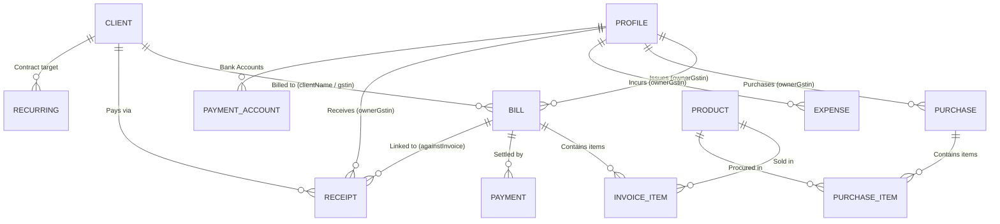

# ARTHA Database Architecture & Schema Specification

> **Storage Paradigm:** Offline-First Document Store (JSON on Local File System)  
> **Server Runtime:** Node.js Express REST API Engine (`server.js`)  
> **Data Root Path:** `d:\VEGA\ARTHA\data/`  
> **Security & Privacy:** 100% Private, Local-Only, Zero Cloud Tracking, Atomic File Locking  
> **Primary Collections:** Bills, Clients, Products, Purchases, Expenses, Receipts, Profiles, Templates, Recurring, Meta  

---

## 1. Executive Summary & Architecture Overview

ARTHA is engineered around an **offline-first, zero-dependency document store** architecture. Rather than relying on heavyweight relational database management systems (RDBMS) that require background services or complex drivers (such as MS Jet/Access, SQLite, or PostgreSQL), ARTHA structures its persistence as **structured, human-readable, schema-validated JSON files** partitioned into collection folders.

```
D:\VEGA\ARTHA\data\
  ├── bills\             <-- Sales Invoices, Estimates, Credit Notes, Delivery Challans
  ├── clients\           <-- Customer and Client Directory Masters
  ├── products\          <-- Item, Inventory, Service, and Price Masters
  ├── purchases\         <-- Supplier Bills & Input Tax Credit (ITC) Records
  ├── expenses\          <-- Operating Expenses & Overhead Vouchers
  ├── receipts\          <-- Payment Receipts & Inward Voucher Settlements
  ├── profiles\          <-- Multi-Business Enterprise Profiles
  ├── templates\         <-- Reusable Terms & Conditions Templates
  ├── recurring\         <-- Recurring Billing Contract Schedules
  ├── trash\             <-- Soft-Deleted Documents & Trashed PDFs
  ├── backups\           <-- Daily Incremental & Snapshot Archives (30-day retention)
  ├── meta.json          <-- Atomic Sequence Counters & Global System Flags
  ├── local-prefs.json   <-- UI State, Column Toggles, and Tax Calculator Inputs
  ├── profile.json       <-- Active Primary Business Profile
  └── port.txt           <-- Persisted Backend Network Port
```

### Core Design Tenets:
1. **Atomic File Writes:** Writes use atomic file writes or strict JSON serialization to ensure zero data corruption during unexpected system power cuts.
2. **Document Immutability & Snapshots:** When an invoice is created, it embeds complete snapshots of the seller (`profile`) and buyer (`client`), preserving tax numbers, addresses, and rates exactly as they existed at issue time.
3. **Cross-Platform & Backup Simplicity:** Because all data lives in `data/`, backing up ARTHA simply requires copying the `data/` folder or using the automated daily snapshot engine.
4. **Multi-Business Isolation:** Multi-company databases are unified within the same data store using `ownerGstin` and `ownerName` partition keys, preventing accidental data bleeding while keeping setup painless.

---

## 2. Entity-Relationship Model



---

## 3. Modular Schema Catalog

Detailed field-by-field specifications, types, constraints, and JSON samples are documented in dedicated modular guides:

| Module | Schema Documentation File | Description & Entities Covered |
| :---: | :--- | :--- |
| **01** | [01_BILLS_AND_INVOICES.md](file:///d:/VEGA/ARTHA/docs/artha_schemas/01_BILLS_AND_INVOICES.md) | Tax Invoices, Quotations, Proformas, Bill of Supply, Credit Notes, Challans, Payments array. |
| **02** | [02_CLIENTS_AND_CUSTOMERS.md](file:///d:/VEGA/ARTHA/docs/artha_schemas/02_CLIENTS_AND_CUSTOMERS.md) | Client master, GSTIN/PAN parsing, State codes, Billing & Shipping addresses, SEZ flags. |
| **03** | [03_PRODUCTS_AND_INVENTORY.md](file:///d:/VEGA/ARTHA/docs/artha_schemas/03_PRODUCTS_AND_INVENTORY.md) | Products, Services, HSN/SAC codes, UQC units, Prices, Tax slabs, Real-time stock. |
| **04** | [04_PURCHASES_AND_SUPPLIERS.md](file:///d:/VEGA/ARTHA/docs/artha_schemas/04_PURCHASES_AND_SUPPLIERS.md) | Supplier purchase bills, Input Tax Credit (ITC) tracking, GSTR-3B reconciliation, Payables. |
| **05** | [05_EXPENSES_AND_OVERHEADS.md](file:///d:/VEGA/ARTHA/docs/artha_schemas/05_EXPENSES_AND_OVERHEADS.md) | Operating overheads, Categories, Service ITC setoff, Payment modes, Vendor GSTINs. |
| **06** | [06_RECEIPTS_AND_PAYMENTS.md](file:///d:/VEGA/ARTHA/docs/artha_schemas/06_RECEIPTS_AND_PAYMENTS.md) | Payment receipts, Cheque/NEFT/UPI references, Inward settlement sync with invoice ledger. |
| **07** | [07_PROFILES_AND_TEMPLATES.md](file:///d:/VEGA/ARTHA/docs/artha_schemas/07_PROFILES_AND_TEMPLATES.md) | Business profiles, Bank accounts, Base64 logos/signatures, Terms templates, Recurring schedules. |
| **08** | [08_SYSTEM_META_AND_CONFIG.md](file:///d:/VEGA/ARTHA/docs/artha_schemas/08_SYSTEM_META_AND_CONFIG.md) | Atomic sequence counters, System flags, PIN lock, Local preferences, Backups, Trash bin. |

---

## 4. BusyWin to ARTHA Schema Mapping Reference

For teams migrating from legacy **BusyWin Accounting** (`C:\BusyWin`) to **ARTHA**, the table below explains how BusyWin's Jet 4.0 database tables translate into ARTHA's document collections:

| BusyWin Source Table | BusyWin Table Role | ARTHA Target Collection | Architectural Mapping Notes |
| :--- | :--- | :--- | :--- |
| **`Master1`** (`MasterType=1`) | Accounts / Debtors / Creditors | `data/clients/` | Client party master. Mapped with `Name`, `GSTIN`, `Address`, `StateCode`, `Phone`. |
| **`Master1`** (`MasterType=6`) | Items / Inventory Masters | `data/products/` | Product catalog. Mapped with `ItemName`, `HSN`, `Unit`, `SellingPrice`, `PurchasePrice`, `Stock`. |
| **`MasterAddressInfo`** | Master Party Addresses | `data/clients/` | Address, city, state, pin, and email are merged directly into the `client` document. |
| **`Tran1`** (`VchType=1, 9`) | Sales Invoices & Credit Notes | `data/bills/` | Header mapped to `bill` metadata (`invoiceNumber`, `invoiceDate`, `totalAmount`, `status`). |
| **`Tran2`** (`Item movement`) | Line Item Transaction Details | `data/bills/` -> `items[]` | Converted into embedded `data.items` array on the invoice document. |
| **`Tran2`** (`Account debit/credit`) | Ledger Posting Lines | `data/bills/` -> `totals` | Converted into statutory tax totals (`subtotal`, `cgst`, `sgst`, `igst`, `roundOff`). |
| **`Tran1`** (`VchType=2`) | Purchase Inward Bills | `data/purchases/` | Mapped to purchase documents with vendor name, supplier GSTIN, and taxable/tax totals. |
| **`Tran1`** (`VchType=5, 6`) | Payment & Receipt Vouchers | `data/receipts/` & `bills.payments` | Payment receipts mapped to `data/receipts/` and synchronized to invoice `payments` arrays. |
| **`Company`** | Enterprise Profile Master | `data/profiles/` & `profile.json` | Mapped to primary company profile (name, address, bank, PAN, GSTIN). |
| **`PrinterReps`** | Invoice Print Formats | `data/templates/` & `meta.json` | Print formatting, layout flags, and thermal options mapped to display options. |

---

## 5. Concurrency, Atomic Operations & Integrity Controls

### 1. Atomic Sequence Counters
Invoice numbers are generated atomically by the Node.js Express server using endpoint `POST /api/meta/:key/increment`.
- Eliminates race conditions where two concurrent browser windows generate the same invoice number.
- Supports "peek" mode (`GET /api/meta/:key`) to show previews on invoice form load without burning sequence numbers.

### 2. Overwrite Protection
Attempting to create an invoice with an already-existing `invoiceNumber` returns HTTP `409 Conflict` unless explicit `?overwrite=1` is provided (e.g. during an explicit edit session).

### 3. Automatic Daily Snapshotting
Before any destructive operation or at midnight:
1. ARTHA creates `data/backups/YYYY-MM-DD/`.
2. Copies all collections into the snapshot directory.
3. Automatically prunes snapshots older than 30 days.
4. Allows instantaneous rollback via `POST /api/backups/:date/restore`.

